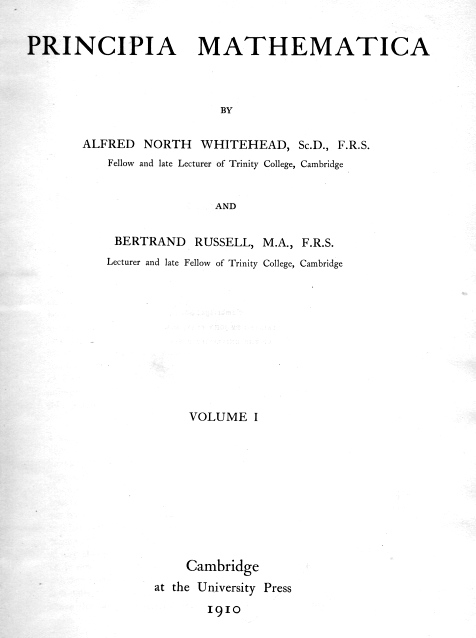
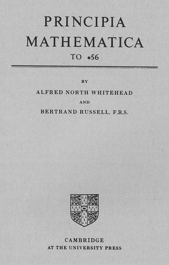

# *Principia Mathematica*
**First published Tue May 21, 1996; substantive revision Tue Mar 10, 2026**

*Linsky, Bernard, Irvine, Andrew David*

This entry briefly describes the history and significance of Alfred North Whitehead and Bertrand Russell’s monumental but little read classic of symbolic logic, *Principia Mathematica* (PM), first published in 1910–1913. The content of PM is described in a section-by-section synopsis, stated in modernized logical notation and described following the introductory notes from each of the three volumes. The original notation is presented in a companion article of this Encyclopedia, *The Notation of Principia Mathematica*. The content of PM is described so as to facilitate a comparison with Gottlob Frege’s *Basic Laws of Arithmetic*, which was subject to Russell’s Paradox. To avoid the paradox Whitehead and Russell introduced a complex system now called “the ramified theory of types”. After the introduction of a theory of sets or “classes” early in the first volume, however, the system of PM can be compared with both Frege and the early development of set theory and found to contain rival accounts, free of contradiction, but differing from the now standard theories in as yet understudied ways.

## 1. Overview

*Principia Mathematica*, the landmark work in formal logic written by Alfred North Whitehead and Bertrand Russell, was first published in three volumes in 1910, 1912 and 1913. A second edition appeared in 1925 (Volume I) and 1927 (Volumes II and III). In 1962 an abbreviated issue (containing only the first 56 chapters) appeared in paperback.

Written as a defense of *logicism* (the thesis that mathematics is in some significant sense reducible to logic), the book was instrumental in developing and popularizing modern mathematical logic. It also served as a major impetus for research in the foundations of mathematics throughout the twentieth century. Along with Aristotle’s *Organon* and Gottlob Frege’s *Basic Laws of Arithmetic*, it remains one of the most influential books on logic ever written.

This entry includes a presentation of the main definitions and theorems used in the development of the logicist project in PM. The entry indicates a path through the whole work presenting the basic results proved in a somewhat more contemporary notation, so as to make it easy to compare the system of Whitehead and Russell with that of Frege, the other most prominent advocate of logicism in the foundations of mathematics. The aim of that program, as described by Russell in the opening lines of the preface to his 1903 book *The Principles of Mathematics*, was to define mathematical notions in terms of logical notions, and to derive mathematical principles, so defined, from logical principles alone:

> The present work has two main objects. One of these, the proof that all pure mathematics deals exclusively with concepts definable in terms of a very small number of fundamental concepts, and that all its propositions are deducible from a very small number of fundamental logical principles, is undertaken in Parts II–VII of this work, and will be established by strict symbolic reasoning in Volume II.…The other object of this work, which occupies Part I, is the explanation of the fundamental concepts which mathematics accepts as indefinable. This is a purely philosophical task…. (1903: xv)

Though Frege’s system was subject to Russell’s Paradox, subsequent examination of his system shows how much of the development of arithmetic is possible independently of the paradoxical elements of the system. In particular, recent interest in Frege’s system has led to the isolation of what is called “Frege’s theorem” in a consistent fragment of Frege’s original system, and thus to the goal of deriving arithmetic, as formalized in Peano’s postulates. See the entry Frege’s theorem and foundations for arithmetic, which presents this aspect of Frege’s system in contemporary notation.

Russell had written *The Principles of Mathematics* (PoM), which presents the basic elements of his logicist program, before discovering Frege’s similar work in *Foundations of Arithmetic* and *Basic Laws of Arithmetic*, in June of 1902. As he describes in the Preface, Russell intended a formal presentation of his account in a “Volume II” of PoM. In 1903 he enlisted Alfred North Whitehead to join him in the writing of this second volume, but soon this turned into a new project, *Principia Mathematica*, a massive three-volume work, which was not to be published until 1910 (Volume I), 1912 (Volume II) and 1913 (Volume III).

The system of PM differed significantly from Frege’s system, in a large part because of the introduction of the *theory of types*, whose purpose was to avoid, in a principled fashion, the paradox that had affected Frege. A second important difference from Frege’s system is that PM is based on a logic of relations of various numbers of arguments, whereas Frege’s system was based on the notions of function and object, with even his distinctively logical *concepts* being seen as functions (from a number of objects to the truth values T and F, which are also objects in Frege’s system). So it might be said that PM is based on a theory of ramified types of relations, in contrast to Frege’s second-order predicate calculus with concepts. The most important step is to define set expressions in terms of higher-order functions. Thus the paradoxical “Russell set”, the set of all sets which are not members of themselves, $\{ x \mid x \notin x\}$, is defined by an expression involving functions that will violate the theory of types. The expression for the offending class is ruled out on the basis of the theory of types, as is its seeming innocuous complement, the set of all sets that *are* members of themselves, $\{ x \mid x \in x\}$. In contemporary set theory $\{ x \mid x \notin x\}$ is the universe of sets, which is not itself a set, and because no set is an element of itself, $\{ x \mid x \in x\}$ is just the empty set. An additional cost of this method is that while for Frege sets are objects of the lowest types, there will be sets in the PM theory in a *simple theory* of types, which distinguishes individuals and sets of individuals and sets of sets of individuals, etc. Even to derive a hierarchy of sets in the simple theory the *axiom of reducibility* is needed to guarantee that more complex “impredicative” definitions pick out sets of the same simple type. Thus the “least upper bound” of a closed interval of real numbers will identify a member of that set of a higher order in the ramified theory. That this least upper bound will be of the same simple type requires the axiom of reducibility. The cost of adopting the theory of types to avoid the paradox extends to difficulties in constructing the natural numbers. While Russell follows Frege in many important details, in particular in using Frege’s notion of the ancestral of the successor relation to define the natural numbers, other parts of the construction are importantly different. Frege was able to define the successor of a number by using the set of its predecessors. The number 2 is the set containing 0 and 1, and thus it has two members. They will, however, be of different types in the hierarchy of simple types, and so the whole set of natural numbers cannot be defined within the theory of simple types. Since each step from 0 to 1, to 2, etc., raises the simple types from 0 to 1 to 2, there will be no simple type of all the natural numbers, so defined. Instead PM adopts the *axiom of infinity* which assures the existence of an infinite number of individuals, allowing for the construction of the natural numbers for each type above a lower bound of 3 (as numbers will be sets of equinumerous sets of individuals…).

With this turn to the ramified theory of types, along with the extra axioms of reducibility and infinity, it is possible for PM to define a version of Frege’s construction of the natural numbers so that the “Peano axioms” can be proved from logic alone. This takes us up to section ∗120, well into Volume II. At this point the alternative to “Frege’s theorem” is completed, in the sense that we are presented with a consistent development of the natural numbers, based on a theory of higher-order logic with a number of additional axioms. Philosophers soon followed Ludwig Wittgenstein (1922) and disputed the idea that these additional axioms, the axioms of reducibility and infinity, are really logical truths, and so denied that the logicist program of reducing arithmetic to logic was any more successful than Frege’s attempt had been.

The survey of PM will proceed through the remainder of Volume II and through Volume III, where the theories of rational and real numbers are developed. The contrast intended here is not with Frege’s theories of rational and real numbers, which are present in *Grundgesetze* but are not seen as a natural extension of the theory of natural numbers. Instead the contemporary account of natural numbers and real numbers is seen as an elementary extension of the axiomatic Zermelo-Fraenkel set theory. A standard textbook in elementary axiomatic set theory, such as Enderton 1977 or Suppes 1960, shows how to construct rational numbers (and negative integers) as ordered pairs of natural numbers. Thus 3/4 is constructed as the ordered pair $\langle 3, 4 \rangle,$ and the operations of addition and multiplication on rational numbers are defined as operations on those pairs. The positive rational numbers are extended to the full set of rational numbers by adding pairs containing negative integers, and then real numbers are defined as Dedekind cuts in the rational numbers, i.e., the set of partitions of sets of rational numbers. The arithmetic of real numbers is then defined for these constructions, and so with sets of real numbers the whole of analysis can be reduced to arithmetic. PM, however, avoids this “arithmetization” of analysis, but instead defines rational numbers, real numbers, and in fact a huge class of “relation numbers” as sets of isomorphic sets of relations. Russell says later that he regrets that the theory of relation numbers was not picked up by later set theorists even though this was some of his most original work in PM. The brief summary of these later topics that we include below can therefore be seen as a summary of the interesting consequences of taking a different route to the definition of natural numbers based on a logic of relations and properties, rather than the set theory of contemporary foundations of mathematics. This entry is thus aimed at an explication of the unusual order of presentation of these results, in comparison with both Frege and contemporary set theory, and at illustrating these aspects of the theory of relations that are not investigated by contemporary researchers.

## 2. History of and Significance of *Principia Mathematica*

### 2.1 History of *Principia Mathematica*

Logicism is the view that (some or all of) mathematics can be reduced to (formal) logic. It is often explained as a two-part thesis. First, it consists of the claim that all mathematical truths can be translated into logical truths or, in other words, that the vocabulary of mathematics constitutes a proper subset of the vocabulary of logic. Second, it consists of the claim that all mathematical proofs can be recast as logical proofs or, in other words, that the theorems of mathematics constitute a proper subset of the theorems of logic. As Russell writes, it is the logicist’s goal “to show that all pure mathematics follows from purely logical premises and uses only concepts definable in logical terms” (1959: 74).

The logicist thesis appears to have been first advocated in the late seventeenth century by Gottfried Leibniz. Later, the idea was defended in much greater detail by Gottlob Frege. During the critical movement of the 1820s, mathematicians such as Bernard Bolzano, Niels Abel, Louis Cauchy, and Karl Weierstrass succeeded in eliminating much of the vagueness and many of the contradictions present in the mathematics of their day. By the mid- to late 1800s, William Hamilton had gone on to introduce ordered couples of reals as the first step in supplying a logical basis for the complex numbers, and Karl Weierstrass, Richard Dedekind, and Georg Cantor had all developed methods for founding the irrationals in terms of the rationals. Using work done by H.G. Grassmann and Richard Dedekind, Giuseppe Peano had then gone on to develop a theory of the rationals based on his now famous axioms for the natural numbers. By Frege’s day, it was thus generally recognized that large parts of mathematics could be derived from a relatively small set of primitive notions.

Even so, it was not until 1879, when Frege developed the necessary logical apparatus, that logicism could finally be said to have become technically plausible. After another five years’ work, Frege arrived at the definitions necessary for logicising arithmetic, and during the 1890s he worked on many of the essential derivations. However, with the discovery of paradoxes such as Russell’s paradox at the turn of the century, it appeared that additional resources would need to be developed if logicism were to succeed.

By 1902, both Whitehead and Russell had reached this same conclusion. Both men were in the initial stages of preparing second volumes to their earlier books on related topics: Whitehead’s 1898 *A Treatise on Universal Algebra* and Russell’s 1903 *The Principles of Mathematics.* Since their research overlapped considerably, they began collaborating on what would eventually become *Principia Mathematica*. By agreement, Russell worked primarily on the philosophical parts of the project, including the book’s philosophically rich Introduction, the theory of descriptions, and the no-class theory (in which set or class terms become meaningful only when placed in well-defined contexts), all of which can still be read fruitfully even by non-specialists. The two men then collaborated on the technical derivations. As Russell writes,

> As for the mathematical problems, Whitehead invented most of the notation, except in so far as it was taken over from Peano; I did most of the work concerned with series and Whitehead did most of the rest. But this only applies to first drafts. Every part was done three times over. When one of us had produced a first draft, he would send it to the other, who would usually modify it considerably. After which, the one who had made the first draft would put it into final form. There is hardly a line in all the three volumes which is not a joint product. (1959: 74)

Initially, it was thought that the project might take a year to complete. Unfortunately, after almost a decade of difficult work on the part of the two men, Cambridge University Press concluded that publishing *Principia Mathematica* would result in an estimated loss of 600 pounds. Although the press agreed to assume half this amount and the Royal Society agreed to donate another 200 pounds, this still left a 100-pound deficit. Only by each contributing 50 pounds were the authors able to see their work through to publication (Whitehead, Russell, & James 1910).

Publication involved the enormous job of typesetting all three volumes by hand. From January to May of 1911 the printing of the second volume was interrupted when Whitehead discovered a difficulty with the symbolism. The result was the insertion (on roman numeral pages) of a long “Prefatory Statement of Symbolic Conventions” at the beginning of Volume II.

The initial print run of 750 copies of Volume I and 500 copies of each of Volumes II and II from Cambridge University Press had been sold by 1922 when Rudolf Carnap wrote to Russell asking for a copy. Russell responded by sending Carnap a 35-page handwritten summary of the definitions and some important theorems in the work (Linsky 2011: 14–15)[^linsky-2011]. As no plates were available for a second printing, Russell began the work of preparing a second edition, which appeared in 1925–7. The first edition was reset along with a new introduction and three appendices, and Volume II was reset as well. Volume III was reproduced by a photographic process, and so the page numbers from the first edition are the same in this volume. *Principia Mathematica* is still in print.

As with many works in mathematics, the later progress of the field of symbolic logic led to numerous improvements. Work in the school of logic started by David Hilbert at Göttingen and in the Polish school of logicians led by S. Leśniewski and his most famous student, Alfred Tarski, began with correcting what they saw as defects and gaps in PM (see Kahle 2013 and Woleński 2013)[^kahle-2013][^woleński-2013]. The criticisms were immediate, begun by Chwistek (1912) soon after the first volume had been published. A series of important new presentations of mathematical logic, in particular Hilbert and Ackermann 1928, Hilbert and Bernays 1934, and Kleene 1952, were adopted as textbooks by successive generations of logicians. As pointed out in Urquhart 2013, this led to a slow decline in the number of references to PM in technical work in logic, as well as its gradual replacement by other texts for the Introduction to Symbolic Logic courses that soon became a staple offering of university departments of philosophy. By the 1950s PM was no longer used as a textbook, even in graduate courses. PM’s influence, then, was enormous from 1910 to 1950, with it now having the status of a recognized classic that is unfamiliar to students of logic, and even unreadable because of its superseded notation. This entry, together with the entry on the notation in *Principia Mathematica*, is intended to make the contributions of this monumental work available, and to enable further research on some of the ideas hidden in those three long volumes.

### 2.2 Significance of *Principia Mathematica*

Achieving *Principia’s* main goal proved to be a challenge. An initial response among mathematicians and logicians in Germany and Poland was to decry the decline in standards of formal rigor set by Frege. This complaint was voiced by Frege himself, in a letter to Philip Jourdain in 1912:

> …I do not understand the English language well enough to be able to say definitely that Russell’s theory (*Principia Mathematica I*, 54ff) agrees with my theory of functions of the first, second, etc. levels. It does seem so. But I do not understand all of it. It is not quite clear to me what Russell intends with his designation $\phi \bang \hat{x}$. I never know for sure whether he is speaking of a sign or of its content. (Frege 1980: 78)[^frege-1980]

This claim that the notion of “propositional function” is subject to use-mention confusions has persisted to this day. This entry will present a modernized version of the syntax of PM, combined with an account of the notation for types in the works of Alonzo Church (1974, 1976). Modern theories of types allow for a coherent syntax for higher-order languages which many find adequate to meet these objections. The complaint about the formulation of the syntax of PM was repeated and a further difficulty was expressed by Gödel (1944 [1951]) in his influential survey of PM:

> It is to be regretted that this first comprehensive and thorough-going presentation of a mathematical logic and the derivation of mathematics from it [is] so greatly lacking in formal precision in the foundations (contained in ∗1–∗21 of Principia) that it presents in this respect a considerable step backwards as compared with Frege. What is missing, above all, is a precise statement of the syntax of the formalism. Syntactical considerations are omitted even in cases where they are necessary for the cogency of the proofs, in particular in connection with the “incomplete symbols”. These are introduced not by explicit definition, but by rules describing how sentences containing them are to be translated into sentences not containing them. To be sure, however, that (or for what expressions) this translation is possible and uniquely determined and that (or to what extent) the rules of inference apply to the new kind of expressions, it is necessary to have a survey of all possible expressions, and this can be furnished only by syntactical considerations. (Gödel 1944 [1951: 126])[^gödel-1944]

The issue with respect to defined expressions, including the “incomplete symbols” for classes and definite descriptions which are explained below, is still problematic for interpreting PM. The difficulty is that certain defined expressions, such as the notation for definite descriptions, class abstracts and even the identity symbol ‘$=$’, are not specified in the initial description of the syntax of the theory, nor are they shown to be validly used as instances of the axioms with their apparent syntax. The method of “contextual definition” used in PM is difficult to formulate rigorously and is not used in contemporary logical theories. The modern presentation of PM in this entry includes the symbols for descriptions and classes, thus differing from the completely rigorous presentations of Church (1976), for example, who avoids both definite descriptions and class expressions, and takes identity as an undefined primitive.

Despite these concerns about the rigor of the presentation, PM nevertheless was studied carefully by those interested in the new symbolic logic, including David Hilbert and those in his school in Göttingen (see Ewald & Sieg 2013: 3; Chwistek 1912)[^chwistek-1912][^ewald-2013]. Primarily at issue were the kinds of assumptions Whitehead and Russell needed to complete their project. Although *Principia* succeeded in providing detailed derivations of many major theorems in finite and transfinite arithmetic, set theory, and elementary measure theory, three axioms in particular were arguably non-logical in character: the axiom of infinity, the axiom of reducibility, and the “multiplicative axiom” or axiom of choice. The axiom of infinity in effect states that there exists an infinite number of objects. Arguably it makes the kind of assumption generally thought to be empirical rather than logical in nature. The multiplicative axiom, later added to Zermelo’s axioms as the axiom of choice, asserts the existence of a certain set containing one element from each member of a given set. Russell worried that without a rule guiding the choice, the existence of such a set was not guaranteed by logic alone. (See the discussion in section 4.1.2 below.) The axiom of reducibility was introduced as a means of overcoming the not completely satisfactory effects of the theory of types, the mechanism Russell and Whitehead used to restrict the notion of a well-formed expression, thereby avoiding Russell’s paradox. Although technically feasible, many critics concluded that the axiom was simply too *ad hoc* to be justified philosophically. Initially at least, Leon Chwistek (1912) believed that it led to a contradiction. Akihiro Kanamori sums up the sentiment of many readers:

> In traumatic reaction to his paradox Russell had built a complex system of orders and types only to collapse it with his Axiom of Reducibility, a fearful symmetry imposed by an artful dodger. (Kanamori 2009: 411)[^kanamori-2009]

In the minds of many, the issue of whether mathematics could be reduced to logic, or whether it could be reduced only to set theory, thus remained open.

In response, Whitehead and Russell argued that both axioms were defensible on inductive grounds. As they tell us in the Introduction to the first volume of *Principia*,

> self-evidence is never more than a part of the reason for accepting an axiom, and is never indispensable. The reason for accepting an axiom, as for accepting any other proposition, is always largely inductive, namely that many propositions which are nearly indubitable can be deduced from it, and that no equally plausible way is known by which these propositions could be true if the axiom were false, and nothing which is probably false can be deduced from it. If the axiom is apparently self-evident, that only means, practically, that it is nearly indubitable; for things have been thought to be self-evident and have yet turned out to be false. And if the axiom itself is nearly indubitable, that merely adds to the inductive evidence derived from the fact that its consequences are nearly indubitable: it does not provide new evidence of a radically different kind. Infallibility is never attainable, and therefore some element of doubt should always attach to every axiom and to all its consequences. In formal logic, the element of doubt is less than in most sciences, but it is not absent, as appears from the fact that the paradoxes followed from premisses which were not previously known to require limitations. (1910: 62 [1925: 59])

Whitehead and Russell were also disappointed by the book’s largely indifferent reception on the part of many working mathematicians. As Russell writes,

> Both Whitehead and I were disappointed that *Principia Mathematica* was only viewed from a philosophical standpoint. People were interested in what was said about the contradictions and in the question whether ordinary mathematics had been validly deduced from purely logical premisses, but they were not interested in the mathematical techniques developed in the course of the work.…Even those who were working on exactly the same subjects did not think it worth while to find out what *Principia Mathematica* had to say on them. I will give two illustrations: *Mathematische Annalen* published about ten years after the publication of *Principia* a long article giving some of the results which (unknown to the author) we had worked out in Part IV of our book. This article fell into certain inaccuracies which we had avoided, but contained nothing valid which we had not already published. The author was obviously totally unaware that he had been anticipated. The second example occurred when I was a colleague of Reichenbach at the University of California. He told me that he had invented an extension of mathematical induction which he called ‘transfinite induction’. I told him that this subject was fully treated in the third volume of the *Principia*. When I saw him a week later, he told me that he had verified this. (1959: 86)

Despite such concerns, PM proved to be remarkably influential in at least three ways. First, it popularized modern mathematical logic to an extent undreamt of by its authors. By using a notation more accessible than that used by Frege, Whitehead and Russell managed to convey the remarkable expressive power of modern predicate logic in a way that previous writers had been unable to achieve. Second, by exhibiting so clearly the deductive power of the new logic, Whitehead and Russell were able to show how powerful the idea of a modern formal system could be, thus opening up new work in what soon was to be called metalogic. Third, *Principia Mathematica* reaffirmed clear connections between logic and two of the main branches of traditional philosophy, namely metaphysics and epistemology, thereby initiating new and interesting work in both of these areas.

As a result, not only did *Principia* introduce a wide range of philosophically rich notions (including propositional function, logical construction, and type theory), it also set the stage for the discovery of crucial metatheoretic results (including those of Kurt Gödel, Alonzo Church, Alan Turing and others). Just as importantly, it initiated a tradition of common technical work in fields as diverse as philosophy, mathematics, linguistics, economics and computer science.

Today a lack of agreement remains over the ultimate philosophical contribution of *Principia*. Some authors hold that, with the appropriate modifications, logicism remains a feasible project. Others hold that the philosophical and technical underpinnings of the project remain too weak or too confused to be of great use to the logicist. (For more detailed discussion, readers should consult Quine 1963, 1966a, 1966b; Landini 1998, 2011; Linsky 1999, 2011; Hale and Wright 2001; Burgess 2005; Hintikka 2009; and Gandon 2012.)[^burgess-2005][^gandon-2012][^hale-2001][^hintikka-2009][^landini-1998][^linsky-1999][^quine-1963]

There is also lack of agreement over the importance of the second edition of Volume I of the book, which appeared in 1925 (Volumes II and III were directly reprinted from the first edition in 1927). The revisions were done by Russell, although Whitehead was given the opportunity to advise. In addition to the correction of minor errors throughout the original text, changes to the new edition included a new Introduction and three new appendices. (The appendices discuss the theory of quantification, mathematical induction and the axiom of reducibility, and the principle of extensionality respectively.) The book itself was reset more compactly, making page references to the first edition obsolete. Russell continued to make corrections as late as 1949 for the 1950 printing, the year he and Whitehead’s widow finally began to receive royalties.

Today there is still debate over the ultimate value, or even the correct interpretation, of some of the revisions, revisions that were motivated in large part by the work of some of Russell’s brightest students, including Ludwig Wittgenstein and Frank Ramsey. Appendix B has been notoriously problematic. The appendix purports to show how mathematical induction can be justified without use of the axiom of reducibility; but as Alasdair Urquhart reports,

> The first indication that something was seriously wrong appeared in Gödel’s well known essay of 1944, “Russell’s Mathematical Logic”. There, Gödel points out that line (3) of the demonstration of Russell’s proposition ∗89·16 is an elementary logical blunder, while the crucial ∗89·12 also appears to be highly questionable. It still remained to be seen whether anything of Russell’s proof could be salvaged, in spite of the errors, but John Myhill provided strong evidence of a negative verdict by providing a model-theoretic proof in 1974 that no such proof as Russell’s can be given in the ramified theory of types without the axiom of reducibility. (Urquhart 2012)[^urquhart-2012]

Linsky (2011) provides a discussion, both of the Appendix itself and of the suggestion that by 1925 Russell may have been out of touch with recent developments in the quickly changing field of mathematical logic. He also addresses the suggestion, made by some commentators, that Whitehead may have been opposed to the revisions, or at least indifferent to them, concluding that both charges are likely without foundation. (Whitehead’s own comments, published in 1926 in *Mind*, shed little light on the issue.)

## 3. Contents of *Principia Mathematica*

*Principia Mathematica* originally appeared in three volumes.

[Title page of the first edition of *Principia Mathematica*, Volume I (1910)](principia-mathematica.pm1.md)

[Cover of the first paperback issue of *Principia Mathematica to ∗56* (1962)](principia-mathematica.pm2.md)

Together, the three volumes are divided into six parts. The commentary that follows will go through the sections in order, indicating in the early parts where a reader can skip ahead to study the unique features of the development of mathematics in the PM system as contrasted with that of Frege and contemporary set theory.

### 3.1 Volume I

Volume I comprises a lengthy Introduction in three sections, followed by two major Parts I (divided into Sections A–E) and II (also divided into Sections A–E). The system of ∗ numbers was designed so that theorems and definitions might be added or removed without requiring any change to other numbers. Apparently the original plan was to set aside numbers ∗1 to ∗10 for propositional logic and ∗10 to ∗15 for the theory of quantification. In the end, only ∗1 to ∗5 were needed for propositional logic, and ∗9 was added later to provide a new account of quantification later in the writing. (See Linsky 2016 and 2022.)[^linsky-2016][^linsky-2022]

- Preliminary Explanations of Ideas and Notations
- The Theory of Logical Types
- Incomplete Symbols
- Part I: Mathematical Logic
- A. The Theory of Deduction ∗1–∗5
- B. Theory of Apparent Variables ∗9–∗14
- C. Classes and Relations ∗20–∗25
- D. Logic of Relations ∗30–∗38
- E. Products and Sums of Classes ∗40–∗43
- Part II: Prolegomena to Cardinal Arithmetic
- A. Unit Classes and Couples ∗50–∗56
- B. Sub-Classes, Sub-Relations, and Relative Types ∗60–∗65
- C. One-Many, Many-One and One-One Relations ∗70–∗74
- D. Selections ∗80–∗88
- E. Inductive Relations ∗90–∗97

### 3.2 Volume II

Volume II begins with a preliminary section on notational conventions followed by Parts III (divided into Sections A–C), IV (divided into Sections A–D), and the first half of Part V (Sections A–C):

- Prefatory Statement of Symbolic Conventions
- Part III: Cardinal Arithmetic
- A. Definition and Logical Properties of Cardinal Numbers ∗100–∗106
- B. Addition, Multiplication and Exponentiation ∗110–∗117
- C. Finite and Infinite ∗118–∗126
- Part IV: Relation-Arithmetic
- A. Ordinal Similarity and Relation-Numbers ∗150–∗155
- B. Addition of Relations, and the Product of Two Relations ∗160–∗166
- C. The Principle of First Differences, and the Multiplication and Exponentiation of Relations ∗170–∗177
- D. Arithmetic of Relation-Numbers∗180–∗186
- Part V: Series
- A. General Theory of Series ∗200–∗208
- B. On Sections, Segments, Stretches, and Derivatives ∗210–∗217
- C. On Convergence, and the Limits of Functions ∗230–∗234

### 3.3 Volume III

Volume III contains the remainder of Part V (Sections D–F) and concludes with Part VI (divided into Sections A–D):

- Part V: Series (continued)
- D. Well-Ordered Series ∗250–∗259
- E. Finite and Infinite Series and Ordinals ∗260–∗265
- F. Compact Series, Rational Series, and Continuous Series ∗270–∗276
- Part VI: Quantity
- A. Generalization of Number ∗300–∗314
- B. Vector-Families ∗330–∗337
- C. Measurement ∗350–∗359
- D. Cyclic Families ∗370–∗375

A fourth volume on geometry was begun but never completed (Russell 1959: 99)[^russell-1959].

Overall, the three volumes not only represent a major leap forward with regard to modern logic, they are also rich in early twentieth-century mathematical developments. To give one example, Whitehead and Russell were the first to define a series as a set of terms having the properties of being asymmetrical, transitive and connected (1912 [1927: 497]). To give another, it is in *Principia* that we find the first detailed development of a generalized version of Cantor’s transfinite ordinals, which the authors call “relation numbers”. The resulting “relation-arithmetic” in turn led to significant improvements in our understanding of the general notion of structure (1912: Part IV).

As T.S. Eliot points out, the book also did a great deal to promote clarity in the use of ordinary language in the early part of the twentieth century:

> how much the work of logicians has done to make of English a language in which it is possible to think clearly and exactly on any subject. The *Principia Mathematica* are perhaps a greater contribution to our language than they are to mathematics. (1927: 291)

The book is also not without some self-deprecating humour. As Blackwell points out (2011: 158, 160), the authors twice poke fun at the length and tedium of the project’s many logical derivations. In Volume I, the authors explain that one cannot list all the non-intensional functions of $\phi \bang \hat{z}$ “because life is too short” (1910 [1925: 73]); and in Volume 3, after over 1,800 pages of dense symbolism, the authors end Part IV, Section D, on Cyclic Families, with the comment,

> We have given proofs rather shortly in this Section, particularly in the case of purely arithmetical lemmas, of which the proofs are perfectly straightforward, but tedious if written out at length. (1913 [1927: 461])

Evidence that the humour originates more with Russell than with Whitehead is perhaps found in not dissimilar remarks that appear in Russell’s other writings. Russell’s comment when discussing the axiom of choice, to the effect that given a collection of sets, it is possible to “pick out a representative arbitrarily from each of them, as is done in a General Election” (1959: 92), is perhaps a case in point.

Readers today (i.e., those who have learned logic in the last few decades of the twentieth century or later) will find the book’s notation somewhat antiquated. Readers wanting assistance are advised to consult the entry on the notation in *Principia Mathematica*. Even so, the book remains one of the great scientific documents of the twentieth century.

## 4. Volume I

### 4.1 Part I: Mathematical Logic

#### 4.1.1 Propositional Logic in PM

The system of *propositional logic* of PM can be seen as a system of *sentential logic* consisting of a language and rules of inference. PM contains the first presentation of symbolic logic that deals with propositional logic as a separate theory. Frege had involved quantification from the beginning, while Peano’s system was interpretable as about propositions and classes with some different principles holding for each interpretation. The propositional logic of PM is unusual for modern readers, for various reasons having to do with its origins in Russell’s earlier work on logic. One is that the axioms of propositional logic are not stated using only the primitive connectives of the logic, which are $\lnot$ and $\lor$, but instead only use $\lor$, and $\supset$ which is a defined connective.

In this section we will use *A*, *B*, etc. as meta-linguistic variables for formulas. The formulas constructed from atomic propositions with the connectives are said to express *elementary propositions* to distinguish them from propositions involving quantifiers and propositional functions. The system is organized axiomatically; the axioms, called “primitive propositions” or “Pp”, are presented with the characteristic ‘$\supset$’ of material implication, which is defined with $\lnot$ and $\lor$. The connectives $\amp$ and $\equiv$ are also defined, but not needed in the statements of the axioms. This peculiarity has its origins in Russell’s view from 1903 that

> The propositional calculus is characterized by the fact that all its propositions have as hypothesis and as consequent the assertion of a material implication. (1903: 13)

All of the “primitive propositions” of *The Principles of Mathematics* are stated with only material implication as a primitive connective. The connectives $\amp$,$\lor$ and $\equiv$ are defined as might be expected. The notion of negation, expressed by $\lnot$, is defined using a notion of quantification over propositions ( $\lnot A$ means that *A* implies all propositions). By 1906 Russell had decided to use $\lnot$ as a primitive connective, and no longer used propositional quantifiers, allowing $\supset$ to be defined, while the primitive propositions were still stated with $\supset$ and $\lor$. That the system of propositional logic in PM was the result of an evolution of changes in choices of primitives is mirrored in the choice of theorems that are proved in the first chapters. While most are proved because they will be used later in PM, some remain simply as remants of the earlier systems. In particular PM contains several theorems that were primitive propositions in earlier systems, though not used in what follows. In fact one primitive proposition of PoM, known as “Peirce’s law” ($[(p \supset q )\supset p ] \supset p$) appears to have been proved in an early version of PM as ∗2·7 but simply deleted (and its number not reassigned to another theorem) simply to save space (see Linsky 2016)[^linsky-2016].

The notion of truth-functional *semantics* for propositional logic, using the familiar truth tables, and the notion of *completeness* of an axiom system, were not developed until soon after the publication of PM by Bernays (1926). As a result there is no attempt to find a short list of axioms that will be complete, and so at later stages of the work there is no simple appeal to “tautological consequences” which might be easily justified by semantic considerations.

The language of propositional logic in PM consists of a vocabulary comprising:

- Atomic proposition variables: *p*, *q*, *r*, $p_1$, … (There are no proposition constants.)
- Sentential connectives. Primitive: $\lnot$ and $\lor$. Defined: $\supset$, $\amp$, $\equiv$.
- Punctuation: $($, $)$, $[$, $]$, $\{$, $\}$, etc.

The well formed formulas (*wffs*) are defined as follows:

- Atomic proposition variables are *wffs*.
- If *A* and *B* are *wffs* then so are: $\lnot A$ and $A \lor B$

The other familiar connectives are defined:

- Definitions $$\begin{align} \tag*{∗1·01} {A \supset B} & \eqdf \lnot {A \lor B}\\ \tag*{∗3·01} {A \amp B} & \eqdf {\lnot(\lnot A \lor \lnot B})\\ \tag*{∗4·01}({A \equiv B} & \eqdf {(A \supset B) \amp (B \supset A)}\\ \end{align} $$
- Axioms $$\begin{align} \tag*{Pp ∗1·2} (p \lor p ) & \supset p\\ \tag*{Pp ∗1·3} q & \supset (p \lor q )\\ \tag*{Pp ∗1·4} (p \lor q ) & \supset (q \lor p)\\ \tag*{Pp ∗1·5} [p \lor ( q \lor r )] & \supset [q \lor ( p \lor r )]\\ \tag*{Pp ∗1·6} ( q \supset r ) & \supset [ (p \lor q ) \supset (p \lor r ) ]\\ \end{align}$$

In 1926 Paul Bernays showed that this could be reduced by one, as axiom 4 (∗1·5) can be proved from the others.

- Rules of inference:
- *Modus ponens* (∗1·1): From $\vdash A \supset B$ and $\vdash A$, derive $\vdash B$
- *Substitution*: From $\vdash A$ derive $\vdash A'$ where $A'$ is the result of substituting some formula $B$ uniformly for any atomic proposition variable that occurs in $A$.

The informal statement of a rule of substitution, stated at (PM 98), is easily seen to be a *derived rule*, in that any proof of the formula $A$ can be turned into a proof of $A'$ by making appropriate substitutions of the axioms and repeating all of the proofs leading up to $A$ with those replacements made. However, this sort of meta-theorem is not discussed in PM, where tacitly throughout instances of earlier theorems and definitional equivalents are used in proofs without remark.

In this article sentence letters $p$, $q$, and $r$, are to be interpreted as real variables ranging over propositions, in which case instances would be derived by instantiation from generalizations over all propositions. The announcement in the Introduction, that “after the early part of the work, variable propositions and variable functions will hardly ever occur” (PM 5) and that “the use of propositions as apparent variables requires an apparatus not required elsewhere, …” ($\ast 14 \cdot 3$), thus presumably up to the introduction of classes and relations in extension at $\ast 20$, is not a rejection of all mention of propositions in PM. Rather, theorems with bound propositional variables are to be avoided. We treat the axioms as containing real (free) variables over propositions. For example, consider an instance of a principle, say Taut $\ast 1\cdot 2 \vdash : p \lor p \supset p$. Then where $\lnot p$ “is written in place of $p$, giving $\lnot p \lor \lnot p \supset \lnot p$”, the instance of the axiom comes from first a generalization over $p$ and then instantiation to another propositional term, $\lnot p$ (PM 98). This is form in which the rule of substitution appears.

In our notation we follow PM and use $p$ and $q$ rather than schematic letters $A$, $B$, etc. The rule of substitution thus is derived from the tacit use of universal instantiation for propositions. This interpretation of the letters as variables will also assist in the presentation of quantificational logic in PM below. (For a comparison with other systems of propositional logic, however, it is possible to treat the letters $p$ and $q$ as schematic letters.)

As is standard for an axiomatic formulation of logic, a *derivation* of a formula of sentential logic in PM will consist of an instance of one of the six axioms, the result of an instance of a previous theorem, or the application of modus ponens to two preceding lines.

The resulting system is complete, in the sense that all and only truth-functionally valid sentences are derivable in the system. This is so despite the seeming defects of the system by modern standards, including the redundancy of one of the axioms, the use of defined symbols in expressions to which the rules of inference apply, and the use of defined symbols in the axioms. The derivations in ∗2 to ∗5 are abbreviated, but with an indication on the side of each line of what justifies it, and how any abbreviation can be undone. Theorems are proved primarily as needed in later numbers, but some were axioms, or important theorems of earlier versions of propositional logic, going back to *The Principles of Mathematics*. Aside from historical interest in their actual choices, however, the system of PM can be viewed as based on any standard system of propositional logic.

#### 4.1.2 The “Ramified” Theory of Types and Propositional Functions

The theory of types in the initial chapters of PM is *ramified*, so that within a given type, of propositions, or of functions of individuals, and functions of functions of individuals, there will be finer subdivisions. This ramification is necessary for the application of the logic of PM to what what are called “epistemological” paradoxes in the Introduction to PM. The most prominent of these is the (propositional) Liar paradox created by the proposition that all propositions of a certain sort, say asserted by Epimenides, are false, when that very proposition is of that sort, that is the only proposition that Epimenides asserted. The solution in the ramified theory of types requires that a proposition about a sort of first-level proposition, say that they are all false, will itself be of the next order.

The paradoxes of the theory of sets are resolved by reducing assertions about sets to assertions about propositional functions. The restriction that a function of one type cannot apply to a function of the same type is enough to block these paradoxes. Thus the distinction between individuals, functions of individuals, and functions of such functions, categorized by what came to be called the “simple theory of types”, is enough for the purposes of reducing mathematics to classes, and so to logic. The idea that the full theory of types was not needed to resolve the mathematical or set-theoretical paradoxes was proposed by Chwistek in Polish in 1921 (English translation: Chwistek 1921 [1967]; English papers are Chwistek 1925 and Ramsey 1925)[^chwistek-1921][^chwistek-1925][^ramsey-1925]. Use of the term “ramified theory of types” for the original system of PM followed soon after, and is followed in this entry.

It is interesting to note that while Ramsey is generally credited with introducing the distinction between ramified and simple type theories, both the idea and the term “simple theory of types” were anticipated by Leon Chwistek. Chwistek used the expression in his Polish paper of 1921, which was only available in English translation as 1967. He says, in that translation: “To eliminate this antinomy [a reconstruction of Richard’s paradox using the axiom of reducibility] it is sufficient to accept the simple theory of types, which distinguishes individuals, functions of individuals, functions of these functions, and so on” (Chwistek 1921 [1967: 342–343])[^chwistek-1921]. The earliest statement of the view in English is: “… with propositional functions whose arguments take functions of the 1st type as possible values, i.e. propositional functions of the 2nd type, and so on. Such a simple hierarchy of types would be, as a matter of fact, sufficient to build up a self-consistent system of Symbolic Logic” (Chwistek 1925: 12)[^chwistek-1925]. Chwistek’s paper was included in the list of “the more important contributions to mathematical logic since the publication of the first edition” in the Introduction to the second edition of PM. Ramsey had checked the list, and even suggested additions, when he read a draft of the new material for the second edition. It is apparent that Ramsey had not read Chwistek 1925, however, as it was not “available” in Cambridge, according to Ramsey (see Linsky 2011: 34)[^linsky-2011].

Ramsey introduces the distinction by pointing out that the paradoxes fall into two sorts:

> … the paradoxes listed in *Principia Mathematica* fall into two fundamentally distinct groups which we will call A and B …

> … Group A consists of contradictions which, were no provision made against them, would occur in a logical or mathematical system itself. They involve only logical or mathematical terms such as class and number, and show that there must be something wrong with our logic or mathematics. But the contradictions of Group B are not purely logical, and cannot be stated in logical terms alone; for they all contain reference to thought, language, or symbolism, which are not formal but empirical terms.

> This view of the second group of contradictions is not original. For instance Peano decided that “Exemplo de Richard non pertine ad Mathematica, sed ad linguistica” and therefore dismissed it. But such an attitude is not completely satisfactory. We have contradictions involving both mathematical and linguistic ideas; the mathematician dismisses them by saying that the fault must lie in the linguistic elements, but the linguistician may equally well dismiss them for the opposite reason, and the contradictions will never be solved. The only solution that has ever been given, that in *Principia Mathematica*, definitely attributed the contradictions to bad logic, and it is up to the opponents of this view to show clearly the fault in what Peano called linguistics, but what I should prefer to call epistemology, to which these contradictions are due. (Ramsey 1925 [1931: 20–21])[^ramsey-1925]

Group A paradoxes can be resolved in the simple theory of types, but those involving thought, language and symbolism, or meaning, are set aside as perhaps empirical and not logical problems.

Alonzo Church accepted the distinction in his (1932) review of Ramsey’s article, and himself used the simple theory of types in his early papers. Readers will note, however, that Church continued with his study of the notions Ramsey calls “linguistic” (semantic), such as the notions of meaning and belief, now called “intensional”. This interest resulted, years later, in Church 1976, a precise formal presentation of the ramified theory of types and a comparison with Tarski’s treatment of the semantic paradoxes.

Although PM does not single out first-order logic from the whole ramified theory of types, the actual deductive apparatus on the page looks exactly like a system of first-order logic, and the complications of the logic of higher types can be expressed with an additional apparatus of type indices. In what follows we will use the system of *r-types* in Church 1976 for type indices, and the use of λ-*operators* for propositional functions.

In the Introduction to PM, terminology is introduced for the two ways that variables may appear in formulas. The “apparent variables” are *bound variables*, whereas “real variables” are *free variables*. The proper interpretation of higher-order variables in PM is the subject of contemporary dispute among scholars of PM. Landini (1998) and Linsky (1999) offer two rival accounts. Landini holds that higher-order free variables should be interpreted as schematic letters, replaceable by formulas, and that the bound variables are to be interpreted “substitutionally”.

The disagreement is not over whether a substitutional interpretation is possible, but whether it was the *intended interpretation* of Whitehead and Russell. It is clear that PM contains passages siding in both ways, and any claim about “the” interpretation of PM must be seen as to some extent a proposal about how to reconstruct a coherent position that fits with the majority of the passages. See Fitch 1938 and 1974 for a substitutional accounts of systems related to the ramified theory of types of PM. Klement 2010 argues that Russell held such a substitutional account of propositional functions as his intended interpretation continuously after their introduction in Russell 1903, through both editions of PM.

In this entry we follow Church’s realist interpretation of the notion of “propositional function” that Ramsey proposed. Russell’s remarks seem to be inconsistent with this reading in some places, and we see them as indicating some vacillation over the interpretation that is behind the technical presentation after the informal Introduction (and prefatory remarks to some later sections such as the chapter on the axiom of reducibility).

Ramsey saw himself as arguing for a broader conception of propositional functions than seems to be presented in PM, where there seems to be a restriction to those that can be defined or expressed in a language. They are called “functions in extension”:

> The possibility of indefinable classes and relations in extension is an essential part of the extensional attitude of modern mathematics which we emphasized in Chapter I, and that it is neglected in *Principia Mathematica* is the first of three great defects in that work. (Ramsey 1925 [1931: 23])[^ramsey-1925]

Ramsey proposes a notion of propositional functions in extension, so that:

> Thus $\phi$ (Socrates) may be Queen Anne is dead, $\phi$(Plato) may be Einstein is a great man; $\phi$ being simply an arbitrary association of propositions $\phi$ to individuals $x$. (Ramsey 1925 [1931: 52])[^ramsey-1925].

A function such as Ramsey’s $\phi$ can be indefinable in general (what is the value of $\phi$ for Aristotle, or any other individual?). It seems as though we must rely on our intuitions about the infinity of indefinable functions, working backwards from our intuitions about the sets that are their extensions, as set theory relies on the existence of sets far beyond those that are definable in some arbitrary language. This is certainly suggested by Ramsey in his example of the function $ \phi $ above.

In his *Introduction to Mathematical Philosophy*, Russell expresses his qualms about the multiplicative axiom with his well-known example of the millionaire who has an $ \aleph_0 $ infinity of boots and of socks:

> The product of these classes will pair boots and socks. He says among boots, we can distinguish between right and left and therefore we can make a selection of one out of each pair, namely, we choose all the right boots or all the left boots; but with socks no such principle of selection suggests itself, and we cannot be sure, unless we assume the multiplicative axiom, that there is any class consisting of one sock out of each pair. Hence the problem. (Russell 1919: 126)[^russell-1919]

Those who accepted Ramsey’s broader notion of “function in extension”, would find the axiom of choice to be true, even though in many cases, the “choice function” that it guarantees to exist will be indefinable, as for the case of the millionaire’s socks. It was thought that surely a choice set existed, and the axiom of choice was added to Zermelo-Fraenkel (ZF) set theory to produce the now standard ZFC. This was long before it was shown to be independent of the rest of Zermelo-Fraenkel set theory by Cohen in 1963 (see Fraenkel, Bar-Hillel and Levy 1973: 58–81).

Church seems to see Ramsey’s “propositional functions in extension” as in fact the position that was accepted in PM, despite Russell’s own later qualms:

> Of course, there may be such things as indefinable classes, and if $\alpha $ is an indefinable class there is no definable propositional function which determines $\alpha$. But this, as we understand it, is not denied by the authors of *Principia Mathematica.* (Church 2019: 49)[^church-2019]

Thus, in this entry we follow Church’s realistic interpretation of propositional functions, allowing for a propositional function to have an arbitrary set as its extension, as well as to see hierarchy of functions as represented by the ramified theory of types.

The logic of the theory of types in PM can be seen as an extension of a theory of a standard first-order logic developed in ∗10. Then the more distinctive notions of PM that depend on the theory of types can be explained. These include the axiom of reducibility in ∗12, which underlies the so called *ramification* of the theory of types, the division into *orders* of predicates true of a single type of argument. The axiom of reducibility asserts that for an arbitrary function of any order there is an equivalent *predicative* function, that is, one true of exactly the same range of arguments. This will be explained below. Identity is defined, in ∗13, with a version of Leibniz’s notion of the identity of indiscernibles that is consistent with the theory of types. Replacing Leibniz’s notion that *x* and *y* are identical just in case they share the same properties, in PM *x* and *y* are identical if and only if they share the same predicative functions. Then using the notion of identity so defined, PM presents Russell’s theory of definite descriptions, precisely as it was defined in “On Denoting” (1905). This article will use the notation for “*r*-types” due to Church (1976), which is explained below, and in the accompanying article “The Notation of *Principia Mathematica*” in this Encyclopedia.

Ramsey’s introduction of the simple theory of types was immediately influential, beginning with his correspondence in 1928 with Adolf (Abraham) Fraenkel who was then preparing the third edition of his *Einleitung in die Mengenlehre* (Introduction to Set Theory). Fraenkel included a discussion of the semantic and set-theoretic paradoxes, giving the now standard name “verzweigten Typentheorie” to the ramified theory of types (Fraenkel 1928: 258)[^fraenkel-1928]. Fraenkel appears to have thought that if all possible sets are included as the extensions of first-order functions, the axiom of reducibility will surely be true, and need not be explicitly added as an axiomatic assumption. Rudolf Carnap’s 1929 textbook limits itself to the simple theory of types, citing Ramsey’s “Foundations of Mathematics” (Carnap 1929: 21)[^carnap-1929]. Ramsey thus directly influenced the widespread attention to the simple theory of types in Germany and the Vienna Circle.

Church’s (1976) formulation of the logic of PM with *r-types*. The language of the higher-order quantificational logic of PM is called *ramified type theory*, and the system of types, following Church, will be called *r*-types. Note that there are two kinds of variables, but they are all assigned to an r-type. Individual variables behave as a special case of propositional function variables.

- (argument) variables: $x_{\mathbf{\tau}}$, $y_{\mathbf{\tau}}$, $z_{\mathbf{\tau}}$, …for each type $\tau$
- *n*-place propositional function variables: $\phi_{\tau}^{n}, \psi_{\tau}^{n}$, …($n \geq 1$), where $\tau$ is a type symbol. ($R^n,S^n, \ldots$ ($n \geq 1$) for *relations in extension*.) $\chi$ is used for a higher-order function of functions, as in $\chi (\phi)$, and $\Phi$ for the next order, as in $\Phi (\chi)$
- connectives: $\lnot$, $\lor$
- punctuation: $($, $)$, $[$, $]$, $\{$, $\}$, etc.
- the quantifier symbols: $\forall$ and $\exists$
- the lambda symbol: $\lambda$

The system of symbols for *r*-types and the assignment of *r*-types to variables for different entities (individuals and functions) is as follows:

- $\iota$ is the *r*-type for an *individual*.
- Where $\tau_1 , \ldots, \tau_m$ are any *r*-types, then $(\tau_1 , \ldots, \tau_m) / n$ is the *r*-type of a propositional function of *level n*; this is the *r*-type of any *m*-ary propositional function of *level* *n*, which has arguments of *r*-types $\tau_1 , \ldots, \tau_m$, respectively.

The *order* of an entity is defined as follows:

- the *order* of an individual (of *r*-type $\iota$) is 0
- the *order* of a function of *r*-type $ (\tau_1, \ldots, \tau_m ) / n $ is $n+N$ where *N* is the greatest of the orders of the arguments $\tau_1 \ldots, \tau_m$

There are no predicate or individual names in this language. There are, however complex terms for propositional functions, defined together with formulas (with the usual notion of bound and free variables):

Let the expressions $\phi_{\tau}$ be variables ranging over propositional functions of type $\tau$. We read $x_{\tau}$ as a metalinguistic variable ranging over variables of *r*-type $\tau$. The subscript $\tau$ will be indicated only with the initial quantifier which governs the variable.

We then can define the *well formed formulas* (wffs) and *terms* of quantificational logic as follows:

- Variables (for individuals and propositional functions) are terms.
- If $\phi_{\tau}^{n}$ is an *n*-place propositional function variable of *r*-type $(\tau_1 \ldots, \tau_n) /k$ and $x_{i} $ for $ ( 0 \leq i \leq n ) $ are terms of of *r*-types $\tau_1 \ldots, \tau_n$, respectively, then $\phi (x_1, \ldots x_n)$ is a *wff*. (The variables $x_n$ are called “argument” variables. They will include *individual variables* of *r*-type $\iota$, but also variables of higher types. The variable $\phi$ can occur as a predicate in $\phi(x)$ and as an argument in $\Psi (\phi)$, and cannot be of type $\iota$ to occur in a *wff*.)
- If *x* is a variable of type $ \tau $ and *A* is a *wff* then $\lambda x A$ is a *term* of *r*-type $(\tau)/n$ (where *n* is one more than the highest order of any bound variable in *A* and at least as high as the order of any free variable in *A*).
- If *x* is an individual variable of type $\tau$ and *A* is a wff in which *x* occurs $free$ then $\forall x A$ and $\exists x A$ are wffs.
- If *A* and *B* are wffs, then so are $\lnot A$, $A \amp B$, $A \lor B$, $A \supset B$, and $A \equiv B$. The conventional precedence ordering of connectives will allow for fewer punctuation signs to indicate scope of connectives, thus $A \lor B \supset C$ is read as $( A \lor B) \supset C$

The comprehension principle for a system of higher-order logic, or set theory, states which formulas express a property or set. Within a type theory this allows for what looks like an “unrestricted” comprehension principle, in that for every well formed expression *A* with a free variable, *x*, there is a property which is satisfied by precisely the entities satisfying the formula. It is the restrictions of types that block the paradoxes, as the problematic formulas “is not a member of itself” and “does not apply to itself” are ruled out by the system of types. The comprehension principle then is characterized by an infinite set of sentences of the form of:

Comprehension:

$$\exists \phi \forall x_{\tau} [ \phi (x) \equiv A], \quad (\phi \textrm{ not free in } A)$$

where $\phi$ is a functional variable of *r*-type $(\tau)/n$ and *x* is a variable of *r*-type $\tau$, and the bound variables of *A* are all of order less than the order of $\phi$ and the free variables of *A* are all of order not greater than the order of $\phi$.

As presented here Church’s seemingly straightforward comprehension principle, with its restrictions on the types of variables, is for Quine a glaring manifestation of the confusion of use and mention of language that he sees infecting PM:

> …there is a characteristic give and take between sign and object: the propositional function gets its order from the abstractive expression, and the order of the variable is the order of the values. Exposition is eased by allowing the word ‘order’ a double sense, attributing orders at once to the notations and, in parallel, to their objects. (Quine 1963: 245)[^quine-1963]

The offense comes from attributing orders (*r*-types) to propositional functions on the basis of the variables with which they are defined, but also to the functions themselves, as simply values of bound higher-order variables. In response, the defender of type theory must say that any semantic intrepretation of the notion of propositional function will have to attribute to functions these distinctions that are marked in linguistic expressions of some of them, and in particular, the variables involved in their definition.

What follows in PM up to ∗12 is a presentation of quantificational logic in the ramified theory of types. The complications are due to the decision of the authors (surely on Russell’s insistence) to add a new section ∗9 which allows the earlier theory of propositional logic to be incorporated directly into a quantificational logic as is done in contemporary logic. This shows the extent to which the earlier theory is indeed a theory of *propositions*, not an account of a fragment of quantificational logic allowing open sentences containing free variables.

Quantificational Logic in PM

Section ∗10 formulates quantificational logic as it is currently formulated, i.e. the axioms and theorems of propositional logic are assumed to hold for all formulas, and not just the elementary propositions of ∗1–5. It appears that Russell became concerned about this assumption, and so a new section ∗9 was introduced to derive the principles of quantification theory from elementary propositions alone. While of interest to scholars of PM, the upshot is the same for later uses of quantificational logic in PM.

Again, the reader interested in what distinguishes the logicist project in PM can skip this section, although passing attention may be paid to the system of higher-order logic that is used, as based here on the *ramified theory of types*.

The extension to functions of more than one variable is obvious, and below, some applications will employ this extension.

The existential quantifier and the other familiar connectives $\supset$, $\amp$ and $\equiv$ are defined as for propositional logic (in what follows *A* is now an arbitrary (possibly quantificational) formula):

$$ \tag*{∗10·01} \exists x A \eqdf \lnot \forall x \lnot A $$

- Axioms of ∗10: All instances of propositional theorems where wffs are uniformly substituted for propositional variables.

The system of PM uses a rule of universal generalization and an axiom which amounts to a rule of instantiation.

$$ \tag*{∗10·1} \vdash \forall x_{\tau} A \supset A' $$

where $A'$ is like *A* except for having a term *y* of type $\tau$ substituted for $x_{\tau}$ in *A*.

(Note: The notion of suitable “substitution” is much more complicated for logic of higher types than it is for first-order logic. In part this is because of the application to an argument of lambda expressions for a propositional function, e.g., $[\lambda x \phi (x)] (\nu)$ where $\nu$ may be a complex term involving variables and quantifiers in other lambda expressions.)

$$ \tag*{∗10·11} \textrm{If } \vdash A \textrm{ then } \vdash \forall x_{\tau} A' $$

where $A'$ is like *A* except for having a term *y* of type $\tau$ substituted for *x* in *A.*

Other quantifier principles, which govern the move of a quantifier from the inside of a formula to governing the entire formula, so-called “quantifier containment principles”, are also derived as theorems in ∗10. Some that are often used in later numbers are:

$$ \begin{align} \tag*{∗10·12} \forall x_{\tau} ( A \lor \phi (x ) ) & \supset (A \lor \forall x_{\tau} \phi (x ))\\ \tag*{∗10·21} \forall x_{\tau} [ A \supset \phi (x ) ] & \equiv [A \supset \forall x_{\tau} \phi (x)]\\ \end{align}$$

The introduction to ∗10 in PM begins with:

> The chief purpose of the propositions of this number [∗10] is to extend to formal implications (*i.e.* to propositions of the form $\forall x (\phi x \supset \psi x)$ as many as possible of the propositions proved previously for material implications, *i.e.* for propositions of the form $p \supset q$. [notation updated]

In other words, this section introduces the logic of quantification, in a way that is familiar to contemporary logic. The propositional logic of the preceding sections is interpreted as true only of elementary, first-order propositions, and so extended to higher-order logic by showing how sentences can be presented in “prenex form”, that is with quantifers in intial position preceding a quantifier-free matrix. These theorems are familiar now as “quantifier confinement” theorems, of the form of:

$$ \tag*{∗10·23} \forall x_{\tau} [ \phi (x ) \supset A ] \equiv [ \exists x_{\tau} \phi (x)] \supset A $$ The Axiom of Reducibility

Given that the system of PM contains a ramified theory of types, however, the move to discussion of classes for the remainder of the work after ∗20 requires a further axiom, the axiom of reducibility, in order to allow a simple theory of types of classes. Consider the fundamental notion from the theory of real numbers of the *least upper bound* (*l.u.b.*) of a bounded class of real numbers. Consider the class of all real numbers whose square is less than or equal to 2, i.e., $\{ x \mid x^2 \leq 2\}$. A class of reals *S* has an *upper bound* if and only if $\exists r \forall s ( s \in S \supset s \leq r)$. If a bounded class *S* of real numbers has members of some *r*-type $\tau$, then the least upper bound must belong to an *r*-type $\tau / 1$ because of the quantifier in the definition ranging over the elements *s* of *S*. We say that the definition of *S* is “impredicative” because it involves quantification over a totality to which it is intended to belong. The theory of real numbers, however, requires that sometimes the least upper bound of a class is a member of that class: in this case, the least upper bound of *S*, namely $\sqrt{2}$, is an element of *S*.

The resolution of this in the system of PM is to adopt an axiom which guarantees that any class defined in terms of another class will be of the same type. Thus impredicative definitions of classes are allowed, and do not introduce a class of a higher type. This is accomplished by adopting the axiom of reducibility, in ∗12, which guarantees that for any function $\phi$, there will be a co-extensive *predicative* function. More precisely, the axiom of reducibility asserts that for any function of any number of arguments of an arbitrary level, there is an equivalent function of level 1, ie. one true of the same entities:

Axiom of reducibility:

$$ \tag*{Pp ∗12·1} \forall \psi \exists \phi \forall x_{\tau} [\psi (x) \equiv \phi \bang(x) ] $$

where $\phi \bang$ is a *predicative function*.

The exclamation mark “$\bang$” is used in PM to indicate *predicative functions*. In Church’s system of *r*-types this is expressed by saying that the variable *x* is of *r*-type $\tau$ and $\phi$ is of *r*-type $(\tau )/1$ and $\psi$ is of *r*-type $(\tau) /n$. In other words, $\phi$ is of the lowest order compatible with its arguments. This notion of predicative functions is taken from the Introduction. In ∗12 Whitehead and Russell propose a narrower conception of predicative function, by which $\phi$ must be a *matrix*, or function in the definition of which no quantifiers at all appear. See the accompanying entry on the notation in *Principia Mathematica*.

It has seemed to some, beginning with Chwistek 1912 and 1922, and continuing through Copi 1950, that the axiom of reducibility is technically faulty, leading to an inconsistency, or at least redundancy, in the system of PM. Ramsey early on (1925) argued that the supposed contradiction in fact demonstrated that certain predicative functions are indefinable. Church (1976) confirms this assessment, and uses the presentation of *r*-types we describe here to show rigorously the limitations on what functions are definable in the system of PM.

The interaction of this axiom with the theory of classes in PM will be explained below in connection with ∗20 on classes.

Identity in PM

Contemporary logic follows Frege in treating *identity*, represented by $=$, as a logical notion. In PM the notion of identity is defined following Leibniz as indiscernibility, i.e. indiscernible objects are identical. That is, $\forall \phi ( \phi x \equiv \phi y) \supset x = y$. But since the axiom of reducibility guarantees that if there is any type of function on which *x* and *y* differ, they will differ on some predicative function, PM uses the following definition of identity:

$$ \tag*{∗13·01} x_{\tau} = y_{\tau} \eqdf \forall \phi [ \phi \bang (x) \supset \phi \bang(y) ], $$

for $\phi \bang$ a predicative function.

In contemporary systems of logic an axiom or rule of inference allows that if $x = y$, then for any predicate $\phi$, $\phi x \equiv \phi y$. In other words, identicals are indiscernible. The given definition of identity only suffices if it is not possible that entities *x* and *y* which share all predicative properties, cannot be distinguished by some property of a higher order. The axiom of reducibility guarantees that *x* and *y* sharing properties of any given higher order will entail sharing predicative properties, and so by the definition of identity, $x = y$.

In the appendix B to the second edition of PM, which was written by Russell, there is a technical discussion of the consequences of abandoning the axiom of reducibility. A faulty proof is proposed to show that the principle of induction can be derived without using the axiom of reducibilty in a modified theory of types (see Linsky 2011)[^linsky-2011]. As Russell points out, however, it is not possible to define real numbers using “Dedekindian” classes of rational numbers without assuming the axiom of reducibility. (The thesis that every class of reals with an upper bound has a real number as its least upper bound, discussed above, would not be provable.) As a result, Russell says “analysis would collapse”. In all of this discussion, however, Russell does not indicate what would replace the definition of dentity in ∗13, which so crucially depends on the axiom of reducibility.

Definite Descriptions

Russell presented his theory of definite descriptions in “On Denoting” (1905) and it has probably been the most widely discussed application of the logic of PM. The role of the theory of definite desciptions in PM, however, is exhausted by its use in ∗30 to define what are called “descriptive functions”. In contemporary logic it is routine to show how the notion of a “functional relation” can be used to justify the introduction of function symbols into a language with only *n*-place predicates. The theory of definite descriptions is essential for this argument. After ∗30 there are only a handful of occurrences of description operators in PM. What is perhaps Russell’s most valuable contribution to philosophical logic and the philosophy of language is, here, only a device used for a technical, though programatically important, purpose. The technical purpose, however, does indicate an important distinction between the logicisms of Frege and Russell. Frege’s logic is based on the notion of concept, which is a case of a function from objects to truth values. Russell’s logic can be seen as further reducing the mathematical notion of function to his logical notion of *propositional function*. Some logicians firmly in the tradition of mathematical logic do not find this to be an advance, but it does indicate a significant difference between the approaches of Frege and Russell (see Linsky 2009)[^linsky-2009].

Definite descriptions are expressions of the form “the $\phi$” which occur in the position of terms apparently as the arguments of functions. Russell’s example from “On Denoting” (1905) is the expression “The present King of France” which apparently occurs as an argument to the function “is bald” in the sentence “The present King of France is bald”. In general the expression “the $\phi$ is $\psi$” is defined as equivalent to the expression “There is exactly one $\phi$ and it is $\psi$”:

Contextual definition of Definite Descriptions

$$ \tag*{∗14·01} \psi ( \imath x \phi (x) ) \eqdf \exists x \forall y \{ [ \phi ( y) \equiv y = x ] \amp \psi (x)\} $$

The use of the expression $\eqdf$, which makes it appear that both flanking expressions are terms, disguises the fact that in this case of a “contextual definition” what occurs on each side are formulas, the right hand side replacing the left hand side, thus “eliminating” the definite description.

To distinguish the two readings of the expression “The present King of France is not bald”, according to the “scope” of the description (with respect to negation), PM uses a “scope indicator” $ [ \imath x \phi ( x )]$ before the formula from which the description is to be eliminated by the definition above. Symbolize “The present King of France” as $\imath x K(x)$ and “*x* is bald” as $ B(x)$, and the two readings will be symbolized as:

$$ [\imath x K(x)] \lnot B(\imath x K(x)), $$

which, eliminating the description by definition, becomes:

$$ \exists x \forall y \{ [K(x) \equiv y = x ] \amp \lnot B(x) \} $$

which is the reading on which there is exactly one present King of France and he is not bald, and:

$$\lnot [\imath x K(x)]B(\imath x K(x)),$$

which, eliminating the description by definition, becomes:

$$ \lnot ( \exists x \forall y \{ [K(x) \equiv y = x ] \amp B(x) \} )$$

The latter is the reading on which it is not the case that there is one and only one present King of France and he is bald. That may be true if there is not exactly one present King of France, as is actually the case, as France has no King. In such a case the description is not “proper”, which is expressed with a special symbol in PM, $E\bang$, defined as:

*proper description*

$$ \tag*{∗14·02} E\bang (\imath x \phi (x)) \eqdf \exists x \forall y [ \phi (y) \equiv y = x ] $$

In theorem ∗14·3 we find one of the rare occurrences of bound variables ranging over propositions *p* and *q* of functions that are not predicative. (Suppose that *p* and *q* are of some *r*-type $()/n$ and *f* is a function of those propositions, *f* might have *r*-type $(()/n)/m$ for $m, n > 1$.) Here we also see an occurrence of a formula $\imath x \phi (x)$ in subject position expressing a proposition as an argument of such a function. These expressions do not figure in theorems later in PM and only occasionally in the introductory material of some sections. Theorem ∗14·3 asserts that in truth-functional contexts the scope of a (proper) description does not affect the truth value of a proposition in which it occurs:

$$ \tag*{∗14·3} \begin{align} \{ \forall p \forall q [ ( p \equiv q ) \supset (\Phi(p) \equiv \Phi(q) )] \amp E\bang ( \imath x \phi(x) ) \} \supset \\ \{ \Phi [\imath x \phi (x) ]\chi(\imath x \phi (x) )\equiv [\imath x \phi (x)] \Phi(\chi(\imath x \phi (x ))) \} \end{align} $$

This theorem is another indication of the way in which the philosophical basis of PM, with its propositional functions that are intensional, is left behind as the mathematical content of PM is introduced with the definition of classes in the next sections.

The “No-Classes” Theory of Classes

The theory of sets (*classes*) in PM is based on a number of contextual definitions, similar in some ways to the theory of descriptions. In what follows we will occasionally use the expression “class” for the PM notion, to remind the reader of the differences between this and an axiomatic theory of sets, such as ZF: not to indicate that these are “proper classes” in the sense used in ZF or VGB class theory, but to indicate an expression that does not define a set, such as $\{ x \mid x = x \}$, which is true of the *universe* $\rV$ and so too “large” to be a set.

The basic definition eliminates terms for classes from contexts in which they occur, just as the theory of definite descriptions eliminates descriptions occuring in the positions of terms:

Contextual definition of classes

$$ \phi \{x \mid \psi (x) \} \eqdf \exists \chi \left [ \begin{split} \forall x [ \chi \bang (x) \equiv \psi (x) ] \\ {} \amp \phi (\lambda x \chi (x)) \end{split} \right] \tag*{∗20·01} $$

for $\chi \bang$ a predicative function.

In other words, an expression seeming to attribute the property $\phi$ to a class $\{x \mid \psi (x) \}$ is true if and only if there is some predicative property $\chi$, which is co-extensive with $\psi$, which really has the property $\phi$.

The notion of membership ($\in$) which is the one non-logical relation symbol of ZF, is defined in the PM system:

Definition of $\in$

$$ \tag*{∗20·02} x \in \phi \eqdf \phi \bang (x) $$

for $\phi$ a predicative function.

The principal role of this “no-classes” theory of classes, as it is called, is to show how the theory of types resolves the paradoxes that had afflicted the naive theory of classes in *The Principles of Mathematics* and was seen by Russell to afflict Frege’s theory. After these foundational sections, all the individual variables that appear in PM should be seen as ranging over classes (and, as will be explained below, the relation symbols are to be interpreted as ranging over relations in extension). The paradoxes appear in different forms, as seen in the Introduction to PM, but the resolution of the paradox of “the class of all classes which do not belong to themselves”, which appears in Russell’s initial letter to Frege, will be used as our example. This class, which leads directly to a contradiction, would appear in contemporary notation as $\{ x \mid x \notin x \}$. The paradox arises when one asks whether that class is a member of itself or not. The expression that it is a member of itself $\{ x \mid x \notin x \} \in \{ x \mid x \notin x \}$ will have two class expressions to be eliminated by the first definition, and then several uses of the relation symbol $\in$ which will also be eliminated. In the end there will be an expression $\lnot (\phi_{\tau} \in \psi_{\tau})$, which is not legitimate, since this is not well-formed for any ${\tau}$. A function must be of a higher order than its arguments.

The effect of these two definitions is to demonstrate that classes fall into a simple theory of types, and while subject to these type restrictions, all of the inferences involving class expressions observe classical quantification theory as stated in ∗10 above. The definitions of existential and universal quantification are simple. Note that Russell uses Greek letters ($\alpha$, $\beta$,…) to range over classes:

Definition of quantification over “all classes”

$$ \tag*{∗20·07} \forall \alpha \chi (\alpha) \eqdf \forall \phi \chi ( \{ x \mid \phi \bang(x) \})$$

for $\phi \bang$ a predicative function.

Definition of quantification over “some classes”

$$ \tag*{∗20·071} \exists \alpha \chi ( \alpha ) \eqdf \exists \phi \chi \{ x \mid \phi \bang(x) \}$$

for $\phi \bang$ a predicative function.

The definition of $\in$ is extended to classes without change:

Definition of membership of a class in a function

$$ \tag*{∗20·07} \alpha \in \psi \eqdf \psi \bang ( \alpha) $$

for $\psi \bang$ a predicative function.

The remainder of ∗20 consists of theorems proving that the theorems of quantificational logic developed in ∗10 apply as well to expressions about classes, with the “Greek” variables $\alpha, \beta, \ldots$ in the place of individual variables $x, y, \ldots$. Because formulas with Greek variables look and behave the same as individual variables with respect to quantificational logic, it is possible to overlook the interaction of the theory of classes with the theory of types. As Gödel points out in the passage quoted above (Gödel 1944 [1951: 126])[^gödel-1944], the “contextual definitions” of class variables $\alpha$, $\beta$, etc. do not specify the elimination of class abstracts from all possible contexts, and in particular those that talk about classes. Linsky (2004) argues that PM has no notation for classes of propositional functions to distinguish them from classes of classes, although one could be added. This is another indication of the turn in PM after the intial sections (up to ∗21) to an extensional system of classes and relations.

In effect the class variables can be seen as propositional function variables, restricted to *r*-types in which only predicative functions appear, in arguments as well, leading to what might be seen as “hereditarily predicative functions”. In other words, the class variables can be replaced with propositional function variables in which the *r*-type of the function and of all the arguments is of the form $(\beta_1, \beta_2, \ldots, \beta_m )/1$, and the same applies to $\beta_1, \beta_2, \ldots, \beta_m$ as well. This means that variables and terms for classes will obey the simple theory of types. These can be contrasted with *r*-types by presenting an alternative system of simple types or “*s*-types”.

**Church’s (1974) “Simple” Theory of Types**

- $\iota$ is the *s*-type for an *individual*.
- Where $\tau_1 \ldots, \tau_m$ are any *s*-types, then $(\tau_1 \ldots, \tau_m)$ is the *s*-type of a propositional function of a *m*-ary propositional function which has arguments of *s*-types $\tau_1 \ldots, \tau_m$, respectively.

The *order* of an entity in the system of *s*-types is defined as follows:

- the *order* of an individual (of *s*-type $\iota$) is 0
- the *order* of a function of *s*-type $ ( \tau_1 \ldots, \tau_m )$ is $n+1$ where *n* is the greatest of the order of the arguments $\tau_1 \ldots, \tau_m$

Church’s notion of “order” is not quite the one that is familiar from standard logic texts, in which “first-order logic” uses only bound individual variables, and “second-order logic” uses both bound individual variables and bound variables ranging over properties of individuals. In Church's system of s-types, *first*-order logic has bound variables of *s*-type 0, whereas *second*-order logic also includes bound variables of *s*-type 1. Thus, the familiar notion of ‘order’ in logic texts employs one number higher than the highest order of any of the bindable variables in the *s*-type system.

Frank Ramsey (1925) argued that the simple theory of types was adequate for blocking the set theoretic paradoxes, but not the paradoxes of semantic concepts like truth or the paradoxes of belief that Russell called *epistmological*. Church (1976) argues that those paradoxes can be resolved in ramified type theory in a way that is similar to Tarski's (1956) solutions.

Comparison of the Classes of PM with Axiomatic Set Theory

It is widely thought that the system of PM offers a very different approach to the solution of the paradoxes from that of axiomatic set theory as formulated in the Zermelo-Fraenkel system ZF. While the theory of types is thought of as a desperate attempt to save the logicist program by artifically introducing types in order to resolve the paradoxes, axiomatic set theory seems to simply postulate sets as entities and adopts axioms in a first-order language with “$\in$” for membership as its one non-logical symbol. This view has been forcefully expressed by Quine:

> Whatever the inconveniences of type theory, contradictions such as [the Russell paradox] show clearly enough that the previous naive logic needs reforming.…There have been other proposals to the same end—one of them coeval with the theory of types. [Quine cites Zermelo 1908.][^zermelo-1908] But a striking circumstance is that none of these proposals, type theory included, has any intuitive foundation. None has the backing of common sense. Common sense is bankrupt, for it wound up in contradiction. (Quine 1951: 153)[^quine-1951]

However, both the view that type theory lacks intuitive support, and the view that type theory and axiomatic set theory are based on the same intuitions, date back to Gödel in 1933, referring to set theory as the “theory of aggregates”:

> At least hitherto only one solution which meets these two requirements [of avoiding the paradoxes while retaining mathematics and the theory of aggregates] has been found.…This solution consists in the theory of [simple] types.…It may seem as if another solution were afforded by the system of axioms for the theory of aggregates, as presented by Zermelo, Fraenkel and von Neumann; but it turns out that this system of axioms is nothing else but a natural generalization of the theory of types, or rather, it is what it becomes of the theory of types if certain superfluous restrictions are removed. (Gödel 1933 [1995: 45–46])[^gödel-1933]

The two “restrictions” that Gödel intends are that types are not *cumulative* and that the levels of types are limited to the natural numbers 0, 1,… *n*,…. Gödel suggests that one adopt a cumulative system of types in which a given type includes functions of all lower types (or *orders*), and the types extend beyond $\omega$, $\omega$ + 1, …$\omega^{\omega}$, …, through all the ordinals. Such a “natural generalization” of the theory of types, he asserts, amounts to the same as Zermelo-Fraenkel set theory (ZF). Gödel’s claim is spelled out by George Boolos (1971) as the “iterative conception” of sets, which can be expressed formally. If one thinks of sets as built up in stages, with each stage adding all sets of members of the last stage, and the process extending endlessly, then the axioms of ZF set theory are indeed provable from the axioms of the theory of the “iterative conception” of sets. In turn the “iterative conception” relies on a strong intuition, contrary to what Quine says. It is the same intuition that underlies the hierarchy of types.

Following Boolos’s presentation of the “iterative conception of set” it seems that axiomatic set theory and PM do not differ widely, and express the similar intuitive notions of set that provide the same solution to the paradoxes.

There was, in fact, a certain continuity in reasoning about foundations of mathematics that supports Gödel’s view about the similarity of type theory and axiomatic set theory. Both Tarski’s “The Concept of Truth in Formalized Languages” (1956) and Gödel’s “On Formally Undecidable Propositions of Principia Mathematica” (1931 [1967]) are formulated in the simple theory of types. (While Tarski credits Leon Chwistek for the notion of the simple theory of types which is the logical framework of the paper, Gödel cites Carnap (1929), and Carnap in turn gives credit to Ramsey. The difference over the origins of the simple theory of types may have been a result of differences in familiarity with Chwistek in Warsaw and in Vienna.) This suggests a reading of the history of the logicist reduction of mathematics to set theory as going through Frege, then the theory of types in PM, to the simple theory of types, and then on, in the intuition behind axiomatic set theory, to ZFC, now favored as the theory in which foundational issues are formulated.

As presented in PM, however, the no-classes theory differs significantly from ZF. The sentences of the PM theory are expressed in the theory of types, as opposed to the first-order theory of ZF. ZF and PM cannot simply be compared in terms of their theorems. Not only are there different axioms in the two theories, but the very languages in which they are expressed differ in logical power. If we follow Gödel and Boolos, however, the two are seen to be based on the same intuitive basis, and the differences are seen as the same, barring certain “superfluous restrictions” on the theory of PM.

Relations in PM

∗21 extends the notion of class which is the extension of a one-place propositional function to the comparable notion of a “relation” for functions of two arguments with the analogous contextual definition.

Contextual definition of a relation in extension

$$ \phi \{x ; y \mid \psi (x,y) \} \eqdf \exists \chi \left[ \begin{split} \forall x \forall y [ \chi \bang (x,y) \equiv \psi (x,y)] \\ {} \amp \phi ( \lambda x \lambda y \: \chi (x,y)) \end{split} \right ] \tag*{∗20·01} $$

(Note: The use of this unusual notation $\phi \{x; y \mid \psi (x,y) \}$ in this one definition is meant to avoid the implication that a relation is interpreted as a set of ordered pairs that would be represented by the contemporary notation $\phi \{\langle x,y \rangle \mid \psi (x,y) \}$. The PM notation for propositional functions, as in $\phi \hat{x}$, uses a caret over the variable where we would write $\lambda x \phi(x)$. The PM notation for a class is $\hat{x} \phi (x)$. A two-place propositional function is identified with variables also with carets: $\phi (\hat{x} \hat{y})$ and the corresponding relation $\hat{x} \hat{y} \phi (x,y)$. This notation does not identify relations as classes of ordered pairs, and that is how our blend of PM and contemporary notation in $\phi \{x ; y \mid \psi (x,y) \}$ is to be taken.)

The introduction of Greek letters for classes in ∗20, and the use of “Roman letters” R, S, …in ∗21 for relations, mark a change in the notation used in PM. After ∗21 the letters $\phi, \psi, \ldots$ rarely appear. As Quine remarks in his study of the logic of Whitehead and Russell, it would seem that after a certain point the body of PM makes use of extensional higher-order logic in a simple theory of types:

> In any case there are no specific attributes [propositional functions] that can be proved in *Principia* to be true of just the same things and yet to differ from one another. The theory of attributes receives no application, therefore, for which the theory of classes would not have served. Once classes have been introduced, attributes are scarcely mentioned again in the course of the three volumes. (Quine 1951: 148)[^quine-1951]

Quine here hints at the view of PM that is widely shared among mathematical logicians, who see the ramified theory of types, with its accompanying axiom of reducibility, as a digression taking logic into a realm of obscure intensional notions, when instead logic, even if expressed in a theory of types, is extensional and is comparable to axiomatic set theory presented with a simple hierarchy of sets of individuals, sets of sets individuals, and so on.

It is certainly true that the remainder of PM is devoted to the theory of individuals, classes, and relations (in extension) between those entities. Thus the ontology of these later portions is a hierarchy of predicative functions arranged in a simple theory of types. This has led one interpreter, Gregory Landini (1998), to argue that only predicative functions are values of bound variables in PM. What we have interpreted as variables ranging over possibly non-predicative propositional functions, $\phi$, $\psi$,…, are for Landini only schematic letters, and are not bindable variables. The only bound variables in PM, he asserts, range over predicative functions. This is a strong version of a view that others such as Kanamori (2009) have expressed, going back to Ramsey (1925), namely that the introduction of the axiom of reducibility has the effect of undoing the ramification of the theory of types, at least for a theory of classes, and so a higher-order logic used for the foundations of mathematics ought to have only a simple type structure.

Our interpretation of this change in attention to classes and relations indicated by the shift in notation is that it indicates the extent to which the solution to the paradoxes, which required a ramified theory of (possibly intensional) propositional functions, may have superseded a logic based on an unproblematic notion of class and mathematical functions and relations between them, which appeared in the body of *The Principles of Mathematics* before Russell’s attention was drawn to the paradoxes. In the summary of the later sections of PM that follows below, it will appear that in fact the symbolic development follows very closely that of PoM from ten years earlier. While we do not know much about the order in which sections of PM were composed, it will appear from this change of attention from propositional functions to classes and relations, that the later parts are in fact an earlier stratum in the conceptual development of the project that started out as a symbolic “Volume II” to follow PoM.

To remind the reader of the change from talking of propositional functions to relations in extension, two further notational alterations are introduced. Greek letters such as $\alpha$, $\beta$, etc. , will be used as variables for ranging over classes as well. The individual variables which are ambiguous with respect to type, “typically ambiguous”, will now also range over classes. A function $\phi$ of two variables *x* and *y* is indicated with the arguments in parentheses after the function variable: $\phi(x, y)$. A two-place relation *R* holding between *x* and *y* is written $x \relR y$, with the *R* in “infix” position. The obvious limitation of this notation is that it is not readily extended to three-place relations, adding a third variable, say *z*. We will follow the practice in PM and write $x \relR y$ for binary relations. PM only requires binary relations for most of the three volumes, although the projected volume IV on geometry would need a notation for “*x* is between *y* and *z*”, as can be seen from Henry Sheffer’s unpublished notes from Russell’s lectures on geometry from 1910 at Cambridge. There he uses the notation $y\rels{B}(x,y)$ which blends the two styles.

The Algebra of Classes

The notions of the subset relation and the intersection and union of sets are defined in PM exactly as they are now (albeit with different terminology). The complement of a set and the universal class $\rV$are not allowed in set theory, and are rejected as “proper classes”. In PM, as they only are a set of entities of a given type $\tau$, they form a set of the next higher type, $(\tau)/1$. The complement of a set of a given type is the set of all entities (of that type) that are not in the set. Each empty set will be the complement of the universal set (of a given type $\tau$ ) and so there will be the empty set of type $\tau$.

$$ \begin{align} \alpha \subseteq \beta & \eqdf \forall x (x \in \alpha \supset x \in \beta) \tag*{∗22·01}\\ \alpha \cap \beta & \eqdf \{x \mid ( x \in \alpha \amp x \in \beta ) \tag*{∗22·02}\\ \alpha \cup \beta & \eqdf \{ x \mid (x \in \alpha \lor x \in \beta ) \tag*{∗22·03}\\ \end{align} $$

The type subscript $\tau$ is added below as a reminder that the notions of universal set $\rV$ and complement are each with regard to a given type (and so an empty set $\emptyset$ will recur in each type.)

$$ \begin{align} - \alpha &\eqdf \{ x_{\tau} \mid \lnot (x \in \alpha )\}\tag*{∗22·04}\\ {\alpha - \beta} & \eqdf {\alpha \cap {- \beta}}\tag*{∗22·05}\\ \end{align} $$ The Universal Class and the Empty Class $$\tag*{∗24·01} \rV_{\tau + 1} \eqdf \{ x_{\tau} \mid (x = x) \} $$

The subscript on ‘$\rV$’ indicates that the universe of classes of a given (simple) type $\tau$ will be a member of the next type. There is no class of all classes of whatever type. This is in common with axiomatic set theory which holds that there is no set of all sets.

$$\tag*{∗24·02} \emptyset_{\tau} \eqdf - \rV_{\tau} $$ Mathematical Functions in PM

The logic of PM is based on *propositions*, *propositional functions* and *relations in extension*, unlike Frege’s which deals with objects, in particular, truth values, and functions, with the special case of concepts, which are functions from objects to truth values. PM reduces mathematical functions to “functional relations” in a way that is familiar from elementary courses. If there is a binary relation which has a unique second argument for each first argument, i.e.,

$$\forall x \exists y [x \relR y \amp \forall z (x \relR z \supset z = y)]$$

then one can introduce a new function symbol $f_R$, such that

$$\forall x \forall y (x\relR y \equiv f_R(x) = y).$$

Similarly for an $n+1$ -place relation for each $x_1$, …, $x_n$ there is a unique *y* such that $R(x_1, \ldots, x_n, y)$, then one can introduce an *n*-place function *g* mapping $x_1, \ldots, x_n$ onto *y*. In PM the expressions for mathematical functions are definite descriptions, referring to the last argument of a relation as the “value” of the function described by that relation. We will use the expression $f_R$ to refer to the functional term referring to the function derived from a relation *R*. PM uses the explicit definite description “the *R* of *y*” (written $ R`y $ ) where we would use the functional expression $f_R$. The definition of a *monadic functional term* then is:

$$ \tag*{∗30·01} f_Ry \eqdf (\imath x)(x \relR y) $$

with the general form for an *n*-place functional term *g* derived from an $n+1$ -place relation *S* (following Russell’s notation in lectures):

$$g_S(x_1, \ldots, x_n) \eqdf (\imath y )(x_1 S x_2, \ldots, x_n, y)$$

(The diligent reader will find that this presentation does not follow PM exactly. The example “the father of” based on a relation *R* expressing “*x* is the father of *y*” would make “the *R* of *x*” actually refer to the unique *x* which is the father of *y*, and so what has been explained above is appropriate to the *converse* of that relation, $\relbR$. The practice of reading the argument of a relational function as the *x* and the value as the *y* is so well established that we have taken a liberty with the actual definitions in PM.)

Recall that from this point on in PM, the relations are to be considered as “relations in extension” and so it is easy to see how one can treat the relations as ordered $n+1$-tuples of which the last member is unique given the first *n* arguments. In particular, a monadic function *f* can be seen in the familiar way as a set of ordered pairs (of $\langle x, f_R(x) \rangle$) for each argument *x* in the domain of the function.

Given the treatment of “relations” as “relations in extension” it is no accident that the development of the logic of relations in ∗30–∗38 looks familiar to contemporary logicians, with even some of the notation from PM surviving into contemporary usage. A series of notions are defined in a way quite familiar to the modern treatment of relations as sets of *n*-tuples:

The Converse of a Relation $$ \tag*{∗31·02} {\relbR} = \{\lambda x \lambda y (y \relR x)\} $$

or, in terms of pairs:

$${\relbR} = \{ \langle x, y \rangle \mid (y \relR x) \}$$ Domains, Ranges and Fields of Relations

The notions of the *domain*, *range*, and *field* of a relation are also given a contemporary definition (and so also the notions of the *domain*, *range* and *field* of a function).

$$ \begin{align} \tag*{∗33·11} \Domain \; R &\eqdf \{x \mid \exists y ( x \relR y ) \}\\ \tag*{∗33·111} \Range \; R &\eqdf \{y \mid \exists x (x \relR y) \}\\ \tag*{∗33·112} Field \; R &\eqdf \{x \mid \exists y (x \relR y \vee y \relR x ) \} \\ \end{align} $$

Note that it is possible that a relation can have its domain in one type and range in another. This adds complications in the theory of cardinal numbers when a relation of similarity (equinumerosity) holds between classes of different types. (See the discussion of ∗100 below.)

The Product of Two Relations

The *composition* of relations *R* and *S* is called their *relative product* and uses a different symbol $R\mid S$ where we write $R \circ S$:

$$ \tag*{∗34·01} R \circ S \eqdf \lambda x \lambda z \{ \exists y ( x \relR y \amp y \relS z ) \} $$ Restricted Relations

The *restriction* of (the *range* of) a relation *R* to a particular class $\beta$ is defined this way: :

$$ \tag*{∗35·02} R \upharpoonright \beta \eqdf \lambda x \lambda y (x \relR y \amp y \in \beta) $$

In his survey of PM, Quine (1951: 155) complains that these last 100 pages of Part I are occupied with proving theorems relating redundant definitions of the same notions. Thus PM defines the notion of domain and range and then introduces notions that again define the same classes, which are then proved to be equivalent. PM defines the notation of ‘$R\pmdq\beta$’ to be read as “the terms which have the relation *R* to members of $\beta$” and uses the example:

> If $\beta$ is the class of great men, and *R* is the relation of wife to husband, $R\pmdq\beta$ will mean “wives of great men”. (PM I [1925]: 278)

In contemporary logic with the notation of set theory used above, there is no need for a special symbol for this notion, as it is written as:

$$ \tag*{∗37·01} R\pmsq \pmsq \beta \eqdf \{ x \mid \exists y (y \in \beta) \amp x \relR y \} $$ [1925]Products and Sums of Classes of Classes $$ \tag*{∗40·01} {} \cap \alpha \eqdf \{ x \mid \forall \beta (\beta \in \alpha \supset x \in \beta) \} $$

This is the *intersection* of $\alpha$.

$$ \tag*{∗40·02} {} \cup \alpha \eqdf \{ x \mid \exists \beta (\beta \in \alpha \amp x \in \beta) \} $$

is the *union* of $\alpha$.

### 4.2 Part II: Prolegomena to Cardinal Arithmetic

The Cardinal Number 1 $$ \tag*{∗52·01} 1 \eqdf \{ \alpha \mid \exists x ( \alpha = \{x \} ) \} $$

So the cardinal number 1 is the class of all singletons. There will be a different number 1 for each type of *x*. Frege, by contrast, defines the natural number 1 as the extension of a certain concept, namely being identical with the number 0, which itself is the extension of the (empty) concept of not being self-identical. In axiomatic set theory the natural numbers are particular finite ordinals, in particular the series with 0 as the empty set $\emptyset$: 1 is $\{ 0 \}$, 2 is $\{0, 1 \}$, and so on. This construction is named the *von Neumann ordinals*.

Pairs $$ \tag*{∗54·02} 2 \eqdf \{ \alpha \mid \exists x \exists y (x \neq y \amp \alpha = \{y \} \cup \{ x \} ) \} $$

Similarly, the number 2 is the class of all pairs, rather than a particular pair. In the type theory of PM there will be distinct couples for the types of *y* and *x*. When they are of the same type the couple is called “homogeneous”. Even with homogeneous pairs there will be distinct classes of pairs for each type, and thus a different number 2 for each type. The same notion applies to relations.

Ordered Pairs

The notion of an ordered pair, called an “*ordinal couple*” is defined as:

$$ \tag*{∗55·01} \langle x, y \rangle \eqdf \textrm{ the extension of } \lambda x \lambda y (x \in \{x \} \amp y \in \{y\}) $$

The idea is that the order of the relation $\lambda x \lambda y (x \in \{x\} \amp y \in \{y\})$ determines the first and second element of the ordered pair. It is a relation in extension, which is the analogue of a property in extension or class. A relation in extension has a distinction between the first and second elements due to the order of the defining relation. The closest in contemporary language would be:

$$\phi \langle x, y \rangle \eqdf \exists \psi \forall u \forall v ( \psi (u, v) \equiv \lambda x \lambda y [ x \in \{x\} \amp y \in \{y\} ] (u, v) \amp \phi (\psi) ) $$

Given the definition of extensions of relations this is the version of the no-classes theory for relations. After attending classes given by Russell the year before, and having several discussions, Norbert Wiener (1914) proposed the following definition (in modern notation):

$$\langle x, y \rangle \eqdf \{\{\{ x\}, \emptyset \}, \{\{ y\}\}\} \textrm{ where } \emptyset \textrm{ is the empty set.}$$

Wiener’s accomplishment was to capture the ordering of the pair which in PM is captured by the ordering of the arguments of relations with the unordered notion of set membership.

The End of PM to ∗56

The paperback abridged edition of *PM to ∗56* only goes this far, so the remaining definitions have only been available to those with access to the full three volumes of PM.

Relative Types

This section presents a discussion of relations between individuals of distinct types, introducing a notation for types, $t\pmsq x$ for the type to which *x* belongs. This section is little used in Volume I. The special consequences for this notion when dealing with relative types of cardinal numbers is the topic of the Preface to Volume II, which was added after the first volume was already in print. The delay due to working out these details partially explains the three-year gap between the publication of Volume I in 1910 and the remaining volumes II and III in 1913. Section ∗65 (On the Typical Definition of Ambiguous Symbols), is a discussion of *typical ambiguity*, the ambiguity of variables with respect to type.

$$ \tag*{∗70·01} f: \alpha \rightarrow \beta \eqdf $$

The functions *f* from $\alpha$ onto $\beta$, that is, the $\Domain \; f = \alpha$ and $\Range \; f = \beta$

Similarity of Classes $$ \tag*{∗73·01} \alpha \approx \beta \eqdf (\exists f) f : \alpha \stackrel{1-1}{\longrightarrow} \beta. $$

There is a one-one function mapping $\alpha$ onto $\beta$ (*similarity* of $\alpha$ and $\beta$). Contemporary discussions say that $\alpha$ and $\beta$ are *equinumerous*. Difficulties arise with respect to the definition of cardinal numbers when the relation of similarity they involve is one that has a domain and range in different types. See ∗100 below.

The main theorem in this chapter is a proof of the Cantor-Bernstein theorem, that if a set $\alpha$ is similar to a subset *z* of another set $\beta$ and $\beta$ is similar to a subset $\delta$ of $\alpha$ then $\alpha$ and $\beta$ are themselves similar:

$$ \forall \alpha \forall \beta \forall \gamma \forall \delta \left[\left ( \begin{split} \alpha \approx \gamma & {}\amp \beta \approx \delta \\ &{} \amp \gamma \subseteq \beta \\ &{} \amp \delta \subseteq \alpha \\ \end{split} \right) \supset \alpha \approx \beta \right] \tag*{∗73·88} $$

The proof here explicitly follows the proof by Ernst Zermelo from 1908. Whitehead and Russell call this the “Schröder-Bernstein” theorem.

The Axiom of Choice (Multiplicative Axiom)

The multiplicative axiom, or “axiom” of choice, is not an axiom of PM, what is termed a “primitive proposition”, but is instead a defined expression that is added as an hypothesis to theorems for which it is used. This reflects the emerging awareness at the time of the role of the axiom of choice in various proofs, in particular, Zermelo’s proof that every class can be *well-ordered*.

$${}\ \begin{aligned}&\textrm{Multiplicative}\\ &\textrm{Axiom} \end{aligned} \eqdf \forall \alpha \left\{ \begin{split} &\forall \beta (\beta \in \alpha \supset \beta \neq \emptyset ) \amp {}\\ &\;\;\forall \beta \forall \delta \left [ \left( \begin{split} \beta & \in \alpha \amp {}\\ \delta & \in \alpha \amp {}\\ \beta & \neq \delta \end{split} \right) \supset (\beta \cap \delta = \emptyset) \right] \supset \\ &\;\;\;\; \exists \beta \forall \delta \exists \gamma \left[ \begin{split} & \delta \in \alpha \supset \\ & \delta \cap {} \beta = \{\gamma\} \end{split} \right] \end{split} \right\} \tag*{∗88·03} $$

If $\alpha$ is a class of mutually exclusive, non-empty, classes, then there is a (“choice”) set $\beta$ such that the intersection of $\beta$ with each member of $ \delta $ of $\alpha$ is a unique (chosen) member of $\delta $.

$\Rast$ The Ancestral Relation $$ \quad\Rast \eqdf \left \{ \begin{split} & \langle x, y \rangle \mid (\exists u x\relR u \lor \exists u uRx ) \amp {} \\ & \forall \alpha \left [ \left[ \begin{split} & x \in \alpha \amp {}\\ &\forall z \forall w (z \in \alpha \amp zRw \supset w \in \alpha ) \end{split} \right] \supset y \in \alpha \right] \end{split}\right \} \tag*{∗90·01} $$

This follows Frege’s definition, namely, that *y* is in all the *R*-hereditary classes that contain *x* or (*x* is in the field of *R* ).

The Powers of a Relation

The “powers” of a relation $R (\textrm{Pot}\pmsq R)$ are the relations *R*, $R^2$, $R^3$, …where

$${R^2 \eqdf R \circ R},\quad {R^{n+1} \eqdf R \circ R^n},\quad \ldots$$

These definitions begin with ∗91·03, using the notion of the ancestral of a higher-order relation between relations defined beginning with *R*.

The main result of this section is another proof of the Cantor-Bernstein theorem: “This proof is essentially the same as Bernstein’s published originally by Borel [1898: Note 1, pp. 102–7]” (PM I, 589). In this proof the one-one relation between the sets $\alpha$ and $\beta$ is constructed from the powers of two relations: *R* that maps $\alpha$ into $\beta$, and *S* that maps $\beta$ into $\alpha$. The one-one mapping is constructed in stages. First all of $\alpha$ is mapped onto $\beta$ by *R*. Those elements in $\beta$ not in the range of *R* are mapped onto $\alpha$ by *S*. But some elements in the range of *S* will have already been mapped by *R*. They need to be shifted to a new image in $\beta$, again by *R*. This process is iterated through all of the powers of *R*, and then it is shown that the resulting relation is one to one from $\alpha$ onto $\beta$. See Hinkis 2013 for a history of the many different proofs of this theorem.

## 5. Volume II

### 5.1 Prefatory Statement of Symbolic Conventions

The writing of this preface delayed the publication of the second volume of PM, as Whitehead and Russell struggled over the complications it raised. The difficulties arise from the *typical ambiguity* of terms and formulas of the theory of types. Every constant, such as those for the numbers $0,1, \ldots, \aleph_0$ will have a definition relative to each type. Without assuming the axiom of infinity for individuals, there is no guarantee that a given constant designates a non-empty class in a given type. The preface introduces the notion of “formal numbers”, which are to be interpreted as belonging to a type that makes them not identical with the $\emptyset$ for that type. Volume II begins with Part III, “Cardinal Arithmetic”. The notions of cardinal numbers are developed in full generality, extending to infinite cardinals. Consequently the theory of natural numbers, which are called “Inductive Cardinals” in PM, is introduced with a series of definitions of special cases of notions that are first introduced in a general form applying to any numbers or classes. For example, addition of natural numbers, as in the famous proof that $1 + 1 = 2$ in ∗110·04, is proved for the special case of the addition of classes that applies to cardinal numbers, ‘$+_c$’. The Prefatory Statement introduces the notion of *homogeneous cardinals*, which are classes of similar classes whose members are all of the same type. It is possible to define similarity between two classes $\alpha$ and $\beta$ of distinct types, say $\tau$ and $\tau '$, and cardinals are classified as *descending* or *ascending* as the domain of the relevant similarity relation is of a higher type than the range, or of a lower type, respectively. The theory of cardinal numbers is straightforward with homogeneous cardinals, however the exceptions must be kept in mind, as is evidenced in ∗100.

### 5.2 Part III: Cardinal Arithmetic

Definition of cardinal numbers $$ \tag*{∗100·01} \rN_c \eqdf \{ x \mid \forall y (y \in x \leftrightarrow \forall z \forall w (z,w \in y \leftrightarrow z \approx w) \} $$

*Cardinal numbers* are classes of equinumerous (similar) classes. We can add a notion of the *number* of a class to allow for a direct comparison with Frege:

$$\# \{x \mid \phi ( x) \} \eqdf \{ y \mid y \approx \{x \mid \phi (x) \} \}.$$

(In set theory of course this is too large to be a set, and so is just a “proper class”.)

Hume’s Principle in PM

*Hume’s principle* is described in Frege 1884 (§63) as asserting that the content of the proposition that “the number which belongs to the concept F is the same as the number which belongs to the concept G”, is equivalent to “the concept F is similar to the concept G”. In terms of classes this becomes $\alpha \approx \beta \equiv \# \alpha = \# \beta$. Hume’s principle is the focus of much of the discussion of “Neo-Logicism”, the doctrine that Frege’s construction of the numbers can be built on a consistent foundation (see the entry on Frege’s theorem).

Only one direction of this equivalence is provable in PM:

$$ \tag*{∗100·321} \alpha \approx \beta \supset \# \alpha = \# \beta $$

The failure of the other direction, the implication from right to left, is due to the possibility that $\alpha$ and $\beta$ are of different types, so that any similarity relation between them will have its domain and range in different types. Suppose there are $\aleph_0$ individuals, and consider two higher types with the cardinals in them of even larger, but distinct, cardinalities: say, $\alpha$ in some high type with cardinality $\aleph_1$ and $\beta$ in an even higher type with cardinality $\aleph_2$. There are no sets of individuals similar to $\alpha$ or $\beta$, so no similarity relation with a domain in $\alpha$ or $\beta$ will hold with respect to any set in the type of individuals. Suppose that $\#$ is defined in terms of such *descending* relation. Therefore $\# \alpha = \{ \Lambda \} = 0$ and $\# \beta = \{ \Lambda \} = 0$ so $\# \alpha = \# \beta$, yet $\alpha \not\approx \beta$ on any similarity relation of whatever domain and range, because their cardinalities differ. Whitehead and Russell assert that the case of $\alpha$ and $\beta$ being in different types is the only way to construct an exception to this direction of Hume’s principle, and offer as a restricted version:

$$ \tag*{∗100·34} \exists \gamma [\gamma \in (\alpha \cap \beta) ] \supset ( \alpha \approx \beta \equiv \# \alpha = \# \beta ) $$

The antecedent guarantees that $\alpha$ and $\beta$ are of the same type, and so the cardinal numbers involved are *homogeneous cardinals*. (Landini (2016) argues that this section of PM is confused.)

0 Defined $$ \tag*{∗101·1} 0 \eqdf \# \emptyset $$

The class of all classes equinumerous with the empty set is just the singleton containing the empty set, so $0 = \{ \emptyset \}$.

The *Arithmetical Sum* of Classes and Cardinals $$ \tag*{∗110·01} \alpha + \beta \eqdf [\{ \beta \cap \emptyset \} \times \{\alpha \}] \cup [ \{ \alpha \times \{ \beta \} ] $$

(If $ \alpha, \beta \neq \emptyset $ , otherwise $ \alpha + \emptyset = \alpha, \emptyset + \beta = \beta $ ). This qualification is hidden in PM by the use of expressions for functional relations that are sometimes undefined. The *arithmetic sum* of $\alpha$ and $\beta$ is the union of $\alpha$ and $\beta$ after they are made disjoint by summing the pairing the elements of $\beta$ with elements of $\{ \alpha \}$ and the elements of $\alpha$ with the elements of $\{ \beta \}$. (The *Cartesian product* of $ \gamma $ and $ \delta $, $ \gamma \times \delta $, is $ \{ \langle x, y \rangle | x \in \gamma \; \amp \; y \in \delta \} $). The classes $\alpha$ and $\beta$ are intersected with the empty class, $\emptyset$, to adjust the type of the elements of the sum. It is more recognizable to contemporary set theory by the equivalent definition (subject to the same exception when :

$$\alpha + \beta \eqdf \{ \langle \emptyset, x \rangle | x \in \alpha \} \cup \{ \langle y, \emptyset \rangle | y \in \beta \} $$

The *cardinal sum* of *y* and *x*

$$ \tag*{∗110·02} {}\quad y +_c x = \{ z \mid \exists \alpha \exists \beta [( y = \# \alpha \amp x = \# \beta) \amp z \approx \alpha + \beta ] \} $$

$y +_c x$ expresses the *cardinal addition* of cardinals *y* and *x*. It is the arithmetical sum of “homogeneous cardinals”, cardinals of a uniform type, to which $\alpha$ and $\beta$ are related by $\rN_0 c$ (itself defined at [∗103·01]). The notation indicating that $\alpha$ is a homogeneous cardinal $\alpha$ is $\rN_0 c\pmsq\alpha$, which we might write as $\#_0$ in an extension of our contemporary notation replacing $\#$ above.

The reader can now appreciate the notorious fact that $1 +1=2$, the most elementary truth of arithmetic, is not proved until page 83 of Volume II of *Principia Mathematica*, and even then, almost as an afterthought:

$$ \tag*{∗110·643} 1 +_c 1 = 2 $$

Whitehead and Russell remark that “The above proposition is occasionally useful. It is used at least three times, in…”. This witticism reminds us that the theory of natural numbers, so central to Frege’s works, appears in PM as only a special case of a general theory of cardinal and ordinal numbers and even more general classes of isomorphic structures.

Exponentiation

Exponentiation for cardinals is defined in such a way that it coincides with Cantor’s notion that the cardinality of the powerset of a class $\alpha$ is 2 raised to the power of the cardinality of $\alpha$:

$$ \tag*{∗116·72} \lvert\lvert \wp \alpha \rvert\rvert = 2^{\lvert\lvert \alpha \rvert\rvert } $$ Greater and Less

Cantor’s Theorem:

$$ \tag*{∗117·661} 2^{y} > y $$

This is Cantor’s theorem that the if a set $\alpha$ has a cardinal number *y* then the cardinal number $2^{y}$ of the powerset of $\alpha$ is greater than *y*.

The Natural Numbers

The most direct comparison with Frege’s development of the natural numbers comes with the notion of *inductive cardinal*, by which PM means the natural numbers 0, 1, 2,…, and the theory of these numbers including the principle of induction. Although the numbers 0 and 1, as well as addition of natural numbers $+_c$ , have been defined earlier, they are defined as cardinal numbers and addition will apply to all cardinal numbers, finite and transfinite. For the finite natural numbers, special notions need to be defined first. For the proof of the Peano postulates it is necessary not only to define 0, but also the notion of *successor*. For Frege the notion of (weak) predecessor of a number is defined, thus 0 and 1 are the predecessors of 1, while 0, 1 and 2 are the predecessors of 2, etc. The successor of *n* is then defined by counting the predecessors of *n*. This definition would not work for PM, where Frege’s successor of each number would be of a yet higher type. There will in fact be natural numbers for each type in PM, thus a set of all individuals of type 0, a set of sets of type 1, etc., for each type. There is no one type, however, at which there are all of the natural numbers (sets of equinumerous sets of that type) without an assumption that there are infinitely many members of some one type.

The solution in PM is to guarantee that for each finite set of *n* individuals of type 0, there will be some object not in that set, which can be included in the set defining the successor. That such a new individual can be found is guaranteed by the axiom of infinity, which in effect asserts the existence of distinct individuals of any finite number. It is interesting to note the “axiom” of infinity is not a *primitive proposition* of the logic of PM. Instead it is an additional hypothesis, to be used as an antecedent to mathematical assertions upon which it depends. The issue of whether the system of PM succeeds as *logicism* is thus not settled by noting that an axiom of infinity has to be assumed, but by determining whether that “axiom” is derivable from logical principles alone.

In axiomatic set theory the “axiom of infinity” guarantees the existence of a particular set, the ordinal $\omega$:

$$ \exists x [ \emptyset \in x \amp \forall y ( y \in x \supset y \cup \{ y\} \in x ) ] $$

The *inductive cardinals* (natural numbers) are defined as the numbers bearing the ancestral of the $+_1$ relation to 0. Given that the $+_1$ relation is the PM account of *successor*, this is the same definition as for Frege.

*Inductive Cardinals* N

$$ \tag*{∗120·01} \rN \eqdf \{x\mid 0 \relSast x \} $$

The *inductive cardinals* N are the familiar *natural numbers*, namely 0 and all those cardinal numbers that are related to 0 by the ancestral of the “successor relation” *S*, where $x\relS y$ just in case $y = x +1$.

$$ \tag*{∗120·03} \textrm{Axiom of Infinity} \eqdf \forall y ( y \in \{x\mid 0\relSast x \} \supset y \neq \emptyset ) $$

This axiom of infinity asserts that all inductive cardinals are non-empty. (Recall that $0 = \{\emptyset \}$, and so 0 is not empty.) The axiom is not a “primitive proposition” but instead to be listed as an “hypothesis” where used, that is as the antecedent of a conditional, where the consequent will be said to depend on the axiom. Technically is not an *axiom* of PM as ∗120·03 is a *definition*, so this is just further defined notation in PM!

Whitehead and Russell do carry out the step of the logicist program of deriving Peano’s postulates based on the prior definitions of the notions of natural number, 0, and successor, as Russell describes the project later (Russell 1919)[^russell-1919]. This is in fact what is done in PM’s ∗120 “Inductive Cardinals”, but it is not described as such, either there or in introductory material. The results are not proved separately, but as they appear in a development of various results about natural numbers. Indeed some, such as ∗120·31, can only be seen to be versions of a Peano axiom with a bit of work.

1. 0 is a natural number. $$ \tag*{∗120·12} 0 \in \rN $$
2. The successor of any number is a number. $$ \tag*{∗120·121} n \in \rN \supset n +_c 1 \in \rN $$
3. No two numbers have the same successor (assuming the axiom of infinity). $$ \tag*{∗120·31} \ \textrm{Axiom of Infinity} \supset (n +_{c} 1 = m +_{c} 1 \supset n = m) $$
4. Given the way that the successor operation is defined, it is not a matter of logic that there is an extra individual to add to a set of size *n* to give one of size $n +_{c} 1$. This is guaranteed by adding the axiom of infinity as an hypothesis to the theorem.
5. 0 is not the successor of any number. $$ \tag*{∗120·124} n +_{c} 1 \neq 0 $$
6. Any property $\phi$ which belongs to 0, and belongs to the successor of *m* provided that it belongs to *m*, belongs to all natural numbers *n*. $$ \tag*{∗120·13} \forall n \{ [ n \in \rN \; \amp \; \forall m( \phi m \supset \phi (m +_c 1)) \; \amp \; \phi \: 0] \supset \phi n \} $$

In contemporary set theory the notion of the successor of a number is defined directly for the ordinals as $s(x) = x \cup \{x \} $ rather than by adding 1, and addition is defined using the familiar recursive definition:

$$ \begin{align} x + 0 & = x\\ x + s(y) & = s (x + y) \end{align} $$

The use of recursive definitions is justified by a theorem proving that they describe a unique function. The induction axiom is justified by showing that any class that contains 0, and for any number *n* contains $s(n)$, will contain all of the numbers in $\omega$. The existence of $\omega$ is guaranteed by the ZF axiom of infinity.

At this point, after 225 pages in Volume II, the reader will see how to compare the logicist reduction of arithmetic in PM with rival accounts of Frege and of contemporary set theory.

Frege completes his development of the natural numbers at page 68 of Volume II of his *Basic Laws of Arithmetic*, published in 1903, which follows the 250 pages of Volume I that had been published in 1893. So both Frege and the authors of PM took great pains to prove more advanced theorems only after a chain of closely argued lemmas based on their own formalized symbolic logic.

Frege ends his deductions of the laws of arithemtic with results about the notions of 0, successor, and the principle of induction which include the Peano axioms. He does not consider arithmetical functions, such as addition or multiplication, and thus does not define the successor of a number *n* as the result of adding 1 to *n*.

Frege’s account is streamlined in other ways as well. He had always considered the analysis of simple identity sentences to be important to his logicism, dating back to the *Begriffsschrift* (1879), on through his *Foundations of Arithmetic* (1884) and his “On Sense and Reference” (1892), and even in the appearance of the example “$2^2 = 2 + 2$” in the foreword to the *Basic Laws of Arithmetic*. Indeed the analysis of identity sentences is the starting point of his introduction of the theory of sense and reference in 1879, yet Frege does not diverge from his project enough to show how such an identity would be proved. So Whitehead and Russell might well have wanted to include their proof of $1+1 = 2$ at ∗110·643 as a reminder of the analysis of mathematical equations in PM using the “descriptive functions” of ∗30 and then the account of definite descriptions in ∗14.

Frege also does not construct the general theory of the arithmetic of cardinal and ordinal numbers that occupies PM for much of Part III. Indeed, after the theorems on arithmetic in §54, which concludes Part II of *Basic Laws of Arithmetic*, Frege jumps directly to the topic of real numbers for the remainder of Volume II. Judged simply on the amount of theorems that had to be proved in leading to the account of Peano arithmetic, PM does not differ wildly from Frege’s earlier attempt.

Admittedly the system of PM would be an indirect and cumbersome system to develop if the theory of arithmetic were the only goal in mind. Firstly, however, the system of the ramified theory of types is independently interesting for the foundations of logic that it provides. After ∗20 the theory of classes, and the development of general notions of arithmetic for relations which follows, do present the arithmetic of the natural numbers as a special case which can be generalized to the arithmetic of ordinal and cardinal numbers, all in a logic with a simple hierarchy of types. The survey below of what follows in Volume II and Volume III shows the particular way of developing the theory of rational and then real numbers that PM follows. The results in set theory will seem primitive, as the results are dated to around 1908, at just the point when axiomatic set theory began its extraordinary development. Whitehead and Russell were not active contributors to set theory and so PM should not be studied for later technical results that may have been anticipated here. Russell summarized results in PM from the current state of the study of infinite cardinals and ordinals in a paper he give in Paris called “On the Axioms of the Infinite and Transfinite” (Russell 1911)[^russell-1911]. There is, however, one result concerning two notions of infinity that appears to originate with PM.

Dedekind Infinity

In PM a class is a *finite* “inductive” class if and only if it can be put into a one-to-one correspondence with the natural numbers less than or equal to some natural number $n$. It will be *infinite* if and only if it is not inductive.

A class is *Dedekind infinite* (r*eflexive*) if and only if it can be put in a one-to-one correspondence with a proper subset of itself.

The key theorem in this section is:

$$ \tag*{∗124·57} \textrm{If } y \textrm{ is not inductive then } 2^{2^y} \textrm{ is reflexive.} $$

The inductive and reflexive notions of infinity coincide if one assumes that axiom of choice. This result does not assume the axiom of choice.

George Boolos (1994: 27) describes the details of this argument and quotes J.R. Littlewood as saying:

> He [Russell] has a secret craving to have proved *some* straight mathematical theorem. As a matter of fact there *is* one: “$2^{2^{\alpha}} > \aleph_0$ if $\alpha$ is infinite”. Perfectly good mathematics.

As use of the axiom of choice is explicitly indicated, and many results do not use it, the unique contribution to set theory of PM may be in its indication of what can be proved without assuming choice.

### 5.3 Part IV: Relation Arithmetic

*Relation arithmetic* is the study of the generalization of cardinal and ordinal numbers to classes of similar classes where similarity is based on an arbitrary relation. A relation *P* is similar to a relation *Q* if there is a one-to-one relation *S* (a *correlator*) relating the domain of *P* to the domain of *Q* so that if $x\relP y$ for some *x* and *y* then if $x\relS w$ and $w\relQ z$ then $z \relbS y$. The mapping *S* is an isomorphism between the relations *P* and *Q*. A *relation number* will then be a class of relations that are similar to each other. Relation arithmetic then generalizes the notions of cardinal arithmetic, such as sum and product, to arbitrary relation numbers. Russell himself expressed regret that the material in Part IV of PM was not more carefully studied by his contemporaries (Russell 1959: 86)[^russell-1959]. If a series $ \relP $ is well-ordered, then the class of relations ordinally similar to $ \relP $ will be an ordinal number. The sums of ordinal numbers are studied in Tarski 1956, but there has been little interest in the more general notion of relation arithmetic presented in these sections of PM. See Solomon 1989.

Ordinal Similarity

- ∗151·01*P* and *Q* are *similar ordinally* $$ \eqdf \exists S [S: \Domain \; P \stackrel{1-1}{\longrightarrow} \Domain \; Q \amp P = S \circ Q \circ {\relbS} ] $$

*P* and *Q* are *similar ordinally*, written $P \smor Q$, just in case there is a one-to-one mapping $ \relS $ of the domain of *P* into the domain of *Q* such if $x\relP y$, $x \relS z$, and $ z \relQ w $ then $w \relbS y$.

The *sum* of series *P* and *Q*, $P \oplus Q$, is defined as:

$$\begin{align} \tag*{∗160·01} &\ P \oplus Q \eqdf \\ &\quad\{ \langle x, y \rangle | \; x\relP y \lor x \relQ y \lor [ \exists z (z\relP x \lor x\relP z)\; \amp \; \exists z (z\relQ y \lor y\relQ z ) ] \} \end{align}$$

As it is put in the headnote to ∗160:

> …we may regard the sum of *P* and *Q* as a relation which holds between *x* and *y* when either *x* precedes *y* in the *P* series, or *x* precedes *y* in the *Q* series, or *x* belongs to the *P*-series and *y* belongs to the *Q*-series.

The *product* of series *P* and *Q*, $Q \otimes P$, relates pairs of members of the *field* of *P* to members of the *field* of *Q* as follows. (This should not be confused with the more familiar notion of *relative product* which was defined in ∗34.)

As it is put in the headnote to ∗166:

> The product $ \relQ \otimes P $ is … a relation which has for its field all the couples that can be formed by choosing a the referent in $C ‘ P $ and the relatum in $C ‘ Q $. These couples are arranged by $ \relQ \otimes \relP $ on the following principle: If the relatum of the one couple has the relation $ \relQ $ to the relatum of the other, we put the one before the other, and if the relata of the two couples are equal while the referent of the one has the relation $ \relP $ to the referent of the other, we put the one before the other.

$$\begin{align} \tag*{∗166·112} &\ \langle x, z \rangle Q \otimes P \langle y, w \rangle {}\\ &\quad\equiv [ ( x,y \in Field \; P \; \amp \; z,w \in Field \; Q ) \; \amp \; zQw ] \lor ( z = w \; \amp \; xPy ) \end{align}$$

(Notice that while the $ sum $ of two binary relations is a binary relation, their $ product $ is a relation between pairs. This is the generalization from classes to relations of the fact that the cardinality of the relative product of two classes is the cardinality of the class of ordered pairs of elements taken one from each.) It is possible to prove results that show the differences between products and sums of relations and of numbers. The product of relations is associative:

$$ \tag*{∗166·42} (P \otimes Q) \otimes R \text{ is ordinally similar to } P \otimes (Q \otimes R) $$

The relations distribute in one way:

$$ \tag*{∗166·45} (Q \oplus R) \otimes P = (Q \otimes P) \oplus (R \otimes P) $$

However, it does not hold in general that:

$$P \otimes (Q \oplus R) = (P \otimes Q) \oplus (P \otimes R).$$

For the purposes of defining rational and real numbers as relations between relations, it is necessary to define the ordering relation between individuals related by the relation, that is, in the domain or range (the *field*) of the relations. This is described in the summary of ∗170 and a theorem as follows:

> … $\alpha$ is said to precede $\beta$ … if we consider the two classes $\alpha - \beta$ and $\beta - \alpha$, there are members of $\alpha - \beta$ which are not preceded by any members of $\beta - \alpha$. (Vol. II, 1912: 411 and 1927: 399)

- ∗170·01 $\alpha $ precedes $ \beta $ in the relation $P $ $$ \alpha P_{lc}\beta \equiv \exists x \{ x \in ( \alpha - \beta) \amp \lnot [ \exists y (y \in \beta - \alpha \amp y\relP x)] \} $$

The notions of the sum and product of relation numbers are defined as the relation numbers of the sum and product of the relations, with adjustments made so that the types of the relations are uniform, and the numbers contain disjoint relations, as was seen in the definition of sum for cardinal numbers in ∗110 above. If *x* and *y* are relation numbers, their sum is $x \dot{+} y$ and the product is $x \dot{\times} y$.

It is proved that the operation of sum for relation numbers has other properties that directly follow from the corresponding properties of the sums and products of relations. Among these many theorems is the fact that sum for relation numbers is associative:

$$ \tag*{∗180·56} ( y \dot{+} x ) \dot{+} \rho = y \dot{+} ( x \dot{+} \rho) $$

The distribution of product of relation numbers over sum for relation numbers holds in one form:

$$ \tag*{∗184·42} ( x \dot{+} \rho) \dot{\times} y = (x \dot{\times} y) \dot{+} ( \rho \dot{\times} y ) $$

### 5.4 Part V: Series

A *series* (*linear ordering*) is defined as a relation that is *irreflexive* $\forall x (\lnot x\relR x)$, *transitive* $\forall x \forall y \forall z (x\relR y \amp y\relR z \supset x\relR z)$, and *connected* $\forall x \forall y (x\relR y \lor y\relR x)$. (∗204·01) (These properties are restricted to a specific domain for each relation. Thus a connected relation will hold between any two members of a given domain.) This is now called a *linear ordering* of a given set.

Sequents

> Thus sequents of $\alpha$ are its immediate successors. If $\alpha$ has a maximum, the sequents are the immediate successors of the maximum; but if $\alpha$ has no maximum, there will be no one term of $\alpha$ which is immediately succeeded by a sequent of $\alpha$; in this case, if $\alpha$ has a single sequent, the sequent is the “upper limit” of $\alpha$. (PM Vol. II, “Summary of ∗205”, 1912: 577 or 1927: 559)

Dedekindian Relations

> We call a relation “Dedekindian” when it is such that every class [bounded from above] has either a maximum or a sequent with respect to it. (PM Vol. II, “Summary of ∗214”, 1912: 684 or 1927: 659)

In other words, the relation $R$ such as $ \pmlt $ is *Dedekindian* when every class $\alpha $ has either a maximum or a sequent with respect to $ R $. This is the standard definition by which every segment with an upper bound has a least upper bound. That least upper bound will either be the maximum of the set or the least individual greater than all members of the set.

## 6. Volume III

### 6.1 Part V: Series (continued)

Elementary Properties of Well-Ordered Series

At ∗250·51 we find a proof that the axiom of choice follows from the well-ordering principle, that is, that every set can be well-ordered.

The Series of Ordinals

The “Burali-Forti” paradox is described in the Introduction to PM as one of the contradictions that can be resolved by the theory of types:

> It can be shown that every well-ordered series has an ordinal number…and that the series of all ordinals (in order of magnitude) is well-ordered. It follows that the series of all ordinals has an ordinal number, $\Omega$ say. But in that case the series of all ordinals including $\Omega$ has the ordinal number $\Omega + 1$, which must be greater than $\Omega$, Hence $\Omega$ is not the ordinal number of all ordinals. (PM Vol. I, 1925: 61 and 1910: 63)

In ∗256 we find the resolution of the Burali-Forti contradiction in observing the relative types of classes of ordinals. Ordinal numbers, as classes of isomorphic series, will be of a higher type than their members. The purported “ordinal number of all ordinal numbers” $\Omega$ will be restricted to a type above the type of the ordinals that are its members. Just as there is no class of all classes (of some type or other) there is also no ordinal of all ordinal numbers.

Theorem ∗256·56 demonstrates that “in higher types there are greater ordinals than any to be found in lower types” (PM Vol. III, 1927: 75).

Zermelo’s Theorem

- ∗258·326 Assuming the axiom of choice, every set can be well-ordered.

This proof of Zermelo’s theorem follows Zermelo’s “new proof” (Zermelo 1908)[^zermelo-1908]. Together with ∗250·51 this shows that the axiom of choice is equivalent to the well-ordering principle.

The Transfinite Ancestral Relation

The discussion of “transfinitely hereditary” properties in ∗257 constitutes the discussion of “transfinite induction” that Russell pointed out to Reichenbach in the discussion reported above from Russell 1959: 86.

Finite Ordinals

It is shown in ∗262 that every infinite well-ordered series consists of a series (well-ordered set) of progressions. ($\omega$ orderings.)

The Series of Alephs

A result of Hausdorff (1906), that $\omega_1$, the first uncountable ordinal, is not the limit of a progression of smaller ordinals, is shown to follow if one assumes the axiom of choice (∗265·49). It is then conjectured that this cannot be shown without relying on the axiom of choice. See Grattan-Guinness 2000: 403 for a discussion of Hausdorff’s influence on the content of PM.

Dorothy Wrinch, who had been a member of Russell’s circle of unofficial students during the war, published in 1919 an article on Dedekindian series of ordinal numbers. She describes the result as investigating “necessary and sufficient conditions that $P^Q$ should be Dedekindian or semi-Dedekindian when *P* and *Q* are well ordered series” (Wrinch 1919: 219)[^wrinch-1919]. This study follows up the result in ∗124 that is described in Boolos 1994, as an investigation of the arithmetic of ordinals without assuming the axiom of choice. Wrinch’s paper not only follows the notation of PM, but also makes use of theorems up to the end of section V on Series, with numbers following the dot, and so could easily be added as ∗277. Russell intended to found a school of “mathematical philosophy”, and of course succeeded in attracting Ludwig Wittgenstein to the foundational issues in PM, but there is no other indication of logicians attempting to set their results in the framework of PM.

### 6.2 Part VI: Quantity

The later portions of PM should thus be studied for a hint of how the real numbers and the use of mathematics in measurement can be developed with this rival foundation on the theory of relations. Gandon (2008, 2012) argues that the application of mathematics is better explained using this logicist account than by rivals.

In ∗300–∗314, positive and negative integers, ratios and real numbers are all defined. The goal of the section is to begin the study of how these numbers are used in the measurement of quantities in geometry and physics.

Ratios $$ R n/m S \eqdf \forall x \forall y ( x\rels{R^n} y \supset x\rels{S^m}y) $$

for *n*, *m* relatively prime.

Relations *R* and *S* stand in the *ratio* of *n* to *m* when $x\rels{R^n} y$ then $x\rels{S^m} y$, where $R^n$ is the *n*-th power of *R* and $S^m$ is the *m*-th power of *S* (see ∗91). The ratio of two relations is represented by numbers *n* and *m* that are *relatively prime*, namely, if

$$\forall j \forall k \forall l [(n = j \times l \amp m = k \times l )\supset l = 1].$$

*Ratios* thus are relations between relations. *Rational numbers*, in keeping with the generalized notions of all numbers in PM, will be classes of similar ratios, and thus the work of developing the theory of rational, and then real numbers, is carried out in terms of ratios and relations between ratios.

Real Numbers

The real numbers $\Theta$ are defined as “the series of segments of the series of ratios”, or the set of Dedekind cuts of the sequence of rational numbers, in their standard ordering. Technically $\Theta$ is a relation in extension. The individuals that are related in the ratios, and thus at the basis of the series of rational numbers, must be infinite in number for the PM version of the real numbers to have the structure we expect. In the introductory material to the section Whitehead and Russell point out that while the construction of the reals thus requires the axiom of infinity, they add it the axiom as an assumption to the theorems where needed and try as much as possible to derive results upon which do not rely on it.

The theory of real numbers in PM is closer to that of Frege than the “arithmetizing” accounts of Dedekind or Cantor. Dedekind postulated that irrational numbers are to be “created” to fill out the gaps in the series of rational numbers that are marked by Dedekind cuts (Dedekind 1872 [1901: 15])[^dedekind-1872], while Cantor (1883: §9, para. 8 [1996: 899]) identified real numbers with the limits of sequences of rational numbers.

Frege, and PM, however, see real numbers as abstracted from the similiarity of relations with a certain structure. See Gandon 2012 for a fine-grained comparison of the Frege and Russell constructions.

It is interesting to note that the overall structure and contents of sections in PM and *Basic Laws* are similar. They both share a first section on the symbolic logic that they will use, then a series of definitions and theorems about the notions of number and concepts used in arithmetic, with a concluding section on real numbers. While the range of the mathematics that is to be reduced to logic in the two works is the same, Frege restricts his work more directly to natural and real numbers, while PM includes the theory of classes and the arithmetic of relations and some basic theorems about infinite sets. While all of these topics are handled in the initial chapters of a contemporary textbook in axiomatic set theory, as Urquhart (2013) suggests, this may be the inevitable fate of even the most groundbreaking mathematical works.

The addition and multiplication of real numbers are defined in the next sections as they are for other numbers, but taking disjoint instances of each number similarity class, and performing the corresponding operation on them. Many results assume the axiom of infinity as an hypothesis. The operations are symbolized as $+_s$ and $\times_s$.

> Measurement—*i.e.* the application of ratios and real numbers to magnitudes—will be dealt with in Section C; for the present, we shall confine ourselves to those properties of magnitude which are presupposed by measurement.…
>
> We conceive of a magnitude as a vector, *i.e.* as an operation, *i.e.* as a descriptive function in the sense of ∗30. Thus for example, we shall so define our terms that 1 gramme would not be a magnitude, but the difference between 2 grammes and 1 gramme would be a magnitude, *i.e.* the relation “+1 gramme” would be a magnitude. On the other hand a centimetre and a second would both be magnitudes according to our definition, because distances in space and time are vectors.…
>
> We demand of a vector (1) that it shall be a one-one relation, (2) that it be capable of indefinite repetition, *i.e.* that if the vector takes us from *a* to *b*, there shall always be a point *c* such that the vector takes us from *b* to *c*. (PM, Vol. III, “Summary of Section B”, 1913: 339, 1927: 339)

The kinds of quantity addressed in this section and the next are all

> *vector families* that is, classes of one-one relations all having the same converse domain, and all having the domain contained in the converse domain. (PM Vol. III, 1927: 350)

#### 6.2.1 Measurement

Measurement in PM is based on the relations between objects that are the basis for the operation of measuring, that one object is heavier than another, or longer than another. Quantities are then equivalence classes of objects which have the same relations to others. Operations are defined on quantities, so that:

> …that is to say, two-thirds of a pound of cheese ought to be $(2/3 \times_s 1/2)$ of a pound of cheese, and similarly in every other case. (PM, Volume III, 1927: 407)

PM concludes with a seemingly dangling excursion into the special case of the measurement of “cyclic families”. For “such cases as the angles at a point, or the elliptic straight line, we require a theory of measurement applicable to families which are not open” (PM, Volume III, 1927: 457). The angles at a point will be measured from 0 to 360 degrees, and then start over again at 0 to measure an object rotating around a point. The many ratios that represent the rotations are represented by a “principal ratio”, which is used to assign the measurement of degrees.

#### 6.2.2 There is No “Conclusion” at the End of PM

PM ends abruptly with the proof of a theorem (∗375·32) concerning cyclic families, without any concluding remarks or hint of what is to come later. The thought is that further mathematics, including the Volume IV that Whitehead was to write on geometry, would have to be developed piecemeal. First the notions of a given branch of mathematics would have to be defined in terms of earlier notions, such as classes of relations with a given structure, and then the important basic results in that field would be proved one by one, in the style of the work so far. Establishing logicism would be an ongoing project, as open-ended as mathematics itself.

## References（引用注释）

> 原文参考文献已转为脚注引用：文内“作者-年份”引用组后附 [^key] 标记，完整条目见本文末脚注定义。

### Primary Literature

### Secondary Literature

## Academic Tools

> |   | [How to cite this entry](https://plato.stanford.edu/cgi-bin/encyclopedia/archinfo.cgi?entry=principia-mathematica). |
> | --- | --- |
> |   | [Preview the PDF version of this entry](https://leibniz.stanford.edu/friends/preview/principia-mathematica/) at the [Friends of the SEP Society](https://leibniz.stanford.edu/friends/). |
> |   | [Look up topics and thinkers related to this entry](https://www.inphoproject.org/entity?sep=principia-mathematica&redirect=True) at the Internet Philosophy Ontology Project (InPhO). |
> |   | [Enhanced bibliography for this entry](https://philpapers.org/sep/principia-mathematica/) at [PhilPapers](https://philpapers.org/), with links to its database. |

## Other Internet Resources

- University of Michigan Historical Math Collection:
- [*Principia Mathematica*, first edition: Volume I](http://name.umdl.umich.edu/AAT3201.0001.001)
- [*Principia Mathematica*, first edition: Volume II](http://name.umdl.umich.edu/AAT3201.0002.001)
- [*Principia Mathematica*, first edition: Volume III](http://name.umdl.umich.edu/AAT3201.0003.001)
- Internet Archive:
- [*Principia Mathematica*, second edition: Volume I](https://archive.org/details/dli.ernet.247278/page/n3/mode/2up)
- [*Principia Mathematica*, second edition: Volume II](https://archive.org/details/PrincipiaMathematicaVol2)
- [*Principia Mathematica*, second edition: Volume III](https://archive.org/details/PrincipiaMathematicaVol3)
- [*Principia Mathematica*: Whitehead and Russell](http://www.thoralf.uwaterloo.ca/htdocs/scav/principia/principia.html), Stanley Burris, University of Waterloo.

## Related Entries

Aristotle | Bolzano, Bernard | Church, Alonzo | Dedekind, Richard: contributions to the foundations of mathematics | descriptions | Frege, Gottlob | Frege, Gottlob: theorem and foundations for arithmetic | Gödel, Kurt | Leibniz, Gottfried Wilhelm | logic: classical | logical constructions | logicism and neologicism | *Principia Mathematica*: notation in | propositional function | Ramsey, Frank | Russell, Bertrand | Russell’s paradox | set theory | Turing, Alan | type theory | type theory: Church’s type theory | Whitehead, Alfred North | Wittgenstein, Ludwig

### Acknowledgments

Thanks are due to Kenneth Blackwell, Fred Kroon, Jim Robinson and several anonymous referees for their helpful comments on earlier versions of this material and to Allen Hazen for discussions of the second edition of PM and of the iterative conception of sets over many years. Thanks to Andrew Tedder, who checked all the proofs in ∗2 of PM. Thanks to James Toupin, Rodrigo Sabadin Ferreira, Johan Gustafsson, and Gregory Landini for spotting errors in earlier versions of this entry. We are indebted to Axel Boldt for finding a (large) number of errors and for alerting us to peculiarities in the PM definitions of *sums* of classes and of *ordinal similarity* in Volume II.

[^russell-1903]: Russell, Bertrand,1903, *The Principles of Mathematics* [PoM], Cambridge: Cambridge University Press. [[PoM available online](https://archive.org/details/principlesmathe00russgoog/page/n5)]

[^russell-1905]: –––, 1905, “On Denoting”, *Mind*, 14(4): 479–493. doi:10.1093/mind/XIV.4.479

[^russell-1911]: –––, 1911, “On the Axioms of the Infinite and of the Transfinite”, in *Logical and Philosophical Papers 1909–1913: The Collected Papers of Bertrand Russell*, Vol. 6, John G. Slater (ed.), London and New York: Routledge, 1992, 41–53.

[^russell-1919]: –––, 1919, *Introduction to Mathematical Philosophy*, London: George Allen & Unwin.

[^russell-1948]: –––, 1948, “Whitehead and *Principia Mathematica*”, *Mind*, 57(226): 137–138. doi:10.1093/mind/LVII.226.137

[^russell-1959]: –––, 1959, *My Philosophical Development*, London: George Allen and Unwin, and New York: Simon and Schuster. Reprinted London: Routledge, 1993. (Page references are to the 1959 edition.)

[^russell-1967]: –––, 1967, 1968, 1969, *The Autobiography of Bertrand Russell*, 3 volumes, London: George Allen and Unwin; Boston: Little Brown and Company (Vols. 1 and 2), New York: Simon and Schuster (Vol. 3).

[^whitehead-1898]: Whitehead, Alfred North, 1898, *A Treatise on Universal Algebra*, Cambridge: Cambridge University Press. [[Whitehead 1898 available online](https://archive.org/details/atreatiseonuniv00goog/page/n8)]

[^whitehead-1906]: –––, 1906, “On Mathematical Concepts of the Material World”, *Philosophical Transactions of the Royal Society A: Mathematical, Physical and Engineering Sciences*, 205(387–401): 465–525. doi:10.1098/rsta.1906.0014

[^whitehead-1926]: –––, 1926, “Notes: Principia Mathematica”, *Mind*, 35(137): 130. doi:10.1093/mind/XXXV.137.130-a

[^whitehead-1910]: Whitehead, Alfred North, and Bertrand Russell, 1910, 1912, 1913, *Principia Mathematica* [PM], 3 volumes, Cambridge: Cambridge University Press; 2nd edition, 1925 (Vol. I), 1927 (Vols. II, III); abridged as *Principia Mathematica to ∗56*, Cambridge: Cambridge University Press, 1962. (Page references are to the second edition.)

[^whitehead-1910-2]: Whitehead, Alfred North, Bertrand Russell, and M.R. James, 1910, Contract for the First Edition of *Principia Mathematica*, reprinted in “Illustrations: Manuscripts Relating to Principia Mathematica”, *Russell: The Journal of Bertrand Russell Studies*, 31(1): 82. doi:10.15173/russell.v31i1.2199

[^bernays-1926]: Bernays, Paul, 1926, “Axiomatische Untersuchungen des Aussagen-Kalkuls der *Principia Mathematica*”, *Mathematische Zeitschrift*, 25: 305–320. doi:10.1007/BF01283841

[^blackwell-2005]: Blackwell, Kenneth, 2005, “A Bibliographical Index for *Principia Mathematica*”, *Russell: The Journal of Bertrand Russell Studies*, 25(1): 77–80. doi:10.15173/russell.v25i1.2072

[^blackwell-2011]: –––, 2011, “The Wit and Humour of *Principia Mathematica*”, in Griffin, Linsky, and Blackwell 2011: 151–160. doi:10.15173/russell.v31i1.2198

[^boolos-1971]: Boolos, George, 1971, “The Iterative Conception of Set”, *Journal of Philosophy*, 68(8): 215–231. doi:10.2307/2025204

[^boolos-1994]: –––, 1994, “The Advantages of Honest Toil over Theft”, in *Mathematics and Mind*, Alexander George (ed.), Oxford: Oxford University Press, 27–44.

[^borel-1898]: Borel, Émile, 1898, *Leçons sur la théorie des fonctions*, Paris.

[^burgess-2005]: Burgess, John P., 2005, *Fixing Frege*, Princeton: Princeton University Press.

[^cantor-1883]: Cantor, Georg, 1883 [1996], *Grundlagen einer allgemeinen Mannigfaltigkeitslehre: Ein mathematisch-philosophischer Versuch in der Lehre des Unendlichen*, Teubner, Leipzig. Translated by William Ewald as “Foundations of a General Theory of Manifolds: A Mathematico-Philosophical Investigation into the Theory of the Infinite” in *From Kant to Hilbert: A Source Book in the Foundations of Mathematics*, Vol. II, Oxford: Oxford University Press, 1996, 878–920.

[^cantor-1895]: –––, 1895 & 1897 [1915], “Beiträge zur Begründung der transfiniten Mengenlehre”, *Mathematische Annalen*, (1895) 46(4): 481–512, (1897) 49(2): 207–246. Translated by Philip E.B. Jourdain as *Contributions to the Founding of the Theory of Transfinite Numbers*, Chicago: Open Court, 1915. doi:10.1007/BF02124929 (de) doi:10.1007/BF01444205 (de)

[^carnap-1929]: Carnap, Rudolf, 1929, *Abriss der Logistik*, Wien: Julius Springer.

[^chihara-1973]: Chihara, Charles S., 1973, *Ontology and the Vicious Circle Principle*, Ithaca, NY: Cornell University Press.

[^church-1932]: Church, Alonzo, 1932, Review of Ramsey’s *The Foundations of Mathematics*, *American Mathematical Monthly*, 39: 355–357. Reprinted in Church 2019: 49–50.

[^church-1974]: –––, 1974, “Russellian Simple Type Theory”, *Proceedings and Addresses of the American Philosophical Association*, 47: 21–33. doi:10.2307/3129899

[^church-1976]: –––, 1976, “Comparison of Russell’s Resolution of the Semantical Antinomies with that of Tarski”, *Journal of Symbolic Logic*, 41(04): 747–760. doi:10.2307/2272393

[^church-2019]: –––, 2019. *The Collected Works of Alonzo Church*, Tyler Burge and Herbert Enderton (eds.), Cambridge Mass: MIT Press.

[^chwistek-1912]: Chwistek, Leon, 1912 [2017], “Zasada sprzeczności w świetle nowszych badań Bertranda Russella”, *Rozprawy Akademii Umiejętności (Kraków), Wydzial historyczno-filozoficzny*, Series II.30: 270–334. Translated by Rose Rand as “The Law of Contradiction in the Light of Recent Investigations of Bertrand Russell”, in *The Significance of the Lvov-Warsaw School in the European Culture*, Anna Brożek, Friedrich Stadler, and Jan Woleński (eds.), Cham: Springer International Publishing, 2017, 227–289. doi:10.1007/978-3-319-52869-4_13

[^chwistek-1921]: –––, 1921 [1967], “Antynomie logiki formalnej”, *Przegląd Filozoficzny*, 24: 164–171. Translated by Z. Jordan as “Antinomies of Formal Logic”, in *Polish Logic 1920-1939*, Storrs McCall (ed.), Oxford: Clarendon Press, 1967, 338–345.

[^chwistek-1922]: –––, 1922, “Über die Antinomen der Prinzipien der Mathematik”, *Mathematische Zeitschrift*, 14: 236–243.

[^chwistek-1925]: –––, 1925, “The Theory of Constructive Types”, *Annales de la Société Polonaise de Mathématique*, 2 (1924): 9–48; 3 (1925): 92–141.

[^collins-2012]: Collins, Jordan E., 2012, *A History of the Theory of Types: Developments after the Second Edition of Principia Mathematica*, Saarbrücken: Lambert Academic Publishing.

[^copi-1950]: Copi, Irving M., 1950, “The Inconsistency or Redundancy of *Principia Mathematica*”, *Philosophy and Phenomenological Research*, 11(2): 190–199. doi:10.2307/2103637

[^copi-1971]: –––, 1971, *The Theory of Logical Types*, London: Routledge and Kegan Paul.

[^dedekind-1872]: Dedekind, Richard, 1872 [1901], *Stetigkeit und irrationale Zahlen*, Braunschweig: Vieweg. Translated by Wooster Woodruff Beman as “Continuity and Irrational Numbers”, in *Essays on the Theory of Numbers*, Chicago: Open Court, 1901. doi:10.1007/978-3-322-98548-4

[^eliot-1927]: Eliot, T.S., 1927, “A Commentary”, *The Monthly Criterion*, 6(4), 289–291.

[^enderton-1977]: Enderton, Herbert B., 1977, *Elements of Set Theory*, New York: Academic Press.

[^ewald-2013]: Ewald, William, and Wilfried Sieg (eds.), 2013, *David Hilbert’s Lectures on the Foundations of Arithmetic and Logic 1917–1933*, Berlin: Springer Verlag. doi: doi:10.1007/978-3-540-69444-1

[^fitch-1938]: Fitch, Frederic B., 1938, “The Consistency of the Ramified Principia”, *Journal of Symbolic Logic* 3: 140–149.

[^fitch-1974]: –––, 1974. “Towards Proving the Consistency of *Principia Mathematica*”, in *Bertrand Russell’s Philosophy*, George Nakhnikian (ed.), New York: Barnes and Noble, 1–17.

[^fraenkel-1928]: Fraenkel, A.A., 1928, *Einleitung in die Mengenlehre*, Berlin: Springer.

[^fraenkel-1973]: Fraenkel, A.A., Y. Bar–Hillel, and A. Levy, 1973, *Foundations of Set Theory*, 2nd edition, Amsterdam: North–Holland.

[^frege-1879]: Frege, Gottlob, 1879 [1967], *Begriffsschrift: Eine der arithmetische nachgebildete Formelsprache des reinen Denkens*, Halle a/S: Louis Nebert. Translated by Stefan Bauer-Mengelberg as “*Begriffsschrift*, A Formula Language, Modeled Upon that of Arithmetic, for Pure Thought”, in Jean van Heijenoort (ed.), *From Frege to Gödel: A Source Book in Mathematical Logic, 1879-1931*, Cambridge, MA: Harvard University Press, 1967, 1–82. [[Frege 1879 available online (de)](https://gallica.bnf.fr/ark:/12148/bpt6k65658c)]

[^frege-1884]: –––, 1884 [1950], *Die Grundlagen der Arithmetik: Eine logisch mathematische Untersuchung über den Begriff der Zahl*, Breslau: Koebner. Translated by J.L. Austin as *The Foundations of Arithmetic: A Logico-Mathematical Enquiry into the Concept of Number*, Oxford: Basil Blackwell, 1950.

[^frege-1892]: –––, 1892 [1984], “Über Sinn und Bedeutung”, *Zeitschrift für Philosophie und philosophische Kritik* 100, 25-50. Translated by Max Black as “On Sense and Meaning”, in *Gottlob Frege: Collected Papers on Mathematics, Logic, and Philosophy*, Brian McGuinness (ed.), Oxford: Basil Blackwell, 1984, 157–177.

[^frege-1893]: –––, 1893/1903 [2013], *Grundgesetze der Arithmetik*, Band I (1893), Band II (1903), Jena: Verlag Hermann Pohle. Translated (preserving the original pagination) by Philip A. Ebert & Marcus Rossberg with Crispin Wright as *Basic Laws of Arithmetic*, Oxford: Oxford University Press, 2013.

[^frege-1980]: –––, 1980, *Philosophical and Mathematical Correspondence*, G. Gabriel et al. (eds.), Chicago: University of Chicago Press.

[^gabbay-2009]: Gabbay, Dov M., and John Woods (eds.), 2009, *Handbook of the History of Logic, Volume 5: Logic From Russell to Church*, Amsterdam: Elsevier/North Holland.

[^gandon-2008]: Gandon, Sébastien, 2008, “Which Arithmetization for Which Logicism? Russell on Relations and Quantities in The Principles of Mathematics”, *History and Philosophy of Logic*, 29(1): 1–30. doi:10.1080/01445340701398530

[^gandon-2011]: –––, 2011, “*Principia Mathematica*, Part VI: Russell and Whitehead on Quantity”, *Logique et analyse*, 54(214): 225–247. [[Gandon 2011 available online](http://virthost.vub.ac.be/lnaweb/ojs/index.php/LogiqueEtAnalyse/article/view/1777/1555)]

[^gandon-2012]: –––, 2012, *Russell’s Unknown Logicism*, New York: Palgrave Macmillan.

[^gödel-1931]: Gödel, Kurt, 1931. “Über formal unentscheidene Sätze der Principia Mathematica und verwandter Systeme I. ” *Monatshefte fur Mathematik und Physik* 38, 173–198. Translated as “On Formally Undecidable Propositions of Principia Mathematica and Related Systems I”, in van Heijenoort 1967: 592–617.

[^gödel-1933]: –––, 1933 [1995], “The Present Situation in the Foundations of Mathematics”, lecture delivered to the Mathematical Association of America and the American Mathematical Society, Cambridge, MA, December 1933, in *Kurt Gödel: Collected Works*, Vol. II, Solomon Feferman et al. (eds.), Oxford and New York: Oxford University Press, 1995, 45–53.

[^gödel-1944]: –––, 1944 [1951], “Russell’s Mathematical Logic”, in *The Philosophy of Bertrand Russell*, Paul Arthur Schilpp (ed.), 1st edition, Chicago: Northwestern University, 1944; 3rd edition, New York: Tudor, 1951, 123–153.

[^grattan-guinness-2000]: Grattan-Guinness, I., 2000, *The Search for Mathematical Roots, 1870-1940: Logics, Set Theories and the Foundations of Mathematics from Cantor through Russell to Gödel*, Princeton and Oxford: Princeton University Press.

[^griffin-2013]: Griffin, Nicholas, and Bernard Linsky (eds.), 2013, *The Palgrave Centenary Companion to Principia Mathematica*, London: Palgrave Macmillan. doi:10.1057/9781137344632

[^griffin-2011]: Griffin, Nicholas, Bernard Linsky, and Kenneth Blackwell (eds.), 2011, *Principia Mathematica at 100*, Hamilton, ON: Bertrand Russell Research Centre; also published as a special issue of *Russell: The Journal of Bertrand Russell Studies*, 31(1). [[Griffin, Linsky, and Blackwell 2011 available online](https://mulpress.mcmaster.ca/russelljournal/issue/view/229)]

[^guay-2012]: Guay, Alexandre (ed.), 2012, *Autour de Principia Mathematica de Russell et Whitehead*, Dijon: Editions Universitaires de Dijon.

[^hale-2001]: Hale, Bob, and Crispin Wright, 2001, *The Reason’s Proper Study: Essays towards a Neo-Fregean Philosophy of Mathematics*, Oxford: Oxford University Press. doi:10.1093/0198236395.001.0001

[^hausdorff-1906]: Hausdorff, Felix, 1906, “Untersuchungen über Ordnungstypen”, *Berichte der Königlichen Sächsische Akademie der Wissenschaft* (Leipzig), 58: 106–169; 59: 84–159.

[^hilbert-1928]: Hilbert, David, and W. Ackermann, 1928, *Grundzüge der theoretischen Logik*, Berlin: Julius Springer Verlag. Translated as *Principles of Mathematical Logic*, Providence: American Mathematical Society, 1958.

[^hilbert-1934]: Hilbert, David, and Paul Bernays, 1934, *Grundlagen der Mathematik*, Berlin: Julius Springer Verlag.

[^hinkis-2013]: Hinkis, Arie, 2013, *Proofs of the Cantor-Bernstein Theorem: A Mathematical Excursion*, New York, Dordrecht, London: Birkhäuser.

[^hintikka-2009]: Hintikka, Jaakko, 2009, “Logicism”, in Irvine 2009: 271–290. doi:10.1016/B978-0-444-51555-1.50010-9

[^irvine-2009]: Irvine, Andrew D. (ed.), 2009, *Philosophy of Mathematics* (Handbook of the Philosophy of Science), Amsterdam: Elsevier. doi:10.1016/B978-0-444-51555-1.X0001-7

[^kahle-2013]: Kahle, Reinhard, 2013, “David Hilbert and *Principia Mathematica* in Poland”, in Griffin and Linsky 2013: 21–34.

[^kanamori-2009]: Kanamori, Akihiro, 2009, “Set Theory from Cantor to Cohen”, in Irvine 2009: 395-459. doi:10.1016/B978-0-444-51555-1.50014-6

[^kleene-1952]: Kleene, S.C., 1952, *Introduction to Metamathematics*, Princeton: Van Nostrand.

[^klement-2010]: Klement, Kevin C., 2010. “The Functions of Russell’s No Class Theory”, *Review of Symbolic Logic*, 3/4, December, 633–664.

[^landini-1998]: Landini, Gregory, 1998, *Russell’s Hidden Substitutional Theory*, New York and Oxford: Oxford University Press.

[^landini-2011]: –––, 2011, *Russell*, London and New York: Routledge.

[^landini-2016]: –––, 2016, “Whitehead’s (*Badly*) Emended *Principia*”, *History and Philosophy of Logic*, 37(2): 114–169. doi:10.1080/01445340.2015.1082063

[^link-2004]: Link, Godehard (ed.), 2004, *One Hundred Years of Russell’s Paradox*, Berlin and New York: Walter de Gruyter.

[^linsky-1990]: Linsky, Bernard, 1990, “Was the Axiom of Reducibility a Principle of Logic?” *Russell: The Journal of Bertrand Russell Studies*, 10: 125–140. Reprinted in *Bertrand Russell: Critical Assessments*, A.D. Irvine (ed.), 4 vols., London: Routledge, 1990, vol. 2, 150–264. doi:10.15173/russell.v10i2.1775

[^linsky-1999]: –––, 1999, *Russell’s Metaphysical Logic*, Stanford: CSLI Publications.

[^linsky-2002]: –––, 2002, “The Resolution of Russell’s Paradox in *Principia Mathematica*”, *Philosophical Perspectives*, 16: 395–417. doi:10.1111/1468-0068.36.s16.15

[^linsky-2003]: –––, 2003, “Leon Chwistek on the No-Classes Theory in *Principia Mathematica*”, *History and Philosophy of Logic*, 25(1): 53–71. doi:10.1080/01445340310001614698

[^linsky-2004]: –––, 2004, “Classes of Classes and Classes of Functions in *Principia Mathematica*”, in Link 2004: 435–447.

[^linsky-2009]: –––, 2009, “From Descriptive Functions to Sets of Ordered Pairs”, in *Reduction-Abstraction-Analysis*, Alexander Hieke and Hannes Leitgeb (eds.), Vol. 11 of Publications of the Austrian Ludwig Wittgenstein Society, new series, Frankfurt: Ontos Verlag, 259-272.

[^linsky-2011]: –––, 2011, *The Evolution of Principia Mathematica: Bertrand Russell’s Manuscripts and Notes for the Second Edition*, Cambridge: Cambridge University Press. doi:10.1017/CBO9780511760181

[^linsky-2016]: –––, 2016, “Propositional Logic from *The Principles of Mathematics* to *Principia Mathematica*”, in *Early Analytic Philosophy: New Perspectives on the Tradition*, Sorin Costreie (ed.), Cham: Springer International Publishing, 213–229. doi:10.1007/978-3-319-24214-9_8

[^linsky-2022]: –––, 2022, “Russellian Propositions in *Principia Mathematica*”, in *Alasdair Urquhart on Nonclassical and Algebraic Logic and Complexity of Proofs*, Ivo Düntsch and Edwin Mares (eds.), Cham: Springer International Publishing, 537 –556. doi:10.1007/978-3-030-71430-7_20

[^linsky-2005]: Linsky, Bernard, and Kenneth Blackwell, 2005, “New Manuscript Leaves and the Printing of the First Edition of *Principia Mathematica*”, *Russell: The Journal of Bertrand Russell Studies*, 25(2): 141–154. doi:10.15173/russell.v25i2.2084

[^mares-2007]: Mares, Edwin D., 2007, “The Fact Semantics for Ramified Type Theory and the Axiom of Reducibility”, *Notre Dame Journal of Formal Logic*, 48(2): 237–251. doi:10.1305/ndjfl/1179323266

[^mayo-wilson-2011]: Mayo-Wilson, Conor, 2011, “Russell on Logicism and Coherence”, in Griffin, Linsky, and Blackwell 2011: 63–79. doi:10.15173/russell.v31i1.2206

[^myhill-1974]: Myhill, John, 1974, “The Undefinability of the Set of Natural Numbers in the Ramified *Principia*”, in *Bertrand Russell’s Philosophy*, George Nakhnikian (ed.), London: Duckworth, 19-27.

[^proops-2006]: Proops, Ian, 2006, “Russell’s Reasons for Logicism”, *Journal of the History of Philosophy*, 44(2): 267–292. doi:10.1353/hph.2006.0029

[^quine-1951]: Quine, W.V.O., 1951, “Whitehead and Modern Logic”, in *The Philosophy of Alfred North Whitehead*, P.A. Schilpp (ed.), New York: Tudor Publishing, 125-163.

[^quine-1960]: –––, 1960, *Word and Object*, Cambridge: MIT Press.

[^quine-1963]: –––, 1963, *Set Theory and Its Logic*, Cambridge: Harvard University Press.

[^quine-1966a]: –––, 1966a, *Selected Logic Papers*, New York: Random House.

[^quine-1966b]: –––, 1966b, *Ways of Paradox*, New York: Random House.

[^quine-1986]: –––, 1986. *Philosophy of Logic*, 2nd edition, Cambridge, Mass., and London: Harvard University Press.

[^ramsey-1925]: Ramsey, Frank, 1925, “The Foundations of Mathematics”, *Proceedings of the London Mathematical Society*, Ser 2., Vol.25, Part 5, 338-384, read 12th November, 1925. Reprinted in *The Foundations of Mathematics and Other Essays*, London: Kegan Paul, Trench, Trübner, 1931, 1-61.

[^rodriguez-consuegra-1991]: Rodriguez-Consuegra, Francisco, 1991, *The Mathematical Philosophy of Bertrand Russell*, Boston, Birkhaueser Press.

[^shapiro-2005]: Shapiro, Stewart (ed.), 2005, *The Oxford Handbook of Philosophy of Mathematics and Logic*, Oxford: Oxford University Press. doi:10.1093/oxfordhb/9780195325928.001.0001

[^sheffer-1910]: Sheffer, Henry M., unpublished, “Notes on Bertrand Russell’s Lectures (Cambridge, MA 1910)”, in Harvard University Archives: Henry Maurice Sheffer Personal Archive [accessions], 1891–1970. For further information see URL = <[http://id.lib.harvard.edu/alma/990138368470203941/catalog](http://id.lib.harvard.edu/alma/990138368470203941/catalog)>.

[^solomon-1989]: Solomon, Graham, 1989, “What Became of Russell’s ‘Relation Arithmetic’?”, *Russell: The Journal of Bertrand Russell Studies*, 9(2): 168 –173.

[^stevens-2011]: Stevens, Graham, 2011, “Logical Form in *Principia Mathematica*”, in Griffin, Linsky, and Blackwell 2011: 9–28. doi:10.15173/russell.v31i1.2203

[^suppes-1960]: Suppes, Patrick, 1960, *Axiomatic Set Theory*, Princeton: van Nostrand.

[^tarski-1956]: Tarski, Alfred, 1956. “The Concept of Truth in Formalized Languages”, in *Logic, Semantics, Meta-Mathematics*, Oxford: Clarendon Press, 152–278.

[^tarski-1956a]: –––, 1956a, *Ordinal Algebras*, Amsterdam: North Holland.

[^urquhart-1988]: Urquhart, Alasdair, 1988, “Russell’s Zigzag Path to the Ramified Theory of Types”, *Russell: The Journal of Bertrand Russell Studies*, 8(1): 82–91. doi:10.15173/russell.v8i1.1735

[^urquhart-2012]: –––, 2012, Review of Bernard Linsky’s *The Evolution of Principia Mathematica: Bertrand Russell’s Manuscripts and Notes for the Second Edition*, *Notre Dame Philosophical Reviews*, [[Urquhart 2012 available online](https://ndpr.nd.edu/news/the-evolution-of-principia-mathematica-bertrand-russell-s-manuscripts-and-notes-for-the-second-edition/)].

[^urquhart-2013]: –––, 2013, “*Principia Mathematica*: The First 100 Years”, in Griffin and Linsky 2013: 3–20.

[^heijenoort-1967]: van Heijenoort, Jean, 1967. *From Frege to Gödel: A Source Book in Mathematical Logic, 1879–1931*, Cambridge and London: Harvard University Press.

[^wahl-2011]: Wahl, Russell, 2011, “The Axiom of Reducibility”, in Griffin, Linsky, and Blackwell 2011: 45–62. doi:10.15173/russell.v31i1.2205

[^wiener-1914]: Wiener, Norbert, 1914, “A Simplification of the Logic of Relations”, *Proceedings of the Cambridge Philosophical Society*, 17: 387–390. [[Wiener 1914 available online](https://biodiversitylibrary.org/page/30512608)]

[^wittgenstein-1922]: Wittgenstein, Ludwig, 1922, *Tractatus Logico-Philosophicus*, C.K. Ogden (trans.), London: Routledge & Kegan Paul.

[^woleński-2013]: Woleński, Jan , 2013, “*Principia Mathematica* in Poland”, in Griffin and Linsky 2013: 35–55.

[^wright-1983]: Wright, Crispin, 1983, *Frege’s Conception of Numbers as Objects*, Aberdeen: Aberdeen University Press.

[^wrinch-1919]: Wrinch, Dorothy, 1919, “On the Exponentiation of Well-Ordered Series”, *Proceedings of the Cambridge Philosophical Society*, 19: 219-233. [[Wrinch 1919 available online](https://biodiversitylibrary.org/page/30410144)]

[^zermelo-1908]: Zermelo, Ernst, 1908 [1967], “Neuer Beweis für die Möglichkeit einer Wohlordnung”, *Mathematische Annalen*, 65(1): 107–128. Translated by Stefan Bauer-Mengelberg as “A New Proof of the Possibility of a Well-Ordering”, in van Heijenoort 1967: 183–198. doi:10.1007/BF01450054 (de)
