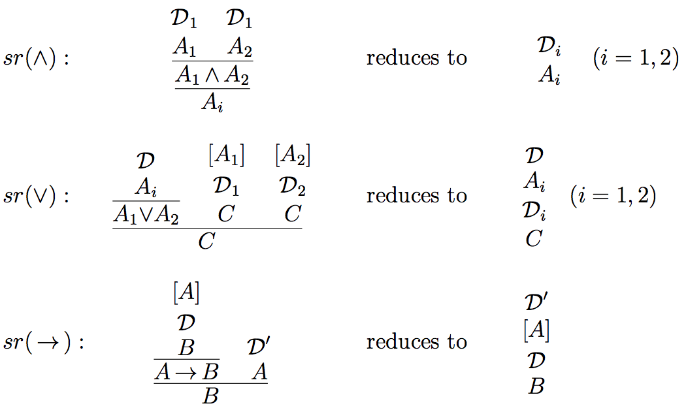
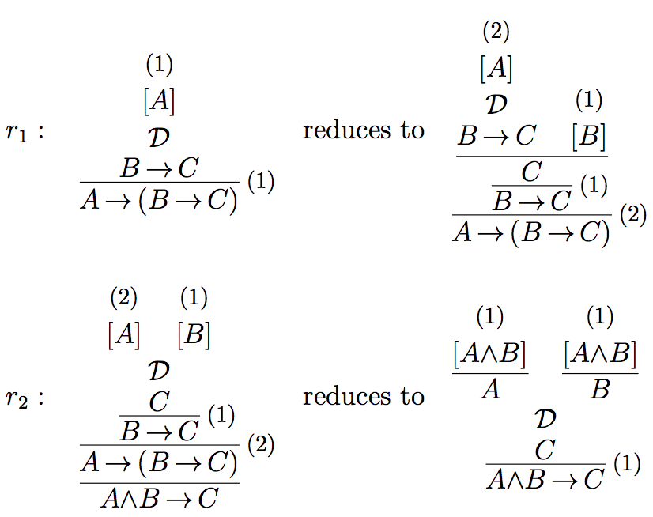
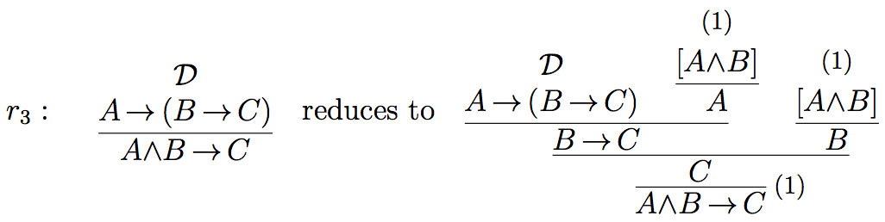

# proof-theoretic-semantics — examples（supplement）

> （《proof-theoretic-semantics》词条补充材料，源：plato.stanford.edu/entries/proof-theoretic-semantics/examples.html）

#### Supplement to Proof-Theoretic Semantics

## Examples of Proof-theoretic Validity

Prawitz’s definition of validity, of which there are several variants, can be reconstructed as follows. We consider only the constants of positive propositional logic (conjunction, disjunction, implication). We assume that an atomic system S is given determining the derivability of atomic formulas, which is the same as their validity. A formula over S is a formula built up by means of logical connectives starting with atoms from S. We propose the term “derivation structure” for a candidate for a valid derivation. (Prawitz uses various terminologies, such as “[argument or proof] schema” or “[argument or proof] skeleton”.) A *derivation structure* is composed of arbitrary rules. The general form of an arbitrary inference rule is the following, where the square brackets indicate assumptions which can be discharged at the application of the rule:

$$\begin{prooftree} \AxiomC{$[C_{11},\ldots,C_{1m_1}]$} \noLine\UnaryInfC{$A_1$} \AxiomC{$\ldots$} \AxiomC{$[C_{n1},\ldots,C_{nm_n}]$} \noLine\UnaryInfC{$A_n$} \TrinaryInfC{$B$} \end{prooftree} \hspace{-2em},$$

in short

$$\begin{prooftree} \AxiomC{$\Gamma_1$} \noLine\UnaryInfC{$A_1$} \AxiomC{$\ldots$} \AxiomC{$\Gamma_n$} \noLine\UnaryInfC{$A_n$} \TrinaryInfC{$B$} \end{prooftree}$$

Obviously, the standard introduction and elimination rules are particular cases of such rules. As a generalization of the standard reductions of maximal formulas it is supposed that certain reduction procedures are given. A reduction procedure transforms a given derivation structure into another one. A set of reduction procedures is called a *derivation reduction system* and denoted by $\mathcal{J}$. Reductions serve as justifying procedures for non-canonical steps, i.e. for all steps, which are not self-justifying, i.e., which are not introduction steps. Therefore a reduction system $\mathcal{J}$ is also called a *justification*. Reduction procedures must satisfy certain constraints such as closure under substitution. As the validity of a derivation not only depends on the atomic system S but also on the derivation reduction system used, we define the validity of a derivation structure with respect to the underlying atomic basis S and with respect to the justification $\mathcal{J}$:

1. Every closed derivation in S is S-valid with respect to $\mathcal{J}$ (for every $\mathcal{J})$.
2. A closed canonical derivation structure is S-valid with respect to $\mathcal{J}$, if all its immediate substructures are S-valid with respect to $\mathcal{J}$.
3. A closed non-canonical derivation structure is S-valid with respect to $\mathcal{J}$, if it reduces, with respect to $\mathcal{J}$, to a canonical derivation structure, which is S-valid with respect to $\mathcal{J}$.
4. An open derivation structure $$\begin{prooftree} \AxiomC{$A_1\ldots A_n$} \noLine\UnaryInfC{$\mathcal{D}$} \noLine\UnaryInfC{$B$} \end{prooftree}$$ where all open assumptions of $\mathcal{D}$ are among $A_1,\ldots ,A_n$, is S-valid with respect to $\mathcal{J}$, if for every extension $S'$ of S and every extension $\mathcal{J}'$ of $\mathcal{J}$, and for every list of closed derivation structures $$\begin{prooftree} \AxiomC{$\mathcal{D_i}$} \RightLabel{$(1 \le i \le n)$,} \noLine\UnaryInfC{$A_i$} \end{prooftree}$$ which are $S'$-valid with respect to $\mathcal{J}'$, $$\begin{prooftree} \AxiomC{$\mathcal{D}_1\quad\;\mathcal{D}_n$} \noLine\UnaryInfC{$A_1\ldots A_n$} \noLine\UnaryInfC{$\mathcal{D}$} \noLine\UnaryInfC{$B$} \end{prooftree}$$ is $S'$-valid with respect to $\mathcal{J}'$.

(See Prawitz, 1973, p. 236; 1974, p. 73; 2006; Schroeder-Heister, 2006.) In clause (iv), the reason for considering extensions $\mathcal{J}'$ of $\mathcal{J}$ and extensions $S'$ of S, is a monotonicity constraint. Derivations should remain valid if one’s knowledge incorporated in the atomic system and in the reduction procedures is extended.

A corresponding concept of *universal validity* can be defined as follows: Let $S_0$ be the atomic system with only propositional variables as atoms and with no inference rules. Let $\mathcal{L}(S_0)$ be a set of derivation structures over $S_0$ together with a justification $\mathcal{J}$ . Let v be an assignment of S-formulas to propositional variables. Let $\mathcal{D}^v$ be obtained from $\mathcal{D}$ by substituting in $\mathcal{D}$ propositional variables p with $v(p)$. Let $\mathcal{J}^v$ be the set of reductions which acts on derivations $\mathcal{D}^v$ in the same way as $\mathcal{J}$ acts on $\mathcal{D}$(i.e., $\mathcal{J}^v$ is the homomorphic image of $\mathcal{J}$ under $v)$. Then a derivation structure $\mathcal{D}$ in $\mathcal{L}(S_0)$ (i.e. a derivation structure containing only propositional variables as atoms) is defined to be *universally valid* with respect to $\mathcal{J}$ iff for every S and every $v, \mathcal{D}^v$ is S-valid with respect to $\mathcal{J}^v$. It is easy to see that $\mathcal{D}$ is universally valid with respect to $\mathcal{J}$ iff $\mathcal{D}$ is $S_0$-valid with respect to $\mathcal{J}$. This means that we can use the term “valid” (with respect to some $\mathcal{J} )$ interchangeably for both universal and $S_0$-validity.

Validity with respect to some $\mathcal{J}$ can be viewed as a generalized notion of logical validity. In fact, if we specialize $\mathcal{J}$ to the standard reductions of intuitionistic logic, then all derivations in intuitionistic logic are valid with respect to $\mathcal{J}$ (see below). The S-validity of a generalized inference rule

$$\begin{prooftree} \AxiomC{$\Gamma_1$} \noLine\UnaryInfC{$A_1$} \AxiomC{$\ldots$} \AxiomC{$\Gamma_n$} \noLine\UnaryInfC{$A_n$} \TrinaryInfC{$B$} \end{prooftree}$$

with respect to a justification $\mathcal{J}$ means that for all derivations

$$\begin{prooftree} \AxiomC{$\Gamma_1\qquad\; \Gamma_n$} \noLine\UnaryInfC{$\mathcal{D}_1,\ldots,\mathcal{D}_n$} \noLine\UnaryInfC{$A_1\qquad\; A_n$} \end{prooftree}$$

which are $S'$-valid with respect to $\mathcal{J}'$ for extensions $S'$ and $\mathcal{J}'$ of S and $\mathcal{J}$, respectively, the derivation

$$\begin{prooftree} \AxiomC{$\Gamma_1$} \noLine\UnaryInfC{$\mathcal{D}_1$} \noLine\UnaryInfC{$A_1$} \AxiomC{$\ldots$} \AxiomC{$\Gamma_n$} \noLine\UnaryInfC{$\mathcal{D}_n$} \noLine\UnaryInfC{$A_n$} \TrinaryInfC{$B$} \end{prooftree}$$

is $S'$-valid with respect to $\mathcal{J}'$. For a simple inference rule

$$\frac{A_1 \quad\ldots\quad A_n}{A}$$

this means that if it is S-valid with respect to $\mathcal{J}$ , it is S-valid with respect to $\mathcal{J}$ when viewed as a one-step derivation structure.

This gives rise to a corresponding notion of consequence (see also Prawitz, 1985). Instead of saying that the rule

$$\frac{A_1 \quad\ldots\quad A_n}{A}$$

is S-valid with respect to $\mathcal{J}$, we may say that A is a *consequence* of $A_1,\ldots,A_n$ *with respect to* S *and* $\mathcal{J}$, formally $A_1,\ldots ,A_n\vDash_{S,\mathcal{J}} A$. If we consider universal validity with respect to $\mathcal{J}$, we may speak of *consequence with respect to* $\mathcal{J}$, formally $A_1,\ldots ,A_n\vDash_{\mathcal{J}} A$. Finally, if there is some $\mathcal{J}$ such that universal validity holds for $\mathcal{J}$ , then we may speak of *logical consequence*, formally $A_1 ,\ldots,A_n\vDash A$.

This makes *proof-theoretic* consequence differ from *constructive* consequence according to which

$$\frac{A_1 \quad\ldots\quad A_n}{A}$$

would be defined as valid with respect to a *constructive function* f, if f transforms valid arguments of the premisses $A_1,\ldots,A_n$ into a valid argument of the conclusion A. Actually, it is not always possible to extract such a constructive function from our derivation reduction system, as a reduction system $\mathcal{J}$ serving as a justification need not be deterministic, which means that it merely generates a constructive relation on arguments. However, constructive consequence may be viewed as a limiting case of proof-theoretic consequence.

Examples of proof-theoretic validity

The following are the standard reductions for conjunction, disjunction and implication, as used in proofs of normalization.

For simplicity, we disregard atomic systems S and speak of $\mathcal{J}$-validity for validity with respect to $\mathcal{J}$ . First we observe that any derivation that results from the composition of $\mathcal{J}$-valid rules and/or $\mathcal{J}$-valid derivations is itself $\mathcal{J}$-valid. For example, the derivation

$$\begin{prooftree} \AxiomC{$A$} \AxiomC{$B$} \BinaryInfC{$C$} \noLine\UnaryInfC{$\mathcal{D}_1$} \noLine\UnaryInfC{$D$} \AxiomC{$\mathcal{D}_2$} \noLine\UnaryInfC{$E$} \BinaryInfC{$F$} \end{prooftree}$$

is $\mathcal{J}$-valid, if the rules

$$ \frac{A\quad B}{C} \quad\text{and}\quad \frac{D\quad E}{F}$$

as well as the derivations $\mathcal{D}_1$ and $\mathcal{D}_2$ are $\mathcal{J}$-valid.

As our first example, we show that the rule of $\rightarrow$ elimination (modus ponens) is valid with respect to $\{sr(\rightarrow)\}$, i.e., with respect to the justification consisting just of the standard reduction for implication. For that we have to show that for any $\mathcal{J} \supseteq \{sr(\rightarrow)\}$, and for all closed $\mathcal{J}$-valid derivations

$$ \begin{prooftree} \AxiomC{$\mathcal{D}_1$} \noLine\UnaryInfC{$A\to B$} \end{prooftree} \quad\text{and}\quad \begin{prooftree} \AxiomC{$\mathcal{D}_2$} \noLine\UnaryInfC{$A$} \end{prooftree}, $$

the derivation

$$ \begin{prooftree} \AxiomC{$\mathcal{D}_1$} \noLine\UnaryInfC{$A\to B$} \AxiomC{$\mathcal{D}_2$} \noLine\UnaryInfC{$A$} \BinaryInfC{$B$} \end{prooftree} $$

is $\mathcal{J}$-valid. Since $\mathcal{D}_1$ is closed $\mathcal{J}$-valid, it is of the form, or reduces with respect to $\mathcal{J}$ to the form

$$\begin{prooftree} \AxiomC{$[A]$} \noLine\UnaryInfC{$\mathcal{D}'_1$} \noLine\UnaryInfC{$B$} \RightLabel{ (1),} \UnaryInfC{$A\to B$} \end{prooftree}$$

where $\mathcal{D}_1 '$ is $\mathcal{J}$-valid. Applying $sr(\rightarrow)$, which is part of $\mathcal{J}$, to

$$ \begin{prooftree} \AxiomC{$[A]$} \noLine\UnaryInfC{$\mathcal{D}'_1$} \noLine\UnaryInfC{$B$} \RightLabel{ (1)} \UnaryInfC{$A\to B$} \AxiomC{$\mathcal{D}_2$} \noLine\UnaryInfC{$A$} \BinaryInfC{$B$} \end{prooftree} $$

yields the derivation

$$\begin{prooftree} \AxiomC{$\mathcal{D}_2$} \noLine\UnaryInfC{$A$} \noLine\UnaryInfC{$\mathcal{D}'_1$} \noLine\UnaryInfC{$B$.} \end{prooftree} $$

This derivation is $\mathcal{J}$-valid, as it is the result of a composition of the $\mathcal{J}$-valid derivations $\mathcal{D}_1'$ and $\mathcal{D}_2$. In a similar way we can demonstrate the validity of $\wedge$ and $\vee$ elimination with respect to the standard reductions $sr(\wedge)$ and $sr(\vee)$ as justifications.

As our second example, we show that the rule of importation

$$\tag{$R_{\imp}$} \frac{A\to(B\to C)}{A \land B \to C} $$

is valid with respect to the justification $\mathcal{J}_{\imp} = \{sr(\rightarrow),sr(\wedge),r_1,r_2\}$, where $sr(\rightarrow)$ and $sr(\wedge)$ are, as before, the standard reductions for implication and conjunction, and $r_1$ and $r_2$ are the following reductions:

We have to show that for every $\mathcal{J} \supseteq \mathcal{J}_{\imp}$ and for every closed $\mathcal{J}$-valid derivation

$$\begin{prooftree} \AxiomC{$\mathcal{D}$} \noLine\UnaryInfC{$A\to(B\to C)$} \end{prooftree}$$

the derivation

$$\tag{$\mathcal{D}_1$} \begin{prooftree} \AxiomC{$\mathcal{D}$} \noLine\UnaryInfC{$A\to(B\to C)$} \UnaryInfC{$A\land B\to C$} \end{prooftree}$$

is $\mathcal{J}$-valid. Since $\mathcal{D}$ is closed $\mathcal{J}$-valid, it is of the form, or reduces with respect to $\mathcal{J}$ to the form

$$\begin{prooftree} \AxiomC{(1)} \noLine\UnaryInfC{$[A]$} \noLine\UnaryInfC{$\mathcal{D}'$} \noLine\UnaryInfC{$B\to C$} \RightLabel{(1),} \UnaryInfC{$A\to (B\to C)$} \end{prooftree}$$

where $\mathcal{D}'$ is $\mathcal{J}$-valid. Applying $r_1$ to this derivation yields

$$\tag{$\mathcal{D}_2$} \begin{prooftree} \AxiomC{(2)} \noLine\UnaryInfC{$[A]$} \noLine\UnaryInfC{$\mathcal{D}'$} \noLine\UnaryInfC{$B\to C$} \AxiomC{(1)} \noLine\UnaryInfC{$[B]$} \BinaryInfC{$C$} \RightLabel{(1)} \UnaryInfC{$B\to C$} \RightLabel{(2)} \UnaryInfC{$A\to (B\to C)$} \end{prooftree}$$

which is $\mathcal{J}$-valid, as it is composed of the $\mathcal{J}$-valid derivation $\mathcal{D}'$ and $\mathcal{J}$-valid rules (note that $\rightarrow$ elimination is $\mathcal{J}$-valid since $sr(\rightarrow)$ belongs to $\mathcal{J}$, and introduction rules are trivially valid). This means that $\mathcal{D}_1$ reduces with respect to $\mathcal{J}$ to

$$\begin{prooftree} \AxiomC{$\mathcal{D}_2$} \noLine\UnaryInfC{$A\to(B\to C)$} \UnaryInfC{$A\land B\to C$} \end{prooftree}\,,$$

which, by means of $r_2$, reduces to

$$\begin{prooftree} \AxiomC{(1)} \noLine\UnaryInfC{$[A\land B]$} \UnaryInfC{$A$} \noLine\UnaryInfC{$\mathcal{D}'$} \noLine\UnaryInfC{$B\to C$} \AxiomC{(1)} \noLine\UnaryInfC{$[A\land B]$} \UnaryInfC{$B$} \BinaryInfC{$C$} \RightLabel{ (1)\,.} \UnaryInfC{$A\land B\to C$} \end{prooftree}$$

The latter derivation structure is $\mathcal{J}$-valid as being composed of the $\mathcal{J}$-valid derivation structure $\mathcal{D}'$ and $\mathcal{J}$-valid rules $(\wedge$ elimination and $\rightarrow$ elimination are $\mathcal{J}$-valid, because $sr(\rightarrow)$ and $sr(\wedge)$ are in $\mathcal{J} )$.

Alternatively, $R_{\imp}$ can be shown to be valid with respect to $\mathcal{J}_{\imp}' = \{sr(\rightarrow),sr(\wedge),r_3\}$, where $r_3$ is defined as:

The comparison of the standard reductions $(sr(\rightarrow), sr(\wedge), sr(\vee))$ with the reductions $r_1,r_2$ and $r_3$ shows that the former are elementary in the sense that they just compose given subderivations, whereas $r_1,r_2$ and $r_3$ use additional steps to generate their output. $r_1$ uses $\rightarrow$ E and introduction rules, $r_2$ uses $\wedge$E and introduction rules, and $r_3$ uses both $\rightarrow$ E and $\wedge$E, and introduction rules. In using standard elimination inferences, both $\mathcal{J}_{\imp}$ and $\mathcal{J}_{\imp}'$ have to rely on the standard reductions for the connectives involved. $\mathcal{J}_{\imp}$ can be viewed more elementary than $\mathcal{J}_{\imp}'$ in that it not simply produces a natural deduction derivation, but requires first a reduction of the premiss derivation of $R_{\imp}$ in order to be able to apply $r_1$. In generating a derivation of the conclusion of $R_{\imp}$ from its premiss, $\mathcal{J}'_{\imp}$ comes nearest to constructive semantics, where just a transformation of derivations is required. The example of importation shows that not every valid rule has a justification consisting of elementary reductions only. As soon as one has a right-iterated implication in the premiss of a rule, we have to rely on non-elementary reductions to establish its validity.

Remarks on Prawitz’s completeness conjecture

If we argue classically, we can disregard justifications and rephrase the definition of validity of proofs as a definition of validity of formulas as follows (see section 2.7 on sentence-based semantics in the main entry). We consider conjunction-disjunction-implication logic, which is essentially minimal logic.

1. An atomic formula A is S-valid, if it is derivable in S.
2. A conjunction $A\wedge B$ is S-valid, if both A and B are S-valid.
3. A disjunction $A\vee B$ is S-valid, if either A or B is S-valid.
4. An implication $A \rightarrow B$ is S valid, if for every extension $S'$ of S, if A if $S'$-valid then B is $S'$-valid.

This very much resembles Kripke-semantics of intuitionistic logic (see Troelstra and van Dalen, 1988, Ch. 2, and the entry on intuitionistic logic). The reference points (worlds) are atomic systems S, and accessibility is the extension relation between such systems. We can identify an atomic system with the set of atoms and rules derivable in it. Furthermore, we can identify rules with implications, as implications together with modus ponens behave like rules. The atomic systems S can thus be identified with deductively closed sets of implications. Together with the subset ordering as accessibility relation, we obtain exactly what in Kripke-style completeness proofs is known as the canonical model for implicational logic. Thus we can conclude that for implicational logic (and, in fact, for implication-conjunction logic), Prawitz’s completeness conjecture is correct, i.e., conjunction-implication logic is complete with respect to validity-based semantics.

However, the analogy to the canonical model breaks down if we add disjunction. In this case, in Kripke-style completeness proofs one has to require saturation, saying that, if a disjunction is member of a world of the canonical model, then so is one of its disjuncts. An explicit counterexample to Prawitz’s completeness conjecture can actually be given. Piecha, de Campos Sanz and Schroeder-Heister (2015) and, under weaker conditions, Piecha and Schroeder-Heister (2019) have shown that Harrop’s rule

$$ \frac{\neg A \to (B \lor C)}{(\neg A \to B) \lor (\neg A \to C)} $$

which is not derivable in intuitionistic logic, is valid (see section 2.8 on semantical completeness).

It should be mentioned that even the above verification of Prawitz’s completeness conjecture for implicational logic only holds if we allow the atomic systems to contain primitive rules which discharge assumptions, and not solely production rules. Only then there is a full analogy between (iterated) implications and (higher-level) rules, which is needed for the parallelism between atomic systems and their extensions on one side and the canonical model on the other. Otherwise counterexamples to completeness can be constructed (see Sandqvist, 2009).

It should also be noticed that it is not fully clear of whether the validity-based semantics presented here is exactly what Prawitz intended. In Prawitz (1971) he gives a clause for implication where he refers to arbitrary extensions of atomic systems, but in Prawitz (1973), where he formulates the completeness conjecture, and also in later papers, he does not consider extensions. Considering extensions in the clause for implication is crucial for the analogy to Kripke models on which we have drawn here. Without considering extensions we are loosing monotonicity, i.e., something shown to be valid in S need no longer be valid if S is extended, which is an inconvenient result. A possible rationale for not considering extensions would be to regard atomic systems as definitions in the sense of definitional reflection (see section 2.3.2) rather than just production systems describing an information state. For further discussions of this topic see Piecha (2016).

At the epistemological level, validity-based semantics was further developed by Prawitz in his theory of grounds (Prawitz 2015). This approach has been significantly expanded by Piccolomini d’Aragona (2023) towards an encompassing formal theory of epistemic grounding, which, by using term-annotated propositions, is related to the formulae-as-types paradigm and thus to Martin-Löf’s proof-theoretic semantics (see section 2.2.3 on contructive type theory).  For epistemological reasons, Prawitz himself is no longer pursuing the formal theory of proof-theoretic validity sketched in this supplement, which is based on the conceptual primacy of the validity of proofs over the validity of inferences. Instead he uses a general characterization of the interdependency of the concepts of inference, validity, argument, canonicality etc. without yet trying to bring these concepts into the well-founded order needed for an inductive definition (Prawitz 2024).
