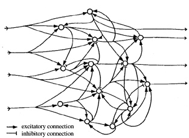
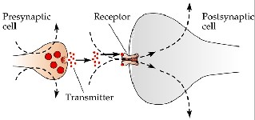
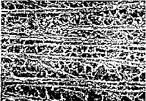
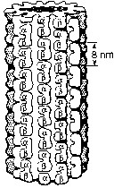

# Quantum Approaches to Consciousness
**First published Tue Nov 30, 2004; substantive revision Mon May 13, 2024**

*Atmanspacher, Harald*

It is widely accepted that consciousness or, more generally, mental activity is in some way correlated to the behavior of the material brain. Since quantum theory is the most fundamental theory of matter that is currently available, it is a legitimate question to ask whether quantum theory can help us to understand consciousness. Several approaches answering this question affirmatively, proposed in recent decades, will be surveyed. There are three basic types of corresponding approaches: (1) consciousness is a manifestation of quantum processes in the brain, (2) quantum concepts are used to understand conscious mental activity without referring to brain activity, and (3) matter and consciousness are regarded as dual aspects of one underlying reality. Major contemporary variants of these quantum-inspired approaches will be discussed. It will be pointed out that they make different epistemological assumptions and use quantum theory in different ways. For each of the approaches discussed, both problematic and promising features will be highlighted.

## 1. Introduction

The problem of how mind and matter are related to each other has many facets, and it can be approached from many different starting points. The historically leading disciplines in this respect are philosophy and psychology, which were later joined by behavioral science, cognitive science and neuroscience. In addition, the physics of complex systems and quantum physics have played stimulating roles in the discussion from their beginnings.

As regards the issue of complexity, this is evident: the brain is one of the most complex systems we know. The study of neural networks, their relation to the operation of single neurons and other important topics do and will profit a lot from complex systems approaches. As regards quantum physics, there can be no reasonable doubt that quantum events occur and are efficacious in the brain as elsewhere in the material world—including biological systems.[^note-1] But it is controversial whether these events are efficacious and relevant for those aspects of brain activity that are correlated with mental activity.

The original motivation in the early 20th century for relating quantum theory to consciousness was essentially philosophical. It is fairly plausible that conscious free decisions (“free will”) are problematic in a perfectly deterministic world,[^note-2] so quantum randomness might indeed open up novel possibilities for free will. (On the other hand, randomness is problematic for goal-directed volition!)

Quantum theory introduced an element of randomness standing out against the previous deterministic worldview preceding it, in which randomness expresses our ignorance of a more detailed description (as in statistical mechanics). In sharp contrast to such epistemic randomness, quantum randomness in processes such as the spontaneous emission of light, radioactive decay, or other examples has been considered a fundamental feature of nature, independent of our ignorance or knowledge. To be precise, this feature refers to *individual* quantum events, whereas the behavior of *ensembles* of such events is *statistically* determined. The indeterminism of individual quantum events is constrained by statistical laws.

Other features of quantum theory, which became attractive in discussing issues of consciousness, were the concepts of complementarity and entanglement. Pioneers of quantum physics such as Planck, Bohr, Schrödinger, Pauli (and others) emphasized the various possible roles of quantum theory in reconsidering the old conflict between physical determinism and conscious free will. For informative overviews with different focal points see e.g., Squires (1990), Kane (1996), Butterfield (1998), Suarez and Adams (2013).

## 2. Philosophical Background Assumptions

Variants of the dichotomy between mind and matter range from their fundamental distinction at a primordial level of description to the emergence of mind (consciousness) from the brain as an extremely sophisticated and highly developed material system. Early overviews can be found in Popper and Eccles (1977), Chalmers (1996), and Pauen (2001).

One important aspect of all discussions about the relation between mind and matter is the distinction between *descriptive* and *explanatory* approaches. For instance, *correlation* is a descriptive term with empirical relevance, while *causation* is an explanatory term associated with theoretical attempts to understand correlations. Causation implies correlations between cause and effect, but this does not always apply the other way around: correlations between two systems can result from a common cause in their history rather than from a direct causal interaction. Moreover, correlations can be synchronic rather than diachronic, so the temporal distance that is presupposed by cause-effect relations is lacking altogether.

In the fundamental sciences, one typically speaks of causal relations in terms of interactions. In physics, for instance, there are four fundamental kinds of interactions (electromagnetic, weak, strong, gravitational) which serve to explain the correlations that are observed in physical systems. As regards the mind-matter problem, the situation is more difficult. Far from a theoretical understanding in this field, the existing body of knowledge essentially consists of empirical correlations between material and mental states. These correlations are synchronic, not diachronic; neither are mental states causally conditioned by brain states nor the other way around. It is (for some purposes) interesting to know *that* particular brain areas are activated during particular mental activities; but this does, of course, not explain *why* they are.

In many discussions of material [ma] brain states and mental [me] states of consciousness, the relations between them are conceived in a *direct* way (A):

$$ [\mathbf{ma}] \substack{\leftarrow \\ \rightarrow} [\mathbf{me}] $$

The most popular approaches along these lines as far as quantum behavior of the brain is concerned will be discussed in Section 3, “Quantum Brain”.

The scheme (A) of direct relations between material and mental states sketches a minimal framework to study reduction, supervenience, or emergence relations (Kim 1998; Stephan 1999)[^kim-1998][^stephan-1999] which can yield both monistic and dualistic pictures. For instance, the idea of *strong reduction* assumes that all mental states and properties can be reduced to the material domain or even to physics. This point of view claims that it is both necessary and sufficient to explore and understand the material domain, e.g., the brain, in order to understand the mental domain, e.g., consciousness. It leads to a monistic picture, in which any need to discuss mental states is eliminated right away or at least considered as epiphenomenal. While mind-brain correlations are still legitimate though causally irrelevant from an epiphenomenalist point of view, eliminative materialism renders even correlations themselves irrelevant.

Counterarguments against the validity of such strongly reductive approaches are qualia arguments, emphasizing their impossibility to properly incorporate the quality of the subjective experience of a mental state, the “what it is like to be” (Nagel 1974)[^nagel-1974] in that state. This leads to an explanatory gap between third-person and first-person accounts for which Chalmers (1995) has coined the notion of the “hard problem of consciousness”. Another, less discussed counterargument is that the physical domain itself is not causally closed. Any solution of fundamental equations of motion (be it experimentally, numerically, or analytically) requires to fix boundary conditions and initial conditions which are not given by the fundamental laws of nature (Primas 2002)[^primas-2002]. This causal gap applies to classical physics as well as quantum physics, where a basic indeterminacy due to collapse makes it even more challenging. A third class of counterarguments refer to the difficulties to include notions of temporal present and nowness in a physical description (Franck 2004, 2008; Primas 2017)[^franck-2004][^primas-2017].

However, relations between mental and material states can also be conceived in a non-reductive fashion, e.g. in terms of emergence relations (Stephan 1999)[^stephan-1999]. Mental states and/or properties can be considered as emergent if the material brain is not necessary or not sufficient to explore and understand them.[^note-3] This leads to a dualistic picture (less radical and more plausible than Cartesian dualism) in which residua remain if one attempts to reduce the mental to the material. Within a dualistic scheme of thinking, it becomes inevitable to discuss the question of how mental and material states are related to one another. This topic has attracted growing interest under the notion of “downward causation” (Velmans 2002; Ellis *et al.* 2011)[^ellis-2011][^velmans-2002]. Since such causation would be synchronic rather than diachronic, a less controversial concept addressing this issue has been proposed in terms of “downward constraints” that mental states impose on brain states (Atmanspacher and beim Graben 2007)[^atmanspacher-2007].

It has been an old idea by Niels Bohr that central conceptual features of quantum theory, such as complementarity, are also of pivotal significance outside the domain of physics. In fact, Bohr became familiar with complementarity through the psychologist Edgar Rubin and, more indirectly, William James (Holton 1970)[^holton-1970] and immediately saw its potential for quantum physics. Although Bohr was convinced of the extraphysical relevance of complementarity, he never elaborated this idea in concrete detail, and for a long time after him no one else did so either. This situation has changed: there are now a number of research programs generalizing key notions of quantum theory in a way that makes them applicable beyond physics.

Of particular interest for consciousness studies are approaches that have been developed in order to pick up Bohr’s proposal with respect to psychology and cognitive science. The first steps in this direction were made by the group of Aerts in the early 1990s (Aerts *et al.* 1993)[^aerts-1993], using non-distributive propositional lattices to address quantum-like behavior in non-classical systems. Alternative approaches have been initiated by Khrennikov (1999), focusing on non-classical probabilities, and Atmanspacher *et al.* (2002), outlining an algebraic framework with non-commuting operations. The recent development of ideas within this framework of thinking is addressed in Section 4, “Quantum Mind”. Other lines of thinking are due to Primas (2007, 2017), addressing complementarity with partial Boolean algebras, and Filk and von Müller (2008), indicating links between basic conceptual categories in quantum physics and psychology.

As an alternative to (A), it is possible to conceive mind-matter relations *indirectly* **(B)**, via a third category:

$$\begin{gather} [\mathbf{ma}] \quad [\mathbf{me}] \\ \searrow\nwarrow \swarrow\nearrow \\ [\mathbf{mame}] \end{gather}$$

This third category, here denoted [mame], is regarded as being neutral with respect to the distinction between [ma] and [me], i.e., psychophysically neutral. In scenario (B), issues of reduction and emergence concern the relation between the undivided “background reality” [mame] and the distinguished aspects [ma] and [me].

Such “dual-aspect” frameworks of thinking have received increasing attention in contemporary discussion. In occidental philosophy, they have a long tradition reaching back as far as to Spinoza (1677) and Schelling (1809). In the early days of psychophysics, Fechner (1861) and Wundt (1911) advocated related views. Whitehead, the modern pioneer of process philosophy, referred to mental and physical poles of “actual occasions”, which themselves transcend their bipolar appearances (Whitehead 1978)[^whitehead-1978]. Many approaches in the tradition of Feigl (1967) and Smart (1963), called “identity theories”, conceive mental and material states as differentiated descendants of “central states”. Other variants of this idea, focusing on quantum ideas, have been suggested by (a) Jung and Pauli (1955) [see also Meier (2001)], involving Jung’s conception of a psychophysically neutral, archetypal order, by (b) approaches toward a neither-mental-nor-material base reality by Eddington (1946) and Wheeler (1994), and by (c) Bohm and Hiley (Bohm 1990; Bohm and Hiley 1993; Hiley 2001)[^bohm-1990][^bohm-1993][^hiley-2001], referring to an implicate order which unfolds into the different explicate domains of the mental and the material. They will be discussed in more detail in Section 5, “Brain and Mind as Dual Aspects”.

Velmans (2002, 2009) has developed a similar approach, backed up with empirical material from psychology, and Strawson (2003) has proposed a “real materialism” which uses a closely related scheme. Another proponent of dual-aspect thinking is Chalmers (1996), who considers the possibility that the underlying, psychophysically neutral level of description could be best characterized in terms of information.

Before proceeding further, it should be emphasized that many present-day approaches prefer to distinguish between first-person and third-person perspectives rather than mental and material states. This terminology serves to highlight the discrepancy between immediate conscious experiences (“qualia”) and their description, be it behavioral, neural, or biophysical. The notion of the “hard problem” of consciousness research refers to bridging the gap between first-person experience and third-person accounts of it. In the present contribution, mental conscious states are implicitly assumed to be related to first-person experience. This does not mean, however, that the problem of how to define consciousness precisely is considered as resolved. Ultimately, it will be (at least) as difficult to define a mental state in rigorous terms as it is to define a material state rigorously.

## 3. Quantum Brain

In this section, some popular approaches for applying quantum theory to brain states will be surveyed and compared, most of them speculative, with varying degrees of elaboration and viability. Section 3.1 addresses three different neurophysiological levels of description, to which particular quantum approaches refer. Subsequently, the individual approaches themselves will be presented and discussed — Section 3.2: Stapp, Section 3.3: Vitiello and Freeman, Section 3.4: Beck and Eccles, Section 3.5: Penrose and Hameroff. For this purpose, the philosophical distinctions A/B (Section 2) and the neurophysiological distinctions addressed in Section 3.1 will serve as guidelines to classify the respective quantum approaches in a systematic way. However, some preliminary qualifications concerning different ways to use quantum theory are in order.

There are quite a number of accounts discussing quantum theory in relation to consciousness that adopt basic ideas of quantum theory in a purely *narrative* manner. Quantum theoretical terms such as entanglement, superposition, collapse, complementarity, and others are used without specific reference to how they are defined precisely and how they are applicable to specific situations. For instance, conscious acts are just *claimed* to be interpretable somehow similarly to physical acts of measurement, or correlations in psychological systems are just *claimed* to be interpretable somehow similarly to physical entanglement. Such accounts may provide fascinating science fiction, and they may even be important to inspire nuclei of ideas to be worked out in detail. But unless such detailed work leads beyond vague allusions and intimations, they do not yet represent scientific progress. Approaches falling into this category will not be further discussed in this contribution.

A second category includes approaches that use the *status quo* of present-day quantum theory to describe neurophysiological and/or neuropsychological processes. Among these approaches, the one with the longest history was initiated by von Neumann in the 1930s, later taken up by Wigner, and then championed by Stapp. It can be roughly characterized as the proposal to consider intentional conscious acts as intrinsically correlated with physical state reductions. Another fairly early idea dating back to Ricciardi and Umezawa in the 1960s is to treat mental states, particularly memory states, in terms of vacuum states of quantum fields. A prominent proponent of this approach is Vitiello. Finally, there is the idea suggested by Beck and Eccles in the 1990s, according to which quantum mechanical processes, relevant for the description of exocytosis at the synaptic cleft, can be influenced by mental intentions.

The third category refers to *further developments or generalizations* of present-day quantum theory. An obvious candidate in this respect is the proposal by Penrose to relate elementary conscious acts to gravitation-induced reductions of quantum states. Ultimately, this requires the framework of a future theory of quantum gravity which is far from having been developed. Together with Penrose, Hameroff has argued that microtubuli might be the right place to look for such state reductions.

### 3.1 Neurophysiological Levels of Description

A mental system can be in many different conscious (intentional, phenomenal) mental states. In a hypothetical state space, a sequence of such states forms a trajectory representing what is often called the stream of consciousness. Since different subsets of the state space are typically associated with different stability properties, a mental state can be assumed to be more or less stable, depending on its position in the state space. Stable states are distinguished by a residence time at that position longer than that of metastable or unstable states. If a mental state is stable with respect to perturbations, it “activates” a mental representation encoding a content that is consciously perceived.

#### Neural Assemblies

Moving from this purely psychological, or cognitive, description to its neurophysiological counterpart leads us to the question: What is the neural correlate of a mental representation? According to standard accounts (cf. Noë and Thompson (2004) for discussion), mental representations are correlated with the activity of neuronal assemblies, i.e., ensembles of several thousands of coupled neurons. The neural correlate of a mental representation can be characterized by the fact that the connectivities, or couplings, among those neurons form an assembly confined with respect to its environment, to which connectivities are weaker than within the assembly. The neural correlate of a mental representation is activated if the neurons forming the assembly operate more actively, e.g., produce higher firing rates, than in their default mode.

*Figure 1.*

Figure 1. Balance between inhibitory and excitatory connections among neurons.

In order to achieve a stable operation of an activated neuronal assembly, there must be a subtle balance between inhibitory and excitatory connections among neurons (cf. Figure 1). If the transfer function of individual neurons is strictly monotonic, i.e., increasing input leads to increasing output, assemblies are difficult to stabilize. For this reason, results establishing a non-monotonic transfer function with a maximal output at intermediate input are of high significance for the modeling of neuronal assemblies (Kuhn *et al.* 2004)[^kuhn-2004]. For instance, network models using lattices of coupled maps with quadratic maximum (Kaneko and Tsuda 2000)[^kaneko-2000] are paradigmatic examples of such behavior. These and other familiar models of neuronal assemblies (for an overview see Anderson and Rosenfeld 1988)[^anderson-1988] are mostly formulated in a way *not* invoking well-defined elements of quantum theory. An explicit exception is the approach by Umezawa, Vitiello and others (see Section 3.3).

#### Single Neurons and Synapses

The fact that neuronal assemblies are mostly described in terms of classical behavior does not rule out that classically undescribable quantum effects may be significant if one focuses on individual constituents of assemblies, i.e., single neurons or interfaces between them. These interfaces, through which the signals between neurons propagate, are called synapses. There are electrical and chemical synapses, depending on whether they transmit a signal electrically or chemically.

At electrical synapses, the current generated by the action potential at the presynaptic neuron flows directly into the postsynaptic cell, which is physically connected to the presynaptic terminal by a so-called gap junction. At chemical synapses, there is a cleft between pre- and postsynaptic cell. In order to propagate a signal, a chemical transmitter (glutamate) is released at the presynaptic terminal. This release process is called exocytosis. The transmitter diffuses across the synaptic cleft and binds to receptors at the postsynaptic membrane, thus opening an ion channel (Kandel *et al.* 2000, part III; see Fig. 2)[^kandel-2000]. Chemical transmission is slower than electric transmission.

*Figure 2.*

Figure 2. Release of neurotransmitters at the synaptic cleft (exocytosis).

A model developed by Beck and Eccles (and later refined by Fisher) applies concrete quantum mechanical features to describe details of the process of exocytosis. Their model proposes that quantum processes are relevant for exocytosis and, moreover, are tightly related to states of consciousness. This will be discussed in more detail in Section 3.4.

At this point, another approach developed by Flohr (2000) should be mentioned, for which chemical synapses with a specific type of receptors, so-called NMDA receptors,[^note-4] are of paramount significance. Briefly, Flohr observes that the specific plasticity of NMDA receptors is a necessary condition for the formation of extended stable neuronal assemblies correlated to (higher-order) mental representations which he identifies with conscious states. Moreover, he indicates a number of mechanisms caused by anaesthetic agents, which block NMDA receptors and consequently lead to a loss of consciousness. Flohr’s approach is physicalistic and reductive, and it is entirely independent of any specific quantum ideas.

#### Microtubuli

The lowest neurophysiological level, at which quantum processes have been proposed as a correlate to consciousness, is the level at which the interior of single neurons is involved: their cytoskeleton. It consists of protein networks essentially made up of two kinds of structures, neurofilaments and microtubuli (Fig. 3, left), which are essential for various transport processes within neurons (as well as other cells). Microtubuli are long polymers usually constructed of 13 longitudinal α and β-tubulin dimers arranged in a tubular array with an outside diameter of about 25 nm (Fig. 3, right). For more details see Kandel *et al.* (2000), Chap. II.4.

Figure 3. (left) microtubuli and neurofilaments, the width of the figure corresponds to approximately 700nm; (right) tubulin dimers, consisting of α- and β-monomers, constituting a microtubule.

The tubulins in microtubuli are the substrate which, in Hameroff’s proposal, is used to embed Penrose’s theoretical framework neurophysiologically. As will be discussed in more detail in Section 3.5, tubulin states are assumed to be quantum states, so that quantum coherence among different tubulins is possible. A crucial thesis in the scenario of Penrose and Hameroff is that the (gravitation-induced) collapse of such coherent tubulin states corresponds to elementary acts of consciousness.

### 3.2 Stapp: Quantum State Reductions and Conscious Acts

The act of measurement is a crucial aspect of quantum theory, that has been the subject of controversy for more than eight decades now. In his monograph on the mathematical foundations of quantum mechanics, von Neumann (1955, Chap. V.1) introduced, in an *ad hoc* manner, the projection postulate as a mathematical tool for describing measurement in terms of a discontinuous, non-causal, instantaneous (irreversible) act given by (1) the transition of a quantum state to an eigenstate *bⱼ* of the measured observable *B* (with a certain probability). This transition is often called the *collapse* or *reduction* of the quantum state (the “wavefunction”), as opposed to (2) the continuous, unitary (reversible) evolution of a system according to the Schrödinger equation.

In Chapter VI, von Neumann (1955) discussed the conceptual distinction between observed and observing system. In this context, he applied (1) and (2) to the general situation of a measured object system (I), a measuring instrument (II), and (the brain of) a human observer (III). His conclusion was that it makes no difference for the result of measurements on (I) whether the boundary between observed and observing system is posited between I and (II & III) or between (I & II) and III. As a consequence, it is inessential whether a detector or the human brain is ultimately referred to as the “observer”.[^note-5]

In contrast to von Neumann’s fairly cautious stance, London and Bauer (1939) went further and proposed that it is indeed human *consciousness* which completes the quantum measurement process (see Jammer (1974, Sec. 11.3 or Shimony (1963) for a detailed account). In this way, they attributed a crucial role to consciousness in understanding quantum measurement in terms of an update of the observer’s knowledge. In the 1960s, Wigner (1967) radicalized this proposal,[^note-6] by suggesting an impact of consciousness on the physical state of the measured system, not only an impact on observer knowledge. In order to describe measurement as a real dynamical process generating irreversible facts, Wigner called for some nonlinear modification of (2) to replace von Neumann’s projection (1).[^note-7]

Since the 1980s, Stapp has developed his own point of view on the background of von Neumann and Wigner. In particular, he tries to understand specific features of consciousness in relation to quantum theory. Inspired by von Neumann, Stapp uses the freedom to place the interface between observed and observing system and locates it in the observer’s brain. He does not suggest any formal modifications to present-day quantum theory (in particular, he stays essentially within the “orthodox” Hilbert space representation), but adds major interpretational extensions, in particular with respect to a detailed ontological framework.

In his earlier work, Stapp (1993) started with Heisenberg’s distinction between the potential and the actual (Heisenberg 1958)[^heisenberg-1958], thereby taking a decisive step beyond the operational Copenhagen interpretation of quantum mechanics. While Heisenberg’s notion of the *actual* is related to a measured event in the sense of the Copenhagen interpretation, his notion of the *potential*, of a *tendency* or *disposition*, relates to the situation *before* measurement, which expresses the idea of a reality independent of measurement.[^note-8]

Immediately after its actualization, each event holds the tendency for the impending actualization of another, subsequent actual event. Therefore, events are by definition ambiguous. With respect to their actualized aspect, Stapp’s essential move is to “attach to each Heisenberg actual event an experiential aspect. The latter is called the *feel* of this event, and it can be considered to be the aspect of the actual event that gives it its status as an intrinsic actuality” (Stapp 1993, p. 149)[^stapp-1993].

With respect to their tendency aspect, it is tempting to understand events in terms of scheme (B) of Section 2. This is related to Whitehead’s ontology, in which mental and physical poles of so-called “actual occasions” are considered as mental and physical aspects of reality. The potential antecedents of actual occasions are psychophysically neutral and refer to a mode of existence at which mind and matter are unseparated. This is expressed, for instance, by Stapp’s notion of a “hybrid ontology” with “both idea-like and matter-like qualities” (Stapp 1999, 159)[^stapp-1999]. Similarities with a dual-aspect approach (B) (cf. Section 5) are evident.

In an interview of 2006, Stapp (2006) specifies some ontological features of his approach with respect to Whitehead’s process thinking, where actual occasions rather than matter or mind are fundamental elements of reality. They are conceived as based on a processual rather than a substantial ontology (see the entry on process philosophy). Stapp relates the fundamentally processual nature of actual occasions to both the physical act of state reduction and the correlated mental intentional act.

Another significant aspect of his approach is the possibility that “conscious intentions of a human being can influence the activities of his brain” (Stapp 1999, p. 153)[^stapp-1999]. Different from the possibly misleading notion of a direct interaction, suggesting an interpretation in terms of scheme (A) of Section 2, he describes this feature in a more subtle manner. The requirement that the mental and material outcomes of an actual occasion must match, i.e. be correlated, acts as a constraint on the way in which these outcomes are formed within the actual occasion (cf. Stapp 2006)[^stapp-2006]. The notion of interaction is thus replaced by the notion of a constraint set by mind-matter correlations (see also Stapp 2007)[^stapp-2007].

At a level at which conscious mental states and material brain states are distinguished, each conscious experience, according to Stapp (1999, p. 153), has as its physical counterpart a quantum state reduction actualizing “the pattern of activity that is sometimes called the neural correlate of that conscious experience”. This pattern of activity may encode an intention and, thus, represent a “template for action”. An intentional decision for an action, preceding the action itself, is then the key for anything like “free agency” in this picture.

Stapp argues that the mental effort, i.e. attention devoted to such intentional acts, can protract the lifetime of the neuronal assemblies that represent the templates for action due to quantum Zeno-type effects. Concerning the neurophysiological implementation of this idea, intentional mental states are assumed to correspond to reductions of superposition states of neuronal assemblies. Additional commentary concerning the concepts of attention and intention in relation to James’ idea of a holistic stream of consciousness (James 1950 [1890])[^james-1950] was given by Stapp (1999).

For further progress, it will be mandatory to develop a coherent formal framework for this approach and elaborate on concrete details. For instance, it is not yet worked out precisely how quantum superpositions and their collapses are supposed to occur in neural correlates of conscious events. Some indications are outlined by Schwartz *et al.* (2005). With these desiderata for future work, the overall conception is conservative insofar as the physical formalism remains unchanged.

This is why Stapp insisted for years that his approach does not change what he calls “orthodox” quantum mechanics, which is essentially encoded in the statistical formulation by von Neumann (1955). From the point of view of standard present-day quantum physics, however, it is certainly unorthodox to include the mental state of observers in the theory. Although it is true that quantum measurement is not yet finally understood in terms of physical theory, introducing mental states as the essential missing link is highly speculative from a contemporary perspective.

This link is a radical conceptual move. In what Stapp (2015) later denotes as a “semi-orthodox” approach, he proposes that the blind-chance kind of randomness of individual quantum events (“nature’s choices”) be reconceived as “not actually random but positively or negatively biased by the positive or negative values in the minds of the observers that are actualized by its (nature’s) choices” (p. 187). This hypothesis leads into mental influences on quantum physical processes which are widely unknown territory at present.

### 3.3 Vitiello and Freeman: Quantum Field Theory of Brain States

In the 1960s, Ricciardi and Umezawa (1967) suggested to utilize the formalism of quantum field theory to describe brain states, with particular emphasis on memory. The basic idea is to conceive of memory states in terms of states of many-particle systems, as inequivalent representations of vacuum states of quantum fields.[^note-9] This proposal has gone through several refinements (e.g., Stuart *et al.* 1978, 1979; Jibu and Yasue 1995)[^jibu-1995][^stuart-1978]. Major progress has been achieved by including effects of dissipation, chaos, fractals and quantum noise (Vitiello 1995; Pessa and Vitiello 2003; Vitiello 2012)[^pessa-2003][^vitiello-1995][^vitiello-2012]. For readable nontechnical accounts of the approach in its present form, embedded in quantum field theory as of today, see Vitiello (2001, 2002).

Quantum field theory (see the entry on quantum field theory) deals with systems with infinitely many degrees of freedom. For such systems, the algebra of observables that results from imposing canonical commutation relations admits multiple representations that are not unitarily equivalent to each other. This differs from the case of standard quantum mechanics, which deals with systems with finitely many degrees of freedom. For such systems, the corresponding algebra of observables admits unitarily equivalent Hilbert-space representations.

The inequivalent representations of quantum field theory can be generated by spontaneous symmetry breaking (see the entry on symmetry and symmetry breaking), occurring when the ground state (or the vacuum state) of a system is not invariant under the full group of transformations providing the conservation laws for the system. If symmetry breaks down, collective modes are generated (so-called Nambu-Goldstone boson modes), which propagate over the system and introduce long-range correlations in it.

These correlations are responsible for the emergence of ordered patterns. Unlike in standard thermal systems, a large number of bosons can be condensed in an ordered state in a highly stable fashion. Roughly speaking, this provides a quantum field theoretical derivation of ordered states in many-body systems described in terms of statistical physics. In the proposal by Umezawa these dynamically ordered states represent coherent activity in neuronal assemblies.

The *activation* of a neuronal assembly is necessary to make the encoded content consciously accessible. This activation is considered to be initiated by external stimuli. Unless the assembly is activated, its content remains unconscious, unaccessed memory. According to Umezawa, coherent neuronal assemblies correlated to such memory states are regarded as vacuum states; their activation leads to excited states and enables a conscious recollection of the content encoded in the vacuum (ground) state. The stability of such states and the role of external stimuli have been investigated in detail by Stuart *et al.* (1978, 1979).

A decisive further step in developing the approach has been achieved by taking *dissipation* into account. Dissipation is possible when the interaction of a system with its environment is taken into account. Vitiello (1995) describes how the system-environment interaction causes a doubling of the collective modes of the system in its environment. This yields infinitely many differently coded vacuum states, offering the possibility of many memory contents without overprinting. Moreover, dissipation leads to finite lifetimes of the vacuum states, thus representing temporally limited rather than unlimited memory (Alfinito and Vitiello 2000; Alfinito *et al.* 2001)[^alfinito-2000][^alfinito-2001]. Finally, dissipation generates a genuine arrow of time for the system, and its interaction with the environment induces entanglement. Pessa and Vitiello (2003) have addressed additional effects of chaos and quantum noise.

Umezawa’s proposal addresses the brain as a many-particle system as a whole, where the “particles” are more or less neurons. In the language of Section 3.1, this refers to the level of neuronal assemblies, which correlate *directly* with mental activity. Another merit of the quantum field theory approach is that it avoids the restrictions of standard quantum mechanics in a formally sound way. Conceptually speaking, many of the pioneering presentations of the proposal nevertheless confused mental and material states (and their properties). This has been clarified by Freeman and Vitiello (2008): the model “describes the brain, not mental states.”

For a corresponding description of brain states, Freeman and Vitiello 2006, 2008, 2010) studied neurobiologically relevant observables such as electric and magnetic field amplitudes and neurotransmitter concentration. They found evidence for non-equilibrium analogs of phase transitions (Vitiello 2015)[^vitiello-2015] and power-law distributions of spectral energy densities of electrocorticograms (Freeman and Vitiello 2010, Freeman and Quian Quiroga 2013)[^freeman-2010]. All these observables are classical, so that neurons, glia cells, “and other physiological units are *not* quantum objects in the many-body model of brain” (Freeman and Vitiello 2008)[^freeman-2008]. However, Vitiello (2012) also points out that the emergence of (self-similar, fractal) power-law distributions in general is intimately related to dissipative quantum coherent states (see also recent developments of the Penrose-Hameroff scenario, Section 3.5).

The overall conclusion is that the application of quantum field theory describes why and how classical behavior emerges at the level of brain activity considered. The relevant brain states themselves are viewed as classical states. Similar to a classical thermodynamical description arising from quantum statistical mechanics, the idea is to identify different regimes of stable behavior (phases, attractors) and transitions between them. In this way, quantum field theory provides formal elements from which a standard classical description of brain activity can be inferred, and this is its main role in large parts of the model. Only in their last joint paper, Freeman and Vitiello (2016) envision a way in which the mental can be explicitly included. For a more recent review including technical background see Sabbadini and Vitiello (2019).

### 3.4 Beck and Eccles: Quantum Mechanics at the Synaptic Cleft

Probably the most concrete suggestion of how quantum mechanics in its present-day appearance can play a role in brain processes is due to Beck and Eccles (1992), later refined by Beck (2001). It refers to particular mechanisms of information transfer at the synaptic cleft, which is known to be affected by anesthetic drugs when they switch off consciousness (for review see Platholi and Hemmings 2022)[^platholi-2022]. However, ways in which these quantum processes might be relevant for mental activity, and in which their interactions with mental states are conceived, remain unclarified to the present day.[^note-10]

As presented in Section 3.1, the information flow between neurons in chemical synapses is initiated by the release of transmitters in the presynaptic terminal. This process is called exocytosis, and it is triggered by an arriving nerve impulse with some small probability. In order to describe the trigger mechanism in a statistical way, thermodynamics or quantum mechanics can be invoked. A look at the corresponding energy regimes shows (Beck and Eccles 1992)[^beck-1992] that quantum processes are distinguishable from thermal processes for energies higher than 10⁻² eV (at room temperature). Assuming a typical length scale for biological microsites of the order of several nanometers, an effective mass below 10 electron masses is sufficient to ensure that quantum processes prevail over thermal processes.

The upper limit of the time scale of such processes in the quantum regime is of the order of 10⁻¹² sec. This is significantly shorter than the time scale of cellular processes, which is 10⁻⁹ sec and longer. The sensible difference between the two time scales makes it possible to treat the corresponding processes as decoupled from one another.

The trigger mechanism proposed by Beck and Eccles (1992) is based on the quantum concept of quasi-particles, reflecting the particle aspect of a collective mode. Skipping the details of the picture, the proposed trigger mechanism refers to tunneling processes of two-state quasi-particles, resulting in state collapses. It yields a probability of exocytosis in the range between 0 and 0.7, in agreement with empirical observations. Using a theoretical framework developed earlier (Marcus 1956; Jortner 1976)[^jortner-1976][^marcus-1956], the quantum trigger can be concretely understood in terms of electron transfer between biomolecules. However, the question remains how the trigger may be relevant for conscious mental states. There are two aspects to this question.

The first one refers to Eccles’ intention to utilize quantum processes in the brain as an entry point for mental causation. The idea, as indicated in Section 1, is that the fundamentally indeterministic nature of individual quantum state collapses offers room for the influence of mental powers on brain states. In the present picture, this is conceived in such a way that “mental intention (volition) becomes neurally effective by *momentarily increasing the probability of exocytosis*” (Beck and Eccles 1992, 11360)[^beck-1992]. Further justification of this assumption is not given.

The second aspect refers to the problem that processes at *single* synapses cannot be simply correlated to mental activity, whose neural correlates are coherent assemblies of neurons. Most plausibly, *prima facie* uncorrelated random processes at individual synapses would result in a stochastic network of neurons (Hepp 1999)[^hepp-1999]. Although Beck (2001) has indicated possibilities (such as quantum stochastic resonance) for achieving ordered patterns at the level of assemblies from fundamentally random synaptic processes, this remains an unsolved problem.

With the exception of Eccles’ idea of mental causation, the approach by Beck and Eccles essentially focuses on brain states and brain dynamics. In this respect, Beck (2001, 109f) states explicitly that “science cannot, by its very nature, present any answer to […] questions related to the mind”. Nevertheless, their biophysical approach may open the door to controlled speculation about mind-matter relations.

A more recent proposal targeting exocytosis processes at the synaptic cleft is due to Fisher (2015, 2017). Similar to the quasi-particles by Beck and Eccles, Fisher refers to so-called Posner molecules, in particular to calcium phosphate, Ca$_9$(PO$_4$)$_6$. The nuclear spins of phosphate ions serve as entangled qubits within the molecules, which protect their coherent states against fast decoherence (resulting in extreme decoherence times in the range of hours or even days). If the Posner molecules are transported into presynaptic glutamatergic neurons, they will stimulate further glutamate release and amplify postsynaptic activity. Due to nonlocal quantum correlations this activity may be enhanced over multiple neurons (which would respond to Hepp’s concern).

This is a sophisticated mechanism, whose physics has been studied in detail by Yunger Halpern and Crosson (2019) and by Adams and Petruccione (2020). A posible empirical test would be to modify the phosphorus spin dynamics within the Posner molecules. For instance, replacing Ca by different Li isotopes with different nuclear spins gives rise to different decoherence times, affecting postsynaptic activity. Corresponding evidence has been shown in animals (Sechzer *et al.* 1986, Krug *et al.* 2019)[^krug-2019][^sechzer-1986]. In fact, lithium is known to be efficacious in tempering manic phases in patients with bipolar disorder.

### 3.5 Penrose and Hameroff: Quantum Gravity and Microtubuli

In the scenario developed by Penrose and neurophysiologically augmented by Hameroff, quantum theory is claimed to be effective for consciousness, but the way this happens is quite sophisticated. It is argued that elementary acts of consciousness are non-algorithmic, i.e., non-computable, and they are neurophysiologically realized as gravitation-induced reductions of coherent superposition states in microtubuli.

Unlike the approaches discussed so far, which are essentially based on (different features of) *status quo* quantum theory, the physical part of the scenario, proposed by Penrose, refers to future developments of quantum theory for a proper understanding of the physical process underlying quantum state reduction. The grander picture is that a full-blown theory of quantum gravity is required to ultimately understand quantum measurement (see the entry on quantum gravity).

This is a far-reaching assumption. Penrose’s rationale for invoking state reduction is not that the corresponding randomness offers room for mental causation to become efficacious (although this is not excluded). His conceptual starting point, at length developed in two books (Penrose 1989, 1994)[^penrose-1989], is that elementary conscious acts are not conceived of as algorithmic, hence cannot be computed. His background in this respect has a lot to do with the nature of creativity, mathematical insight, Gödel’s incompleteness theorems, and the idea of a Platonic reality beyond mind and matter.

Penrose argues that a valid formulation of quantum state reduction replacing von Neumann’s projection postulate must faithfully describe an *objective physical process* that he calls *objective reduction*. As such a physical process remains empirically unconfirmed so far, Penrose proposes that effects not currently covered by quantum theory could play a role in state reduction. Ideal candidates for him are gravitational effects since gravitation is the only fundamental interaction which is not integrated into quantum theory so far. Rather than modifying elements of the theory of gravitation (i.e., general relativity) to achieve such an integration, Penrose discusses the reverse: that novel features have to be incorporated in quantum theory for this purpose. In this way, he arrives at the proposal of *gravitation-induced objective state reduction*.

Why is such a version of state reduction non-computable? Initially one might think of objective state reduction in terms of a stochastic process, as most current proposals for such mechanisms indeed do (see the entry on collapse theories). This would certainly be indeterministic, but probabilistic and stochastic processes can be standardly implemented on a computer, hence they are definitely computable. Penrose (1994, Secs 7.8 and 7.10) sketches some ideas concerning genuinely non-computable, not only random, features of quantum gravity. In order for them to become viable candidates for explaining the non-computability of gravitation-induced state reduction, a long way still has to be gone.

With respect to the neurophysiological implementation of Penrose’s proposal, his collaboration with Hameroff has been instrumental. With his background as an anaesthesiologist, Hameroff suggested to consider microtubules as an option for where reductions of quantum states can take place in an effective way, see e.g., Hameroff and Penrose (1996). The respective quantum states are assumed to be coherent superpositions of tubulin states, ultimately extending over many neurons. Their simultaneous gravitation-induced collapse is interpreted as an individual elementary act of consciousness. The proposed mechanism by which such superpositions are established includes a number of involved details that remain to be confirmed or disproven.

The idea of focusing on microtubuli is partly motivated by the argument that special locations are required to ensure that quantum states can live long enough to become reduced by gravitational influence rather than by interactions with the warm and wet environment within the brain. Speculative remarks about how the non-computable aspects of the expected new physics mentioned above could be significant in this scenario[^note-11] are given in Penrose (1994, Sec. 7.7).

Influential criticism of the possibility that quantum states can in fact survive long enough in the thermal environment of the brain has been raised by Tegmark (2000). He estimates the decoherence time of tubulin superpositions due to interactions in the brain to be less than 10⁻¹² sec. Compared to typical time scales of microtubular processes of the order of milliseconds and more, he concludes that the lifetime of tubulin superpositions is much too short to be significant for neurophysiological processes in the microtubuli. In a response to this criticism, Hagan *et al.* (2002) showed that a corrected version of Tegmark’s model provides decoherence times up to 10 to 100 μsec, and it has been argued that this can be extended up to the neurophysiologically relevant range of 10 to 100 msec under particular assumptions of the scenario by Penrose and Hameroff.

A few years later another option has entered this debate. Theoretical studies of interacting spins have shown that entangled states can be maintained in noisy open quantum systems at high temperature and far from thermal equilibrium. In these studies the effect of decoherence is counterbalanced by a simple “recoherence” mechanism (Hartmann *et al.* 2006, Li and Paraoanu 2009)[^hartmann-2006]. This indicates that, under particular circumstances, entanglement may persist even in hot and noisy environments such as the brain.

However, decoherence is just one piece in the debate about the overall picture suggested by Penrose and Hameroff. From another perspective, their proposal of microtubules as quantum computing devices has received support from work of Bandyopadhyay’s lab at Japan, showing evidence for vibrational resonances and conductivity features in microtubules that should be expected if they are macroscopic quantum systems (Sahu *et al.* 2013)[^sahu-2013]. Bandyopadhyay’s results initiated considerable attention and commentary (see Hameroff and Penrose 2014)[^hameroff-2014]. In a well-informed in-depth analysis, Pitkänen (2014) raised concerns to the effect that the reported results alone may not be sufficient to confirm the approach proposed by Hameroff and Penrose with all its ramifications.

In a different vein, Craddock *et al.* (2015, 2017) discussed in detail how microtubular processes (rather than, or in addition to, synaptic processes, see Flohr 2000)[^flohr-2000] may be affected by anesthetics, and may also be responsible for neurodegenerative memory disorders. As the correlation between anesthetics and consciousness seems obvious at the phenomenological level, it is interesting to know the intricate mechanisms by which anesthetic drugs act on the cytoskeleton of neuronal cells,[^note-12] and what role quantum mechanics plays in these mechanisms. Craddock *et al.* (2015, 2017) point out a number of possible quantum effects (including the power-law behavior addressed by Vitiello, cf. Section 3.3) which can be investigated using presently available technologies, see also Adams and Petruccione (2020) for competent and detailed review. More empirical results about potential quantum interactions of anesthetics in microtubuli are due to Li *et al.* (2018), Burdick *et al.* (2019), and Zadeh-Haghighi and Simon (2022).

From a philosophical perspective, the scenario of Penrose and Hameroff has occasionally stirred up heated debate, see e.g., Grush and Churchland (1995) and the reply by Penrose and Hameroff (1995). Indeed, their approach invokes several top level mysteries, among them the relation between mind and matter itself, the ultimate unification of all physical interactions, the origin of mathematical truth, and the understanding of brain dynamics across hierarchical levels. Combining such deep and fascinating issues certainly needs further work to be substantiated, and should neither be too quickly celebrated nor offhandedly dismissed. After more than three decades since its inception one thing can be safely asserted: the approach has fruitfully inspired important innovative work about quantum effects (from microtubuli to synaptic processes and large-scale brain areas) on consciousness across various research groups, both theoretical and empirical.

## 4. Quantum Mind

### 4.1 Applying Quantum Concepts to Mental Systems

Today there is accumulating evidence in the study of consciousness and cognition that quantum concepts like complementarity, contextuality, entanglement, dispersive states, and non-Boolean logic play significant roles in mental processes and have epistemological consequences (see, e.g., Bruza *et al.* 2023)[^bruza-2023]. Corresponding quantum-inspired approaches address purely mental (psychological) phenomena using formal features also employed in quantum physics, but without involving the full-fledged framework of quantum mechanics or quantum field theory. The term “quantum cognition” has been coined to refer to this new area of research. Perhaps a more precise characterization would be non-commutative structures in cognition.

On the surface, this seems to imply that the brain activity correlated with those mental processes is in fact governed by quantum physics. The quantum brain approaches discussed in Section 3 represent attempts that have been proposed along these lines. But is it necessarily true that quantum features in psychology imply quantum physics in the brain?

A formal move to incorporate quantum behavior in mental systems, without referring to quantum brain activity, is based on a state space description of mental systems. If mental states are defined on the basis of cells of a neural state space partition, then this partition needs to be well tailored to the neural dynamics in order to lead to robustly defined states. Especially for nonlinear neural dynamics, ad hoc chosen partitions are typically “misplaced” and will create incompatible mental descriptions (Atmanspacher and beim Graben 2007)[^atmanspacher-2007] and mental states may become entangled (beim Graben *et al.* 2013)[^graben-2013].

This implies that quantum brain dynamics is not the only possible explanation of quantum features in mental systems. Assuming that mental states arise from partitions of neural states in such a way that statistical neural states are co-extensive with individual mental states, the nature of mental processes depends strongly on the kind of partition chosen. If the partition is not properly constructed, it is likely that mental states and observables show features that resemble quantum behavior although the correlated brain activity may be entirely classical: *quantum mind without quantum brain*.

Intuitively, it is not difficult to understand why non-commuting operations or non-Boolean logic should be relevant, even inevitable, for mental systems that have nothing to do with any quantum physics of brain activity. Simply speaking, the non-commutativity of operations means nothing else than that the sequence, in which operations are applied, matters for the final result. And non-Boolean logic refers to propositions that may have unsharp truth values beyond yes or no, shades of plausibility or credibility as it were. Both versions obviously abound in psychology and cognitive science (and in everyday life). Pylkkänen (2015) has even suggested to use this intuitive accessibility of mental quantum features for a better conceptual grasp of quantum *physics*.

The particular strength of the idea of generalizing quantum theory beyond quantum physics is that it provides a formal framework which both yields a transparent well-defined link to conventional quantum physics and has been used to describe a number of concrete psychological applications with surprisingly detailed theoretical and empirical results. Corresponding approaches fall under the third category mentioned in Section 3: further developments or generalizations of quantum theory.

One rationale for the focus on psychological phenomena is that their detailed study is a necessary precondition for further questions as to their neural correlates. Therefore, the investigation of mental quantum features resists the temptation to reduce them (within scenario A) all-too quickly to neural activity. There are several kinds of psychological phenomena which have been addressed in the spirit of mental quantum features so far: (i) decision processes, (ii) order effects, (iii) bistable perception, (iv) learning, (v) semantic networks, (vi) quantum agency,and (vii) super-quantum entanglement correlations. These topics will be outlined in some more detail in the following Section 4.2.

It is a distinguishing aspect of these approaches that they have led to well-defined and specific theoretical models with empirical consequences and novel predictions. A second point worth mentioning is that by now there are a number of research groups worldwide (rather than solitary actors) studying quantum ideas in cognition, partly even in collaborative efforts. For about two decades there have been regular international conferences with proceedings for the exchange of new results and ideas. Target articles, special issues, and monographs have been devoted to basic frameworks and new developments (Khrennikov 1999, Atmanspacher *et al.* 2002, Busemeyer and Bruza 2012, Haven and Khrennikov 2013, Wendt 2015)[^atmanspacher-2002][^busemeyer-2012][^haven-2013][^khrennikov-1999][^wendt-2015].

### 4.2 Concrete Applications

#### Decision Processes

An early precursor of work on decision processes is due to Aerts and Aerts (1994). However, the first detailed account appeared in a comprehensive publication by Busemeyer *et al.* (2006). The key idea is to define probabilities for decision outcomes and decision times in terms of quantum probability amplitudes. Busemeyer *et al.* found agreement of a suitable Hilbert space model (and disagreement of a classical alternative) with empirical data. Moreover, they were able to clarify the long-standing riddle of the so-called conjunction and disjunction effects (Tversky and Shafir 1992)[^tversky-1992] in decision making (Pothos and Busemeyer 2009)[^pothos-2009]. Another application refers to the asymmetry of similarity judgments (Tversky 1977)[^tversky-1977], which can be adequately understood by quantum approaches (see Aerts *et al.* 2011, Pothos *et al.* 2013)[^aerts-2011][^pothos-2013][^pothos-2013-2]. Moreover, Busemeyer *et al.* (2019) found evidence for quantum interference effects, which are absent in classical models, in the way confidence is dynamically building up during decision processes.

#### Order Effects

Order effects in polls, surveys, and questionnaires, recognized for a long time (Schwarz and Sudman 1992)[^schwarz-1992], have long been insufficiently understood. Their study as contextual quantum features (Aerts and Aerts 1994, Busemeyer *et al.* 2011)[^aerts-1994][^busemeyer-2011] offers the potential to unveil a lot more about such effects than the well-known fact that responses can drastically alter if questions are swapped. Atmanspacher and Römer (2012) proposed a complete classification of possible order effects (including uncertainty relations, and independent of Hilbert space representations), and Wang *et al.* (2014) discovered a fundamental covariance condition (called the QQ equation) for a wide class of order effects.

An important issue for quantum mind approaches is the complexity or parsimony of Hilbert space models as compared to classical (Bayesian, Markov, etc.) models. Atmanspacher and Römer (2012) as well as Busemeyer and Wang (2018) addressed this issue for order effects, with the result that quantum approaches generally require less free variables than competing classical models and are, thus, more parsimonious and more stringent than those. Busemeyer and Wang (2017) studied how measuring incompatible observables sequentially induces uncertainties on the second measurement outcome.

#### Bistable Perception

The perception of a stimulus is bistable if the stimulus is ambiguous, such as the Necker cube. This bistable behavior has been modeled analagous to the physical quantum Zeno effect. (Note that this differs from the quantum Zeno effect as used in Section 3.2.) The resulting Necker-Zeno model predicts a quantitative relation between basic psychophysical time scales in bistable perception that has been confirmed experimentally (see Atmanspacher and Filk 2013 for review)[^atmanspacher-2013][^atmanspacher-2013-2].

Moreover, Atmanspacher and Filk (2010) showed that the Necker-Zeno model violates temporal Bell inqualitities for particular distinguished states in bistable perception.[^note-13] This theoretical prediction is yet to be tested experimentally and would be a litmus test for quantum behavior in mental systems; see recent work by Waddup *et al.* (2023). Such states have been denoted as *temporally nonlocal* in the sense that they are not sharply (pointwise) localized along the time axis but appear to be stretched over an extended time interval (an extended present). Within this interval, relations such as “earlier” or “later” are illegitimate designators and, accordingly, causal connections are ill-defined.

#### Learning Processes

Another quite obvious arena for non-commutative behavior is learning behavior. In theoretical studies, Atmanspacher and Filk (2006) showed that in simple supervised learning tasks small recurrent networks not only learn the prescribed input-output relation but also the sequence in which inputs have been presented. This entails that the recognition of inputs is impaired if the sequence of presentation is changed. In very few exceptional cases, with special characteristics that remain to be explored, this impairment is avoided.

#### Semantic Networks

The difficult issue of meaning in natural languages is often explored in terms of semantic networks. Gabora and Aerts (2002) described the way in which concepts are evoked, used, and combined to generate meaning depending on contexts. Their ideas about concept association in evolution were further developed by Gabora and Aerts (2009). A particularly thrilling application is due to Bruza *et al.* (2015), who challenged a long-standing dogma in linguistics by proposing that the meaning of concept combinations (such as “apple chip”) is not uniquely separable into the meanings of the combined concepts (“apple” and “chip”). Bruza *et al.* (2015) refer to meaning relations in terms of entanglement-style features in quantum representations of concepts and reported first empirical results in this direction.

#### Quantum Agency

A quantum approach for understanding issues related to agency, intention, and other controversial topics in the philosophy of mind has been proposed by Briegel and Müller (2015), see also Müller and Briegel (2018). This proposal is based on work on quantum algorithms for reinforcement learning in neural networks (“projective simulation”, Paparo *et al.* 2012)[^paparo-2012], which can be regarded as a variant of quantum machine learning (Wittek 2014)[^wittek-2014]. The gist of the idea is how agents can develop agency as a kind of independence from their environment and the deterministic laws governing it (Briegel 2012)[^briegel-2012]. The behavior of the agent itself is simulated as a non-deterministic quantum random walk in its memory space.

#### Super-Quantum Correlations

Quantum entanglement implies correlations exceeding standard classical correlations (by violating Bell-type inequalitites) but obeying the so-called Tsirelson bound. However, this bound does not exhaust the range by which Bell-type correlations can be violated in principle. Popescu and Rohrlich (1994) found such correlations for particular simple models of quantum measurements, and the study of such super-quantum correlations has become a vivid field of contemporary research, as an early review by Popescu (2014) already shows.

One problem in identifying super-quantum correlations in mental systems is to delineate genuine (non-causal) quantum-type correlations from (causal) classical correlations that can be used for signaling. Dzhafarov and Kujala (2013) derived a compact way to do so and subtract classical context effects such as priming in mental systems so that true quantum correlations remain. See Cervantes and Dzhafarov (2018) for empirical applications, and Atmanspacher and Filk (2019) for further subtleties.

## 5. Mind and Matter as Dual Aspects

### 5.1 Compositional and Decompositional Approaches

Dual-aspect approaches consider mental and material domains of reality as aspects, or manifestations, of one underlying reality in which mind and matter are unseparated. In such a framework, the distinction between mind and matter results from the application of a basic tool for achieving epistemic access to, i.e., gather knowledge about, both the separated domains and the underlying reality.[^note-14] Consequently, the status of the underlying, psychophysically neutral domain is considered as *ontic relative to* the mind-matter distinction.

As mentioned in Section 2, dual-aspect approaches have a long history, essentially beginning with Spinoza as its earliest explicit protagonist in occidental philosophy. Major directions in the 20th century have been described and compared to some detail by Atmanspacher (2014). An important distinction between two basic classes of dual-aspect thinking is the way in which the psychophysically neutral domain is related to the mental and the physical. For Russell and the neo-Russellians the *compositional* arrangements of psychophysically neutral elements decide how they differ with respect to mental or physical properties. As a consequence, the mental and the physical are reducible to the neutral domain. Chalmers’ (1996, Chap. 8) ideas on “consciousness and information” fall into this class. Tononi’s theoretical framework of “integrated information theory” (see Oizumi *et al.* 2014, Tononi 2015)[^oizumi-2014][^tononi-2015] can be seen as a concrete implementation of a number of features of Chalmers’ proposal. No quantum structures are involved in this work.

The other class of dual-aspect models is *decompositional* rather than compositional. Here the basic metaphysics of the psychophysically neutral domain is holistic, and the mental and the physical (neither reducible to one another nor to the neutral) emerge by breaking the holistic symmetry or, in other words, by making distinctions. [^note-15] The decompositional framework can be seen in analogy with quantum holism, where wholes that do not consist of parts in the first place (characterized by non-product entangled states) become disentangled into parts. This explains why the predominant versions of this picture are quantum theoretically inspired as, for instance, proposed by Pauli and Jung (Jung and Pauli 1955; Meier 2001)[^jung-1955][^meier-2001], by Eddington (1946) and Wheeler (1994), and by Bohm and Hiley (Bohm 1990; Bohm and Hiley 1993; Hiley 2001)[^bohm-1990][^bohm-1993][^hiley-2001]. They are based on speculations that obviously exceed the scope of contemporary quantum theory. Details of these three lineages are comprehensively discussed by Atmanspacher and Rickles (2022).

Already in his *Fundamental Theory* of 1946 it is evident that Eddington is looking for a basis reality that he called the “spiritual world”, which is free from the mind-matter distinction. He referred to this reality in terms of an algebraic structure with idempotents as operators distinguishing between existence versus non-existence. Over and above this basic level of reality Eddington proposed a tight link between physical objects and their phenomenal perception, treating physical observation as a subjective act (his “selective subjectivism”): a clearly non-mainstream attitude toward the measurement process in quantum theory, yet not to be confused with the approaches described in Section 3.

Wheeler followed up on this idea with his notion of observer-participancy (see e.g. Wheeler 1994)[^wheeler-1994], originally proposed already by Bohr. The idea that experiments are tools in which nature provides objective answers to questions it is asked is complemented by the subjective selection of the questions that nature does not prescribe. Wheeler’s (1994) slogan *it from bit* is deeply misunderstood if it is only related to the yes-no alternative that is decided by a measurement. There are no bits in an unpartitioned state space: only the selection of a question entails a particular partition that allows the definition of (sequences of) bits.

The link between objective registration and subjective selection is neither part of the physical alone nor of the mental alone. It is relational between the two. In this spirit, Wheeler introduced the notion of a *meaning curcuit*, where meaning massively differs from syntactic information as measureable in bits. Meaning (not causation) is the appropriate concept to interpret correlations between the mental and the physical which — in the Eddington-Wheeler approach — connect the subjective with the objective. Quantum Bayesiansism (QBism) according to Fuchs (2002, 2017) offers a contemporary approach developing this further. Bohr’s cartoon picture of a “smokey dragon”, tangible at its teeth and tail but unseizable in between, illustrates how the psychophysically neutral reality defies being fixed in mental or physical terms.

In Bohm’s and Hiley’s approach, the notions of implicate and explicate order mirror the distinction between ontic and epistemic domains of reality. Mental and physical states emerge by explication, or unfoldment, from an ultimately undivided and psychophysically neutral implicate, enfolded order. This order is called *holomovement* because it is not static but rather dynamic, as in Whitehead’s process philosophy. De Gosson and Hiley (2013) give a good introduction of how the holomovement can be addressed from a formal (algebraic) point of view, which Hiley actually developed inspired by Eddington’s existence algebra.

At the level of the implicate order, the term *active information* expresses that this level is capable of “informing” the epistemically distinguished, explicate domains of mind and matter. It should be emphasized that the usual notion of information is obviously an epistemic term. Using information-based concepts in a non-epistemic manner appears inconsistent, or at least confusing, if the common (syntactic) significance of Shannon-type information is intended. This does not only apply to Wheeler’s *it from bit* (if taken unreflected) but also to other information-based approaches.[^note-16]

### 5.2 Pauli-Jung Conjecture

While the lineages of Eddington-Wheeler and Bohm-Hiley essentially sketch conceptual frameworks without further concrete empirical consequences, particularly concerning the mental domain, the Pauli-Jung conjecture (Atmanspacher and Fuchs 2014, Atmansapcher and Rickles 2022)[^atmanspacher-2014][^atmanspacher-2014-2] offers some more material to discuss in this respect. An intuitively appealing first step into their approach considers the distinction between epistemic and ontic domains of *material* reality due to quantum theory in parallel with the distinction between epistemic and ontic *mental* domains.

On the physical side, the epistemic/ontic distinction refers to the distinction between a “local realism” of empirical facts obtained from classically conceived measuring instruments and a “holistic realism” of entangled systems (Atmanspacher and Primas 2003)[^primas-2003]. Essentially, these domains are connected by the process of measurement. The corresponding picture on the mental side refers to a distinction between conscious and unconscious domains.[^note-17] In Jung’s depth psychological conceptions, these two domains are connected by the emergence of conscious mental states from the unconscious, analogous to physical measurement.

In Jung’s depth psychology it is crucial that the unconscious has a *collective* component, unseparated between individuals and populated by so-called *archetypes*. They are regarded as constituting the psychophysically neutral reality into which the collective unconscious and the holistic reality of quantum theory converge. Archetypes operate as “ordering factors”, being responsible for the arrangement of their mental and physical manifestations in the epistemically distinguished domains of mind and matter. More details of this picture can be found in Jung and Pauli (1955), Meier (2001), Atmanspacher and Primas (2009), Atmanspacher and Fach (2013), Atmanspacher and Fuchs (2014), and Atmanspachr and Rickles (2022).

The Pauli-Jung conjecture is clearly related to scenario (B) of Sec. 2, combining an epistemically dualistic with an ontically monistic approach. Correlations between the mental and the physical are conceived as non-causal with respect to one another, thus respecting the causal closure of the physical *against the mental* (and *vice versa*). However, there is another kind of “causal” relationship, in the sense of formal rather than efficient causation, between the psychophysically neutral, monistic level and the epistemically distinguished mental and material domains. In Pauli’s and Jung’s terms this kind of causation is expressed by the ordering operation of archetypal activity.

This scenario offers the possibility that the mental and material manifestations may inherit mutual correlations due to the fact that they are jointly caused by psychophysically neutral archetypes. One might say that such correlations reflect the lost holism of the underlying reality. They are *not* the result of any *direct* causal interaction between mental and material domains. Thus, they are *not* suitable for an explanation of *direct* efficient mental causation. And yet, dual-aspect monism according to scenario (B) is the only philosophical position that explains such correlations in a most natural way, rather than just positing them. Wheeler’s observer-participancy with its mind-matter link can be seen as a special case of such correlations.

### 5.3 Mind-Matter Correlations and the Role of Meaning

In the Pauli-Jung conjecture, particularly striking ones among these correlations are called *synchronistic*, and Meier (1975) has generalized this concept to psychosomatic relations. A comprehensive taxonomy of mind-matter correlations following from Pauli’s and Jung’s dual-aspect monism was proposed by Atmanspacher and Fach (2013). They found that a large body of empirical material concerning more than 2000 cases of so-called “exceptional experiences” can be classified according to their deviation from the conventional reality model of a subject and from the conventional relations between its components (see Atmanspacher and Rickles 2022 for more details)[^atmanspacher-2022]. Synchronistic events in the sense of Pauli and Jung appear as a special case of such relational deviations. See Atmanspacher and Rickles (2022) and Fach (2023) for extensive studies in clinical psychology, psychophysiology, and psychophysics supporting the taxonomy with empirical material.

An essential criterion required for synchronistic correlations is that they are *meaningful* for those who experience them. This re-emphasizes the significance of meaning that is found in Eddington-Wheeler’s meaning circuit and Bohm-Hiley’s active information. It is thus tempting to speculate about the concept of meaning as a basic ingredient in our overall view of reality *in toto*. Although this entails difficult problems concerning a clear-cut definition and operationalization, something akin to meaning, both explicitly and implicitly, might feature highly significantly in the framework of decompositional dual-aspect thinking. Along with the distinction of meaning as sense and meaning as reference due to Frege (1892), Atmanspacher and Rickles (2022) suggested to distinguish a surface structure of meaning between the mental and the physical from a deep structure that connects these two domains with their psychophysically neutral ground.

Primas (2003, 2009, 2017) proposed a dual-aspect approach where the distinction of mental and material domains originates from the distinction between two different modes of time: tensed (mental) time, including nowness, on the one hand and tenseless (physical) time, viewed as an external parameter, on the other (see the entries on time and on being and becoming in modern physics). Regarding these two concepts of time as implied by a symmetry breaking of a timeless level of reality that is psychophysically neutral, Primas conceives the tensed time of the mental domain as quantum-correlated with the parameter time of physics via “time-entanglement”. This scenario has been formulated in a Hilbert space framework with appropriate time operators (Primas 2009, 2017)[^primas-2009], so it offers a formally elaborated dual-aspect quantum framework for basic aspects of the mind-matter problem. It shows some convergemce with the idea of temporally nonlocal mental states as addresed in Section 4.2.

As indicated in Section 3.2, the approach by Stapp contains elements of dual-aspect thinking as well, although this is not much emphasized by its author. The dual-aspect quantum approaches discussed in the present section focus on the issue of a generalized mind-matter relationship based on psychophysically neutral “non-product states” reminiscent of quantum entanglement, rather than on physical state reduction. The primary purpose here is to understand correlations between mental and material domains by their common ground, and not by direct causally efficacious interactions between them.

A final note in this section refers to the position of panpsychism or panexperientialism, respectively (see Skrbina 2003, Seager 2020, and the entry on panpsychism)[^seager-2020][^skrbina-2003]. Other than dual-aspect monism, panpsychism has no psychophysically neutral domain of reality characterized by non-product states. It is a plainly dualistic approach with mental and physical domains that are primordially coupled to one another (as in psychophysical parallelism). In such a situation it is important to understand “mentality” more generally than restricted to human “consciousness”. Unconscious or proto-mental acts as opposed to conscious mental acts are notions sometimes used to underline this difference. The special case of human consciousness within the mental domain might be regarded as special as its material correlate, the brain, within the material domain.

## 6. Conclusions

The historical motivation for exploring quantum theory in trying to understand consciousness and its place in reality as a whole derived from the realization that collapse-type quantum events introduce an element of randomness, which is primary (ontic) rather than due to ignorance or missing information (epistemic). Approaches such as those of Stapp and of Beck and Eccles emphasize this (in different ways), insofar as the ontic randomness of quantum events is regarded to provide room for mental causation, i.e., the possibility that conscious mental acts can influence brain activity. The approach by Penrose and Hameroff also focuses on state collapse, but with a significant move from mental causation to the non-computability of (particular) conscious acts.

Any discussion of state collapse or state reduction (e.g. by measurement) refers, at least implicitly, to superposition states since those are the states that are reduced. Insofar as entangled systems remain in a quantum superposition as long as no measurement has occurred, entanglement is always co-addressed when state reduction is discussed. By contrast, dual-aspect quantum approaches refer to the topic of entanglement differently, and independently of state reduction in the first place. Inspired by entanglement-induced nonlocal correlations in quantum physics, the splitting of a holistic, psychophysically neutral domain of reality into mental and physical aspects is conceived as the origin of mind-matter correlations.

Each of the examples discussed in this overview has both promising and problematic aspects. The approach by Beck and Eccles, refined by Fisher, is most detailed and concrete with respect to the application of standard quantum mechanics to the process of exocytosis. However, it does not solve the problem of how the activity of single synapses enters the dynamics of neural assemblies, and it leaves the mental causation of quantum processes as a mere claim. Stapp’s approach suggests a radically expanded ontological basis for both the mental domain and status-quo quantum theory as a theory of matter without essentially changing the formalism of quantum theory. Although related to inspiring philosophical and some psychological background, it still lacks empirical confirmation.

The approach initiated by Umezawa is embedded in the framework of quantum field theory, more broadly applicable and formally more sophisticated than standard quantum mechanics. It is used to describe the emergence of classical activity in neuronal assemblies on the basis of symmetry breakings in a quantum field theoretical framework. A clear conceptual distinction between brain states and mental states is often been missing in presentations of this approach. The proposal by Penrose and Hameroff exceeds the domain of present-day quantum theory and is the most speculative example among the quantum brain approaches discussed. Nevertheless it has initiated important empirical work on the function of anesthetics and the operation of microtubuli. At a conceptual level, a consistent framework for the interplay of mental and physical domains of reality with Penrose’s mathematical Platonism has not yet been worked out.

The dual-aspect approaches of Pauli-Jung, Eddington-Wheeler, and Bohm-Hiley offer a tripartite picture of reality with a psychopysically neutral domain in addition to the mental and the physical. This extension implies additional options for understanding psychophysical correlations in a conceptually transparent fashion. With surprising coincidence, all these approaches emphasize the concept of meaning for the interpretation of correlations between the mental, the physical, and the psychophysically neutral domains of reality. Also, there is now a huge body of empirically documented (ordinary and exceptional) mind-matter correlations in clinical psychology, psychophysiology, and psychophysics that supports the Pauli-Jung conjecture in particular. Wheeler’s approach has been formally developed in profoundly interesting ways by quantum Bayesianism (QBism) due to Fuchs. Hiley’s work (based on old ideas by Eddington) offers an algebraic framework which also indicates theoretical progress. A dual-aspect quantum proposal by Primas, based on the distinction between tensed mental time and tenseless physical time, marks another potential step forward.

Maybe the best prognosis for short-term future success among the examples described in this overview, at least on foreseeable time scales, goes to the investigation of mental quantum features without focusing on associated brain activity in the first place. A number of corresponding approaches have been developed which include concrete models for concrete situations and have lead to concrete predictions and successful empirical tests. On the other hand, a coherent theory behind individual models and relating the different types of approaches is still to be settled in detail. With respect to scientific practice, a particularly promising aspect is the visible formation of a scientific community with conferences, mutual collaborations, and some perspicuous attraction for younger scientists to join the field.

## References（引用注释）

> 原文参考文献已转为脚注引用：文内“作者-年份”引用组后附 [^key] 标记，完整条目见本文末脚注定义。

## Academic Tools

> |   | [How to cite this entry](https://plato.stanford.edu/cgi-bin/encyclopedia/archinfo.cgi?entry=qt-consciousness). |
> | --- | --- |
> |   | [Preview the PDF version of this entry](https://leibniz.stanford.edu/friends/preview/qt-consciousness/) at the [Friends of the SEP Society](https://leibniz.stanford.edu/friends/). |
> |   | [Look up topics and thinkers related to this entry](https://www.inphoproject.org/entity?sep=qt-consciousness&redirect=True) at the Internet Philosophy Ontology Project (InPhO). |
> |   | [Enhanced bibliography for this entry](https://philpapers.org/sep/qt-consciousness/) at [PhilPapers](https://philpapers.org/), with links to its database. |

## Other Internet Resources

[Please contact the author with suggestions.]

## Related Entries

panpsychism | physics: symmetry and symmetry breaking | process philosophy | quantum mechanics: collapse theories | quantum theory: quantum field theory | quantum theory: quantum gravity | space and time: being and becoming in modern physics | time

### Acknowledgments

Helpful discussions on numerous topics treated in this paper with Guido Bacciagaluppi, Jerome Busemeyer, Thomas Filk, Hans Flohr, Stuart Hameroff, Hans Primas, Dean Rickles, Stefan Rotter, Henry Stapp, Giuseppe Vitiello, and Max Velmans are gratefully acknowledged.

## Notes（原文脚注）

## Notes to Quantum Approaches to Consciousness

[^note-1]: Examples for non-trivial quantum effects in biological systems are: coherent excitations of biomolecules, quantum tunneling of protons, van der Waals forces, ultrafast dynamics through conical intersections, photon-assisted electron tunneling as the basis for smell, entangled states in photosynthesis, mechanisms for magnetoreception in the avian compass. For a competent review of these examples and more see Huelga and Plenio (2013).

[^note-2]: This statement reflects a philosophical position which is known as incompatibilism. It is more or less implicitly shared by most scientists thinking about the options quantum theory offers for free will. On a compatibilist presumption, free will does not necessarily contradict determinism(see the entries on compatibilism and arguments for incompatibilism). Quantum based incompatibilist approaches are, e.g., due to Kane (1996) or Müller and Briegel (2014). See also Section 4.

[^note-3]: See Atmanspacher and beim Graben (2007) for a more detailed discussion of contextual conditions in the description of emergent properties in physics and in cognitive neuroscience.

[^note-4]: The abbreviation NMDA refers to N-methyl-D-aspartate, the synthetic agonist that activates NMDA receptors.

[^note-5]: Notice that von Neumann’s chain of observing systems does *not* leave the material domain. When he refers to subjective (mental) experiences, he *presupposes* some psychophysical parallelism allowing him to treat these experiences as brain processes.

[^note-6]: In his later writings, he repudiated this point of view about the role of consciousness, stating that "it is outside the realm of quantum mechanics" (Wigner 1977)[^wigner-1977].

[^note-7]: A critical discussion of the problems for Wigner’s approach to measurement, together with the presentation of alternatives, can be found in Esfeld (1999).

[^note-8]: Margenau’s notion of *latent observables* (Margenau, 1950) and d’Espagnat’s notion of an *independent reality* (d’Espagnat, 1999) are similar ways to achieve such an ontological interpretation of quantum theory.

[^note-9]: Related proposals based on a similar idea are due to Fröhlich (1968) and Pribram (1971).

[^note-10]: An often used argument against direct mental-physical interaction is that energy conservation as a base physical principle would be violated. Cucu and Pitts (2019) showed in detail that and why this argument is a *non sequitur*.

[^note-11]: For example, it has been shown in ESA space flight experiments that gravitation seems to be necessary for the development of an ordered network of microtubuli (Papaseit *et al.*, 2000). However, there is no obvious relation between this result and objective state reduction.

[^note-12]: This idea can be traced back to early work by Claude Bernard in the mid 19th century. It was backed up 50 years later by Hans Meyer and Charles Overton who found significant correlations between the potency of anesthetic gases in animals and their solubility in a hydrophobic environment resembling olive oil.

[^note-13]: See also Emary *et al.* (2014) and Mahler (2015) for an informed overview of temporal Bell inequalities and their ramifications in quantum physics.

[^note-14]: Spencer-Brown (1969, Chap. 1) proposed such a procedure emphatically as the basis of all cognitive activity: “We take as given the idea of distinction and the idea of indication, and that we cannot make an indication without drawing a distinction.”

[^note-15]: The domain of the psychophysically neutral may be difficult to interpret at first glance, but a careful study reveals a plurality of concepts (in science, philosophy, and even the arts) that in fact are neither mental nor physical. See Atmanspacher (2024) for discussion.

[^note-16]: The pioneering quantum conception of information is von Weizsäcker’s ur-theory (Weizsäcker, 1985), most prominent is Wheeler’s often misunderstood ‘it from bit’ (Wheeler 1994)[^wheeler-1994]. Other proposals are due to Zeilinger (Brukner and Zeilinger 2003)[^brukner-2003] and Clifton *et al.* (2003). See also Chalmers (1996) for a discussion of information-based dual aspects without reference to quantum theory.

[^note-17]: It is obvious that the term ‘mental’ is used here with a connotation more general than that of consciousness. Preconscious, subconscious, and unconscious domains, personal and collective, are included as well.

[^adams-2020]: Adams, B. and Petruccione F., 2020, “Quantum effects in the brain: A review,” *AVS Quantum Science*, 2: 022901.

[^aerts-1993]: Aerts, D., Durt, T., Grib, A., Van Bogaert, B., and Zapatrin, A., 1993, “Quantum structures in macroscopical reality,” *International Journal of Theoretical Physics*, 32: 489–498.

[^aerts-1994]: Aerts, D. and Aerts, S., 1994, “Applications of quantum statistics in psychological studies of decision processes,” *Foundations of Science*, 1: 85–97.

[^aerts-2011]: Aerts, S., Kitto, K., and Sitbon, L., 2011, “Similarity metrics within a point of view,” in *Quantum Interaction. 5th International Conference*, D. Song *et al.* (eds.), Berlin: Springer, pp. 13–24.

[^alfinito-2000]: Alfinito, E., and Vitiello, G., 2000, “Formation and life-time of memory domains in the dissipative quantum model of brain,” *International Journal of Modern Physics B*, 14: 853–868.

[^alfinito-2001]: Alfinito, E., Viglione, R.G., and Vitiello, G., 2001, “The decoherence criterion,” *Modern Physics Letters B*, 15: 127–135.

[^anderson-1988]: Anderson, J.A., and Rosenfeld, E. (eds.), 1988, *Neurocomputing: Foundations of Research*, Cambridge, MA: MIT Press.

[^atmanspacher-2014]: Atmanspacher, H., 2014, “20th century variants of dual-aspect thinking (with commentaries and replies),” *Mind and Matter*, 12: 245–288.

[^atmanspacher-2024]: –––, 2024, “Psychophysical neutrality and its descendants: A brief primer for dual-aspect monism,” *Synthese*, 203: 25.

[^atmanspacher-2013]: Atmanspacher H., and Fach W., 2013, “A structural-phenomenological typology of mind-matter correlations,” *Journal of Analytical Psychology*, 58: 218–243.

[^atmanspacher-2006]: Atmanspacher, H., and Filk, T., 2006, “Complexity and non-commutativity of learning operations on graphs,” *BioSystems*, 85: 84–93.

[^atmanspacher-2010]: –––, 2010, “A proposed test of temporal nonlocality in bistable perception,” *Journal of Mathematical Psychology*, 54: 314–321.

[^atmanspacher-2013-2]: –––, 2013, “The Necker-Zeno model for bistable perception,” *Topics in Cognitive Science*, 5: 800–817.

[^atmanspacher-2019]: –––, 2019, “Contextuality revisited – Signaling may differ from communicating,” in *Quanta and Mind*, A. de Barros and C. Montemayor (eds.), Berlin: Springer.

[^atmanspacher-2014-2]: Atmanspacher, H., and Fuchs, C., (eds.), 2014, *The Pauli-Jung Conjecture and Its Impact Today*, Exeter: Imprint Academic.

[^atmanspacher-2007]: Atmanspacher, H. and beim Graben, P., 2007, “Contextual emergence of mental states from neurodynamics.” *Chaos and Complexity Letters*, 2: 151–168.

[^atmanspacher-2009]: Atmanspacher, H. and Primas, H., (eds.), 2009, *Recasting Reality. Wolfgang Pauli’s Philosophical Ideas and Contemporary Science*, Berlin: Springer.

[^atmanspacher-2022]: Atmanspacher, H. and Rickles, D., 2022, *Dual-Aspect Monism and the Deep Structure of Meaning*, London: Routledge.

[^atmanspacher-2012]: Atmanspacher, H., and Römer, H., 2012, “Order effects in sequential measurememts of non-commuting psychological observables,” *Journal of Mathematical Psychology*, 56: 274–280.

[^atmanspacher-2002]: Atmanspacher, H., Römer, H., and Walach, H., 2002, “Weak quantum theory: Complementarity and entanglement in physics and beyond,” *Foundations of Physics*, 32: 379–406.

[^beck-1992]: Beck, F., and Eccles, J., 1992, “Quantum aspects of brain activity and the role of consciousness.” *Proceedings of the National Academy of Sciences of the USA*, 89: 11357–11361.

[^beck-2001]: Beck, F., 2001, “Quantum brain dynamics and consciousness,” in *The Physical Nature of Consciousness*, P. van Loocke (ed.), Amsterdam: Benjamins, pp. 83–116.

[^graben-2013]: beim Graben, P., Filk, T., and Atmanspacher, H., 2013, “Epistemic entanglement due to non-generating partitions of classical dynamical systems,” *International Journal of Theoretical Physics*, 52: 723–734.

[^bohm-1990]: Bohm, D., 1990, “A new theory of the relationship of mind and matter,” *Philosophical Psychology*, 3: 271–286.

[^bohm-1993]: Bohm, D., and Hiley, B.J., 1993, *The Undivided Universe*, Routledge, London. See Chap. 15.

[^briegel-2012]: Briegel, H.-J., 2012, “On creative machines and the physical origins of freedom,” *Scientific Reports*, 2: 522.

[^briegel-2015]: Briegel, H.-J., and Müller, T., 2015, “A chance for attributable agency”, *Minds and Machines*, 25: 261–279.

[^brukner-2003]: Brukner, C., and Zeilinger, A., 2003, “Information and fundamental elements of the structure of quantum theory,” in *Time, Quantum and Information*, L. Castell and O. Ischebeck (ed.), Berlin: Springer, pp. 323–355.

[^bruza-2023]: Bruza, P.D., Fell, L., Hoyte, P., Dehdashti, S., Obeid, A., Gibson, A., and Moreira, C., 2023, “Contextuality and context-sensitivity in probabilistic models of cognition,” *Cognitive Psychology*, 140: 101529.

[^bruza-2015]: Bruza, P.D., Kitto, K., Ramm, B.R., and Sitbon, L., 2015, “A probabilistic framework for analysing the compositionality of conceptual combinations”, *Journal of Mathematical Psychology*, 67: 26–38.

[^burdick-2019]: Burdick, R.K., Villabona-Monsalve, J.P., Mashour, G.A., and Goodson, T. III, 2019, “Modern anesthetic ethers demonstrate quantum interactions with entangled photons,” *Scientific Reports* , 9: 11351.

[^busemeyer-2012]: Busemeyer, J.R., and Bruza, P.D., 2012, *Quantum Models of Cognition and Decision*, Cambridge: University Press. Second, expanded edition in press.

[^busemeyer-2019]: Busemeyer, J.R., Kvam, P.D., and Pleskac, T.J., 2019, “Markov versus quantum dynamic models of belief change during evidence monitoring,” *Scientific Reports*, 9(1): 1–10.

[^busemeyer-2017]: Busemeyer, J.R., and Wang, Z., 2017, “Is there a problem with quantum models of psychological measurements?” *PLoS ONE*, 12(11): e0187733125.

[^busemeyer-2018]: –––, 2018, “Hilbert space multidimensional theory,” *Psychological Review*, 125: 572–591.

[^busemeyer-2006]: Busemeyer, J.R., Wang, Z., and Townsend, J.T., 2006, “Quantum dynamics of human decision making,” *Journal of Mathematical Psychology*, 50: 220–241.

[^busemeyer-2011]: Busemeyer, J.R., Pothos, E., Franco, R., and Trueblood, J.S., 2011, “A quantum theoretical explanation for probability judgment errors,” *Psychological Review*, 108: 193–218.

[^butterfield-1998]: Butterfield, J., 1998, “Quantum curiosities of psychophysics,” in *Consciousness and Human Identity*, J. Cornwell (ed.), Oxford University Press, Oxford, pp. 122–157.

[^cervantes-2018]: Cervantes, V.H., and Dzhafarov, E.N., 2018, “Snow Queen is evil and beautiful: Experimental evidence for probabilistic contextuality in human choices,” *Decision*, 5: 193–204.

[^chalmers-1995]: Chalmers, D., 1995, “Facing up to the problem of consciousness,” *Journal of Consciousness Studies*, 2(3): 200–219.

[^chalmers-1996]: –––, 1996, *The Conscious Mind*, Oxford: Oxford University Press.

[^clifton-2003]: Clifton, R., Bub, J., and Halvorson, H., 2003, “Characterizing quantum theory in terms of information-theoretic constraints,” *Foundations of Physics*, 33: 1561–1591.

[^craddock-2015]: Craddock, T.J.A., Hameroff, S.R., Ayoub, A.T., Klobukowski, M., and Tuszynski, J.A., 2015, “Anesthetics act in quantum channels in brain microtubules to prevent consciousness,” *Current Topics in Medicinal Chemistry*, 15: 523–533.

[^craddock-2017]: Craddock, T.J.A., Kurian, P., Preto, J., Sahu, K., Hameroff, S.R., Klobukowski, M., and Tuszynski, J.A., 2017, “Anesthetic alterations of collective terahertz oscillations in tubulin correlate with clinical potency: Implications for anesthetic action and post-operative cognitive dysfunction,” *Scientific Reports*, 7: 9877.

[^cucu-2019]: Cucu, A.C., and Pitts, J.B., 2019, “How dualists should (not) respond to the objection from energy conservation,” *Mind and Matter*, 17: 95–121.

[^gosson-2013]: de Gosson, M.A., and Hiley, B., 2013, “Hamiltonian flows and the holomovement,” *Mind and Matter*, 11: 205–221.

[^espagnat-1999]: d’Espagnat, B., 1999, “Concepts of reality,” in *On Quanta, Mind, and Matter*, H. Atmanspacher, U. Müller-Herold, and A. Amann (eds.), Kluwer, Dordrecht, pp. 249–270.

[^dzhafarov-2013]: Dzhafarov, E.N., and Kujala, J.V., 2013, “All-possible-couplings approach to measuring probabilistic context,” *PLoS One*, 8(5): e61712.

[^eddington-1946]: Eddington, A.S., 1946, *Fundamental Theory*, Cambridge: University Press.

[^ellis-2011]: Ellis, G.F.R., Noble, D., and O’Connor T. (eds.), 2011, *Top-Down Causation: An Integrating Theme Within and Across the Sciences?*, Special Issue of *Interface Focus* 2(1).

[^emary-2014]: Emary, C., Lambert, N., and Nori, F., 2014, “Leggett-Garg inequalities,” *Reports on Progress in Physics*, 77: 016001.

[^esfeld-1999]: Esfeld, M, 1999, “Wigner’s view of physical reality,” *Studies in History and Philosophy of Modern Physics*, 30B: 145–154.

[^fach-2023]: Fach, W., 2023, *Das Spektrum des Aussergewöhnlichen. Konzeptionelle Ansätze, empirisch\-phänomenologische Untersuchungen und plananalytische Fallstudien zur mentalen Repräsentation bei aussergewöhnlichen Erfahrungen*, Ph.D. Thesis, University of Bern.

[^fechner-1861]: Fechner, G., 1861, *Über die Seelenfrage. Ein Gang durch die sichtbare Welt, um die unsichtbare zu finden*, Amelang, Leipzig. Second edition: Leopold Voss, Hamburg, 1907. Reprinted Eschborn: Klotz, 1992.

[^feigl-1967]: Feigl, H., 1967, *The ‘Mental’ and the ‘Physical’*, Minneapolis: University of Minnesota Press.

[^filk-2009]: Filk, T., and von Müller, A., 2009, “Quantum physics and consciousness: The quest for a common conceptual foundation,” *Mind and Matter*, 7(1): 59–79.

[^fisher-2015]: Fisher, M.P.A., 2015, “Quantum cognition: The possibility of processing with nuclear spins in the brain,” *Annals of Physics*, 362: 593–602.

[^fisher-2017]: –––, 2017, “Are we quantum computers, or merely clever robots?” *Asia Pacific Physics Newsletter*, 6(1): 39–45.

[^flohr-2000]: Flohr, H., 2000, “NMDA receptor-mediated computational processes and phenomenal consciousness,” in *Neural Correlates of Consciousness. Empirical and Conceptual Questions*, T. Metzinger (ed.), Cambridge: MIT Press, pp. 245–258.

[^franck-2004]: Franck, G., 2004, “Mental presence and the temporal present,” in *Brain and Being*, G.G. Globus, K.H. Pribram, and G. Vitiello (eds.), Amsterdam: Benjamins, pp. 47–68.

[^franck-2008]: –––, 2008, “Presence and reality: An option to specify panpsychism?” *Mind and Matter*, 6(1): 123–140.

[^freeman-2012]: Freeman, W.J., and Quian, Quiroga R., 2012, *Imaging Brain Function with EEG*, Berlin: Springer.

[^freeman-2006]: Freeman, W.J., and Vitiello, G., 2006, “Nonlinear brain dynamics as macroscopic manifestation of underlying many-body field dynamics,” *Physics of Life Reviews*, 3(2): 93–118.

[^freeman-2008]: –––, 2008, “Dissipation and spontaneous symmetry breaking in brain dynamics,” *Journal of Physics A*, 41: 304042.

[^freeman-2010]: –––, 2010, “Vortices in brain waves,” *International Journal of Modern Physics B*, 24: 3269–3295.

[^freeman-2016]: –––, 2016, “Matter and mind are entangled in two streams of images guiding behavior and informing the subject through awareness,” *Mind and Matter*, 14: 7–25.

[^frege-1892]: Frege, G., 1892, “Über Sinn und Bedeutung,” *Zeitschrift füur Philosophie und philosophische Kritik*, 100: 25–50; translated as “On Sense and Reference,” in *Translations from the Philosophical Writings of G. Frege*, P. Geach and M. Black (eds.), Oxford: Blackwell 1980, pp. 56–78.

[^fröhlich-1968]: Fröhlich, H., 1968, “Long range coherence and energy storage in biological systems,” *International Journal of Quantum Chemistry*, 2: 641–649.

[^fuchs-2002]: Fuchs, C.A., 2002, “Quantum mechanics as quantum information (and only a little more),” n *Quantum Theory: Reconsideration of Foundations*, A. Yu. Khrennikov (ed.), Växjö: Växjö University Press, pp. 463–543.

[^fuchs-2017]: –––, 2017, “Notwithstanding Bohr, the reaons for QBism,” *Mind and Matter*, 15(2): 245–300.

[^gabora-2002]: Gabora L., and Aerts, D., 2002, “Contextualizing concepts using a mathematical generalization of the quantum formalism,” *Journal of Experimental and Theoretical Artificial Intelligence*, 14: 327–358.

[^gabora-2009]: –––, 2009, “A model of the emergence and evolution of integrated worldviews,” *Journal of Mathematical Psychology*, 53: 434–451.

[^grush-1995]: Grush, R., and Churchland, P.S., 1995, “Gaps in Penrose’s toilings,” *Journal of Consciousness Studies* 2(1), 10–29. (See also the response by R. Penrose and S. Hameroff in *Journal of Consciousness Studies* 2(2) (1995): 98–111.)

[^hagan-2002]: Hagan, S., Hameroff, S.R., and Tuszynski, J.A., 2002, “Quantum computation in brain microtubules: Decoherence and biological feasibility,” *Physical Review E*, 65: 061901-1–061901-11.

[^hameroff-1996]: Hameroff, S.R., and Penrose, R., 1996, “Conscious events as orchestrated spacetime selections,” *Journal of Consciousness Studies*, 3(1): 36–53.

[^hameroff-2014]: –––, 2014, “Consciousness in the universe: A review of the Orch OR theory (with commentaries and replies),” *Physics of Life Reviews*, 11: 39–112.

[^hartmann-2006]: Hartmann, L., Düer, W., and Briegel, H.-J., 2006, “Steady state entanglement in open and noisy quantum systems at high temperature,” *Physical Review A*, 74: 052304.

[^haven-2013]: Haven, E., and Khrennikov, A.Yu., 2013, *Quantum Social Science*, Cambridge: Cambridge University Press.

[^heisenberg-1958]: Heisenberg, W., 1958, *Physics and Philosophy*, New York: Harper and Row.

[^hepp-1999]: Hepp, K., 1999, “Toward the demolition of a computational quantum brain,” in *Quantum Future*, P. Blanchard and A. Jadczyk (eds.), Berlin: Springer, pp. 92–104.

[^hiley-2001]: Hiley, B.J., 2001, “Non-commutative geometry, the Bohm interpretation and the mind-matter relationship,” in *Computing Anticipatory Systems—CASYS 2000*, D. Dubois (ed.), Berlin: Springer, pp. 77–88.

[^holton-1970]: Holton, G., 1970, “The roots of complementarity,” *Daedalus*, 99: 1015–1055.

[^huelga-2013]: Huelga, S.H., and Plenio, M.B., 2013, “Vibrations, quanta, and biology,” *Contemporary Physics*, 54: 181–207.

[^james-1950]: James, W., 1950 [1890], *The Principles of Psychology* (Volume 1), New York: Dover; originally published in 1890.

[^jammer-1974]: Jammer, M., 1974, *The Philosophy of Quantum Mechanics*, New York: Wiley.

[^jibu-1995]: Jibu, M., and Yasue, K., 1995, *Quantum Brain Dynamics and Consciousness*, Amsterdam: Benjamins.

[^jortner-1976]: Jortner, J., 1976, “Temperature dependent activation energy for electron transfer between biological molecules,” *Journal of Chemical Physics*, 64: 4860–4867.

[^jung-1955]: Jung, C.G., and Pauli, W., 1955, *The Interpretation of Nature and the Psyche*, Pantheon, New York. Translated by P. Silz. German original *Naturerklärung und Psyche*, Zürich: Rascher, 1952.

[^kandel-2000]: Kandel, E.R., Schwartz, J.H., and Jessell, T.M., 2000, *Principles of Neural Science*, New York: McGraw Hill.

[^kane-1996]: Kane, R., 1996, *The Significance of Free Will*, Oxford: Oxford University Press.

[^kaneko-2000]: Kaneko, K., and Tsuda, I., 2000, *Chaos and Beyond*, Berlin: Springer.

[^khrennikov-1999]: Khrennikov, A.Yu., 1999, “Classical and quantum mechanics on information spaces with applications to cognitive, psychological, social and anomalous phenomena,” *Foundations of Physics*, 29: 1065–1098.

[^kim-1998]: Kim, J., 1998, *Mind in a Physical World*, Cambridge, MA: MIT Press.

[^krug-2019]: Krug, J.T., A.K. Klein, E.M. Purvis, K. Ayala, M.S. Mayes, L. Collins, M.P.A. Fisher, and A. Ettenberg, 2019, “Effects of chronic lithium exposure in a modified rodent ketamine-induced hyperactivity model of mania,” *Pharmacology, Biochemistry and Behavior*, 179: 150–156.

[^kuhn-2004]: Kuhn, A., Aertsen, A., and Rotter, S., 2004, “Neuronal integration of synaptic input in the fluctuation-driven regime,” *Journal of Neuroscience*, 24: 2345–2356.

[^li-2009]: Li, J., and Paraoanu, G.S., 2009, “Generation and propagation of entanglement in driven coupled-qubit systems,” *New Journal of Physics*, 11: 113020.

[^li-2018]: Li, N., Lu, D., Yang, L., Tao, H., Xu, Y., Wang, C., Fu, L., Liu, H., Chummum, Y., and Zhang, S., 2018: “Nuclear spin attenuates the anesthetic potency of xenon isotopes in mice: Implications for the mechanisms of anesthesia and consciousness,”. *Anesthesiology*, 129: 271–277.

[^london-1939]: London, F., and Bauer, E., 1939, *La théorie de l’observation en mécanique quantique*, Paris: Hermann; English translation, “The theory of observation in quantum mechanics,” in *Quantum Theory and Measurement*, J.A. Wheeler and W.H. Zurek (eds.), Princeton: Princeton University Press, 1983, pp. 217–259.

[^mahler-2015]: Mahler, G., 2015, “Temporal non-locality: Fact or fiction?,” in *Quantum Interaction. 8th International Conference*, H. Atmanspacher *et al.* (eds.), Berlin: Springer, pp. 243–254.

[^marcus-1956]: Marcus, R.A., 1956, “On the theory of oxydation-reduction reactions involving electron transfer,” *Journal of Chemical Physics*, 24: 966–978.

[^margenau-1950]: Margenau, H., 1950, *The Nature of Physical Reality*, New York: McGraw Hill.

[^meier-1975]: Meier, C.A., 1975, “Psychosomatik in Jungscher Sicht,” in *Experiment und Symbol*, C.A. Meier (ed.), Olten: Walter Verlag, pp. 138–156.

[^meier-2001]: ––– (eds.), 2001, *Atom and Archetype: The Pauli/Jung Letters 1932–1958*, Princeton University Press, Princeton. Translated by D. Roscoe. German original *Wolfgang Pauli und C.G. Jung: ein Briefwechsel*, Berlin: Springer, 1992.

[^müller-2018]: Müller, T., and Briegel, H.-J., 2018, “A stochastic process model for free agency under indeterminism,” *Dialectica*, 72: 219–252.

[^nagel-1974]: Nagel, T., 1974, “What is it like to be a bat?,” *The Philosophical Review*, LXXXIII: 435–450.

[^neumann-1955]: Neumann, J. von, 1955, *Mathematical Foundations of Quantum Mechanics*, Princeton University Press, Princeton. German original *Die mathematischen Grundlagen der Quantenmechanik*, Berlin: Springer, 1932.

[^noë-2004]: Noë, A., and Thompson, E., 2004, “Are there neural correlates of consciousness? (with commentaries and replies),” *Journal of Consciousness Studies*, 11: 3–98.

[^oizumi-2014]: Oizumi, M., Albantakis, L., and Tononi, G., 2014, “From the phenomenology to the mechanisms of consciousness: Integrated information theory 3.0,” *PLoS Computational Biology*, 10(5): e1003588.

[^paparo-2012]: Paparo, G.D., Dunjko, V., Makmal, A., Martin-Delgado, M.A., and Briegel, H.-J., 2012, “Quantum speedup for active learning agents,” *Physical Review X*, 4: 031002.

[^papaseit-2000]: Papaseit, C., Pochon, N., and Tabony, J., 2000, “Microtubule self-organization is gravity-dependent,” *Proceedings of the National Academy of Sciences of the USA*, 97: 8364–8368.

[^pauen-2001]: Pauen, M., 2001, *Grundprobleme der Philosophie des Geistes*, Frankfurt, Fischer.

[^penrose-1989]: Penrose, R., 1989, *The Emperor’s New Mind*, Oxford: Oxford University Press.

[^penrose-1994]: –––, 1994, *Shadows of the Mind*, Oxford: Oxford University Press.

[^penrose-1995]: Penrose, R., and Hameroff, S., 1995, “What gaps? Reply to Grush and Churchland,” *Journal of Consciousness Studies*, 2(2): 98–111.

[^pessa-2003]: Pessa, E., and Vitiello, G., 2003, “Quantum noise, entanglement and chaos in the quantum field theory of mind/brain states,” *Mind and Matter*, 1: 59–79.

[^pitkänen-2014]: Pitkänen, M., 2014, “New results about microtubuli as quantum systems,” *Journal of Nonlocality*, 3(1): [Pitkänen 2014 available online](http://journals.sfu.ca/jnonlocality/index.php/jnonlocality/article/view/51/54).

[^platholi-2022]: Platholi, J., and Hemmings, H.C., 2022, “Effects of general anesthetics on synaptic transmission and plasticity,” *Current Neuropharmacology*, 20: 27–54.

[^popescu-2014]: Popescu, S., 2014, “Nonlocality beyind quantum mechanics, ” *Nature Physics*, 10 (April): 264–270.

[^popescu-1994]: Popescu, S., and Rohrlich, D., 1994, “Nonlocality as an axiom,” *Foundations of Physics*, 24: 379–385.

[^popper-1977]: Popper, K.R., and Eccles, J.C., 1977, *The Self and Its Brain*, Berlin: Springer.

[^pothos-2009]: Pothos, E.M., and Busemeyer, J.R., 2009, “A quantum probability model explanation for violations of rational decision theory,” *Proceedings of the Royal Society B*, 276: 2171–2178.

[^pothos-2013]: –––, 2013, “Can quantum probability provide a new direction for cognitive modeling?” *Behavioral and Brain Sciences*, 36: 255–274.

[^pothos-2013-2]: Pothos, E.M., Busemeyer, J.R., and Trueblood, J.S., 2013, “A quantum geometric model of similarity,” *Psychological Review*, 120: 679–696.

[^pribram-1971]: Pribram, K., 1971, *Languages of the Brain*, Englewood Cliffs: Prentice-Hall.

[^primas-2002]: Primas, H., 2002, “Hidden determinism, probability, and time’s arrow,” in *Between Chance and Choice*, H. Atmanspacher and R.C. Bishop (eds.), Exeter: Imprint Academic, pp. 89–113.

[^primas-2003]: –––, 2003, “Time-entanglement between mind and matter,” *Mind and Matter*, 1: 81–119.

[^primas-2007]: –––, 2007, “Non-Boolean descriptions for mind-matter systems,” *Mind and Matter*, 5(1): 7–44.

[^primas-2009]: –––, 2009, “Complementarity of mind and matter,” in *Recasting Reality*, H. Atmanspacher and H. Primas (eds.), Berlin: Springer, pp. 171–209.

[^primas-2017]: –––, 2017, *Knowledge and Time*, Berlin: Springer.

[^pylkkänen-2015]: Pylkkänen, P., 2015, “Fundamental physics and the mind – Is there a connection?,” in *Quantum Interaction. 8th International Conference*, H. Atmanspacher *et al.* (eds.), Berlin: Springer, pp. 3–11.

[^ricciardi-1967]: Ricciardi, L.M., and Umezawa, H., 1967, “Brain and physics of many-body problems,” *Kybernetik*, 4: 44–48.

[^sabbadini-2019]: Sabbadini, S.A., and Vitiello, G., 2019, “Entanglement and phase-mediated correlations in quantum field theory. Application to brain-mind states,” *Applied Sciences*, 9: 3203.

[^sahu-2013]: Sahu, S., Ghosh, S., Hirata, K., Fujita, D., and Bandyopadhyay, A., 2013, “Multi-level memory-switching properties of a single brain microtubule,” *Applied Physics Letters*, 102: 123701.

[^schelling-1809]: Schelling, F.W.J., 1809, *Philosophical Investigations into the Essence of Human Freedom*, J. Love and J. Schmidt (eds.), Albany, State University of New York Press 2006.

[^schwartz-2005]: Schwartz, J.M., Stapp, H.P., and Beauregard, M., 2005, “Quantum theory in neuroscience and psychology: a neurophysical model of mind/brain interaction,” *Philosophical Transactions of the Royal Society B*, 360: 1309–1327.

[^schwarz-1992]: Schwarz, N., and Sudman, S. (eds.), 1992, *Context Effects in Social and Psychological Research*, Berlin: Springer.

[^seager-2020]: Seager W. (ed.), 2020, *Routledge Handbook of Panpsychism*. London: Routledge.

[^sechzer-1986]: Sechzer, J. A., K. W. Lieberman, G. J. Alexander, D. Weidman, and P. E. Stokes, 1986, “Aberrant parenting and delayed offspring development in rats exposed to lithium,” *Biological Psychiatry*, 21: 1258–1266.

[^shimony-1963]: Shimony, A., 1963, “Role of the observer in quantum theory,” *American Journal of Physics*, 31: 755–773.

[^skrbina-2003]: Skrbina, D., 2003, “Panpsychism in Western philosophy,” *Journal of Consciousness Studies*, 10(3): 4–46.

[^smart-1963]: Smart, J.J.C., 1963, *Philosophy and Scientific Realism*, London: Routledge & Kegan Paul.

[^spencer-1969]: Spencer, Brown G., 1969, *Laws of Form*, London: George Allen and Unwin.

[^spinoza-1677]: Spinoza, B. de, 1677, *Ethics*, in *The Collected Works of Spinoza*, 2 volumes, E. Curley (ed.), Princeton: University Press, 1985 and 2016.

[^squires-1990]: Squires, E., 1990, *Conscious Mind in the Physical World*, Bristol: Adam Hilger.

[^stapp-1993]: Stapp, H.P., 1993, “A quantum theory of the mind-brain interface,” in *Mind, Matter, and Quantum Mechanics*, Berlin: Springer, pp. 145–172.

[^stapp-1999]: –––, 1999, “Attention, intention, and will in quantum physics,” *Journal of Consciousness Studies*, 6(8/9): 143–164.

[^stapp-2006]: –––, 2006,“Clarifications and specifications. Conversation with Harald Atmanspacher,” *Journal of Consciousness Studies*, 13(9): 67–85.

[^stapp-2007]: –––, 2007, *Mindful Universe*, Berlin: Springer.

[^stapp-2015]: –––, 2015, “A quantum-mechanical theory of the mind-brain connection,” in *Beyond Physicalism*, E.F. Kelly *et al.* (eds.), Lanham: Rowman and Littlefield, pp. 157–193.

[^stephan-1999]: Stephan, A., 1999, *Emergenz*, Dresden: Dresden University Press.

[^strawson-2003]: Strawson, G., 2003, “Real materialism,” in *Chomsky and His Critics*, L. Anthony and N. Hornstein (eds.), Oxford: Blackwell, pp. 49–88.

[^stuart-1978]: Stuart, C.I.J., Takahashi, Y., and Umezawa, H., 1978, “On the stability and non-local properties of memory,” *Journal of Theoretical Biology*, 71: 605–618.

[^stuart-1979]: –––, 1979, “Mixed system brain dynamics: neural memory as a macroscopic ordered state,” *Foundations of Physics*, 9: 301–327.

[^suarez-2013]: Suarez, A., and Adams, P. (eds.), 2013, *Is Science Compatible with Free Will?*, Berlin: Springer.

[^tegmark-2000]: Tegmark, M., 2000, “Importance of quantum decoherence in brain processes,” *Physical Review E* 61, 4194–4206.

[^tononi-2015]: Tononi, G., 2015, “Integrated information theory,” *Scholarpedia*, 10(1): 4164. [[Tononi 2015 available online](http://www.scholarpedia.org/article/Integrated_information_theory)]

[^tversky-1977]: Tversky, A., 1977, “Features of similarity,” *Psychological Review*, 84: 327–352.

[^tversky-1992]: Tversky, A., and Shafir, E., 1992, “The disjunction effect in choice under uncertainty,” *Psychological Science*, 3: 305–309.

[^velmans-2002]: Velmans, M., 2002, “How could conscious experiences affect brains?” *Journal of Consciousness Studies*, 9(11): 3–29. Commentaries to this article by various authors and Velman’s response in the same issue, pp. 30–95. See also *Journal of Consciousness Studies*, 10(12): 24–61 (2003), for the continuation of the debate.

[^velmans-2009]: –––, 2009, *Understanding Consciousness*, Routledge, London.

[^vitiello-1995]: Vitiello, G., 1995, “Dissipation and memory capacity in the quantum brain model,” *International Journal of Modern Physics B*, 9: 973–989.

[^vitiello-2001]: –––, 2001, *My Double Unveiled*, Amsterdam: Benjamins.

[^vitiello-2002]: –––, 2002, “Dissipative quantum brain dynamics,” in *No Matter, Never Mind*, K. Yasue, M. Jibu, and T. Della Senta (eds.), Amsterdam: Benjamins, pp. 43–61.

[^vitiello-2012]: –––, 2012, “Fractals as macroscopic manifestation of squeezed coherent states and brain dynamics,” *Journal of Physics*, 380: 012021.

[^vitiello-2015]: –––, 2015, “The use of many-body physics and thermodynamics to describe the dynamics of rhythmic generators in sensory cortices engaged in memory and learning,” *Current Opinion in Neurobiology*, 31: 7–12.

[^waddup-2023]: Waddup, O.J., Yearsley, J.M., Blaslak, P. and Pothos E.M., 2023, “Temporal Bell inequalities in cognition,” *Psychonomic Bulletin and Review*, 30: 1946–1953.

[^wang-2013]: Wang, Z., Busemeyer, J., Atmanspacher, H., and Pothos, E., 2013, “The potential of quantum theory to build models of cognition,” *Topics in Cognitive Science*, 5: 672–688.

[^wang-2014]: Wang, Z., Solloway, T., Shiffrin, R.M., and Busemeyer, J.R., 2014, “Context effects produced by question orders reveal quantum nature of human judgments,” *Proceedings of the National Academy of Sciences of the USA*, 111: 9431–9436.

[^weizsäcker-1985]: Weizsäcker, C.F. von, 1985, *Aufbau der Physik*, München: Hanser.

[^wendt-2015]: Wendt, A., 2015, *Quantum Mind and Social Science*, Cambridge: Cambridge University Press.

[^wheeler-1994]: Wheeler, J.A., 1994, “It from bit,” in *At Home in the Universe*, Woodbury: American Institute of Physics, pp. 295–311, references pp. 127–133.

[^whitehead-1978]: Whitehead, A.N., 1978, *Process and Reality*, New York: Free Press.

[^wigner-1967]: Wigner, E.P., 1967, “Remarks on the mind-body question,” in *Symmetries and Reflections*, Bloomington: Indiana University Press, pp. 171–184.

[^wigner-1977]: –––, 1977, “Physics and its relation to human knowledge,” Hellenike Anthropostike Heaireia, Athens, pp. 283–294. Reprinted in Wigner’s *Collected Works Vol. VI*, edited by J. Mehra, Berlin: Springer, 1995, pp. 584–593.

[^wittek-2014]: Wittek, P., 2014, *Quantum Machine Learning: What Quantum Computing Means to Data Mining*, New York: Academic Press.

[^wundt-1911]: Wundt, W., 1911, *Grundzüge der physiologischen Psychologie, dritter Band*, Leipzig: Wilhelm Engelmann.

[^yunger-2019]: Yunger Halpern, N., and Crosson, E., 2019, “Quantum information in the Posner model of quantum cognition,” *Annals of Physics*, 407: 92–147.

[^zadeh-haghighi-2022]: Zadeh-Haghighi, H., and Simon,C., 2022, “Radical pairs may play a role in microtubule reorganization,” *Scientific Reports*, 12: 6109.
