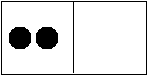
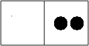
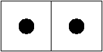

# Identity and Individuality in Quantum Theory
**First published Tue Feb 15, 2000; substantive revision Thu Feb 29, 2024**

*French, Steven, Bigaj, Tomasz*

What are the metaphysical implications of quantum physics? One way of approaching this question is to consider the impact of the theory on our understanding of objects as individuals with well defined identity conditions. According to the ‘Received View’, which was elaborated as the quantum revolution was taking place, quantum theory implies that the fundamental particles of physics cannot be regarded as individual objects in this sense. Such a view has motivated the development of non-standard formal systems which are appropriate for representing non-individual objects. However, it has also been argued that quantum physics is in fact compatible with a metaphysics of individual objects, but that such objects are indistinguishable in a sense which leads to the violation of Leibniz’s famous Principle of the Identity of Indiscernibles. This last claim has also been contested opening up a further way of understanding the individuality of quantum entities. As a result, we are faced with a form of underdetermination of the relevant metaphysics by the physics, in which we have, on the one hand, quantum objects-as-individuals and, on the other, quantum objects-as-non-individuals. It has been argued that this underdetermination of such fundamental metaphysical ‘packages’ has important implications for the realism-antirealism debate.

## 1. Introduction

It is typically held that chairs, trees, rocks, people and many of the so-called ‘everyday’ objects we encounter can be regarded as individuals. The issue, then, is how this individuality is to be understood, or what constitutes the ‘principle’ of individuality. This is an issue which has a very long history in philosophy. A number of approaches to it can be broadly delineated.

We might begin by noting that a tree and rock, say, can be *distinguished* in terms of their different properties. We might then go further and insist that this also forms the basis for ascribing *individuality* to them. Even two apparently very similar objects, such as two coins of the same denomination or so-called identical twins, will display *some* differences in their properties – a scratch here, a scar there, and so on. On this account such differences are sufficient to both distinguish and individuate the objects. This undergirds the so-called ‘bundle’ view of objects, according to which an object is *nothing but* a bundle of properties. In order to guarantee individuation, no two objects can then be absolutely indistinguishable, or indiscernible, in the sense of possessing *exactly* the same set of properties. This last claim has been expressed as the Principle of Identity of Indiscernibles and it ensures the individuality of the objects that fall under its scope; we shall return to it below.

However, this approach has been criticised on the grounds (among others) that we can surely *conceive* of two absolutely indistinguishable objects: thinking of Star Trek, we could imagine a replicator device which precisely reproduces an object, such as a coin or even a person, giving two such objects exactly the same set of properties. Not quite, one might respond, since these two objects do not and indeed cannot exist at the same place at the same time; that is, they do not possess the same spatio-temporal properties. In terms of *these* properties, then, the objects can still be distinguished and hence regarded as different individuals. Clearly, then, this approach to the issue of individuality must be underpinned by the assumption that individual objects are *impenetrable*.

A more thorough-going criticism of this property based approach to individuality insists that it conflates *epistemological* issues concerning how we distinguish objects, with *ontological* issues concerning the metaphysical basis of individuality. Thus, it is argued, to talk of distinguishability requires at least two objects but we can imagine a universe in which there exists only one. In such a situation, it is claimed, it would be inappropriate to say that the object is distinguishable but not that it is an individual. Although we do not actually find ourselves in such situations, of course, still, it is insisted, distinguishability and individuality should be kept *conceptually* distinct.

If this line of argument is accepted, then the principle of individuality must be sought in something over and above the properties of an object. One candidate is the notion of substance, in which properties are taken to inhere in some way. Locke famously described substance as a ‘something, we know not what’, since to describe it we would have to talk of its properties, but bare substance, by its very nature, has no properties itself.

Alternatively, the individuality of an object has been expressed in terms of its ‘haecceity’ or ‘primitive thisness’ (Adams 1979)[^adams-1979]. As the name suggests, this is taken to be the primitive basis of individuality, which cannot be analysed further. However, it has also been identified with the notion of self-identity, understood as a relational property (Adams *ibid*.) and expressed more formally in the form of a one-argument predicate ‘$x=a$’. Each individual is understood to be identical to itself. This may seem like a form of the property-based approach we started with, but self-identity is a rather peculiar kind of property. As we’ll see, denying that quantum objects are self-identical may be one way of capturing the idea that they are non-individuals.

It has to be added that some authors expand the concept of individuals beyond the issue of distinguishability and self-identity. Saunders (2015)[^saunders-2015] stipulates that individuals must be uniquely identified throughout the time they persist. This brings the perennial metaphysical problem of diachronic (transtemporal) identity into the picture (see Haslanger 2003 for an overview)[^haslanger-2003]. Another feature associated with individuals is the possibility of their identification in counterfactual scenarios, known also as transworld identifiability (Bigaj 2022, Ch. 8)[^bigaj-2022]. This aspect of individuality is particularly important in the context of permutations of quantum particles (the problem of counterfactual switching as described in Teller 2001)[^teller-2001]. The diachronic identifiability, on the other hand, is closely linked to the analysis of interactions between identical particles (e.g. scatterings).

This is just a sketch of some of the various positions that have been adopted. There has been considerable debate over which of them applies to the everyday objects mentioned above. But at least it is generally agreed that such objects should be regarded as individuals to begin with. What about the fundamental objects posited by current physical theories, such as electrons, protons, neutrons etc.? Can these be regarded as individuals? One response is that they cannot, since they behave very differently in aggregates from ‘classical’ individuals.

## 2. Quantum Non-Individuality

The argument for the above conclusion – that the fundamental objects of physics cannot be regarded as individuals – can be summed up as follows: First of all, both ‘classical’ and ‘quantal’ objects of the same kind (e.g. electrons) can be regarded as indistinguishable in the sense of possessing the same intrinsic (that is, state-independent) properties, such as rest mass, charge, spin etc. Consider now the distribution of two such indistinguishable particles over two boxes, or two states in general:

 (1)  (2)  (3)

\*Figures\*

In classical physics, (3) is given a weight of twice that of (1) or (2), corresponding to the two ways the former can be achieved by permuting the particles. This gives us four combinations or complexions in total and hence we can conclude that the probability of finding one particle in each state, for example, is 1/2. (Note that it is assumed that none of the four combinations is regarded as privileged in any way, so each is just as likely to occur.) This is an example of the well-known ‘Maxwell-Boltzmann’ statistics to which, it is claimed, thermodynamics was reduced at the turn of the twentieth century.

In quantum statistical mechanics, however, we have two ‘standard’ forms: one for which there are three possible arrangements in the above situation (both particles in one box, both particles in the other, and one in each box), giving ‘Bose-Einstein’ statistics; and one for which there is only one arrangement (one particle in each box), giving ‘Fermi-Dirac’ statistics (which underpins the Pauli Exclusion Principle and all that entails). Setting aside the differences between these two kinds of quantum statistics, the important point for the present discussion is that in the quantum case, a permutation of the particles is not regarded as giving rise to a new arrangement. This result lies at the very heart of quantum physics; putting things slightly more formally, it is expressed by the so-called ‘Indistinguishability Postulate’:

> If a particle permutation $P$ is applied to any state function for an assembly of particles, then there is no way of distinguishing the resulting permuted state function from the original unpermuted one by means of any observation at any time.

(The state function of quantum mechanics determines the probability of measurement results. Hence what the Indistinguishability Postulate expresses is that a particle permutation does not lead to any difference in the probabilities for measurement outcomes. The Indistinguishability Postulate leads to the well-known restrictions on the available states of groups of same-type particles and/or their measurable properties, represented by Hermitian (self-adjoined) operators (Messiah and Greenberg 1964)[^messiah-1964]. In the case of bipartite states there are only two types of states – symmetric (for bosons) and antisymmetric (for fermions) – that can guarantee the universal validity of the Indistinguishability Postulate. Following this restriction, the observables representing physical properties of systems of identical particles (including the Hamiltonian) should be permutation-invariant (symmetric), whereas non-symmetric operators are considered to be unphysical.)

The argument then continues as follows: that a permutation of the particles is counted as giving a different arrangement in classical statistical mechanics implies that, although they are indistinguishable, such particles can be regarded as individuals (indeed, Boltzmann himself made this explicit in the first axiom of his ‘Lectures on Mechanics’, couched in terms of the impenetrability assumption noted above). Since this individuality resides in something over and above the intrinsic properties of the particles in terms of which they can be regarded as indistinguishable, it has been called ‘Transcendental Individuality’ by Post (1963)[^post-1963]. This notion can be cashed out in various well-known ways, as indicated in the Introduction above: in terms of some kind of underlying Lockean substance, for example, or in terms of primitive thisness. More generally, one might approach it in modal fashion, through the doctrine of haecceitism: this asserts that two possible worlds may describe some individual in qualitatively the same way (that is, as possessing the same set of properties), yet represent that individual differently by ascribing a different haecceity or thisness in each world, or more generally, by ascribing some non-qualitative aspect to the individual (Lewis 1986; Huggett 1999a)[^huggett-1999a][^lewis-1986].

Conversely, it is argued, if such permutations are not counted in quantum statistics, it follows that quantum objects cannot be regarded as individuals in any of these senses (Post 1963)[^post-1963]. In other words, they are very different from most everyday objects in that they are ‘non-individuals’, in some sense. Note that we are appealing here to the possibility of transworld (counterfactual) identification as one of the defining features for individuals, which is different from the standard distinguishability-based concept. The fact that quantum statistics do not count permuted arrangements of particles as distinct speaks against their individuality in the sense of not retaining their identities in counterfactual scenarios, and not in the sense of being entirely indistinguishable (which they clearly are not, since they occupy distinct boxes and hence can be distinguished). The lack of counterfactual identifiability can be put down to the fact that identical particles possess the same set of state-independent properties, and thus cannot be uniquely ‘tagged’.

The radical metaphysical conclusion regarding the non-individuality of particles can be traced back to the reflections of Born and Heisenberg themselves and was further elaborated in the very earliest discussions of the foundations of quantum physics. As Weyl put it in his classic text on group theory and quantum mechanics:

> … the possibility that one of the identical twins Mike and Ike is in the quantum state E1 and the other in the quantum state E2 does not include two differentiable cases which are permuted on permuting Mike and Ike; it is impossible for either of these individuals to retain his identity so that one of them will always be able to say ‘I’m Mike’ and the other ‘I’m Ike.’ Even in principle one cannot demand an alibi of an electron! (Weyl 1931)[^weyl-1931]

Recalling the discussion sketched in the Introduction, if we were to create a twin using some kind of Star trek replicator, say, then in the classical domain such a twin could insist that ‘I’m here and she’s there’ or, more generally, ‘I’m in this state and she’s in that one’ and ‘swapping us over makes a difference’. In the classical domain each (indistinguishable) twin has a metaphysical ‘alibi’ grounded in their individuality. Weyl’s point is that in quantum mechanics, they do not.

## 3. Quantum Individuality

This conclusion – that quantal objects are not individuals – is not the whole story, however. First of all, the contrast between classical and quantum physics with regard to individuality and non-individuality is not as straightforward as it might seem. As already indicated, the above account involving permutations of particles in boxes appears to fit nicely with an understanding of individuality in terms of Lockean substance or primitive thisness. However, one can give an alternative field-theoretic account in which particles are represented as dichotomic ‘Yes/No’ fields: with such a field, the field amplitude is simply ‘Yes’ at location $x$ if the ‘particle’ is present at $x$ and ‘No’ if it is not (Redhead 1983)[^redhead-1983]. On this account, individuality is conferred via spatio-temporal location together with the assumption of impenetrability mentioned in the Introduction. Thus the above account of particle individuality in terms of either Lockean substance or primitive thisness is not necessary for classical statistical mechanics.

The particles-and-boxes picture above corresponds to the physicists’ multidimensional ‘phase space’, which describes which individuals have which properties, whereas the field- theoretic representation corresponds to ‘distribution space’, which simply describes which properties are instantiated in what numbers. Huggett has pointed out that the former supports haecceitism, whereas the latter does not and, furthermore, that the empirical evidence provides no basis for choosing between these two spaces (Huggett 1999a)[^huggett-1999a]. Thus the claim that classical statistical mechanics is wedded to haecceitism also becomes suspect.

Secondly, the above argument from permutations can be considered from a radically different perspective. In the classical case the situations with one particle in each box are given a weight of ‘2’ in the counting of possible arrangements. In the case of quantum statistics this situation is given a weight of ‘1’. With this weighting, there are two possible statistics, as we noted: Bose-Einstein, corresponding to a symmetric state function for the assembly of particles and Fermi-Dirac, corresponding to an anti-symmetric state function. Given the Indistinguishability Postulate, it can be shown that symmetric state functions will always remain symmetric and anti-symmetric always anti-symmetric. Thus, if the initial condition is imposed that the state of the system is either symmetric or anti-symmetric, then only one of the two possibilities – Bose-Einstein or Fermi-Dirac – is ever available to the system, and this explains why the weighting assigned to ‘one particle in each state’ is half the classical value. This gives us an alternative way of understanding the difference between classical and quantum statistics, not in terms of the lack of individuality of the objects, but rather in terms of which states are accessible to them (French 1989)[^french-1989]. In other words, the implication of the different ‘counting’ in quantum statistics can be understood as not that the objects are non-individuals in some sense, but that there are different sets of states available to them, compared to the classical case. On this view, the objects can still be regarded as individuals, with the issue remaining as to how that individuality is to be cashed out.

Both of these perspectives raise interesting and distinct metaphysical issues (for a useful introduction see Castellani 1998b)[^castellani-1998b]. Let us consider, first, the objects-as-individuals ‘package’. How is the relevant notion of individuality to be articulated? One option would be to take one of the traditional lines and ground it some form of primitive thisness or Lockean substance. However, this kind of metaphysics is anathema to many of a naturalistic persuasion, not least because it lies beyond the physical pale, as it were. Alternatively, one might take individuality to be primitive but then assuage any naturalistic tendencies by tying it to the idea of ‘countability’ – in the sense that we can always count how many quantum objects are in a given state – and take the latter to be both physically significant and capable of being ‘read off’ from the theory (Dorato and Morganti 2013)[^dorato-2013][^morganti-2013]. Nevertheless, it may be felt that naturalism is better satisfied by eschewing such primitivist moves and taking the individuality of the objects to be reducible to their discernibility and ground the latter in their properties, as presented by the theory (a feeling that may be further supported by doubts as to the physical plausibility of possible worlds containing only one object, as mentioned above). Of course, for this to work, we need some assurance that no two objects are indiscernible (or indistinguishable) in the relevant sense. Traditionally this assurance has been provided by Leibniz’s famous Principle of the Identity of Indiscernibles, so let us consider the status of this Principle in the context of modern physics.

## 4. Quantum Physics and the Identity of Indiscernibles

Now, of course, both quantum and classical objects of the same kind – such as electrons, say – are indistinguishable in the sense that they possess all intrinsic properties – charge, spin, rest mass etc. – in common. However, it may be argued that quantum objects are indistinguishable in a much stronger sense in that it is not just that two or more electrons possess the same intrinsic properties but that – on the standard understanding – no measurement whatsoever could in principle determine which one is which. If the non-intrinsic, state-dependent properties are identified with all the monadic or relational properties which can be expressed in terms of physical magnitudes standardly associated with self-adjoint operators that can be defined for the objects, then it can be shown that two bosons or two fermions in a joint symmetric or anti-symmetric state respectively have the same monadic properties and the same relational properties one to another (French and Redhead 1988; see also Butterfield 1993, Dieks and Versteegh 2008)[^butterfield-1993][^dieks-2008][^french-1988]. This has immediate implications for the Principle of the Identity of Indiscernibles which, expressed crudely, insists that two things which are indiscernible, must be, in fact, identical.

Setting aside the historical issue of Leibniz’s own attitude towards his Principle (see, for example, Rodriguez-Pereyra 2014)[^rodriguez-pereyra-2014], supporters of it have tended to retreat from the claim that it is necessary and have adopted the alternative view that it is at least contingently true (in the face of apparent counter-examples such as possible worlds containing just two indistinguishable spheres). There is the further issue as to how the Principle should be characterised and, in particular, there is the question of what properties are to be included within the scope of those relevant to judgments of indiscernibility. Excluding the property of self-identity (which, again, we’ll come back to below), three forms of the Principle can be broadly distinguished according to the properties involved: the weakest form, PII(1), states that it is not possible for two individuals to possess all properties and relations in common; the next strongest, PII(2), excludes spatio-temporal properties from this description; and the strongest form, PII(3), includes only monadic, non-relational properties. Thus, for example, PII(3) is the claim that no two individuals can possess all the same monadic properties (a strong claim indeed, although it is one way of understanding Leibniz’s own view).

In fact PII(2) and PII(3) can be argued to be violated in classical physics, where distinct particles of the same kind possess the same identifying, essential features, such as mass. Of course it may still be possible to discern them using some accidental non-relational and non-spatiotemporal properties, for instance velocity, energy or momentum, but in principle there is no reason why they can’t share these properties as well (we can consider two classical particles with the same velocities, and thus the same energy and momentum. Of course, Leibniz himself would not have been perturbed by this result, since he took the Principle of Identity of Indiscernibles to ultimately apply only to ‘monads’, which were the fundamental entities of his ontology. Physical objects such as particles were regarded by him as merely ‘well founded phenomena’.) However, PII(1) is not violated classically, since classical statistical mechanics typically assumes that such particles are impenetrable, in precisely the sense that their spatio-temporal trajectories cannot overlap. Hence they can be individuated via their spatio-temporal properties, as indicated above.

The situation appears to be very different in quantum mechanics, however. If the particles are taken to possess both their state-independent and state-dependent properties in common, as suggested above, then there is a sense in which even the weakest form of the Principle, PII(1), fails (Cortes 1976; Teller 1983; French and Redhead 1988; for an alternative view, see van Fraassen 1985 and 1991 as well as sec. 5 in this entry)[^cortes-1976][^french-1988][^teller-1983][^fraassen-1985][^fraassen-1991]. On this understanding, the Principle of Identity of Indiscernibles is actually false. Hence it cannot be used to effectively guarantee individuation via the state-dependent properties by analogy with the classical case. If one wishes to maintain that quantum particles are individuals, then their individuality will have to be taken as conferred by Lockean substance, primitive thisness or, in general, some form of non-qualitative haecceistic difference.

However, this conclusion has been challenged. First of all, it has been questioned whether quantum particles can be said to possess the relevant state-dependent properties in the sense that would be damaging to PII (Massimi 2001; see also Mittelstaedt and Castellani 2000)[^massimi-2001][^mittelstaedt-2000]. However, this argument only applies to monadic, state-dependent properties and so the above conclusion still holds for PII(2) and PII(3). In effect, what has been shown is that those versions of PII which allow relations to individuate are not the weakest forms of the Principle, but the only forms which are applicable.

This shift to relations as individuating elements has led to the development of a form of PII, based on Quine’s suggestions about discernibility, which allows objects to be ‘weakly’ discernible in relational terms (Saunders 2003a and 2006; for a useful overview see Bigaj 2015a)[^bigaj-2015a][^saunders-2003a][^saunders-2006]. Consider for example, two fermions in a spherically-symmetric singlet state. The fermions are not only indistinguishable in the above sense but also possess exactly the same set of spatio-temporal properties and relations. However, each enters into the symmetric but irreflexive relation of ‘having opposite direction of each component of spin to …’ on the basis of which they can be said to be ‘weakly discernible’ (for general discussions of different kinds of discernibility see Caulton and Butterfield 2012a; Bigaj 2015b; Ketland 2011; Ladyman, Linnebo and Pettigrew 2012)[^bigaj-2015b][^caulton-2012a][^ketland-2011][^ladyman-2012]. If we extend PII to incorporate such relations, the Principle can, it seems, be made compatible with quantum physics and the individuality of the fermions can be grounded in these irreflexive relations, without having to appeal to anything like primitive thisness. This result has also been extended to bosons (Muller and Saunders 2008; Muller and Seevinck 2009)[^muller-2008][^muller-2009], although some of the details are contentious, in particular with regard to the interpretation of some of the mathematical features that are appealed to in this account (see Bigaj 2015a and 2015b; Caulton 2013; Huggett and Norton 2014; Norton 2015)[^bigaj-2015a][^bigaj-2015b][^caulton-2013][^huggett-2014][^norton-2015]. In addition to such technical issues, there is the further philosophical concern that the appeal to irreflexive relations in order to ground the individuality of the objects which bear such relations involves a circularity: in order to appeal to such relations, one has had to already individuate the particles which are so related and the numerical diversity of the particles has been presupposed by the relation which hence cannot account for it (see French and Krause 2006; Hawley 2006 and 2009)[^french-2006][^hawley-2006][^hawley-2009]. One response to this worry would be to question the underlying assumption that relata must have the relevant ontological priority over relations and adopt some form of structuralist view of objects according to which the relata are eliminable in terms of relations (perhaps ‘emerging’, in some sense as ‘intersections’ of them) or, more mildly perhaps, argue that neither are accorded priority but come as a ‘package’ as it were (for further discussion see French 2014)[^french-2014]. It has been suggested, for example, that this whole discussion of weak discernibility reveals a category of entity that has received little attention so far, namely that of ‘relationals’: objects that can be discerned by means of relations only (Muller 2011, 2015)[^muller-2011][^muller-2015]. I shall return to the structuralist perspective below (but for an alternative, ‘coherentist’ account, see Calosi and Morganti 2018)[^calosi-2018]. More generally, however, it has been argued that this whole debate is orthogonal to that over the status of PII since what weak discernibility grounds is merely numerical distinctness, rather than the robust sense of discernibility that PII was originally concerned with (Ladyman and Bigaj 2010)[^ladyman-2010]. The latter involves some sense of difference over and above numerical distinctness but weakly discernible relations such as ‘having opposite direction of each component of spin to …’ do not provide this. Hence, it is claimed, PII remains violated by quantum mechanics (although see Friebe 2014 where the principle is defended in the context of a specific understanding of quantum entanglement)[^friebe-2014].

The above considerations are typically presented within the ‘orthodox’ interpretation of quantum mechanics but there are a further set of responses which step outside of this. Thus van Fraassen, for example (van Fraassen 1985 and 1991)[^fraassen-1985][^fraassen-1991] has advocated a form of ‘modal’ interpretation, in the context of which (standard) PII can be retained. At the core of this approach lies a distinction between two kinds of state: the ‘value’ state, which is specified by stating which observables have values and what they are; and the ‘dynamic’ state, which is specified by stating how the system will develop both if isolated and if acted upon in some definite fashion. The evolution of the latter is deterministic, in accordance with Schroedinger’s equation, but the value state changes unpredictably, within the limits set by the dynamic state (for criticism see some of the papers in Dieks and Vermaas 1998)[^dieks-1998]. Because the actual values of observables do not increase predictive power if added to the relevant dynamic state description, they are deemed to be ‘empirically superfluous’. In the case of fermions, at least, distinct value states can be assigned to each particle and PII saved.

However concerns have been raised over the objectivity of such value state attributions (Massimi op. cit., p. 318, fn. 11) and one might regard the associated ‘empirically superfluous’ properties as merely conceptual. This bears again on the important issue of what kinds of properties may be admitted to lie within the scope of the Principle. Clearly some would appear to be beyond the pale: saving PII by regarding the particle labels themselves as intrinsic properties is surely unacceptable. Furthermore, bosons must be treated differently, since they can have the same dynamic and value states. In this case, van Fraassen suggests that each boson is individuated by its history, where this is again to be understood as ‘empirically superfluous’. Of course, it might seem odd that an approach which originally sought to avoid the grounding of the individuality of objects in something like Lockean substance should find itself having to include empirically superfluous factors within the scope of PII.

Another ‘unorthodox’ approach incorporates the Bohmian interpretation of quantum mechanics and in particular it has been suggested that it might form the basis of an alternative conception of particle individuality in terms of their spatio-temporal trajectories. As is well known, attributing distinguishing spatio-temporal trajectories to quantum objects faces acute difficulties under the orthodox interpretation of quantum mechanics. On the Bohm interpretation, however, they are allowed; indeed, the only observable admitted is that of position. What this interpretation gives us is a dual ontology of point particles plus `pilot’ wave, where the role of the latter is to determine the instantaneous velocities of the former through the so-called ‘guidance equations’. These ‘complete’ the standard formulation of quantum mechanics so that, in addition to the quantum state, whose development is determined by the Schrödinger equation, there is also a set of single-particle trajectories, each of which is determined by the guidance equation, plus the initial positions of the particles (for a review see Cushing *et al*. 1996)[^cushing-1996]. Such an interpretation appears to provide a natural home for the metaphysical package which takes quantum objects to be individuals (see, for example, Brown *et al*. 1999)[^brown-1999] and, indeed, a form of PII(1) can now be defended against the above conclusion.

Nevertheless, things are not quite as straightforward as they might seem: it has been argued that intrinsic properties cannot be considered as possessed solely by the objects but in some sense must be assigned to the pilot wave as well (Brown *et al*.1994)[^brown-1994]. Thus, again, there is an ontological cost involved in retaining this view of objects as individuals.

What if one were to consider the evolution of the system concerned in the multi-dimensional ‘configuration space’ in terms of which the wave function must be described? Here the implications of considering particle permutations are encoded in the topology of such a space by identifying points corresponding to such a permutation and thereby constructing what is known as the ‘reduced configuration space’ formed by the action of the permutation group on the full configuration space. As in the case of ‘ordinary’ space-time, some form of ‘impenetrability assumption’ must be adopted to ensure that – in the case of those particles that are not bosons at least – no two particles occupy the same point of this reduced space.Here Bohmian mechanics offers some advantage: it turns out that the guidance equations ensure the non-coincidence of the relevant particle trajectories (Brown *et al*. 1999)[^brown-1999]. In effect ‘impenetrability’ is built into the dynamics and thus the configuration space approach and de Broglie-Bohm interpretation fit nicely together.

## 5. The Heterodox Approach to Quantum Discernibility

The claim that quantum particles of the same type violate the PII in the strongest sense (that is, that they possess the exact same relational and non-relational properties, be it state-independent or state-dependent) constitutes the core of what can be labelled as the orthodox approach to quantum individuality. However, in recent years an alternative view, which questions the indiscernibility thesis as spelled out above, has gained wider popularity. This view can be referred to as heterodoxy. It can be traced back to the observation that in scientific practice we often and typically discern particles belonging to the same category, such as two electrons (Dieks and Lubberdink 2011)[^dieks-2011]. An experimenter working in a lab clearly distinguishes between an electron detected in a cloud chamber and a different electron that occupies a particular star in the Andromeda Galaxy. These electrons plausibly differ with respect to a multitude of their physical properties: their spatiotemporal locations, energies, spins etc. Can this intuition be given a firm conceptual and formal foundation in the light of the inevitable symmetrization postulate and permutation invariance? As a matter of fact, it can.

The issue of how to formally express facts of discernibility in an entirely symmetric (i.e. permutation-invariant) language has been resolved in (Ghirardi et al. 2002, Ghirardi and Marinatto 2003)[^ghirardi-2003][^ghirardi-2002]. They use symmetric combinations of orthogonal single-particle projecting operators (projectors) in order to express the fact that two (or more) particles occupying a symmetric or antisymmetric state nevertheless possess distinct properties. To give a simple example: if $P_{\text{up}}$ is the projector representing the property “spin-up” (in some direction) and $P_{\text{down}}$, correspondingly, represents “spin-down”, then the symmetric combination $P_{\text{up}} \otimes P_{\text{down}} + P_{\text{down}} \otimes P_{\text{up}}$ will represent the property of a two-particle system that can be informally expressed as “One particle possesses spin up and the other possesses spin down (but we don’t know which)”. This idea has been picked up and expanded upon by several authors (Saunders 2013, Caulton 2014a, 2014b, Dieks 2020, 2023, Dieks and Lubberdink 2020, Bigaj 2015c, 2022)[^bigaj-2015c][^bigaj-2022][^caulton-2014a][^caulton-2014b][^dieks-2020][^dieks-2023][^dieks-2020-2][^saunders-2013]. It turns out (Caulton 2014a)[^caulton-2014a] that using the above method of discernment we can always distinguish two fermions of the same type with the help of some orthogonal projectors, but not necessarily one-dimensional. The discernibility statement with respect to fermions can be seen as a generalization of Pauli’s exclusion principle. With respect to same-type bosons, their total indiscernibility still persists in the case of products of identical states, such as in the case of a bosonic condensate. Thus according to the heterodoxy, the PII is never breached by pairs of identical fermions, while the cases of its violation for identical bosons are limited to special states.

How can this fact be reconciled with the formally unassailable and indeed rather straightforward arguments for the total indiscernibility of same-type particles, as presented in (French and Redhead 1988, Butterfield 1993, and Dieks and Versteegh 2008)[^butterfield-1993][^dieks-2008][^french-1988]? As it turns out, all these formal derivations presuppose an interpretational principle identified for the first time by Caulton (2014a)[^caulton-2014a] and dubbed by him “factorism”. When we write down a state of a system of two same-type particles in its symmetric or antisymmetric form, this state is supposed to occupy a tensor product of two identical Hilbert spaces: $H_1 \otimes H_2$. Factorism claims that these Hilbert spaces represent states and properties of the particles constituting the system. Consequently, labels 1 and 2 that we use to distinguish the two components in the factorization of the total Hilbert space can be also used to refer to individual particles. And indeed this is what is typically done when interpreting symmetric/antisymmetric states of two particles: the labels used in the description of such states, and with respect to which the requirement of symmetry/antisymmetry is imposed, are assumed to refer directly to the particles occupying these states. However, Caulton observes that this assumption is by no means forced upon us by the standard quantum-mechanical formalism. When we switch to the method of individuation based on symmetric projectors, as spelled out above, the labels no longer play the referential role. This can help us make sense of the somewhat cryptic remarks by Ghirardi et al. (2002) that the symmetric projectors enable us to differentiate particles by their properties without telling “which is which”. This can be interpreted as expressing the fact that while we can definitely say that one electron has spin up and the other has spin down, we cannot associate these electrons with any label used in the description of their joint state, simply because these labels are not referential anymore. As Caulton suggests, labels in symmetric/antisymmetric states play a mere formal role as indicators of certain mathematical symmetries, akin to gauge symmetries in electromagnetism or other physical theories.

The heterodox approach to quantum discernibility encounters several controversial issues and stumbling blocks that need to be cleared. First of all, in order to avoid immediate objections that the approach is blatantly wrong when it comes to an interpretation of well-known entangled states, such as the singlet spin state (since the heterodoxy seems to imply that individual particles in such a state possess well-defined spins, contrary to the common knowledge), the states of same-time particles have to be always written in their full form, including internal and external (spatial) degrees of freedom (see Bigaj 2022, Ch. 5 for details)[^bigaj-2022]. This example also suggests that the standard concept of entanglement needs to be modified in order to accommodate the change in perspective on quantum individuation present in the heterodox approach. The state of same-type particles is considered non-entangled if it can be produced by symmetrizing or antisymmetrizing a product of orthogonal states (this concept is called GMW-entanglement by Caulton to differentiate it from the ordinary notion of entanglement as non-factorizability). Thus typical antisymmetric states considered in the literature, even though non-factorizable, do not count as entangled (but see extensive discussions of this problem and some dissenting opinions in Muller and Leegwater 2020, Dieks 2023, Bigaj 2023)[^bigaj-2023][^dieks-2023][^muller-2020]

Another interesting feature of the heterodox approach is that it admits a number of distinct and even incompatible individuations for particles occupying the same joint state. This feature is variably called arbitrariness (Ghirardi), conventionality (Caulton) or ambiguity (Bigaj). Limiting ourselves to the case of non-GMW-entangled states of two identical fermions, we can show that there is an infinite number of mutually incompatible pairs of single-particle projectors that can individuate these fermions. This creates a conceptual problem, since we have no general way to choose one such individuation as representing actual reality, and yet they cannot be correct all at once. In some cases a pragmatic selection of one individuation is possible, for instance when we are interested in individuations with the help of well-defined spatial locations, but this method fails to resolve the problem in all possible scenarios. Bigaj (2022)[^bigaj-2022] suggests that we should introduce the concept of relativized existence to account for this phenomenon, but this metaphysical proposal needs to be further developed.

What are the consequences of the heterodox approach for the issue of quantum individuality? It seems that at least in the case of fermions we can reinstate individuality understood in terms of absolute distinguishability by properties. But things are not that simple. As we have seen above, we have to take into account the decidedly non-classical phenomenon of ambiguity of individuation by quantum properties. Even setting this problem aside, we have to note that the conditions of individuality based on transtemporal and transworld identifications are by no means guaranteed to be satisfied. As a matter of fact, the transworld (counterfactual) identity of particles is not available even under the heterodox approach without some heavy-weight metaphysical concepts, such as that of haecceities or primitive identities. Regarding transtemporal identifications, the heterodox approach is more flexible than its rival, the orthodox view. That is, it admits the possibility of definite diachronic identifications of interacting particles, as long as there are certain “markers” associated with these particles that do not change during the interaction, such as spins in some directions (Feynman et al. 1964, Cohen-Tannoudji et al. 1978, for dissenting opinions and alternative treatments of scattering experiments see Kastner 2023, de Barros and Holik 2023)[^cohen-tannoudji-1978][^barros-2023][^kastner-2023]. However, in typical scenarios such identifications are not possible, and interacting particles ‘merge’ their identities giving rise to well-known interference effects. Consequently, even under the heterodox approach the concept of quantum individuality becomes shaky. Whether this implies that we should interpret quantum particles straightforwardly as non-individuals, or just modify the classical concept of individuality, remains to be seen. However, the orthodox approach with its Indiscernibility Thesis is definitely more conducive to the concept of non-individuality. But now the obvious question arises: what sense can we make of this notion?

## 6. Non-individuality and self-identity

Let us recall Weyl’s statement that one can’t ask alibis of electrons. Dalla Chiara and Toraldo di Francia refer to quantum physics as ‘the land of anonymity’, in the sense that, on this view, the objects cannot be uniquely labelled (1993 and 1995). They ask, then, how can we talk about what happens in such a land? Their suggestion is that quantum objects can be regarded as ‘intensional-like entities’, where the intensions are represented by conjunctions of intrinsic properties. The extension of the natural kind, ‘electron’, say, is then given by the collection of indistinguishable elements, or a ‘quaset’. The theory of such quasets then gives the possibility of a semantics for quantum objects without alibis (*ibid*.).

Alternatively, but relatedly, non-individuality can be understood in terms of the denial of self-identity. This suggestion can be found most prominently in the philosophical reflections of Born, Schrödinger, Hesse and Post (Born 1943; Schrödinger 1952; Hesse 1963; Post 1963)[^born-1943][^hesse-1963][^post-1963][^schrödinger-1952]. It is immediately and clearly problematic, however: how can we have objects that are not identical to themselves? Such self-identity seems bound up with the very notion of objecthood in the sense that it is an essential part of what it is to be that object (thus it has been suggested that non-individuality might be better understood in terms of the loss of spatio-temporal trajectories in quantum physics; see Arenhart, Bueno and Krause 2019)[^arenhart-2019][^bueno-2019][^krause-2019]. This intuition is summed up in the Quinean slogan, ‘no entity without identity’ (Quine 1969)[^quine-1969], with all its attendant consequences regarding reference etc.

However, Barcan Marcus has offered an alternative perspective, insisting on ‘No identity without entity.’ (Marcus 1993)[^marcus-1993] and arguing that although ‘… all terms may “refer” to objects… not all objects are things, where a thing is at least that about which it is appropriate to assert the identity relation.’ (*ibid*., p. 25) Object-reference then becomes a wider notion than thing-reference. Within such a framework, we can then begin to get a formal grip on the notion of objects which are not self-identical through so-called ‘Schrödinger logics’, introduced by da Costa (da Costa and Krause 1994)[^costa-1994] These are many-sorted logics in which the expression $x = y$ is not a well-formed formula in general; it is where $x$ and $y$ are one sort of term, but not for the other sort corresponding to quantum objects. A semantics for such logics can be given in terms of ‘quasi-sets’ (da Costa and Krause 1997)[^costa-1997]. The motivation behind such developments is the idea that collections of quantum objects cannot be considered as sets in the usual Cantorian sense of ‘… collections into a whole of definite, distinct objects of our intuition or of our thought.’ (Cantor 1955, p. 85)[^cantor-1955]. Quasi-set theory incorporates two kinds of basic posits or ‘Urelemente’: m-atoms, whose intended interpretation are the quantal objects and M-atoms, which stand for the ‘everyday’ objects, and which fall within the remit of classical set theory with Ur-elements. Quasi-sets are then the collections obtained by applying the usual Zermelo-Fraenkel framework plus Ur-element ZFU-like axioms to a basic domain composed of m-atoms, M-atoms and aggregates of them (Krause 1992; for a comparison of qua-set theory with quasi-set theory, see Dalla Chiara, Giuntini and Krause 1998)[^dalla-1998][^krause-1992].

These developments supply the beginnings of a categorial framework for quantum ‘non- individuality’ which, it is claimed, helps to articulate this notion and, bluntly, make it philosophically respectable (extensive details are given in French and Krause 2006; see also Arenhart 2012; Domenach and Holik 2007; Domenach, Holik and Krause, 2008; Krause 2010)[^arenhart-2012][^domenach-2007][^domenach-2008][^french-2006][^krause-2010]. Crucially, within this formal framework, a sense of countability is retained in that collections of quantum entities possess a (kind of) cardinality but not an ordinality, so we can, in effect, say how many objects there are, even though we cannot place them in numerical order. Critical discussions of both these formal details and of the basis for attributing ‘non-individuality’ to quantum objects can be found in Bueno et. al. 2011 and Sant’ Anna 2019. Much of this criticism has proceeded on the basis of insisting that we do not need to adopt such an apparently radical approach. Thus advocates of ‘weak discernibility’, discussed above, have argued that this notion yields an appropriately naturalist sense of individuality, suitable for quantum physics. (More specifically, weakly discerning relations offer hope to ground facts of numerical identity and distinctness in purely qualitative facts, thus undercutting the argument that identity does not apply to indistinguishable quantum particles (but see Bigaj 2015a for an argument that weakly discerning relations used in quantum mechanics do not achieve this goal)[^bigaj-2015a]. On the other hand, the heterodox approach discussed in the previous section reinstates absolute discernibility of quantum particles and thus eliminates one of the central arguments for the formal theory of non-individuals, however, retaining other arguments from the lack of reidentification criteria and unique counterfactual identity.) On the other hand, Dorato and Morganti (2013)[^morganti-2013] insist, as already noted, that one can retain countability, and individuality, as primitive notions and that this is to be preferred over any shift to non-individuality (for a response to the latter and defence of the above formal framework, see Arenhart and Krause 2014)[^arenhart-2014]. Jantzen on the other hand, has argued that identity and cardinality are tied together as a ‘matter of meaning’ rather than metaphysics and that, consequently, talk of entities without identity is either meaningless or, in fact, talk about something else altogether (Jantzen 2019)[^jantzen-2019]. Likewise Bueno has insisted that identity is too fundamental to be given up so readily and suggests that we can infer the non-individuality of quantum particles directly from their indistinguishability with identity itself understood as a ‘useful idealization’ that simplifies our conceptual framework and allows us to predict the behaviour of the relevant objects – in this case quantal entities (Bueno 2014; for responses see Arenhart 2017a and Krause and Arenhart 2019)[^arenhart-2017a][^arenhart-2019][^bueno-2014][^krause-2019].

The formal theory of quasi-sets has been shown to support an alternative quantum metaphysics of properties rather than non-individual particles (Holik et al. 2022)[^holik-2022]. This conception, which takes its cue from the well-known bundle theory of objects, has been developed by da Costa, Lombardi and others (Lombardi and Castagnino 2008; da Costa et al. 2013, da Costa and Lombardi 2014, Lombardi and Dieks 2016, Lombardi 2023a, 2023b)[^costa-2014][^costa-2013][^lombardi-2023a][^lombardi-2023b][^lombardi-2008][^lombardi-2016]. According to their proposal, the fundamental objects are properties (divided into type-properties and case-properties) and the fundamental facts about these properties involve their instantiation. States of two identical particles can be described as cases of multiple instantiations of the same properties (such a situation is characterized as an ‘aggregation’ or ‘merging’ of bundles). Since bundles are not individuals, the Principle of the Identity of Indiscernibles does not apply to them. Also, the problems of reidentification (diachronic identity) and counterfactual identity do not arise in this approach. However, the ontology of properties may be accused of being at odds with scientific practice, where the concept of particles in various experimental settings continues to be employed (see a proposal to use a concept of particles as emergent entities in Dieks 2023)[^dieks-2023].

Both the framework of quasi-set theory and the underlying metaphysics have been extended into the foundations of Quantum Field Theory, where it has been argued, one has non-individual ‘quanta’ (Teller 1995)[^teller-1995]. A form of quasi-set theory may provide one way of formally capturing this notion (French and Krause 2006; for concerns about such a move see Sant’ Anna 2019)[^french-2006][^sant’-2019]. It has also been suggested that this offers a way of understanding the sense in which quantum objects may be regarded as vague (French and Krause 2003)[^french-2003][^french-2003-2][^french-2003-3], although it has been questioned whether vagueness is the appropriate notion here (Darby 2010)[^darby-2010] and also whether quasi-set theory offers the most perspicuous way of capturing this sense (Smith 2008)[^smith-2008]. Finally, for those who are leery of quasi-sets and their attendant formal apparatus, there is also the option of returning to Weyl’s original insight, which underpins the quote above, and appropriating his idea of an ‘aggregate’. If this is interpreted non-set-theoretically as an equivalence relation, where the relevant elements are understood as simply objects that have certain properties in common, one can continue to maintain that such objects do not have well-defined identity conditions (Bueno 2019)[^bueno-2019]. Indeed, there may be a variety of such frameworks, both formal and metaphysical, in terms of which non-individuality may be understood (Arenhart 2017b)[^arenhart-2017b].

## 7. Metaphysical Underdetermination

We now appear to have an interesting situation. Quantum mechanics is compatible with two distinct metaphysical ‘packages’, one in which the objects are regarded as individuals and one in which they are not. Thus, we have a form of ‘underdetermination’ of the metaphysics by the physics (see van Fraassen 1985 and 1991; French 1989; Huggett 1997)[^french-1989][^huggett-1997][^fraassen-1985][^fraassen-1991]. This has implications for the broader issue of realism within the philosophy of science. If asked to spell out her beliefs, the realist will point to currently accepted fundamental physics, such as quantum mechanics, and insist that the world is, at least approximately, however the physics says it is. Of course, there are the well-known problems of ontological change (giving rise to the so-called Pessimistic Meta-Induction) and Underdetermination of Theories by the Empirical data. However, this underdetermination of metaphysical packages seems to pose an even more fundamental problem, as the physics involved is well entrenched and the difference in the metaphysics seemingly as wide as it could be. These packages support dramatically different world-views: one in which quantum objects, such as electrons, quarks and so forth, are individuals and one in which they are not. The realist must then face the question: which package corresponds to the world?

One option would be to refuse to answer and insist that all the realist is required to do is to state how the world is, according to our best theories; that is, to articulate her realism in terms of electrons, quarks etc. and what physics tells us about them and no more, metaphysically speaking. This might be called a ‘shallow’ form of realism (Magnus 2012)[^magnus-2012] and it raises the obvious worry that the content of such shallow realism amounts to no more than a recitation of the relevant physical content of our best theories, with no consideration of whether that content is concerned with objects or not, and whether the former are individuals or not.

At the other extreme, one might be tempted to give up realism altogether and adopt an anti-realist stance. Thus the constructive empiricist, taking realism to be metaphysically informed, and hence ‘deep’ rather than ‘shallow’, draws as the lesson from this underdetermination, ‘so much for metaphysics’ and realism along with it. Since on this view, all that theories can tell us is how the world *could* be, the different metaphysical packages of objects-as-individuals and as non-individuals simply amount to different ways of spelling that out (van Fraassen 1991)[^fraassen-1991].

In between these extremes are various options for handling the underdetermination, corresponding to different levels of ‘deep’ realism. Thus one might try to argue that the underdetermination can be ‘broken’ in some way. One might, for example, appeal to some metaphysical factor or other in support of one package over the other, or shift to meta-metaphysical considerations in order to argue, for example, that individuality based on weak discernibility has certain advantages over rival accounts and also over non-individuality, with its attendant non-standard formal underpinning. However Arenhart argues that weak discernibility generates further metaphysical underdetermination and hence cannot support a fully naturalistic understanding of quantum mechanics as some of its advocates have claimed (Arenhart 2017b, see also Arenhart 2023, where he expresses his skepticism regarding the possibility of solving the metaphysical problem of individuality on the basis of a general theory such as quantum mechanics)[^arenhart-2017b][^arenhart-2023]. Alternatively, of course, one could argue the other way and insist that the non-individuality package avoids having to choose between different metaphysical accounts of individuality, at least, and that the formal shift to quasi-set theory is not as dramatic as might be thought. Ultimately, however, its not at all clear what weight should be given to the various factors involved or even if a coherent weighting scheme can be applied in the first place.

Instead one might appeal to broadly methodological factors to break the underdetermination. Thus it has been argued that the package of objects-as-non-individuals meshes better with quantum field theory (QFT) where, it is claimed, talk of individuals is avoided from the word go (Post 1963; Redhead and Teller 1991 and 1992; Teller 1995)[^post-1963][^redhead-1991][^redhead-1992][^teller-1995]. The central argument for this claim focuses on the core understanding that objects may indeed be regarded as individuals in quantum physics but as such are subject to restrictions on the sets of states they may occupy. The states that are inaccessible to the particles of a particular kind, such as electrons say, can be taken as corresponding to just so much ‘surplus structure’. In particular, if the view of particles as individuals is adopted, then it is entirely mysterious as to why a particular sub-set of these inaccessible, surplus states, namely those that are non-symmetric, are not actually realised. Applying the general methodological principle that a theory which does not contain such surplus structure is to be preferred over one that does, Redhead and Teller conclude that we have grounds for preferring the non-individuals package and the mystery of the inaccessible states simply does not arise (Redhead and Teller 1991 and 1992)[^redhead-1991][^redhead-1992].

This line of argument has been criticised by Huggett on the grounds that the apparent mystery is a mere fabrication: the inaccessible non-symmetric states can be ruled out as simply not physically possible (Huggett 1995)[^huggett-1995]. The surplus structure, then, is a consequence of the representation chosen and has no further metaphysical significance. However, it has been insisted that a theory should also tell us why a particular state of affairs is not possible. So, consider the possible state of affairs in which a cold cup of tea spontaneously starts to boil. Statistical mechanics can explain why we never observe such a possibility, whereas the quantum-objects-as-individuals view cannot explain why we never observe non-symmetric states and hence it is deficient in this regard (Teller 1998)[^teller-1998].

Unfortunately, the analogy is problematic. Statistical mechanics does not say that the above situation never occurs but only that the probability of its occurrence is extremely low. The question then reduces to that of ‘why is this probability so low?’ The answer to that is typically given in terms of the very low number of states corresponding to the tea boiling compared to the vast number of states for which it remains cold. Why, then, this disparity in the number of accessible states? Or, equivalently, why do we find ourselves in situations in which entropy increases? One answer takes us back to the initial conditions of the Big Bang. A similar line can then be taken in the case of quantum statistics. Why do we never observe non-symmetric states? Because that is the way the universe is and we should not expect quantum mechanics alone to have to explain why certain initial conditions obtain and not others. Here we recall that the symmetry of the Hamiltonian ensures that if a particle is in a state of a particular symmetry (corresponding to Bose-Einstein statistics, say, or Fermi-Dirac) to begin with, it will remain in states of that symmetry. Hence, if non-symmetric states do not feature in the initial conditions which held at the beginning of the universe, they will remain forever inaccessible to the particles. The issue then turns on different views of the significance of the above ‘surplus structure’ (see Belousek 2000.)[^belousek-2000]

Furthermore, even if we accept the methodological principle of ‘the less surplus structure the better’, it is not clear that QFT understood in terms of non-individual ‘quanta’ offers any significant advantage in this respect (although see da Costa and Holik 2015 for an account in these terms of states with undefined particle number, characteristic of QFT)[^costa-2015]. Indeed, it has been argued that the formalism of QFT is also compatible with the alternative package of objects as individuals. Van Fraassen has pressed this claim (1991), drawing on de Muynck’s construction of state spaces for QFT which involve labelled particles (1975). Butterfield, however, has argued that the existence of states that are superpositions of particle number, within QFT, undermines the equivalence (1993). Nevertheless, Huggett insists, in this case the undermining is empirical, rather than methodological (Huggett 1995)[^huggett-1995]. When the number is constant, it is the states for arbitrary numbers of particles which are so much surplus structure and now, if the methodological argument is applied, it is the individuals package which is to be preferred.

It is also worth noting, perhaps, that some of this ‘surplus’ structure corresponds to so-called ‘paraparticle’ statistics, or forms of quantum statistics that are neither bosonic nor fermionic. These were acknowledged as possible by Dirac as early as the 1930s but were only fully developed theoretically from the late 1950s. For a brief period in the mid-1960s it was thought that quarks might be paraparticles, before the same statistical behaviour came to be described in terms of the new intrinsic property of ‘colour’ leading to the development of quantum chromodynamics, which effectively pushed paraparticle theory into the theoretical twilight (for a summary of the history see French and Krause 2006, Ch. 3; for a discussion of paraparticles in the context of issues relating to particle indistinguishability, see Caulton and Butterfield 2012b)[^caulton-2012b][^french-2006]. This suggests that paraparticle statistics can always be re-described in conventional terms – a suggestion that has been taken up by Baker et. al. in the context of algebraic QFT, thereby eliminating this form of surplus structure at least (Baker, Halvorson and Swanson 2015)[^baker-2015].

There remains considerable scope for further exploration of all these issues and concerns in the context of quantum field theory (see also Auyang 1995)[^auyang-1995] and a collection of relevant historical and philosophical reflections can be found in Cao (1999)[^cao-1999].

A further approach to this underdetermination is to reject both packages and seek a third way. Thus Morganti has argued that both of the above metaphysical packages assume that everything qualitative about an object must be encoded in terms of a property that it possesses (Morganti 2009)[^morganti-2009]. Dropping this assumption allows us to consider quantum statistics as describing ‘inherent’ properties of the assembly as a whole. The (anti-)symmetry of the relevant states is then accounted for in terms of the disposition of the system to give rise to certain correlated outcomes upon measurement. This is presented as an extension of Teller’s ‘relational holism’ (Teller 1989), and relatedly, the notion of ‘inherence’ involves the denial of the supervenience of the properties of the whole on those of the parts. However, as just indicated, it comes with a cost: that of admitting holistic dispositional properties and the metaphysics of these in the quantum context requires further development, as does the sense in which such inherent properties ‘emerge’ when systems interact. Earlier and along similar metaphysical lines, Lavine suggested that quantum objects can be regarded as the smallest possible amounts of ‘stuff’ and, crucially, that a multi-particle state represents a further amount of stuff such that it does not contain proper parts (1991; see also Jantzen 2019)[^jantzen-2019]. Such a view, he claims, avoids the metaphysically problematic aspects of both the individuals and non-individuals packages. Of course, there are then the issues of the metaphysics and logic of ‘stuff’, but it can be argued that these are familiar and not peculiar to quantum mechanics. One such issue concerns the nature of ‘stuff’: is it our familiar primitive substance? Substance as a fundamental metaphysical primitive faces well-known difficulties and it has been suggested that it should be dropped in favour of some form of ‘bundle theory’, as mentioned at the very beginning of this article. If the individual objects are understood to be bundles of ‘tropes’, where a trope is an individual instance of a property or a relation, and if this notion is broadened to include individuals whose existence depends on that of others which are not a part of them then, it is claimed, this notion may be flexible enough to accommodate quantum physics (Simons 1998; see also Morganti 2013)[^morganti-2013][^simons-1998]. Another issue concerns the manner in which ‘stuff’ combines: how do we go from the amounts of stuff represented by two independent photons, to the amount represented by a joint two-photon state? The analogies Lavine gives are well known: drops of water, money in the bank, bumps on a rope (Teller 1983; Hesse 1963)[^hesse-1963][^teller-1983]. Of course, these may also be appropriated by the non-individual objects view but, more significantly, they are suggestive of a field-theoretic approach in which the ‘stuff’ in question is the quantum field.

Here we return to issues concerning the metaphysics of quantum field theory and it is worth pointing out that underdetermination may arise here too. In classical physics we are faced with a choice between the view of the field as a kind of global substance or stuff and an alternative conception in terms of field quantities assigned to and hence as properties of, the points of space-time. In the case of quantum field theory, the field quantities are not well-defined at such points (because of difficulties in defining exact locational states in quantum field theory) but are instead regarded as ‘smeared’ over space-time regions (see Teller 1999)[^teller-1999]. The underdetermination remains, of course: between an understanding of the given quantum field in terms of some kind of global substance and the alternative conception in terms of the properties of space-time *regions*. Taking the first option obviously requires a metaphysically articulated form of substantivalism applicable to quantum field theory. Many commentators have preferred the second option, but now, of course, attention must be paid to the metaphysical status of the space-time regions over which the field properties are taken to be instantiated. Typically, these will be taken to be composed of points of space-time and conceiving of a field in terms of a set of properties meshes comfortably with the approach that takes space-time to be a kind of substance or ‘stuff’ itself. But this too faces well known difficulties in the context of modern physics (see, for example, Earman 1989)[^earman-1989]. In particular, space-time substantivalism has been argued to have extremely unpalatable consequences (Earman and Norton 1987)[^earman-1987]. Unfortunately, such a properties-based account of fields is difficult to reconcile with the alternative view of space-time as merely a system of relations (such as contiguity) between physical bodies: if the field quantities are properties of space-time regions and the latter are understood, ultimately, to be reducible to relations between physical objects, where the latter are conceived of in field-theoretic terms, then a circularity arises (see Rovelli 1999)[^rovelli-1999]. One way forward would be to draw on alternative accounts of the nature of spacetime. Thus Stachel has suggested that we drop the sharp, *metaphysical* distinction between *things* and *relations* between things and adopt a broadly ‘structuralist’ view of spacetime (Stachel 1999; see the essays in Rickles, French & Saatsi 2006)[^french-2006][^rickles-2006][^stachel-1999]. Suitably extended, such a ‘structuralist’ approach might offer a way around the above incompatibility by regarding both space-time and the quantum field in structural terms, rather than in terms of substances, properties or relations (see Auyang 1995; Cao 2003; French and Ladyman 2003; Kantorovich 2003; Lyre 2004; Saunders 2003b)[^auyang-1995][^cao-2003][^french-2003][^french-2003-2][^french-2003-3][^kantorovich-2003][^lyre-2004][^saunders-2003b].

This takes us to a further possible response to the above metaphysical underdetermination which urges realism to retreat from a metaphysics of objects and develop an ontology of structure compatible with the physics (Ladyman 1998 and 2014)[^ladyman-1998][^ladyman-2014]. An early attempt to do this in the quantum context can be seen in the work of Cassirer who noted the implications of the new physics for the standard notion of individual objects and concluded that quantum objects were describable only as ‘“points of intersection” of certain relations’ (1937, p. 180) Setting aside the neo-Kantian elements in Cassirer’s structuralism, this view of quantum entities has been developed in the context of a form of ‘ontic’ structural realism (Ladyman and Ross 2007)[^ladyman-2007]. Drawing on the views of both Weyl and Wigner, quantum objects are here understood as ontologically constituted, group theoretically, in terms of sets of invariants, such as rest mass, charge, spin, and so on (Castellani 1998a)[^castellani-1998a]. From this perspective, both the individuality and non-individuality packages get off on the wrong feet, as it were, by assuming that the way the world is, according to physics, is a world of objects, which can either be regarded as individuals, whether primitively or via weak discernibility, or as non-individuals, whether formally represented through quasi-set theory or not. How, then, should we regard the ‘Indistinguishability Postulate’ with which we began this discussion of identity and individuality in the quantum context? Both the above packages rest upon a certain understanding of particle permutations, as encapsulated in that Postulate, namely that these are to be conceived in terms of swapping the particles between states, or boxes in our illustrative sketch. However, we can also think of the ‘Indistinguishability Postulate’ as expressing a fundamental symmetry constraint on quantum mechanics, to the effect that the relevant states should be invariant under particle permutations. An alternative way of regarding this ‘permutation invariance’ that aligns with a widely accepted view of symmetry principles in general is that it expresses a certain representational redundancy in the formalism. Thus, referring to our sketch above, the permuted arrangement of one particle in each box, which is counted in classical statistical mechanics but not in the quantum form, can be considered as ‘representationally redundant’ in this sense. This casts ‘permutation invariance’ as one of a number of such symmetry principles that have acquired a fundamental role in modern physics (Huggett 1999b; French and Rickles 2003)[^french-2003][^french-2003-2][^french-2003-3][^huggett-1999b]. Not surprisingly perhaps, such a re-casting may also have metaphysical implications in that when applied to certain systems obeying Fermi-Dirac statistics – that is, systems of ‘material’ particles – the composition of such systems (in the sense that they may be regarded as composed or made up of sub-systems considered as ‘parts’) violates standard mereological principles (an analysis of this problem from the heterodox perspective discussed in sec. 5 can be found in Caulton 2015; for some possible responses see Bigaj 2016)[^bigaj-2016][^caulton-2015]. More generally it has been argued that ‘permutation invariance’ is incompatible with a particle ontology understood even in a metaphysically minimal sense (Jantzen 2011)[^jantzen-2011]. Given the fundamental significance of the former, it has been suggested that the latter must then be jettisoned. A possible alternative is to adopt a form of space-time substantivalism and take property-bearing regions of space-time to provide the appropriate ontological basis (Jantzen 2011)[^jantzen-2011]. However that runs into the sorts of problems touched on above. More radically, perhaps, dropping the above ‘object-oriented’ assumption would undercut the metaphysical underdetermination entirely and open up space for an alternative ontology in terms of which quantum entities are conceived of as nothing more than features of ‘the structure of the world’ (see French and Ladyman 2003)[^french-2003][^french-2003-2][^french-2003-3]. This can then be articulated in terms of the relevant laws and symmetries with the properties of such putative entities understood as the determinate aspects of this structure (see French 2014; for further consideration of such an ontology in the context of ‘structural realism’, see Ladyman 2014; for some objections see Sider 2022, Sec. 3.4)[^french-2014][^ladyman-2014].

## References（引用注释）

> 原文参考文献已转为脚注引用：文内“作者-年份”引用组后附 [^key] 标记，完整条目见本文末脚注定义。

## Academic Tools

> |   | [How to cite this entry](https://plato.stanford.edu/cgi-bin/encyclopedia/archinfo.cgi?entry=qt-idind). |
> | --- | --- |
> |   | [Preview the PDF version of this entry](https://leibniz.stanford.edu/friends/preview/qt-idind/) at the [Friends of the SEP Society](https://leibniz.stanford.edu/friends/). |
> |   | [Look up topics and thinkers related to this entry](https://www.inphoproject.org/entity?sep=qt-idind&redirect=True) at the Internet Philosophy Ontology Project (InPhO). |
> |   | [Enhanced bibliography for this entry](https://philpapers.org/sep/qt-idind/) at [PhilPapers](https://philpapers.org/), with links to its database. |

## Other Internet Resources

[Please contact the author with suggestions.]

## Related Entries

identity: of indiscernibles | identity: relative | physics: holism and nonseparability | quantum mechanics | structural realism

### Acknowledgments

Thanks to Otávio Bueno, Rob Clifton, Nick Huggett, Decio Krause and James Ladyman for helpful comments.

[^adams-1979]: Adams, R., 1979, “Primitive Thisness and Primitive Identity”, *Journal of Philosophy*, 76: 5–26.

[^arenhart-2012]: Arenhart, J.R.B., 2012, “Finite Cardinals in Quasi-Set Theory”, *Studia Logica*, 100: 437–452.

[^arenhart-2017a]: –––, 2017a, “The Received View on Quantum Non-Individuality: Formal and Metaphysical Analysis”, *Synthese*, 194: 1323–1347.

[^arenhart-2017b]: –––, 2017b, “Does Weak Discernibility Determine Metaphysics?”, *Theoria*, 32: 109–125.

[^arenhart-2023]: –––, 2023, “A No-individuals Account of Quantum Mechanics”, *Philosophical Transactions of the Royal Society A*, 381 (2255): 20220097.

[^arenhart-2014]: Arenhart, J.R.B. and Krause, D., 2014, “From Primitive Identity to the Non-Individuality of Quantum Objects”, *Studies in History and Philosophy of Modern Physics*, 46: 273–282.

[^arenhart-2019]: Arenhart, J.R.B., Bueno, O. and Krause, D., 2019, “Making Sense of Nonindividuals in Quantum Mechanics”, in O. Lombardi, S. Fortin, C. López, and F. Holik (eds.), 2019), *Quantum Worlds: Perspectives on the Ontology of Quantum Mechanics*, Cambridge: Cambridge University Press, pp. 185–204.

[^auyang-1995]: Auyang, S. Y., 1995, *How is Quantum Field Theory Possible?* Oxford: Oxford University Press.

[^baker-2015]: Baker, D., Halvorson, H. and Swanson, N., 2015, “The Conventionality of Parastatistics”, *British Journal for the Philosophy of Science*, 66: 929–976

[^belousek-2000]: Belousek, D., 2000, “Statistics, Symmetry and the Conventionality of Indistinguishability in Quantum Mechanics,” *Foundations of Physics*, 30: 1–34.

[^bigaj-2015a]: Bigaj, T., 2015a, “Dissecting Weak Discernibility of Quanta” *Studies in History and Philosophy of Modern Physics*, 50: 43–53.

[^bigaj-2015b]: –––, 2015b, “On Discernibility and Symmetries” *Erkenntnis*, 80: 117–135.

[^bigaj-2015c]: –––, 2015c, “Exchanging Quantum Particles”, *Philosophia Scientiae*, 19: 185–198.

[^bigaj-2016]: –––, 2016, “On Some Troubles with the Metaphysics of Fermionic Compositions” *Foundations of Physics*, 46: 1168–1184.

[^bigaj-2022]: –––, 2022, *Identity and Indiscernibility in Quantum Mechanics*, Cham: Pallgrave-Macmillan.

[^bigaj-2023]: –––, 2023, “Entanglement and Discernibility of Identical Particles”, *Philosophical Transactions of the Royal Society A*, 381 (2255): 2022015

[^boltzmann-1897]: Boltzmann, L., 1897, *Vorlesungen über die Principe der Mechanik*, Leipzig: Barth.

[^born-1943]: Born, M., 1943, *Experiment and Theory in Physics*, Cambridge: Cambridge University Press.

[^brown-1994]: Brown, H., Dewdney, C. and Horton, G., 1994, “Bohm Particles and their Detection in the Light of Neutron Interferometry”, *Foundations of Physics A*, 25: 329–347.

[^brown-1999]: Brown, H., Salqvist, E. and Bacciagaluppi, G., 1999, “Remarks on identical particles in de Broglie-Bohm theory”, *Physics Letters A*, 251: 229–235.

[^bueno-2014]: Bueno, O., 2014, “Why Identity is Fundamental”, *American Philosophical Quarterly*, 51: 325–332.

[^bueno-2019]: –––, 2019, “Weyl, Identity, Indiscernibility, Realism” in A. Cordero (ed.) *Philosophers Look at Quantum Mechanics*, Cham: Springer, pp. 199–214.

[^bueno-2011]: Bueno, O., Castellani, E., Crosilla, L., Howard, D. and van Fraassen, B., 2011, “Book Symposium: The Physics and Metaphysics of Identity and Individuality”, with a reply by S. French and D. Krause, *Metascience*, 20: 225–251.

[^butterfield-1993]: Butterfield, J., 1993, “Interpretation and Identity in Quantum Theory”, *Studies in History and Philosophy of Science*, 24: 443–476.

[^calosi-2018]: Calosi, C. and Morganti, M., 2018, “Interpreting Quantum Entanglement: Steps towards Coherentist Quantum Mechanics”, *British Journal for the Philosophy of Science* doi.org/10.1093/bjps/axy064.

[^cao-2003]: Cao, T.L., 2003, “Structural Realism and the Interpretation of Quantum Field Theory”, *Synthese*, 136: 3–24.

[^cao-1999]: ––– (ed.), 1999, *Conceptual Foundations of Quantum Field Theory*, Cambridge: Cambridge University Press.

[^cassirer-1937]: Cassirer, E., 1937, *Determinism and Indeterminism in Modern Physics*, New Haven: Yale University, 1956; translation of *Determinismus und Indeterminismus in der modern Physik*, Goteborg: Elanders Boktryckeri Aktiebolag, 1937.

[^cantor-1955]: Cantor, G., 1955, *Contributions to the Founding of the Theory of Transfinite Numbers*, New York: Dover.

[^castellani-1998a]: Castellani, E., 1998a, “Galilean Particles: An Example of Constitution of Objects”, in Castellani, E. (ed.), *Interpreting Bodies: Classical and Quantum Objects in Modern Physics*, Princeton: Princeton University Press, pp. 181–194.

[^castellani-1998b]: –––, 1998b, “Introduction”, in Castellani, E. (ed.), *Interpreting Bodies: Classical and Quantum Objects in Modern Physics*, Princeton: Princeton University Press, pp. 3–17.

[^caulton-2013]: Caulton, A., 2013, “Discerning ‘indistinguishable’ quantum systems”, *Philosophy of Science*, 80: 49–72.

[^caulton-2014a]: –––, 2014a, “Qualitative Individuation in Permutation-Invariant Quantum Mechanics”, arXiv: 1409.0247v1 [quant-ph].

[^caulton-2014b]: –––, 2014b, “Physical Entanglement in Permutation-Invariant Quantum Mechanics”, arXiv: 1409.0246 [quant-ph].

[^caulton-2015]: –––, 2015, “Is Mereology Empirical? ‘Composition for Fermions”, in Bigaj, T., Wüthrich, C. (eds.) *Metaphysics in Contemporary Physics, Poznan ́ Studies in the Philosophy of the Sciences and the Humanities*, Leiden: Brill, 293–321.

[^caulton-2012a]: Caulton, A. and Butterfield, J. 2012a, “On Kinds of Indiscernibility in Logic and Metaphysics”, *British Journal for the Philosophy of Science*, 63: 27–84.

[^caulton-2012b]: –––, 2012b, “Symmetries and Paraparticles as a Motivation for Structuralism”, *British Journal for the Philosophy of Science*, 63: 233–285.

[^cohen-tannoudji-1978]: Cohen-Tannoudji, C., Diu, B and Laloë, F., 1978, *Quantum Mechanics*, vol. 2, New York: Wiley.

[^cortes-1976]: Cortes, A., 1976, “Leibniz’s Principle of the Identity of Indiscernibles: A False Principle”, *Philosophy of Science*, 43: 491–505.

[^cushing-1996]: Cushing, J. T., Fine, A. and Goldstein, S., 1996, *Bohmian Mechanics and Quantum Theory: An Appraisal*, Dordrecht: Kluwer Academic Publishers.

[^costa-2015]: da Costa, N. C. A. and Holik, F., 2015, “A Formal Framework for the Study of the Notion of Undefined Particle Number in Quantum Mechanics”, *Synthese*, 192: 505–523.

[^costa-1994]: da Costa, N. C. A. and Krause, D., 1994, “Schrödinger Logics”, *Studia Logica*, 53: 533–550.

[^costa-1997]: –––, 1997, “An Intensional Schrödinger Logic”, *Notre Dame Journal of Formal Logic*, 38: 179–194.

[^costa-2014]: da Costa, N.C.A. and Lombardi, O., 2014, “Quantum Mechanics: Ontology without Individuals”, *Foundations of Physics*, 44: 1246–1257.

[^costa-2013]: da Costa, N.C.A., Lombardi, O., and Lastiri, M., 2013, “A Modal Ontology of Properties for Quantum Mechanics”, *Synthese*, 190: 3671–3693.

[^muynck-1975]: de Muynck, W., 1975, “Distinguishable and Indistinguishable-Particle Descriptions of Systems of Identical Particles”, *International Journal of Theoretical Physics*, 14: 327–346.

[^barros-2023]: de Barros, J.A. and Holik, F., 2023, “Ontological Indistinguishability as a Central Tenet of Quantum Theory”, *Philosophical Transactions of the Royal Society A*, 381 (2255): 20220100.

[^dalla-1993]: Dalla Chiara, M. L. and Toraldo di Francia, G., 1993, “Individuals, Kinds and Names in Physics”, in G. Corsi, *et al*. (eds.), *Bridging the Gap: Philosophy, Mathematics, Physics*, Dordrecht: Kluwer Academic Publishers, pp. 261–283.

[^dalla-1995]: –––, 1995, “Identity Questions from Quantum Theory”, in K. Gavroglu, *et al*. (eds.), *Physics, Philosophy and the Scientific Community*, Dordrecht: Kluwer Academic Publishers, pp. 39–46.

[^dalla-1998]: Dalla Chiara, M. L., Giuntini, R. and Krause, D., 1998, “Quasiset Theories for Microobjects: A Comparision”, in E. Castellani (ed.), *Interpreting Bodies: Classical and Quantum Objects in Modern Physics*, Princeton: Princeton University Press, pp. 142–152.

[^darby-2010]: Darby, G., 2010, “Quantum Mechanics and Metaphysical Indeterminacy”, *Australasian Journal of Philosophy*, 88: 227–245.

[^dieks-2020]: Dieks, D., 2020, “Identical Quantum Particles, Entanglement and Individuality”, *Entropy*, 22: 134.

[^dieks-2023]: –––, 2023, “Emergence and Identity of Quantum Particles”, *Philosophical Transactions of the Royal Society A*, 381 (2255): 20220107.

[^dieks-2011]: Dieks, D. and Lubberdink, A., 2011, “How Classical Particles Emerge from the Quantum World”, *Foundations of Physics*, 41: 1051–1064.

[^dieks-2020-2]: –––, 2020, “Identical Quantum Particles as Distinguishable Objects”, *Journal of General Philosophy of Science*, 53: 259–274.

[^dieks-1998]: Dieks, D. and Vermaas, P. (eds.), 1998, *The Modal Interpretation of Quantum Mechanics*, Dordrecht: Kluwer Academic Publishers.

[^dieks-2008]: Dieks, D. and Versteegh, M., 2008, “Identical Quantum Particles and Weak Discernibility”, *Foundations of Physics*, 38: 923–934.

[^domenach-2007]: Domenach, G. and Holik, F., 2007, “A Discussion on Particle Number and Quantum Indistinguishability”, *Foundations of Physics*, 37: 855–878.

[^domenach-2008]: Domenach, G. Holik, F., and Krause, D., 2008, “Quasi-spaces and the Foundations of Quantum Mechanics”, *Foundations of Physics*, 38: 969–994.

[^dorato-2013]: Dorato, M. and Morganti, M., 2013, “Grades of Individuality. A Pluralistic View of Identity in Quantum Mechanics and the Sciences”, *Philosophical Studies*, 163: 591–610.

[^earman-1989]: Earman, J., 1989, *World Enough and Space-Time*, Cambridge: MIT Press.

[^earman-1987]: Earman, J. and Norton, J., 1987, “What Price Spacetime Substantivalism?”, *British Journal for the Philosophy of Science*, 38: 515–525.

[^feynman-1965]: Feynman, R., Leighton, R. and Sands, M., 1965, *The Feynman Lectures on Physics*, vol. III, Reading: Addison-Wesley.

[^french-1989]: French, S., 1989, “Identity and Individuality in Classical and Quantum Physics”, *Australasian Journal of Philosophy*, 67: 432–446.

[^french-2014]: –––, 2014, *The Structure of the World: Metaphysics and Representation*, Oxford: Oxford University Press.

[^french-2003]: French, S., and Krause, D., 2003, “Quantum Vagueness”, *Erkenntnis*, 59: 97–124.

[^french-2006]: –––, 2006, *Identity in Physics: A Formal, Historical and Philosophical Approach*, Oxford: Oxford University Press.

[^french-2003-2]: French, S. and Ladyman J., 2003, “Remodelling Structural Realism: Quantum Physics and the Metaphysics of Structure”, *Synthese*, 136: 31–56.

[^french-1988]: French, S. and Redhead, M., 1988, “Quantum Physics and the Identity of Indiscernibles”, *British Journal for the Philosophy of Science*, 39: 233–246.

[^french-2003-3]: French, S. and Rickles, D., 2003 “Understanding Permutation Symmetry”, in K. Brading and E. Castellani (eds), *Symmetries in Physics: New Reflections*, Cambridge: Cambridge University Press, pp. 212–238.

[^friebe-2014]: Friebe, C., 2014, “Individuality, distinguishability, and (non-)entanglement: A defense of Leibniz’s principle”, *Studies in History and Philosophy of Modern Physics*, 48: 89–98.

[^ghirardi-2003]: Ghirardi, G. and Marinatto, L., 2003, “Entanglement and Properties”, *Forschritte der Physik*, 51: 379–387.

[^ghirardi-2002]: Ghirardi, G., Marinatto, L. and Weber, T., 2002, “Entanglement and Properties of Composite Quantum Systems: a Conceptual and Mathematical Analysis”, *Journal of Statistical Physics*, 108 (112): 49–122.

[^hawley-2006]: Hawley, K., 2006, “Weak Discernibility”, *Analysis*, 66 (4): 300–303.

[^hawley-2009]: –––, 2009, “Identity and Indiscernibility”, *Mind*, 118: 101–119.

[^haslanger-2003]: Haslanger, S., 2003, “Persistence through Time”, in Loux, M.J. and Zimmerman, D.W. (eds.) *The Oxford Handbook of Metaphysics*, Oxford: Oxford University Press, 315–354.

[^hesse-1963]: Hesse, M., 1963, *Models and Analogies in Science*, London: Sheed and Ward; reprinted Notre Dame: University of Notre Dame Press, 1966.

[^holik-2022]: Holik, F., Jorge J.P., Krause D. and Lombardi, O., 2022, “Quasi-set Theory: a Formal Approach to a Quantum Ontology of Properties”, *Synthese*, 200, 401.

[^huggett-1995]: Huggett, N., 1995, “What are Quanta, and Why Does it Matter?”, *Proceedings of the 1994 Biennial Meeting of the Philosophy of Science Association*, (PSA 1994, Volume 2), East Lansing: Philosophy of Science Association, 1995, 69–76.

[^huggett-1997]: –––, 1997, “Identity, Quantum Mechanics and Common Sense”, *The Monist*, 80: 118–130.

[^huggett-1999a]: –––, 1999a, “Atomic Metaphysics”, *The Journal of Philosophy*, 96: 5–24.

[^huggett-1999b]: –––, 1999b, “On The Significance of the Permutation Symmetry ”, *The British Journal for the Philosophy of Science*, 50: 325–347.

[^huggett-2014]: Huggett, N. and Norton, J., 2014, “Weak Discernibility for Quanta, The Right Way”, *British Journal for the Philosophy of Science*, 65: 39–58.

[^jantzen-2011]: Jantzen, B., 2011, “An Awkward Symmetry: The Tension between Particle Ontologies and Permutation Invariance”, *Philosophy of Science*, 78: 39–59.

[^jantzen-2019]: Jantzen, B. C., 2019, “Entities Without Identity: A Semantical Dilemma”, *Erkenntnis*, 84: 283–308.

[^kantorovich-2003]: Kantorovich, A., 2003, “The Priority of Internal Symmetries in Particle Physics”, *Studies in History and Philosophy of Modern Physics*, 34: 651–675.

[^kastner-2023]: Kastner, R.E., 2023, “Quantum Haecceity”, *Philosophical Transactions of the Royal Society A*, 381 (2255): 20220106.

[^ketland-2011]: Ketland, J., 2011, “Identity and Discernibility”, *The Review of Symbolic Logic*, 4: 171–185.

[^krause-1992]: Krause, D., 1992, “On a Quasi-set Theory”, *Notre Dame Journal of Formal Logic*, 33: 402–411.

[^krause-2010]: –––, 2010, “Logical Aspects of Quantum (Non-)Individuality”, *Foundations of Science*, 15: 79–94.

[^krause-2019]: Krause, D. and Arenhart, J., 2019, “Is Identity Really So Fundamental?”, *Foundations of Science*, 24: 51–71.

[^ladyman-1998]: Ladyman, J., 1998, “What is Structural Realism?”, *Studies in History and Philosophy of Science*, 29: 409–424.

[^ladyman-2014]: –––, 2014, “Structural Realism”, in E. Zalta (ed.), *Stanford Encyclopaedia of Philosophy*, Fall 2014 edition.

[^ladyman-2010]: Ladyman, J. and Bigaj, T., 2010, “The Principle of Identity of Indiscernibles and Quantum Mechanics”, *Philosophy of Science*, 77: 117–136.

[^ladyman-2012]: Ladyman, J., Linnebo, O. and Pettigrew, R., 2012, “Identity and Discernibility in Philosophy and Logic”, *The Review of Symbolic Logic*, 5: 162–186.

[^ladyman-2007]: Ladyman, J. and Ross, D., 2007, *Every Thing Must Go: Metaphysics Naturalized*, Oxford: Oxford University Press.

[^lavine-1991]: Lavine, S., 1991, “Is Quantum Mechanics an Atomistic Theory?”, *Synthese*, 89: 253–271.

[^lewis-1986]: Lewis, D., 1986, *On the Plurality of Worlds*, Oxford: Blackwell.

[^lombardi-2023a]: Lombardi, O., 2023a, “Not Individuals, Nor Even Objects: on the Ontological Nature of Quantum Systems”, in Arenhardt, J.B. and Wohnrath Arroyo, R. (eds.) *Non-reflexive Logics, Non-individuals and the Philosophy of Quantum Mechanics*, Dordrecht: Springer, 545–551.

[^lombardi-2023b]: –––, 2023b, “Entanglement and Indistinguishability: Facing Some Challenges from a New Perspective”, *Philosophical Transactions of the Royal Society A*, 381 (2255): 20220101.

[^lombardi-2008]: Lombardi, O. and Castagnino, M., 2008, “A Modal-Hamiltonian Interpretation of Quantum Mechanics”, *Studies in History and Philosophy of Modern Physics*, 39: 380–443.

[^lombardi-2016]: Lombardi, O. and Dieks, D., 2016, “Particles in a Quantum Ontology of Properties”, in Bigaj, T. and Wüthrich, C. (eds.) *Metaphysics in Contemporary Physics*, Leiden: Brill-Rodopi, 123–143.

[^lyre-2004]: Lyre, H., 2004, “Holism and Structuralism in U(1) Gauge Theory”, *Studies in History and Philosophy of Modern Physics*, 35: 643–670.

[^magnus-2012]: Magnus, P. D., 2012, *From Planets to Mallards: Scientific Enquiry and Natural Kinds*, Palgrave Macmillan.

[^marcus-1993]: Marcus, Barcan R., 1993, *Modalities: Philosophical Essays*, Oxford: Oxford University Press.

[^massimi-2001]: Massimi, M., 2001, “Exclusion Principle and the Identity of Indiscernibles: a Response to Margenau’s Argument”, *British Journal for the Philosophy of Science*, 52: 303–330.

[^messiah-1964]: Messiah, A.M.L. and Greenberg, O.W., 1964, “Symmetrization Postulate and its Experimental Foundation”, *Physical Review*, 136: B248–B267.

[^mittelstaedt-2000]: Mittelstaedt, P. and Castellani, E., 2000, “Leibniz’s Principle, Physics and the Language of Physics”, *Foundations of Physics*, 30: 1585–1604.

[^morganti-2009]: Morganti, M., 2009, “Inherent Properties and Statistics with Individual Particles in Quantum Mechanics”, *Studies in History and Philosophy of Modern Physics*, 40: 223–231.

[^morganti-2013]: –––, 2013 *Combining Science and Metaphysics: Contemporary Physics, Conceptual Revision and Common Sense*, Palgrave Macmillan.

[^muller-2011]: Muller, F., 2011, “Withering Away, Weakly”, *Synthese*, 180: 223–233.

[^muller-2015]: –––, 2015, “The Rise of Relationals”, *Mind*, 124: 201–237.

[^muller-2020]: Muller, F. and Leegwater G., 2020, “The Case against Factorism: on the Labels of $\otimes$-factor Hilbert-spaces of Similar Particles in Quantum Mechanics”, *Journal of General Philosophy of Science*, 53: 291–306.

[^muller-2008]: Muller, F., and Saunders, S., 2008, “Discerning Fermions”, *British Journal for the Philosophy of Science*, 59: 499–548.

[^muller-2009]: Muller, F. and Seevinck, M., 2009, “Discerning Elementary Particles”, *Philosophy of Science*, 76: 179–200.

[^norton-2015]: Norton, J., 2015, “Weak Discernibility and Relations between Quanta”, *Philosophy of Science*, 82: 1188–1199.

[^post-1963]: Post, H., 1963, “Individuality and Physics”, *The Listener*, 70: 534–537; reprinted in *Vedanta for East and West*, 32: 14–22.

[^quine-1969]: Quine, W.V.O., 1969, “Speaking of Objects”, *Ontological Relativity and Other Essays*, New York: Columbia University Press.

[^redhead-1983]: Redhead, M., 1983, “Quantum Field Theory for Philosophers”, in Asquith, P.D. and Nickles, T. (eds), *Proceedings of the 1982 Biennial Meeting of the Philosophy of Science Association*, (PSA 1982, Volume 2), East Lansing: Philosophy of Science Association (1983): 57–99.

[^redhead-1991]: Redhead, M. and Teller, P., 1991, “Particles, Particle Labels, and Quanta: the Toll of Unacknowledged Metaphysics”, *Foundations of Physics*, 21: 43–62.

[^redhead-1992]: –––, 1992, “Particle Labels and the Theory of Indistinguishable Particles in Quantum Mechanics”, *British Journal for the Philosophy of Science*, 43: 201–218.

[^rickles-2006]: Rickles, D., French, S. and Saatsi, J., 2006, *Structural Foundations of Quantum Gravity*, Oxford: Oxford University Press.

[^rodriguez-pereyra-2014]: Rodriguez-Pereyra, R. 2014, *Leibniz’s Principle of Identity of Indiscernibles*, Oxford: Oxford University Press.

[^rovelli-1999]: Rovelli, C., 1999, “Localization in Quantum Field Theory: How Much of Quantum Field Theory is Compatible With What We Know about Space-Time?”, in T. Cao (ed.), *Conceptual Foundations of Quantum Field Theory*, Cambridge: Cambridge University Press, pp. 207–229.

[^sant’-2019]: Sant’ Anna, A. S., 2019, “Individuality, quasi-sets and the double-slit experiment”, *Quantum Studies: Mathematical Foundations*, doi.org/10.1007/s40509-019-00209-2.

[^saunders-2003a]: Saunders, S., 2003a, “Physics and Leibniz’s Principles”, in K. Brading and E. Castellani (eds.), *Symmetries in Physics: Philosophical Reflections*, Cambridge: Cambridge University Press (2003).

[^saunders-2003b]: –––, 2003b, “Structural Realism, Again”, *Synthese*, 136: 127–133.

[^saunders-2006]: –––, 2006, “Are Quantum Particles Objects?”, *Analysis*, 66: 52–63.

[^saunders-2013]: –––, 2013, “Indistinguishability”, in Batterman, R. (ed.) *Oxford Handbook of Philosophy of Physics*, Oxford: Oxford University Press, 340–380.

[^saunders-2015]: –––, 2015, “On the Emergence of Individuals in Physics”, in Guay, A. and Pradeau, T. (eds.) *Individuals Across Sciences*, Oxford: Oxford University Press, 165–190.

[^schrödinger-1952]: Schrödinger, E., 1952, *Science and Humanism*, Cambridge: Cambridge University Press.

[^sider-2020]: Sider, T., 2020, *The Tools of Metaphysics and the Metaphysics of Science*, Oxford: Clarendon Press.

[^simons-1998]: Simons, P., 1998, “Farewell to Substance: A Differentiated Leave-taking”, *Ratio*, 11: 235–252.

[^smith-2008]: Smith, N.J., 2008, “Why Sense Cannot Be Made of Vague Identity”, *Noûs*, 42: 1–16.

[^stachel-1999]: Stachel, J., 1999, “Comments”, in T. Cao (ed.), *Conceptual Foundations of Quantum Field Theory*, Cambridge: Cambridge University Press, pp. 233–240.

[^teller-1983]: Teller, P., 1983, “Quantum Physics, the Identity of Indiscernibles and Some Unanswered Questions”, *Philosophy of Science*, 50: 309–319.

[^teller-1995]: –––, 1995, *An Interpretative Introduction to Quantum Field Theory*, Princeton: Princeton University Press.

[^teller-1998]: –––, 1998, “Quantum Mechanics and Haecceities”, in E. Castellani (ed.), *Interpreting Bodies: Classical and Quantum Objects in Modern Physics*, Princeton: Princeton University Press, pp. 114–141.

[^teller-1999]: –––, 1999, “The Ineliminable Classical Face of Quantum Field Theory”, in T. Cao (ed.), *Conceptual Foundations of Quantum Field Theory*, Cambridge: Cambridge University Press, pp. 314–323.

[^teller-2001]: –––, 2001, “The Ins and Outs of Counterfactual Switching”, *Noûs*, 35: 365–393.

[^fraassen-1984]: van Fraassen, B., 1984, “The Problem of Indistinguishable Particles”, in J. T. Cushing, C. F. Delaney, and G. M. Gutting (eds.), *Science and Reality: Recent Work in the Philosophy of Science: Essays in Honor of Erman McMullin*, Notre Dame: University Notre Dame Press, pp. 153–172.

[^fraassen-1985]: –––, 1985, “Statistical Behaviour of Indistinguishable Particles: Problems of Interpretation”, in P. Mittelstaedt and E. W. Stachow (eds.), *Recent Developments in Quantum Logic*, Mannheim: B.I. Wissenschaft, pp. 161–187.

[^fraassen-1991]: –––, 1991, *Quantum Mechanics: An Empiricist View*, Oxford: Oxford University Press.

[^weyl-1931]: Weyl, H., 1931, *The Theory of Groups and Quantum Mechanics*, London: Methuen and Co., English trans., 2nd edition.
