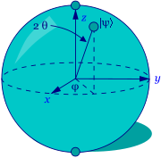

# Quantum Computing
**First published Sun Dec 3, 2006; substantive revision Tue Mar 5, 2024**

*Cuffaro, Michael, Hagar, Amit*

Combining physics, mathematics and computer science, quantum computing and its sister discipline of quantum information have developed in the past few decades from visionary ideas to two of the most fascinating areas of quantum theory. General interest and excitement in quantum computing was initially triggered by P. W. Shor (1994)[^shor-1994] who showed how a quantum algorithm apparently can factor large numbers into primes far more efficiently than any known classical algorithm. Shor’s algorithm was soon followed by several other algorithms for solving combinatorial and algebraic problems, and in the years since the theoretical study of quantum computational systems has achieved tremendous progress. Although no proof exists yet for the general superiority of quantum computers over classical computers, the implementation of Shor’s algorithm on a large scale quantum computer would render ineffective currently widely used cryptosystems that rely on the premise that no efficient algorithm for factoring exists. Consequently, experimentalists around the world are engaged in attempts to tackle the technological difficulties that prevent the realisation of a large scale quantum computer.

The philosophical interest in quantum computing is manifold. From a social-historical perspective, quantum computing is a domain where experimentalists find themselves ahead of their fellow theorists. Indeed, quantum mysteries such as entanglement and nonlocality were historically considered to be of “merely philosophical” interest until physicists discovered that these mysteries might be harnessed to devise new efficient algorithms. But while the technology for harnessing the power of hundreds of qubits (the basic unit of information in the quantum computer) is now within reach, only a handful of quantum algorithms exist, and the question of whether these can truly outperform any conceivable classical alternative is still, for theoreticians, open.

From a foundational point of view, reflecting on features of the design and implementation of efficient quantum algorithms may help us to better understand just what it is that makes quantum systems quantum, and it may illuminate fundamental concepts such as measurement and causality. Further, the idea that abstract mathematical concepts such as *computability* and *complexity* may not only be translated into physics, but also *re-written* by physics bears directly on the autonomous character of computer science and the status of its theoretical entities—the so-called “computational kinds”. As such it is also relevant to the long-standing philosophical debate on the relationship between mathematics and the physical world.

## 1. A Brief History of the Field

### 1.1 Physical Computational Complexity

A mathematical model for a universal computer was defined long before the invention of quantum computers and is called the Turing machine. It consists of (a) an unbounded tape divided (in one dimension) into cells, (b) a “read-write head” capable of reading or writing one of a finite number of symbols from or to a cell at a specific location, and (c) an instruction table (instantiating a transition function) which, given the machine’s initial “state of mind” (one of a finite number of such states that can be visited any number of times in the course of a computation) and the input read from the tape in that state, determines (i) the symbol to be written to the tape at the current head position, (ii) the subsequent displacement (to the left or to the right) of the head, and (iii) the machine’s final state. In 1936 Turing (1936)[^turing-1936] showed that since one can encode the instruction table of any given Turing machine $T$ as a binary number $\#(T)$, there exists a universal Turing machine $U$ which, upon reading a given $\#(T)$ from its tape, can simulate the operation of $T$ on any input.

In mathematics, an *effective method*, informally speaking, is a method consisting of a finite number of precise finite-length instructions, guaranteed to produce some desired result in a finite number of steps if followed exactly by a human being using nothing other than paper and pencil (Papayannopoulos 2023)[^papayannopoulos-2023]. That the Turing machine model formally captures the concept of effective calculability in its entirety is the essence of the Church-Turing thesis. Since the thesis involves both a precise mathematical notion (i.e., that of a Turing machine) and an informal and intuitive notion (i.e., that of an effective method), however, strictly speaking it cannot be proved or disproved but is arguably best thought of as an explication in Carnap’s sense (Carnap 1962, ch. I)[^carnap-1962].

Simple cardinality considerations show, in any case, that not all functions are Turing-computable (the set of all Turing machines is countable, while the set of all functions from the natural numbers to the natural numbers is not), and the discovery of this fact came as a complete surprise in the 1930s (Davis 1958)[^davis-1958]. But as interesting and important as the question of whether a given function is computable by Turing machine—the purview of computability theory (Boolos, Burgess, & Jeffrey 2007)[^boolos-2007]—is, it is not the only question that interests computer scientists. Beginning especially in the 1960s (Cobham 1965; Edmonds 1965; Hartmanis & Stearns 1965)[^cobham-1965][^edmonds-1965][^hartmanis-1965], the question of the *cost* of computing a function also came to be of great importance. This cost, also known as computational complexity, is measured naturally in terms of the physical resources (in particular time and space, given in terms of computational steps and memory locations, respectively) required in order to solve the computational problem at hand. Computer scientists classify computational problems according to the way their cost function behaves as a function of their input size, $n$ (the number of bits required to store the input). *Tractable*, or efficiently solvable, problems are those that can be solved in “polynomial time”; i.e., in a number of time steps that is bounded by a polynomial function of the size of the input, while *intractable* problems are those which cannot, i.e., that require “exponential” time.

For a *deterministic Turing machine* (DTM) like the ones we have been discussing so far, its behaviour at any given time is wholly determined by its state plus whatever its input happens to be. In other words such machines have a unique transition function. We can generalise the Turing model, however, by allowing a machine to instantiate more than one transition function simultaneously. A *nondeterministic Turing machine* (NTM), upon being presented with a given input in a given state, is allowed to ‘choose’ which of its transition functions to follow, and we say that it solves a given problem whenever, given some input, there exists at least one path through its state space leading to a solution. Exactly how an NTM “chooses” whether to follow one transition function rather than another at a given moment in time is left undefined (Turing originally conceived these choices as those of an external operator). In particular, we do not assume that any probabilities are attached to these choices. In a *probabilistic Turing machine* (PTM), by contrast, we characterise the computer’s choices by associating a particular probability with each of its possible transitions.

Probabilistic and deterministic Turing machines (DTMs) have different success criteria. A successful deterministic algorithm for a given problem is guaranteed to yield the correct answer given its input. Of a successful probabilistic algorithm, on the other hand, we only demand that it yield a correct answer with “high” probability (minimally, we demand that it be strictly greater than 1/2). It was generally believed, until relatively recently, that for some problems (see, e.g. Rabin 1976)[^rabin-1976] probabilistic algorithms are dramatically more efficient than any deterministic alternative; in other words that the set or “class” of problems efficiently solvable by PTM is larger than the class of problems efficiently solvable by DTM. It is now generally believed that the PTM model does not, in fact, offer a computational advantage in this sense over the DTM model (Arora & Barak 2009, ch. 20)[^arora-2009]. Probabilistic (Turing) computation is nevertheless interesting to consider, because abstractly a *quantum* computer is just a variation on the PTM that *does* appear to offer computational advantages over deterministic computation, although as already mentioned this conjecture still awaits a proof.

The class $\mathbf{P}$ (for Polynomial) is the class containing all the computational decision problems that can be solved by a DTM in polynomial time. The class **NP** (for Non-deterministic Polynomial) is the class containing all the computational decision problems that can be solved by an NTM in polynomial time.[^note-1] The most famous problems in **NP** are called “**NP**-complete”, where “complete” designates the fact that these problems stand or fall together: Either they are all tractable, or none of them is! If we knew how to solve an **NP**-complete problem efficiently (i.e., with polynomial cost) we could use it to efficiently solve any other problem in **NP** (Cook 1971)[^cook-1971]. Today we know of hundreds of examples of **NP**-complete problems (Garey & Johnson 1979)[^garey-1979], all of which are reducible one to another with no more than a polynomial slowdown. Since the best known algorithm for any of these problems is exponential, the widely believed conjecture is that there is no polynomial algorithm that can solve them. Clearly $\mathbf{P} \subseteq \mathbf{NP}$. Proving or disproving the conjecture that $\mathbf{P} \ne \mathbf{NP}$, however, remains perhaps one of the most important open questions in computer science. The class **BPP** (bounded probabilistic polynomial) is the class of problems that can be solved in polynomial time with “high” probability (see above) by a PTM. Finally, the class **BQP** is the class of problems that can be solved in polynomial time with “high” probability by a quantum computer. From the perspective of computer science, answering the question of whether quantum computers are more powerful than classical computers amounts to determining whether **BPP** $\subsetneq$ **BQP** is true (see Cuffaro 2018b)[^cuffaro-2018b].

Although the original Church-Turing thesis involves the *abstract* mathematical notion of computability, physicists as well as computer scientists often interpret it as saying something about the scope and limitations of *physical* computing machines. Wolfram (1985)[^wolfram-1985] claims that any physical system can be simulated (to any degree of approximation) by a universal Turing machine, and that complexity bounds on Turing machine simulations have physical significance. For example, if the computation of the minimum energy of some system of $n$ particles requires at least an exponentially increasing number of steps in $n$, then the actual relaxation of this system to its minimum energy state will also take exponential time. Aharonov (1999)[^aharonov-1999] strengthens this thesis (in the context of showing its putative incompatibility with quantum mechanics) when she says that a PTM can simulate any reasonable physical device at polynomial cost.

In order for the “physical Church-Turing thesis” to make sense one has to relate physical space and time parameters to their computational counterparts: memory capacity and number of computation steps, respectively. There are various ways to do that, leading to different formulations of the thesis (see Copeland 2018; Gandy 1980; Pitowsky 1990; Sieg & Byrnes 1999)[^copeland-2018][^gandy-1980][^pitowsky-1990][^sieg-1999]. For example, one can encode the set of instructions of a universal Turing machine and the state of its infinite tape in the binary development of the position coordinates of a single particle. Consequently, one can physically ‘realise’ a universal Turing machine as a billiard ball with hyperbolic mirrors (Moore 1990; Pitowsky 1996)[^moore-1990][^pitowsky-1996].

It should be stressed that strictly speaking there is no relation between the original Church-Turing thesis and its physical version (Pitowsky & Shagrir 2003)[^pitowsky-2003], and while the former concerns the concept of computation that is relevant to logic (since it is strongly tied to the notion of *proof* which requires *validation*), it does not analytically entail that *all* computations should be subject to validation. Indeed, there is a long historical tradition of analog computations (Dewdney 1984; Maley 2023; Papayannopoulos 2020)[^dewdney-1984][^maley-2023][^papayannopoulos-2020], and the output of these computations is validated either by repetitive “runs” or by validating the physical theory that presumably governs the behaviour of the analog computer.

### 1.2 Physical “Short-cuts” of Computation

Do physical processes exist which contradict the physical Church-Turing thesis? Apart from analog computation, there exist at least two main kinds of example purporting to show that the notion of recursion, or Turing-computability, is not a natural *physical* property (Hogarth 1994; Pitowsky 1990; Pour-el & Richards 1981)[^hogarth-1994][^pitowsky-1990][^pour-el-1981]. Although the physical systems involved (a specific initial condition for the wave equation in three dimensions and an exotic solution to Einstein’s field equations, respectively) are somewhat contrived, a school of “hypercomputation” that aspires to extend the limited examples of physical “hypercomputers” and in so doing to physically “compute” the non-Turing-computable has nevertheless emerged (Andréka, Madarász, Németi, Németi, & Székely 2018; Copeland 2002, 2011; Davis 2003)[^andréka-2018][^copeland-2002][^copeland-2011][^davis-2003]. *Quantum* hypercomputation is less frequently discussed in the literature (see, e.g., Adamyan, Calude, & Pavlov 2004)[^adamyan-2004], but arguably the most concrete attempt to harness quantum theory to compute the non-computable is the suggestion to use the quantum adiabatic algorithm (see below) to solve Hilbert’s Tenth Problem (Kieu 2002, 2004)[^kieu-2002][^kieu-2004]—a Turing-undecidable problem equivalent to the halting problem—though this alleged quantum adiabatic hypercomputer has been criticised as unphysical (see Hagar & Korolev 2007; Hodges 2005 [Other Internet Resources])[^hagar-2007][^hagar-2007-2].

Setting aside hypercomputers, even if we restrict ourselves only to Turing-computable functions, one can still find many proposals in the literature that purport to display “short-cuts” in computational resources. Consider, e.g., the DNA model of computation that was claimed (Adleman 1994; Lipton 1995)[^adleman-1994][^lipton-1995] to solve **NP**-complete problems in polynomial time. A closer inspection shows that the cost of the computation in this model is still exponential since the number of molecules in the physical system grows exponentially with the size of the problem. Or take an allegedly instantaneous solution to another **NP**-complete problem using a construction of rods and balls (Vergis, Steiglitz, & Dickinson 1986)[^vergis-1986] that unfortunately ignores the accumulating time-delays in the rigid rods that result in an exponential overall slowdown. It appears that these and other similar models cannot serve as counter-examples to the physical Church-Turing thesis (as far as complexity is concerned) since they all require some exponential physical resource. Note, however, that all these models are described using classical physics, hence the unavoidable question: Can the shift to quantum physics allow us to find computational short-cuts? The quest for the quantum computer began with the possibility of giving a positive answer to this question.

### 1.3 Milestones

As early as 1969 Steven Wiesner suggested quantum information processing as a possible way to better accomplish cryptologic tasks. But the first four published papers on quantum information (Wiesner published his only in 1983)[^wiesner-1983], belong to Alexander Holevo (1973)[^holevo-1973], R. P. Poplavskii (1975)[^poplavskii-1975], Roman Ingarden (1976)[^ingarden-1976], and Yuri Manin (1980)[^manin-1980]. Better known are contributions made in the early 1980s by Charles H. Bennett of the IBM Thomas J. Watson Research Center, Paul A. Benioff of Argonne National Laboratory in Illinois, David Deutsch of the University of Oxford, and Richard P. Feynman of the California Institute of Technology. The idea emerged when scientists were investigating the fundamental physical limits of computation: If technology continued to abide by “Moore’s Law” (the observation made in 1965 by Gordon Moore, co-founder of Intel, that the number of transistors per square inch on integrated circuits had doubled every 18 months since the integrated circuit was invented), then the continually shrinking size of circuitry packed onto silicon chips would eventually reach a point where individual elements would be no larger than a few atoms. But since the physical laws that govern the behaviour and properties of the putative circuit at the atomic scale are inherently quantum-mechanical in nature, not classical, the natural question arose whether a new kind of computer could be devised based on the principles of quantum physics.

Inspired by Ed Fredkin’s ideas on reversible computation (see Hagar 2016)[^hagar-2016], Feynman was among the first to attempt to provide an answer to this question by producing an abstract model in 1982 that showed how a quantum system could be used to do computations. He also explained how such a machine would be able to act as a simulator for quantum physics, conjecturing that any classical computer could do the same task only inefficiently. In 1985, David Deutsch proposed the first universal quantum Turing machine, which paved the way to the quantum circuit model (Deutsch 1989)[^deutsch-1989] and the development of quantum algorithms.

The 1990s saw the discovery of the Deutsch-Josza algorithm (1992) and of Simon’s algorithm (1994). The latter supplied the basis for Shor’s factoring algorithm. Published in 1994, this algorithm marked a “phase transition” in the development of quantum computing and sparked a tremendous interest even outside the physics community. In that year the first experimental realisation of the quantum *CNOT* (controlled-not) gate with trapped ions was proposed by Cirac & Zoller (1995). In 1995, Peter Shor and Andrew Steane proposed (independently) the first scheme for quantum error-correction. In that same year the first realisation of a quantum logic gate was done in Boulder, Colorado, following Cirac and Zoller’s proposal. In 1996, Lov Grover from Bell Labs invented a quantum search algorithm which yields a provable (though only quadratic) “speed-up” compared to its classical counterparts. A year later the first model for quantum computation based on nuclear magnetic resonance (NMR) techniques was proposed. This technique was realised in 1998 with a 2-qubit register, and was scaled up to 7 qubits in the Los Alamos National Lab in 2000.

The adiabatic and cluster-state models of quantum computing were discovered in 2000 and 2002, respectively (Farhi, Goldstone, Gutmann, & Sipser 2000; Raussendorf & Briegel 2002)[^raussendorf-2002] and in 2011 D-Wave systems announced the creation of “D-Wave one,” an adiabatic quantum computer system running on a 128-qubit processor (Johnson, Amin, Gildert, et al. 2011)[^johnson-2011]. The late 2010s saw the beginning of the Noisy Intermediate Scale Quantum Computing (NISQ) era (Preskill 2018)[^preskill-2018], and in 2019 scientists affiliated with Google LLC announced (Arute, Arya, Babbush, & coauthors 2019)[^arute-2019] that they had achieved “quantum computational supremacy” (Aaronson 2019 [Other Internet Resources])—the actual existence of a (in this case, NISQ) quantum computer capable of solving a specific problem for which no efficient classical algorithm is known—at least until 2022 when a classical algorithm to outperform Google LLC’s quantum computer was discovered (Pan, Chen, & Zhang 2022)[^pan-2022], not to mention subsequent theoretical results demonstrating the inherent limitations of Google LLC’s approach (Aharonov, Gao, Landau, Liu, & Vazirani 2023)[^aharonov-2023]. Despite the tremendous growth of the field since the discovery of Shor’s algorithm, the basic questions remain open even today: (1) theoretically, can quantum algorithms efficiently solve classically intractable problems? (2) operationally, can we actually realise a large scale quantum computer to run these algorithms?

## 2. Basics

In this section we review the basic paradigm for quantum algorithms, namely the quantum circuit model, which comprises the basic quantum unit of information (the qubit) and the basic logical manipulations thereof (quantum gates). For more detailed introductions see Nielsen & Chuang (2010) and Mermin (2007)[^mermin-2007].

### 2.1 The Qubit

The qubit is the quantum analogue of the bit, the classical fundamental unit of information. It is a mathematical object with specific properties that can be realised in an actual physical system in many different ways. Just as the classical bit has a *state*—either 0 or 1—a qubit also has a state. Yet contrary to the classical bit, $\lvert 0\rangle$ and $\lvert 1\rangle$ are but two possible states of the qubit, and any linear combination (superposition) thereof is also possible. *In general*, thus, the physical state of a qubit is the superposition $\lvert\psi \rangle = \alpha \lvert 0\rangle + \beta \lvert 1\rangle$ (where $\alpha$ and $\beta$ are complex numbers). The state of a qubit can be described as a vector in a two-dimensional Hilbert space, a complex vector space (see the entry on quantum mechanics). The special states $\lvert 0\rangle$ and $\lvert 1\rangle$ are known as the *computational basis states*, and form an orthonormal basis for this vector space. According to quantum theory, when we try to measure the qubit in this basis in order to determine its state, we get either $\lvert 0\rangle$ with probability $\lvert \alpha\rvert^2$ or $\lvert 1\rangle$ with probability $\lvert \beta\rvert^2$. Since $\lvert \alpha\rvert^2 + \lvert\beta\rvert^2 = 1$ (i.e., the qubit is a *unit* vector in the aforementioned two-dimensional Hilbert space), we may (ignoring the overall phase factor) effectively write its state as $\lvert \psi \rangle =$ cos$(\theta)\lvert 0\rangle + e^{i\phi}$sin$(\theta)\lvert 1\rangle$, where the numbers $\theta$ and $\phi$ define a point on the unit three-dimensional sphere, as shown in the figure below. This sphere is typically called *the Bloch sphere*, and it provides a useful means to visualise the state space of a single qubit.

| $\lvert 0\rangle$ |
| --- |
|  at the north pole and \|1> at the south pole; from the center of the sphere there are 3 axes shown labelled x, y, and z. The x-y plan is horizontal intersects the equator of the sphere. An arbitrary point on the surface of the sphere is noted by going angle phi horizontally from the x axis towards the y axis and then angle psi up towards the z axis." /> |
| $\lvert 1\rangle$ |

*The Bloch Sphere*

Since $\alpha$ and $\beta$ are complex and therefore continuous variables one might think that a single qubit is capable of storing an infinite amount of information. When measured, however, it yields only the classical result (0 or 1) with certain probabilities specified by the quantum state. In other words, the measurement *changes* the state of the qubit, “collapsing” it from a superposition to one of its terms. In fact one can prove (Holevo 1973)[^holevo-1973] that the amount of information actually retrievable from a single qubit (what Timpson (2013, 47ff.) calls its “accessible information”) is no more than one bit. If the qubit is *not* measured, however, the amount of “hidden” information it “stores” (what Timpson calls its “specification information”) is conserved under its (unitary) dynamical evolution. This feature of quantum mechanics allows one to manipulate the information stored in unmeasured qubits with quantum gates (i.e. unitary transformations), and is one of the sources for the putative power of quantum computers.

As an illustration, let us suppose we have two qubits at our disposal. A pair of qubits has four computational basis states: {$\lvert 00\rangle, \lvert 01\rangle, \lvert 10\rangle, \lvert 11\rangle$}. If these were classical bits, they would represent the four physically possible states of the system. But a pair of qubits can also exist in what can be described as a superposition of these four basis states, each of which has its own complex coefficient (whose mod square, being interpreted as a probability, is normalised). As long as the quantum system evolves unitarily and is unmeasured, it can be imagined to “store” that many bits of (specification) information. The difficult task, however, is to use this information efficiently in light of the bound on the state’s accessible information.

### 2.2 Quantum Gates

Classical computational gates are Boolean logic gates that manipulate information stored in bits. In quantum computing such gates are represented by matrices, and can be visualised as rotations over the Bloch sphere. This visualisation represents the fact that quantum gates are unitary operators, i.e., they preserve the norm of the quantum state (i.e., $U^{\dagger}U=I$, where $U$ is a linear operator representing a quantum gate and $U^{\dagger}$ is its adjoint). In classical computing some gates are “universal”. For instance, all of the possible logical connections between two inputs A and B can be realised using some string of *NAND* gates (which each evaluate the function “not both A and B”). Another universal gate is *NOR*. In the context of quantum computing it was shown (DiVincenzo 1995)[^divincenzo-1995] that two-qubit gates (i.e. that transform two qubits) are sufficient to realise any quantum circuit, in the sense that a circuit composed exclusively from (a small set of) one- and two-qubit gates can approximate to arbitrary accuracy any unitary transformation of $n$ qubits. Barenco *et. al.* (1995) showed in particular that any multiple-qubit logic gate may be composed in this sense from a combination of single-qubit gates and the two-qubit controlled-not (*CNOT*) gate, which either flips or preserves its “target” input bit depending on the state of its “control” input bit (specifically: in a *CNOT* gate the output state of the target qubit is the result of an operation analogous to the classical exclusive-OR (*XOR*) gate on the inputs). One general feature of quantum gates that distinguishes them from classical gates is that they are always reversible: the inverse of a unitary matrix is also a unitary matrix, and thus a quantum gate can always be inverted by another quantum gate.

$$ \textrm{CNOT} = \left[ \begin{array}{cccc} 1 & 0 & 0 & 0 \\ 0 & 1 & 0 & 0 \\ 0 & 0 & 0 & 1 \\ 0 & 0 & 1 & 0 \end{array} \right]. $$ 

*The CNOT Gate*

Unitary gates manipulate information stored in the “quantum register”—a quantum system—and in this sense ordinary (unitary) quantum evolution can be regarded as a computation. In order to read the result of this computation, however, the quantum register must be measured. Measurement is represented as a non-unitary gate that “collapses” the quantum superposition in the register onto one of its terms with a probability corresponding to that term’s complex coefficient. Usually this is described with respect to the computational basis, but in principle a measurement could be carried out in any of the infinitely many possible orthonormal bases with respect to which a given state $| \psi \rangle$ can be expressed as a linear combination of basis states. It so happens that some such measurements are more difficult to implement than others.

### 2.3 Quantum Circuits

Quantum circuits are similar to classical computer circuits in that they consist of logical *wires* and *gates*. The wires are used to carry the information, while the gates manipulate it (note that the wires are abstract and do not necessarily correspond to physical wires; they may correspond to a physical particle, e.g. a photon, moving from one location to another in space, or even to time-evolution). Conventionally, the input of the quantum circuit is assumed to be a number of qubits each initialised to a computational basis state (typically $\lvert 0\rangle$). The output state of the circuit is then measured in some orthonormal basis (usually the computational basis).

The first quantum algorithms (i.e., Deutsch-Jozsa, Simon, Shor and Grover) were constructed in this paradigm. Additional paradigms for quantum computing exist today that differ from the circuit model in many interesting ways. So far, however, they all have been demonstrated to be computationally equivalent to the circuit model (see below), in the sense that any computational problem that can be solved by the circuit model can be solved by these new models with only a polynomial overhead in computational resources. We note the parallel here with the various classical computational models, for which it is also the case that any “reasonable” such model can be efficiently simulated by any other (for discussion, see Cuffaro 2018b, 274)[^cuffaro-2018b].

## 3 Quantum Algorithms

Algorithm design is a highly complicated task, and in quantum computing, delicately leveraging the features of quantum mechanics in order to make an algorithm more efficient makes the task even more complicated. But before discussing this aspect of quantum algorithm design, let us first convince ourselves that quantum computers can actually simulate classical computation. In some sense this is obvious, given the belief in the universal character of quantum mechanics, and the observation that any quantum computation that is diagonal in the computational basis, i.e., that involves no interference between the qubits, is effectively classical. Yet the demonstration that quantum circuits can be used to simulate classical circuits is not straightforward (recall that the former are always reversible while the latter use gates which are in general irreversible). Indeed, quantum circuits cannot be used *directly* to simulate classical computation, but the latter can still be simulated on a quantum computer using an intermediate gate, namely the *Toffoli* gate. This universal classical gate has three input bits and three output bits. Two of the input bits are control bits, unaffected by the action of the gate. The third input bit is a target bit that is flipped if both control bits are set to 1, and otherwise is left alone. This gate is reversible (its inverse is itself), but by stringing a number of such gates together one can simulate any classical circuit. Consequently, using the quantum version of the *Toffoli* gate (which by definition permutes the computational basis states similarly to the classical *Toffoli* gate) one can simulate, although rather tediously, irreversible classical logic gates with quantum reversible ones. Quantum computers are thus capable of performing any computation which a classical deterministic computer can do.

What about probabilistic computation? Not surprisingly, a quantum computer can also simulate this type of computation by using another famous quantum gate, namely the Hadamard gate, a single-qubit gate that takes the input state $\lvert 0\rangle$ to $\frac{\lvert 0\rangle + \lvert 1\rangle}{\sqrt{2}}$ and the input state $\lvert 1\rangle$ to $\frac{\lvert 0\rangle - \lvert 1\rangle}{\sqrt{2}}$. Measuring either of these output states yields $\lvert 0\rangle$ or $\lvert 1\rangle$ with 50/50 probability, which can be used to simulate a fair coin toss.

$$ H = \frac{1}{\sqrt{2}}\left[ \begin{array}{cc} 1 & 1 \\ 1 & -1 \end{array}\right] $$ 

*The Hadamard Gate*

Obviously, if quantum algorithms could be used only to simulate classical algorithms the interest in them would be far more limited than it currently is. But while there may always be some computational problems that resist quantum speed-up (see Myers 1997 and Linden & Popescu 1998 [Other Internet Resources])[^myers-1997], there is a general confidence in the community that quantum algorithms may not only simulate classical ones, but that they will actually *outperform* the latter in some cases, with debatable (Cuffaro 2018b; Hagar 2007)[^cuffaro-2018b][^hagar-2007][^hagar-2007-2] implications for our abstract notions of tractability and intractability.

### 3.1 Quantum Circuit-Based Algorithms

#### 3.1.1 Oracles

The first quantum algorithms were designed to solve problems which essentially involve the use of an “oracle”, so let us begin by explaining this term. An oracle is a conceptual device that has proven useful in the complexity-theoretic analysis of computational problems, which one can think of as a kind of imaginary magic black box (Arora & Barak 2009, 72–73; Aaronson 2013a, 29ff.)[^aaronson-2013a][^arora-2009] to which, like the famous oracle at Delphi, one poses (yes or no) questions. Unlike that ancient oracle, the oracles considered in computer science always return an answer in a *single* time step. For example, we can imagine an oracle to determine whether a given Boolean formula is satisfiable or not: Given as input the description of a particular propositional formula, the oracle outputs—in a single time step—a single bit indicating whether or not there is a truth-value assignment satisfying that formula. Obviously such a machine does not really exist—**SAT** (short for satisfiability) is an NP-complete problem—but that is not the point. The point of using such imaginary devices is to abstract away from certain “implementational details” which are for whatever reason deemed unimportant for answering a given complexity-theoretic question. For example, Simon’s problem (Simon 1994)[^simon-1994] is that of determining the period of a given function $f$ that is periodic under bit-wise modulo-2 addition. Relative to Simon’s problem, we judge the internal complexity of $f$ to be unimportant, and so abstract away from it by imagining that we have an oracle to evaluate it in a single step. As useful as these conceptual devices are, however, their usefulness has limitations. To take one example, there are oracles relative to which **P** = **NP**, as well as oracles relative to which **P** $\not =$ **NP**. This (and many other) questions are not clarified by oracles (see Fortnow 1994)[^fortnow-1994].

#### 3.1.2 Deutsch’s Algorithm

Deutsch (1989)[^deutsch-1989] asks the following question: Suppose we have a function $f$ which can be either constant—i.e. such that it produces the same output value for each of its possible inputs, or balanced—i.e. such that the output of one half of its possible inputs is the opposite of the output of the other half. The particular example considered is a function $f : \{0,1\} \rightarrow \{0,1\}$, which is constant if $f$(0) $= f$(1) and balanced if $f$(0) $\ne f$(1). Classically it would take *two* evaluations of the function to tell whether it is one or the other. Quantum-mechanically, we can answer this question in *one* evaluation.

*A Schematic Representation of Deutsch’s Algorithm*

After initially preparing (Mermin 2007, ch. 2)[^mermin-2007] the first and second qubits of the computer in the state $\lvert 0\rangle\lvert 0\rangle$, one then “flips” both qubits (see the Figure above) using “NOT” gates (i.e. Pauli *X* transformations) to $\lvert 1 \rangle$, and then subjects each qubit to a Hadamard gate. One then sends the two qubits through an oracle or ‘black box’ which one imagines as a unitary gate, $\mathbf{U}_f$, representative of the function whose character (of being either constant or balanced) we wish to determine, where we define $\mathbf{U}_f$ so that it takes inputs like $\lvert x,y\rangle$ to $\lvert x, y\oplus f (x)\rangle$, such that $\oplus$ is addition modulo two (i.e. exclusive-or). The first qubit is then fed into a further Hadamard gate, and the final output of the algorithm (prior to measurement) is the state:

$$\frac{1}{2}| 1 \rangle(| f(0) \rangle - | \hat{f}(0) \rangle)$$

whenever $f$ is constant, and the state:

$$\frac{1}{2}| 0 \rangle(| f(0) \rangle - | \hat{f}(0) \rangle)$$

whenever $f$ is balanced, where $\hat{f}(x) \equiv 1 \oplus f(x)$. Since the computational basis states are orthogonal to one another, a single measurement of the first qubit suffices to retrieve the answer to our original question regarding the function’s nature. And since there are two possible constant functions and two possible balanced functions from $f : \{0,1\} \rightarrow \{0,1\}$, we can characterise the algorithm as distinguishing, using only one oracle call, between two quantum disjunctions without finding out the truth values of the disjuncts themselves, i.e. without determining *which* balanced or *which* constant function $f$ is (Bub 2010)[^bub-2010][^bub-2010-2].

A generalisation of Deutsch’s problem, called the Deutsch-Jozsa problem (Deutsch & Jozsa 1992)[^deutsch-1992], enlarges the class of functions under consideration so as to include all of the functions $f:\{0,1\}^n\to\{0,1\}$, i.e., rather than only considering $n = 1$. The best deterministic classical algorithm for determining whether a given such function is constant or balanced requires $\frac{2^{n}}{2}+1$ queries to an oracle. In a quantum computer, however, we can answer the question using *one* oracle call. As with Deutsch’s algorithm, an analysis shows that the reason why a quantum computer only requires one call to the oracle to evaluate the global property of the function in question, is that the output state of the computer is a superposition of balanced and constant states such that the balanced states all lie in a subspace of the system’s Hilbert space orthogonal to that of the constant states and can therefore be distinguished from the latter in a single measurement (Bub 2006a)[^bub-2006a].

#### 3.1.3 Simon’s Algorithm

Suppose we have a Boolean function $f$ on $n$ bits that is 2-to-1, i.e. that takes $n$ bits to $n-1$ bits in such a way that for every $n$-bit integer $x_1$ there is an $n$-bit integer $x_2$ for which $f (x_{1}) = f (x_{2})$. The function is moreover periodic in the sense that $f(x_1)$ = $f(x_2)$ if and only if $x_1 = x_2 \oplus a$, where $\oplus$ designates bit-wise modulo 2 addition and $a$ is an $n$-bit nonzero number called the *period* of $f$. Simon’s problem is the problem to find $a$ given $f$. Relative to an oracle $U_f$ that evaluates $f$ in a single step, Simon’s quantum algorithm (Simon 1994)[^simon-1994] finds the period of $f$ in a number of oracle calls that grows only linearly with the length of $n$, while the best known classical algorithm requires an exponentially greater number of oracle calls. Simon’s algorithm reduces to Deutsch’s algorithm when $n=2$, and can be regarded as an extension of the latter, in the sense that in both cases a global property of a function is evaluated in no more than a (sub-)polynomial number of oracle invocations, owing to the fact that the output state of the computer just before the final measurement is decomposed into orthogonal subspaces, only one of which contains the problem’s solution. Note that one important difference between Deutsch’s and Simon’s algorithms is that the former yields a solution with certainty, whereas the latter only yields a solution with probability very close to 1. For more on the logical analysis of these first quantum circuit-based algorithms see Bub (2006a)[^bub-2006a] and Bub (2010)[^bub-2010][^bub-2010-2].

#### 3.1.4 Shor’s Algorithm

The algorithms just described, although demonstrating the potential superiority of quantum over classical computation, nevertheless deal with apparently unimportant computational problems. Moreover the speed-ups in each of them are only relative to their respective oracles. It is therefore doubtful whether research into quantum computing would have attracted so much attention in the 1990s had Shor not realised that Simon’s algorithm could be harnessed to solve a much more interesting and crucial problem, namely *factoring*, which lies at the heart of widely-used cryptographic protocols such as RSA (Rivest, Shamir, & Adleman 1978)[^rivest-1978]. Shor’s algorithm turned quantum computing into one of the most exciting research domains in quantum mechanics.

Shor’s algorithm exploits the ingenious number theoretic argument that two prime factors $p,q$ of a positive integer $N=pq$ can be found by determining the period, $r$, of a function $f(x) = y^x \textrm{mod} N,$ for any $y < N$ which has no common factors with $N$ other than 1 (Nielsen & Chuang 2010, app. 4)[^nielsen-2010]. The period of $f(x)$ depends on $y$ and $N$. If one knows it, one can factor $N$ if $r$ is even and if $y^{\,\frac{r}{2}} \neq -1$ mod $N$. This will be jointly the case with probability greater than $\frac{1}{2}$ for any $y$ chosen randomly (otherwise one chooses another value of $y$ and tries again). The factors of $N$ are the greatest common divisors of $y^{\,\frac{r}{2}} \pm 1$ and $N$, which can be found in polynomial time using the well known Euclidean algorithm. In other words, Shor’s remarkable result rests on the discovery that the problem of *factoring* reduces to the problem of finding the period of a certain periodic function. That this problem can be solved efficiently by a quantum computer is hinted at by Simon’s algorithm, which considers the more restricted case of functions periodic under bit-wise modulo-2 addition as opposed to the periodic functions under ordinary addition considered here.

Notwithstanding that *factoring* is believed to be only in **NP** and not in **NP**-complete (see Aaronson 2013a, 64–66)[^aaronson-2013a], Shor’s result is arguably the most dramatic example of quantum speed-up known. To verify whether $n$ is prime takes a number of steps which is polynomial in $\log_{2}n$ (the binary encoding of a natural number $n$ requires $\log_{2}n$ resources). But nobody knows how to classically factor numbers into primes in polynomial time, and the best classical algorithms we have for this problem are sub-exponential. A number of widely-used modern cryptographic protocols are based on these facts (Giblin 1993)[^giblin-1993], and the discovery that quantum computers can solve *factoring* in polynomial time has therefore had a dramatic effect. The implementation of the algorithm on a scalable architecture would consequently have economic, as well as scientific consequences (Alléaume et al. 2014)[^alléaume-2014].

#### 3.1.5 Grover’s Algorithm

In a brilliant undercover operation, Agent 13 has managed to secure two crucial bits of information concerning the whereabouts of the arch-villain Siegfried: the phone number of the secret hideout from which he intends to begin carrying out KAOS’s plans for world domination, and the fact that the number is a listed one (apparently an oversight on Siegfried’s part). Unfortunately you and your colleagues at CONTROL have no other information besides this. Can you find Siegfried’s hideout using only this number and a phone directory? In theoretical computer science this task is known as an unstructured search. In the worst case, if there are $n$ entries in the directory, the computational resources required to find the entry will be linear in $n$. Grover (1996)[^grover-1996] showed how this task could be done with a quantum algorithm using computational resources on the order of only $\sqrt{n}$. Agreed, this speed-up is more modest than Shor’s since unstructured search belongs to the class $\mathbf{P}$, but contrary to Shor’s case, where the classical complexity of factoring is still unknown, here the superiority of the quantum algorithm, however modest, is definitely provable. That this quadratic speed-up is also the *optimal* quantum speed-up possible for this problem was proved by Bennett, Bernstein, Brassard, & Vazirani (1997).

Although the purpose of Grover’s algorithm is usually described as “searching a database”, it may be more accurate to describe it as “inverting a function”. Roughly speaking, if we have a function $y=f(x)$ that can be evaluated on a quantum computer, Grover’s algorithm allows us to calculate $x$ given $y$. Inverting a function is related to searching a database because we could come up with a function that produces a particular value of $y$ if $x$ matches a desired entry in a database, and another value of $y$ for other values of $x$. The applications of Grover’s algorithm are far-reaching (even more so than foiling Siegfried’s plans for world domination). For example, it can be used to determine efficiently the number of solutions to an $N$-item search problem, hence to perform exhaustive searches on a class of solutions to an **NP**-complete problem and substantially reduce the computational resources required for solving it.

### 3.2 Adiabatic Algorithms

Many decades have passed since the discovery of the first quantum algorithm, but so far little progress has been made with respect to the “Holy Grail” of solving an **NP**-complete problem with a quantum circuit. In 2000 a group of physicists from MIT and Northeastern University (Farhi et al. 2000 [Other Internet Resources]) proposed a novel paradigm for quantum computing that differs from the circuit model in several interesting ways. Their goal was to try to decide with this algorithm instances of one of the most famous **NP**-complete problems: *satisfiability*. According to the adiabatic theorem (see, e.g., Messiah 1961)[^messiah-1961] and given certain specific conditions, a quantum system remains in its lowest energy state, known as the ground state, along an adiabatic transformation in which the system is deformed slowly and smoothly from an initial Hamiltonian to a final Hamiltonian (as an illustration, think of moving a sleeping baby in a cradle from the living room to the bedroom. If the transition is done slowly and smoothly enough, and if the baby is a sound sleeper, then it will remain asleep during the whole transition). The most important condition in this theorem is the energy gap between the ground state and the next excited state (in our analogy, this gap reflects how sound asleep the baby is). Being inversely proportional to the evolution time $T$, this gap controls the latter. If this gap exists during the entire evolution (i.e., there is no level crossing between the energy states of the system), the theorem dictates that in the adiabatic limit (when $T\rightarrow \infty)$ the system will remain in its ground state. In practice, of course, $T$ is always finite, but the longer it is, the less likely it is that the system will deviate from its ground state during the time evolution.

The crux of the quantum adiabatic algorithm which rests on this theorem lies in the possibility of encoding a specific instance of a given decision problem in a certain Hamiltonian (this can be done by capitalising on the well-known fact that any decision problem can be derived from an optimisation problem by incorporating into it a numerical bound as an additional parameter). One then starts the system in a ground state of another Hamiltonian which is easy to construct, and slowly evolves the system in time, deforming it towards the desired Hamiltonian. According to the quantum adiabatic theorem and given the gap condition, the result of such a physical process is another energy ground state that encodes the solution to the desired decision problem. The adiabatic algorithm is thus a rather ‘laid back’ algorithm: one needs only to start the system in its ground state, deform it adiabatically, and measure its final ground state in order to retrieve the desired result. But whether or not this algorithm yields the desired speed-up depends crucially on the behaviour of the energy gap as the number of degrees of freedom in the system increases. If this gap decreases exponentially with the size of the input, then the evolution time of the algorithm will increase exponentially; if the gap decreases polynomially, the decision problem so encoded could be solved efficiently. Physicists have been studying spectral gaps for almost a century, but they have only relatively recently begun to do so with computing in mind. It is now known that there exists no algorithm to determine, given the Hamiltonian of an arbitrary quantum many-body system, whether it is gapped or gapless (Cubitt, Perez-Garcia, & Wolf 2015)[^cubitt-2015]. In practice, gap amplification techniques are employed in adiabatic quantum computers to ensure the existence of a gap throughout a computation (Albash & Lidar 2018, sec. F)[^albash-2018].

The quantum adiabatic algorithm holds much promise (Farhi et al. 2001)[^farhi-2001]. It has been shown (Aharonov et al. 2008)[^aharonov-2008] to be polynomially equivalent to the circuit model (that is, each model can simulate the other with only polynomial overhead in the number of qubits and computational steps), but the caveat that is sometimes left unmentioned is that its application to an intractable computational problem may sometimes require solving another, as intractable a task (this general worry was first raised by a philosopher; see Pitowsky 1990)[^pitowsky-1990]. Indeed, Reichardt (2004)[^reichardt-2004] has shown that there are simple problems for which the algorithm will get stuck in a local minimum, in which there are exponentially many eigenvalues all exponentially close to the ground state energy, so applying the adiabatic theorem, even for these simple problems, will take exponential time, and we are back to square one. For a recent survey of the state of the art, see Albash & Lidar (2018).

### 3.3 Measurement-Based Algorithms

Measurement-based algorithms differ from circuit algorithms in that instead of employing unitary evolution as the basic mechanism for the manipulation of information, these algorithms make essential use of measurements in the course of a computation and not only at the readout stage. They fall into two categories. The first is teleportation quantum computing, based on an idea of Gottesman & Chuang (1999), and developed into a computational model by Nielsen (2003)[^nielsen-2003] and Leung (2004)[^leung-2004]. The second is the “one way quantum computer”, known also as the “cluster state” model (Raussendorf & Briegel 2002)[^raussendorf-2002]. The interesting feature of these models, which are polynomially equivalent to the circuit model (Raussendorf, Browne, & Briegel 2003)[^raussendorf-2003], is that they can efficiently simulate unitary quantum dynamics using non-unitary measurements. This is accomplished (see Duwell 2021, 5.2)[^duwell-2021] via measurements on a pool of highly entangled quantum systems such that the orthonormal basis in which each measurement is performed is calculated, via a classical computer, using the results of earlier measurements.

Measurement-based models are interesting from a foundational perspective for a number of reasons. To begin with, in these models there is a clear separation between the classical (i.e., the calculation of the next measurement-basis) and quantum (i.e., measurements on the entangled qubits) parts of a computation, which may make it easier to pinpoint the quantum resources that are responsible for speed-up. Further, they may offer insight into the role of entanglement in quantum computing. They may also have interesting engineering-related consequences, suggesting a different kind of computer architecture which is more fault tolerant (Brown & Roberts 2020; Nielsen & Dawson 2005)[^brown-2020][^nielsen-2005].

### 3.4 Topological-Quantum-Field-Theory (TQFT) Algorithms

Another model for quantum computing which has attracted a lot of attention, especially from Microsoft inc. (Freedman 1998)[^freedman-1998], is the Topological Quantum Field Theory model (Lahtinen & Pachos 2017)[^lahtinen-2017]. In contrast to the easily visualisable circuit model, this model resides in the most abstract reaches of theoretical physics. The exotic physical systems TQFT describes are topological states of matter. That the formalism of TQFT can be applied to computational problems was shown by Witten (1989)[^witten-1989] and the idea was later developed by others. One of the principal merits of the model, which is polynomially equivalent to the circuit model (Aharonov, Jones, & Landau 2009; Freedman, Kitaev, & Wang 2002)[^aharonov-2009][^freedman-2002], lies in its high tolerance to the errors which are inevitably introduced in the implementation of a large scale quantum computer (see below). Topology is especially helpful here because many global topological properties are, by definition, invariant under deformation, and given that most errors are local, information encoded in topological properties is robust against them.

## 4 Realisations

The quantum computer might be the theoretician’s dream, but as far as experimentalists are concerned, its full realisation, which involves resolving the still open question of how to combine the elements needed to build a quantum computer into scalable systems (see Van Meter & Horsman 2013)[^van-2013], is a nightmare. Shor’s algorithm may break RSA encryption, but it will remain an anecdote if the largest number that it can factor is 21 (Martín-López et al. 2012; Skosana & Tame 2021)[^martín-lópez-2012][^skosana-2021]. In the circuit-based model the problem is to achieve a scalable quantum system that at the same time will allow one to (1) robustly represent quantum information with (2) a time to decoherence significantly longer than the length of the computation, (3) implement a universal family of unitary transformations, (4) prepare a fiducial initial state, and (5) measure the output result (these are DiVincenzo (2000)[^divincenzo-2000]’s five criteria). Alternative paradigms may trade some of these requirements with others, but the gist will remain the same, i.e., one would have to achieve control of one’s quantum system in such a way that the system will remain “quantum” albeit macroscopic or at least mesoscopic in its dimensions.

In order to deal with these challenges, several ingenious solutions have been devised, including quantum error correction codes and fault tolerant computation (Aharonov & Ben-Or 1997; de Beaudrap & Horsman 2020; Horsman, Fowler, Devitt, & Van Meter 2012; Raussendorf, Harrington, & Goyal 2008; Shor 1995; Shor & DiVincenzo 1996; Steane 1996)[^aharonov-1997][^beaudrap-2020][^horsman-2012][^raussendorf-2008][^shor-1995][^shor-1996][^steane-1996] which can dramatically reduce the spread of errors during a ‘noisy’ quantum computation. An important criticism of these active error correction schemes, however, is that they are devised for a very unrealistic noise model which treats the computer as quantum and the environment as classical (Alicki, Lidar, & Zinardi 2006)[^alicki-2006]. Once a more realistic noise model is allowed, the feasibility of large scale, fault tolerant and computationally superior quantum computers is less clear (Hagar 2009; Tabakin 2017)[^hagar-2009][^tabakin-2017].

In the near term, a promising avenue for realising a quantum advantage in a limited number of problem domains is the Noisy Intermediate-Scale Quantum (NISQ) paradigm (Lau, Lim, Shrotriya, & Kwek 2022; Preskill 2018)[^lau-2022][^preskill-2018]. The NISQ paradigm does not employ any error correction mechanisms (postponing the problem to implement scalable versions of these to the future) but rather focuses on building computational components, and on tackling computational problems, that are inherently more resilient to noise. These include, for example, certain classes of optimisation problems, quantum semidefinite programming, and digital quantum simulation (Tacchino, Chiesa, Carretta, & Gerace 2020)[^tacchino-2020]. A caveat here is that as the resiliency to noise of a circuit increases, the more classically it behaves.

As just mentioned, one of the envisioned applications of NISQ computing is for digital quantum simulation (i.e. simulation using a gate-based programmable quantum computer). There is an older tradition of *analog* quantum simulation, however, wherein one utilises a quantum system whose dynamics resemble the dynamics of a particular target system of interest. Although it is believed that digital quantum simulation will eventually supersede it, the field of analog quantum simulation has progressed substantially in the years since it was first proposed, and analog quantum simulators have already been used to study quantum dynamics in regimes thought to be beyond the reach of classical simulators (see, e.g., Bernien et al. 2017; for further discussion of the philosophical issues involved, see Hangleiter, Carolan, & Thébault 2022)[^bernien-2017][^hangleiter-2022].

## 5 Philosophical Questions

In this section we review some of the important philosophical issues related to quantum computing that have been discussed in the philosophical and physical literature. For more detailed surveys of some of these issues that are still accessible to non-specialists, see Cuffaro (2022)[^cuffaro-2022] and Duwell (2021)[^duwell-2021].

### 5.1 What is *Quantum* in Quantum Computing?

Putting aside the problem of practically realising and implementing a large scale quantum computer, a crucial theoretical question remains open: What physical resources—which of the essential features of quantum mechanics—are responsible for the putative power of quantum computers to outperform classical computers? A number of candidates have been put forward. Fortnow (2003)[^fortnow-2003] posits interference as the key, though it has been suggested that this is not truly a quantum phenomenon (Spekkens 2007)[^spekkens-2007]. Jozsa (1997)[^jozsa-1997] and many others point to entanglement, although there are purported counter-examples to this thesis (see, e.g., Linden & Popescu 1998 [Other Internet Resources], Biham, Brassard, Kenigsberg, & Mor 2004, and for a philosophical discussion of their significance see Cuffaro 2017)[^biham-2004][^cuffaro-2017]. Howard, Wallman, Veitch, & Emerson (2014) appeal to quantum contextuality. For Bub (2010)[^bub-2010][^bub-2010-2], the answer lies in the logical structure of quantum mechanics (cf. Dalla Chiara, Giuntini, Leporini, & Sergioli 2018)[^dalla-2018], while Duwell (2018)[^duwell-2018] argues for quantum parallelism. And for Deutsch (1997)[^deutsch-1997] and others it is “parallel worlds” which are the resource.

Speculative as it may seem, the question “what is *quantum* in quantum computing?” has significant practical consequences. It is almost certain that one of the reasons for the paucity of quantum algorithms that have actually been discovered is the lack of a full understanding of what makes a quantum computer quantum. Quantum computing skeptics (Levin 2003)[^levin-2003] happily capitalise on this: If no one knows *why* quantum computers are superior to classical ones, how can we be sure that they *are*, indeed, superior?

#### 5.1.1 The Debate over Parallelism and Many Worlds

The answer that has tended to dominate the popular literature on quantum computing is motivated by evolutions such as:

$$\tag{1} \Sigma_{x} \lvert x\rangle \lvert 0\rangle \rightarrow \Sigma_{x} \lvert x\rangle \lvert f(x)\rangle,$$

which were common to many early quantum algorithms. Note the appearance that $f$ is evaluated for each of its possible inputs simultaneously. The idea that we should take this at face value—that quantum computers *actually do* compute a function for many different input values simultaneously—is what Duwell (2018, 2021)[^duwell-2018][^duwell-2021] calls the *Quantum Parallelism Thesis* (QPT). For Deutsch, who accepts it as true, the only reasonable explanation for the QPT is that the many worlds interpretation (MWI) of quantum mechanics is also true. For Deutsch, a quantum computer in superposition, like any other quantum system, exists in some sense in many classical universes simultaneously. These provide the physical arena within which the computer effects its parallel computations. This conclusion is also defended by Hewitt-Horsman (2009)[^hewitt-horsman-2009] and by Wallace (2012)[^wallace-2012]. Wallace notes, however, that the QPT—and hence the explanatory need for many worlds—may not be true of all or even most quantum algorithms.

For Pitowsky (2002)[^pitowsky-2002] and Steane (2003)[^steane-2003], the explanation for quantum speedup is not to be found in quantum parallelism. Pitowsky (2002)[^pitowsky-2002] asks us to consider a given solution, which has been found using a quantum circuit-based algorithm, to a problem like *satisfiability*. The quantum algorithm may appear to solve this problem by testing exponentially many assignments “at once” as suggested by (1), yet this quantum ‘miracle’ helps us very little since, as previously mentioned, any measurement performed on the output state collapses it, and if there is one possible truth assignment that solves this decision problem, the probability of retrieving it is no greater than it would be for a classical probabilistic Turing machine which guesses the solution and then checks it. Pitowsky’s conclusion is that achieving quantum speedup requires us to construct ‘clever’ superpositions that increase the probability of successfully retrieving the result far more than that of a pure guess (see also Aaronson 2022 [Other Internet Resources]). Steane (2003)[^steane-2003], among other things, argues that if we compare the information actually produced by quantum and classical algorithms, then we should conclude that quantum algorithms perform not more but *fewer*, cleverer, computations than classical algorithms (see, also, Section 5.1.2 below). Additionally Steane argues that the motivation for the QPT is at least partly due to misleading aspects of the standard quantum formalism.

Another critic of the MWI approach is Duwell, who (contra Pitowsky and Steane) accepts the QPT (Duwell 2018)[^duwell-2018], but nevertheless denies (contra Deutsch) that it uniquely supports the MWI (Duwell 2007)[^duwell-2007]. Considering the phase relations between the terms in a superposition such as (1) is crucially important when evaluating a quantum algorithm’s computational efficiency. Phase relations, however, are global properties of a state. Thus a quantum computation, Duwell argues, does not consist *solely* of local parallel computations. But in this case, the QPT does not uniquely support the MWI over other explanations.

Defending the MWI, Hewitt-Horsman (2009)[^hewitt-horsman-2009] argues (contra Steane) that to state that quantum computers do not actually generate each of the evaluation instances represented in (1) is false according to the view: on the MWI such information could be extracted in principle given sufficiently advanced technology. Further, Hewitt-Horsman emphasises that the MWI is not motivated simply by a suggestive mathematical representation. Worlds on the MWI are defined according to their explanatory usefulness, manifested in particular by their stability and independence over the time scales relevant to the computation. Wallace (2012)[^wallace-2012] argues similarly.

Aaronson (2013b)[^aaronson-2013b] and Cuffaro (2012, 2022)[^cuffaro-2012][^cuffaro-2022] point out that there is a prima facie tension between the Many Worlds Explanation (MWX) of Quantum Computing and the MWI. The latter typically employs decoherence as a criterion for distinguishing macroscopic worlds from one another. Quantum circuit model algorithms, however, utilise coherent superpositions. To distinguish computational worlds from one another, therefore, one needs to somehow modify the decoherence criterion, but Cuffaro questions whether this can be successfully motivated independently of a prior commitment to the MWI. Further, Cuffaro argues that the MWX is for all practical purposes incompatible with measurement based computation, for even granting the legitimacy of a modified world identification criterion, there is no natural way in this model to identify worlds that are stable and independent in the way required.

#### 5.1.2 The Elusive Nature of Speed-Up

Even if we could rule out the MWX, identifying the physical resource(s) responsible for quantum speed-up would remain a difficult problem. Among other things the question raises important issues about how to measure the complexity of a given quantum algorithm, as well as issues about which quantum operations we can realistically expect to be able to implement (Geroch 2009, ch. 18; Schmitz 2023)[^geroch-2009][^schmitz-2023]. The answers differ according to the particular model under consideration. In the adiabatic model one needs only to estimate the energy gap behaviour and its relation to the input size (encoded in the number of degrees of freedom of the Hamiltonian of the system). In the measurement-based model one counts the number of measurements needed to reveal the solution that is hidden in the input cluster state (since the preparation of the cluster state is a polynomial process, it does not add to the complexity of the computation). But in the circuit model things are not as straightforward. After all, the whole of the quantum circuit-based computation can be represented as a *single* unitary transformation from the input state to the output state.

This arguably suggests that the source of the power of a quantum computer, if any, lies not in its dynamics (i.e., the Schrödinger equation) per se, but rather in some feature of the quantum state, or “wave function”. Consider also that the Hilbert subspace “visited” during a quantum computational process is, at any moment, a linear space spanned by all of the vectors in the total Hilbert space which have been created by the computational process up to that moment. But this Hilbert subspace is thus a subspace spanned by a polynomial number of vectors and is thus at most a polynomial subspace of the total Hilbert space. A classical simulation of the quantum evolution on a Hilbert space with polynomial number of dimensions (that is, a Hilbert space spanned by a number of basis vectors which is polynomial in the number of qubits involved in the computation), however, can be carried out in a polynomial number of classical computations. Were quantum dynamics solely responsible for the power of quantum computing, the latter could be mimicked in a polynomial number of steps with a classical computer (see, e.g. Vidal 2003)[^vidal-2003].

This is not to say that quantum computation is no more powerful than classical computation. The key point, of course, is that one does not end a quantum computation with an arbitrary superposition, but aims for a very special, ‘clever’ state—to use Pitowsky’s term. Quantum computations are not always efficiently classically simulable because the characterisation of the computational subspace of certain quantum states is difficult. Consequently, in the quantum circuit model one should count the number of computational steps in the computation not by counting the number of transformations of the state, but by counting the number of one- or two-qubit local transformations that are required to create the ‘clever’ superposition that ensures the desired speed-up. (Note that Shor’s algorithm, for example, involves three major steps in this context: First, one creates the ‘clever’ entangled state with a set of unitary transformations. The result of the computation—a global property of a function—is now ‘hidden’ in this state; second, in order to retrieve this result, one projects it on a subspace of the Hilbert space, and finally one performs another set of unitary transformations in order to make the result measurable in the original computational basis. *All* these steps count as *computational* steps as far as the efficiency of the algorithm is concerned. See also Bub 2006b.) The trick is to perform these local one- or two-qubit transformations in polynomial time, and it is likely that it is here where the physical power of quantum computing may be found.

### 5.2 Experimental Metaphysics?

The quantum information revolution has prompted discussion and debate (in which both physicists and philosophers have figured centrally) over what the rising new science can tell us about the foundations of quantum mechanics (see, e.g., Bub 2016; Bub & Pitowsky 2010; Chiribella & Spekkens 2016; Cuffaro 2020; Dunlap 2022; Duwell 2020; Felline 2016; Henderson 2020; Koberinski & Müller 2018; Janas, Cuffaro, & Janssen 2022; Myrvold 2010; Timpson 2013)[^bub-2010][^bub-2016][^bub-2010-2][^chiribella-2016][^cuffaro-2020][^cuffaro-2022][^dunlap-2022][^duwell-2020][^felline-2016][^henderson-2020][^janas-2022][^koberinski-2018][^myrvold-2010][^timpson-2013]. To be sure (though see below), no resolution to the quantum measurement problem would seem to be forthcoming (see Felline 2020; Hagar 2003; Hagar & Hemmo 2006)[^felline-2020][^hagar-2003][^hagar-2006]. But what the rise of the new science has motivated, some would argue, is a reconsideration of whether that is a problem worth solving at all. On “informational approaches” to the interpretation of quantum mechanics such as these (see Cuffaro 2023)[^cuffaro-2023], quantum mechanics is seen as elevating something that we already know effectively constrains the practice of classical physics (Curiel 2020 [Other Internet Resources]) to the level of a postulate, namely, that interpreting the outcome of a measurement interaction as providing us with information about a given system of interest requires the specification of a schematic representation of an observer, minimally in terms of a “Boolean frame” within which one represents the answers to a set of yes-or-no questions associated with the system. On such a view, classical physics can be understood as a special case of this more general conception of a theory in which such a schematic representation adds no information that is not already contained, in principle, in a given system’s state description. That quantum mechanics is more general than this is the reason why, it is argued, it is able to represent correlational phenomena that cannot be represented efficiently in classical mechanics. And furthermore this ought to make us reconsider the usefulness for physics of the quest for a theory underlying quantum mechanics that satisfies our classical intuitions, such as that a “fundamental” theory of physics must solve the measurement problem.

Not all of the foundational work prompted by the rising science of quantum computing takes this attitude toward the measurement problem, and it is the hope of some that recent advances in the realisation of a large scale quantum computer may actually provide us with an empirical solution to it. As it turns out, collapse theories—one form of alternatives to quantum theory which aim to solve the measurement problem—modify Schrödinger’s equation and give different predictions from quantum theory in certain specific circumstances. These circumstances can be realised, moreover, if decoherence effects can be suppressed (Bassi, Adler, & Ippoliti 2004)[^bassi-2004]. Now one of the most difficult obstacles that await the construction of a large scale quantum computer is its robustness against decoherence effects (Unruh 1995)[^unruh-1995]. It thus appears that the technological capabilities required for the realisation of a large scale quantum computer are potentially related to those upon which the distinction between “true” and “false” collapse (Pearle 1997)[^pearle-1997], i.e., between collapse theories and environmentally induced decoherence, is contingent. Consequently the physical realisation of a large-scale quantum computer, if it were of the right architecture, could potentially shed light on one of the long standing conceptual problems in the foundations of the theory, and if so this would serve as yet another example of experimental metaphysics (the term was coined by Abner Shimony to designate the chain of events that led from the EPR argument via Bell’s theorem to Aspect’s experiments). Note, however, that as just mentioned, one would need to consider the computer’s architecture before making any metaphysical conclusions. The computer architecture is important because while dynamical collapse theories tend to collapse superpositions involving the positions of macroscopic quantities of mass, they tend not to collapse large complicated superpositions of photon polarisation or spin.

### 5.3 Quantum Causality

Is quantum mechanics compatible with the principle of causality? This is an old question (Hermann 2017; Schlick 1961, 1962)[^hermann-2017][^schlick-1961][^schlick-1962]. In the contemporary literature there is considerable skepticism regarding the prospects of explaining quantum phenomena causally (Hausman & Woodward 1999; Woodward 2007)[^hausman-1999][^woodward-2007], or at any rate *locally* causally, especially in the wake of Bell’s theorem (Myrvold 2016)[^myrvold-2016]. Inspired by ideas very familiar to computer scientists, however, a strand in the physical and philosophical literature on causation has begun to reconsider whether the prospects for a locally causal explanation of quantum phenomena, at least in the context of an interventionist theory of causation, are quite as hopeless as they may initially have seemed (Adlam 2023; Allen, Barrett, Horsman, Lee, & Spekkens 2017; Costa & Shrapnel 2016; Lorenz 2022; Shrapnel 2017)[^adlam-2023][^allen-2017][^costa-2016][^lorenz-2022][^shrapnel-2017]. This is not to say that decades of physical and philosophical investigations into the consequences of Bell’s theorem have all been mistaken, of course. For one thing, the interventionist frameworks utilised in this new work are operationalist, thus the relevance of this work to so-called hidden variables theories of quantum mechanics is unclear. Second, the interventionist frameworks utilised are not classical, and neither is the kind of causality they explicate. Indeed it is arguably the key insight emerging from this work that the frameworks previously utilised for analysing interventionist causation in the quantum context are inappropriate to that context. In contrast to a classical interventionist framework in which events are thought of as primitive (i.e. as not further analysable), events in these generalised frameworks are characterised as *processes* with associated inputs and outputs. Specifically, one characterises quantum events using a concept from quantum computation and information theory called a *quantum channel*. And within this generalised interventionist framework, causal models of quantum phenomena can be given which do not need to posit non-local causal influences, and which satisfy certain other desiderata typically required in a causal model (in particular that such a model respect the causal Markov condition and that it not require ‘fine-tuning’; see Shrapnel 2017)[^shrapnel-2017].

### 5.4 (Quantum) Computational Perspectives on Physical Science

Physics is traditionally conceived as a primarily “theoretical” activity, in the sense that it is generally thought to be the goal of physics to tell us, even if only indirectly (Fuchs 2002, pp. 5–6)[^fuchs-2002], what the world is like independently of any considerations of purpose. This is not the case with every science. Chemistry, for example, is arguably best thought of as a “practically” oriented discipline concerned with the ways in which systems can be manipulated for particular purposes (Bensaude-Vincent 2009)[^bensaude-vincent-2009]. Even within physics, there are sub-disciplines which are best construed in this way (Ladyman 2018; Myrvold 2011; Wallace 2014)[^ladyman-2018][^myrvold-2011][^wallace-2014], and indeed some have even advocated that physics should be reconceptualised as the science of possible and impossible transformations (Deutsch 2013; Marletto 2022; Marletto et al. 2022)[^deutsch-2013][^marletto-2022][^marletto-2022-2].

Elaborating upon ideas which one can glean from Pitowsky’s work (1990, 1996, 2002), Cuffaro (2017, 2018a)[^cuffaro-2017][^cuffaro-2018a] argues that quantum computation and information theory (QCIT) are practical sciences in this sense, as opposed to the “theoretical sciences” exemplified by physics under its traditional characterisation; further that recognising this distinction illuminates both areas of activity. On the one hand, practical investigators attempting to isolate and/or quantify the computational resources made available by quantum computers are in danger of conceptual confusion if they are not cognisant of the differences between practical and traditional sciences. On the other hand, one should be wary of the significance of classical computer simulations of quantum mechanical phenomena for the purposes of a foundational analysis of the latter. For example, certain mathematical results can legitimately be thought of as no-go theorems for the purposes of a traditional foundational analysis, and yet are not really relevant for the purpose of characterising the class of efficiently simulable quantum phenomena.

### 5.5 The Church-Turing Thesis and Deutsch’s Principle

The Church-Turing thesis, which asserts that every function naturally regarded as computable is Turing-computable, is argued by Deutsch to presuppose a physical principle, namely that:

> [DP]: Every finitely realisable physical system can be perfectly simulated by a universal model computing machine operating by finite means. (Deutsch 1985)[^deutsch-1985]

Since no machine operating by finite means can simulate classical physics’ continuity of states and dynamics, Deutsch argues that DP is false in a classical world. He argues that it is true for quantum physics, however, owing to the existence of the universal quantum Turing machine he introduces in the same paper, which thus proves both DP and the Church-Turing thesis it underlies to be sound. This idea—that the Church-Turing thesis requires a physical grounding—is set into historical context by Lupacchini (2018)[^lupacchini-2018], who traces its roots in the thought of Gödel, Post, and Gandy. It is criticised by Timpson (2013)[^timpson-2013], who views it as methodologically fruitful, but as nevertheless resting on a confusion regarding the meaning of the Church-Turing thesis, which in itself has to do with the notion of an effective method and has nothing, per se, to do with physics (cf. Sprevak 2022)[^sprevak-2022].

### 5.6 (Quantum) Computation and Scientific Explanation

In the general philosophy of science literature on scientific explanation there is a distinction between so-called “how-actually” and “how-possibly” explanation, where the former aims to convey how a particular outcome actually came about, and the latter aims to convey how the occurrence of an event can have been possible. That how-actually explanation actually explains is uncontroversial, but the merit (if any) of how-possibly explanation has been debated. While some view how-possibly explanation as genuinely explanatory, others have argued that how-possibly ‘explanation’ is better thought of as, at best, a merely heuristically useful exercise.

It turns out that the science of quantum computation is able to illuminate this debate. Cuffaro (2015)[^cuffaro-2015] argues that when one examines the question of the source of quantum speed-up, one sees that to answer this question is to compare algorithmic processes of various kinds, and in so doing to describe the possibility spaces associated with these processes. By doing so one explains how it is possible for one process to outperform its rival. Further, Cuffaro argues that in examples like this, once one has answered the how-possibly question, nothing is actually gained by subsequently asking a how-actually question.

### 5.7 Are There Computational Kinds?

Finally, another philosophical implication of the realisation of a large scale quantum computer regards the long-standing debate in the philosophy of mind on the autonomy of computational theories of the mind (Fodor 1974)[^fodor-1974]. In the shift from strong to weak artificial intelligence, the advocates of this view tried to impose constraints on computer programs before they could qualify as theories of cognitive science (Pylyshyn 1984)[^pylyshyn-1984]. These constraints include, for example, the nature of physical realisations of symbols and the relations between abstract symbolic computations and the physical causal processes that execute them. The search for the computational feature of these theories, i.e., for what makes them *computational* theories of the mind, involved isolating some features of the computer *as such*. In other words, the advocates of weak AI were looking for computational properties, or kinds, that would be *machine independent*, at least in the sense that they would not be associated with the physical constitution of the computer, nor with the specific machine model that was being used. These features were thought to be instrumental in debates within cognitive science, e.g., the debates surrounding functionalism (Fodor & Pylyshyn 1988)[^fodor-1988].

Note, however, that once the physical Church-Turing thesis is violated, arguably some computational notions cease to be autonomous. In other words, given that quantum computers may be able to efficiently solve classically intractable problems, hence re-describe the abstract space of computational complexity (Bernstein & Vazirani 1997)[^bernstein-1997], computational concepts and even computational kinds such as ‘an efficient algorithm’ or ‘the class NP’, arguably become machine-dependent, and recourse to ‘hardware’ becomes inevitable in any analysis thereof (Cuffaro 2018b; Hagar 2007)[^cuffaro-2018b][^hagar-2007][^hagar-2007-2]. Advances in quantum computing may thus militate against the functionalist view about the *unphysical* character of the types and properties that are used in computer science. Consequently, efficient quantum algorithms may serve as counterexamples to a-priori arguments against reductionism (Pitowsky 1996)[^pitowsky-1996]—although the conceptual challenges to the physicalist version of that view would also seem to be non-trivial (Brown 2023)[^brown-2023].

## References（引用注释）

> 原文参考文献已转为脚注引用：文内“作者-年份”引用组后附 [^key] 标记，完整条目见本文末脚注定义。

## Academic Tools

> |   | [How to cite this entry](https://plato.stanford.edu/cgi-bin/encyclopedia/archinfo.cgi?entry=qt-quantcomp). |
> | --- | --- |
> |   | [Preview the PDF version of this entry](https://leibniz.stanford.edu/friends/preview/qt-quantcomp/) at the [Friends of the SEP Society](https://leibniz.stanford.edu/friends/). |
> |   | [Look up topics and thinkers related to this entry](https://www.inphoproject.org/entity?sep=qt-quantcomp&redirect=True) at the Internet Philosophy Ontology Project (InPhO). |
> |   | [Enhanced bibliography for this entry](https://philpapers.org/sep/qt-quantcomp/) at [PhilPapers](https://philpapers.org/), with links to its database. |

## Other Internet Resources

- Aaronson, S., 2019, [Scott’s Supreme Quantum Supremacy FAQ!](https://scottaaronson.blog/?p=4317).
- –––, 2022, [How Much Structure Is Needed for Huge Quantum Speedups?](https://arxiv.org/abs/2209.06930v1).
- Curiel, E., 2020, [Schematizing the Observer and the Epistemic Content of Theories](https://arxiv.org/abs/1903.02182v3).
- Farhi, E., Goldstone, J., Gutmann, S., and Sipser, M., 2000, [Quantum Computation by Adiabatic Evolution](https://arxiv.org/abs/quant-ph/0001106v1).
- Hodges, A., 2005, [Can Quantum Computing Solve Classically Unsolvable Problems?](https://arxiv.org/abs/quant-ph/0512248v1)
- Linden, N., and Popescu, S., 1998, [The Halting Problem for Quantum Computers](https://arxiv.org/abs/quant-ph/9806054v2).

## Related Entries

Bell’s Theorem | Church-Turing Thesis | computability and complexity | computational complexity theory | quantum mechanics | quantum mechanics: collapse theories | quantum mechanics: the role of decoherence in | quantum theory: philosophical issues in | quantum theory: quantum entanglement and information | quantum theory: the Einstein-Podolsky-Rosen argument in | Turing, Alan | Turing machines

## Notes（原文脚注）

[^note-1]: Equivalently, the class NP can be characterised as the class that contains all those computational decision problems for which a proposed solution can be *verified* by a DTM in polynomial time given a “proof” of (i.e. a certificate for) that solution. The two definitions are equivalent. For a given problem and an NTM that solves it there is by definition a polynomial-length sequence of transitions of the NTM which will result in a particular solution. One can use this sequence as a certificate or “proof” of that solution which can then be fed to a DTM to verify it in polynomial time. Conversely, suppose there is a DTM $M_D$ which is such that, given a polynomial-length certificate for a particular solution, $M_D$ can verify the solution in polynomial time. Then one can construct a polynomial-time NTM, $M_N$, which ‘chooses’ a certificate from among the set of possible polynomial-length strings. Upon choosing a certificate, $M_N$ then feeds that certificate to $M_D$, and transitions to ‘yes’ only if $M_D$ outputs ‘yes’ (Arora and Barak 2009, 42)[^arora-2009].

[^aaronson-2013a]: Aaronson, S., 2013a, *Quantum Computing Since Democritus*, New York: Cambridge University Press.

[^aaronson-2013b]: –––, 2013b, “Why Philosophers Should Care about Computational Complexity,” in B. J. Copeland, C. J. Posy, & O. Shagrir (eds.), *Computability: Turing, Gödel, Church, and Beyond*, pp. 261–327, Cambridge, MA: MIT Press.

[^adamyan-2004]: Adamyan, V. A., Calude, C. S., and Pavlov, B. S., 2004, “Transcending the Limits of Turing Computability,” in *Quantum Information and Complexity*, pp. 119–137.

[^adlam-2023]: Adlam, Emily, 2023, “Is There Causation in Fundamental Physics? New Insights from Process Matrices and Quantum Causal Modelling,” *Synthese*, 201: 152.

[^adleman-1994]: Adleman, L. M., 1994, “Molecular Computation of Solutions to Combinatorial Problems,” *Science*, 266: 1021–1024.

[^aharonov-1999]: Aharonov, D., 1999, “Quantum Computation,” in *Annual Reviews of Computational Physics VI*, pp. 259–346, Singapore: World Scientific.

[^aharonov-1997]: Aharonov, D., and Ben-Or, M., 1997, “Fault-Tolerant Computation with Constant Error,” in *Proceedings of the Twenty-Ninth ACM Symposium on the Theory of Computing*, Vol. 176.

[^aharonov-2009]: Aharonov, D., Jones, V., and Landau, Z., 2009, “A Polynomial Quantum Algorithm for Approximating the Jones Polynomial,” *Algorithmica*, 55: 395–421.

[^aharonov-2023]: Aharonov, Dorit, Gao, Xun, Landau, Zeph, Liu, Yunchao, and Vazirani, Umesh, 2023, “A Polynomial-Time Classical Algorithm for Noisy Random Circuit Sampling,” in *Proceedings of the 55th Annual ACM Symposium on Theory of Computing*, pp. 945–957, New York, NY, USA: Association for Computing Machinery.

[^aharonov-2008]: Aharonov, D., Van Dam, W., Kempe, J., Landau, Z., Lloyd, S., and Regev, O., 2008, “Adiabatic Quantum Computation Is Equivalent to Standard Quantum Computation,” *SIAM Review*, 50: 755–787.

[^albash-2018]: Albash, T., and Lidar, D. A., 2018, “Adiabatic Quantum Computation,” *Reviews of Modern Physics*, 90: 015002-1-01502-64.

[^alicki-2006]: Alicki, R., Lidar, D., and Zinardi, P., 2006, “Internal Consistency of Fault Tolerant Quantum Error Correction,” *Phys. Rev. A*, 73: 052311.

[^alléaume-2014]: Alléaume, R., Branciard, C., Bouda, J., Debuisschert, T., Dianati, M., Gisin, N., … others, 2014, “Using Quantum Key Distribution for Cryptographic Purposes: A Survey,” *Theoretical Computer Science*, 560: 62–81.

[^allen-2017]: Allen, J. A., Barrett, J., Horsman, D. C., Lee, C. M., and Spekkens, R. W., 2017, “Quantum Common Causes and Quantum Causal Models,” *Physical Review X*, 7: 031021.

[^andréka-2018]: Andréka, H., Madarász, J. X., Németi, I., Németi, P., and Székely, G., 2018, “Relativistic Computation,” in Cuffaro & Fletcher (2018), pp. 195–218.

[^arora-2009]: Arora, S., and Barak, B., 2009, *Computational Complexity: A Modern Approach*, Cambridge: Cambridge University Press.

[^arute-2019]: Arute, F., Arya, K., Babbush, R., and coauthors, 2019, “Quantum Supremacy Using a Programmable Superconducting Processor,” *Nature*, 574: 505–510.

[^barenco-1995]: Barenco, A., Bennett, C. H., Cleve, R., DiVincenzo, D. P., Margolus, N., Shor, P., … Weinfurter, H., 1995, “Elementary Gates for Quantum Computation,” *Phys. Rev. A*, 52: 3457–3467.

[^bassi-2004]: Bassi, A., Adler, S. L., and Ippoliti, E., 2004, “Towards Quantum Superpositions of a Mirror: Stochastic Collapse Analysis,” *Phys. Rev. Lett.*, 94: 030401.

[^bennett-1997]: Bennett, C. H., Bernstein, E., Brassard, G., and Vazirani, U., 1997, “Strengths and Weaknesses of Quantum Computing,” *SIAM Journal on Computing*, 26: 1510–1523.

[^bensaude-vincent-2009]: Bensaude-Vincent, B., 2009, “The Chemists’ Style of Thinking,” *Berichte Zur Wissenschaftsgeschichte*, 32: 365–378.

[^bernien-2017]: Bernien, H., Schwartz, S., Keesling, A., Levine, H., Omran, A., Pichler, H., … others, 2017, “Probing Many-Body Dynamics on a 51-Atom Quantum Simulator,” *Nature*, 551: 579.

[^bernstein-1997]: Bernstein, E., and Vazirani, U., 1997, “Quantum Complexity Theory,” *SIAM Journal on Computing*, 26: 1411–1473.

[^biham-2004]: Biham, E., Brassard, G., Kenigsberg, D., and Mor, T., 2004, “Quantum Computing Without Entanglement,” *Theoretical Computer Science*, 320: 15–33.

[^boolos-2007]: Boolos, George S., Burgess, John P., and Jeffrey, Richard C., 2007, *Computability and Logic*, 5th edition, Cambridge: Cambridge University Press.

[^brown-2020]: Brown, B. J., and Roberts, S., 2020, “Universal Fault-Tolerant Measurement-Based Quantum Computation,” *Physical Review Research*, 2: 033305.

[^brown-2023]: Brown, Christopher Devlin, 2023, “Quantum Computation and the Untenability of a ‘No Fundamental Mentality’ Constraint on Physicalism,” *Synthese*, 201: 10.

[^bub-2006a]: Bub, J., 2006a, “Quantum Computation from a Quantum Logical Perspective.”

[^bub-2006b]: –––, 2006b, “Quantum Information and Computing,” in J. Butterfield & J. Earman (eds.), *Handbook of the Philosophy of Science, Philosophy of Physics, Part A*, pp. 555–660, Amsterdam: Elsevier.

[^bub-2010]: –––, 2010, “Quantum Computation: Where Does the Speed-up Come From?” in A. Bokulich & G. Jaeger (eds.), *Philosophy of Quantum Information and Entanglement*, pp. 231–246, Cambridge: Cambridge University Press.

[^bub-2016]: –––, 2016, *Bananaworld, Quantum Mechanics for Primates*, Oxford: Oxford University Press.

[^bub-2010-2]: Bub, J., and Pitowsky, I., 2010, “Two Dogmas about Quantum Mechanics,” in Simon Saunders, Jonathan Barrett, Adrian Kent, & David Wallace (eds.), *Many Worlds? Everett, Quantum Theory, and Reality*, pp. 433–459, Oxford: Oxford University Press.

[^carnap-1962]: Carnap, Rudolf, 1962, *Logical Foundations of Probability*, 2nd edition, Chicago: The University of Chicago Press.

[^chiribella-2016]: Chiribella, G., and Spekkens, R. W., 2016, *Quantum Theory: Informational Foundations and Foils*, Dordrecht: Springer.

[^cirac-1995]: Cirac, J. I., and Zoller, P., 1995, “Quantum Computations with Cold Trapped Ions,” *Phys. Rev. Lett.*, 74: 4091–4094.

[^cobham-1965]: Cobham, A., 1965, “The Intrinsic Computational Difficulty of Functions,” in Yehoshua Bar-Hillel (ed.), *Logic, Methodology and Philosophy of Science: Proceedings of the 1964 International Congress*, pp. 24–30, Amsterdam: North-Holland.

[^cook-1971]: Cook, S. A., 1971, “The Complexity of Theorem-Proving Procedures,” in *Proceedings of the Third Annual ACM Symposium on Theory of Computing*, pp. 151–158, New York: ACM.

[^copeland-2002]: Copeland, B. J., 2002, “Hypercomputation,” *Minds and Machines*, 12: 461–502.

[^copeland-2011]: –––, 2011, “Do Accelerating Turing Machines Compute the Uncomputable?” *Minds & Machines*, 21: 221–239.

[^copeland-2018]: –––, 2018, “Zuse’s Thesis, Gandy’s Thesis, and Penrose’s Thesis,” in Cuffaro & Fletcher (2018), pp. 39–59.

[^costa-2016]: Costa, F., and Shrapnel, S., 2016, “Quantum Causal Modelling,” *New Journal of Physics*, 18: 063032.

[^cubitt-2015]: Cubitt, Toby S., Perez-Garcia, David, and Wolf, Michael M., 2015, “Undecidability of the Spectral Gap,” *Nature*, 528: 207–211.

[^cuffaro-2012]: Cuffaro, M. E., 2012, “Many Worlds, the Cluster-State Quantum Computer, and the Problem of the Preferred Basis,” *Studies in History and Philosophy of Modern Physics*, 43: 35–42.

[^cuffaro-2015]: –––, 2015, “How-Possibly Explanations in (Quantum) Computer Science,” *Philosophy of Science*, 82: 737–748.

[^cuffaro-2017]: –––, 2017, “On the Significance of the Gottesman-Knill Theorem,” *The British Journal for the Philosophy of Science*, 68: 91–121.

[^cuffaro-2018a]: –––, 2018a, “Reconsidering No-Go-Theorems from a Practical Perspective,” *The British Journal for the Philosophy of Science*, 69: 633–655.

[^cuffaro-2018b]: –––, 2018b, “Universality, Invariance, and the Foundations of Computational Complexity in the Light of the Quantum Computer,” in S. O. Hansson (ed.), *Technology and Mathematics: Philosophical and Historical Investigations*, pp. 253–282, Cham: Springer.

[^cuffaro-2020]: –––, 2020, “Information Causality, the Tsirelson Bound, and the ‘Being-Thus’ of Things,” *Studies in History and Philosophy of Modern Physics*, 72: 266–277.

[^cuffaro-2022]: –––, 2022, “The Philosophy of Quantum Computing,” in E. Miranda (ed.), *Quantum Computing in the Arts and Humanities*, pp. 107–152, Dordrecht: Springer.

[^cuffaro-2023]: –––, 2023, “The Measurement Problem Is a Feature, Not a Bug – Schematising the Observer and the Concept of an Open System on an Informational, or (Neo-)Bohrian, Approach,” *Entropy*, 25: 1410.

[^cuffaro-2018]: Cuffaro, M. E., and Fletcher, S. C. (eds.), 2018, *Physical Perspectives on Computation, Computational Perspectives on Physics*, Cambridge: Cambridge University Press.

[^dalla-2018]: Dalla Chiara, Maria Luisa, Giuntini, Roberto, Leporini, Roberto, and Sergioli, Giuseppe, 2018, *Quantum Computation and Logic: How Quantum Computers Have Inspired Logical Investigations*, Cham: Springer.

[^davis-1958]: Davis, M., 1958, *The Undecidable*, New York: Dover.

[^davis-2003]: –––, 2003, “The Myth of Hypercomputation,” in C. Teuscher (ed.), *Alan Turing, Life and Legacy of a Great Thinker*, pp. 195–212, New York: Springer.

[^beaudrap-2020]: de Beaudrap, Niel, and Horsman, Dominic, 2020, “The ZX Calculus Is a Language for Surface Code Lattice Surgery,” *Quantum*, 4: 218.

[^deutsch-1985]: Deutsch, D., 1985, “Quantum Theory, the Church-Turing Principle and the Universal Quantum Computer,” *Proc. Roy. Soc. Lond. A*, 400: 97–117.

[^deutsch-1989]: –––, 1989, “Quantum Computational Networks,” *Proc. Roy. Soc. Lond. A*, 425: 73–90.

[^deutsch-1997]: –––, 1997, *The Fabric of Reality*, New York: Penguin.

[^deutsch-2013]: –––, 2013, “The Philosophy of Constructor Theory,” *Synthese*, 190: 4331–4359.

[^deutsch-1992]: Deutsch, D., and Jozsa, R., 1992, “Rapid Solution of Problems by Quantum Computation,” *Proc. Roy. Soc. Lond. A*, 439: 553–558.

[^dewdney-1984]: Dewdney, A. K., 1984, “On the Spaghetti Computer and Other Analog Gadgets for Problem Solving,” *Scientific American*, 250: 19–26.

[^divincenzo-1995]: DiVincenzo, D., 1995, “Two-Bit Gates Are Universal for Quantum Computation,” *Phys. Rev. A*, 51: 1015–1022.

[^divincenzo-2000]: –––, 2000, “The Physical Implementation of Quantum Computation,” *Fortschritte Der Physik*, 48: 771–783.

[^dunlap-2022]: Dunlap, Lucas, 2022, “Is the Information-Theoretic Interpretation of Quantum Mechanics an Ontic Structural Realist View?” *Studies in History and Philosophy of Science*, 91: 41–48.

[^duwell-2007]: Duwell, A., 2007, “The Many-Worlds Interpretation and Quantum Computation,” *Philosophy of Science*, 74: 1007–1018.

[^duwell-2018]: –––, 2018, “How to Make Orthogonal Positions Parallel: Revisiting the Quantum Parallelism Thesis,” in Cuffaro & Fletcher (2018), pp. 83–102.

[^duwell-2020]: –––, 2020, “Understanding Quantum Phenomena and Quantum Theories,” *Studies in History and Philosophy of Modern Physics*, 72: 278–291.

[^duwell-2021]: –––, 2021, *Physics and Computation*, Cambridge: Cambridge University Press.

[^edmonds-1965]: Edmonds, J., 1965, “Paths, Trees, and Flowers,” *Canadian Journal of Mathematics*, 17: 449–467.

[^farhi-2001]: Farhi, E., Goldstone, J., Gutmann, S., Lapan, J., Lundgren, A., and Preda, D., 2001, “A Quantum Adiabatic Evolution Algorithm Applied to Random Instances of an NP-Complete Problem,” *Science*, 292: 472–475.

[^felline-2016]: Felline, L., 2016, “It’s a Matter of Principle: Scientific Explanation in Information‐theoretic Reconstructions of Quantum Theory,” *Dialectica*, 70: 549–575.

[^felline-2020]: –––, 2020, “The Measurement Problem and Two Dogmas about Quantum Mechanics,” in M. Hemmo & O. Shenker (eds.), *Quantum, Probability, Logic: Itamar Pitowsky’s Work and Influence*, pp. 285–304, Cham: Springer.

[^feynman-1982]: Feynman, R. P., 1982, “Simulating Physics with Computers,” *International Journal of Theoretical Physics*, 21: 467–488.

[^fodor-1974]: Fodor, J., 1974, “Special Sciences,” *Synthese*, 2: 97–115.

[^fodor-1988]: Fodor, J., and Pylyshyn, Z., 1988, “Connectionism and Cognitive Architecture, a Critical Analysis,” *Cognition*, 28: 3–71.

[^fortnow-1994]: Fortnow, L., 1994, “The Role of Relativization in Complexity Theory,” *Bulletin of the European Association for Theoretical Computer Science*, 52: 229–244.

[^fortnow-2003]: –––, 2003, “One Complexity Theorist’s View of Quantum Computing,” *Theoretical Computer Science*, 292: 597–610.

[^freedman-1998]: Freedman, M. H., 1998, “P/NP and the Quantum Field Computer,” *Proc. Natl. Acad. Sci.*, 95: 98–101.

[^freedman-2002]: Freedman, M. H., Kitaev, A., and Wang, Z., 2002, “Simulation of Topological Field Theories by Quantum Computers,” *Communications in Mathematical Physics*, 227: 587–603.

[^fuchs-2002]: Fuchs, Christopher A., 2002, “Quantum Mechanics as Quantum Information (and Only a Little More).”

[^gandy-1980]: Gandy, R., 1980, “Church’s Thesis and Principles for Mechanisms,” in J. Barwise, H. J. Keisler, & K. Kunen (eds.), *The Kleene Symposium*, pp. 123–148, Amsterdam: Elsevier.

[^garey-1979]: Garey, M. R., and Johnson, D. S., 1979, *Computers and Intractability: A Guide to the Theory of NP-Completeness*, New York: WH Freeman.

[^geroch-2009]: Geroch, R., 2009, *Perspectives in Computation*, Cambridge: Cambridge University Press.

[^giblin-1993]: Giblin, P., 1993, *Primes and Programming*, Cambridge: Cambridge University Press.

[^gottesman-1999]: Gottesman, D., and Chuang, I., 1999, “Demonstrating the Viability of Universal Quantum Computation Using Teleportation and Single-Qubit Operations,” *Nature*, 402: 390–393.

[^grover-1996]: Grover, L. K., 1996, “A Fast Quantum Mechanical Algorithm for Database Search,” in *Proceedings of the Twenty-Eighth Annual ACM Symposium on Theory of Computing*, pp. 212–219, New York, NY, USA: Association for Computing Machinery.

[^hagar-2003]: Hagar, A., 2003, “A Philosopher Looks at Quantum Information Theory,” *Philosophy of Science*, 70: 752–775.

[^hagar-2007]: –––, 2007, “Quantum Algorithms: Philosophical Lessons,” *Minds & Machines*, 17: 233–247.

[^hagar-2009]: –––, 2009, “Active Fault-Tolerant Quantum Error Correction: The Curse of the Open System,” *Philosophy of Science*, 76: 506–535.

[^hagar-2016]: –––, 2016, “Ed Fredkin and the Physics of Information: An Inside Story of an Outsider Scientist,” *Information and Culture*, 51: 419–443.

[^hagar-2006]: Hagar, A., and Hemmo, M., 2006, “Explaining the Unobserved: Why Quantum Mechanics Ain’t Only about Information,” *Foundations of Physics*, 36: 1295–1324.

[^hagar-2007-2]: Hagar, A., and Korolev, A., 2007, “Quantum Hypercomputation – Hype or Computation?” *Philosophy of Science*, 74: 347–363.

[^hangleiter-2022]: Hangleiter, D., Carolan, J., and Thébault, K. P. Y., 2022, *Analogue Quantum Simulation: A New Instrument for Scientific Understanding*, Cham: Springer.

[^hartmanis-1965]: Hartmanis, J., and Stearns, R. E., 1965, “On the Computational Complexity of Algorithms,” *Transactions of the American Mathematical Society*, 117: 285–306.

[^hausman-1999]: Hausman, D. M., and Woodward, J., 1999, “Independence, Invariance, and the Causal Markov Condition,” *The British Journal for the Philosophy of Science*, 50: 521–583.

[^henderson-2020]: Henderson, L., 2020, “Quantum Reaxiomatisations and Information-Theoretic Interpretations of Quantum Theory,” *Studies in History and Philosophy of Modern Physics*, 72: 292–300.

[^hermann-2017]: Hermann, G., 2017, “Natural-Philosophical Foundations of Quantum Mechanics (1935),” in E. Crull & G. Bacciagaluppi (eds.), E. Crull (trans.), *Grete Hermann: Between Physics and Philosophy*, pp. 239–278, Dordrecht: Springer.

[^hewitt-horsman-2009]: Hewitt-Horsman, C., 2009, “An Introduction to Many Worlds in Quantum Computation,” *Foundations of Physics*, 39: 869–902.

[^hogarth-1994]: Hogarth, M., 1994, “Non-Turing Computers and Non-Turing Computability,” in *PSA: Proceedings of the Biennial Meeting of the Philosophy of Science Association*, pp. 126–138, Philosophy of Science Association.

[^holevo-1973]: Holevo, A. S., 1973, “Bounds for the Quantity of Information Transmitted by a Quantum Communication Channel,” *Problemy Peredachi Informatsii*, 9: 3–11. English translation in Problems of Information Transmission 9: 177–183, 1973.

[^horsman-2012]: Horsman, C., Fowler, A. G., Devitt, S., and Van Meter, R., 2012, “Surface Code Quantum Computing by Lattice Surgery,” *New Journal of Physics*, 14: 123011.

[^howard-2014]: Howard, M., Wallman, J., Veitch, V., and Emerson, J., 2014, “Contextuality Supplies the ‘Magic’ for Quantum Computation,” *Nature*, 510: 351–355.

[^ingarden-1976]: Ingarden, R. S., 1976, “Quantum Information Theory,” *Rep. Math. Phys.*, 10: 43–72.

[^janas-2022]: Janas, Michael, Cuffaro, Michael E., and Janssen, Michel, 2022, *Understanding Quantum Raffles: Quantum Mechanics on an Informational Approach: Structure and Interpretation*, Cham: Springer-Verlag.

[^johnson-2011]: Johnson, M., Amin, M., Gildert, S.others, 2011, “Quantum Annealing with Manufactured Spins,” *Nature*, 473: 194–198.

[^jozsa-1997]: Jozsa, R., 1997, “Entanglement and Quantum Computation,” in S. A. Huggett, L. J. Mason, K. P. Tod, S. T. Tsou, & N. M. J. Woodhouse (eds.), *The Geometric Universe*, pp. Ch. 27, Oxford: Oxford University Press.

[^kieu-2002]: Kieu, T. D., 2002, “Quantum Hypercomputability,” *Minds and Machines*, 12: 541–561.

[^kieu-2004]: –––, 2004, “A Reformulation of Hilbert’s Tenth Problem Through Quantum Mechanics,” *Proc. Royal Soc. A*, 460: 1535–1545.

[^koberinski-2018]: Koberinski, Adam, and Müller, Markus P., 2018, “Quantum Theory as a Principle Theory: Insights from an Information Theoretic Reconstruction,” in Cuffaro & Fletcher (2018), pp. 257–280.

[^ladyman-2018]: Ladyman, J., 2018, “Intension in the Physics of Computation: Lessons from the Debate about Landauer’s Principle,” in Cuffaro & Fletcher (2018), pp. 219–239.

[^lahtinen-2017]: Lahtinen, Ville, and Pachos, Jiannis K., 2017, “A Short Introduction to Topological Quantum Computation,” *SciPost Physics*, 3: 021.

[^lau-2022]: Lau, Jonathan Wei Zhong, Lim, Kian Hwee, Shrotriya, Harshank, and Kwek, Leong Chuan, 2022, “NISQ Computing: Where Are We and Where Do We Go?” *Association of Asia Pacific Physical Societies Bulletin*, 32: 27.

[^leung-2004]: Leung, D. W., 2004, “Quantum Computation by Measurements,” *International Journal of Quantum Information*, 2: 33–43.

[^levin-2003]: Levin, L., 2003, “Polynomial Time and Extravagant Models,” *Problems of Information Transmission*, 39: 2594–2597.

[^levin-1999]: –––, 1999, “Good Dynamics Versus Bad Kinematics: Is Entanglement Needed for Quantum Computation?” *Phys. Rev. Lett.*, 87: 047901.

[^lipton-1995]: Lipton, R., 1995, “Using DNA to Solve NP-Complete Problems,” *Science*, 268: 542–545.

[^lorenz-2022]: Lorenz, Robin, 2022, “Quantum Causal Models: The Merits of the Spirit of Reichenbach’s Principle for Understanding Quantum Causal Structure,” *Synthese*, 200: 424.

[^lupacchini-2018]: Lupacchini, Rossella, 2018, “Church’s Thesis, Turing’s Limits, and Deutsch’s Principle,” in Cuffaro & Fletcher (2018), op. cit., pp. 60–82.

[^maley-2023]: Maley, Corey J., 2023, “Analogue Computation and Representation,” *The British Journal for the Philosophy of Science*, 74: 739–769.

[^manin-1980]: Manin, Y., 1980, *Computable and Uncomputable*, Moscow: Sovetskoye Radio.

[^marletto-2022]: Marletto, Chiara, 2022, “The Information-Theoretic Foundation of Thermodynamic Work Extraction,” *Journal of Physics Communications*, 6: 055012.

[^marletto-2022-2]: Marletto, Chiara, Vedral, Vlatko, Knoll, Laura T., Piacentini, Fabrizio, Bernardi, Ettore, Rebufello, Enrico, … Genovese, Marco, 2022, “Emergence of Constructor-Based Irreversibility in Quantum Systems: Theory and Experiment,” *Physical Review Letters*, 128: 080401.

[^martín-lópez-2012]: Martín-López, Enrique, Laing, Anthony, Lawson, Thomas, Alvarez, Roberto, Zhou, Xiao-Qi, and O’Brien, Jeremy L., 2012, “Experimental Realization of Shor’s Quantum Factoring Algorithm Using Qubit Recycling,” *Nature Photonics*, 6: 773–776.

[^mermin-2007]: Mermin, David N., 2007, *Quantum Computer Science: An Introduction*, Cambridge University Press.

[^messiah-1961]: Messiah, A., 1961, *Quantum Mechanics* Vol. II, New York: Interscience Publishers.

[^moore-1990]: Moore, C., 1990, “Unpredictability and Undecidability in Dynamical Systems,” *Phys. Rev. Lett.*, 64: 2354–2357.

[^myers-1997]: Myers, J., 1997, “Can a Universal Quantum Computer Be Fully Quantum?” *Phys. Rev. Lett.*, 78: 1823–1824.

[^myrvold-2011]: Myrvold, W. C., 2011, “Statistical Mechanics and Thermodynamics: A Maxwellian View,” *Studies in History and Philosophy of Modern Physics*, 42: 237–243.

[^myrvold-2016]: –––, 2016, “Lessons of Bell’s Theorem: Nonlocality, Yes; Action at a Distance, Not Necessarily,” in Mary Bell & Shan Gao (eds.), *Quantum Nonlocality and Reality: 50 Years of Bell’s Theorem*, pp. 238–260, Cambridge: Cambridge University Press.

[^myrvold-2010]: –––, 2010, “From Physics to Information Theory and Back,” in Alisa Bokulich & Gregg Jaeger (eds.), *Philosophy of Quantum Information and Entanglement*, pp. 181–207, Cambridge: Cambridge University Press.

[^nielsen-2003]: Nielsen, M., 2003, “Quantum Computation by Measurement and Quantum Memory,” *Phys. Lett. A*, 308: 96–100.

[^nielsen-2010]: Nielsen, M. A., and Chuang, I. L., 2010, *Quantum Computation and Quantum Information* 10th anniversary., Cambridge: Cambridge University Press.

[^nielsen-2005]: Nielsen, M. A., and Dawson, C. M., 2005, “Fault-Tolerant Quantum Computation with Cluster States,” *Physical Review A*, 71: 042323.

[^pan-2022]: Pan, Feng, Chen, Keyang, and Zhang, Pan, 2022, “Solving the Sampling Problem of the Sycamore Quantum Circuits,” *Physical Review Letters*, 129: 090502.

[^papayannopoulos-2020]: Papayannopoulos, Philippos, 2020, “Computing and Modelling: Analog Vs. Analogue,” *Studies in History and Philosophy of Science*, 83: 103–120.

[^papayannopoulos-2023]: –––, 2023, “On Algorithms, Effective Procedures, and Their Definitions,” *Philosophia Mathematica*, 31: 291–329.

[^pearle-1997]: Pearle, P., 1997, “True Collapse and False Collapse,” in D. H. Feng & B. L. Hu (eds.), *Quantum Classical Correspondence: Proceedings of the 4th Drexel Symposium on Quantum Nonintegrability, Philadelphia, PA, USA, September 8–11, 1994*, pp. 51–68, Cambridge: International Press.

[^pitowsky-1990]: Pitowsky, I., 1990, “The Physical Church Thesis and Physical Computational Complexity,” *Iyyun: The Jerusalem Philosophical Quarterly*, 39: 81–99.

[^pitowsky-1996]: –––, 1996, “Laplace’s Demon Consults an Oracle: The Computational Complexity of Prediction,” *Studies in History and Philosophy of Modern Physics*, 27: 161–180.

[^pitowsky-2002]: –––, 2002, “Quantum Speed-up of Computations,” *Philosophy of Science*, 69: S168–S177.

[^pitowsky-2003]: Pitowsky, I., and Shagrir, O., 2003, “Physical Hypercomputation and the Church-Turing Thesis,” *Minds and Machines*, 13: 87–101.

[^poplavskii-1975]: Poplavskii, R. P., 1975, “Thermodynamical Models of Information Processing (in Russian),” *Uspekhi Fizicheskikh Nauk*, 115: 465–501.

[^pour-el-1981]: Pour-el, M., and Richards, I., 1981, “The Wave Equation with Computable Initial Data Such That Its Unique Solution Is Not Computable,” *Advances in Mathematics*, 29: 215–239.

[^preskill-2018]: Preskill, J., 2018, “Quantum Computing in the NISQ Era and Beyond,” *Quantum*, 2: 79.

[^pylyshyn-1984]: Pylyshyn, Z., 1984, *Computation and Cognition: Toward a Foundation for Cognitive Science*, Cambridge: MIT Press.

[^rabin-1976]: Rabin, M., 1976, “Probabilistic Algorithms,” in J. Traub (ed.), *Algorithms and Complexity: New Directions and Recent Results*, pp. 23–39, New York: Academic Press.

[^raussendorf-2002]: Raussendorf, R., and Briegel, H. J., 2002, “Computational Model Underlying the One-Way Quantum Computer,” *Quantum Information and Computation*, 2: 443–486.

[^raussendorf-2003]: Raussendorf, R., Browne, D. E., and Briegel, H. J., 2003, “Measurement-Based Quantum Computation on Cluster States,” *Physical Review A*, 68: 022312.

[^raussendorf-2008]: Raussendorf, R., Harrington, J., and Goyal, K., 2008, “Topological Fault-Tolerance in Cluster State Quantum Computation,” *New Journal of Physics*, 9: 1–24.

[^reichardt-2004]: Reichardt, B. W., 2004, “The Quantum Adiabatic Optimization Algorithm and Local Minima,” in *Proceedings of the Thirty-Sixth Annual ACM Symposium on Theory of Computing*, pp. 502–510.

[^rivest-1978]: Rivest, R. L., Shamir, A., and Adleman, L., 1978, “A Method for Obtaining Digital Signatures and Public-Key Cryptosystems,” *Communications of the ACM*, 21: 120–126.

[^schlick-1961]: Schlick, M., 1961, “Causality in Contemporary Physics I (1931),” *The British Journal for the Philosophy of Science*, 12: 177–193.

[^schlick-1962]: –––, 1962, “Causality in Contemporary Physics II (1931),” *The British Journal for the Philosophy of Science*, 12: 281–298.

[^schmitz-2023]: Schmitz, Timothy, 2023, “On Epistemically Useful Physical Computation,” *Philosophy of Science*, 90: 974–984.

[^shor-1995]: Shor, P., 1995, “Scheme for Reducing Decoherence in Quantum Computer Memory,” *Phys. Rev. A.*, 52: 2493–2496.

[^shor-1994]: –––, 1994, “Algorithms for Quantum Computation: Discrete Logarithms and Factoring,” *Foundations of Computer Science, 1994 Proceedings., 35th Annual Symposium on*, 124–134.

[^shor-1996]: Shor, P., and DiVincenzo, D., 1996, “Fault Tolerant Error Correction with Efficient Quantum Codes,” *Phys. Rev. Lett.*, 77: 3260–3263.

[^shrapnel-2017]: Shrapnel, S., 2017, “Discovering Quantum Causal Models,” *The British Journal for the Philosophy of Science*, 70: 1–25.

[^sieg-1999]: Sieg, W., and Byrnes, J., 1999, “An Abstract Model for Parallel Computations,” *The Monist*, 82: 150–164.

[^simon-1994]: Simon, D. R., 1994, “On the Power of Quantum Computation,” in *1994 Proceedings of the 35th Annual Symposium on Foundations of Computer Science*, pp. 116–123, Los Alamitos, CA: IEEE Press.

[^skosana-2021]: Skosana, Unathi, and Tame, Mark, 2021, “Demonstration of Shor’s Factoring Algorithm for N = 21 on IBM Quantum Processors,” *Scientific Reports*, 11: 16599.

[^spekkens-2007]: Spekkens, R. W., 2007, “Evidence for the Epistemic View of Quantum States: A Toy Theory,” *Phys. Rev. A*, 75: 032110.

[^sprevak-2022]: Sprevak, Mark, 2022, “Not All Computational Methods Are Effective Methods,” *Philosophies*, 7: 113.

[^steane-1996]: Steane, A. M., 1996, “Multiple Particle Interference and Quantum Error Correction,” *Proc. Roy. Soc. Lond. A*, 452: 2551–2577.

[^steane-2003]: –––, 2003, “A Quantum Computer Only Needs One Universe,” *Studies in History and Philosophy of Modern Physics*, 34: 469–478.

[^tabakin-2017]: Tabakin, F., 2017, “Model Dynamics for Quantum Computing,” *Annals of Physics*, 383: 33–78.

[^tacchino-2020]: Tacchino, F., Chiesa, A., Carretta, S., and Gerace, D., 2020, “Quantum Computers as Universal Quantum Simulators: State-of-Art and Perspectives,” *Advanced Quantum Technologies*, 3: 1900052.

[^timpson-2013]: Timpson, C. G., 2013, *Quantum Information Theory & the Foundations of Quantum Mechanics*, Oxford: Oxford University Press.

[^turing-1936]: Turing, A. M., 1936, “On Computable Numbers, with an Application to the Entscheidungsproblem,” *Proceedings of the London Mathematical Society. Second Series*, s2–42: 230–265.

[^unruh-1995]: Unruh, W. G., 1995, “Maintaining Coherence in Quantum Computers,” *Phys. Rev. A*, 51: 992–997.

[^van-2013]: Van Meter, R., and Horsman, C., 2013, “A Blueprint for Building a Quantum Computer,” *Communications of the ACM*, 56: 16–25.

[^vergis-1986]: Vergis, A., Steiglitz, K., and Dickinson, B., 1986, “The Complexity of Analog Computation,” *Mathematics and Computers in Simulation*, 28: 91–113.

[^vidal-2003]: Vidal, G., 2003, “Efficient Classical Simulation of Slightly Entangled Quantum Computations,” *Phys. Rev. Lett.*, 91: 147902.

[^wallace-2012]: Wallace, D., 2012, *The Emergent Multiverse*, Oxford: Oxford University Press.

[^wallace-2014]: –––, 2014, “Thermodynamics as Control Theory,” *Entropy*, 16: 699–725.

[^wiesner-1983]: Wiesner, S., 1983, “Conjugate Coding,” *Sigact News*, 18: 78–88.

[^witten-1989]: Witten, E., 1989, “Quantum Field Theory and the Jones Polynomial,” *Comm. Math. Phys.*, 121: 351–399.

[^wolfram-1985]: Wolfram, S., 1985, “Undecidability and Intractability in Theoretical Physics,” *Phys. Rev. Lett.*, 54: 735.

[^woodward-2007]: Woodward, J., 2007, “Causation with a Human Face,” in H. Price & R. Corry (eds.), *Causation, Physics, and the Constitution of Reality: Russell’s Republic Revisited*, Oxford: Oxford University Press.
