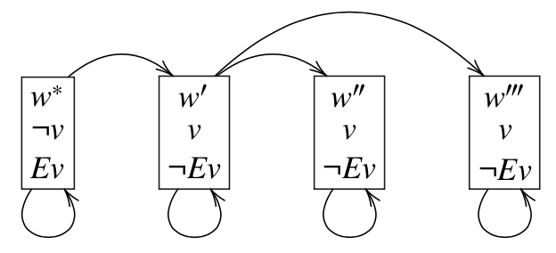

# Challenges to Metaphysical Realism
**First published Thu Jan 11, 2001; substantive revision Wed Jul 16, 2025**

*Khlentzos, Drew*

According to metaphysical realism, the world is as it is independent of how humans or other inquiring agents take it to be. The objects the world contains, together with their properties and the relations they enter into, fix the world’s nature and these objects [together with the properties they have and the relations they enter into] exist independently of our ability to discover they do. Unless this is so, metaphysical realists argue, none of our beliefs about our world could be objectively true since true beliefs tell us how things are and beliefs are objective when true or false independently of what anyone might think.

Many philosophers believe metaphysical realism is just plain common sense. Others believe it to be a direct implication of modern science, which paints humans as fallible creatures adrift in an inhospitable world not of their making. Nonetheless, metaphysical realism is controversial. Besides the analytic question of what it means to assert that objects exist independently of the mind, metaphysical realism also raises epistemological problems: how can we obtain knowledge of a mind-independent world? There are also prior semantic problems, such as how links are set up between our beliefs and the mind-independent states of affairs they allegedly represent. This is the Representation Problem.

Anti-realists deny the world is mind-independent. Believing the epistemological and semantic problems to be insoluble, they conclude realism must be false. The first anti-realist arguments based on explicitly semantic considerations were advanced by Michael Dummett and Hilary Putnam. These are:

1. Dummett’s Manifestation Argument: the cognitive and linguistic behaviour of an agent provides no evidence that realist mind/world links exist;
2. Dummett’s Language Acquisition Argument: if such links were to exist language learning would be impossible;
3. Putnam’s Brain-in-a-Vat Argument: realism entails both that we could be massively deluded (‘brains in a vat’) and that if we were we could not even form the belief that we were;
4. Putnam’s Conceptual Relativity Argument: it is senseless to ask what the world contains independently of how we conceive of it, since the objects that exist depend on the conceptual scheme used to classify them;
5. Putnam’s Model-Theoretic Argument: realists must either hold that an ideal theory passing every conceivable test could be false or that perfectly determinate terms like ‘cat’ are massively indeterminate, and both alternatives are absurd.

We’ll proceed by first defining metaphysical realism, illustrating its distinctive mind-independence claim with some examples and distinguishing it from other doctrines with which it is often confused, in particular factualism. We’ll then outline the Representation Problem in the course of presenting the anti-realist challenges to metaphysical realism that are based on it. We discuss metaphysical realist responses to these challenges, indicating how the debates have proceeded, suggesting various alternatives and countenancing anti-realist replies. We finish with a brief review of recent realist/anti-realist debates in meta-ontology.

## 1. What is Metaphysical Realism?

Metaphysical realism is the thesis that the objects, properties and relations the world contains, collectively: the structure of the world [Sider 2011][^sider-2011], exists independently of our thoughts about it or our perceptions of it. Anti-realists either doubt or deny the existence of the structure the metaphysical realist believes in or else doubt or deny its independence from our conceptions of it. Realists about numbers, for example, hold that numbers exist mind-independently. This view is opposed by Nominalists who deny the existence of abstract objects and Intuitionists who agree numbers exist, but as mental constructions, denying their mind-independence. Some realists about laws of nature, to take an empirical example, hold that laws are relations between universals [Armstrong 1983][^armstrong-1983], others that laws are ontologically primitive entities [Maudlin 2007][^maudlin-2007]. Anti-realists about laws of nature, on the other hand, either deny there are any laws at all [Cartwright 1983; van Fraassen 1989][^cartwright-1983] or else discern a dependence on human concepts in the nature of these laws, interpreting them as expressing certain expectations we have about regularities that we unconsciously project onto the world [Blackburn 1986][^blackburn-1986].

Metaphysical realism is not the same as scientific realism. That the world’s constituents exist mind-independently does not entail that its constituents are as science portrays them. One could adopt an instrumentalist attitude toward the theoretical entities posited by science, continuing to believe that whatever entities the world actually does contain exist independently of our conceptions and perceptions of them. For the same reason, metaphysical realists need not accept that the entities and structures ontologists posit exist mind-independently.

Henceforth, we shall often just use the term ‘realism’ to mean metaphysical realism. Opposition to realism can take many forms so there is no single theoretical view denoted by the term ‘anti-realism’. In particular, anti-realism is not Idealism, even though Idealism is its most recognised form. One approach, popular in Continental Philosophy, rejects realism on the grounds that words can only acquire their meaning *intra-linguistically*, through their semantic relations with other words, where these relations are grounded in our linguistic and cultural practices, rather than through referential relations to the world outside of language. This view, Anti-Representationalism as it is sometimes called, has gained traction in analytic philosophy also [See Price 2009][^price-2009].

Within the ranks of Analytic Philosophy, Verificationists and Pragmatists also reject realism, though for different reasons. We shall mainly focus in this entry on the types of criticism voiced by these two groups of Analytic philosophers with Michael Dummett advocating a certain kind of Verificationism and Hilary Putnam a certain kind of Pragmatism. While accepting Representationalism, both Dummett and Putnam rejected realism by deploying semantic considerations in arguments designed to show that realism is untenable. The main goal of this entry is to outline these ‘semantic’ challenges to realism and to critically appraise them.

The characterization of realism in terms of mind-independence above is not universally accepted. Some object that mind-independence is obscure [e.g. Chalmers 2009; for relevant discussion, see the entry ontological dependence][^chalmers-2009][^chalmers-2009-2]. Others maintain that realism is committed, in addition, to a distinctive (and tendentious) conception of truth [Putnam 1981, 1985, 1992; Wright 1993; Button 2013; Taylor 2006][^button-2013][^putnam-1981][^putnam-1985][^putnam-1992][^taylor-2006][^wright-1993] or, more radically, that realism just is a thesis about the nature of truth—that truth can transcend the possibility of verification, ruling statements for which we can gather no evidence one way or the other to be determinately either true or false. An example would be “Julius Caesar’s heart skipped a beat as he crossed the Rubicon.” Thus the realist on this view is one who believes the law of bivalence (every statement is either true or false) holds for all meaningful (non-vague) statements [Dummett 1978, 1991, 1993][^dummett-1978][^dummett-1993][^dummett-1991].

In the same vein, Crispin Wright [1992a, 2003] presents a nuanced alethic analysis according to which discourses may be more or less realist depending on which distinctive ‘marks of truth’ they satisfy.

These semantic formulations of metaphysical realism are unacceptable to realists who are deflationists about truth, denying that truth is a substantive notion that can be used to characterise alternative metaphysical views [see the entry on the deflationary theory of truth]. Realists collectively complain, with some justice, that the anti-realist arguments are really arguments against the correspondence (or other substantive) theory of truth rather than realism [Devitt 1983, 1991; Millikan 1986][^devitt-1983][^devitt-1991][^millikan-1986]. This is an important reason for preferring an ontological construal of realism rather than a semantic one.

There is, in fact, an obvious worry about using the notion of mind-independence to characterise realism: it appears to consign mental states and events to irreality. Surely your savouring the taste of espresso, say, is dependent on your mind if anything is? Moreover, just as certainly the nature and content of the experience of tasting espresso depends upon one’s beliefs and expectations. Indeed, but this is not what the ‘mind-independence’ characterisation of realism means to exclude. Rather, it is the *existence* of conscious events that is deemed to be independent of the particular opinions or theories we might hold about their existence —given conscious events do exist, were our descendants to uniformly dismiss them as illusory, they would be mistaken. The ‘mind-independence’ at issue is epistemic rather than ontological.

On this understanding of realism, it is an error to identify realism with factualism, the view that sentences in some discourse or theory are to be construed literally as fact-stating ones. The anti-realist views discussed below are factualist about discourse describing certain contentious domains. Adopting a non-factualist or error-theoretic interpretation of some domain of discourse commits one to anti-realism about its entities. Factualism is thus a necessary condition for realism. But it is not sufficient. Verificationists such as Dummett reject the idea that something might exist without our being able to recognize its existence. They can be factualists about entities such as numbers and quarks while anti-realists about their nature since they deny any entities can exist mind-independently.

To elaborate the notion of mind-independent existence, consider Peter van Inwagen’s argument for the existence of numbers [van Inwagen 2016], which he describes as “a typical neo-Quinean argument”. The argument rests on two Quinean theses, van Inwagen tells us. Firstly, that there is only one kind of variable, a variable that occupies nominal position, the range of which is unrestricted. Secondly, that the meanings of the quantifiers are univocal.[^note-1]

Given these two background assumptions, the argument he gives is this:

1. There are objects that have both mass and volume.
2. The average density of an object that has both mass and volume is the ratio of its mass to its volume.
3. So, there is at least one thing that is a ratio.
4. Anything that is a ratio is a number.
5. Hence, there are numbers.

(3) follows from (1) and (2), with the conclusion (5) deducible from (1), (2) and (4). Moreover, both (2) and (4) are, if not analytically true, simple mathematical truths. (1), on the other hand, is an empirical fact, van Inwagen notes. The argument is clearly valid and the three premises that support the conclusion are all highly plausible. Should we not just accept that numbers exist? Many philosophers think so but some philosophers demur. Amongst the latter are those who think that the meaning of ‘there exists’ varies from context to context [Hilary Putnam and Eli Hirsch are two prominent advocates whose ideas we review]. There are others who think that the existential quantifier carries no ontological import [Azzouni, J. 1997][^azzouni-1997]. If one accepts Quine’s two assumptions about the existential quantifier, however, and regards the argument as sound, hasn’t one thereby accepted realism about numbers?

No. For, while the argument establishes the existence of numbers, if it is indeed sound, it leaves their nature unspecified. Hence, it does not prove that numbers exist independently of human (or other) minds. Moreover, since the inferences are intuitionistically valid, anti-realists can accept it. The argument gives Intuitionists who believe numbers are mental constructs just as much as Platonists who believe they are eternal abstract objects a reason to believe numbers exist.

## 2. Mind-Independent Existence

Why do some find the notion of mind-independent existence inadequate for the task of formulating metaphysical realism? The most common complaint is that the notion is either obscure, or, more strongly, incoherent or cognitively meaningless. An eloquent spokesman for this strong view was Rudolf Carnap: “My friends and I have maintained the following theses,” Carnap announces [Carnap 1963, p.868][^carnap-1963]:

1. The statement asserting the reality of the external world (realism) as well as its negation in various forms, e.g., solipsism and several forms of idealism, in the traditional controversy are *pseudo-statements*, i.e., devoid of cognitive content.
2. The same holds for the statements about the reality or irreality of *other minds*.
3. For the statements of the reality or irreality of *abstract entities* (realism of universals or Platonism, vs. nominalism).

In spite of his finding these disputes meaningless, Carnap indicates how he thinks we could reconstruct them (sic.) so as to make some sense of them: if we were to “replace the ontological theses about the reality or irreality of certain entities, theses which we regard as pseudo-theses, by proposals or decisions concerning the use of certain languages. Thus realism is replaced by the practical decision to use the reistic language”.

Carnap does not have in mind a factualist reformulation of metaphysical realism here—his “reistic” language is strictly limited to the description of “intersubjectively observable, spatio-temporally localized things or events”.

What matters here is not Carnap’s sense of a commensurability between a metaphysical thesis about reality and a practical decision to speak only about observable things, but rather that he thinks he can explain how the illusion of meaningfulness arises for the metaphysical theses he declares “devoid of cognitive content”. His explanation has to do with a distinction between two types of questions — *internal* and *external* questions:

> An existential statement which asserts that there are entities of a specified kind can be formulated as a simple existential statement in a language containing variables for these entities. I have called existential statements of this kind, formulated *within* a given language, *internal* existential statements. [Carnap 1963, p. 871][^carnap-1963]

Whereas internal questions about the existence of physical objects are to be answered by observations that confirm or disconfirm sentences asserting their existence, existential statements about abstract objects are analytic, Carnap contends:

> Just because internal statements are usually analytic and trivial, we may presume that the theses involved in the traditional philosophical controversies are not meant as internal statements, but rather as *external* existential statements; they purport to assert the existence of entities of the kind in question not merely within a given language, but, so to speak, before a language has been constructed. [1963, p. 871]

Having dismissed all external existential questions as devoid of cognitive content, Carnap decides that both realism which asserts the ontological reality of abstract entities and nominalism which asserts their irreality are “pseudo-statements if they claim to be theoretical statements” (*ibid*).

Where Carnap could make no sense of the notion of mind-independent reality, Albert Einstein had no such difficulty. For, together with Podolsky and Rosen, Einstein famously proposed a test for elements of reality in their EPR paper [Einstein, Podolsky and Rosen 1935: 777–8][^einstein-1935]:

> *If, without in any way disturbing a system, we can predict with certainty (i.e. with probability equal to unity) the value of a physical quantity, then there exists an element of physical reality corresponding to this physical quantity*.

Tim Maudlin [2014, p.7] explains the significance of the EPR criterion thus:

> Suppose … I can *without in any way disturbing a system* predict with certainty the value of a physical quantity … then the relevant element of reality obtained … *independently of the determination being made*. Because, as we have said, the means of determination did not (by hypothesis) disturb the system.

Realists might wish to endorse the EPR criterion as an idealized test for the mind-independent reality of (macro-)physical quantities — even if we rarely (if at all) are able to “predict with certainty” the outcome of an experiment, we can, some would argue, approach near-certainty in a significant class of cases without disturbing the system.

## 3. The Anti-Realist Challenges to Metaphysical Realism

### 3.1 Language Use and Understanding

The first anti-realist challenge to consider focuses on the use we make of our words and sentences. The challenge is simply this: what aspect of our linguistic use could provide the necessary evidence for the realist’s correlation between sentences and mind-independent states of affairs? Which aspects of our semantic behaviour manifest our grasp of these correlations, assuming they do hold?

For your representations of the world to be reliable, there must be a correlation between these representations and the states of affairs they portray. So the cosmologist who utters the statement “the entropy of the Big Bang was remarkably low” has uttered a truth if and only if the entropy of the Big Bang was remarkably low.

A natural question to ask is how the correlation between the statement and the mind-independent state of affairs which makes it true is supposed to be set up. One suggestive answer is that the link is effected by the use speakers make of their words, the statements they endorse and the statements they dissent from, the rationalizations they provide for their beliefs and actions and so forth; cognitively, it will be the functional role of mental symbols in thought, perception and language learning etc. that effects these links.

However, when we look at how speakers actually do use their sentences, anti-realists argue, we see them responding not to states of affairs that they cannot in general detect but rather to agreed upon conditions for asserting these sentences. Scientists assert “the entropy of the Big Bang was remarkably low” because they all concur that the conditions justifying this assertion have been met.

What prompts us to use our sentences in the way that we do are the public justification conditions associated with those sentences, justification conditions forged in linguistic practices which imbue these sentences with meaning, anti-realists aver.

The realist believes we are able to mentally represent mind-independent states of affairs. But consider those cases where everything that we know about the world leaves it unsettled whether a relevant state of affairs obtains. Did Socrates sneeze in his sleep the night before he took the hemlock or did he not? How could we possibly find out? Yet realists hold that the sentence “Socrates sneezed in his sleep the night before he took the hemlock” will be true if Socrates did sneeze then and false if he did not.

The Manifestation challenge to realism is to isolate some feature of the use agents make of their words, or their mental symbols, which forges the link between mind-independent states of affairs and the thoughts and sentences that represent them. Nothing in the thinker’s linguistic behaviour, according to the anti-realist, provides evidence that this link has been forged—linguistic use is keyed to public assertibility conditions, not undetectable truth-conditions. In those cases, such as the Socrates one, where we cannot find out whether the truth-condition is satisfied or not, it is simply gratuitous to believe that there is anything we can think or say or do which could provide evidence that the link has been set up in the first place. So the anti-realist claims [Dummett 1978, 1991, 1993; Tennant 1987, 1997; Wright 1993][^dummett-1978][^dummett-1993][^dummett-1991][^tennant-1987][^tennant-1997][^wright-1993].

Why should we expect the evidence to be behavioural rather than, say, neurophysiological? The reason anti-realists give is that the meanings of our words and (derivatively for them) the contents of our thoughts are essentially communicable and thus must be open for all speakers and thinkers to see [Dummett 1978, 1993][^dummett-1978][^dummett-1993].

Anti-realists contend there is nothing in cognitive or linguistic behaviour that could provide evidence that people grasp what it is for a sentence to be true in the realist’s sense of ‘true’. How can you manifest a grasp of a notion which can apply or fail to apply without you being able to tell which? How could you ever learn to use such a concept?

One possible realist response is that the concept of truth is actually very simple, and it is spurious to demand that one always be able to determine whether a concept applies. As to the first part, it is often argued that all there is to the notion of truth is what is given by the formula “‘*p*’ is true if and only if *p*”. The function of the truth-predicate is to disquote sentences in the sense of undoing the effects of quotation—thus all that one is saying in calling the sentence “Yeti are vicious” *true* is that Yeti are vicious.

It is not clear that this response really addresses the anti-realist’s worry, however. It may well be that there is a simple algorithm for learning the meaning of ‘true’ and that, consequently, there is no special difficulty in learning to apply the concept. But that by itself does not tell us whether the predicate ‘true’ applies to cases where we cannot ascertain that it does. All the algorithm tells us, in effect, is that if it is legitimate to assert *p* it is legitimate to assert that ‘*p*’ is true. So are we entitled to assert ‘either Socrates did or did not sneeze in his sleep the night before he took the hemlock’ or are we not? Presumably that will depend on what we mean by the sentence, whether we mean to be adverting to two states of affairs neither of which we have any prospect of ever confirming.

Anti-realists follow verificationists in rejecting the intelligibility of states of affairs that we cannot detect and tend to base their rules for assertion on intuitionistic logic, which rejects the universal applicability of the Law of Bivalence (the principle that every statement is either true or false). This law is thought to be a foundational semantic principle for classical logic. However, some question whether classical logic requires bivalence [e.g. Sandqvist 2009][^sandqvist-2009]. Others dispute the idea that acceptance or rejection of bivalence has any *metaphysical* (rather than meaning-theoretic) consequences [Edgington, 1981; McDowell 1976; Pagin 1998; Gaiffman 1996][^edgington-1981][^gaiffman-1996][^mcdowell-1976][^pagin-1998]. There is, in addition, a question as to whether the anti-realist’s preferred substitute for realist truth-conditions in verification-conditions (or proof-conditions) satisfies the requirement of exhaustive manifestability [Pagin 2009][^pagin-2009].

Perhaps anti-realists are right. But if so, they need to explain how a practice based on a pervasive illusion can be as successful as modern science. Anti-realists perturbed by the manifestability of realist truth are revisionists not just about parts of our linguistic practice, they are revisionists about our understanding of the world. The consequence of this revisionist stance is that mathematics and science require extensive and non-trivial revision. The debate about whether classical logic should (or can) be rejected on meaning-theoretic grounds is ongoing: Burgess 1984, Hellman 1989, Michael 1999 and Read 2000 are critical of Dummett’s case for rejecting classical logic, whereas Cogburn 2005, Cozzo 1994, Prawitz 1977, 1987, 1994 and Tennant 1997 are, in varying degrees, supportive.

Perhaps the most persuasive realist reply to Dummett’s manifestation challenge questions the need for epistemic access to ‘verification-transcendent’ states of affairs to understand a sentence. How do we understand a sentence like “Socrates sneezed in his sleep the night before he took the hemlock”? By understanding the sentence’s component words and their mode of composition. No epistemic confrontation with an inaccessible past state of affairs is required given that we have epistemic access to the semantic values of the sentence’s components and their mode of composition. That we do indeed understand the truth-conditions associated with the Socrates sentence in the realist way, as verification-transcendent ones, is manifest in our acceptance of statements such as “Socrates either sneezed in his sleep the night before he took the hemlock or he did not, independently of what anyone believes”. Call this the Compositionality Reply.

Anti-realists respond to the Compositionality Reply by arguing that all we make manifest by asserting things like “Socrates either sneezed in his sleep the night before he took the hemlock or he did not, independently of what anyone believes” is our pervasive misunderstanding of the notion of truth. They apply the same diagnosis to the realist’s belief in the mind-independence of entities in the world and to counterfactuals which express this belief. We overgeneralize the notion of truth, believing that it applies in cases where it does not, they contend [Tennant 1987, 1997; Wright 1993][^tennant-1987][^tennant-1997][^wright-1993].

An apparent consequence of their view is that reality is indeterminate in surprising ways—we have no grounds for asserting that Socrates did sneeze in his sleep the night before he took the hemlock and no grounds for asserting that he did not and no prospect of ever finding out which. Does this mean that for anti-realists the world contains no such fact as the fact that Socrates did one or the other of these two things? No. For anti-realists who subscribe to intuitionistic principles of reasoning, the most that can be said is that there is no present warrant to assert $S \lor \neg S$: that Socrates either did or did not sneeze in his sleep the night before he took the hemlock. Realists who endorse the Compositionality Reply may counter that classical disjunction is the simplest projection from concrete cases: we understand the disjunction by projecting from our own case, for example: “I am sneezing now or I am not sneezing now” [thanks, again, to the reviewer]. We return to this issue below in §3.2.

Dummett contends that a speaker’s understanding of meaning is exhaustively manifested by certain recognitional abilities — those that are exercised when determining whether the truth-conditions of sentences are satisfied. Recent research, however, has cast doubt on his claim, unearthing crucial semantic recognitional abilities that are *not* manifest in use. Psychologists have tested people’s understanding of logical rules using university students as their subjects for the last sixty years or so. Recently, they have compared subjects’ responses to ‘Control’ syllogisms such as *All vehicles have wheels; Bikes are vehicles. So, bikes have wheels* [De Neys 2014] with responses to ‘Conflict’ syllogisms like *All vehicles have wheels; Boats are vehicles. So, boats have wheels*. The consistent finding across hundreds of such studies has been that while most university-educated subjects accept the Control syllogisms they *reject* the Conflict ones, judging that the conclusion ‘boats have wheels’ does *not* follow from the premises that *all vehicles have wheels* and *boats are vehicles*. The studies seem to show that even highly educated people are unaware of basic logical rules, particularly so when subjects make no reference to these rules when quizzed about their responses. Yet, Wim de Neys (2012) persuasively argued that a range of more sophisticated measures suggest this may not be so. The measures included ones for skin conductance showing increased autonomic arousal when solving Conflict syllogisms; eye-tracking, showing increased saccades to Conflict syllogism premises and conclusions compared to those for Control syllogisms; higher activation of the anterior cingulate cortex (an area known to be active in conflict detection) for Conflict syllogisms; longer response latencies and decreased response confidence when solving Conflict syllogisms as compared to Control ones. De Neys concludes from these findings that while subjects do indeed recognise logical rules, in most cases this recognition is not sufficient to counter a strong bias to reject any reasoning that leads to an obviously false conclusion: “Hence, although solving conflict problems might require abundant executive resources, detecting the conflict is successful even for the most biased reasoners.” [ibid, p.31]

### 3.2 Language Acquisition

The second anti-realist challenge to realism concerns our acquisition of language. The challenge is for realists to explain how a child could come to know the meanings of certain sentences within his/her language: the ones which the realist contends have undetectable truth-makers associated with them. How could the child learn the meanings of such sentences if these meanings are determined by states of affairs not even competent speakers can detect? In short, competence in one’s language would be impossible to acquire if realism were true [Dummett 1978, 1993; Wright 1993][^dummett-1978][^dummett-1993][^wright-1993]. This is the Language Acquisition challenge.

Consider the sentence (S) once more:

- (S) Socrates sneezed in his sleep the night before he took the hemlock.

Realists say (S) is either true or false even though we may (and almost certainly will) never know which it is. The state of affairs which satisfies (S)’s truth-condition when it is true, its ‘truthmaker’, and the state of affairs which satisfies the truth-condition of the negation of (S) when (S) is false are supposed to be able to hold even though competent speakers cannot detect whether they do. How could the child ever learn about this undetectable relation?

A straightforward realist reply is, again, the Compositionality Reply encountered in §3.1— that knowledge of the meanings of sentences with undetectable truth-conditions like (S) is acquired in the same way as knowledge of the meanings of sentences with recognisable truth-conditions: namely, compositionally by acquiring knowledge of the lexicon and the relevant compositional principles [Pagin 2009][^pagin-2009].[^note-2] While anti-realists contest the interpretation of the compositional principles that generate sentences with undetectable truth-conditions [where realists assert $S \lor \neg S$ is true (*S* being the Socrates sentence), anti-realists maintain there is no ground for asserting this disjunction [e.g. Tennant 1987][^tennant-1987]], this does nothing to show that the realist’s classical disjunction is unlearnable [thanks to a referee for emphasizing this point], and, as we saw in §3.1, there is a simple way in which it could be learned.

The Acquisition challenge is exacerbated by the anti-realist’s assumption that since the linguistic meaning of an expression *E* is determined solely by competent speakers’ use of *E* the child’s task in all cases is to infer or observe the meaning of *E* from its use. Thus Dummett [1978 pp. 216–217], in discussing the meaning of mathematical statements, proposes a thesis he argues holds for the meanings of every kind of statement:

> The meaning of a mathematical statement determines and is exhaustively determined by its use. The meaning of a mathematical statement cannot be, or contain as an ingredient, anything which is not manifest in the use made of it, lying solely in the mind of the individual who apprehends that meaning: if two individual agree completely about the use to be made of the statement, then they agree about its meaning. The reason is that the meaning of a statement consists solely in its role as an instrument of communication between individuals, just as the powers of a chess-piece consist solely in its role in the game according to the rules.

W.V.O. Quine is even more insistent on the public nature of linguistic meaning. Displaying his unshakable faith in Skinnerian models of language-learning he writes [1992, pp. 37–38]:

> In psychology one may or may not be a behaviourist, but in linguistics one has no choice … There is nothing in linguistic meaning beyond what is to be gleaned from overt behaviour in observable circumstances.

Some realists reject the publicity of meaning principle as it applies to language learning. While many accept that the meaning of a word is determined by its use in a given language, not all do [e.g. Chomsky 1986; Fodor and Lepore 2002][^chomsky-1986][^fodor-2002]. Realists who think of semantic understanding as a mental state reject the idea that a speaker’s understanding of meaning is exhaustively manifest in its use *as an instrument of communication*. They argue meaning is fixed by its internal role in expressing thought. If Dummett’s manifestation requirement is a demand for a behaviouristic reduction of semantic knowledge, they argue, it should be rejected [Burgess 1984; Chomsky 1986][^burgess-1984][^chomsky-1986]. However, some sympathetic to the demand for full manifestability of semantic knowledge reject the behaviouristic construal and instead justify it on conceptual grounds [e.g. Shieh 1998, McGee 2015][^mcgee-2015][^shieh-1998].[^note-3]

The Acquisition Challenge is a vexed one for realists to respond to because Dummett shares little common ground with the many (realist) philosophers, linguists and cognitive scientists who believe language acquisition is effected by a dedicated language module [Fodor 1975, 1983, 2008; Chomsky 1986, 2006; Crain 2012; Pinker 1994][^chomsky-1986][^chomsky-2006][^crain-2012][^fodor-1975][^fodor-1983][^fodor-2008][^pinker-1994] or even with those who disavow modularity but agree that semantic knowledge is partly unconscious. Thus, Dummett rejected Chomsky’s thesis that speakers have unconscious knowledge of the rules of Universal Grammar on the Wittgensteinian grounds that it was, at best “an explanatory hypothesis, not a systematisation of facts open to view.” [Dummett 1981][^dummett-1981]. Dummett apparently took this “systemisation of facts” to be satisfied by an account that pairs knowledge of meaning with recognitional abilities.[^note-4]

Evidence from developmental psychology indicates some meaning is pre-linguistic and that some pre-linguistic meaning or conceptual content relate to situations that are not detectable by the child. For example, psychologists have discovered systems of core knowledge activated in infancy that govern the representation of, *inter alia* concrete objects and human agents [see Spelke 2003; Spelke and Kinzler 2007][^spelke-2003][^spelke-2007]. An interesting finding from preferential gaze experiments suggests 4 month old infants represent occluded objects as continuing behind their barriers.[^note-5]

While these findings do not by themselves show that the meanings of mental symbols is not determined by public use, they do provide evidence that ‘verification-transcendent’ conceptual content is laid down in the earliest stages of cognitive development.

It should be noted that the anti-realist’s model of disjunction seems at odds with how we actually use disjunction. For it rules many quite innocuous-looking disjunctions as unacceptable:

We say of a coin to be tossed that (C) *The coin will either land Heads or Tails* without having any idea which face it will land on or of a lottery with one ticket to be drawn from a million tickets that (L) *One of these tickets will be the winning ticket* without wishing to say of any one ticket that it will win. In fact, it is arguably the point of disjunction to allow speakers to convey useful information about the number of live possibilities when they do not know which of those possibilities does (or did or will) obtain. Indeed, even when we can never find out which alternative holds or held or will hold. Consider (D) *The number of dinosaurs on Earth was either odd or even*. Most people hear (D) as a trivial truth. Why? Presumably because if there were dinosaurs on earth, there must have been a definite number of them, N say, where N is a positive integer. But as all positive integers are either odd or even, N is either odd or even. Yet, it is utterly unlikely that we could ever know what positive integer N is. Hence, we’ll (almost certainly) never know whether the number N of dinosaurs that roamed our world was an odd positive integer or an even one.

Whence, disjunction provides a plausible method for a language learner to acquire the notion of verification-transcendent truth. Just because the disjunctions in (C) and (L) are assertible even though their individual disjuncts are not (at the time of utterance or of entertaining the disjunction in thought) and the disjunction (D) is assertible even though we will never find out which disjunct holds, we can come to grasp how a statement such as (O) *There were an odd number of dinosaurs on earth* could be true without our ever being able to verify it is. For, as (D) is true, it must either be that (O) is true or else that (E) *There were an even number of dinosaurs on earth* is true instead. Thus, either (O) or (E) is true, though undetectably so.

### 3.3 Radical Skepticism

According to Hilary Putnam, the metaphysical realist subscribes not just to the belief in a mind-independent world but also to the thesis that truth consists in a correspondence relation between words (or mental symbols) and things in that mind-independent world. Call this thesis *correspondence truth* (after Devitt 1991)[^devitt-1991]. More importantly, metaphysical realists aver that an ideal theory of the world could be *radically* false, Putnam contends: ‘radical’ in the sense that *all* (or almost all) of the theory’s theses could fail to hold. Such a global failure would result if we were to be ‘brains-in-a-vat’, our brains manipulated by mad scientists (or machines, as in the movie *The Matrix*) so as to dream of an external world that we mistake for reality. Call this thesis *radical skepticism*.

It is widely believed that states of affairs that are truly mind-independent do engender radical skepticism. The skeptic contends that for all we could tell we could be brains in a vat—brains kept alive in a bath of nutrients by mad alien scientists, or, in Putnam’s preferred version, by super-computers so that there are and never were any flesh and blood creatures as we imagine there to be. All our thoughts, all our experience, all that passed for science would be systematically mistaken if we were. We’d have no bodies although we thought we did, the world would contain no physical objects, yet it would seem to us that it did, there’d be no Earth, no Sun, no vast universe, only the brain’s deluded representations of such. At least this could be the case if our representations derived even part of their content from links with mind-independent objects and states of affairs. Since realism implies that such an absurd possibility could hold without our being able to detect it, it has to be rejected, according to anti-realists.

Putnam assays to prove that realism is not just false but internally inconsistent. It is the goal of his Brain-In-A-Vat Argument to prove not only that we are *not* brains in a vat but that we *could not* be. When I talk of Putnam’s Brain-In-A-Vat Argument, **BIVA**, I shall mean his argument for the modal thesis that we *could not be* brains-in-a-vat. Most discussions of Putnam’s Brain-In-A-Vat Argument focus instead on the question of whether Putnam has shown that we are not BIVs. [I am indebted to a SEP reviewer for emphasizing the need to focus on the modal conclusion that *we could not be* brains-in-a-vat and for helpful suggestions about arguments for this conclusion]. The difficulty we face is that the only clear argument Putnam gives for the modal conclusion is very brief and, as we shall see, a little perplexing.

A crucial assumption of the **BIVA** is semantic externalism, the thesis that the reference of our words and mental symbols is partially determined by contingent relations between thinkers and the world. This is a semantic assumption many realists endorse. To understand semantic externalism, it is useful to recall the ‘Twin-Earth’ considerations used to support it: on Twin-Earth things are exactly as they are here on Earth except for one difference—whereas for Earthly humans water has the chemical composition H₂O, for our döppelgangers on Twin-Earth, twumans, water is instead composed of some substance unknown to us on Earth, XYZ. Now when you and your twuman counterpart say (or think) “‘Water’ refers to water” both of you utter (or think) truths. But which truth you both think or utter differs. For humans “‘Water’ refers to water” expresses the truth that the term ‘water’ in English refers to that substance whose chemical composition is H₂O. For our twuman Twin-Earth counterparts, however, their sentence “‘Water’ refers to water” expresses the truth that their term ‘water’ in Twenglish refers to that substance whose chemical composition is XYZ.

Now, according to Putnam, while the realist’s mind-independence thesis entails that we could indeed be brains in a vat, Externalism entails that were we to be BIVs we could not even entertain this as a possibility (since a BIV’s thoughts are about virtual BIVs, not BIVs). Putnam concludes that (externalist) realism is incoherent [Putnam 1981][^putnam-1981]. For this argument to work, however, Putnam must be assuming a rather restrictive form of modal rationalism: we could be brains in a vat only if in the circumstance that we were envatted, we could conceive that we were envatted.

There is, in fact, no *logical* incoherence in believing both that (I) It is possible that one is a BIV and that (II) If one is a BIV one could never conceive that one was —as the figure below illustrates.

*Figure.* Consider a universe of 4 worlds. If we are *not* in fact brains-in-a-vat (so that the hypothesis *v* that we are brains in a vat is false, $\neg v$ is true at $w^*$, the actual world) we can nonetheless entertain $(E)$, the hypothesis that we are (so that $Ev$ is true at $w^*$), recognizing as we do so that were we to inhabit a world such as $w'$ in which we are brains-in-a-vat (*v* holds at $w'$), we would lack the semantic resources to articulate thoughts reflecting our own envatted state so that we *could not* so much as entertain the thought that we were brains-in-a-vat ($\neg Ev$ holds not only at $w'$ but at all those worlds ( $w''$, $w'''$) accessible from $w'$).

Putnam’s argument for realism being inconsistent does not seem compelling. However, he offers another argument based upon Externalism that seeks to prove we could not be brains-in-a-vat. This is his **BIVA**. It rests upon the following reasoning: “So, if we are brains in a vat, then the sentence ‘We are brains in a vat’ says something false (if it says anything). In short, if we are brains in a vat, then ‘We are brains in a vat’ is false. So, it is necessarily false.” [1981, p.15]. Putnam apparently thought he had proved by means of Externalism that we could not be brains-in-a-vat. Has he? Suppose I worry that I might be a brain-in-a-vat. Seeking reassurance that I could not be, I read Putnam’s words. I ponder the sentence “If I am a brain-in-a-vat, then the sentence ‘I am a brain-in-a-vat’ is false”. If Externalism is true, I reason, then if I indeed am a brain-in-a-vat, the pronoun ‘I’ in my language (vat-English or v-English) refers not to me but to *virtual* me, *v-me*, and the term ‘brain-in-a vat’ or ‘BIV’ refers not to real BIVs but to *v-BIVs*. That being so, the sentence ‘I am a brain-in-a-vat’ in v-English will mean that *v-me is a v-BIV.* But that proposition is true, not false. I then reconsider: perhaps the singular pronoun ‘I’ refers to me in every possible situation, whatever my nature? If so, then in the circumstance that I am a BIV my utterance (or mental tokening) of ‘I am a BIV’ will mean that *I am a v-BIV*. That proposition is false. But it is not the proposition Putnam is discussing. The proposition Putnam thinks is necessarily false is the proposition that *I am a BIV*.

Is there then no valid argument in the spirit of Putnam’s **BIVA** which could be used to show that we could not be brains-in-a-vat?

Michael McKinsey has cleverly reworked Putnam’s argument to show against the sceptic that we are not (and we can know that we are not) brains-in-a-vat. [His anti-skeptical argument, AS, in section 9 of his Winter 2024 archived entry [skepticism and content externalism](https://plato.stanford.edu/archives/win2024/entries/skepticism-content-externalism/#SuccAntiSkepArgu)]. Here, I adapt McKinsey’s AS argument to formulate a revised brain-in-a-vat argument, BIVA*. Consider the set of worlds U wherein I am a denizen with much the same cognitive abilities as I have now in the actual world @ such that in every world w of U, I possess at least a modicum of logical acumen. The BIV hypothesis is that I could be a brain-in-a-vat (a lab-grown computer-controlled brain dreaming it is a human denizen of an external world experiencing and thinking about that world in just the way that I experience and think about it). Alternatively, I could be a computer simulation of a human imagining that it is a human. Then:

1. In any world w ∈ U, I understand that the proposition that I have a body entails I am not a BIV.
2. Thus, in any world w ∈ U, I have the concept of a BIV.
3. Suppose that there is a world w′ ∈ U in which I am a BIV.
4. Then, by (2), in w′ I have the concept of a BIV.
5. But, by Externalism, if I’m a BIV in w′, then in w′ I do not have the concept of a BIV.
6. Hence, in w′ I both have and do not have the concept of a BIV.
7. Therefore, there is no world w′ ∈ U in which I am a BIV.

BIVA* rests on the two assumptions of Minimal Logical Acumen, and (Semantic) Externalism. Premise (2) seems correct: one cannot grasp the proposition that one is not a BIV unless one has the concept of a BIV. The MLA assumption guarantees I can recognize basic entailments such as from the proposition that I have a body to the proposition that I am not a BIV. Premise (5) rests on Externalism: since BIVs are lab-grown computer-controlled brains or computer simulations of humans who inhabit a virtual world in thought, BIVs cannot refer in thought or word to real world brains or computer simulations.Of course, the argument is only as good as its Externalist assumptions and prominent realists such as Frank Jackson and David Lewis follow Robert Stalnaker in rejecting Externalism for an ‘Internalist’ view of semantic content according to which the content of a sentence is the set of possible worlds in which it is true. Those realists who do accept Externalism and are swayed by the McKinsey-styled argument BIVA*, on the other hand, still owe us an explanation of how we can so much as grasp the proposition that we are brains in a vat or virtual humans (if only to reject it). Their answer will be that while all our evidence cannot rule out this possibility, if Externalism is true there is no way the world could have been wherein this possibility obtained. That is to say, these realists believe that while it is *epistemically* possible that we are brains-in-vats or virtual humans, it is not *metaphysically* possible (if Externalism is true).

### 3.4 Models and Reality

Putnam’s Model-Theoretic Argument is the most technical of the arguments we have so far considered. We shall not reproduce all the technicalities here. The central ideas can be conveyed informally, although some technical concepts will be mentioned where necessary. The argument purports to show that the Representation Problem—to explain how our mental symbols and words get hooked up to mind-independent objects and how our sentences and thoughts target mind-independent states of affairs—is insoluble.

According to the Model-Theoretic Argument, there are simply too many ways in which our mental symbols can be mapped onto items in the world. The consequence of this is a dilemma for the realist. The first horn of the dilemma is that s/he must accept that what our symbols refer to is massively indeterminate. The second horn is that s/he must insist that even an ideal theory, whose terms and predicates can demonstrably be mapped veridically onto objects and properties in the world might still be false, i.e., that such a mapping might not be the right one, the one ‘intended’.

Neither alternative can be defended, according to anti-realists. Concerning the first alternative, massive indeterminacy for perfectly determinate terms is absurd. As for the second, what can it mean for a mapping to be the intended mapping if not that it satisfies every conceivable operational and theoretical constraint? Yet Putnam’s Model-Theoretic Argument proves that there will invariably be interpretations of an ideal theory on which all the theory’s sentences come out true which do satisfy any constraint we might choose to impose on them, anti-realists maintain.

Now, in logic theories are treated as sets of sentences and the objects (if any) that sentences talk about appear as elements of the domain of set-theoretic entities called *structures*. Associated with these structures are *interpretation functions* that map individual constants onto individual objects of the domain and n-place predicates onto n-tuples of elements in the domain. When a structure makes all the sentences of a given theory true it is called a *model* of the theory. By demonstrating that there is a model of T we show theory T is consistent. If T turns out to be true in its *intended model*, then T is true *simpliciter*.

> For an informal illustration of the basic ideas of model theory, see the supplementary document, [Model Theory: Core Ideas](realism-sem-challenge.model-theory.md).

Let us call structures whose domains consist of numbers ‘numeric’ structures. The nub of Putnam’s Model-Theoretic Argument against realism is that the realist cannot distinguish the intended model for his/her total theory of the world from non-standard interlopers such as permuted models or ones derived from numeric models, even when total theory is a rationally optimal one that consists, as it must do, of an *infinite* set of sentences and the realist is permitted to impose the most exacting constraints to distinguish between models. This is a very surprising result if true! How does Putnam arrive at it?

Putnam uses several different arguments to establish the conclusion above. The argument of prime concern to realists, as Taylor (2006)[^taylor-2006] emphasises, is the argument based on Gödel’s Completeness Theorem, GCT. For, following Lewis [Lewis, 1984][^lewis-1984], realists might concede to Putnam that they cannot single out the intended model or distinguish it from various ersatz models, but argue that this is not necessary since it suffices that an intended model *exists*, even if we cannot specify it. This response does not answer the GCT argument, however. For this argument purports to prove directly that an ideal theory of the world could not be false, a conclusion flatly inconsistent with realism. See the supplementary document [The Model-Theoretic Argument and the Completeness Theorem](realism-sem-challenge.model-theory-completeness.md) for an outline of this argument.

Putnam has another model-theoretic argument against realism, the Permutation Argument, also designed to guarantee we can find a true interpretation of an ideal theory:

Suppose that the realist is able to somehow specify the intended model. Call this intended model $W''$. Then nothing the realist can do can possibly distinguish $W''$ from a permuted variant $W^*$ which can be specified following Putnam 1994b, 356–357:

> We define properties of being a cat* and being a mat* such that:
>
> 1. In the actual world cherries are cats* and trees are mats*.
> 2. In every possible world the two sentences “A cat is on a mat” and “A cat* is on a mat*” have precisely the same truth value.

Instead of considering two sentences “A cat is on a mat” and “A cat* is on a mat*” now consider only the one “A cat is on a mat”, allowing its interpretation to change by first adopting the standard interpretation for it and then adopting the non-standard interpretation in which the set of cats* are assigned to ‘cat’ in every possible world and the set of mats* are assigned to ‘mat’ in every possible world. The result will be the truth-value of “A cat is on a mat” will not change and will be exactly the same as before in every possible world. Similar non-standard reference assignments could be constructed for all the predicates of a language. [See Putnam 1985, 1994b.][^putnam-1985][^putnam-1994b]

Bas van Fraassen [1997] provides a concise informal sketch of Putnam’s Model-Theoretic Argument:

> Let *T* be a theory that contains all the sentences we insist are true, and that has all other qualities we desire in an ideal theory. Suppose moreover that there are infinitely many things, and that *T* says so. Then there exist functions (interpretations) which assign to each term in *T*’s vocabulary an extension, and which satisfy *T*. So we conclude, to quote Putnam, “*T* comes out true, true of the world, provided we just interpret ‘true’ as TRUE(SAT)”.

Here ‘TRUE(SAT)’ means “true relative to a mapping of the terms of the language of *T* onto (sets of) items in the world”.

Why should we interpret ‘true’ as TRUE(SAT)? Because truth is truth in an intended model and, Putnam argues, amongst all the models of *T* that make all its theses come out true there is guaranteed to be at least one that passes all conceivable constraints we can reasonably impose on a model in order for it to be an intended model of *T*.

Realists have responded to the argument by rejecting the claim that a model *M* of the hypothetical ideal theory *T* passes every theoretical constraint simply because all of the theory’s theses come out true in it. For there is no guarantee, they claim, that terms stand in the right relation of reference to the objects to which *M* links them. To be sure, if we impose another theoretical constraint, say:

> Right Reference Constraint (RRC): Term *t* refers to object *x* if and only if $Rtx$ where *R* is the right relation of reference,

then *M* (or some model based on it) can interpret this RRC constraint in such a way as to make it come out true. But there is a difference between a model’s making some description of a constraint come out true and its actually conforming to that constraint, metaphysical realists insist [Devitt 1983, 1991; Lewis 1983, 1984][^devitt-1983][^devitt-1991][^lewis-1983][^lewis-1984].

Thus Devitt and Lewis claim that Putnam’s alternative model *M* has not been shown to satisfy *every* theoretical constraint *merely* by making some description of each theoretical constraint true.

Skolem’s Paradox in set theory seems to present a striking illustration of Lewis’s distinction between (re)interpreting a constraint to make it come out true and genuinely satisfying that constraint. The Löwenheim-Skolem Theorem states that every consistent, countable set of first-order formulae has a denumerable model, in fact a model in the set of integers $\mathbb{Z}$. Now in ZF one can prove the existence of sets with a non-denumerable number of elements such as the set $\mathbb{R}$ of real numbers. Yet the ZF axioms comprise a consistent, countable set of first-order formulae and thus by the Löwenheim-Skolem Theorem has a model in $\mathbb{Z}$. So ZF’s theorem $\phi$ stating that $\mathbb{R}$ is non-denumerable will come out true in a denumerable model $\mu$ of ZF.

How can this be? One explanation is that $\mu$ makes $\phi$ true only at the cost of re-interpreting the term ‘non-denumerable’ so that it no longer means *non-denumerable*. Thus $\mu$ is not the intended model $M^*$ of ZF. It looks as if the metaphysical realist has a clear illustration of Lewis’s distinction at hand in set theory.

Unfortunately for the realist, this is not the only explanation. In fact, Putnam used this very example in an early formulation of the MTA. Just because there are different models that satisfy $\phi$ in some of which $\mathbb{R}$ is non-denumerable but in others of which (such as $\mu$) $\mathbb{R}$ is denumerable, Putnam argued, it is impossible to pin down the intended interpretation of ‘set’ via first-order axioms. Moreover, well before Putnam, Skolem and his followers had taken the moral of Skolem’s Paradox to be that set-theoretic notions are indeterminate [For further discussion, see the entry on Skolem’s paradox].

The question of how to interpret Skolem’s Paradox merely raises anew the question of what it is for a theory such as the hypothesized ideal theory *T* to satisfy a right reference constraint, (RRC). Putnam [1985] regards it as simply question-begging for a realist to assume her notion of an intended model is determinate: i.e. that terms such as ‘satisfaction’ or ‘correspondence’ refer to those relations to which she wishes them to refer. That her term ‘refers’ refers to her desired reference relation is ‘just more theory’. Realists have responded that Putnam is wilfully re-interpreting their semantic terms as he sees fit.[^note-6]

Is there some independent way to validate Lewis’s distinction? Michael Resnick thinks so [Resnick 1987][^resnick-1987]. Putnam maintained that *M*, the model he constructs of the ideal theory *T*, is an intended model because it passes every operational and theoretical constraint we could reasonably impose. It passes every theoretical constraint, he argues, simply because it makes every thesis of *T* true. But unless the Reflection Principle **(RP)** below holds, Resnick argues, this inference is just a *non-sequitur*:

- (**RP**) To any condition *f* that a model of a theory satisfies, there corresponds a condition *C* expressible in the theory that that theory satisfies.

However, this principle is false. The simplest counterexample to it, Resnick points out, is Tarskian truth. Suppose we impose on *T*’s model *M* a condition $f^*$ that *M* makes all of *T*’s theses come out true. Then, unless *T* is either inconsistent or too weak to express elementary arithmetic no truth predicate will be definable in *T*. Whence there will be no condition *C* expressible in *T* corresponding to this condition $f^*$ on *T*’s model(s) *M*. Resnick concludes (*ibid*):

> Any true interpretation of *T* whatsoever—even one which does not satisfy *C*—will make true every thesis of *T*, including T’s assertion that *C* is satisfied. Which suffices to block the ‘just more theory’ gambit.

The philosophical consensus appears to be that Lewis and Resnick are right. Note that their argument, if sound, works against the Permutation Argument also. Apart from the authors already discussed, important criticisms of the MTA were advanced in Hale and Wright 1997, van Cleve 1992 and Bays 2008. However, some very sophisticated anti-realist attempts to buttress the Model-Theoretic Argument against Lewis-styled criticisms have appeared. Igor Douven reconstructs Putnam’s argument, defending it against standard objections [Douven 1999][^douven-1999]. Barry Taylor presents a detailed explication and defence of Putnam’s Just More Theory reply [Taylor 2006][^taylor-2006], as does Tim Button [Button 2013][^button-2013]. Whether these newer formulations of the MTA succeed in answering the Lewis/Resnick objection is an open question.[^note-7]

### 3.5 Conceptual Schemes and Pluralism

According to conceptual pluralists, there can no more be an answer to the question “What is the structure of the world?” outside of some scheme for classifying entities than there can be an answer to the question of whether two events *A* and *B* are simultaneous outside of some inertial frame for dating those events. The objects that exist are the objects some conceptual scheme says exists—‘mesons exist’ is true just because mesons exist relative to the conceptual scheme of current physics.

Realists think there is a unitary sense of ‘object’, ‘property’ etc., for which the question “what objects and properties does the world contain?” makes sense. Any answer which succeeded in listing all the objects, properties, events etc. which the world contains would comprise a privileged description of that totality [Putnam 1981][^putnam-1981]. Anti-realists reject this. For them ‘object’, ‘property’ etc., shift their senses as we move from one conceptual scheme to another. Some anti-realists argue that there cannot be a totality of all the objects the world contains since the notion of ‘object’ is *indefinitely extensible* and so, trivially, there cannot be a privileged description of any such totality. [For discussions of indefinite extensibility see Dummett 1978, 1991; Linnebo 2018; Warren 2017][^dummett-1978][^dummett-1991][^linnebo-2018][^warren-2017].

How does Putnam defend conceptual relativity? One way is by arguing that there can be two complete theories of the world which are descriptively equivalent yet logically incompatible from the realist’s point of view. For example, theories of space-time can be formulated in one of two mathematically equivalent ways: as an ontology of points, with spatiotemporal regions being defined as sets of points; or as an ontology of regions, with points being defined as convergent sets of regions. Such theories are descriptively equivalent since mathematically equivalent and yet are logically incompatible from the realist’s point of view, Putnam contends [Putnam 1985, 1990][^putnam-1985][^putnam-1990]. Call the point based theory $T_1$ and the region-based theory $T_2$.

Anti-realists regard two theories as descriptively equivalent if each theory can be interpreted in the other and both theories explain the same phenomena. This judges $T_1$ and $T_2$ as descriptively equivalent. Realists can accept the two theories are descriptively equivalent. What the realist cannot accept is that $T_1$ and $T_2$ are logically incompatible. Thomas William Barrett and Hans Halvorson argue that the two theories “ … are simply convenient ways of expressing the geometric facts that are more fully expressed by a comprehensive theory” that quantifies over both points and lines. $T_1$ and $T_2$ cannot be incompatible according to Barrett and Halvorson because they are in essence the *same* theory [Barrett and Halvorson 2017][^barrett-2017]. This seems right: points exist in $T_2$ just as they do in $T_1$. The two theories differ only in their choice of theoretical primitives, not in their ontology. The geometric case thus does not provide an instance of two theories that are descriptively equivalent but logically incompatible (from the realist’s point of view). Realists deny the existence of such theories.

So, consider another Putnam-styled case [Putnam 2004][^putnam-2004]. Ernie looks into his bag and sees there are 3 coins and nothing else and announces “There are exactly 3 objects in my bag.” Maxi looks into Ernie’s bag and shakes her head “No Ernie, there are 7 objects in your bag!” she corrects him. The Carnapian pluralist feels she can defuse the conflict and accommodate both points of view by maintaining that whilst 3 objects exist-in-*E* (where *E* is Ernie’s everyday framework), 7 objects exist-in-*M* (with *M* Maxi’s mereological framework). But even if Maxi can endorse both of these claims (since the mereological objects include Ernie’s 3 coins), it is not at all certain Ernie can do so. If Ernie is unpersuaded that mereological fusions of objects are themselves objects, then he may reject Maxi’s putative truthmaker for her framework-relative existence claim “7 objects exist-in-*M*”.

In this case, Maxi and Ernie do disagree about what exists. However, the pluralist’s suggestion that 3 objects exist-in-*E* but 7 objects exist-in-*M* is not clearly warranted. There are simpler explanations: one is that by ‘object’ Ernie means ordinary object, by ‘object’ Maxi means mereological object. Nothing deeper than that is required to explain their disagreement. Rather than existence or truth that is relativized, the meanings of their terms differ. On this account, pluralists have mistaken a plurality of meanings for a plurality of modes of being. However, other explanations are also possible: for instance, it may be that Ernie and Maxi do mean the same thing by ‘object’ but hold incompatible theories about what counts as an object. More importantly, as a reviewer noted, the debate *need not* turn on the notion of an object: it can proceed with quantifiers, for example. The disagreement then would arise from divergent interpretations of those quantifiers.

Putnam’s pluralism has provoked very different reactions from realists. Some argue that conceptual pluralism is consistent with realism [Lynch 1998; Horgan and Timmons 2002; Sosa 2003][^horgan-2002][^lynch-1998][^sosa-2003], others take Putnam’s pluralism to amount to the claim that ontological expressions are either indeterminate or that alternative ontologies are equally good, both alternatives being problematic [Eklund 2008][^eklund-2008]. Realists cannot make sense of the Carnapian idea that existence and truth are relative to a conceptual scheme [Brueckner 1998][^brueckner-1998]. Peter van Inwagen provides a trenchant criticism of Putnam’s claims (remarks in square brackets added for clarification):

> I cannot grant that ‘Carnap’s’ [Ernie’s] and ‘The Polish logician’s’ [Maxi’s] descriptions are equally good or equivalent descriptions of the population of a world [e.g., the contents of Ernie’s bag]—not at least if Carnap’s description is ‘a world that contains three mereological simples and nothing else’. I cannot grant that they *could* be ‘equally good or equivalent descriptions of the population of a world’ since they are straightforwardly incompatible. (van Inwagen 2002)[^inwagen-2002]

Recently, however, some impressive neo-Carnapian defences of conceptual pluralism have been proposed that bring new considerations to bear on these debates. We briefly review some of these in section 4.

## 4. Realism and Anti-Realism in Meta-Ontology

Debates in meta-ontology (analytic ontology) over the last twenty years have sparked renewed interest in realism. They have also seen a marked shift in how realism, i.e. ontological realism, is understood. “The central question of metaontology”, Theodore Sider, a prominent ontological realist, contends, “is that of whether there are many equally good quantifier meanings, or whether there is a single best quantifier meaning.” [Sider 2009, p.397][^sider-2009]. Where Sider argues for a single best quantifier meaning, Eli Hirsch believes there are a multiplicity of possible quantifier meanings that are equally good, a thesis he calls *Quantifier Variance*. This meaning-theoretic focus is something new.[^note-8]

It is no surprise, then, to find that the positions marked out as ‘realist’ and ‘anti-realist’ by those engaged in ontological disputes do not always coincide with realism and anti-realism as we have explained these metaphysical views.[^note-9]

A more significant division is between metaontologists who accept a *robust* conception of ontology, and *deflationists* about ontology who don’t. Sider defends robust ontology [Sider 2009, 385–386][^sider-2009]:

> “ontological deflationists”… have said … when some particles are arranged tablewise, there is no “substantive” question of whether there also exists a table composed of those particles. There are simply different — and equally good — ways to talk. I, on the other hand, accept a very strong realism about ontology. I think that questions about the existence of composite objects are substantive, just as substantive as the question of whether there are extra-terrestrials.

Neo-Carnapians such as Putnam, Eli Hirsch, David Chalmers, Amie Thomasson, and Huw Price are ontological deflationists who embrace conceptual pluralism about ontological matters. Hirsch, however, thinks conceptual pluralism is perfectly consistent with realism [Hirsch, E. 2002][^hirsch-2002]. Matti Eklund understands Hirsch to mean that he considers the world to be an amorphous lump [Eklund, M., 2008][^eklund-2008] (citing Michael Dummett), a ‘lump’ that alternative and equally feasible conceptual schemes serve to make intelligible. For Sider, in contrast, rejecting an intrinsic structure to the world is to reject realism.[^note-10]

Competing views about temporal persistence do not seem to be semantic in nature. While Perdurantists believe that things persist through time by virtue of having temporal parts that *perdure*, Endurantists reject the notion of temporal parts as incoherent —things persist by *enduring*: they are wholly present whenever they exist. As observed in the entry on temporal parts:

> This looks like a straightforward ontological disagreement, a dispute about what exists.

Eli Hirsch is not convinced, however:

> I claim that the dispute between Endurantists and Perdurantists is verbal … each party ought to agree the other party speaks a truth in his own language. [Hirsch 2011, 229][^hirsch-2011]

How can this be? Endurantists think perdurantists are guilty of spatializing time when they talk about temporal parts; perdurantists think enduring objects cannot explain change. How can there be a rapprochement of the sort Hirsch has in mind?

Hirsch’s novel and intriguing idea is that what makes the endurantist/perdurantist temporal parts debate and the nihilist/universalist mereological debate merely verbal ones is the fact that the protagonists in these debates mean different things by their quantifiers, in particular their existential quantifiers, in their ontological assertions. While both protagonists speak a common language, here English, in which certain ontological claims such as ‘there are tables’ happen to come out true, this is a superficial socio-linguistic fact about English that might not have been so: we and they could just as easily have spoken English* (an ontological nihilist language) in which the sentence ‘there are tables’ came out false. Protagonists in these ontological disputes are, unwittingly, engaged in a ‘merely verbal’ debate and are thus talking past each other.[^note-11]

How does the deflationist tell that an ontological dispute is a ‘merely verbal’ one? Hirsch thinks that when we interpret the words of another, we assign truth-conditions to their sentences by matching those sentences with sets of possible worlds, guided by the metasemantic maxim that the speaker’s assertion of those sentences should come out true. The maxim applies to ontological disputes such as the Ernie/Maxi dispute about mereology — there are possible languages in which both speakers’ assertions come out true. Where a ‘character’ of a sentence is a function from contexts of utterance to truth-conditions, Hirsch contends: “speakers of either language should allow that speakers of the other language assert sentences that have the same characters and the same truth-values as they themselves assert” [Hirsch 2009, p. 242][^hirsch-2009].

In this way Ernie should attribute the same set of possible worlds (intensions) to Maxi’s sentence ‘There are seven objects in your bag’ as he associates with his own sentence ‘There are three objects in my bag’ and Ernie should interpret Maxi as uttering a truth in so doing. Ernie and Maxi are asserting the very same proposition but are using different words to express it. They are, as a result, simply talking past each other.

Hirsch’s doctrine of quantifier variance QV dominates current metaontological debate. Some have questioned whether interpreters on one side of an ontological dispute can admit that the language of those on the other side is possible. For to do so each interpreter must be able to provide a Tarskian semantics for the other’s language. But an Endurantist won’t be able to do this for the Perdurantist’s sentence such as ‘Aliceₜ is a temporal part of Alice’ since the predicate ‘is a temporal part of’ has an empty extension in the Endurantist’s language [Hawthorne 2006; Eklund 2009][^eklund-2009][^hawthorne-2006]. Others suspect QV is an internally unstable position: how can an Endurantist speaking her language E allow that a sentence like ‘Aliceₜ is a temporal part of Alice’ is a *true* sentence of the Perdurantist’s language P without admitting that there are temporal parts [e.g. Hale and Wright 2009; Dorr 2014][^dorr-2014][^hale-2009]? Warren 2015 provides a convincing QV response to this ‘Collapse’ argument. An important resource, containing papers by some of the authors cited, is the collection of essays anthologised in Chalmers et al 2009 [For background on mereology see the entry mereology and for discussion of whether there are composite objects, see the entry material constitution and the entry ordinary objects].

The meaning-theoretic focus on Quantifier Variance in metaontology represents a fascinating development. The implications for ontological realism are as yet undecided.

## 5. Summary

We have considered a number of challenges to realism, the thesis that the objects and properties that the world contains, its nature and structure, exist independently of our conception or perception of them. Historically, these challenges came from two camps: (1) neo-verificationists led by Dummett who assimilate belief in mind-independent world to a belief in a verification-transcendent conception of truth which they profess to find unintelligible, and (2) pragmatists and pluralists led by Putnam who also question the intelligibility of the realist’s mind-independent world but for reasons independent of any commitment to verificationism. While neo-verificationism today claims few adherents, within the ranks of analytic ontologists, pluralism and Carnap’s version of it in particular, has enjoyed something of a revival. Today, perhaps the most active and engaging debates about realism are meta-ontological ones that involve neo-Carnapian pluralists and their ontological realist opponents.

Both the historical debate between realists and their anti-realist opponents and the meta-ontological debate are still very much open. If realists could provide a plausible theory about how correspondences between mental symbols and the items in the world to which they refer might be set up, many of these challenges could be met. Alternatively, if they could explain how, consistently with our knowledge of a mind-independent world, no such correspondences are required to begin with, many of the anti-realist objections would fall away as irrelevant. In the absence of such explanations it is still entirely reasonable for realists to believe that the correspondences are in place, however, and there can, indeed, be very good evidence for believing this. Ignorance of Nature’s reference-fixing mechanism is no reason for denying it exists.

## References（引用注释）

> 原文参考文献已转为脚注引用：文内“作者-年份”引用组后附 [^key] 标记，完整条目见本文末脚注定义。

## Academic Tools

> |   | [How to cite this entry](https://plato.stanford.edu/cgi-bin/encyclopedia/archinfo.cgi?entry=realism-sem-challenge). |
> | --- | --- |
> |   | [Preview the PDF version of this entry](https://leibniz.stanford.edu/friends/preview/realism-sem-challenge/) at the [Friends of the SEP Society](https://leibniz.stanford.edu/friends/). |
> |   | [Look up topics and thinkers related to this entry](https://www.inphoproject.org/entity?sep=realism-sem-challenge&redirect=True) at the Internet Philosophy Ontology Project (InPhO). |
> |   | [Enhanced bibliography for this entry](https://philpapers.org/sep/realism-sem-challenge/) at [PhilPapers](https://philpapers.org/), with links to its database. |

## Other Internet Resources

- Schaffer, J., 2018, “[Heavy Ontology, Light Ideology](http://www.jonathanschaffer.org/heavylight.pdf),” unpublished manuscript.

## Related Entries

mental representation | realism | truth | truth: coherence theory of | truth: deflationism about

### Acknowledgments

Thanks to a reviewer for many helpful criticisms and corrections. Thanks also to Marinus Ferreira, Jesse Alama and a subject editor for the *Stanford Encyclopedia of Philosophy* for their help in shaping earlier versions of this entry.

## Notes（原文脚注）

[^note-1]: That is to say that the meanings of the quantifiers do not change across different logical categories: to say that numbers as well as material objects exist is not to invoke two different senses of the predicate exist. As van Inwagen puts it: The meaning of a quantifier does not change when one applies it to objects in different logical categories or any kind of categories you like. Note we have omitted the units of measurement van Inwagen uses in his argument to simplify the presentation.

[^note-2]: See Fodor and Lepore 2002 for discussion of the centrality of compositionality for language understanding.

[^note-3]: Vann McGee [2015, p. 398] argues that Quine (and, by implication, Dummett) is right to insist on the publicity of meaning if natural languages are to be communally shared:

> Giving up linguistic behaviourism is more than just relinquishing a psychological theory that is no longer in fashion. It means giving up the idea that meaning in public language is public property, something shared by a community of speakers. We can’t share one another’s mental states, so if meanings are shared by a community, mental states can’t determine meaning. If knowing the meaning of a word only requires a disposition to produce appropriate verbal behaviours, then a child can learn the meaning of a word by watching what her elders do, and her elders can tell when she’s learnt it correctly by watching what the child does. But how can the parents praise the child for using her words correctly if correct usage requires not just correct behaviour but a correct concomitant mental state?

[^note-4]: The ability to tell whether pronouns have anaphoric readings is a recognitional ability if anything is. Chomsky believes that it is precisely such recognitional abilities which a theory of language acquisition has to explain. Dummett, on the other hand, wishes to explain semantic understanding by means of recognitional abilities. Chomsky’s puzzlement is evident from his defence of his position against Dummett’s animadversions:

> Thus, according to the theory that Dummett finds problematic or unintelligible, a person has knowledge of the principles of binding theory, and from these and others discussed, it follows that … in 9(i) I wonder who [the men expected to see them], the pronoun *them* may be referentially dependent on *the men*, whereas in 9(ii) [The men expected to see them], it may not. That this is so is conscious knowledge, among the numerous consequences of principles of UG, which are surely not accessible to consciousness. … We do not, of course, have a clear account, or any account at all, of why certain elements of our knowledge are accessible to consciousness whereas others are not, or of how knowledge, conscious or not, is manifested in our behaviour. [1986: 270]

[^note-5]: Even more surprisingly, 2 day old chicks exposed to occluded objects for the first time do so as well [Spelke 2003][^spelke-2003]. Chicks who in their first day of life had imprinted on a centre-occluded object were placed in an unfamiliar cage on their second day and presented with a choice between two versions of the object placed at opposite ends of the cage. In one version, the visible ends were connected; in the other these ends were separated by a visible gap matching the occluder they’d seen the day before. “Chicks selectively approached the connected object, providing evidence that they, like human infants, had perceived the imprinted object to continue behind its occluder” [Spelke 2003, p.283][^spelke-2003].]

[^note-6]: Discussing this issue in connection with set theory, Timothy Bays writes [Bays 2001][^bays-2001]:

> When a philosopher claims that the intended models of set theory should be transitive, she is *describing* the structures which are to count as models for her axioms; she isn’t just adding new sentences to be interpreted at Putnam’s favorite models. Similarly, when she claims that intended models should satisfy second-order ZFC, she is explaining *which semantics* (and, more specifically, which satisfaction relation) her axioms should be interpreted under; she isn’t just adding new axioms to be interpreted under a (first-order) semantics of Putnam’s choosing.

[^note-7]: Putnam [Putnam 2015][^putnam-2015] eventually came to reject the Model-Theoretic Argument. Quoting his former self (the author of ‘Realism and Reason’) who had written [Putnam, H. 1978: 125]:

> The most important consequence of metaphysical realism is that *truth* is supposed to be *radically nonepistemic* — we might be ‘brains in a vat’ and so the theory that is ‘ideal’ from the point of view of operational utility, inner beauty and elegance, ‘plausibility’, simplicity, ‘conservatism,’ etc. *might be false*. … It is this feature that distinguishes metaphysical realism … And it is this feature that I shall attack.

Putnam [ibid. 2015, pp.315–316] commented:

> The thesis that a theory ‘ideal as far as we can tell’ might actually be false simply amounts to the claim that a statement that we are epistemically entitled to accept as part of our best theory of the world might be false, and there might be no way of verifying that it is false. And I agree with Maudlin that there are such statements.… Truth is not the same thing as warranted assertibility under ideal conditions. ‘Realism and Reason’ was wrong.

What might have led to this about-face? It is hard to know for sure but one source of dissatisfaction with the idea of truth as idealized assertibility for Putnam appears to have been statements about the past. Witness his reply to Gary Ebbs in *Philosophical Topics 20: The Philosophy of Hilary Putnam*, C. Hill ed. no.1, 1992:

> I have repeatedly argued that any theory of truth that makes the truth or falsity of a historical claim depend on whether that claim can be decided in the future is radically misguided.

[^note-8]: Michael Dummett had argued tirelessly for a meaning-theoretic foundation for metaphysics. His pleas went largely unheeded. Philosophical consensus until quite recently, certainly amongst realists, was that metaphysical questions concerned the nature of reality whereas meaning-theoretic questions concerned our representations of reality. It is interesting, then, to witness the revival of a Dummettian view with metaontology now widely thought to require if not a meaning-theoretic foundation, a semantics for the quantifiers.

[^note-9]: Thus, David Chalmers [2009, p.77] defines ontological realism to be the view that ontological facts are objective:

> The meta-ontologist may ask: “is there an objective fact of the matter about whether the mereological sum of two distinct entities exists?” The ontological realist says yes, and the ontological anti-realist says no.

Ontological realists, in Chalmers’ sense, include nominalists who deny numbers and other abstract objects exist since they certainly agree there is an objective fact to the matter as to whether numbers exist — they don’t. Chalmers comments:

> Note that ontological anti-realism about numbers should be distinguished from the sort of anti-realism about numbers that denies that numbers exist — somewhat confusingly, this form of anti-realism about numbers is a form of ontological realism about numbers! [ibid p.17]

In our terminology, Chalmers ‘ontological realists’ are ontological factualists. Nominalists, in our terms, although ontological factualists to the extent that they believe there is a fact to the matter as to whether numbers exist, are ontological anti-realist (about numbers) since they deny that numbers do exist.

[^note-10]: Sider is surely right about this if what is at issue is *ontological* realism. What could it mean for the world to be an amorphous lump on which our conceptual frameworks impose a structure if not that the world has no mind-independent ontological properties of its own? However, Hirsch although skeptical about ontology can still justifiably claim to be a metaphysical realist if he believes that while certain ontological properties may be mind-dependent the ultimate constituents of the world are not. The idea that a pluralist conception of our descriptions of the world is consistent with metaphysical realism was promoted by Putnam [1987: 19], where he is discussing a version of the Ernie/Max interchange about whether there are 3 or 7 objects in a certain situation:

> Now the classic metaphysical realist way of dealing with such problems is well known. It is to say that there is a single world (think of this as a piece of dough) which we can slice into pieces in different ways. But this ‘cookie cutter’ metaphor founders on the question, ‘What are the parts of this dough?’

The ‘cookie cutter’ metaphor does founder on that question. But to think of the world or worldly contexts as pieces of dough that can be sliced in different ways is to abandon realism in favour of projectivist anti-realism. Metaphysical realists are committed to thinking of the world as having an intrinsic structure that awaits discovery. It is the conceptual pluralists (such as Putnam and Hirsch) who reject this picture in favour of the ‘cookie-cutter’ model if anyone does. Putnam’s argument effectively undercuts the ground for believing in conceptual pluralism.

In an earlier work, Putnam linked the realist’s failure to understand conceptual relativity to a failure to appreciate variation in the ‘logical primitives’ [Putnam 1987:17][^putnam-1987]:

> … it is no accident that metaphysical realism cannot really recognize the phenomenon of conceptual relativity—for that phenomenon turns on the fact that the logical primitives themselves, and in particular the notions of object and existence, have a multitude of different uses rather than one absolute meaning.

[^note-11]: The idea of Quantifier Variance was first mooted by Putnam [2004:37]

> The symbol ‘$\exists x$’ and its ordinary language counterparts, the expression ‘there are’, ‘there exist’, … do not have a single absolutely precise use but a whole family of uses.

Hirsch’s formulation [Hirsch, E. 2002:68][^hirsch-2002] focuses on ontology:

> The world can be correctly described using a variety of concepts of the ‘existence of something’.

Discussing his mereological example, Putnam claimed [2004:38]:

> There is nothing in the logic of existential and universal quantification to tell us whether we should say that mereological sums exist or don’t exist; nor is there some other science that answers this question. I suggest we can decide to say either.

Sider [2009, p. 397] concedes the reality of Quantifier Variance to Hirsch and believes that it poses the greatest threat to his ontological realism. He responds by extending Lewis’s idea of natural properties (e.g. the colour green as opposed to the ‘disjunctive’, hence unnatural, colour grue) which Lewis thought supplied eligible meanings for predicates, to logical terms, including the quantifiers. His idea is that there is a distinguished quantifier meaning in a language adequate for theorizing about ontology such that this meaning and this meaning alone is apt for describing the structure of the world.

[^armstrong-1983]: Armstrong, David, 1983, *What is a Law of Nature?* Cambridge: Cambridge University Press.

[^azzouni-1997]: Azzouni, Jody, 1997, “Applied Mathematics, Existential Commitment and the Quine-Putnam Indispensability Thesis,” *Philosophia Mathematica*, 5: 193–209.

[^bago-2017]: Bago, B. and W. De Neys, 2017, “Fast Logic?: Examining the time course assumption of dual process theory.” *Cognition*, 158: 90–109.

[^barrett-2017]: Barrett, Thomas William, and Hans Halvorson, 2017, “From Geometry to Conceptual Relativity,” *Erkenntnis*, 82(5): 1043–1063.

[^bays-2001]: Bays, Timothy, 2001, “On Hilary Putnam and his Models,” *Journal of Philosophy*, 98: 331–50.

[^bays-2008]: –––, 2008, “Two Arguments Against Realism,” *The Philosophical Quarterly*, 58(231): 193–213.

[^bennett-2015]: Bennett, Karen, 2015, “‘Perfectly Understood, Unproblematic and Certain’: Lewis on Mereology,” in Barry Loewer and Jonathan Schaffer (eds.), *A Companion to David Lewis*, Oxford and New York: Blackwell.

[^berger-2011]: Berger, A. (ed.), 2011, *Saul Kripke*, New York: Cambridge University Press.

[^berger-2011-2]: Berger, A., 2011, “Kripke on the Incoherency of Adopting a Logic,” in Berger (ed.) 2011, 177–210.

[^blackburn-1986]: Blackburn, S., 1986, “Morals and Modals,” in *Fact, Science and Morality*, G. Macdonald and C. Wright (eds.), Oxford: Basil Blackwell.

[^blackburn-2000]: Blackburn, S. and K. Simmons (eds.), 2000, *Truth*, Oxford: Oxford University Press.

[^boghossian-1989]: Boghossian, Paul, 1989, “The Rule Following Considerations,” *Mind*, 93: 507–49.

[^bostrom-2003]: Bostrom, Nick, 2003, “Are you living in a Computer Simulation?” *The Philosophical Quarterly*, 53(211): 243–255.

[^bostrom-2005]: –––, 2005, “The Simulation Argument: Reply to Weatherson” *Philosophical Quarterly*, 55(218): 90–97.

[^brandom-2000]: Brandom, R. (ed.), 2000, *Rorty and His Critics*, Oxford: Blackwell.

[^brueckner-1986]: Brueckner, A., 1986, “Brains in a Vat,” *Journal of Philosophy*, 83(3): 148–167.

[^brueckner-1992]: –––, 1992, “If I’m a Brain in a Vat then I’m Not a Brain in a Vat,” *Mind*, 101: 123–28.

[^brueckner-1998]: –––, 1998, “Conceptual Relativism,” *Pacific Philosophical Quarterly*, 79(4): 295–301.

[^brueckner-2008]: –––, 2008, “Brains in a Vat” *Journal of Philosophy*, 83(3): 148–167.

[^burgess-1984]: Burgess, John, 1984, “Dummett’s case for intuitionism,” *History and Philosophy of Logic*, 5(2): 177–194.

[^button-2013]: Button, T., 2013, *The Limits of Realism*, Oxford: Oxford University Press.

[^button-2015]: –––, 2015, “Brains in vats and model theory” in S. Goldberg (ed.) 2015, pp. 131–154.

[^carnap-1950]: Carnap, R., 1950, “Empiricism, Semantics and Ontology” *Revue Internationale de Philosophie*, 4: 20–40.

[^carnap-1963]: Carnap, R., 1963, “Replies and Systematic Expositions”in Schilpp, P. (ed.) 859–1013.

[^cartwright-1983]: Cartwright, Nancy, 1983, *How the Laws of Physics Lie*, Oxford: Oxford University Press.

[^chakravartty-2007]: Chakravartty, Anjan, 2007, *A Metaphysics for Scientific Realism: Knowing the Unknowable*, Cambridge: Cambridge University Press.

[^chalmers-2009]: Chalmers, David, 2009, “Ontological Anti-Realism” in D. Chalmers, D. Manley, and R. Wasserman (eds.) 2009, 77–129.

[^chalmers-2010]: –––, 2010, *The Character of Consciousness*, Oxford: Oxford University Press.

[^chalmers-2009-2]: Chalmers, D., D. Manley, and R. Wasserman (eds.), 2009, *Metametaphysics: New Essays on the Foundations of Ontology*. Oxford: Oxford University Press.

[^chomsky-1986]: Chomsky, Noam, 1986, *Knowledge of Language*, Westport, CT: Prager.

[^chomsky-2006]: –––, 2006, *Language and Mind*, 3rd edition, Cambridge: Cambridge University Press.

[^cogburn-2005]: Cogburn, Jon, 2005, “The Logic of Logical Revision: formalizing Dummett’s argument,” *Australasian Journal of Philosophy*, 83(1): 15–32.

[^cozzo-1994]: Cozzo, Cesare, 1994, “Are Dummett’s Requirements on a Theory of Meaning Sufficient for Rejecting Classical Logic?” *Erkenntnis*, 40(2): 243–263.

[^crain-2012]: Crain, Stephen, 2012, *The Emergence of Meaning*, Cambridge: Cambridge University Press.

[^crain-2010]: Crain, Stephen and D. Khlentzos, 2010, “The Logic Instinct,” *Mind and Language*, 25(1): 30–65.

[^david-1991]: David, Marian, 1991, “Neither Mentioning ‘Brains in a Vat’ nor Mentioning Brains in a Vat Will Prove That We Are Not Brains in a Vat,” *Philosophy and Phenomenological Research*, 51(4): 891–896.

[^davidson-1973]: Davidson, Donald, 1973, “On The Very Idea of a Conceptual Scheme,” *Proceedings and Addresses of the American Philosophical Association*, 47: 5–20.

[^davidson-1979]: –––, 1979, “The Inscrutability of Reference,” *Southwestern Journal of Philosophy*, 10(2): 7–19.

[^davidson-1999]: –––, 1999, “The Folly of Trying to Define Truth,” *Journal of Philosophy*, 93(6): 263–79.

[^davidson-2000]: –––, 2000, “Truth Rehabilitated,” in Brandom (ed.) 2000, 65–73.

[^de-2012]: De Neys, W., 2012, “Bias and Conflict: A Case For Logical Intuitions,” *Perspectives on Psychological Science*, 7(1): 28–38.

[^de-2010]: De Neys, W., E. Moyens, and D. Vansteenwegen, 2010, “Feeling we’re biased: Autonomic arousal and reasoning conflict,” *Cognitive, Affective & Behavioural Neuroscience*, 10(2): 208–216.

[^de-2008]: De Neys, W., O. Vartanian, and V. Goel, 2008, “Smarter than we think: when our brains detect that we are biased.” *Psychological Science*, 19(5): 483–489.

[^devitt-1983]: Devitt, Michael, 1983, “Realism and the Renegade Putnam: A Critical Study of *Meaning and the Moral Sciences*,” *Noûs*, 17(2): 291–301.

[^devitt-1991]: –––, 1991, *Realism and Truth*, Second Edition, Princeton: Princeton University Press.

[^dolev-2007]: Dolev, Yuval, 2007, *Time and Realism: Philosophical and Anti-Philosophical Perspectives*, Cambridge, MA: MIT Press.

[^dorr-2011]: Dorr, Cian, 2011, “Physical Geometry and Fundamental Metaphysics,” *Proceedings of the Aristotelian Society*, 111(1): 135–179.

[^dorr-2014]: –––, 2014, “Quantifier Variance and the Collapse Theorems,” *The Monist*, 97: 503–570.

[^douven-1999]: Douven, Igor, 1999, “Putnam’s Model-Theoretic Argument Reconstructed,” *Journal of Philosophy*, 96(9): 479–490.

[^dummett-1978]: Dummett, Michael, 1978, *Truth and Other Enigmas*, London: Duckworth.

[^dummett-1981]: –––, 1981, “Objections to Chomsky,” *London Review of Books*, 3(16), September 3, 1981 [[Dummett 1981 available online](https://www.lrb.co.uk/the-paper/v03/n16/michael-dummett/objections-to-chomsky)].

[^dummett-1993]: –––, 1993, *The Seas of Language*, Oxford: Oxford University Press.

[^dummett-1991]: –––, 1991, *The Logical Basis of Metaphysics*, Cambridge, MA: Harvard University Press.

[^dummett-2000]: –––, 2000, “Is Time a Continuum of Instants?,” *Philosophy*, 75: 497–515.

[^dummett-2000-2]: –––, 2000, “Of What Kind of Thing is Truth a Property?” in Blackburn and Simmons 2000, 264–281.

[^dummett-2002]: –––, 2002, “Victor’s Error,” *Analysis*, 62(2): 1–2.

[^dummett-2004]: –––, 2004, *Truth and the Past*, New York: Columbia University Press.

[^dummett-2006]: –––, 2006, *Thought and Reality*, Oxford: Clarendon Press.

[^ebbs-1992]: Ebbs, Gary, 1992, “Skepticism, Objectivity and Brains in Vats,” *Philosophical Topics*, 20(1): 1–33.

[^edgington-1981]: Edgington, Dorothy, 1981, “Meaning, Bivalence and Realism,” *Proceedings of the Aristotelian Society*, 1980–1981, Vol. 81: 153–173.

[^einstein-1935]: Einstein, A., B. Podolsky, and N. Rosen, 1935, “Can Quantum-Mechanical Description of Physical Reality Be Considered Complete?” *Physical Review*, 47(10): 777–780.

[^eklund-2006]: Eklund, Matti, 2006, “Meta-Ontology” *Philosophy Compass*, 3: 317–334.

[^eklund-2008]: –––, 2008, “The Picture of Reality as an Amorphous Lump” in Theodore Sider, John Hawthorne and Dean Zimmerman (eds.), *Contemporary Debates in Metaphysics*, Oxford: Blackwell, 382–396.

[^eklund-2009]: –––, 2009, “Carnap and Ontological Pluralism” in D. Chalmers, D. Manley, and R. Wasserman (eds.) 2009, pp. 130–156.

[^field-1978]: Field, Hartry, 1978, “Mental Representation,” *Erkenntnis*, 13: 9–61.

[^field-1998]: –––, 1998, “Some Thoughts on Radical Indeterminacy,” *The Monist*, 81(2): 253–273.

[^field-2001]: –––, 2001, *Truth and The Absence of Fact*, Oxford: Clarendon Press.

[^fodor-1975]: Fodor, Jerry, 1975, *The Language of Thought*, Harvard University Press, Cambridge, Massachusetts.

[^fodor-1983]: –––, 1983, *The Modularity of Mind*, Cambridge, MA: MIT Press.

[^fodor-2008]: –––, 2008, *The Language of Thought Revisited*, Oxford: Clarendon Press; New York: Oxford University Press.

[^fodor-2002]: Fodor, Jerry and Ernest Lepore, 2002, *The Compositionality Papers*, Oxford: Clarendon Press.

[^forbes-1995]: Forbes, Graeme, 1995, “Realism and Skepticism: Brains in a Vat Revisited”*Journal of Philosophy*, 92(4), 205 – 222.

[^gaiffman-1996]: Gaiffman, Haim, 1996, “Is the ‘Bottom-Up’ Approach from the Theory of Meaning to Metaphysics Possible?” *Journal of Philosophy*, 93(8): 373–407.

[^george-1993]: George, Alexander, 1993, “How Not to Refute Realism,” *Journal of Philosophy*, 90(2): 53–72.

[^gödel-1949]: Gödel, Kurt, 1949, “A Remark About the Relationship between Relativity Theory and Idealistic Philosophy,” in *Albert Einstein: Philosopher-Scientist* (The Library of Living Philosophers: Volume 7), P.A. Schilpp (ed.), Evanston, IL: Open Court, 558.

[^goldberg-2015]: Goldberg, S. (ed.), 2015, *The Brain in a Vat*, Cambridge: Cambridge University Press.

[^hale-1997]: Hale, B. and C. Wright, 1997, “Putnam’s Model-Theoretic Argument against Metaphysical Realism,” in *A Companion to the Philosophy of Language*, B. Hale and C. Wright (eds.) Oxford: Blackwell, 427–457.

[^hale-2009]: –––, 2009, “The Metaontology of Abstraction,” in D. Chalmers, D. Manley, and R. Wasserman (eds.) 2009, pp. 178–212.

[^hand-2003]: Hand, Michael, 2003, “Knowability and Truth,” *Australasian Journal of Philosophy*, 81(2): 216–228.

[^hauser-2001]: Hauser, Kai, 2001, “Objectivity over Objects: A Case Study in Theory Formation” *Synthese*, 128: 245–285.

[^hawthorne-2006]: Hawthorne, John, 2006, “Plenitude, Convention and Ontology,” in J. Hawthorne, *Metaphysical Essays*, Oxford: Oxford University Press, pp. 53–69.

[^hawthorne-2009]: –––, 2009, “Superficialism in Ontology,” in D. Chalmers, D. Manley, and R. Wasserman (eds.) 2009, pp. 213–230.

[^hazen-2012]: Hazen, Allen, 2012, “Intuitionism,” in *The Routledge Companion to Philosophy of Language* (Chapter 5.8), Gillian Russell and Delia Graff Farra (eds.), New York: Routledge, 667–677.

[^hellman-1989]: Hellman, Geoffrey, 1989, “Never Say ‘Never!’ On the Communication Problem between Intuitionism and Classicism,” *Philosophical Topics*, 17(2): 47–67.

[^hellman-1992]: –––, 1992, “The Boxer and His Fists: The Constructivist in the Arena of Quantum Physics,” *Proceedings of the Aristotelian Society* (Supplementary Volume), 66: 61–77.

[^huemer-2016]: Huemer, Michael, 2016, “Serious Theories and Skeptical Theories: Why You Are Probably Not a Brain in a Vat,” *Philosophical Studies*, 173(4): 1031–1052.

[^hirsch-1993]: Hirsch, Eli, 1993, *Dividing Reality*, New York: Oxford University Press.

[^hirsch-2002]: –––, 2002, “Quantifier Variance and Realism,” *Philosophical Issues*, 12: 51–73.

[^hirsch-2005]: –––, 2005, “Physical Object Ontology, Verbal Disputes and Common Sense,” *Philosophy and Phenomenological Research*, 70(1): 67–97.

[^hirsch-2009]: –––, 2009, “Ontology and Alternative Languages” in D. Chalmers, D. Manley, and R. Wasserman (eds.) 2009, pp. 231–259.

[^hirsch-2011]: –––, 2011, *Quantifier Variance and Realism: Essays in Meta-Ontology*, New York, Oxford: Oxford University Press.

[^horgan-2002]: Horgan, T. and M. Timmons, 2002, “Conceptual Relativity and Metaphysical Realism,” *Noûs*, 36(1): 74–96.

[^horwich-1990]: Horwich, Paul, 1990, *Truth*, Oxford: Blackwell.

[^jackson-2015]: Jackson, Alexander, 2015, “How You Know You Are Not a Brain in a Vat,” *Philosophical Studies*, 172(10): 2799–2822.

[^jackson-2000]: Jackson, Frank, 2000, *From Metaphysics to Ethics: A Defence of Conceptual Analysis*, Oxford: Clarendon Press.

[^jenkins-2010]: Jenkins, C.S., 2010, “What Is Ontological Realism?,” *Philosophy Compass*, 5/10:880–890.

[^khlentzos-2004]: Khlentzos, Drew, 2004, *Naturalistic Realism and the Antirealist Challenge*, Cambridge, MA: Bradford Books, MIT Press.

[^khlentzos-2016]: –––, 2016, “Naturalism and the Question of Realism” in K. J. Clark (ed.), *The Blackwell Companion to Naturalism*, Chichester: Wiley-Blackwell, pp. 150–67.

[^khlentzos-2020]: –––, 2020, “Conceptual Schemes,” in *The Routledge Handbook of Philosophy of Relativism* (Chapter 48), M. Kusch (ed.), London, New York: Routledge, Taylor & Francis Group, pp. 457–467.

[^lewis-1983]: Lewis, David, 1983, “New Work for a Theory of Universals,” *Australasian Journal of Philosophy*, 61: 343–77.

[^lewis-1984]: –––, 1984, “Putnam’s Paradox,” *Australasian Journal of Philosophy*, 62: 221–36.

[^lewis-1991]: –––, 1991, *Parts of Classes*, Oxford: Blackwell.

[^lewis-1994]: –––, 1994, “Reduction of Mind” in S. Guttenplan, *Companion to the Philosophy of Mind*, Oxford: Blackwell, pp. 412–31.

[^linnebo-2018]: Linnebo, O., 2018, “Dummett on Indefinite Extensibility,” *Philosophical Issues*, 28(1): 196–220.

[^lynch-2001]: Lynch, Michael (ed.), 2001, *The Nature of Truth: Classic and Contemporary Perspectives*, Cambridge, MA: MIT Press.

[^lynch-1998]: Lynch, Michael, 1998, *Truth in Context: An Essay on Pluralism and Objectivity*, Cambridge, MA: MIT Press.

[^lowe-2009]: Lowe, E. J. and A. Ramichandran (eds.), 2009, *Truth and Truthmaking*, Stockfield: Acumen.

[^michael-1999]: Michael, Michaelis, 1999, “Dummett’s Argument against Classical Logic,” *Philosophia*, 27(3–4): 359–382.

[^maudlin-2007]: Maudlin, Tim, 2007, *The Metaphysics within Physics*, Oxford: Clarendon Press.

[^maudlin-2014]: –––, 2014, “What Bell did,” *Journal of Physics A: Mathematical and Theoretical*, 47: 1–24.

[^mcdowell-1976]: McDowell, John, 1976, “Truth-conditions, Bivalance and Verificationism,” in G. Evans & J. McDowell (eds.), *Truth and Meaning: Essays in Semantics*, Oxford: Clarendon Press, 42–66.

[^mcdowell-1994]: –––, 1994, *Mind and World*, Cambridge, MA: Harvard University Press.

[^mcgee-2015]: McGee, Vann, 2015, “Inscrutability and its Discontents,” *Noûs*, 39(3): 397–425.

[^mcginn-1976]: McGinn, Colin, 1976, “Truth and Use,” in M. Platts (ed.), *Reference, Truth and Reality*, London: Routledge & Kegan Paul, 19–40.

[^mcginn-1979]: –––, 1979, “An Apriori Argument for Realism,” *Journal of Philosophy*, 76: 113–33.

[^mcginn-1982]: –––, 1982, “Realist Semantics and Content Ascription,” *Synthese*, 52: 113–34.

[^millikan-1986]: Millikan, Ruth, 1986, “Metaphysical Anti-Realism?” *Mind*, XCV: 417–431.

[^moretti-2014]: Moretti, Luca, 2014, “Global Scepticism, Underdetermination and Metaphysical Possibility” *Erkenntnis*, 79(2): 381–403.

[^nagel-1986]: Nagel, Thomas, 1986, *The View from Nowhere*, Oxford: Oxford University Press.

[^nagel-1997]: –––, 1997, *The Last Word*, Oxford: Oxford University Press.

[^pagin-1998]: Pagin, Peter, 1998, “Bivalence: meaning theory vs metaphysics” *Theoria*, 64(2–3): 157–186.

[^pagin-2009]: –––, 2009, “Compositionality, Understanding and Proofs,” *Mind*, 118(471): 713–737.

[^papineau-1996]: Papineau, David (ed.), 1996, *The Philosophy of Science*, Oxford: Oxford University Press.

[^pinker-1994]: Pinker, Steven, 1994, *The Language Instinct*, New York: Harper Perennial Modern Classics.

[^prawitz-1977]: Prawitz, Dag, 1977, “Meaning and Proofs: On the Conflict between Classical and Intuitionistic Logic,” *Theoria*, 48: 2–40.

[^prawitz-1987]: –––, 1987, “Dummett on a theory of meaning and its impact on logic,” in B. Taylor (ed.), *Michael Dummett: Contributions to Philosophy*, Dordrecht: Martinus Nijhoff.

[^prawitz-1994]: –––, 1994, “Meaning theory and anti-realism,” in B. McGuinness and G. Olivieri (eds.), *The Philosophy of Michael Dummett*, Dordrecht: Kluwer.

[^price-2009]: Price, Huw, 2009, “Metaphysics after Carnap: the ghost who walks?” in D. Chalmers, D. Manley, and R. Wasserman (eds.) 2009, pp. 320–346.

[^pryor-2007]: Pryor, James, 2007, “What’s Wrong with McKinsey-style Reasoning?” in S. Goldberg (ed.), *Internalism and Externalism in Semantics and Epistemology*, Oxford: Oxford University Press, pp. 177–200.

[^putnam-1981]: Putnam, Hilary, 1981, *Reason, Truth and History*, Cambridge: Cambridge University Press.

[^putnam-1985]: –––, 1985, *Realism and Reason*, volume 3 of *Philosophical Papers*, Cambridge: Cambridge University Press.

[^putnam-1987]: –––, 1987, “Truth and Convention: On Davidson’s Refutation of Conceptual Relativism,” *Dialectica*, 41: 69–77.

[^putnam-1990]: –––, 1990, *Realism with a Human Face*, Cambridge, MA: Harvard University Press.

[^putnam-1992]: –––, 1992, *Renewing Philosophy*, Cambridge, MA: Harvard University Press.

[^putnam-1994a]: –––, 1994a, “The Dewey Lectures,” *Journal of Philosophy*, 91: 445–517.

[^putnam-1994b]: –––, 1994b, *Words and Life*, Cambridge, MA: Harvard University Press.

[^putnam-2000a]: –––, 2000a, *The Threefold Cord: Mind, Body and World*, New York City: Columbia University Press.

[^putnam-2000b]: –––, 2000b, “Richard Rorty on Reality and Justification,” in Brandom (ed.) 2000, 81–87.

[^putnam-2004]: –––, 2004, *Ethics Without Ontology*, Cambridge, MA: Harvard University Press.

[^putnam-2012a]: –––, 2012a, “Corresponding with Reality,” in M. Caro and D. Macarthur (eds.), *Philosophy in an Age of Science*, Cambridge, MA: Harvard University Press, 72–90.

[^putnam-2012b]: –––, 2012b, “How to be a Sophisticated ‘Naïve Realist,” in M. Caro and D. Macarthur (eds.), *Philosophy in an Age of Science*, Cambridge, MA: Harvard University Press, 624– 39.

[^putnam-2015]: –––, 2015, “Naturalism, Realism, and Normativity,” *Journal of the American Philosophical Association*, Volume 1(2): 312–328.

[^quine-1992]: Quine, W.V.O., 1992, *Pursuit of Truth*, Cambridge, MA: Harvard University Press.

[^quine-1969]: –––, 1969, “Ontological Relativity,” in W. Quine, *Ontological Relativity and Other Essays*, New York: Columbia University Press, pp. 69–90.

[^quine-1964]: –––, 1964, *Word and Object*, Cambridge, Mass.: MIT Press.

[^read-2000]: Read, Stephen, 2000, “Harmony and Autonomy in Classical Logic,” *Journal of Philosophical Logic*, 29(2): 123–154.

[^resnick-1987]: Resnick, Michael, 1987, “You Can’t Trust an Ideal Theory to Tell the Truth,” *Philosophical Studies*, 52: 151–160.

[^resnick-1990]: –––, 1990, “Immanent Truth,” *Mind*, 99(395): 405–424.

[^sandqvist-2009]: Sandqvist, Tor, 2009, “Classical Logic without Bivalence,” *Analysis*, 69(2): 211–218.

[^schilpp-1963]: Schilpp, Paul (ed.), 1963, *The Philosophy of Rudolf Carnap*, La Salle: Open Court.

[^shapiro-1998]: Shapiro, Stewart, 1998, “Proof and Truth: Through Thick and Thin,” *Journal of Philosophy*, 95(10): 493–521.

[^shapiro-2001]: –––, 2001, “Why Anti-Realists and Classical Mathematicians Cannot Get Along,” *Topoi*, 20 (1): 53–63.

[^shapiro-1996]: Shapiro, Stewart and William Taschek, 1996, “Intuitionism, Pluralism and Cognitive Command,” *Journal of Philosophy*, 93(2): 74–88.

[^shieh-1998]: Shieh, Sanford, 1998, “On The Conceptual Foundations of Anti-Realism,” *Synthese*, 115(1): 33–70.

[^sider-2011]: Sider, Theodore, 2011, *Writing the Book of the World*, Oxford: Oxford University Press.

[^sider-2009]: –––, 2009, “Ontological Realism” in D. Chalmers, D. Manley, and R. Wasserman (eds.) 2009, pp. 384–423

[^shoemaker-2011]: Shoemaker, Sydney, 2011, “Kripke and Cartesianism,”in A. Berger (ed.) 2011, pp. 327–342.

[^soames-2014]: Soames, Scott, 2014, “The Place of Quine in Analytic Philosophy,” in *A Companion to W.V.O. Quine* (Chapter 21), Gilbert Harman and Ernest Lepore (eds.), Oxford: Wiley-Blackwell, 432–464.

[^sosa-2003]: Sosa, Ernest, 2003, “Ontological and Conceptual Relativity and the Self,” in Michael J. Loux and Dean W. Zimmerman (eds.), *The Oxford Handbook of Metaphysics*, Oxford: Oxford University Press.

[^spelke-2003]: Spelke, E. S., 2003, “What Makes Us Smart? Core Knowledge and Natural Language,” in E. Gentner and S. Goldin-Meadow (eds.), *Language in Mind: Advances in the Study of Language and Thought*, Cambridge, MA: MIT Press, 277–311.

[^spelke-2007]: Spelke, E. S. and K. D. Kinzler, 2007, “Core Knowledge,” *Developmental Science*, 10: 89–96.

[^stirton-1998]: Stirton, William, 1998, “Anti-Realism, Truth Conditions and Verificationism,” *Mind*, 106(424): 697–716.

[^taylor-2006]: Taylor, Barry, 2006, *Models, Truth and Realism*, Oxford: Oxford University Press.

[^tennant-1987]: Tennant, Neil, 1987, *Anti-Realism and Logic*, Oxford: Clarendon Press.

[^tennant-1997]: –––, 1997, *The Taming of the True*, Oxford: Clarendon Press.

[^tennant-2002]: –––, 2002, “Victor Vanquished,” *Analysis*, 62(2): 135–142.

[^thomasson-2015]: Thomasson, A., 2015, *Ontology made easy*, Oxford: Oxford University Press.

[^tymoczko-1989]: Tymoczko, T., 1989, “In Defence of Putnam’s Brains,” *Philosophical Studies*, 57(3): 281–297.

[^cleve-1992]: van Cleve, J., 1992, “Semantic Supervenience and Referential Indeterminacy,” *Journal of Philosophy*, 89: 341–361.

[^van-1980]: Van Fraassen, B. C., 1980, *The Scientific Image*, Oxford: Oxford University Press.

[^van-1989]: –––, 1989, *Laws and Symmetry*, Oxford: Clarendon Press.

[^van-1997]: –––, 1997, “Putnam’s Paradox: Metaphysical Realism Revamped and Evaded,” in J. Tomberlin (ed.), *Philosophical Perspectives*, 11: 17–42.

[^van-2002]: –––, 2002, *The Empirical Stance*, New Haven: Yale University Press.

[^inwagen-2002]: van Inwagen, Peter, 2002, “‘Carnap’ and ‘the Polish Logician’,” *Acta Analytica*, 17(28): 7–17.

[^inwagen-2014]: –––, 2014, “Modes of Being and Quantification,” *Disputatio*, 6(38): 1–24.

[^inwagen-2020]: –––, 2020, “The neo-Carnapians,” *Synthese*, 197(1): 7–32.

[^wagner-1993]: Wagner, Steven, 1993, “Why Realism Can’t Be Naturalized,” in S. Wagner and R. Warner (eds.), *Naturalism: A Critical Appraisal*, Notre Dame: University of Notre Dame Press, 211–253.

[^walker-1995]: Walker, Ralph, 1995, “Verificationism, Anti-Realism and Idealism,” *European Journal of Philosophy*, 3(3): 257–272.

[^warren-2015]: Warren, J., 2015, “Quantifier Variance and the Collapse Argument,” *Philosophical Quarterly*, 65(259): 241–253.

[^warren-2017]: –––, 2017, “Quantifier Variance and Indefinite Extensibility,” *Philosophical Review*, 126(1): 81–122.

[^weatherson-2003]: Weatherson, Brian, 2003, “Are You a Sim?” *Philosophical Quarterly*, 53(212): 425–431.

[^weiss-1996]: Weiss, Bernard, 1996, “Anti-Realism, Truth-Value Links and Tensed Truth Predicates,” *Mind*, 105(420): 577–602.

[^williamson-2000]: Williamson, Timothy, 2000, “Tennant on the Knowability of Truth,” *Ratio*, 13(2): 99–114.

[^williamson-2000-2]: –––, 2000, *Knowledge and Its Limits*, Oxford: Oxford University Press.

[^wright-1984]: Wright, Crispin, 1984, “Kripke’s Account of the Argument against Private Language,” *Journal of Philosophy*, 81: 759–78.

[^wright-1993]: –––, 1993, *Realism, Meaning and Truth*, Oxford: Blackwell.

[^wright-1992a]: –––, 1992a, *Truth and Objectivity*, Cambridge, MA: Harvard University Press.

[^wright-1992b]: –––, 1992b, “On Putnam’s Proof That We Are Not Brains in a Vat,” *Proceedings of the Aristotelian Society*, 92(1): 67–94.

[^wright-2000]: –––, 2000, “Truth as Sort of Epistemic: Putnam’s Peregrinations,” *Journal of Philosophy*, 97(6): 335–364.

[^wright-2000-2]: –––, 2000, “Truth: A Traditional Debate Reviewed,” in Blackburn and Simmons (eds.) 2000, 203–238.

[^wright-2001]: –––, 2001, “Minimalism, Deflationism, Pragmatism, Pluralism,” in Lynch (ed.) 2001, 751–787.

[^wright-2002]: –––, 2002, “(Anti-)Sceptics Simple and Subtle,”*Philosophy and Phenomenological Research*, 65 (2): 330–348.

[^wright-2002a]: –––, 2002a, “The Conceivability of Naturalism” in T. Szabo Gendler and J. Hawthorne (eds.), *Conceivability and Possibility*, Oxford: Clarendon Press.

[^wright-2003]: –––, 2003, Saving the Differences: Essays on Themes from Truth and Objectivity, Harvard University Press, Cambridge, Massachusetts.

[^xu-2008]: Xu, F. and V. Garcia, 2008, “Intuitive statistics by 8-month old infants,”, *Proceedings of the National Academy of Sciences of the United States of America*, 105: 5012–5015.
