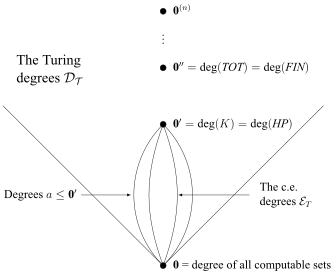
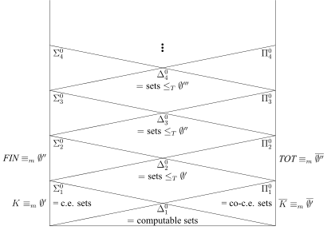

# Recursive Functions
**First published Thu Apr 23, 2020; substantive revision Fri Mar 1, 2024**

*Dean, Walter, Naibo, Alberto*

The *recursive functions* are a class of functions on the natural numbers studied in *computability theory*, a branch of contemporary mathematical logic which was originally known as *recursive function theory*. Such functions take their name from the process of *recursion* by which the value of a function is defined by the application of the same function applied to smaller arguments.

This process may be illustrated by considering the familiar factorial function $x!$—i.e., the function which returns the product $1 \times 2 \times \ldots \times x$ if $x > 0$ and 1 otherwise. An alternative recursive definition of this function is as follows:

$$\begin{align} \label{defnfact} \fact(0) & = 1 \\ \nonumber \fact(x+1) & = (x+1) \times \fact(x) \end{align}$$

Such a definition might at first appear circular in virtue of the fact that the value of $\fact(x)$ on the left hand side is defined in terms the same function on the righthand side. However a characteristic feature of recursive definitions is that they allow for the values of functions which they describe to be calculated by successively “unwinding” the clause for $x > 0$ until the clause for $x = 0$ (the so-called *base case*) is reached. For instance the value of $fact(4)$ may be calculated using the preceding definition as follows:

$$\begin{align} \label{factcalc} \fact(4) &= 4 \times \fact(3) \\ & = 4 \times (3 \times \fact(2)) \nonumber \\ & = 4 \times (3 \times (2 \times \fact(1))) \nonumber \\ &=4 \times (3 \times (2 \times 1 \times (\fact(0)))) \nonumber \\ & = 4 \times (3 \times (2 \times (1 \times 1))) \nonumber \\ & = 24 \nonumber \\ \end{align}$$

Understood in this way, the defining equations (\ref{defnfact}) provide an *algorithm* for computing $\fact(x)$—i.e., an effective procedure for calculating its values which can be carried out by a human or mechanical computing device within a finite number of steps. It is for this reason that a class of recursive definitions similar to that exemplified by (\ref{defnfact})—i.e., the *general recursive functions*—were first employed as the mathematical model of computation on which recursive function theory was originally founded.

Section 1 of this entry provides an overview of the foundational developments in logic and mathematics which led to the founding of recursive function theory in the 1930s. Section 2 surveys different forms of recursive definitions, inclusive of the *primitive* and *partial recursive functions* which are most central to the classical development of this subject. Section 3 provides an overview of computability theory, inclusive of the so-called *Recursion Theorem* (Section 3.4)—a result which highlights the centrality of recursion to computation in general as well as its relationship to self-reference. Subsequent updates to this entry will provide an overview of subrecursive hierarchies employed in proof theory and computer science as well as a more comprehensive treatment of contemporary computability theory.

## 1. Historical Background

The theory of recursive functions is often presented as a chapter in the history of the subject originally known as *recursive function theory*. This subject has its roots in the foundational debates of the first half of the twentieth century. Within this context, the need arose to provide a precise analysis of what we would naturally describe as inductive or recursive modes of reasoning which play a part in the deductive machinery of axiomatic theories in mathematics. This history will be traced in the current section, with an emphasis on how different forms of recursion have been understood as exemplifying various kinds of step-by-step algorithmic processes.

This section assumes some familiarity with some of the terminology introduced in Section 2 and Section 3. Readers looking for a technical overview of recursive functions or computability theory are advised to start there.

### 1.1 The Early History of Recursive Definitions

Examples of recursive definitions can be found intermittently in the history of ancient and medieval mathematics. A familiar illustration is the sequence $F_i$ of *Fibonacci numbers* $1,1,2,3,5,8,13, \ldots$ given by the recurrence $F_0 = 1, F_1 = 1$ and $F_{n} = F_{n-1} + F_{n-2}$ (see Section 2.1.3). The definition of this sequence has traditionally been attributed to the thirteenth century Italian mathematician Leonardo of Pisa (also known as Fibonacci) who introduced it in his *Liber Abaci* in the context of an example involving population genetics (see Fibonacci 1202 [2003: 404–405]). But descriptions of similar sequences can also be found in Greek, Egyptian, and Sanskrit sources dating as early as 700 BCE (see, e.g., Singh 1985)[^singh-1985].

General interest in recursion as a mode of function definition originated in the mid-nineteenth century as part of the broader program of arithmetizing analysis and the ensuing discussions of the foundations of arithmetic itself. In this context, the formulation of recursive definitions for number theoretic functions was closely tied to the isolation of mathematical induction as a mode of reasoning about the natural numbers. It was in this setting in which Grassmann (1861) and Peirce (1881) first gave the familiar recursive definitions of addition and multiplication:[^note-1]

$$\begin{align} \label{defnadd} \text{i.}\quad && x + 0 & = x \\ \nonumber \text{ii.}\quad && x + (y+1) & = (x+y)+1\\ \end{align}$$ $$\begin{align} \label{defnmult} \text{i.}\quad && x \times 0 & = 0 \\ \nonumber \text{ii.}\quad && x \times (y+1) & = (x\times y) + x \end{align}$$

They then used these definition to prove the associative, commutative, and distributive laws for these operations.[^note-2]

The first person to employ the expression “definition by recursion” appears to have been Dedekind in his essay *Was sind und was sollen die Zahlen* (1888). This work presents a set theoretic foundation for arithmetic wherein Dedekind demonstrated that it was possible to state and prove the existence and uniqueness of functions defined by primitive recursion as mathematical theorems (§125–126). He formulated recursive definitions of addition (§135), multiplication (§147), and exponentiation (§155) and then also formally proved by induction that the functions so defined satisfy the expected algebraic identities. The first two of these definitions would later be adopted by Peano (1889) as defining the symbols $+$ and $\times$ in the direct axiomatization of arithmetic he based on Dedekind’s monograph.

### 1.2 The Origins of Primitive Recursion

The first work devoted exclusively to recursive definability was Skolem’s (1923) paper

> The foundations of elementary arithmetic established by the recursive mode of thought, without the use of apparent variables ranging over infinite domains.

This work is significant with respect to the subsequent development of computability theory for at least three reasons. First, it contains a informal description of what we now call the *primitive recursive functions*. Second, it can be regarded as the first place where recursive definability is linked to effective computability (see also Skolem 1946)[^skolem-1946]. And third, it demonstrates that a wide range of functions and relations are primitive recursive in a manner which anticipates Gödel’s (1931) use of primitive recursion for the arithmetization of syntax.

One of Skolem’s stated goals was to present a logical foundation for number theory which avoids the use of unrestricted quantifiers. He was inspired in this regard by the observation that it is possible to develop much of elementary arithmetic without the use of the expressions “always” (i.e., *for all*) and “sometimes” (i.e., *there exists*) which figure in the formalization of number theory given by Russell and Whitehead in *Principia Mathematica* (1910–1913). This was to be accomplished by formulating arithmetical theorems as what he referred to as *functional assertions*. These took the form of identities between terms defined by primitive recursive operations which Skolem referred to as *descriptive functions*. For instance, the commutativity of addition is expressed in this form by an equation with free variables

$$\begin{equation}\label{funassert} x + y = y + x \end{equation}$$

In cases where such statements are provable in the system Skolem describes, the intended interpretation is that the claim holds universally for all natural numbers—e.g., $\forall x \forall y (x + y = y + x)$. But in Skolem’s system there is no means of negating such a statement to express a bare existential assertion without producing a witness.

Statements like (\ref{funassert}) would later be referred to by Hilbert & Bernays (1934) (who provided the first textbook treatment of recursion) as *verifiable* in the sense that their individual instances can be verified computationally by replacing variables with concrete numerals. This is accomplished by what Skolem referred to as the “recursive mode of thought”. The sense of this phrase is clarified by the following properties of the system he describes:

1. the natural numbers are taken as basic objects together with the successor function $x + 1$;
2. it is assumed that descriptive functions proven to be equal may be substituted for one another in other expressions;
3. all definitions of functions and relations on natural numbers are given by recursion;
4. functional assertions such as (\ref{funassert}) must be proven by induction.

Taking these principles as a foundation, Skolem showed how to obtain recursive definitions of the *predecessor* and *subtraction* functions, the *less than*, *divisibility*, and *primality* relations, *greatest common divisors*, *least common multiples*, and *bounded sums and products* which are similar to those given in Section 2.1.2 below.

Overall Skolem considered instances of what we would now refer to as primitive recursion, course of values recursion, double recursion, and recursion on functions of type $\mathbb{N} \rightarrow \mathbb{N}$. He did not, however, introduce general schemas so as to systematically distinguish these modes of definition. Nonetheless, properties i–iv of Skolem’s treatment provide a means of assimilating calculations like (\ref{factcalc}) to derivations in quantifier-free first-order logic. It is thus not difficult to discern in Skolem (1923) the kernel of the system we now know as *Primitive Recursive Arithmetic* (as later formally introduced by Hilbert & Bernays 1934: ch. 7)[^hilbert-1934].

The next important steps in the development of a general theory of recursive function arose as a consequence of the interaction between Hilbert’s Program and Gödel’s (1931) proof of the Incompleteness Theorems. Hilbert (1900) had announced the goal of proving the consistency of arithmetic—and ultimately also analysis and set theory—in the face of the set theoretic paradoxes. His initial plans for carrying out such a proof are described in a series of lectures and addresses in the 1910s–1920s which provide a description of what would come to be called the *finitary standpoint*—i.e., the fragment of mathematical reasoning pertaining to finite combinatorial objects which was intended to serve as the secure basis for a consistency proof. The proof itself was to be carried out using the methods of what Hilbert referred to as *metamathematics*—i.e., the formal study of axioms and derivations which would grow into the subject now known as *proof theory*.

In one of his initial descriptions of this program Hilbert (1905) sketched the basic form which a metamathematical proof of consistency might take. Suppose, for instance, that $\mathsf{T}$ is a mathematical theory about which it is possible to prove the following conditional:

1. If $n$ applications of rules of inference applied to the axioms of a system $\mathsf{T}$ do not lead to a contradiction, then $n+1$ applications also do not lead to a contradiction.

Were it possible to provide a mathematical demonstration of i), it might seem possible to conclude

1. $\mathsf{T}$ is consistent.

However Poincaré (1906) observed that Hilbert’s approach relies on mathematical induction in inferring ii from i. He objected on the basis that this renders Hilbert’s proposed method circular in the case that the system $\mathsf{T}$ in question itself subsumes principles intended to formalize induction.[^note-3]

Together with his collaborators Ackermann and Bernays, Hilbert developed metamathematics considerably during the 1910–1920s. This served as the basis of Hilbert’s (1922) lecture wherein he replied to Poincaré by making a systematic distinction between “formal” occurrences of mathematical induction in the object language and the metatheoretic use of induction as a “contentual” [*inhaltliche*] principle used in order to reason about proofs as finite combinatorial objects. It was also in this context in which Hilbert connected the latter form of induction to the “construction and deconstruction of number signs” (1922 [1996: 1123]).

As is made clear in subsequent presentations, Hilbert understood “number signs” to be unary numerals written in stroke notation of the form

$$\nonumber |, ||, |||, \ldots$$

Such expressions can be operated on concretely by adjoining or removing strokes in a manner which mirrors the arithmetical operations of successor and predecessor which figure in Skolem’s “recursive mode of thought“. This observation in turn informed Hilbert’s explanation of the meaning of functional assertions like (\ref{funassert}) in terms of their logical derivability from recursive definitions which also serve as procedures for computing the values of functions they define (Hilbert 1920 [2013: 54–57])[^hilbert-1920].

Hilbert first described a logical calculus for finitary number theory including “recursion and intuitive induction for finite totalities” in 1923 ([1996: 1139]).[^note-4] Although this presentation also included a discussion of definition by simultaneous recursion, a more extensive treatment of what we would now recognize as *recursion schemes* is given in his well known paper “On the infinite” (1926). This includes a discussion of what Hilbert calls *ordinary recursion* (which is similar to Skolem’s description of primitive recursion), transfinite recursion, as well as recursion at higher types. (These different forms of recursion will be discussed further in the [supplement on the Ackermann-Péter function](recursive-functions.ackermann-peter.md).) This treatment makes clear that Hilbert and his collaborators had taken substantial steps towards developing a general theory of recursive definability. Ultimately, however, the influence of Hilbert’s presentations was diminished in light of the more precise formulation of primitive recursion which Gödel would soon provide.[^note-5]

Gödel’s (1931 [1986: 157–159]) definition was as follows:

> A number-theoretic function $\phi(x_1,\ldots,x_n)$ is said to be *recursively defined in terms of* the number-theoretic functions $\psi(x_1,x_2,\ldots,x_{n-1})$ and $\mu(x_1,x_2,\ldots, x_{n+1})$ if
>
> $$\begin{align} \label{gprimrec} \text{i.}\quad & \phi(0,x_2,\ldots,x_n) = \psi(x_2,\ldots,x_n) \\ \nonumber \text{ii.}\quad & \phi(k+1,x_2,\ldots,x_n) = \mu(k,\phi(k,x_2,\ldots,x_n),x_2,\ldots,x_n) \end{align}$$
>
> holds for all $x_2,\ldots,x_n,k$.
>
> A number-theoretic function $\phi$ is said to be *recursive* if there is a finite sequence of number-theoretic functions $\phi_1 , \phi_2 , \ldots \phi_n$ that ends with $\phi$ and has the property that every function $\phi_k$ of the sequence is recursively defined in terms of two of the preceding functions, or results from any of the preceding functions by substitution, or, finally, is a constant or the successor function $x + 1$…. A relation $R(x_1, \ldots , x_n)$ between natural numbers is said to be *recursive* if there is a recursive function $\phi(x_1 \ldots , x_n)$ such that, for all $x_1, x_2, \ldots, x_n$
>
> $$\begin{equation}\label{prch} R(x_1,\ldots,x_n) \leftrightarrow \phi(x_1,\ldots,x_n) = 0 \end{equation}$$

Putting aside Gödel’s use of the term “recursive” rather than “primitive recursive” (which will be explained below), this exposition comes close to coinciding with the contemporary definition of the primitive recursive functions given in Section 2.1.[^note-6] Gödel’s definition also improved upon those of his predecessors by clearly defining the class of initial functions which are allowed in primitive recursive definitions and by stating that each primitive recursive function possesses a definition in terms of a sequence of functions showing how it is built up from initial functions. This makes clear that the primitive recursive functions constitute a mathematically well-defined class of functions on the natural numbers (which will be denoted here as **PR**). Gödel additionally proved that the primitive recursive relations—defined as characteristic functions via (\ref{prch})—are closed under propositional operations and quantification bounded by a primitive recursive function (see Section 2.1.2).

### 1.3 Arithmetical Representability and Gödel’s First Incompleteness Theorem

The foregoing definition appears in Gödel’s well-known (1931) paper “On formally undecidable propositions of *Principia mathematica* and related systems I”. As he observes immediately before presenting it, the definition of primitive recursion is in fact a digression from the main focus of the paper—i.e., proving the incompleteness of the axiomatic system of arithmetic he calls $\mathsf{P}$. In order to understand Gödel’s contribution to the initial development of recursive function theory, it will be useful to attend both to some features of this system and also to his proof of the First Incompleteness Theorem itself. (Additional details and context are provided in the entry on Gödel’s incompleteness theorems.)

System $\mathsf{P}$ is obtained from that of Whitehead and Russell’s *Principia Mathematica* (1910–1913) by omitting the ramification of types, taking the natural numbers as the lowest type, and adding for them the second-order Peano axioms. It is hence a fixed formal system with finitely many non-logical axioms sufficient for the development of elementary number theory.[^note-7] Recall also that an arithmetical system is said to be $\omega$-*consistent* if it does not prove both $\exists x \varphi(x)$ and $\neg \varphi(\overline{n})$ for each natural number $n \in \mathbb{N}$ (where $\overline{n} =_{\mathrm{df}} s(s(\ldots s(0)))$ *n*-times) and that $\omega$-consistency implies *simple consistency* (i.e., the non-derivability of a formula and its negation).

The incompleteness theorem which Gödel proved states that if $\mathsf{P}$ is ω-consistent, then there exists a formula $G_{\mathsf{P}}$ which is *undecidable in* $\mathsf{P}$—i.e., neither provable nor refutable from its axioms. In order to obtain such a formula, Gödel first demonstrated how it is possible to express various syntactic and metatheoretic properties of $\mathsf{P}$-formulas and proofs as primitive recursive relations via a technique which has come to be known as the *arithmetization of syntax* (see the entry on Gödel’s incompleteness theorems). Second, he showed that for every primitive recursive relation $R(x_1,\ldots,x_k)$ there exists a “class sign” (i.e., formula) $\varphi_R(x_1,\ldots,x_n)$ of $\mathsf{P}$ such that the fact that $R(x_1,\ldots,x_n)$ holds of (or does not hold of) a given tuple of numbers $n_1,\ldots,n_k$ is mirrored by the provability (or refutability) in $\mathsf{P}$ of the corresponding instance of $\varphi_R(x_1,\ldots,x_n)$ when the formal numeral $\overline{n} = s(s(\ldots s(0)))$ (*n*-times) is substituted for $x_i$—i.e.,

$$\begin{align} \label{rep} \text{i.}\quad & \text{if } R(n_1,\ldots,n_k), \text{ then } \mathsf{P} \vdash \varphi_R(\overline{n}_1,\ldots,\overline{n}_k) \\ \nonumber \text{ii.}\quad & \text{if } \neg R(n_1,\ldots,n_k), \text{ then } \mathsf{P} \vdash \neg \varphi_R(\overline{n}_1,\ldots,\overline{n}_k) \end{align}$$

According to the terminology Gödel would later introduce in 1934, in such a case $\varphi_R(x_1,\ldots,x_n)$ *represents* $R(x_1,\ldots,x_n)$. In this presentation, he also generalized his prior definition to say that a function $f(x_1,\ldots,x_n)$ is representable in $\mathsf{P}$ just in case there exists a formula $\varphi_f(x_1,\ldots,x_k,y)$ such that for all $n_1,\ldots,x_k,m \in \mathbb{N}$,

$$\begin{equation}\label{repfun} f(n_1,\ldots,n_k) = m \textrm{ if and only if } \mathsf{P} \vdash \varphi_f(\overline{n}_1,\ldots,\overline{n}_k,\overline{m}) \end{equation}$$

Gödel’s arithmetization of syntax provides a means of assigning to each primitive symbol, term, formula, and proof $\alpha$ of $\mathsf{P}$ a unique *Gödel number* $\ulcorner \alpha \urcorner \in \mathbb{N}$ according to its syntactic structure. This technique takes advantage of the familiar observation that a finite sequence of numbers $n_1,\ldots,n_k$ can be encoded as a product of prime powers $2^{n_1} \cdot 3^{n_2} \cdot \ldots p_k^{n_k}$ so that various correlative operations on sequences can be shown to be primitive recursive—e.g., the operation which takes two numbers $x$ and $y$ encoding sequences and returns the code $x * y$ of the result of concatenating $x$ followed by $y$. Gödel proceeded on this basis to show that a sequence of notions about the syntax and proof theory of $\mathsf{P}$ are primitive recursive—e.g., the function $\textrm{Neg}(x)$ which returns the Gödel number of the negation of the formula coded by $x$ can be defined as $\ulcorner \neg \urcorner * x$. The availability of the relevant recursive definitions thus falls out naturally since the inductive definitions of syntactic notions like *well-formed formula* generalize the “construction and deconstruction of number signs” in the sense described by Hilbert.[^note-8]

The penultimate definition in Gödel’s list is the relation $\mathsf{Proof}_{\mathsf{P}}(x,y)$ which holds between the Gödel number of a $\mathsf{P}$-formula $\varphi$ and the Gödel number of a finite sequence of $\mathsf{P}$-formulas $\psi_1,\ldots, \psi_n$ just in case the latter is a correctly formed derivation of the former from the axioms of $\mathsf{P}$—i.e.,

$\mathsf{Proof}_{\mathsf{P}}(\ulcorner \psi_1,\ldots, \psi_n \urcorner, \ulcorner \varphi \urcorner))$ iff $\mathsf{P} \vdash \varphi$ via a derivation $\psi_1,\ldots,\psi_n$ in which each $\psi_i$ is either an axiom of $\mathsf{P}$ or follows from prior formulas via its rules of inference.

From (\ref{rep}) it follows that there exists a formula $\textrm{Prf}_{\mathsf{P}}(x,y)$ of $\mathsf{P}$ which represents $\mathsf{Proof}_{\mathsf{P}}(x,y)$ and thus also a formula

$$\textrm{Prov}_{\mathsf{P}}(y) =_{\textrm{df}} \exists x \textrm{Prf}_{\mathsf{P}}(x,y).$$

Gödel famously named the latter formula $\sc{bew}(x)$ (for *beweisbar*) as it can be understood to express that there exists a proof from the axioms of $\mathsf{P}$ of the formula with Gödel number $y$. But unlike the other formulas representing primitive recursive relations which figure in its definition, $\textrm{Prov}_{\mathsf{P}}(x)$ contains an unbounded existential quantifier. And thus as Gödel is careful to observe, there is no reason to expect that it defines a primitive recursive relation.

It is, nonetheless, this formula which Gödel uses to construct a sentence which is undecidable in $\mathsf{P}$. This can be accomplished by the application of the so-called *Diagonal Lemma* (see Gödel’s incompleteness theorems) which states that for every formula $\varphi(x)$ of $\mathsf{P}$, there exists a sentence $\psi_{\varphi}$ such that

$$\mathsf{P} \vdash \psi_{\varphi} \leftrightarrow \varphi(\overline{\ulcorner \psi_{\varphi} \urcorner})$$

When applied to the formula $\neg \textrm{Prov}_{\mathsf{P}}(x)$, the Diagonal Lemma yields a sentence $G_{\mathsf{P}}$—i.e., the so-called *Gödel sentence for $\mathsf{P}$*—such that $\mathsf{P} \vdash G_P \leftrightarrow \neg \textrm{Prov}_{\mathsf{P}}(\ulcorner G_{\mathsf{P}} \urcorner)$. $G_{\mathsf{P}}$ is thus interpretable as “saying of itself” that it is unprovable in $\mathsf{P}$. Gödel showed that this formula has the following properties:

1. if $\mathsf{P}$ is consistent, then $\mathsf{P} \not\vdash G_{\mathsf{P}}$;
2. if $\mathsf{P}$ is ω-consistent, then $\mathsf{P} \not\vdash \neg G_{\mathsf{P}}$.

This constitutes what is now known as Gödel’s First Incompleteness Theorem.

The proof of this fact relies explicitly on the representability of the relation $\mathsf{Proof}_{\mathsf{P}}(x,y)$ in $\mathsf{P}$ which in turn derives from its primitive recursiveness. But the techniques on which Gödel’s proof relies also contributed to the subsequent development of computability theory in several additional ways. First, it follows from the possibility of Gödel numbering the formulas of $\mathsf{P}$ that we may also effectively enumerate them as $\varphi_0(x), \varphi_1(x), \varphi_2(x), \ldots$—e.g., in increasing order of $\ulcorner \varphi_i \urcorner$. This provides a mechanism for referring to formulas via their indices which in turn served as an important precedent for Kleene’s (1936a) use of a similar indexation of general recursive definitions in his proof of the Normal Form Theorem (see Section 2.2.2). Second, the proof of the Diagonal Lemma also demonstrates how it is possible to formalize the substitution of terms for free variables in a manner which may be understood to yield an effective form of Cantor’s diagonal argument (see the entry on self-reference). This technique served as an important precedent for the use of diagonalization in results such as the undecidability of the Halting Problem (Turing 1937, see Section 3.2)[^turing-1937], the Recursion Theorem (Kleene 1938, see Section 3.4)[^kleene-1938], and the Hierarchy Theorem (Kleene 1943, see Section 3.6)[^kleene-1943].

Another significant contribution of Gödel’s paper derives from the fact that after proving the incompleteness of $\mathsf{P}$, he took several steps towards isolating features of axiomatic theories which are sufficient to ensure that they satisfy analogous undecidability results. In addition to being sufficiently strong to satisfy (\ref{rep}), the other requirement which he identifies is that “the class of axioms and the rules of inference $\ldots$ are recursively definable” (1931 [1986: 181]). As he notes, these features hold both of Zermelo-Fraenkel set theory $[\mathsf{ZF}$] and a first-order arithmetical system similar to what we now call first-order Peano arithmetic $[\mathsf{PA]}$, relative to an appropriate Gödel numbering of their axioms. In particular, while neither of these systems is *finitely axiomatizable*, they may be axiomatized by a finite number of *schemes* (e.g., of induction or comprehension) such that the relation $\ulcorner \varphi \urcorner$ is the Gödel number of an axiom of T is primitive recursive. This is so precisely because membership in the schemes in question is determined by a inductive condition on formulas whose structure mirrors that of a primitive recursive definition.

This observation set the stage for Gödel’s subsequent revisiting of the incompleteness theorems in the lectures (1934) wherein he suggests a significant generalization of his original (1931) definition of recursiveness. Gödel starts out by providing the following informal characterization of the requirements of the theories just described:

> We require that the rules of inference, and the definitions of meaningful formulas and axioms, be constructive; that is, for each rule of inference there shall be a finite procedure for determining whether a given formula $B$ is an immediate consequence (by that rule) of given formulas $A_1, \ldots, A_n$ and there shall be a finite procedure for determining whether a given formula $A$ is a meaningful formula or an axiom. (Gödel 1934: 346)[^gödel-1934]

He also makes clear that what he calls “recursiveness” is to be initially regarded as an *informal* notion which he is attempting to make precise:

> Recursive functions have the important property that, for each given set of values of the arguments, the value of the function can be computed by a finite procedure. Similarly, recursive relations (classes) are decidable in the sense that, for each given *n*-tuple of natural numbers, it can be determined by a finite procedure whether the relation holds or does not hold (the number belongs to the class or not), since the representing function is computable. (Gödel 1934 [1986: 348])[^gödel-1934]

One of Gödel’s goals was thus to provide a mathematical definition of the term “recursive” which generalizes prior examples of recursive definability in a manner but also captures to as great an extent as possible the class of functions computable by a finite procedure. This led him to define the so-called *general recursive functions* (see Section 1.5) whose isolation in turn played an important role in the formulation of *Church’s Thesis* (see Section 1.6). However Gödel’s definition also took place against the backdrop of other work which had been inspired by Hilbert’s original consideration of different forms of recursive definitions. It will now be useful to examine these developments.

### 1.4 The Ackermann-Péter Function

Already at the time of (1926), Hilbert had anticipated that it would be possible to formulate definitions of functions whose values could be computed in a recursive manner but which are not themselves primitive recursive. In order to illustrate how such a definition might be obtained, he presented a heuristic argument involving the following sequence of functions:

$$\begin{align*} \alpha_0(x,y) &= x + 1 &\text{(successor)} \\ \alpha_1(x,y) &= x + y &\text{(addition)} \\ \alpha_2(x,y) &= x \times y &\text{(multiplication)} \\ \alpha_3(x,y) &= x^y &\text{(exponentiation)} \\ \alpha_4(x,y) &= \underbrace{x^{x^{\udots^x}}}_{y \textrm{ times}} &\text{(super-exponentiation)} \\ &\vdots \end{align*}$$

The functions in this sequence are defined so that $\alpha_{i+1}(x,y+1)$ is obtained by primitive recursion as $\alpha_i(\alpha_{i+1}(x,y),x)$, together with an appropriate base case. It thus makes sense to consider the function

$$\begin{equation}\label{alphadef} \alpha(i,x,y) = \alpha_i(x,y) \end{equation}$$

whose first argument $i$ represents the position of the function $\alpha_i(x,y)$ in the prior list. For fixed $i,n,m \in \mathbb{N}$, it is thus possible to effectively compute the value of $\alpha(i,n,m)$ by first constructing the definition of $\alpha_i(x,y)$ and then evaluating it at $n,m$. But it is also easy to see that $\alpha_{i+1}(x,x)$ will eventually dominate $\alpha_i(x,x)$ for sufficiently large $x$. This in turn suggests that $\alpha(i,x,y)$ cannot be defined by a finite number of applications of the primitive recursion scheme. It thus follows that $\alpha(i,x,y)$ is thus not primitive recursive itself.

The specification of $\alpha(i,x,y)$ just given does not have the form of a recursive definition. But it is possible to define similar functions in a manner which generalizes the format of the scheme (\ref{gprimrec}). One means of doing so is to use a simple form of recursion at higher types as considered by both Skolem and Hilbert. To this end, consider the *iteration functional* $\mathcal{Iter}$ which takes as arguments a function $f: \mathbb{N} \rightarrow \mathbb{N}$ and a natural number $i$ and returns the function which is obtained as *i*-fold composition of $f$ with itself. In other words, $\mathcal{Iter}$ has the type

$$(\mathbb{N} \rightarrow \mathbb{N}) \rightarrow (\mathbb{N} \rightarrow (\mathbb{N} \rightarrow \mathbb{N})).$$

Such a function can be formally defined as follows:

$$\begin{aligned} \mathcal{Iter}(f,0) & = id \\ \mathcal{Iter}(f,i+1) & = \mathcal{Comp}(f,\mathcal{Iter}(f,i)) \nonumber \end{aligned}$$

Here $id$ denotes the identity function (i.e., $id(y) = y$) and

$$\mathcal{Comp}(f,\mathcal{Iter}(f,i))$$

denotes what we would more conventionally express as $f \circ f^i$—i.e.,

$$f \circ \underbrace{f \circ \ldots \circ f}_{i \mathrm{\ times}}$$

or the result of composing $f$ with $f^i$.

We may now define a function $\beta$ which takes a natural number as input and returns a function of type $\mathbb{N} \rightarrow \mathbb{N}$—i.e., of type $\mathbb{N} \rightarrow (\mathbb{N} \rightarrow \mathbb{N})$—as follows:

$$\begin{aligned} \beta(0) & = y +1 \textrm{ (i.e., the successor function)} \\ \beta(i+1) & = \mathcal{Iter}(\beta(i),y)(\beta(i)(1)) \nonumber \end{aligned}$$

Since the value of $\beta(i)$ is a function, here $y+1$ and

$$\mathcal{Iter}(\beta(m),y)(\beta(i)(1))$$

should both be understood as functions of type $\mathbb{N} \rightarrow \mathbb{N}$ depending on a variable $y$ which is implicitly abstracted. In other words, if we employ the notation of the $\lambda$-calculus, then we should think of these terms as the abstracts $\lambda y.y+1$ and

$$\lambda y.\mathcal{Iter}(\beta(i),y)(\beta(i)(1)).$$

With these definitions in place, it can now be verified that as $i$ varies over $\mathbb{N}$, $\beta(0), \beta(1), \ldots$ correspond to the following sequence of functions of increasing rate of growth:

$$\begin{align*} \beta(0) & = \lambda x.x +1, \\ \beta(1) & = \lambda x.2 + (x + 3) - 3 = x+2, \\ \beta(2) & = \lambda x.2 \times x - 3, \\ \beta(3) & = \lambda x.2^{x+3} - 3, \\ \beta(4) &= \lambda x.\underbrace{2^{2^{\udots^2}}}_{x \textrm{ times}} - 3,\\ &\vdots \end{align*} $$

This provides one means of defining what is now often called the *Péter function* (or also the *Ackermann-Péter function* ) as $\pi(i,x) = \lambda x.\beta(i)(x)$. $\pi(i,x)$ has the same order of growth as $\alpha_i(x,x)$ and it is possible to prove via the sort of argument sketched above that $\pi(i,x)$ is not primitive recursive (see, e.g., Péter 1967: ch. 9)[^péter-1967].

As with the series of functions $\alpha_i(x,y)$, it also clear that each function $\pi(i,x)$ is effectively computable for each concrete number $i$. However in order to define this function uniformly we have had to define $\beta$ using the functional $\mathcal{Iter}$ which itself is defined by recursion on type $\mathbb{N} \rightarrow \mathbb{N}$. The question thus arise whether it is also possible to define an extensionally equivalent function by a form of recursion on the natural numbers themselves.

An affirmative answer was provided by Ackermann (1928a) for the slightly more complicated *Ackermann function* described in the [supplement](recursive-functions.ackermann-peter.md) and also directly for a function $\pi(x,y)$ by Péter (1935). In particular, it is possible to formulate a definition of a function extensionally coincident with $\beta(i)$ by what Ackermann originally referred to as *simultaneous recursion* as follows:[^note-9]

$$\begin{align}\label{pidef} \pi(0,i+1) & = i + 1\\ \nonumber \pi(x+1,0) & = \pi(x,1)\\ \nonumber \pi(x+1,i+1) & = \pi(i,\pi(i+1,x)) \end{align}$$

The third clause in this definition defines the value of $\pi(i+1,x+1)$ in terms of $\pi(i,z)$ where the $z$ is determined by the value of $\pi(i+1,x)$. It may thus not be immediately obvious that the definition (\ref{pidef}) describes an algorithm for computing the values of $\pi(i,x)$ which always terminates in the manner illustrated by the calculation (\ref{factcalc}). Note, however, the when we expand the clauses on the right-hand side of this definition, either $i$ decreases, or $i$ remains the same and $x$ decreases. It thus follows that each time $x$ reaches $0$, $i$ will start to decrease so that the base case is eventually reached. Thus although the value of $\pi(i,x)$ grows very rapidly—e.g., $\pi(4,3) = 2^{2^{65536}}-3$—it is still reasonable to regard (\ref{pidef}) as satisfying Gödel's requirement that a recursively defined function is computable by a finite procedure.

Systematic consideration of such alternative recursion schemes exemplified by (\ref{pidef}) was initiated by Péter (1932). It was also she who introduced the term “primitive recursive” to describe the class of functions given by Gödel’s scheme (\ref{gprimrec}), a choice which would become standard after its adoption by Kleene (1936a). Péter additionally showed that the primitive recursive functions are closed *course of values recursion* (see Section 2.1.3), *multiple recursion*, and *nested recursion* of one variable (see the [supplement](recursive-functions.ackermann-peter.md)). Thus the choice of there term “primitive” not should be understood to diminish the richness of the class of primitive recursive functions. Rather it flags the fact that definitions like (\ref{pidef}) which give rise to more complicated computational process leading out of this class were also regarded as “recursive” by theorists like Hilbert, Ackermann, and Péter from the outset of their studies.

Péter's work in the 1930s also led to her book (Péter 1967)[^péter-1967], whose original German edition *Rekursive Funktionen* (1951) was the first monograph devoted to recursive functions. Together with the later work of Grzegorczyk (1953), these developments also inspired the investigation of various subrecursive hierarchies which would later play a role in proof theory and computer science.[^note-10]

### 1.5 The General Recursive Functions

The immediate source for Gödel’s discussion of recursion in 1934 was not Ackermann or Péter’s work but rather a private communication with Herbrand, who in two previous papers (1930, 1932) had proposed a related means of generalizing recursive definitions. Gödel’s informal description of Herbrand’s suggestion was as follows:[^note-11]

> If $\phi$ denotes an unknown function, and $\psi_1,\ldots,\psi_k$ are known functions, and if the $\psi$’s and $\phi$ are substituted in one another in the most general fashions and certain pairs of the resulting expressions are equated, then, if the resulting set of functional equations has one and only one solution for $\phi$, $\phi$ is a recursive function. (Gödel 1934 [1986: 308])[^gödel-1934]

As an illustration, consider the following set of equations:

$$\begin{align} \label{genrecex} \phi(0) &= 0 \\ \nonumber \psi(x) &= \phi(x) + 1\\ \nonumber \phi(x+1) &= \psi(x) + 1 \end{align}$$

In this case, the “unknown” function denoted by $\phi(x)$ is specified in terms of the auxiliary function $\psi(x)$ in such a way that $\phi(x)$ appears only once on the lefthand side of the equations (other than the base case). Nonetheless, such a system of equations is unlike a primitive recursive definition in that it does not specify a unique means for computing the values of $\phi(n)$ by “deconstructing” $n$ in the deterministic manner illustrated by calculations such as (\ref{factcalc}).

In the general case there is indeed no guarantee that there will exist a unique extensional function satisfying such a definition. But in the case of this example it can be shown that $2 \times x$ is the unique function of type $\mathbb{N} \rightarrow \mathbb{N}$ satisfying $\phi(x)$ in the system of equations (\ref{genrecex}). This may be illustrated by considering the following calculation of $\phi(2)$:

$$\begin{align} \label{genreccal} \text{i.}\quad & \phi(2) = \psi(1) + 1 \\ \nonumber \text{ii.}\quad & \psi(1) = \phi(1) +1 \\ \nonumber \text{iii.}\quad & \phi(1) = \psi(0) + 1 \\ \nonumber \text{iv.}\quad & \psi(0) = \phi(0) + 1 \\ \nonumber \text{v.}\quad & \phi(0) = 0 \\ \nonumber \text{vi.}\quad & \psi(0) = 0 + 1 \\ \nonumber \text{vii.}\quad & \phi(1) = (0 + 1) + 1 \\ \nonumber \text{viii.}\quad& \psi(1) = ((0 + 1) + 1) + 1 \\ \nonumber \text{ix.}\quad & \phi(2) = (((0 + 1) + 1) + 1) + 1 \ (= 4) \end{align}$$

As Gödel notes, such a calculation may be understood as a derivation in quantifier-free first-order logic wherein the only rules which are allowed are the substitution of numerals for variables and the replacement of a term on the righthand side of an equation by a numeral for which the corresponding identity has already been derived.

Gödel introduced the term *general recursive* to describe a function defined in this manner. Following the modernized presentation of Odifreddi (1989: ch. I.2) this class may be specified on the basis of the following initial definitions:[^note-12]

**Definition 1.1**

1. The class of *numerals* is the smallest set containing 0 and closed under the successor function $x \mapsto s(x)$. We write $\overline{n}$ for the numeral $s(s(\ldots s(0)))$ *n*-times.
2. The class of *terms* is the smallest set containing the numerals, *variables* $x_0,x_1, \ldots$ and closed under the operations $t \mapsto s(t)$ and $t_1,\ldots,t_n \mapsto \psi^n_i(t_1,\ldots,t_n)$ where $t,t_1,\ldots,t_n$ are terms and $\psi^n_i$ is a primitive *n*-ary functional symbol.
3. If $t$ and $u$ are terms and $t$ is of the form $\psi^n_i(t_1,\ldots,t_n)$ where $t_1,\ldots,t_n$ do not contain any functional symbols other than $s$, then $t = u$ is an *equation*.
4. A *system of equations* is a finite set of equations. $\mathcal{E}(\psi_1,\ldots,\psi_n,\vec{x})$ will be used to denote a system of equations containing basic functional symbols $\psi_1,\ldots,\psi_n$ and variables among $\vec{x} = x_1,\ldots, x_k$.

Herbrand (1932) gave a semantic characterization of what it means for a number theoretic function $f$ to be defined by a system of equations $\mathcal{E}(\psi_1,\ldots,\psi_n,\vec{x})$ by requiring both that there is a solution to the system and that $f$ coincides with the function determined as $\psi_1$ for every solution. He also suggested that this fact should be proved intuitionistically, which might in turn be thought to yield an effective procedure for computing the values of $f$.[^note-13] He did not, however, specify a formal system in which such a proof should be carried out. And thus Gödel suggested (essentially) the following syntactic replacement for Herbrand’s definition:

**Definition 1.2:** A function $f:\mathbb{N}^k \rightarrow \mathbb{N}$ is *general recursive* if there is a system of equations $\mathcal{E}(\psi_1,\ldots,\psi_n,\vec{x})$ such that if $\psi^k_i$ is the leftmost functional symbol in the last equation of $\mathcal{E}$ then for all $n_1,\ldots,n_k, m \in \mathbb{N}$

$$f(n_1,\ldots,n_k) = m$$

if and only if the equation

$$\psi^k_i(\overline{n}_1,\ldots,\overline{n}_k) = \overline {m}$$

is derivable from the equations comprising $\mathcal{E}$ via the following two rules:

**R1:**

Substitution of a numeral for every occurrence of a particular variable in an equation.

**R2:**

If $\psi^j_l(\overline{n}_1,\ldots,\overline{n}_j) = \overline{q}$ has already been derived, then $\psi^j_l(\overline{n}_1,\ldots,\overline{n}_j)$ may be replaced with the numeral $\overline{q}$ on the righthand side of an equation.

In such a case we say that $\mathcal{E}$ *defines* $f$ with respect to $\psi^k_i$.

It can be verified that the system of equations (\ref{genrecex}) and the derivation (\ref{genreccal}) exhibited above satisfy the foregoing requirements, thus illustrating how it is possible to mechanically calculate using a system of general recursive equations. However certain systems—e.g., $\{\phi(x) = 0, \phi(x) = s(0)\}$—are inconsistent in the sense of not being satisfied by any function on the natural numbers, while others—e.g., $\{\phi(x) = \phi(x)\}$—are not satisfied uniquely. One evident drawback of Gödel’s definition of general recursiveness is thus that there is no apparent means of establishing whether a given system of equations $\mathcal{E}$ determines a unique function (even if only partially defined). This is one of the reasons why Gödel’s characterization has been replaced by other extensionally equivalent definitions such as Kleene’s partial recursive functions (see Section 2.2) in the subsequent development of computability theory.

### 1.6 Church’s Thesis

By formalizing his informal characterization of recursiveness via Definition 1.2, Gödel succeeded in formulating a definition which subsumes the primitive recursion scheme (\ref{gprimrec}), the definition of the Ackermann-Péter function, as well as several other schemes considered by Hilbert. Gödel’s definition of general recursiveness thus also defined a class **GR** of functions of type $\mathbb{N}^k \rightarrow \mathbb{N}$ which properly subsumes the primitive recursive functions **PR**. Moreover, we now know that the class of functions representable in $\mathsf{P}$ (and in fact in far weaker arithmetical systems) corresponds not to the primitive recursive functions, but rather to the general recursive functions. Weakening the hypothesis that the set of (Gödel numbers) of the axioms of a formal system to the requirement that they be general recursive rather than primitive recursive thus indeed provides a generalization of the First Incompleteness Theorem the manner in which Gödel envisioned.

The definition of **GR** is also of historical importance because it was the first among several equivalent (and nearly contemporaneous) definitions of what were originally called the *recursive functions* but are now often referred to as the *computable functions* (see Section 2.2). These developments also contributed to one of the two final chapters in the study of recursive definability prior to the initiation of computability theory as an independent subject—i.e., the isolation and eventual adoption of what is now known as *Church’s Thesis*.

Church’s Thesis corresponds to the claim that the class of functions which are computable by a finite mechanical procedure—or, as it is traditionally said, are *effectively computable*—coincides with the class of general recursive functions—i.e.,

**(CT)**

$f:\mathbb{N}^k \rightarrow \mathbb{N}$ is effectively computable if and only if $f \in \textbf{GR}$.

There is some historical variation in how authors have glossed the notion of an effectively computable function which CT purports to analyze. (For more on this point, see the entries on Church’s Thesis and Computational Complexity Theory.) Nonetheless there is general agreement that this notion approximates that of a function computed by an algorithm and also that a proper understanding of the thesis requires that this latter notion must be understood informally. [^note-14]

On this understanding it may appear that Gödel already proposed a version of Church’s Thesis in 1934. However, he did not immediately endorse it upon its first explicit articulation by Church.[^note-15] And since the surrounding history is complex it will be useful to record the following observations as a prelude to Sections 2 and 3.[^note-16]

Gödel delivered the lectures (Gödel 1934)[^gödel-1934] while he was visiting Princeton in the spring of 1934. Already at that time Church, together with his students Kleene and Rosser, had made substantial progress in developing the formal system of function application and abstraction now known as the *untyped lambda calculus*. This system also provides a means of representing natural numbers as formal terms—i.e., as so-called *Church numerals*. This leads to a notion of a function being *lambda-definable* which is similar in form to (\ref{repfun}). Church’s definition thus also characterize a class $\mathbf{L}$ of lambda-definable functions which is similar in form to that of **GR**. During this period, Kleene demonstrated that a wide range of number theoretic functions were included in $\mathbf{L}$, in part by showing how it is possible to implement primitive recursion in the lambda calculus. This ultimately led Church to propose in early 1934 that the lambda-definable functions coincide with those possessing the property which he called “effective calculability”.[^note-17]

A natural conjecture was thus that lambda-definability coincided extensionally with general recursiveness. Unlike (CT)—which equates an informally characterized class of functions with one possessing a precise mathematical definition—the statement $\textbf{GR} = \mathbf{L}$ potentially admits to formal demonstration. Such a demonstration was given by Church (1936b)—and in greater detail by Kleene 1936b—providing the first of several extensional equivalence results which Kleene (1952: sec. 60, sec. 62) would eventually cite as evidence of what he proposed to call “Church’s Thesis”.

Church’s Thesis underlies contemporary computability theory in the sense that it justifies the assumption that by studying computability relative to a *single* formalism (such as **GR** or $\mathbf{L}$) we are thereby providing a *general* account of which functions in extension can and cannot be effectively computed in principle by an algorithm. In light of this, it will be useful to catalog some additional evidence for Church’s Thesis in the form of the equivalence of **GR** with several other computational formalisms presented in the Stanford Encyclopedia:

1. Let $\mathsf{T}$ be a consistent, computably axiomatizable theory extending $\mathsf{Q}$ (i.e., Robinson arithmetic). Then the class of functions $\mathbf{F}_{\mathsf{T}}$ which is representable in $\mathsf{T}$ in the sense of (\ref{repfun}) above (with $\mathsf{T}$ replacing $\mathsf{P}$) is such that $\mathbf{F}_{\mathsf{T}} = \textbf{GR}$. (See representability in the entry on Gödel’s incompleteness theorems and Odifreddi (1989: ch. I.3).)
2. The class **REC** consisting of the total functions which are members of the class of *partial recursive functions* (formed by closing the class **PR** under the unbounded minimization operation) is such that $\textbf{REC} = \textbf{GR}$. (See Section 2.2.1 and Odifreddi [1989: ch. I.2].)
3. The class **CL** of functions representable in *Combinatory Logic* (a formal system related to the lambda calculus) is such that $\textbf{CL} = \textbf{GR}.$ (See computable functions and arithmetic in the entry on combinatory logic and Bimbó [2012: ch. 5.3].)
4. The class $\mathbf{T}$ of functions computable by a *Turing machine* (under several variants of its definition) is such that $\mathbf{T} = \textbf{GR}$. (See alternative historical models of computability in the entry on Turing machines and Odifreddi [1989: ch. I.4].)
5. The class $\mathbf{U}$ of functions computable by *Unlimited Register Machines* introduced by Shepherdson & Sturgis (1963) is such that $\mathbf{U} = \textbf{GR}$. (See Cutland [1980: ch. 1–3] and Cooper [2004: ch. 2].)

Equivalence results of these forms testify to the mathematical robustness of the class **GR** and thereby also to that of the informal notion of effective computability itself. As we have seen, Gödel was originally led to the formulation of general recursiveness by attempting to analyze the background notion of recursive definition as a model of effective computation as inspired by the foundational developments of the late nineteenth and early twentieth centuries.[^note-18] Further discussion of how the work of Church, Turing, and Post can be seen as providing independently motivated analyses of computability which also support Church’s Thesis can be found in Gandy (1980) and Sieg (1994, 1997, 2009).

### 1.7 The *Entscheidungsproblem* and Undecidability

In addition to the goal of widening the scope of Gödel’s Incompleteness Theorems, another motivation for work on recursive functions during the 1930s was the study of so-called *undecidable* (or *unsolvable*) *problems*. The original example of such a problem was that of determining whether a given formula $\varphi$ of first-order logic is *valid*—i.e., true in all of its models. This was first described as the *Entscheidungsproblem* (or *decision problem*) for first-order logic by Hilbert & Ackermann in their textbook *Grundzüge der theoretischen Logik* (1928):[^note-19]

> The *Entscheidungsproblem* is solved if one knows a procedure, which permits the decision of the universality [i.e., validity] or satisfiability of a given logical expression by finitely many operations. The solution of the problem of decision is of fundamental importance to the theory of all domains whose propositions can be logically described using finitely many axioms. (Hilbert & Ackermann 1928: 73)[^hilbert-1928][^hilbert-1928-2][^note-20]

This passage illustrates another sense in which the question of the decidability of logical derivability is connected to the concerns which had initiated Hilbert’s study of metamathematics. For note that if $\Gamma$ is a *finite* set of axioms $\{\gamma_1,\ldots,\gamma_k\}$, then the question of whether $\psi$ is a logical consequence of $\Gamma$ is equivalent to whether the sentence $\varphi=_{\textrm{df}} (\gamma_1 \wedge \ldots \wedge \gamma_k) \rightarrow \psi$ is logically valid. By Gödel’s Completeness Theorem (see the entry on Gödel) for first-order logic, this is equivalent to the derivability of $\varphi$ from Hilbert & Ackermann’s axiomatization of first-order logic. A positive answer to the *Entscheidungsproblem* could thus be interpreted as showing that it is possible to mechanize the search for proofs in mathematics in the sense of allowing us to algorithmically determine if a formula expressing an open question (e.g., the Riemann Hypothesis) is a logical consequence of a suitably powerful finitely axiomatized theory (e.g., Gödel-Bernays set theory).

In addition to analyzing the notion of effective computability itself, the mathematical goal of both Turing (1937) and Church (1936a,b) was to provide a mathematically precise *negative* answer to the *Entscheidungsproblem*. The answers which they provided can be understood as proceeding in three phases:

1. Via the method of the *arithmetization of syntax* described in Section 1.3 Turing and Church showed how the *Entscheidungsproblem* could be associated with a set of natural numbers $V$.
2. They then showed mathematically that $V$ is not *decidable*—i.e., its characteristic function is not computable in the formal sense, respectively relative to the models $\mathbf{T}$ or $\mathbf{L}$.
3. They finally offered further arguments to the effect that these models subsume all effective computable functions thus suggesting the function is not computable in the informal sense either.

The first of these steps can be undertaken by defining

$$\begin{aligned} V & = \{\ulcorner \varphi \urcorner : \varphi \text{ is logically valid} \} \\ & = \{\ulcorner \varphi \urcorner : \mathfrak{M} \models \varphi \text{ for all } \mathcal{L}_{\varphi} \text{-models } \mathfrak{M}\} \end{aligned}$$

where $\ulcorner \cdot \urcorner$ is a Gödel numbering of the language of $\varphi$ as described in Section 1.3. The second step of Turing and Church’s negative answer to the *Entscheidungsproblem* relied on their prior specification of similar decision problems for the models $\mathbf{T}$, $\mathbf{L}$, and **GR**. Together with Kleene (1936a), they showed the following:

**Proposition 1.1:** The characteristic functions of the following sets are not computable with respect to the relevant model:

1. $\HP_T = \{\langle i,n \rangle : \text{the Turing machine $T_i$ halts on input $n$}\}$
2. $\HP_L = \{\ulcorner M \urcorner : \text{the untyped $\lambda$-term $M$ has a normal form}\}$
3. $\HP_{\textit{GR}} = \{\ulcorner \mathcal{E} \urcorner :$ the system of equations $\mathcal{E}$-term determines a general recursive function$\}$

For instance, Part i of Proposition 1.1 shows that there is no Turing machine which outputs 1 if $T_i$ halts on $n$ and 0 otherwise. This is thus a formulation of Turing’s well-known *unsolvability of the Halting Problem* (see the entry on Turing machines). Part ii and iii would also now be described as expressing that the sets $\HP_T,$ $\HP_L,$ and $\HP_{\textit{GR}}$ are all *undecidable*. By taking into account the equivalence results summarized in Section 1.6, Proposition 1.1 thus shows that membership in these sets cannot be decided relative to *any* of the models in question.

On this basis, Turing (for $\mathbf{T}$) and Church (for $\mathbf{L}$ and **GR**) then proved the following:

**Proposition 1.2:** If $V$ were decidable (with respect to any of the models in question), then $\HP_T, \HP_L$, and $\HP_{GR}$ would be as well.

The proofs which Turing and Church gave of these facts are constructive in the sense that they show how to effectively transform an individual instance of one of the models into a first-order formula such that the formula is valid if and only if the instance possesses the property in question—e.g., given a Turing machine $T_i$ and input $n \in \mathbb{N}$, we construct a formula $\varphi_{i,n}$ such that the computation $T_i(n)$ halts if and only if $\varphi_{i,n}$ is valid. This method thus anticipates the definition of *many-one reducibility* given in Section 3.5.1 below.

In conjunction with the other arguments which Church and Turing had already offered in favor of Church’s Thesis (see Section 1.6), Propositions 1.1 and 1.2 can thus be taken to show that the *Entscheidungsproblem* is indeed not decidable in the informal sense described by Hilbert & Ackermann (1928)—i.e., not decidable by a “mechanical procedure using finitely many operations”. As we will see in Section 3, the desire to develop a general theory of such undecidability results and the relations which they bear to one another was an important motivation for the further development of computability theory starting in the 1940s.

### 1.8 The Origins of Recursive Function Theory and Computability Theory

The developments just described form part of the prehistory of the subfield of contemporary mathematical logic which was originally known as *recursive function theory* (or more simply as *recursion theory*). This subject was initiated in earnest by Kleene, Turing, and Post starting in the late 1930s, directly on the basis of the papers containing the equivalence and undecidability results summarized in Section 1.6 and Section 1.7. Of particular importance are the papers (1936a, 1938, 1943, 1955a,b,c) of Kleene. These respectively contain the definition of the partial recursive functions, the proof of their equivalence to **GR**, the Normal Form Theorem, the Recursion Theorem, and the definitions of the arithmetical and analytical hierarchies. Of equal importance are the papers (1937, 1939) of Turing (which respectively contain the undecidability of the Halting Problem and the definition of Turing reducibility) and the paper (1944) of Post (which introduced many-one and one-one reducibility and formulated what would come to be known as *Post’s Problem*).

These developments will be surveyed in Section 3. As we will see there, an important theme in the early stages of computability theory was the characterization of a notion of effective computability which is capable of supporting rigorous proofs grounded in intuitions about algorithmic calculability but which abstracts away from the details of the models mentioned in Section 1.6. To this end, Gödel’s original definition of the general recursive equations was replaced in early textbook treatments (e.g., Shoenfield 1967; Rogers 1987)[^rogers-1987][^shoenfield-1967] by Kleene’s definition of the partial recursive functions in terms of the unbounded minimization operator introduced in Section 2.2. This characterization has in turn been replaced by machine-based characterizations such as those of Turing (1937) or Shepherdson & Sturgis (1963) in later textbooks (e.g., Soare 1987; Cutland 1980)[^cutland-1980][^soare-1987] which are closer in form to informally described computer programs.

What is retained in these treatments is an understanding of computation as a means of operating in an effective manner on finite combinatorial objects which can still be understood to fall under the “recursive mode of thought” as understood by early theorists such as Skolem, Hilbert, Gödel, and Péter. But at the same time, many of the basic definitions and results in recursive function theory are only indirectly related to recursive definability in the informal sense described in this section. In light of this, Soare (1996) proposed that recursive function theory should be renamed *computability theory* and that we should accordingly refer to what were traditionally known as the *recursive functions* as the *computable functions*.

Such a change in terminology has been largely adopted in contemporary practice and is reflected in recent textbooks such as Cooper (2004) and Soare (2016). Nonetheless, both sets of terminology are still widely in use, particularly in philosophical and historical sources. Readers are thus advised to keep in mind the terminological discussion at the beginning of Section 3.

## 2. Forms of Recursion

NB: Readers looking for a mathematical overview of recursive functions are advised to start here. Discussion of the historical context for the major definitions and results of this section can be found in Section 1.

This section presents definitions of the major classes of recursively defined functions studied in computability theory. Of these the *primitive recursive functions* **PR** and the *partial recursive functions* **PartREC** are the most fundamental. The former are based on a formalization of the process of recursion described in the introduction to this entry and include virtually all number theoretic functions studied in ordinary mathematics. The partial recursive functions are formed by closing the primitive recursive functions under the operation of *unbounded minimization*—i.e., that of searching for the smallest witness to a decidable predicate. The class of *recursive functions* **REC**—i.e., the partial recursive functions which are defined on all inputs—has traditionally been taken to correspond via Church’s Thesis (Section 1.6) to those which can be effectively computed by an algorithm.

The following notational conventions will be employed in the remainder of this entry:

- $\mathbb{N} =\{0,1,2,\ldots\}$ denotes the set of natural numbers, $\mathbb{N}^k$ denotes the cross product $\mathbb{N} \times \ldots \times \mathbb{N}$ *k*-times, and $\vec{n}$ denotes a vector of fixed numbers $n_0,\ldots,n_{k-1}$ (when the arity is clear from context).
- Lowercase Roman letters $f,g,h,\ldots$ denote functions of type $\mathbb{N}^k \rightarrow \mathbb{N}$ (for some $k$)—i.e., the class of functions with domain $\mathbb{N}^k$ and range $\mathbb{N}$. For a fixed $j$, $f:\mathbb{N}^j \rightarrow \mathbb{N}$ expresses that $f$ is a *j*-*ary* function (or has *arity* $j$)—i.e., $f$ has domain $\mathbb{N}^j$ and range $\mathbb{N}$. Lower case Greek letters will be used similarly for special functions (e.g., projections) as defined below.
- $x_0,x_1,x_2, \dots$ are used as formal variables over $\mathbb{N}$ for the purpose of indicating the argument of functions. $x,y,z,\ldots$ will also be used informally for arbitrary variables from this list. $\vec{x}$ will be used to abbreviate a vector of variables $x_0,\ldots,x_{k-1}$ (when the arity is clear from context).
- Boldface letters $\mathbf{X}, \mathbf{Y}, \mathbf{Z},\ldots$ (or abbreviations like **PR**) will be used to denote classes of functions which are subsets of $\bigcup_{k \in \mathbb{N}}( \mathbb{N}^k \rightarrow \mathbb{N})$.
- Calligraphic letters $\mathcal{F},\mathcal{G},\mathcal{H},\ldots$ (or abbreviations like $\mathcal{Comp}^j_k$) will be used to denote *functionals* on $\mathbb{N}^k \rightarrow \mathbb{N}$—i.e., operations which map one or more functions of type $\mathbb{N}^k \rightarrow \mathbb{N}$ (possibly of different arities) to other functions.
- Uppercase letters $R,S,T, \ldots$ will be used to denote *relations*—i.e., subsets of $\mathbb{N}^k$—with the range $A,B,C, \ldots$ reserved to denote unary relations—i.e., subsets of $\mathbb{N}$.
- The *characteristic function* of a relation $R \subseteq \mathbb{N}^k$ is denoted by $\chi_R(x_0,\ldots,x_{k-1})$—i.e., $$\chi_R(x_0,\ldots,x_{k-1}) = \begin{cases} 1 & \text{ if } R(x_0,\ldots,x_{k-1}) \\ 0 & \text{ if } \neg R(x_0,\ldots,x_{k-1}) \end{cases}$$

### 2.1 The Primitive Recursive Functions (**PR**)

#### 2.1.1 Definitions

A class $\mathbf{X}$ of recursively defined functions may be specified by giving a class of initial functions $I_{\mathbf{X}}$ which is then closed under one or more functionals from a class $\textit{Op}_{\mathbf{X}}$. It is in general possible to define a class in this manner on an arbitrary set of initial functions. However, all of the function classes considered in this entry will determine functions of type $\mathbb{N}^k \rightarrow \mathbb{N}$—i.e., they will take *k*-tuples of natural numbers as inputs and (if defined) return a single natural number as output.

In the case of the primitive recursive functions **PR**, the initial functions include the nullary *zero function* $\mathbf{0}$ which returns the value 0 (and can thus be treated as a constant symbol), $s(x)$ denotes the unary *successor function* $x \mapsto x + 1$, and $\pi^k_i$ denotes the *k*-ary *projection function* on to the $i$th argument (where $0 \leq i < k$)—i.e.,

$$\pi^k_i(x_0,\ldots,x_i, \ldots x_{k-1}) = x_i$$

This class of functions will be denoted by $I_{\textbf{PR}} = \{\mathbf{0}, s, \pi^k_i\}$. Note that since $\pi^k_i$ is a distinct function for each $i,k \in \mathbb{N}$, $I_{\textbf{PR}}$ already contains infinitely many functions.

The functionals of **PR** are those of *composition* and *primitive recursion*. Composition takes $j$ functions $g_0, \ldots, g_{j-1}$ of arity $k$ and a single function $f$ of arity $j$ and returns their *composition*—i.e., the function

$$h(x_0,\ldots,x_{k-1}) = f(g_0(x_0,\ldots,x_{k-1}),\ldots,g_{j-1}(x_0,\ldots,x_{k-1}))$$

of type $\mathbb{N}^k \rightarrow \mathbb{N}$. As an example, suppose that $f$ is the multiplication function $\textit{mult}(x,y)$, $g_0$ is the constant 3 function (which we may think of as implicitly taking a single argument), and $g_1(x)$ is the successor function $s(x)$. Then the composition of $f$ with $g_0$ and $g_1$ is the unary function $h(x) = f(g_0(x),g_1(x)) = mult(3, s(x))$ which we would conventionally denote by $3 \times (x+1)$.

The operation of composition may be understood as a class of functionals which for each $j,k \in \mathbb{N}$ takes as inputs $j$ functions $g_0, \ldots, g_{j-1}$ of arity $k$ and a single function $f$ of arity $j$ and returns as output the *k*-ary function $h$ which composes these functions in the manner just illustrated. This is described by the following scheme:

**Definition 2.1:** Suppose that $f:\mathbb{N}^j \rightarrow \mathbb{N}$ and $g_0, \ldots, g_{j-1} : \mathbb{N}^k \rightarrow \mathbb{N}$. Then the term $\mathcal{Comp}^j_k[f,g_0,\ldots,g_{j-1}]$ denotes the function

$$f(g_0(x_0,\ldots,x_{k-1}),\ldots,g_{j-1}(x_0,\ldots,x_{k-1}))$$

of type $\mathbb{N}^k \rightarrow \mathbb{N}.$

Primitive recursion is also a functional operation. In the simplest case, it operates by taking a single unary function $g(x)$ and a natural number $n \in \mathbb{N}$ and returns the unary function defined by

$$\begin{align} h(0) & = n \label{prex1}\\ \nonumber h(x+1) & = g(h(x)) \end{align}$$

In such a definition, the first clause (known as the *base case*) determines the value of $h$ at 0, while the second clause determines how its value at $x+1$ depends on its value at $x$. In this case it is easy to see that the value of $x$ determines how many times the function $g$ is *iterated* (i.e., applied to itself) in determining the value of $h$. For instance, if $n = 3$ and $g(x) = x^2$, then $h(x) = 3^{2^x}$.

The full primitive recursion scheme generalizes (\ref{prex1}) in two ways. First, it allows the value of the function $h$ at $x+1$ to depend not just on its own value at $x$, but also on the value of the variable $x$ itself. This leads to the scheme

$$\begin{align} \label{prex2} h(0) & = n \\ \nonumber h(x+1) & = g(x,h(x)) \end{align}$$

For instance, the definition of the factorial function $\fact(x)$ defined in the introduction to this entry can be obtained via (\ref{prex2}) with $n = 1$ and

$$g(x_0,x_1) = mult(s(\pi^2_0(x_0, x_1)), \pi^2_1(x_0, x_1)).$$

A second possible generalization to (\ref{prex1}) results from allowing the value of $h$ to depend on a finite sequence of auxiliary variables known as *parameters* which may also be arguments to the base case. In the case of a single parameter $x$, this leads to the scheme

$$\begin{align} \label{prex3} h(x,0) & = f(x) \\ \nonumber h(x,y+1) & = g(x,h(x,y)) \end{align}$$

The addition function $\textit{add}(x,y)$ may, for instance, be defined in this way by taking $f(x_0) = x_0$ and $g(x_0,x_1) = s(x_1)$. This definition can also be thought of as specifying that the sum $x+y$ is the value obtained by iterating the application of the successor function $y$ times starting from the initial value $x$ in the manner of (\ref{prex1}). Similarly, $\textit{mult}(x,y)$ may be defined by taking $f(x_0) = 0$ and $g(x_0,x_1) = add(x_0,x_1)$. This defines the product $x \times y$ as the value obtained by iterating the function which adds $x$ to its argument $y$ times starting from the initial value 0.

Such definitions may thus be understood to provide algorithms for computing the values of the functions so defined.[^note-21] For observe that each natural number $n$ is either equal to 0 or is of the form $m+1$ for some $m \in \mathbb{N}$. If we now introduce the abbreviation $\overline{n} = s(s(s \ldots (s(\mathbf{0}))))$ *n*-times, the result of applying the successor function $s$ to a number denoted by $\overline{n}$ thus yields the number denoted by $\overline{n+1}$. We may thus compute the value of $x + y$ using the prior recursive definition of addition as follows:

$$\begin{align}\label{prcalc2} \textit{add}(\overline{2},\overline{3}) & = s(\textit{add}(\overline{2},\overline{2})) \\ & = s(s(add(\overline{2},\overline{1}))) \nonumber\\ & = s(s(s(\textit{add}(\overline{2},\overline{0})))) \nonumber\\ & = s(s(s(\overline{2}))) \nonumber\\ & = s(s(s(s(s(\mathbf{0}))))) \nonumber\\ & = \overline{5}\nonumber\\ \end{align}$$

The full definition of the primitive recursion operation combines both generalizations of (\ref{prex1}) into a single scheme which takes as arguments a *k*-ary function $f$, a $k+2$-ary function $g$, and returns a $k+1$-ary function $h$ defined as follows

$$\begin{align} \label{prscheme} h(x_0,\ldots,x_{k-1},0) & = f(x_0,\ldots,x_{k-1}) \\ \nonumber h(x_0,\ldots,x_{k-1},y+1) & = g(x_0,\ldots,x_{k-1},y,h(x_0,\ldots,x_{k-1},y)) \end{align}$$

Here the first $k$ arguments $x_0,\ldots,x_{k-1}$ to $g$ are the parameters, the $k+1$st argument $y$ is the *recursion variable*, and the $k+2$nd argument $h(x_0,\ldots,x_{k-1},y)$ gives the prior value of $h$. An elementary set theoretic argument shows that for each $k \in \mathbb{N}$, if $f$ is *k*-ary and $g$ is $k+2$-ary, then a there is a unique $k+1$-ary function $h$ satisfying (\ref{prscheme})—see, e.g., Moschovakis (1994: ch. 5).

It will again be useful to introduce a formal scheme for referring to functions defined in this manner:

**Definition 2.2:** Suppose that $f:\mathbb{N}^k \rightarrow \mathbb{N}$ and $g: \mathbb{N}^{k+2} \rightarrow \mathbb{N}$. Then the term $\mathcal{PrimRec}_k[f,g]$ denotes the unique function of type $\mathbb{N}^{k+1} \rightarrow \mathbb{N}$ satisfying (\ref{prscheme}).

We may now formally define the class **PR** of primitive recursive functions as follows:

**Definition 2.3:** The class of *primitive recursive functions* **PR** is the smallest class of functions containing the initial functions $I_{\textbf{PR}} = \{\mathbf{0}, s, \pi^k_i\}$ and closed under the functionals

$$\textit{Op}_{\textbf{PR}} = \{\mathcal{Comp}^i_j, \mathcal{PrimRec}_k\}.$$

With the definition of **PR** in place, we may also define what it means for a relation $R \subseteq \mathbb{N}^k$ to be primitive recursive:

**Definition 2.4:** $R \subseteq \mathbb{N}^k$ is a *primitive recursive relation* just in case its characteristic function

$$\chi_R(x_0,\ldots,x_{k-1}) = \begin{cases} 1 & \text{ if } R(x_0,\ldots,x_{k-1}) \\ 0 & \text{ if } \neg R(x_0,\ldots,x_{k-1}) \end{cases} $$

is a primitive recursive function.

Definition 2.4 thus conventionalizes the characterization of a primitive recursive relation $R \subseteq \mathbb{N}^k$ as one for which there exists an algorithm similar to that illustrated above which returns the output 1 on input $\vec{n}$ if $R$ holds of $\vec{n}$ and the output 0 if $R$ does not hold of $\vec{n}$. As will become clear below, most sets and relations on the natural numbers which are considered in everyday mathematics—e.g., the set *PRIMES* of prime numbers or the relation

$$\textit{DIV} = \{\langle n, m \rangle : n \textit{ divides } m \textit{ without remainder}\}$$

—are primitive recursive.

The foregoing definition specifies **PR** as the *minimal closure* of $I_{\textbf{PR}}$ under the functions in $\textit{Op}_{\textbf{PR}}$. In other words, **PR** may be equivalently defined as the subclass of $\bigcup_{k \in \mathbb{N}}(\mathbb{N}^k \rightarrow \mathbb{N})$ satisfying the following properties:

$$\begin{equation}\label{prmc} \end{equation}$$

i. $I_{\textbf{PR}} \subseteq \textbf{PR}$

**ii.**

For all $j,k \in \mathbb{N}$ and $f,g_0,\ldots,g_{k-1} \in \textbf{PR}$, if $f$ is *j*-ary and $g_i$ is *k*-ary (for $1 \leq i \leq n$) then $\mathcal{Comp}^j_k[f,g_0,\ldots,g_{j-1}] \in \textbf{PR}$.

**iii.**

For all $k \in \mathbb{N}$ and $f,g \in \textbf{PR}$, if $f$ is *k*-ary and $g$ is $k+2$-ary then $\mathcal{PrimRec}_k[f,g] \in \textbf{PR}$.

**iv.**

No functions are members of **PR** unless they can be defined by i–iii.

Another consequence of Definition 2.3 is thus that each function $f \in \textbf{PR}$ possesses a specification which shows how it may be defined from the initial functions $I_{\textbf{PR}}$ in terms of a finite number of applications of composition and primitive recursion. This process may be illustrated by further considering the definitions of the functions $\textit{add}(x,y)$ and $\textit{mult}(x,y)$ given above.

Note first that although the familiar recursive definitions of addition (\ref{defnadd}) and multiplication (\ref{defnmult}) fit the format of (\ref{prex3}), they do not fit the format of (\ref{prscheme}) which in this case requires that the argument $g$ to the primitive recursion scheme be a 3-ary function. It is, however, possible to provide a definition of $\textit{add}(x,y)$ in the official form by taking $f(x_0) = \pi^1_0(x_0)$—i.e., the identity function—and $g(x_0,x_1,x_2) = \mathcal{Comp}^1_3[s,\pi^3_1]$—i.e., the function which results from composing the successor function with the 3-ary projection function on to its second argument. The expression $\mathcal{PrimRec}_1[\pi^1_0,\mathcal{Comp}^1_3[s,\pi^3_1]]$ may then be understood as a term which encodes the definition we have provided for addition. Multiplication can then be defined via (\ref{prscheme}) with $f = \mathbf{0}$ and

$$g(x_0,x_1,x_2) = \mathcal{Comp}^2_3[add,\pi^3_0,\pi^3_2].$$

Thus

$$\mathcal{PrimRec}_1[\mathbf{0},\mathcal{Comp}^2_3[add,\pi^3_0,\pi^3_2]]$$

—or in explicit form

$$\mathcal{PrimRec}_1[\mathbf{0},\mathcal{Comp}^2_3[\mathcal{PrimRec}_1[\pi^1_0,\mathcal{Comp}^1_3[s,\pi^3_1]],\pi^3_0,\pi^3_2]]$$

—can be taken as a similar term encoding the definition of multiplication we have abbreviated by $\textit{mult}(x,y)$.

These examples illustrate that the simpler recursion schemes which are employed in many informal recursive definitions may be assimilated to Definition 2.3—e.g., the function $h(x,y)$ defined in (\ref{prex3}) maybe obtained as $\mathcal{PrimRec}_1[f,\mathcal{Comp}^2_3[g,\pi^3_1,\pi^3_2]]$. Repeated use of this and similar observations will be made (generally without comment) in the examples provided in Section 2.1.2.

Another consequence of the fact that *every* $f \in \textbf{PR}$ is defined by a term given in this manner by (\ref{prmc}) is the following:

**Proposition 2.1:** The class of functions **PR** is countable.

This can be demonstrated by showing that it is possible to enumerate **PR** as $f_0,f_1,f_2,\ldots$ by introducing a Gödel numbering of terms formed from the expressions $\mathbf{0},$ $s,$ $\pi^k_i, \mathcal{Comp}^j_k,$ and $\mathcal{PrimRec}_k$ in the manner described in Section 1.3. Since there are uncountably many functions of type $\mathbb{N}^k \rightarrow \mathbb{N}$ for all $k > 0$, this observation also provides a non-constructive demonstration that there exist number theoretic functions which are not primitive recursive.

#### 2.1.2 Examples

Almost all number theoretic functions and relations encountered in ordinary mathematics can be shown to be primitive recursive. In order to illustrate the extent of this class, we will present here a standard sequence of definitions which can be traced historically to Skolem (1923). This can be used to show that the sequence coding $\langle \ldots \rangle$ and decoding $(\cdot)_i$ operations defined below are primitive recursive. This is in turn required for Gödel’s arithmetization of syntax (see Section 1.3) as well as results like the Normal Form Theorem (2.3) which will be discussed below.

##### a. Constant functions

For each $k \in \mathbb{N}$ the constant *k*-function defined as $\const_k(x) = k$ is primitive recursive. In order to show this, we first define the constant 0-function by primitive recursion as follows:

$$\begin{aligned} \const_0(0) & = \mathbf{0}\\ \const_0(x+1) & = \pi^{2}_{1}(x,const_{0}(x)) \end{aligned}$$

We may then define the constant *k*-function by repeated composition as

$$const_{k}(x) = \underbrace{s( \ldots (s(const_{0}(x)) \ldots)}_{k \text{ times }} $$

##### b. Exponentiation, super-exponentiation, …

We have already seen that the addition function $\textit{add}(x,y)$ can be defined by primitive recursion in terms of repeated application of successor and that the multiplication function $\mathit{mult}(x,y)$ can be defined by primitive recursion in terms of repeated application of addition. We can continue this sequence by observing that the exponentiation function $x^y$ can be defined by primitive recursion in terms of repeated multiplication as follows:

$$\begin{align} \label{exp} \textit{exp}(x,0) & = \overline{1}\\ \nonumber \textit{exp}(x+1,y) & = \textit{mult}(x,\textit{exp}(x,y)) \end{align}$$

The super-exponentiation function

$$x \uarrow y = \underbrace{x^{x^{\udots^x}}}_{y \textrm{ times}}$$

can be defined by primitive recursion in terms of repeated exponentiation as as follows:

$$\begin{align} \label{superexp} \textit{supexp}(x,0) & = \overline{1}\\ \nonumber \textit{supexp}(x+1,y) & = \textit{exp}(x,\textit{supexp}(x,y)) \end{align}$$

The sequence of functions

$$\begin{aligned} \alpha_0(x,y) & = x + y, \\ \alpha_1(x,y) & = x \times y, \\ \alpha_2(x,y) & = x^y, \\ \alpha_3(x,y) & = x \uarrow y, \\ &\vdots\\ \end{aligned}$$

whose $i+1$st member is defined in terms of primitive recursion of the $i$th member form a hierarchy of functions whose values grow increasingly quickly in proportion to their inputs. While each function in this sequence is primitive recursive, we can also consider the function $\alpha(x,y)$ defined as $\alpha_x(y,y)$—a version of the so-called *Ackermann-Péter function* defined in Section 1.4—whose values are not bounded by any fixed function $\alpha_i$. As it can be shown that the values of $\alpha(x,y)$ are not bounded by any of the functions $\alpha_i(x,y)$, this shows that $\alpha(x,y)$ cannot be defined by any finite number of applications of the scheme $\mathcal{PrimRec}_1$. This provides a constructive proof that there exist functions of type $\mathbb{N}^2 \rightarrow \mathbb{N}$ which are not primitive recursive.

##### c. Predecessor and proper subtraction

The *proper predecessor* function is given by

$$\textit{pred}(y) = \begin{cases} 0 & \text{ if } y = 0 \\ y - 1 & \text{otherwise} \end{cases}$$

This function is primitive recursive since it may be defined as

$$\begin{align} \label{pred} \textit{pred}(0) & = 0\\ \nonumber \textit{pred}(y+1) & = y \end{align}$$

Note that the second clause of (\ref{pred}) does not depend on the prior value of $\textit{pred}(y)$. But this definition can still be conformed to the scheme (\ref{prscheme}) by taking $f(x_0) = \mathbf{0}$ and $g(x_0,x_1) = \pi^2_0$.

The *proper subtraction* function is given by

$$x \dotminus y = \begin{cases} x - y & \text{ if } y \leq x \\ 0 & \text{otherwise} \end{cases}$$

This function is also primitive recursive since it may be defined as

$$\begin{align} \label{dotminus} x \dotminus 0 & = x \\ \nonumber x \dotminus (y+1) & = \textit{pred}(x \dotminus y) \end{align}$$

##### d. Absolute difference, signum, minimum, and maximum

The absolute difference function is defined as

$$|x - y| = \begin{cases} x - y & \text{ if } y \leq x \\ y - x & \text{otherwise} \end{cases}$$

$|x - y|$ may be defined by composition as $(x \dotminus y) + (y \dotminus x)$ and is hence primitive recursive since $\dotminus$ is.

The *signum* function is defined as

$$\textit{sg}(x) = \begin{cases} 1 & \text{ if } x \neq 0 \\ 0 & \text{otherwise} \end{cases}$$

This function may be defined by composition as $\textit{sg}(x) = 1 \dotminus (1 \dotminus x)$ and is hence primitive recursive as is the *inverted signum* function defined by $\overline{\textit{sg}}(x) = 1 \dotminus \textit{sg}(y)$ which returns 1 if $x = 0$ and 1 otherwise.

The minimum and maximum functions may be similarly defined by composition from functions previously seen to be primitive recursive as follows:

$$\begin{aligned} \min(x,y) & = \overline{\textit{sg}}(x \dotminus y) \times x + \textit{sg}(y \dotminus x) \times y\\ \max(x,y) & = \textit{sg}(x \dotminus y) \times x + \overline{\textit{sg}}(y \dotminus x) \times y\end{aligned}$$

##### e. Order and identity

The characteristic functions of the *less than* relation ($<$) and *equality* relation ($=$) on the natural numbers are definable as follows:

$$\begin{aligned} \chi_<(x,y) & = \textit{sg}(y \dotminus x) \\ \nonumber \chi_=(x,y) & = 1 \dotminus (\textit{sg}(x \dotminus y) + \textit{sg}(y \dotminus x))\end{aligned}$$

These relations are hence primitive recursive.

As the *less than or equal to* relation ($\leq$) is logically equivalent to $x < y \vee x = y$ it will follow from the next set of observations that this relation is also primitive recursive. The is additionally true of $x > y$, $x \geq y,$ and $x \neq y$.

##### f. Closure under propositional operations

The set of primitive recursive relations is *closed under boolean operations*. In other words, if $P(\vec{x})$ and $Q(\vec{x})$ are primitive recursive, then so are $\neg P(\vec{x})$, $P(\vec{x}) \wedge Q(\vec{x})$, $P(\vec{x}) \vee Q(\vec{x})$, $P(\vec{x}) \rightarrow Q(\vec{x}),$ and $P(\vec{x}) \leftrightarrow Q(\vec{x})$.

Given the interdefinability of the classical connectives, this follows upon noting the following:

$$\begin{align*} \chi_{\neg P}(\vec{x}) & = 1 \dotminus \chi_{P}(\vec{x}) \\ \chi_{P \wedge Q}(\vec{x}) & = \chi_{P}(\vec{x}) \times \chi_{Q}(\vec{x}) \end{align*}$$

##### g. Bounded sums and products

Suppose that $f(\vec{x},z)$ is primitive recursive. Then the *bounded sum* $g(\vec{x},y) = \Sigma_{i=0}^y f(\vec{x},i)$ and the *bounded product* $h(\vec{x},y) = \Pi_{i=0}^y f(\vec{x},i)$ are both primitive recursive as they may be respectively defined as follows:

$$\begin{aligned} g(\vec{x},0) & = f(\vec{x},0) \\ \nonumber g(\vec{x},y+1) & = g(\vec{x},y) + f(\vec{x},y+1) \\ \nonumber h(\vec{x},0) & = f(\vec{x},0) \\ \nonumber h(\vec{x},y+1) & = g(\vec{x},y) \times f(\vec{x},y+1) \end{aligned}$$

##### h. Closure under bounded quantification

The set of primitive recursive relations is also closed under *bounded quantification*—i.e., if $R(\vec{x},z)$ is a primitive recursive relation, then so are the relations $\forall z \leq y R(\vec{x},z)$ and $\exists z \leq y R(\vec{x},z).$ These may be respectively defined as follows:

$$\begin{aligned} u_R(\vec{x},y) & =_{\textrm{df}} \chi_{\forall z \leq y R(\vec{x},z)}(\vec{x},y) = \Pi_{i=0}^y \chi_R(\vec{x},i) \\ \nonumber e_R(\vec{x},y) & =_{\textrm{df}} \chi_{\exists z \leq y R(\vec{x},z)}(\vec{x},y) = sg\left(\Sigma_{i=0}^y \chi_R(\vec{x},i)\right)\end{aligned}$$

As it will be useful below, we have here extended our notational convention for characteristic functions so as to display free and bound variables in the subscripts of the functions being defined.

##### i. Closure under bounded minimization

The set of primitive recursive relations is also closed under *bounded minimization*. This is to say that if $R(\vec{x},z)$ is a primitive recursive relation, then so is the function $m_R(\vec{x},y)$ which returns the least $z$ less than or equal to $y$ such that $R(\vec{x},z)$ holds if such a $z$ exists and $y+1$ otherwise—i.e.,

$$\begin{align} \label{boundedmin} m_R(\vec{x},y) = \begin{cases} \text{the least $z \leq y$ such that $R(\vec{x},z)$} & \text{ if such a $z$ exists} \\ y + 1 & \text{ otherwise} \end{cases}\end{align}$$

To see this, observe that if $R(\vec{x},z)$ is primitive recursive, then so is $\forall z \leq y \neg R(\vec{x},z)$. It is then not difficult to verify that

$$m_R(\vec{x},y) = \Sigma_{i=0}^y \chi_{\forall z \leq y \neg R(\vec{x},z)}(\vec{x},i).$$

##### j. Divisibility and primality

A natural number $y$ is said to be *divisible* by $x$ just in case there exists a $z$ such that $x \times z = y$—i.e., $x$ divides $y$ without remainder. In this case we write $x \divides y$. Note that if $x \divides y$ holds, then this must be witnessed by a divisor $z \leq y$ such that $x \times z = y$. We may thus define $x \divides y$ in the following manner which shows that it is primitive recursive:

$$x \divides y \Longleftrightarrow \exists z \leq y(x \times z = y)$$

We may also define the *non-divisibility* relations $x \notdivides y$ as $\neg(x \divides y)$ which shows that it too is primitive recursive.

Next recall that a natural number $x$ is *prime* just in case it is greater than 1 and is divisible by only 1 and itself. We may thus define the relation $\textit{Prime}(x)$ in the following manner which shows that it is primitive recursive:

$$\begin{aligned} \textit{Prime}(x) \Longleftrightarrow \overline{1} < x \wedge \forall z \leq x(z \divides x \rightarrow (z = \overline{1} \vee z = x))\end{aligned}$$

The primes form a familiar infinite sequence $p_0 = 2,$ $p_1 = 3,$ $p_2 = 5,$ $p_3 = 7,$ $p_4 = 11,$…. Let $p(x) = p_x$—i.e., the function which returns the $x$th prime number. $p(x)$ can be defined by primitive recursion relative to the function $\nextPrime(x)$ which returns the least $y > x$ such that $y$ is prime as follows:

$$\begin{aligned} p(0) & = \overline{2} \\ \nonumber p(x+1) & = \nextPrime(p(x))\end{aligned}$$

Recall that Euclid’s Theorem states that there is always a prime number between $x$ and $x! + 1$ and also that $x! = \fact(x)$ is primitive recursive. It thus follows that $\nextPrime(x)$ can be defined via bounded minimization as follows:

$$\begin{aligned} \nextPrime(x) = m_{x < z \ \wedge \ \textit{Prime}(z)}(x,\fact(x)+1)\end{aligned}$$

It thus follows that $p(x)$ is primitive recursive.

##### k. Sequences and coding

The foregoing sequence of definitions provides some evidence for the robustness of the class of primitive recursive relations and functions. Further evidence is provided by the fact that it is possible to develop the machinery for coding and decoding finite sequences of natural numbers and for performing various combinatorial operations on sequences—e.g., adjunction of an element, concatenation, extracting a subsequence, substituting one element for another, etc. The primitive recursiveness of these operations underpins Gödel’s arithmetization of syntax as described in Section 1.3. We present here only the basic definitions required to demonstrate the primitive recursiveness of the *k*-tupling and projection functions which are required for results in computability theory such as the Normal Form Theorem (2.3) discussed below.

Given a finite sequence of natural numbers $n_0,n_1,\ldots,n_{k-1}$ we define its *code* to be the number

$$\begin{align} \label{primecode} p_0^{n_0 + 1} \times p_1^{n_1 + 1} \times p_2^{n_2 + 1} \times \ldots \times p_{k-1}^{n_{k-1}+1} \end{align}$$

where $p_i$ is the $i$th prime number as defined above. In other words, the code of $n_0,n_1,\ldots,n_{k-1}$ is the natural number resulting from taking the product of $p_i^{n_i + 1}$ for $0 \leq i \leq k-1$. This will be denote by $\langle n_0,n_1,\ldots,n_{k-1} \rangle$—e.g.,

$$\begin{aligned} \langle 3,1,4,1,5 \rangle & = 2^{4} \times 3^{2} \times 5^{5} \times 7^{2} \times 11^{6} \\ & = 39062920050000.\\ \end{aligned} $$

(Note that 1 is added to each exponent so that, e.g., 3, 1, 4, 1, 5 has a distinct code from that of 3, 1, 4, 1, 5, 0, etc.—i.e., so that the coding operation is *injective*.)

The operation which takes a sequence of arbitrary length to its code does not have a fixed arity and hence is not given by a single primitive recursive function. But it is not hard to see that if we restrict attention to sequences of given length $k$, then $\langle n_0,n_1,\ldots,n_{k-1} \rangle : \mathbb{N}^k \rightarrow \mathbb{N}$ is primitive recursive as it is simply the bounded product given by (\ref{primecode}). Consider next the function $\textit{element}(s,i) = n_i$ where $s = \langle n_0,n_1,\ldots,n_{k-1} \rangle$ and $0 \leq i \leq k-1$ and which returns 0 when $i$ is not in this range or $s = 0$ or 1 (and thus not a code of a sequence). In order to see that $\textit{element}(s,i)$ is also primitive recursive, first observe that it is possible to recover $\textit{len}(s)$—i.e., the *length* of the sequence coded by $s$—by searching for the least $i < s$ such that $p_i \divides s$ and $p_{i+1} \notdivides s$. Since $s$ also bounds all the primes $p_i$ which divide it we may define

$$\begin{aligned} len(s) = \begin{cases} 0 & \text{ if $s = 0$ or $s = 1$} \\ 1 + m_{p_z \divides s \wedge p_{z+1} \notdivides s}(s,s) & \text{ otherwise} \end{cases}\end{aligned}$$

It is straightforward to see that a function defined by cases with primitive recursive conditions is primitive recursive. So $\textit{len}(s)$ is primitive recursive as well. Similarly, it is easy to see that relation $ Seq(x) $ of being the code of a sequence is primitive recursive.

Finally observe that $\textit{element}(s,i)$ is equal to the smallest exponent $n$ such that $p_i^{n+1} \divides s$ but $p_i^{n+2} \notdivides s$ and that such an exponent is also bounded by $s$. We may thus provide a primitive recursive definition of $\textit{element}(s,i)$ as follows:

$$\begin{aligned} \textit{element}(s,i) = \begin{cases} 0 & \text{ if $i \geq len(s)$ or $\neg Seq(s)$}\\ m_{p_i^{z+1} \divides s \wedge p_i^{z+2} \notdivides s}(s,s) \dotminus 1 & \text{ otherwise} \end{cases}\end{aligned}$$

The conventional abbreviation $(s)_i = \textit{element}(s,i)$ will be employed for this function below.

#### 2.1.3 Additional closure properties of the primitive recursive functions

The primitive recursive functions and relations encompass a broad class including virtually all those encountered in ordinary mathematics outside of logic or computability theory. This is illustrated in part by the fact that **PR** contains functions such as $supexp(x,y)$ which grow far faster than those whose values we can feasibly compute in practice in the sense studied in computational complexity theory. But the robustness of the class **PR** is also attested to by the fact that its definition is invariant with respect to a variety of modifications—e.g., with respect to the classes of initial functions $I_{\textbf{PR}}$ and functionals $\textit{Op}_{\textbf{PR}}$ on which its definition is based.

As an initial illustration, consider the following scheme of so-called *pure iteration*:

$$\begin{align} \label{pureiter} h(0,y) & = y \\ \nonumber h(x+1,y) & = g(h(x,y)) \end{align}$$

It is easy to see that the function $h$ defined by (\ref{pureiter}) from $g$ in this manner is the $x^{\mathrm{th}}$–iterate of $g$—i.e., $g^{x}(y)=_{\mathrm{df}} g(g(\ldots g(y)))$ $x$–times with the convention that $g^0(y) = y$. We will denote this functional by $\mathcal{Iter}[g,x]$. The scheme (\ref{pureiter}) thus generalizes (\ref{prex1}) by making the value of base case an argument to $h$. But it is an apparent restriction of (\ref{prscheme}) in the sense that $h$ cannot depend on either the recursion variable or additional parameters.

Suppose we now consider an alternative class of initial functions $In_{\mathbf{IT}}$ containing $s,\pi^k_i$, the binary coding function $\langle x,y \rangle$, and the decoding functions $(x)_0$ and $(x)_1$ defined at the end of Section 2.1.2. (Note that these operate analogously to the first and second production functions $\pi^2_0$ and $\pi^2_1$ operating on *codes* of ordered pairs.) Now define $\mathbf{IT}$ to be the smallest class of functions containing $In_{\mathbf{IT}}$ and closed under the functionals $\textit{Op}_{\mathbf{IT}} = \{\mathcal{Comp}^i_j,\mathcal{Iter}\}$.

**Theorem 2.1** (Robinson 1947)[^robinson-1947]: The class $\mathbf{IT}$ is equal to the class **PR** of primitive recursive functions.

This illustrates that if we slightly enlarge the class of initial functions, it is still possible to obtain the entire class **PR** via a scheme of functional iteration which at first appears less general than primitive recursion. See Odifreddi (1989: ch. I.5) for an account of further improvements which can be obtained in this direction.

Other results show that the class **PR** also remains stable if primitive recursion is replaced with other schemes which may initially appear more general. The most familiar of these is the scheme of *course of values recursion* which is traditionally illustrated using the so-called *Fibonacci function* $\fib(x)$ which was briefly discussed at the beginning of Section 1. This may be defined as follows:

$$\begin{align} \label{fibdefn} fib(0) & = 0\\ \nonumber fib(1) & = 1\\ \nonumber fib(y+1) & = fib(y) + fib(y-1) \end{align}$$

This definition can readily be used to calculate the values of $\fib(x)$ in a recursive manner—e.g.,

$$\begin{aligned} \fib(4) &= \fib(3) + \fib(2) \\ &= (\fib(2) + \fib(1)) + (\fib(1)+\fib(0)) \\ &= ((\fib(1) + \fib(0)) + 1) + (1 + 1) \\ &= ((1 + 1) + 1) + (1 + 1) \\ & = 5 \end{aligned}$$

This gives rises to the familiar sequence 0, 1, 1, 2, 5, 8, 13, 21, 34, 55, 89, 144,… wherein $F_0 =0,$ $F_1 = 1,$ and $F_{i+2} = F_{i+1} + F_i.$ Note, however, the definition (\ref{fibdefn}) cannot be directly assimilated to the primitive recursion scheme (\ref{prscheme}) since the third clause defines the value of $\fib(y+1)$ in terms of *both* $\fib(y)$ and $\fib(y-1)$. It is, however, still possible to show that $\fib \in \textbf{PR}$. One means of doing this is to again make use of the binary coding and projection functions to first define an auxiliary function $g(0) = \langle 0,1 \rangle$ and

$$g(y+1) = \langle (g(y))_1,(g(y))_0 + (g(y))_1 \rangle$$

which enumerates the pairs $\langle F_0,F_1 \rangle$, $\langle F_1, F_2 \rangle, \ldots$ It is then easy to see that $\fib(y) = (g(y))_0$.

(\ref{fibdefn}) is thus an instance in which the value of the function $h$ at $y$ depends on both of the prior values $h(y-1)$ and $h(y-2)$ from its graph (for $y \geq 2$). It is, of course, also possible to consider cases where $h(y)$ depends on an arbitrary number of its preceding values $h(0), \ldots, h(y-1)$. To this end, suppose we are given $h(\vec{x},y)$ and then define

$$\begin{align*} \widetilde{h}(\vec{x},y) &= \Pi_{i = 0}^y p_i^{h(\vec{x},i)+1} \\ & = \langle h(\vec{x},0), \ldots, h(\vec{x},y) \rangle.\\ \end{align*} $$

We then say that $h(\vec{x},y)$ is defined by *course of values recursion* from $f(\vec{x})$ and $g(\vec{x},y,z)$ if

$$\begin{aligned} h(\vec{x},0) & = f(\vec{x}) \\ \nonumber h(\vec{x},y + 1) & = g(\vec{x},y,\widetilde{h}(\vec{x},y))\end{aligned}$$

Suppose that we now let $\mathcal{CV}_k[f,g]$ denote the corresponding functional operation and let $\mathbf{CV}$ be the smallest class of functions containing $In_{\textbf{PR}}$ and closed under $\mathcal{Comp}^j_k$ and $\mathcal{CV}_k$. Then since it is easy to see that $\widetilde{h}(\vec{x},y)$ is primitive recursive if $h(\vec{x},y)$ is, we also have the following:

**Theorem 2.2** (Péter 1935)[^péter-1935]: The class $\mathbf{CV}$ is equal to the class **PR** of primitive recursive functions.

Since course of values recursion is used in mathematical practice, it is significant that it does not lead outside the class of primitive recursive functions. There are, however, a number of other possible ways in which the scheme (\ref{prscheme}) might also be generalized, including what are known as *double recursion* and *nested recursion*. The definition of the function $\pi(x,y)$ in Section 1.4 exhibits the former since its value at $x,y$ depends on its value at *both* $x-1$ and $y-1$ and also the latter since the occurrence of the defined function $\pi(x,y)$ is “nested” within itself (rather than an auxiliary function) on the righthand side of the third clause. See the [supplement on the Ackermann-Péter function](recursive-functions.ackermann-peter.md) for further details on the closure properties of the primitive recursive functions with respect to these schemes.

### 2.2 The Partial Recursive Functions (**PartREC**) and the Recursive Functions (**REC**)

We have now seen two ways of showing that there exist number theoretic functions which are not primitive recursive—i.e., by observing that while there are only countably many primitive recursive functions there are uncountably many functions of type $\mathbb{N}^k \rightarrow \mathbb{N}$ ($k > 0$) and also by constructing a function such as $\alpha(x,y) = \alpha_x(y,y)$ which grows faster than any primitive recursive function. A third proof—originally due to Hilbert & Bernays (1934: ch. 7)—is based on the observation that it is possible to enumerate the class **PR** as $g_0(x),g_1(x),g_2(x), \ldots$—e.g., by Gödel numbering the sorts of definitions considered at the end of Section 2.1.1. If we then consider the modified diagonal function

$$\begin{aligned} \delta(x) = g_x(x) + 1\end{aligned}$$

it is easy to see that this function also cannot be primitive recursive. For if $\delta(x)$ coincided with some function $g_j(x)$ in the enumeration, then we would have $g_j(j) = \delta(j) = g_j(j) + 1$, a contradiction. Note that this also shows that relative to such an enumeration the *universal function* $u_1(i,x) = g_i(x)$ for unary primitive recursive functions cannot itself be primitive recursive as we could otherwise define $\delta(x)$ as $u_1(x,x) + 1$. Hilbert & Bernays (1939: ch. 5) would later discuss this observation in regard to what has become known as their *denotational paradox*—see, e.g., Priest 1997.

On the other hand, there are intuitively effective procedures for computing each of these functions. For instance, in the case of $\delta(x)$ we can proceed as follows:

1. use $x$ to construct the definition of $g_x(y)$;
2. compute the value of $g_x(x)$ by performing the corresponding primitive recursive calculation;
3. add 1 and halt.

As with the definitions of $\alpha$ and $u_1$, the foregoing procedure is effective in the sense discussed in Section 1.6. But the corresponding function cannot be computed by a single primitive recursive definition in virtue of the uniformity in the variable $x$ at step ii. There is thus a natural motivation for seeking to expand the definition of the class **PR** so as to encompass such functions.

One means by which this can be accomplished builds on the observation that the bounded minimization operation $m_R(\vec{x},y)$ admits to a straightforward algorithmic characterization—i.e., to compute the value of $m_R(\vec{x},y)$ successively check $R(\vec{x},0),$ $R(\vec{x},1),$ …, $R(\vec{x},z),$… giving output $z$ and halting as soon as $R(\vec{x},z)$ holds and $y+1$ if no positive instance is found before $z = y$. This can be generalized to the so-called *unbounded search* operation. In particular, given a relation $R(\vec{x},y)$ we can define the operation $\mu_R(\vec{x},z)$ which returns the least $z$ such that $R(\vec{x},z)$ if such a $z$ exists and is undefined otherwise. Note that if $R(\vec{x},y)$ is primitive recursive, then it is still possible to effectively search for the value of $\mu_R(\vec{x},y)$ by successively checking $R(\vec{x},0),$ $R(\vec{x},1),$…. But since no upper bound is specified in advance, we are not guaranteed that this procedure will always terminate. In particular, if there is no $z \in \mathbb{N}$ such that $R(\vec{x},z)$ holds, then the procedure will continue indefinitely. In this case, we stipulate that $\mu_R(\vec{x},y)$ is *undefined*, from which it follows that $\mu_R(\vec{x},y)$ will correspond to what is known as a *partial function*—a notion which is made precise by the following sequence of definitions.

#### 2.2.1 Definitions

The class of so-called *partial recursive functions* is obtained from our prior definition of **PR** by closing under an operation similar to $\mu_R(\vec{x},z)$ which is applied to functions rather than relations. In order to define this class, we first introduce the following conventions regarding *partial functions* which extends those given at the beginning of Section 2:

- A function $f:\mathbb{N}^k \rightarrow \mathbb{N}$ is called *total* if $f(\vec{n})$ is defined for all $\vec{n} \in \mathbb{N}^k$. Otherwise $f(\vec{x})$ is called *partial*.
- We write $f(\vec{n})\darrow$ to express that $f(\vec{x})$ is defined at $\vec{n}$ and additionally $f(\vec{n})\darrow = m$ if $f(\vec{n})$ is defined at $\vec{n}$ and equal to $m$. Otherwise we write $f(\vec{n})\uarrow$ to express that $f(\vec{x})$ is undefined at $\vec{n}.$
- The *domain* of $f(\vec{n})$ is the set $\textrm{dom}(f) = \{\vec{n} \in \mathbb{N}^k : f(\vec{n}) \darrow\}$.
- We write $f(\vec{x}) \simeq g(\vec{x})$ just in case for all $\vec{n} \in \mathbb{N}$, either $f(\vec{n})$ and $g(\vec{n})$ are both undefined or are both defined and equal.

Suppose we are given a partial function $f(x_0,\ldots,x_{k-1},y)$. We now introduce terms of the form $\mu y f(x_0,\ldots,x_{k-1},y)$ defined as follows:

$$\begin{align} \label{murec} \mu y f(x_0,\ldots,x_{k-1},y) = \begin{cases} z & \text{if } z \text{ is such that } \\ &\:\: f(x_0,\ldots,x_{k-1},z) = 0 \text{ and } \\ &\:\: \forall w < z(f(x_0,\ldots,x_1,w)\darrow \neq 0) \\ \uarrow & \text{otherwise} \end{cases}\end{align}$$

In other words, $\mu y f(\vec{n},y)$ is equal to the least $m$ such that $f(\vec{n},m) = 0$ provided that such an $m$ exists and also that $f(\vec{n},i)$ is defined but not equal to 0 for all $0 \leq i < m$. On the other hand, $\mu y f(\vec{n},y)$ is undefined just in case either there is no $m$ such that $f(\vec{n},m) = 0$ or there is such a $m$ but $f(\vec{n},i)$ is undefined for some $i < m$.

Since this definition determines $\mu yf(\vec{x},y)$ uniquely, (\ref{murec}) can also be regarded as defining a functional $\mathcal{Min}_k$ which maps $k+1$-ary partial functions into *k*-ary partial functions. We now define the classes of functions **PartREC** and **REC** as follow:

**Definition 2.5:** The class of *partial recursive functions* **PartREC** (also known as the *$\mu$-recursive functions*) is the smallest class of partial functions of type $\mathbb{N}^k \rightarrow \mathbb{N}$ containing the initial functions $I_{\textbf{PR}} = \{\mathbf{0},s,\pi^i_k\}$ and closed under the functionals

$$\textit{Op}_{\textbf{PartREC}} = \{\mathcal{Comp}^i_j,\mathcal{PrimRec}_k,\mathcal{Min}_k\}.$$

We say that a function $f:\mathbb{N}^k \rightarrow \mathbf{N}$ is *partial recursive* if $f \in \textbf{PartREC}$. Additionally we say that $f$ is *recursive* if $f \in \textbf{PartREC}$ and $f$ is total. The set of recursive functions will be denoted by **REC**.

Since the use of the name “partial recursive function” to denote this class has been standard usage since the 1930s, we will retain it here. Nonetheless it is potentially confusing in at least two respects. First, since “partial” serves to modify “function“ rather than “recursive“ in the assertion “$f$ is a partial recursive function”, a more natural expression would be “recursive partial function”. Second, despite its name, the class of partial recursive functions contains total functions. In particular, a *recursive function* is, by definition, one which is *partial recursive while also being total*. We will see in Section 3.2, there also exist partial recursive functions which are genuinely partial and total functions which are not recursive.

Note finally that if $f(\vec{x})$ is recursive it may be defined via some finite number of applications of composition, primitive recursion, and unbounded minimization in a manner which preserves the totality of intermediate functions in its definition. Thus although the specification of $f(\vec{x})$ may involve one or more applications of unbounded search, each search required to compute its value is guaranteed to terminate in a finite number of steps. It thus follows that all of functions in **REC** are computable by an algorithm (despite the fact that we will soon see that this class contains functions which are not primitive recursive). This constitutes part of the evidence for *Church’s Thesis*—i.e., the claim that **REC** coincides with the class of effectively computable functions—which was surveyed in Section 1.6.

#### 2.2.2 The Normal Form Theorem

Once we have defined the class **PartREC**, a question which naturally arises is whether all partial recursive functions can be defined in a canonical way. The *Normal Form Theorem*—originally due to Kleene (1936a)—provides a positive answer to this question by showing that a single application of the unbounded minimization operator suffices to obtain all such functions. In order to formulate this result, it is convenient to officially extend the application of the $\mu$-operator to primitive recursive relations $R(\vec{x})$ in the manner discussed at the beginning of this section—i.e.,

$$\begin{align} \label{unboundedminrel} \mu y R(\vec{x},y) = \begin{cases} \text{the least $y$ such that $R(\vec{x},y)$} & \text{ if such a $y$ exists} \\ \uarrow & \text{ otherwise} \end{cases}\end{align}$$

**Theorem 2.3:** For all $k \in \mathbb{N}$ there exists a $k+2$-ary primitive recursive relation $T_k(e,\vec{x},s)$—the so-called Kleene *T*-predicate—and a primitive recursive function $u(x)$ (not depending on $k$) satisfying the following condition: for all *k*-ary partial recursive functions $f(\vec{x})$ there exists $e \in \mathbb{N}$ such that for all $\vec{n} \in \mathbb{N}^k$

$$f(\vec{n}) \simeq u(\mu s T_k(e,\vec{n},s))$$

Since $\mu y R(\vec{x},y) \simeq \mu y \chi_{\neg R}(\vec{x},y)$, it is easy to see that the class **PartREC** can also be obtained by closing the primitive recursive functions under the operation defined by (\ref{unboundedminrel}). One consequence of Theorem 2.3 is thus that it is indeed possible to define any *k*-ary partial recursive function $f(\vec{x})$ by a single application of unbounded search applied to the relation $T_k(e,\vec{x},s)$ for an appropriate choice of $e$. More generally, the Normal Form Theorem illustrates how any such function may be defined from a *single* relation $T_k(e,\vec{x},s)$ wherein the value of $e$ serves as a description of the manner in which $f(\vec{x})$ is defined in terms of the basis functions $I_{\textbf{PR}}$ and the operations $\textit{Op}_{\mathbf{PartRec}}$. Such an $e$ is known as an *index* for $f(\vec{x})$. As we will see in Section 3, the availability of such indices is one of the central features of the partial recursive functions which allows them to provide the basis for a general theory of computability and non-computability.

The complete details of the proof of Theorem 2.3 are involved. But the basic idea may be summarized as follows:

1. Every partial recursive function $f(\vec{x})$ is defined by a term $\tau$ over the language $$\mathbf{0},s,\pi^i_j,\mathcal{Comp}^j_k,\mathcal{PrimRec}_k,\mathcal{Min}_k$$ in the manner which extends the notation scheme for partial recursive function introduced at the end of Section 2.1.1. By associating the atomic expressions of this language with natural numbers in the manner of Gödel numbering $\ulcorner \cdot \urcorner$ described in Section 1.3 and then employing the coding machinery described at the end of Section 2.1.2, it is then possible to associate $\tau$ with a natural number $\ulcorner \tau \urcorner = e$ which can serve as an index for $f(\vec{x})$.
2. The definition of $T_k(e,\vec{n},s)$ can now be constructed by formalizing the following decision algorithm:
3. on input $e,\vec{n},s$ construct a term $\tau$ defining $f(\vec{x})$ from $e$;
4. understanding $s$ as a potential code for a sequence of intermediate computational steps similar to that exemplified by the calculation (\ref{prcalc2}), check whether $s$ encodes one of the ways of carrying out the computation described by $\tau$ on input $\vec{n}$ for $\textit{len}(s)$;
5. if so, accept—i.e., $T_k(e,\vec{n},s)$ holds—and if not reject—i.e., $\neg T_k(e,\vec{n},s)$ holds.
6. By performing an unbounded search over codes of computation sequences in this manner, we achieve the dual purposes of both determining if the computation described by $\tau$ on input $\vec{n}$ halts after a finite number of steps and, if so, also finding a code $s$ of a computation sequence which witnesses this fact. [^note-22] The function $u(s)$ can then be defined by formalizing the operation which extracts the output of the computation from the last step $(s)_{\textit{len}(s)-1}$ of the sequence encoded by $s$. In the case that $T_k(e,\vec{n},s)$ holds, $u(s)$ will thus correspond to the value $f(\vec{n})$. Since the foregoing steps require only performing bounded search and checking the local combinatorial properties of finite sequences, it can additionally be shown that $T_k(e,\vec{n},s)$ and $u(x)$ are primitive recursive.

The techniques used in this proof can also be used to show that $\alpha(x,y)$, the universal *k*-ary primitive recursive evaluation function $u_k(i,\vec{x})$, and the modified diagonal function $\delta(x)$ are all recursive (despite the fact that we have seen above that they are *not* primitive recursive). For instance note that the coding of definitions of *k*-ary partial recursive functions described above also allows us to uniformly enumerate all primitive recursive functions $g_0(\vec{x}),g_1(\vec{x}),\ldots$ by considering the codes of terms not containing $\mathcal{Min}_k$. We can define in this manner a primitive recursive function $r(i)$ enumerating the indices for these functions such that we can obtain the universal function for *k*-ary primitive recursive function as $u_k(i,\vec{x}) = u(\mu s T_1(r(i),\vec{x},s)) = g_i(\vec{x})$. But note that since $g_i(\vec{x})$ is always defined, $u_1(i,\vec{x})$ is not only partial recursive but also total, and hence recursive.

Taking into account the equivalences between models of computation summarized in Section 1.6, it is also possible to formulate a version of Theorem 2.3 for each of the models of computation mentioned there. For instance, in the case of the Turing Machine model $\mathbf{T}$, the analogous version of the Normal Form Theorem can be used to show that there is a single *universal Turing machine* (see entry on Turing machines) $U$ such that every partial recursive function $f(\vec{x})$ corresponds to that computed by $U(e,\vec{x})$ for some $e \in \mathbb{N}$. Complete proofs of this sort were given by Turing (1937: sec. 6) for $\mathbf{T}$, by Kleene (1936a: sec. 2) for the general recursive functions **GR** (see also Kleene 1952: sec. 58)[^kleene-1952], by Shoenfield (1967: ch. 7.4) for the class $\mathbf{F}_{\mathsf{PA}}$ of functions representable in Peano Arithmetic, and by Cutland (1980: ch. 5) for the Unlimited Register Machine model $\mathbf{U}$.

## 3. Computability Theory

Computability Theory is a subfield of contemporary mathematical logic devoted to the classification of functions and sets of natural numbers in terms of their absolute and relative computability and definability-theoretic properties. This subject is closely related in both origin and content to the study of recursive functions. This is reflected by the fact that computability theory was known as *recursive function theory* (or simply *recursion theory*) from the time of its inception in the 1930s until the late 1990s. It is also reflected in the formulation and proof of the so-called *Recursion Theorem* which provides a fundamental link between recursive definability and the sort of self-referential constructions which are at the core of many methods in computability theory (see Section 3.4).

For reasons discussed in Section 1.7, contemporary expositions of computability theory are often presented in an abstract manner which seeks to minimize reference to the specific features of a model of computation such as the partial recursive functions. It is thus useful to stress the following modifications to the traditional terminology which has been employed in Sections 1 and 2 and the more contemporary terminology which will be employed in this section:

- The expressions **computable function** and **partial computable function** will be used instead of the traditional terms **recursive function** and **partial recursive function** as defined in Section 2.2.1.
- The expression **computable set** will be used instead of the traditional term **recursive set**. Similarly, **computably enumerable** (or c.e.) **set** will be used instead of the traditional term **recursively enumerable** (or r.e.) **set** (see Section 3.3).

The other notational conventions introduced at the beginnings of Section 2.1 and Section 2.2 will be retained in this section.

### 3.1 Indexation, the *s*-*m*-*n* Theorem, and Universality

The first significant result in computability theory was Kleene’s (1936a) proof of the Normal Form Theorem which was presented in Section 2.2.2. As discussed there, the Normal Form Theorem can be understood as illustrating how it is possible to associate each *k*-ary partial computable function $f(\vec{x})$ with a natural number $e$ known as its *index* such that $f(\vec{x}) \simeq \mu s(T_k(e,\vec{x},s))$. Such an $e$ can be thought of as a name for a computer program built up from the basis functions, composition, primitive recursion, and minimization by which the values $f(\vec{x})$ can be computed. This also leads to what is known as an *indexation* of *k*-ary partial computable functions

$$\phi^k_0(\vec{x}), \phi^k_1(\vec{x}), \phi^k_2(\vec{x}), \ldots, \phi^k_i(\vec{x}), \ldots$$

where $\phi^k_i(\vec{x}) \simeq \mu s T_k(i,\vec{x},s)$. Such an enumeration provides a uniform means of listing off all partial computable functions in the order of their indices. It should be noted, however, that each partial computable function has infinitely many indices. For instance, given a function $f:\mathbb{N}^k \rightarrow \mathbb{N}$ computed by $\phi_e(\vec{x})$, it is possible to define infinitely many extensionally coincident functions with distinct indices $\phi_{e'}(\vec{x}), \phi_{e''}(\vec{x}), \ldots$—e.g., by “padding” the definition encoded by $e$ with terms that successively add and then subtract $m$ for each $m \in \mathbb{N}$. As this yields a definition of an extensionally equivalent function, it thus follows that infinitely many of the $\phi^k_i(\vec{x})$ will correspond to the same function in extension.

A result closely related to the Normal Form Theorem is the following which is conventionally known as the *s-m-n* Theorem:

**Theorem 3.1:** For all $n,m \in \mathbb{N}$, there is a primitive recursive function $s^m_n(i,x_0,\ldots,x_{m-1})$ such that

$$\phi^n_{s^m_n(i,x_0,\ldots,x_{m-1})}(y_0,\ldots,y_{n-1}) \simeq \phi^{n+m}_i(x_0,\ldots,x_{m-1},y_0,\ldots,y_{n-1})$$

Here the function $s^m_n(i,\vec{x})$ should be thought of as acting on an index $i$ for an $n+m$-ary partial computable function together with values $\vec{x}$ for the first $m$ of its arguments. This function returns an index for another partial computable function which computes the *n*-ary function determined by carrying out $\phi^{n+m}_i$ with the first $m$ of its arguments $\vec{x}$ fixed but retaining the next $n$ variables $\vec{y}$ as inputs. Although the formulation of the *s-m-n* Theorem may at first appear technical, its use will be illustrated in the proof of Rice’s Theorem (3.4) and the Recursion Theorem (3.5) below.

Another consequence of the Normal Form Theorem is the following:

**Theorem 3.2:** For every $k \in \mathbb{N}$, there is a $k+1$-ary partial computable function $\upsilon^k$ which is universal in the sense that for all *k*-ary partial computable functions $f(\vec{x})$, there is an $i \in \mathbb{N}$ such that $\upsilon_k(i,\vec{x}) \simeq f(\vec{x})$.

This follows immediately from Theorem 2.3 by taking $\upsilon_k(i,\vec{x}) = u(\mu s T_k(i,\vec{x},s))$ where $i$ is such that $f(\vec{x}) \simeq \phi^k_i(\vec{x})$ in the enumeration of *k*-ary partial computable functions. As $\upsilon^k(i,\vec{x})$ can be used to compute the values of all *k*-ary partial computable functions uniformly in their index, it is conventionally referred to as the *k*-ary *universal partial computable function*.

It is useful to observe that while we have just defined such a function for each $k$, it is also possible to define a binary function $\upsilon(i,x)$ which treats its second argument as a code for a finite sequence $x_0,\ldots,x_{k-1}$ and then computes in the same manner as the *k*-ary universal function so that we have $\upsilon(i,\langle x_0,\ldots, x_{k-1} \rangle) \simeq \upsilon^k(i,x_0,\ldots,k_{k-1})$. This provides a means of replacing the prior enumerations of *k*-ary partial computable functions with a single enumeration of unary functions

$$\phi_0(x), \phi_1(x), \phi_2(x), \ldots, \phi_i(x), \ldots$$

where

$$\begin{align*} \phi_i(\langle x_0,\ldots, x_{k-1} \rangle) & \simeq \upsilon(i,\langle x_0,\ldots, x_{k-1} \rangle)\\ & \simeq \phi^k_i(x_0,\ldots, x_{k-1}) \end{align*} $$

Together with Theorem 2.3, Theorem 3.1 and Theorem 3.2 codify the basic properties of a model of computation which make it suitable for the development of a general theory of computability. In Section 2 such a model has been defined in the form of the partial recursive functions. But as was discussed briefly at the end of Section 2.2.2, versions of these results may also be obtained for the other models of computation discussed in Section 1.6. This licenses the freer usage of computer-based analogies and other appeals to Church’s Thesis employed in most contemporary treatments of computability theory which will also be judiciously employed in the remainder of this entry.

### 3.2 Non-Computable Functions and Undecidable Problems

Having just seen that there is a universal partial computable function $\upsilon(i,x)$, a natural question is whether this function is also computable (i.e., *total*). A negative answer is provided immediately by observing that by using $\upsilon(i,x)$ we may define another modified diagonal function $d(x) = \upsilon(x,x) + 1$ which is partial computable (since $\upsilon(i,x)$ is). This in turn implies that $d(x) \simeq \phi_j(x)$ for some $j$. But now note that if $\upsilon(i,x)$ were total, then $d(j)$ would be defined and we would then have

$$\begin{align*} d(j) & = \phi_j(j) \\ & = \upsilon(j,j) + 1 \\ & = \phi_j(j) + 1, \end{align*}$$

a contradiction. Comparing this situation with that described at the beginning of Section 2.2 we can see that the partial computable functions differ from the primitive recursive functions in admitting a universal function within the same class but at the same time giving up the requirement that the functions in the class must be total. In other words, while $\upsilon(i,x) \in \textbf{PartREC}$, the discussion in Section 2.2.2 shows that $u_1(i,\vec{x}) \in \textbf{REC} - \textbf{PR}$.

Since it is easy to see how the minimization operation can be used to define partial functions, the foregoing observations are expected. What is more surprising is that there are mathematically well-defined *total* functions which are not computable. Building on the discussion of the *Entscheidungsproblem* in Section 1.7, the most famous example of such a function derives from the so-called *Halting Problem* (see entry on Turing machines) for the Turing Machine model. This was originally formulated by Turing (1937) as follows:

Given an indexation of $T_0, T_1, \ldots$ of Turing machines, does machine $T_i$ halt on the input $n$?

An equivalent question can also be formulated in terms of the partial recursive functions:

Is the partial computable function $\phi_i(x)$ defined for input $n$?

The pairs of natural numbers $\langle i,n \rangle$ corresponding to positive answers to this question determine a subset of $\mathbb{N} \times \mathbb{N}$ as follows:

$$\begin{aligned} \HP = \{\langle i,n \rangle : \phi_i(n) \darrow\} \end{aligned}$$

A set (or *problem*) is said to be *undecidable* just in case its characteristic function is not computable. For instance let $h(x,y) = \chi_{\HP}(x,y)$ and observe that this, by definition, is a *total function*. The so-called *undecidability of the Halting Problem* may now be formulated as follows:

**Theorem 3.3:** $h(x,y)$ is not a computable function.

*Proof:* Suppose for a contradiction that $h(x,y)$ were computable. Consider the function $g(x)$ defined as

$$\begin{aligned} g(x) = \begin{cases} 0 & \text{if } h(x,x) \darrow = 0 \\ \uarrow & \text{otherwise} \end{cases}\end{aligned}$$

On the assumption that $h(x,y)$ is computable, $g(x)$ is partial computable since, e.g., it may be computed by a program which on input $x$ computes $h(x,x)$ and returns 0 just in case $h(x,x) = 0$ and otherwise goes into an infinite loop. It hence follows that $g(x) \simeq \phi_j(x)$ for some $j \in \mathbb{N}$. But now observe that one of the following two alternatives must hold: i) $g(j) \darrow$; or ii) $g(j)\uarrow$. We may thus reason by cases as follows:

1. Suppose that $g(j) \darrow$. Then $h(j,j) = 0$ by definition of $g(x)$. Since $h(i,x)$ is the characteristic function of $\HP$, this means $\phi_j(j) \uarrow$. But then since $g(x) \simeq \phi_j(x)$, $g(j) \uarrow$, a contradiction.
2. Suppose that $g(j) \uarrow$. Then $h(j,j) \neq 0$ by definition of $g(x)$. Since $h(x,y)$ is the characteristic function of $\HP$ (and hence total), the only other possibility is that $h(j,j) = 1$ which in turn implies that $\phi_j(j) \darrow$. But then since $g(x) \simeq \phi_j(x)$, $g(j) \darrow$, a contradiction. □

$h(x,y)$ thus provides an initial example of a mathematically well-defined total function which is not computable. Other non-computable functions can be defined by considering decision problems similar to $\HP$. Some well-known examples are as follows:

$$\begin{align} \label{undecexs} K & = \{i : \phi_i(i) \darrow\} \\ Z &= \{i : \phi_i(n)\darrow = 0 \text{ for all $n \in \mathbb{N}$}\} \nonumber \\ \TOT & = \{i : \phi_i(n) \darrow \text{ for all $n \in \mathbb{N}$}\} \nonumber \\ \textit{FIN} & = \{i : \phi_i(n)\darrow \text{ for at most finitely many distinct } \text{$n \in \mathbb{N}$}\}\nonumber\\ & = \{i : W_i \text{ is finite} \} \nonumber \end{align}$$

Suppose we let $k(x), z(x), \textit{tot}(x)$, and $\textit{fin}(x)$ be the characteristic functions of these sets. By making suitable modifications to the proof of Theorem 3.3 it is possible to directly show the following:

**Proposition 3.1:** None of the functions $k(x), z(x), \textit{tot}(x)$, and $\textit{fin}(x)$ are computable.

For instance in the case of $k(x)$, we may argue as follows:

1. define a function $g(x)$ which returns 0 if $k(x) = 0$ and which is undefined otherwise;
2. as before, if $k(x)$ is assumed to be computable, then $g(x)$ is partial computable and there is hence an index $j$ such that $g(x) \simeq \phi_j(x)$;
3. but now observe that $k(j) = 1$ iff $g(j) \uarrow$ iff $\phi_j(j) \uarrow$ iff $k(j) = 0$.

As this is again a contradictory situation, we may conclude that $k(x)$ is not computable.

Note that each of the sets $I$ defined in (\ref{undecexs}) has the following property: if $j \in I$ and $\phi_j(x) \simeq \phi_k(x)$, then $k \in I$ as well. Sets with this property are known as *index sets* as they collect together the indices of all partial computable functions which share a common “semantic” property—i.e., one which is completely determined by their graphs such as being coincident with the constant 0 function in the case of $Z$ or being defined on all inputs in the case of $\TOT$. An index set $I$ is called *non-trivial* if $I \neq \emptyset$ or $I \neq \mathbb{N}$—i.e., it fails to either include or exclude all indices. It is easy to see that all of the sets defined in (\ref{undecexs}) are non-trivial index sets. The undecidability of these sets thus follows from the following more general result:

**Theorem 3.4** (Rice 1953)[^rice-1953]: If $I$ is a non-trivial index set, then $I$ is undecidable.

*Proof:* Let $I$ be a non-trivial index set and suppose for a contradiction that $\chi_I(x)$ is computable. Consider the everywhere undefined unary function $u(x)$—i.e., $u(n) \uarrow$ for all $n \in \mathbb{N}$. Since $u(x)$ is partial computable, there is an index $b$ such that $\phi_b(x) \simeq u(x)$. We may suppose without loss of generality that $b \not\in I$. (If it is the case that $b \in I \neq \mathbb{N}$, then we can switch the role of $I$ with its complement $\overline{I}$ in the following argument and obtain the same result). Since $I \neq \emptyset$, we can also choose an index $a \in I$ and define a function as follows:

$$\begin{aligned} f(x,y) = \begin{cases} \phi_a(y) & \text{if } k(x) = 1 \ \ \ \text{(i.e., if $\phi_x(x) \darrow$)} \\ \uarrow & \text{if } k(x) = 0 \ \ \ \text{(i.e., if $\phi_x(x) \uarrow$)} \end{cases} \nonumber\end{aligned}$$

Note that $f(x,y)$ is partial computable since it is defined by cases in terms of $\phi_a(x)$ based on the value of $\phi_x(x)$. There is thus an index $c$ such that $f(x,y) \simeq \phi_c(x,y)$. By applying the *s-m-n* Theorem (3.1), we thus have that $\phi_c(x,y) \simeq \phi_{s^2_1(c,x)}(y)$. But note that we now have the following sequences of implications:

$$\begin{align*} k(x) = 1 & \Leftrightarrow f(x,y) \simeq \phi_a(y) \\ & \Leftrightarrow \phi_{s^2_1(c,x)}(y) \simeq \phi_a(y)\\ & \Leftrightarrow s^2_1(c,x) \in I \end{align*} $$

(by our choice of $a \in I$)

$$\begin{align*} k(x) = 0 & \Leftrightarrow f(x,y) \simeq \phi_b(y) \\ & \Leftrightarrow \phi_{s^2_1(c,x)}(y) \simeq \phi_b(y) \\ & \Leftrightarrow s^2_1(c,x) \not\in I \end{align*}$$

(by our assumptions that $b$ is an index for $u(x)$—the everywhere undefined function—and that $b \not\in I$).

It hence follows that the value of $k(x)$ may be computed by applying the following algorithm:

1. on input $x$, calculate the value of $s^2_1(c,x)$ (whose computability follows from the *s-m-n* Theorem);
2. calculate the value of $\chi_I(s^2_1(c,x))$ (which may be accomplished since we have assumed that $\chi_I(x)$ is computable).

Either by invoking Church’s Thesis or by formalizing the prior algorithm as a partial recursive definition, it follows that $k(x)$ is computable. But this contradicts Proposition 3.1 which shows that $k(x)$ is not computable. □

Rice’s Theorem (3.4) provides a means of showing that many decision problems of practical import are undecidable—e.g., of determining whether a program always returns an output or whether it correctly computes a given function (e.g., addition or multiplication). Its proof also shows that if $I$ is a non-trivial index set, the problem of deciding $x \in K$ can be “reduced” to that of deciding $x \in I$ in the following sense: *if* we could effectively decide the latter, *then* we could also effectively decide the former by first calculating $s^2_1(c,x)$ and then checking if this value is in $I$. This method of showing undecidability will be formalized by the notion of a *many-one reduction* described in Section 3.5 below.

### 3.3 Computable and Computably Enumerable Sets

A set $A \subseteq \mathbb{N}$ is said to be *computable* (or *recursive* according to the older terminology of Section 2) just in case its characteristic function is. More generally we have the following:

**Definition 3.1:** A relation $R \subseteq \mathbb{N}^k$ is *computable* just in case $\chi_R(\vec{x})$ is computable.

This definition extends the definition of a primitive recursive relation given in Section 2.1—e.g., since sets like *PRIMES* and *DIV* are primitive recursive they are *ipso facto* computable. Via Church’s Thesis, the notion of a computable set thus also generalizes the accompanying heuristic about effective decidability—i.e., $R$ is computable just in case there is an algorithm for deciding if $R(\vec{n})$ holds which always returns an answer after a finite (although potentially unbounded) number of steps. On the other hand, it follows from the observations recorded in Section 3.2 that none of *HP*, *K*, *Z*, *TOT*, or *FIN* are computable sets.

A related definition is that of a *computably enumerable* (or *c.e.*) *set*—i.e., one whose members can be enumerated by an effective procedure. (In the older terminology of Section 2 such a set is said to be *recursively enumerable* which is traditionally abbreviated *r.e.*) Officially we have the following:

**Definition 3.2:** $A \subseteq \mathbb{N}$ is *computably enumerable* (or c.e.) if $A = \emptyset$ or $A$ is the range of a computable function—i.e.,

$$A = \{m : \phi_e(n)\darrow = m \text{ for some } n \in \mathbb{N}\}$$

for some index $e$ of a total computable function.

This definition can be extended to relations by viewing $m$ as a code for a finite sequence in the obvious way—i.e., $R \subseteq \mathbb{N}^k$ is c.e. just in case there is a computable function $\phi_e(x)$ such that $R(n_0, \ldots, n_k)$ if and only if $\phi_e(n) = \langle n_0, \ldots, n_k \rangle$ for some $n \in \mathbb{N}$.

If $A$ is computably enumerable, its members may thus be listed off as

$$A = \{\phi_e(0), \phi_e(1), \phi_e(2), \ldots \}$$

possibly with repetitions—e.g., the constant function $\const_{17}(x)$ enumerates the singleton set $\{17\}$, which is thereby c.e. It is easy to see that a computable set $A$ is computably enumerable. For if $A = \emptyset$, then $A$ is c.e. by definition. And if $A \neq \emptyset$, we may choose $a \in A$ and then define

$$\begin{align} \label{cefromc} f(x) = \begin{cases} x & \text{if } \chi_A(x) = 1 \\ a & \text{otherwise} \end{cases} \end{align}$$

In this case $f(x)$ is computable and has $A$ as its range.

In proving facts about computably enumerable sets, it is often convenient to employ one of several equivalent definitions:

**Proposition 3.2:** Suppose $A \subseteq \mathbb{N}$. Then the following are equivalent:

1. $A$ is computably enumerable.
2. $A = \emptyset$ or $A$ is the range of a primitive recursive function.
3. $A = \{n \in \mathbb{N}: \exists y R(n,y)\}$ for a computable relation $R$.
4. $A$ is the domain of a partial computable function.

The proof of Proposition 3.2 is largely a matter of unpacking definitions. For instance, to see that iv implies i, suppose that $A = \textrm{dom}(\phi_e)$—i.e., $A = \{n \in \mathbb{N} : \phi_e(n) \darrow\}$. If $A = \emptyset$ it is automatically c.e. Otherwise, there is an element $a \in A$. We may now define

$$\begin{aligned} f(x) = \begin{cases} (x)_0 & \text{if } T_1(e,(x)_0,(x)_1) \\ a & \text{otherwise} \end{cases}\end{aligned}$$

$f(x)$ thus treats its input as a pair $\langle n,s \rangle$ consisting of an input $n$ to $\phi_e(x)$ and a computation sequence $s$ as defined in the proof of the Normal Form Theorem (2.3). As $x$ varies over $\mathbb{N}$, it thus steps through all possible inputs $(x)_0$ to $\phi_e$ and also all possible witnesses $(x)_1$ to the fact that the computation of $\phi_e$ on $(x)_0$ halts. It then returns $(x)_0$ if $(x)_1$ is such a witness to a halting computation and $a$ otherwise. Thus the range of $f(x)$ will correspond to that of $\phi_e(x)$. And as $T_1(e,x,s)$ is computable (and in fact primitive recursive) relation, it is easy to see that $f(x)$ is a computable function with range $A$. This shows that $A$ is c.e. as desired.

Part iv of Proposition 3.2 also provides a convenient uniform notation for computably enumerable sets—i.e., if $A = \textrm{dom}(\phi_e)$ we denote $A$ by $W_e = \{n : \phi_e(n) \darrow\}$. The sequence $W_0,W_1, W_2, \ldots$ thus provides a uniform enumeration of c.e. sets relative to our prior enumeration of unary partial computable functions. This notation also aids the formulation of the following:

**Proposition 3.3:**

1. The computably enumerable sets are effectively closed under union, intersection, and cross product—i.e., there are computable functions $\textit{un}(x,y),$ $\textit{int}(x,y)$ and $\textit{cr}(x,y)$ such that if $A = W_i$ and $B = W_j$ then $$A \cup B = W_{\textit{un}(i,j)}, A \cap B = W_{\textit{int}(i,j)}$$ and $$\{\langle x,y \rangle : x \in A \ \& \ y \in B\} = W_{\textit{cr}(i,j)}.$$
2. The computable sets are additionally closed under complementation and relative complementation—i.e., if $A$ and $B$ are recursive, then so are $\overline{A}$ and $A - B$.

The proofs of these facts are also straightforward upon appeal to Church’s Thesis. For instance, if $\textrm{dom}(\phi_i) = A$ and $\textrm{dom}(\phi_j) = B$ then $\textit{un}(i,j)$ can be taken to be an index for a program which simulates the computation of $\phi_i(n)$ and $\phi_j(n)$ in alternate stages and halts just in case one of these subcomputations halt. Note also that if $A = W_i$ is computable, then $\chi_{\overline{A}}(x) = 1 \dotminus \chi_A(x)$ is also computable, from which it follows that $\overline{A}$ is computable.[^note-23]

A related observation is the following:

**Proposition 3.4** (Post 1944)[^post-1944]: $A$ is computable if and only if $A$ and $\overline{A}$ are both computably enumerable.

The left-to-right direction is subsumed under Proposition 3.3. For the right-to-left direction, suppose that $A = \textrm{dom}(\phi_i)$ and $\overline{A} = \textrm{dom}(\phi_j)$. Then to decide $n \in A$ we can perform an unbounded search for a computation sequence $s$ such that either $T_1(i,n,s)$ or $T_1(j,n,s)$, accepting in the first case and rejecting in the second. Since $A \cup \overline{A} = \mathbb{N}$, the search must always terminate and since $A \cap \overline{A} = \emptyset$, the conditions are exclusive. Thus by again appealing to Church’s Thesis, $A$ is computable.

We have seen that the computable sets are contained in the computably enumerable sets. Two questions which arise at this stage are as follows:

1. are there examples of sets which are computably enumerable but not computable?
2. are there are examples of sets which are not computably enumerable?

A positive answer to both is provided by the following:

**Corollary 3.1:** Recall the set $K = \{i : \phi_i(i) \darrow\}$—i.e., the so called *Diagonal Halting Problem*. $K$ is computably enumerable but not computable while $\overline{K}$ is not computably enumerable.

$K$ is clearly c.e. as it is the domain of $\mu s T_1(x,x,s)$. On the other hand, we have seen that the characteristic function of $K$—i.e., the function $\chi_K(x) = k(x)$ as defined in Section 3.2—is not computable. Thus $K$ is indeed a computably enumerable set which is not computable. To see that $\overline{K}$ is not c.e., observe that if it were, then $K$ would be computable by Proposition 3.4. This in turn suggests a sense in which it is “harder” to decide membership in $K$ than in any computable set. The hierarchies introduced in Sections 3.5 and Section 3.6 will provide a means of making such observations precise.

### 3.4 The Recursion Theorem

The result which is now most often referred to as *Kleene’s Recursion Theorem* can be used to unify a number of effective diagonal arguments similar to that underlying Theorem 3.3 and has a wide range of applications both in computability theory and other areas of mathematical logic and computer science.[^note-24] Although its statement is straightforward, both its significance and the following proof become clearer upon considering subsequent applications.

**Theorem 3.5** (Kleene 1938)[^kleene-1938]: Suppose that $f(x)$ is a total computable function. Then there is a number $n \in \mathbb{N}$ such that $\phi_n(y) \simeq \phi_{f(n)}(y)$.

*Proof:* Consider the function $g(x,y)$ defined as follows:

$$\begin{aligned} g(x,y) = \begin{cases} \phi_{\phi_x(x)}(y) & \text{if } \phi_x(x) \darrow \\ \uarrow & \text{otherwise} \end{cases} \end{aligned}$$

As it is evident that $g(x,y)$ is partial computable, $g(x,y) \simeq \phi_e(x,y)$ for some $e$. It thus follows by the *s-m-n* Theorem (3.1) that $\phi_e(x,y) \simeq \phi_{s^2_1(e,x)}(y)$. Let $b(x) = s^2_1(e,x)$ and note that we then have $\phi_{b(x)}(y)$ is the same function as $\phi_{\phi_x(x)}(y)$ provided that $\phi_x(x)$ is defined. Note that $b(x)$ is a total computable function and is defined independently of the given function $f(x)$.

Next let $k$ be an index for the composition of $f(x)$ with $b(x)$—i.e., $\phi_k(x) \simeq f(b(x))$. We now claim that $n = b(k)$ is the number called for in the statement of the theorem. For first note that since $b(x)$ and $f(x)$ are both total, $\phi_k(x)$ is also total and thus $\phi_k(k)$ is defined. From this it follows that $\phi_{b(k)}(y) \simeq \phi_{\phi_k(k)}(y)$. We now have the following sequence of functional identities:

$$\phi_n(y) \simeq \phi_{b(k)}(y) \simeq \phi_{\phi_k(k)}(y) \simeq \phi_{f(b(k))}(y) \simeq \phi_{f(n)}(y)$$

□

The Recursion Theorem is sometimes also referred to as the *Fixed Point Theorem*. Note, however, that Theorem 3.5 does not guarantee the existence of an extensional fixed point for the given function $f(x)$—i.e., a number $n$ such that $f(n) = n$. (In fact it is evident that there are computable functions for which no such value exists—e.g., $f(x) = x+1$.) ?But suppose we view $f(x)$ instead as a mapping on indices to partial computable functions or, more figuratively, as a means of transforming a *program* for computing a partial computable function into another program. On this interpretation, the theorem expresses that for every such computable transformation there is some program $n$ such that the function $\phi_n(y)$ which it computes is the same as the function $\phi_{f(n)}(y)$ computed by its image $f(n)$ under the transformation.

As it may at first appear such an $n$ is defined in a circular manner, it is also *prima facie* unclear why such a program must exist. Indeed Soare (2016: 28–29) remarks that the foregoing proof of the Recursion Theorem is “very short but mysterious” and is “best visualized as a diagonal argument that fails”. In order to clarify both this comment and the proof, consider the matrix depicted in Figure 1 whose rows $R_i$ enumerate not the values of partial computable functions but rather the functions themselves—i.e., the row $R_i$ will contain the functions $\phi_{\phi_i(0)}, \phi_{\phi_i(1)}, \ldots$ with the understanding that if $\phi_i(j) \uarrow$, then $\phi_{\phi_i(j)}$ denotes the totally undefined function. (Such a depiction is originally due to Owings 1973.)[^owings-1973]

$$\begin{matrix} \phi_{\phi_{0}(0)} & \phi_{\phi_{0}(1)} & \ldots & \phi_{\phi_{0}(i)} & \ldots& \phi_{\phi_{0}(d)} & \ldots& \phi_{\phi_{0}(h_{f}(i))}& \ldots\\ \phi_{\phi_{1}(0)} & \phi_{\phi_{1}(1)} & \ldots & \phi_{\phi_{1}(i)} & \ldots& \phi_{\phi_{1}(d)} & \ldots& \phi_{\phi_{1}(h_{f}(i))}& \ldots\\ ⋮&& ⋱ &&&&&⋮\\ \phi_{\phi_{i}(0)} & \ldots & \ldots & \phi_{\phi_{i}(i)} & \ldots & \phi_{\phi_{i}(d)} & \ldots& \phi_{\phi_{i}(h_{f}(i))} & \ldots \\ ⋮& & & & ⋱ & &&⋮\\ \phi_{\phi_{d}(0)} & \ldots& \ldots& \phi_{\phi_{d}(i)} & \ldots& \phi_{\phi_{d}(d)} & \ldots& \phi_{\phi_{d}(h_{f}(i))}& \ldots& \phi_{\phi_{d}(h_{f}(d))} \ldots\\ ⋮& & & & & & ⋱ & &&\uarrow\\ \phi_{\phi_{h_{f}(i)}(0)}& \ldots & \ldots& \phi_{\phi_{h_{f}(i)}(i)}& \ldots& \phi_{\phi_{h_{f}(i)}(d)}& \ldots& \phi_{\phi_{h_{f}(i)}(h_{f}(i))}& \ldots & \simeq \\ ⋮& & & & & && & ⋱ &\darrow\\ \phi_{\phi_{h_{f}(d)}(0)}& \ldots& \ldots& \phi_{\phi_{h_{f}(d)}(i)}& \ldots& \phi_{\phi_{h_{f}(d)}(d)}& \ldots& \phi_{\phi_{h_{f}(d)}(h_{f}(i))}& \ldots& \phi_{\phi_{h_{f}(d)}(h_{f}(d))} \ldots\\ ⋮\\ \end{matrix}$$

*Figure 1:* The matrix of partial computable functions employed in the proof of the Recursion Theorem (3.5)

We may think of the function $f(x)$ given in Theorem 3.5 as inducing a transformation on the rows so that $R_i$ is mapped to $R_{f(i)}$. To this end, let $h_f(x)$ be an index to the total computable function which composes $f$ with $\phi_x$ so that we have

$$\begin{aligned} \phi_{h_f(x)}(y) \simeq f(\phi_x(y))\end{aligned}$$

Next consider the diagonal of this matrix—i.e., $D = \phi_{\phi_0(0)}, \phi_{\phi_1(1)}, \ldots$ Since the indices to the functions which comprise $D$ are given effectively, it must be the case that $D$ itself corresponds to some row $R_d$—i.e.,

$$\begin{align} \label{dr} \phi_{\phi_d(i)}(y) \simeq \phi_{\phi_i(i)}(y) \text{ for all } i \in \mathbb{N} \end{align}$$

But now consider the image of $R_d$ under $f$—i.e., the row $R_{h_f(d)} = \phi_{\phi_{h_f(d)}(0)}, \phi_{\phi_{h_f(d)}(1)}, \ldots$ It follows from (\ref{dr}) that we must have

$$\begin{equation} \label{lastrecthm1} \phi_{\phi_d(h_f(d))}(y) \simeq \phi_{\phi_{h_f(d)}(h_f(d))}(y) \end{equation}$$

But note that by the definition of $h_f$, $\phi_{h_f(d)}(h_f(d)) = f(\phi_d(h_f(d))$ and thus also from (\ref{lastrecthm1})

$$\begin{equation} \label{lastrecthm2} \phi_{\phi_d(h_f(d))}(y) \simeq \phi_{f(\phi_d(h_f(d))}(y) \end{equation}$$

But now note that since $f,\phi_d$ and $h_f$ are all total, the value $\phi_d(h_f(d))$ is defined. Thus setting $n = \phi_d(h_f(d))$ it follows from (\ref{lastrecthm2}) that $\phi_n(y) \simeq \phi_{f(n)}(y)$ as desired.

As mentioned above, the Recursion Theorem may often be used to present compact proofs of results which would traditionally be described as involving *self-reference*. For instance, an immediate consequence is that for every $f(x)$ there is an $n$ such that $W_n = W_{f(n)}$. To see this note that Theorem 3.5 entails the existence of such an $n$ such that $\phi_n(x) \simeq \phi_{f(n)}$ for every computable $f(x)$. But since the domains of the functions must then coincide, it follows that $W_n = W_{f(n)}$.

It is useful to record the following alternative form of the Recursion Theorem:

**Corollary 3.2:** For every partial computable function $f(x,y)$, there is an index $n$ such that $\phi_n(y) \simeq f(n,y)$.

*Proof:* By the *s-m-n* Theorem (3.1), $f(x,y) \simeq \phi_{s^2_1(i,x)}(y)$ for some $i$. But then the existence of the required $n$ follows by applying Theorem 3.5 to $s^2_1(i,x)$. □

Here are some easy consequences in the spirit described above which make use of this formulation:

1. There is a number $n$ such that $\phi_n(x) = x + n$. (This follows by taking $f(x,y) = y + x$ in Corollary 3.2. Analogous observations yield the existence of $n$ such that $\phi_n(x) = x \times n, \phi_n(x) = x^n$, etc.)
2. There is a number $n$ such that $W_n = \{n\}$. (Take $$f(x,y) = \begin{cases} 0 & \text{if } x = y \\ \uarrow & \text{otherwise} \end{cases}$$ in Corollary 3.2.)
3. Consider a term $\tau$ corresponding to a “program” which determines the partial computable program with index $\ulcorner \tau \urcorner$ (as described in Section 2.2.2). We say that such a program is *self-reproducing* if for all inputs $x$, the computation of $\tau$ on $x$ outputs $\ulcorner \tau \urcorner$. Since in order to construct $\tau$ it would seem that we need to know $\ulcorner \tau \urcorner$ in advance, it might appear that self-reproducing programs need not exist. Note, however, that transposed back into our official terminology, the existence of such a program is equivalent to the existence of a number $n$ such that $\phi_n(x) = n$. And this is guaranteed by applying Corollary 3.2 to the function $f(x,y) = x$.

For further discussions of the Recursion Theorem in regard to self-reference and more advanced applications in computability theory see, e.g., Cutland (1980: ch. 11), Rogers (1987: ch. 11), Odifreddi (1989: ch. II.2), and Y. Moschovakis (2010).

Before leaving the Recursion Theorem, it will finally be useful to reflect on how it bears on the general concept of recursive definability as discussed in Sections 1 and 2. Consider, for instance, a simple definition such as

$$\begin{align} \label{recex} h(0) & = k \\ \nonumber h(y+1) & = g(h(y)) \end{align}$$

In the case that $g(y)$ is primitive recursive, we have remarked that it is possible to show that there exists a unique function $h(y)$ satisfying (\ref{recex}) by an external set-theoretic argument. But we may also consider the case in which $g(y)$ is assumed to be computable relative to a model of computation $\mathbf{M}$ which differs from the primitive recursive functions in that it does not natively support recursion as a mode of computation—e.g., the Turing Machine model $\mathbf{T}$ or Unlimited Register Machine model $\mathbf{U}$. If we simply set down (\ref{recex}) as a definition in this case, we would have no *a priori* assurance that $h(y)$ is computable relative to $\mathbf{M}$ even if $g(x)$ is.

Upon examination, however, it is clear that the only features of a model of computation on which the proof of Theorem 3.5 relies are the existence of an indexation for which a version of the *s-m-n* Theorem (3.1) is available. If $\mathbf{M}$ satisfies these conditions, the claim that $h(y)$ is computable relative to $\mathbf{M}$ is equivalent to $h(y) \simeq \phi_n(y)$ where $n$ is an index drawn from some suitable indexation of the $\mathbf{M}$-computable functions. But since the *s-m-n* Theorem for $\mathbf{M}$ allows us to treat an index as a variable, we can also consider the function defined by

$$\begin{aligned} f(x,0) & = k \\ \nonumber f(x,y+1) & = g(\phi_x(y))\end{aligned}$$

Now note that the existence of an $n$ such that $f(n,y) \simeq \phi_n(y)$ is again guaranteed by Corollary 3.2. This in turn yields

$$\begin{aligned} \phi_n(0) & = k \\ \nonumber \phi_n(y+1) & = g(\phi_n(y))\end{aligned}$$

This illustrates how the existence of a computable function satisfying a recursive definition such as (\ref{recex}) follows from the Recursion Theorem even if we have not started out by characterizing a “computable function” as one defined “recursively” in the informal sense discussed in Section 1. And this in turn helps to explain why Theorem 3.5 has come to be known as the *Recursion* Theorem.

### 3.5 Reducibilities and Degrees

A central topic in contemporary computability theory is the study of *relative computability*—i.e., if we *assume* that we are able to decide membership in a given set or compute a given function, which other sets or functions would we be able to decide or compute? This question may be studied using the notion of a *reduction* of one set $A$ to another $B$ which was introduced informally by Kolmogorov (1932) as a means of transforming a “solution” of $A$ into a “solution” of $B$.[^note-25] Turing (1939) provided the first formal definition of a computational reduction in his study of ordinal logics. However, it was Post who first proposed to systematically study reducibility notions and their associated degree structures in his highly influential paper “Recursively enumerable sets of positive integers and their decision problems” (1944).

Therein Post explains the basic idea of a reduction and its significance as follows:

> Related to the question of solvability or unsolvability of problems is that of the reducibility or non-reducibility of one problem to another. Thus, if problem $P_1$ has been reduced to problem $P_2$, a solution of $P_2$ immediately yields a solution of $P_1$, while if $P_1$ is proved to be unsolvable, $P_2$ must also be unsolvable. For unsolvable problems the concept of reducibility leads to the concept of degree of unsolvability, two unsolvable problems being of the same *degree of unsolvability* if each is reducible to the other, one of lower degree of unsolvability than another if it is reducible to the other, but that other is not reducible to it, of incomparable degrees of unsolvability if neither is reducible to the other. A primary problem in the theory of recursively enumerable sets is the problem of determining the degrees of unsolvability of the unsolvable decision problems thereof. We shall early see that for such problems there is certainly a highest degree of unsolvability. Our whole development largely centers on the single question of whether there is, among these problems, a lower degree of unsolvability than that, or whether they are all of the same degree of unsolvability. (Post 1944: 289)[^post-1944]

In order to appreciate this passage, it is again useful to think of a set $A \subseteq \mathbb{N}$ as being associated with the *problem* of deciding membership in $A$—e.g., given a natural number $n$, is $n$ prime? (i.e., $n \in \textit{PRIMES}$?) or is the $n$th partial computable function with input $n$ defined? (i.e., $n \in K$?). But even given this correspondence, the assertion that a solution to a problem $B$ “immediately yields” a solution to $A$ may still be analyzed in a number of different ways. Two of the most important possibilities are as follows:

1. Assuming that there is an algorithm for deciding questions of the form $n \in B$, then it is possible to specify an algorithm for deciding questions of the form $n \in A$.
2. Assuming that we had access to an “*oracle*” capable of answering arbitrary questions of the form $n \in B$ in a single step, then it is possible to specify an algorithm employing the oracle for deciding $n \in A$.

The formalization of these relations between problems leads to the notions of *many-one reducibility* and *Turing reducibility* which provide distinct but complementary analyses of the notions $A$ *is no harder to solve than* $B$ and also *the degree of unsolvability* (or *difficulty*) *of $A$ is equal to that of $B$*.[^note-26] The latter notion came first historically and was introduced by Turing (1939) and in an equivalent form by Kleene (1943). However it was Post (1944) who both introduced the former notion and also initiated the general study of Turing reducibility. In fact the final sentence of the passage quoted above describes an important technical question about the Turing degrees which would shape the early development of computability theory (i.e., “Post’s problem” given as Question 3.1 below).

#### 3.5.1 The many-one degrees

We have already seen an example of many-one reducibility in the proof of Rice’s Theorem (3.4). In particular, the proof showed that the problem of deciding membership in $K$ can be reduced to that of deciding membership in any non-trivial index set $I$ in the following sense: for all $n$, if $n \in K$ then $s^2_1(c,n) \in I$. Thus if there were an algorithm for deciding membership in $I$, we would be able to decide whether $n \in K$ by using it to test whether $s^2_1(c,n) \in I$. The function $s^2_1(c,x)$ (whose computability is given by the *s-m-n* Theorem) is thus a so-called *many-one* reduction of $K$ to $I$.

The formal definition generalizes this example as follows:

**Definition 3.3:** Given sets $A, B \subseteq \mathbb{N}$, $A$ is said to be *many-one* (or *m*-one) *reducible* to $B$ if there is a computable function $f(x)$ such that for all $n \in \mathbb{N}$,

$$n \in A \text{ if and only if } f(n) \in B$$

In this case we write $A \leq_m B$.

Using this notation, the foregoing example thus shows that $K \leq_m I$. These observations can be generalized as follows:

**Proposition 3.5:** Suppose that $A \leq_m B$.

1. If $B$ is computable, then so is $A$.
2. If $B$ is computably enumerable, then so is $A$.

By contraposing Proposition 3.5 it thus follows that in order to show that a set $B$ is non-computable (or non-c.e.) it suffices to show that there is a known non-computable (or non-c.e.) $A$ such that $A$ is many-one reducible to $B$. For instance suppose that we had first proven that the Diagonal Halting Problem $K = \{i : \phi_i(i) \darrow\} = A$ is non-computable. Then in order to show that the Halting Problem $\HP = \{\langle i,n \rangle : \phi_i(n) \darrow\} = B$ is also non-computable, it suffices to note that $f(x) = \langle x,x \rangle$—i.e., the computable pairing function of $x$ with itself—is a many-one reduction showing $K \leq_m \HP$.

Reducibility notions also typically come with an associated notion of what it means for a designated set to be *complete* relative to a class of sets—i.e., a set to which every set in the class may be reduced and which is itself a member of the class. As an initial example we have the following:

**Definition 3.4:** A set $B$ is said to be *many-one* (or *m*-) *complete* for the computably enumerable sets just in case the following conditions hold:

1. $B$ is computable enumerable;
2. For all computably enumerable sets $A$, $A \leq_m B$.

An obvious example of a complete c.e. set is $\HP$. For since $\HP = \{\langle i,n \rangle : \exists s T_1(i,n,s)\}$ and $T_1(x,y,z)$ is a computable relation, it follows from Proposition 3.2 that $\HP$ is c.e. And on the other hand, if $A = W_i$, then $n \in A$ if and only if $\langle i,n \rangle \in \HP$ thus showing that $W_i \leq_m \HP$.

It is, nonetheless, standard to take $K$ rather than $\HP$ as the canonical complete c.e. Although it might at first seem that $K$ contains “less computational information” than $\HP$, it is not hard to see that $K$ is also such that every c.e. set is *m*-reducible to it. For supposing that $A = W_i$, we may define a function

$$\begin{aligned} \label{redK} f(x,y) = \begin{cases} 1 & \text{ if } \phi_i(x) \darrow \text{ (i.e., $x \in A$)} \\ \uarrow & \text{otherwise} \end{cases}\end{aligned}$$

As $f(x,y)$ is clearly partial computable, the *s-m-n* Theorem (3.1) gives a total recursive function $s^2_1(i,x)$ such that $f(x,y) \simeq \phi_{s^2_1(i,x)}(y)$. We then have

$$n \in A \ \Leftrightarrow \ \phi_i(n) \darrow \ \Leftrightarrow \ \phi_{s^2_1(i,n)}(s^2_1(i,n)) \darrow \ \Leftrightarrow \ s^2_1(i,n) \in K$$

These biconditionals hold because $\phi_i(n) \darrow$ just in case $\phi_{s^2_1(i,n)}(y)$ is $\const_1(x)$ (i.e., the constant 1-function) as opposed to the everywhere undefined function just in case $\phi_{s^2_1(i,n)}(s^2_1(i,n)) \darrow$. But as the later condition is equivalent to $s^2_1(i,n) \in K$, $s^2_1(i,x)$ is a many-one reduction showing $A \leq_m K$.

This illustrates a sense in which deciding membership in $K$ can also be understood as universal for computably enumerable sets or, alternatively, that there is no c.e. set which is any “harder” to solve than $K$. Nonetheless, there are problems that are harder to solve than $K$ in the sense that they could not be solved even if we possessed a decision algorithm for $K$. For instance, it will follow from results given below that while $K$ is *m*-reducible to $\TOT$, $\TOT$ is not *m*-reducible to $K$. This illustrates how *m*-reducibility can be used to study the *relative difficulty* of solving computational problems.

These considerations lead naturally to the notion of a *degree of difficulty*—another concept which can be made precise with respect to different reducibility notions. The version for many-one reducibility is given by the following definition:

**Definition 3.5:** If $A$ and $B$ are many-one reducible to each other—i.e., $A \leq_m B$ and $B \leq_m A$—then we say that $A$ and $B$ are *many-one equivalent* and we write $A \equiv_m B$.

It follows immediately from Definition 3.3 that $\leq_m$ is reflexive. It is also clearly transitive. (For if $f(x)$ and $g(x)$ are computable functions which respectively serve as many-one reductions showing $A \leq_m B$ and $B \leq_m C$, then their composition $f(g(x))$ is a many-one reduction showing $A \leq_m C$.) As it thus follows that $\equiv_m$ is an equivalence relation, it also makes sense to define the following:

**Definition 3.6:** $\textrm{deg}_m(A)$—the *many-one* (or *m*-) *degree* of $A$—is the equivalence class of $A$ with respect to $\equiv_m$—i.e., $\textrm{deg}_m(A) = \{B \subseteq \mathbb{N} : B \equiv_m A\}$. We call an *m*-degree *computable* if it contains a computable set and *c.e*. if it contains a computably enumerable set.

The *m*-degree $\textrm{deg}(A)$ of $A$ collects together all sets which are many-one equivalent to it. It can thus be thought of as an abstract representation of the relative difficulty of deciding membership in $A$ when this latter notion is in turn explicated in terms of *m*-reducibility. For instance, since our prior observations show that $\textrm{deg}_m(\HP) = \textrm{deg}_m(K)$, they are thus “equally difficult” c.e. degrees.

It is traditional to use boldface lower case Roman letters $\mathbf{a},\mathbf{b}, \ldots$ to denote degrees (although it should be kept in mind that these are *sets of sets of natural numbers*). We next define an ordering on *m*-degrees as follows:

**Definition 3.7:** Let $\mathbf{a}$ and $\mathbf{b}$ be *m*-degrees. We then define

1. $\mathbf{a} \leq_m \mathbf{b}$ just in case there is a set $A \in \mathbf{a}$ and a set $B \in \mathbf{b}$ such that $A \leq_m B$.
2. $\mathbf{a} <_m \mathbf{b}$ just in case $\mathbf{a} \leq_m \mathbf{b}$ and $\mathbf{a} \neq \mathbf{b}$.

It is easy to see that $<_m$ is a partial order on *m*-degrees—i.e., irreflexive, antisymmetric, and transitive. We accordingly introduce the structure $\mathcal{D}_m = \langle \{\textrm{deg}_m(A) : A \subseteq \mathbb{N}\}, <_m\rangle$ which is traditionally known as the *many-one* (or *m*-) *degrees*.

Together with the similar study of the Turing degrees (which will be defined in Section 3.5.2), investigating the structure of $\mathcal{D}_m$ has been a major focus of research in computability theory since the time of Post’s (1944) introduction of the many-one degrees. Some properties of this structure are as follows:

**Proposition 3.6:**

1. The *m*-degrees are not closed under complementation—i.e., there exist sets $A$ such that $A \not\equiv_m \overline{A}$ and thus $\overline{A} \not\in \textrm{deg}(A)$.
2. $\mathbf{0} =_{\textrm{df}} \textrm{deg}_m(\emptyset) = \{\emptyset\}$ and $\mathbf{n} =_{\textrm{df}} \textrm{deg}_m(\mathbb{N}) = \{\mathbb{N}\}$ are distinct *m*-degrees both of which are (trivially) computable.
3. There is exactly one computable *m*-degree $\mathbf{0}_m$ other than $\mathbf{0}$ and $\mathbf{n}$—i.e., $\mathbf{0}_m = \textrm{deg}(A)$ for any computable set $A \neq \emptyset, A\neq \mathbb{N}$. Additionally, $\mathbf{0}_m$ is minimal in $\mathcal{D}_m$ in the sense that $\mathbf{0}_m \leq_m \mathbf{a}$ for all degrees $\mathbf{a}$ other than $\mathbf{0}$ and $\mathbf{n}$.
4. If $\mathbf{b}$ is a c.e. degree and $\mathbf{a} \leq_m \mathbf{b}$, then $\mathbf{a}$ is also a c.e. degree.
5. There is a *maximum* c.e. *m*-degree—i.e., $\textrm{deg}_m(K) =_{\textrm{df}} \mathbf{0}'_m$—in the sense that $\mathbf{a} \leq \mathbf{0}'_m$ for all c.e. degrees $\mathbf{a}$.
6. Any pair of *m*-degrees $\mathbf{a},\mathbf{b}$ have a *least upper bound* $\mathbf{c}$—i.e., $\mathbf{a} \leq_m \mathbf{c}$ and $\mathbf{b} \leq_m \mathbf{c}$ and $\mathbf{c}$ is $\leq_m$-less than any other upper bound of $\mathbf{a}$ and $\mathbf{b}$. Since we have seen that $\leq_m$ is also a partial order, this implies that $\mathcal{D}_m$ is additionally an *upper semi-lattice*.
7. There exists a c.e. degree $\mathbf{a}$ properly between $\mathbf{0}_m$ and $\mathbf{a} < \mathbf{0}'_m$—i.e., $\mathbf{0}_m < \mathbf{a} < \mathbf{0}'_m$.

Post (1944) demonstrated part vii by showing that there exist so-called *simple sets*—i.e., sets $A$ which are c.e. and such that $\overline{A}$ is infinite but does not contain an infinite c.e. subset. It is easy to see that a simple set cannot be computable. But on the other hand, Post also showed that a simple set cannot be *m*-complete. And it thus follows that if $A$ is simple $\mathbf{a} =_{\textrm{df}} \textrm{deg}_m(A) \neq \mathbf{0}_m$ but $A \not\equiv_m K$ and thus $\mathbf{a} < \mathbf{0}'_m$. Suppose we now understand “degrees of unsolvability” in the passage quoted at the beginning of this section as corresponding to the c.e. *m*-degrees. It thus follows from part v of Proposition 3.6 that $\mathbf{0}'_m$ is indeed a “highest” such degree and also from part vii that there is a lower but still “unsolvable” (i.e., non-computable) degree.

Although the other parts of Proposition 3.6 have straightforward proofs, they provide some insight into the fact that $\mathcal{D}_m$ is itself a highly complex structure (see, e.g., Odifreddi 1999b: 1)[^odifreddi-1999b]. Nonetheless the first two parts of this theorem are often taken to illustrate awkward features of the many-one degrees as an abstract representation of computational difficulty—i.e., the exceptional behavior of $\textrm{deg}_m(\emptyset)$ and $\textrm{deg}_m(\mathbb{N})$ and the fact a set and its complement may inhabit different degrees (as is easy to see is exemplified by $K$ and $\overline{K}$). It is partly in light of these features that the Turing degrees $\mathcal{D}_T$ are the structure which are now most widely studied in computability theory. But as Post also alludes, it is relative to $\mathcal{D}_T$ for which he was originally unable to demonstrate the existence of a c.e. set of an intermediate degree of unsolvability.

#### 3.5.2 The Turing degrees

The notion of *relative computability* mentioned at the beginning of this section is now standardly analyzed in terms of *computability in a set* $A \subseteq \mathbb{N}$. Informally, we say that a function $f(\vec{x})$ is computable in $A$ just in case there exists an algorithm which is effective in the traditional sense with the exception of the fact its computation may rely on computing one or more values $\chi_A(y)$. These values are in turn assumed to be available to the algorithm in a single step even though $\chi_A(y)$ may not itself be computable—e.g., if $A = K$.

This notion was originally introduced by Turing (1939) who described what he referred to as an *oracle* (or *o*-) *machine* variant of the standard Turing Machine model $\mathbf{T}$. An o-machine is otherwise like a normal Turing machine but also possesses a read-only *oracle tape* (and corresponding read-only head) on which the characteristic function of a set $A$ is assumed to be written at the beginning of its computation. The transitions of an o-machine are determined by its internal state together with the currently scanned symbols on both its read-write tape and the oracle tape, thus formalizing the idea that the machine may “consult the oracle” about the characteristic function of $A$ one or more times during the course of its computation.[^note-27]

Kleene (1943) described an analogous idea for the *general recursive functions* as follows:

> A function $\phi$ which can be defined from given functions $\psi_1, \ldots, \psi_k$ by a series of applications of general recursive schemata we call *general recursive in* the given functions; and in particular, a function definable *ab initio* by these means we call *general recursive*. (Kleene 1943: 44)[^kleene-1943]

The former part of this characterization differs from the definition of general recursiveness given in Section 1.5 in allowing that in addition to the initial functions $\mathbf{0}$ and $s(x)$, the functions $\psi_1, \ldots, \psi_k$ can also enter into systems of equations which define the function $\phi$. This corresponds to the assumption that the values of $\psi_1, \ldots, \psi_k$ are available in the course of a computation without the need for further calculation.

It is also possible to modify the definition of the *partial recursive functions* given in Section 2.2.1 to allow such relativization to an additional class of initial functions. Since relativization to a finite set of functions can be accomplished by successive relativization to a single function and the graph of a function can also be coded into a set, this is now standardly achieved as follows:

**Definition 3.8:** Given a set $A \subseteq \mathbb{N}$, we define the class of *A*-partial recursive functions $\textbf{PartREC}^A$ to be the smallest class of partial functions containing the initial functions $I_A = \{\mathbf{0},s,\pi^i_k,\chi_A(x)\}$ and closed under the functionals

$$\textit{Op}_{\textbf{PartREC}} = \{\mathcal{Comp}^i_j,\mathcal{PrimRec}_k,\mathcal{Min}_k\}.$$

There are, of course, uncountably many subsets of the natural numbers. But for each such $A \subseteq \mathbb{N}$, we may still understand $\chi_A(x)$ as a new primitive functional symbol which can be employed in constructing one of countably many *A*-partial recursive definitions in the manner discussed in Section 2.1.1. It is thus also possible to list off all of the unary *A*-partial recursive functions relative to the codes of their definitions to obtain a uniform enumeration

$$\begin{aligned} \phi_0^{A}(x), \phi_1^{A}(x), \phi^{A}_2(x), \ldots\end{aligned}$$

and similarly for other arities. It is thus not difficult to see that we can thereby also obtain relativized versions of results like the *s-m-n* Theorem (3.1) and the Universality Theorem (3.2) as exemplified by the following:

**Theorem 3.6:** For all $A \subseteq \mathbb{N}$, there is an *A*-partial computable function $\upsilon$ which is *universal* in the sense that for all unary *A*-partial computable functions $f(\vec{x})$, there is an $i \in \mathbb{N}$ such that $\upsilon^{A}(i,x) \simeq f(x)$.

These observations in turn license the use of the expression *computable in $A$* to describe both a function $f(\vec{x})$ which is *A*-partial recursive and total and also a set $B$ such that $\chi_B(x)$ is computable in $A$. We also use the expression *computably enumerable* (c.e.) *in $A$* to describe a set $B$ which is the range of an *A*-partial recursive function and the notation $W^A_e$ to denote the domain of $\phi^{A}_e(x)$. It is then straightforward to see that many of our prior proofs about *non-computability* also carry over to the relativized setting—e.g., $K^A = \{i : \phi^{A}_i(i)\darrow\}$ is an example of a set which is computably enumerable in $A$ but not computable in $A$.

We may now state the definition of *Turing reducibility* as follows:

**Definition 3.9:** Given sets $A, B \subseteq \mathbb{N}$, $A$ is said to be *Turing* (or $T$-) *reducible* to $B$ just in case $A$ is computable in $B$. In this case we write $A \leq_T B$.

It is a consequence of this definition that $A \leq_T B$ just in case $\chi_A(x)$ coincides with the (total) $B$-computable function given by $\phi^{B}_e(x)$ for some index $e$. For instance if we adopt Turing’s characterization of relative computability, we may think of $e$ as describing a program for a machine which can consult $B$ as an oracle. In this case, $A \leq_T B$ means that it is possible to decide if $n \in A$ by carrying out the program described by $e$ on the input $n$ which may in turn require performing queries to the oracle $B$ during the course of its computation.

We may also define a notion of completeness with respect to $\leq_T$ as follows:

**Definition 3.10:** We say that $B$ is *Turing complete* if $B$ is c.e. and all c.e. sets $A$ are such that $A \leq_T B$.

It is easy to see that $A \leq_m B$ implies $A \leq_T B$. (For if $f(x)$ is a *m*-reduction of $A$ to $B$, then consider the program which first computes $f(n)$ and then, using $B$ an as oracle, checks if $f(n) \in B$, outputting 1 if so and 0 if not.) It thus follows that $K$ is also Turing complete—i.e., it embodies the maximum “degree of unsolvability” among the c.e. sets when this notion is understood in terms of Turing reducibility as well as many-one reducibility.

Such observations can be made precise by first defining the notion of Turing equivalence:

**Definition 3.11:** If $A$ and $B$ are Turing reducible to each other—i.e., $A \leq_T B$ and $B \leq_T A$—then we say that $A$ and $B$ are *Turing equivalent* and we write $A \equiv_T B$.

As it is again easy to see that $\equiv_T$ is an equivalence relation, we may also define the notion of *Turing degree* as follows:

**Definition 3.12:** $\textrm{deg}_T(A)$—the *Turing degree* of $A$—is the equivalence class of $A$ with respect to $\equiv_T$—i.e., $\textrm{deg}_T(A) = \{B \subseteq \mathbb{N} : B \equiv_T A\}$.

We can now define an ordering on Turing degrees as follows:

**Definition 3.13:** Let $\mathbf{a}$ and $\mathbf{b}$ be Turing degrees. We then define

1. $\mathbf{a} \leq_T \mathbf{b}$ just in case there is a set $A \in \mathbf{a}$ and a set $B \in \mathbf{b}$ such that $A \leq_T B$.
2. $\mathbf{a} <_T \mathbf{b}$ just in case $\mathbf{a} \leq_T \mathbf{b}$ and $\mathbf{a} \neq \mathbf{b}$.

As with the *m*-degrees, we say that $\mathbf{a}$ is a *computable Turing degree* if it contains a computable set and a *computably enumerable* (c.e.) *degree* if it contains a c.e. set. If we consider the structure

$$\mathcal{D}_T = \langle \{\textrm{deg}_T(A) : A \subseteq \mathbb{N}\},\leq_T\rangle $$

—which is known as the *Turing degrees*—it is again easy to see that $\leq_T$ is a partial order. Some observations which illustrate the relationship between $\mathcal{D}_T$ and the many-one degrees $\mathcal{D}_m$ are as follows:

**Theorem 3.7:**

1. There is exactly one computable Turing degree denoted by $\mathbf{0}_T = \textrm{deg}_T(\emptyset)$ (which is often written $\mathbf{0}$ when there is no possibility of ambiguity with the *m*-degrees). $\mathbf{0}_T$ consists of all of the computable sets and is the unique minimum Turing degree.
2. For all sets $A$, and $A \equiv_T \overline{A}$ and thus also $\textrm{deg}_T(A) = \textrm{deg}_T(\overline{A})$.
3. $\textrm{deg}_T(K)$ is the maximum amongst all c.e. Turing degrees.
4. For any sets $A,B$, $\textrm{deg}_m(A) \subseteq \textrm{deg}_T(A)$ and if $$\textrm{deg}_m(A) \leq_m \textrm{deg}_m(B),$$ then $$\textrm{deg}_T(A) \leq_T \textrm{deg}_T(B).$$

Since $\emptyset$ and $\mathbb{N}$ are both (trivially) computable sets, by part i) we have $\textrm{deg}_T(\emptyset) = \textrm{deg}_T(\mathbb{N}) = \mathbf{0}_T$, unlike the *m*-degrees. And also unlike the *m*-degrees we have by part ii that $\textrm{deg}_T(A) = \textrm{deg}_T(\overline{A})$. (For if we can decide $B$ via an algorithm which uses $A$ an as oracle, then we can also decide it using $\overline{A}$ as an oracle by simply swapping the responses obtained in our former algorithm.)

The structures of both $\mathcal{D}_T$ and the c.e. degrees

$$\mathcal{E}_T = \langle \{\textrm{deg}_T(A) : A \text{ is c.e.}\}, \leq_T\rangle$$

have been extensively investigated since the 1950s. One of their most basic properties may be considered by first defining the operation of sets

$$A \oplus B = \{2n : n \in A\} \cup \{2n+1 : n \in B\}.$$

$A \oplus B$ is called the *effective join* of $A$ and $B$ as it encodes the “information” contained in $A$ on the even members of $A \oplus B$ and that contained $B$ on its odd members. $A \oplus B$ is c.e. if both $A$ and $B$ are. Suppose we also define the operation

$$\textrm{deg}_T(A) \vee \textrm{deg}_T(B) =_{\textrm{df}} \textrm{deg}(A \oplus B)$$

on the degrees $\mathbf{a} = \textrm{deg}_T(A)$ and $\mathbf{b} = \textrm{deg}_T(B)$. Then it is not difficult to see that $\mathbf{a} \vee \mathbf{b}$ is the *least upper bound* of $\mathbf{a}$ and $\mathbf{b}$ with respect to the structure $\mathcal{D}_T$. Like the *m*-degrees, $\mathcal{D}_T$ and $\mathcal{E}_T$ both form an *upper semi-lattice*—i.e., a partial order in which least upper bounds always exist.[^note-28]

Given $A \subseteq \mathbb{N}$, we may also consider $K^A =\{n : \phi^{A}_n(n) \darrow\}$—i.e., the set considered above which corresponds to the Diagonal Halting Problem relativized to the oracle $A$. $K^A$ is referred to as the *jump* of $A$ for which we also write $A'$. This notation is also used to denote an operation on Turing degrees by setting $\mathbf{a}' = \textrm{deg}_T(A')$ for some representative $A \in \mathbf{a}$. The following collects together several facts about the jump operation on both sets and degrees:

**Proposition 3.7:** For any set $A, B \subseteq \mathbb{N}$ with $\textrm{deg}_T(A) = \mathbf{a}$ and $\textrm{deg}_T(B) = \mathbf{b}$:

1. If $A$ is computable, then $K^A \equiv_T K$.
2. $A'$ is c.e. in $A$ but not computable in $A$.
3. If $A \leq_T B$, then $A' \leq_T B'$ and if $A \equiv_T B$, then $A' \equiv_T B'$.
4. $\mathbf{a} <_T \mathbf{a}'$
5. If $\mathbf{a} \leq_T \mathbf{b}$, then $\mathbf{a}' \leq_T \mathbf{b}'$.
6. $\mathbf{0}' \leq_T \mathbf{a}'$
7. If $B$ is c.e. in $A$, then $\mathbf{b} \leq_T \mathbf{a}'$.

Part ii of Proposition 3.7 records the fact that the basic result that $K$ is c.e. but not computable holds for computability relativized to any set $A$. From this it follows that $A <_T A'$ and thus also that the result of iterating the jump operation on any set $A$ yields a sequence

$$\begin{aligned} A^{(0)} & = A, \\ A^{(1)} & = \left(A^{(0)}\right)' = A', \\ A^{(2)} & = \left(A^{(1)}\right)' = A'', \\ \vdots \\ A^{(i+1)} &= \left(A^{(i)}\right)', \\ \vdots \end{aligned}$$

for which $A^{(0)} <_T A^{(1)} <_T A^{(2)} <_T \ldots$. As benchmarks in the Turing degrees we also define the sets

$$\begin{aligned} \emptyset^0 & = \emptyset, \\ \emptyset' & = K, \\ \emptyset'' & = K', \\ \vdots \\ \emptyset^{(i+1)} & = K^{(i)'}, \\ \vdots \end{aligned}$$

and the degrees $\mathbf{0}^{(n)} = \textrm{deg}_T(\emptyset^{(n)})$. Note that the latter correspond to a linearly ordered sequence

$$ \mathbf{0} <_T \mathbf{0}' < _T\mathbf{0}'' <_T \ldots <_T \mathbf{0}^{(n)} <_T \ldots $$

*Figure 2:* The Turing degrees $\mathcal{D}_T$. [An extended text-based description of figure 2 is available.]

As depicted in Figure 2, it is possible to use this sequence to classify many of the problems defined in Section 3.2:

1. $\mathbf{0} = \textrm{deg}_T(\emptyset) = \{A : A \text{ is computable}\}$
2. $\mathbf{0}' = \textrm{deg}_T(K) = \textrm{deg}_T(\HP)$
3. $\mathbf{0}'' = \textrm{deg}_T(\TOT) = \textrm{deg}_T(\textit{FIN})$

Such classifications illustrate how the position of a set within $\mathcal{D}_T$ can be understood as a measure of how far away it is from being computable—i.e., of its *degree of unsolvability* or *difficulty*. However unlike other conventional measurement scales, the structure of $\mathcal{D}_T$ is neither simple nor is it always straightforward to discern. Some evidence to this effect was provided by the fact that the answer to the following question was posed but left unanswered by Post (1944):[^note-29]

**Question 3.1** (*Post’s Problem*): Is there a c.e. degree $\mathbf{a}$ such that $\mathbf{0} <_T \mathbf{a} <_T \mathbf{0}'$?

Post’s problem was eventually answered in the positive independently by Friedberg (1957) and Muchnik (1956) who showed the following:

**Theorem 3.8:** There are c.e. sets $A$ and $B$ such that $A \nleq_T B$ and $B \nleq_T A$. Thus if $\mathbf{a} = \textrm{deg}_T(A)$ and $\mathbf{b} = \textrm{deg}_T(B)$, then $\mathbf{a} \nleq_T \mathbf{b}$ and $\mathbf{b} \nleq_T \mathbf{a}$ and hence also $\mathbf{0} <_T \mathbf{a} <_T \mathbf{0}'$ and $\mathbf{0} <_T \mathbf{b} < _T\mathbf{0}'$.

The proof of Friedberg-Muchnik Theorem (3.8) required the development of a new technique known as the *priority method* (or also as the *injury method*) which has become a central tool in the subsequent development of computability theory. The method provides a means of constructing a c.e. set $A$ with a certain property $P$ which may be described as follows:

1. the desired properties of $A$ are divided into an infinite list of *requirements* $R_0, R_1, R_2, \ldots$ such that if all of the $R_i$ are satisfied, then $A$ will satisfy $P$;
2. the requirements are then associated with *priorities* corresponding to an ordering in which their satisfaction is to be preserved by the construction—e.g., $R_0$ might have the highest (or “most important”) priority, $R_1$ the second highest priority, $\ldots$;
3. $A$ is then constructed in stages $A_0,A_1,A_2, \ldots, A_s, \ldots$ with each stage $s$ attempting to satisfy the highest priority requirement $R_j$ which is currently unsatisfied, either by adding numbers to the current approximation $A_s$ of $A$ or by prohibiting other numbers from entering $A_t$ at a later stage $t > s$;
4. it may happen that by satisfying some requirement $R_i$ at stage $s$ the process causes another requirement $R_j$ to become unsatisfied (i.e., stage $s$ *injures* $R_j$);
5. in this case, the priority ordering is consulted in order to determine what action to take.

In the case of Theorem 3.8, this technique is used to simultaneously construct the two c.e. sets $A$ and $B$ of degree intermediate between $\mathbf{0}$ and $\mathbf{0}'$ by alternating between the requirements $R_{2i}$ which entail that $A \neq \{n : \phi^{B}_i(n) \darrow = 1\}$ at even stages to ensure $A \nleq_T B$ and requirements $R_{2i+1}$ which entail that $B \neq \{n : \phi^{A}_i(n) \darrow = 1\}$ at odd stages so as to ensure $B \nleq_T A$.

Sophisticated application of the priority method have been employed in computability theory from the 1960s onward to investigate the structure of $\mathcal{D}_T$ and $\mathcal{E}_T$.[^note-30] Some illustrative results which can be obtained either in this manner or more elementary techniques are as follows:

1. There are continuum (i.e., $2^{\aleph_0}$) many distinct Turing degrees. In particular, although for a given degree $\mathbf{a}$ the set of $\mathbf{b}$ such that $\mathbf{b} \leq_T \mathbf{a}$ is countable, the set of $\mathbf{b}$ such that $\mathbf{a} <_T \mathbf{b}$ is uncountable (Kleene & Post 1954)[^kleene-1954].
2. For every degree $\mathbf{a} \not\equiv_T \mathbf{0}$, there exists a degree $\mathbf{b}$ which is *incomparable* to $\mathbf{a}$—i.e., $\mathbf{b} \nleq_T \mathbf{a}$ and $\mathbf{a} \nleq_T \mathbf{b}$. Moreover, there is a set of $2^{\aleph_0}$ pairwise incompatible degrees (Kleene & Post 1954)[^kleene-1954].
3. There are *minimal degrees* $\mathbf{m}$—i.e., degrees for which there is no $\mathbf{a}$ such that $\mathbf{0} <_T \mathbf{a} <_T \mathbf{m}$ (Sacks 1963b)[^sacks-1963b]. Thus in general $<_T$ is *not* a dense order. (But by fact vii below, there are not minimal c.e. degrees.)
4. There are pairs of degrees $\mathbf{a}$ and $\mathbf{b}$ which do not possess a greatest lower bound. Thus although $\mathcal{D}_T$ is an upper semi-lattice, it is not a lattice (Kleene & Post 1954)[^kleene-1954]. The same is true of $\mathcal{E}_T$ (Lachlan 1966)[^lachlan-1966].
5. Every countable partially ordered set can be embedded into $\mathcal{D}_T$ (Thomason 1971)[^thomason-1971]. However this is *not* true of $\mathcal{E}_T$ into which there are finite non-distributive lattices which cannot be embedded (Lachlan & Soare 1980)[^lachlan-1980].
6. There is a non-c.e. degree $\mathbf{a} <_T \mathbf{0}'$ (Shoenfield 1960)[^shoenfield-1960].
7. For any c.e. degrees $\mathbf{a} <_T \mathbf{b}$, there is a c.e. degree $\mathbf{c}$ such that $\mathbf{a} <_T \mathbf{c} <_T \mathbf{b}$ (Sacks 1964)[^sacks-1964]. Thus unlike the Turing degrees in general, the c.e. degrees *are* densely ordered.
8. For any c.e. degree $\mathbf{a} >_T \mathbf{0}$, there are incomparable c.e. degrees $\mathbf{b},\mathbf{c} <_T \mathbf{a}$ such that $\mathbf{a} = \mathbf{b} \cup \mathbf{c}$ (Sacks 1963b)[^sacks-1963b].
9. Let $\textrm{Th}({\mathcal{D}_T})$ be the first-order theory of the structure $\mathcal{D}_T$ in the language with the with $\equiv_T$ and $\leq_T$. Not only is $\textrm{Th}({\mathcal{D}_T})$ undecidable (Lachlan 1968)[^lachlan-1968], it is fact many-one equivalent to *true second-order arithmetic* (Simpson 1977)[^simpson-1977].
10. As is easily shown to be true of the join operation $\mathbf{a} \vee \mathbf{b}$, the jump operation $\mathbf{a}' = \mathbf{b}$ is definable in $\mathcal{D}_T$ in the language with $\equiv_T$ and $\leq_T$ (Shore & Slaman 1999)[^shore-1999].

These properties attest to the complexity of $\mathcal{D}_T$ as a mathematical structure. A related question is whether $\mathcal{D}_T$ is *rigid* in the following sense:

**Question 3.2:** Does there exist a *non-trivial automorphism* of $\mathcal{D}_T$—i.e., a mapping $\pi: \mathcal{D}_T \rightarrow \mathcal{D}_T$ which preserves $\leq_T$ and is not the identity?

A negative answer to this question would show that the relation of $\textrm{deg}_T(A)$ to other degrees uniquely determines the degree of unsolvability of $A$ relative to $\mathcal{D}_T$. Recent work has pointed in this direction (see, e.g., Slaman 2008)[^slaman-2008]. Nonetheless, at the time of the 2020 update to this entry, Question 3.2 remains a significant open problem in computability theory whose origins can be traced back to the original foundational work of Turing, Post, and Kleene surveyed above.

### 3.6 The Arithmetical and Analytical Hierarchies

The many-one degrees $\mathcal{D}_m$ and the Turing degrees $\mathcal{D}_T$ are sometimes referred to as *hierarchies* in the sense that they determine an ordering on $\mathcal{P}(\mathbb{N})$—i.e., the set of subsets of the natural numbers—in terms of relative computability. In a series of papers from the 1940s and 1950s, Kleene (initiating in 1943) and Mostowski (initiating in 1947) realized that it was also possible to impose another sort of ordering on $\mathcal{P}(\mathbb{N})$ in terms of the logical complexity of the simplest predicate which defines a set $A \subseteq \mathbb{N}$ in the languages of first- or second-order arithmetic. This idea leads to what are known as the *arithmetical* and *analytical hierarchies*, both of which can be understood as classifying sets in terms of their *definitional* (or *descriptive*) complexity. As we will see, the resulting classifications are related to those determined relative to $\mathcal{D}_T$ in terms of relative computability. They are also similar in form to other definability hierarchies studied in computational complexity theory (e.g., the *polynomial hierarchy*) and descriptive set theory (e.g., the *Borel* and *projective hierarchies*).

#### 3.6.1 The arithmetical hierarchy

Recall that according to the definitions given in Section 3.3, a *relation* $R \subseteq \mathbb{N}^k$ is said to be *computable* just in case its characteristic function $\chi_R(\vec{x})$ is a computable function and *computably enumerable* just in case it is the range of a computable function. In order to introduce the arithmetical hierarchy, it is useful to employ an alternative characterization of computable and computably enumerable relations in the form of a semantic analog to the proof-theoretic notion of *arithmetical representability* discussed in Section 1.3.

Recall that the *language of first-order arithmetic* $\mathcal{L}_a$ contains the primitive symbols $\{<,',+,\times,0\}$ respectively intended to denote the less than relation, successor, addition, and multiplication functions on the natural numbers as well as the first natural number 0. A *first-order arithmetical formula* is one built up from these expressions using variables, propositional connectives, and the first-order quantifiers $\forall x, \exists x$ where the variables are intended to range over the natural numbers $\mathbb{N}$. Recall also that the *standard model of first-order arithmetic* is the structure $\mathfrak{N} = \langle \mathbb{N},0,<,s,+,\times \rangle$ in which the symbols of $\mathcal{L}_a$ receive their intended interpretations. Finally we say that an $\mathcal{L}_a$-formula $\varphi(\vec{x})$ *defines* a relation $R \subseteq \mathbb{N}^k$ just in case $R = \{\langle n_1,\ldots,n_k \rangle : \mathfrak{N} \models \varphi(n_1,\ldots,n_k)\}$.[^note-31] For instance $x < y \vee x = y$ defines the less-than-or-equal relation $\leq$, $\exists y(y + y = x)$ defines the even numbers, and

$$\forall y \forall z(y \times z = x \rightarrow y = s(0) \vee y = x)$$

defines the prime numbers.

**Definition 3.14:** A formula $\varphi(\vec{x})$ of $\mathcal{L}_a$ is said to be in the class $\Delta^0_0$ if it contains only *bounded first-order quantifiers*—i.e., those of the form $\exists x(x < t \wedge \ldots)$ and $\forall x(x < t \rightarrow \ldots)$ for $t$ an $\mathcal{L}_a$-term not containing $x$. A formula is said to be in the class $\Sigma^0_1$ if it is of the form $\exists \vec{y} \varphi(\vec{x},\vec{y})$ for $\varphi(\vec{x},\vec{y}) \in \Delta^0_0$ and to be in the class $\Pi^0_1$ if it is of the form $\forall \vec{y} \varphi(\vec{x},\vec{y})$ for $\varphi(\vec{x},\vec{y}) \in \Delta^0_0$. Finally, a formula $\varphi(\vec{x})$ is said to be in the class $\Delta^0_1$ if it is semantically equivalent to both a $\Sigma^0_1$-formula $\psi(\vec{x})$ and a $\Pi^0_1$-formula $\chi(\vec{x})$—i.e., $\mathfrak{N} \models \varphi(\vec{n})$ iff $\mathfrak{N} \models \psi(\vec{n})$ iff $\mathfrak{N} \models \chi(\vec{n})$ for all $\vec{n} \in \mathbb{N}^k$.

It is standard to extend this syntactic classification of formulas in terms of quantifier complexity to sets and relations on the natural numbers which can be defined by a formula in a given class. Thus, for instance, $x < y \vee x = y$ is a $\Delta^0_0$-formula and the relation $\leq$ on $\mathbb{N} \times \mathbb{N}$ is accordingly said to be $\Delta^0_0$. On the other hand, while $\exists y(y + y = x)$ is a $\Sigma^0_1$-formula, the set of even numbers is also defined by $\exists y < x(x = 0 \vee y + y = x)$. Thus this set is also classified as $\Delta^0_0$ in virtue of the existence of this latter definition which is simpler in the sense measured by the arithmetical hierarchy.

The first step in relating such classifications to computability-theoretic notions is provided by the following:

**Proposition 3.8:**

1. A relation $R \subseteq \mathbb{N}^k$ is computably enumerable if and only if there is a $\Sigma^0_1$-formula which defines $R(\vec{x})$.
2. A relation $R \subseteq \mathbb{N}^k$ is computable if and only if there is a $\Delta^0_1$-formula which defines $R(\vec{x})$.

Proposition 3.8 may be proved by directly showing that for each partial recursive function $\phi_e(\vec{x})$ it is possible to construct a corresponding $\mathcal{L}_a$-formula $\varphi(\vec{x})$ whose logical structure mimics the steps in the definition of the former. This can be achieved by formalizing primitive recursion using an arithmetically definable coding of finite sequences and expressing minimization using an unbounded existential quantifier (see, e.g., Kaye 1991: ch. 3)[^kaye-1991]. But it is also possible to obtain Proposition 3.8 in a uniform manner by showing that there is a so-called *universal formula* for $\Sigma^0_1$. In order to specify such a formula, first note that it is possible to effectively enumerate all $\Delta^0_0$-formulas with $k+1$ free variables as $\psi^{k+1}_0(x,\vec{y}), \psi^{k+1}_1(x,\vec{y}), \ldots$ and then define a corresponding enumeration of $\Sigma^0_1$-formulas as $\varphi^k_0(\vec{y}) = \exists x \psi_0(x,\vec{y}),$ $\varphi^k_1(\vec{y}) = \exists x \psi_1(x,\vec{y}),$…. We then have the following:

**Theorem 3.9** (Kleene 1943)[^kleene-1943]: For all $k$, there exists a $\Sigma^0_1$-formula $\sigma_{k,1}(x,\vec{y})$ such that for all $\Sigma^0_1$-formulas with *k*-free variables $\varphi^k_e(\vec{y})$, the following biconditional

$$\sigma_{k,1}(e,\vec{m}) \leftrightarrow \varphi^k_e(\vec{m})$$

holds in the standard model $\mathfrak{N}$ for all $\vec{m} \in \mathbb{N}^k$.

Theorem 3.9 can be demonstrated by first observing that the truth of a $\Sigma^0_1$-formula $\varphi^k_e(\vec{x})$ is equivalent to $\mathfrak{N} \models \psi^k_e(n,\vec{m})$ for some $n \in \mathbb{N}$. Next note that the sequence of observations recorded in Section 2.1.2 suffices to show that all $\Delta^0_0$-definable relations are primitive recursive. We may thus consider an algorithm which on input $e,\vec{m}$ uses $e$ to construct $\psi^k_e(x,\vec{y})$ and then performs an unbounded search for an $n$ such that $\psi^k_e(n,\vec{m})$ holds. By an appeal to Church’s Thesis (which can, of course, be replaced by an explicit construction) there is a computable function $f(e)$ for which we have the following:

$$\mathfrak{N} \models \varphi^k_e(\vec{m}) \text{ if and only if } \mu s(T_k(f(e),\vec{m},s)) \darrow$$

In order to construct the formula $\sigma_{k,1}(e,\vec{y})$ promised by Theorem 3.9, observe that standard techniques from the arithmetization of syntax allow us to obtain a $\Delta^0_1$-formula $\tau_k(x,\vec{y},z)$ which defines the Kleene $T$-predicate $T_k(x,\vec{y},z)$ introduced in Section 2.2.2. We may finally define $\sigma_{k,1}(e,\vec{y}) = \exists z \tau_k(f(e),\vec{y},z)$. The first part of Proposition 3.8 now follows by letting $e$ be such that $\textrm{dom}(\phi^k_e(\vec{x})) = R$ and then taking $\sigma_{k,1}(e_0,\vec{x}) \in \Sigma^0_1$ where $e_0$ is such that $f(e_0) = e$. This is often formulated as what is known as the *Enumeration Theorem* which can be compared to Theorem 3.2:

**Proposition 3.9:** A relation $R \subseteq \mathbb{N}^k$ is computably enumerable if and only if there is a number $e$ (known as a *c.e. index* for $R$) such that $R$ is defined by $\exists z \tau_k(e,\vec{y},z)$.

The second part of Proposition 3.8 follows by observing that if $R$ is recursive then both $R$ and $\overline{R}$ are c.e. Thus if $e$ is a c.e. index for $R$, then $\overline{R}$ is defined by $\neg \exists z \tau_k(e,\vec{x},z)$ which is equivalent to a $\Pi^0_1$-formula since $\tau_k(x,\vec{y},z) \in \Delta^0_1$.

The formula classes $\Delta^0_1$ and $\Sigma^0_1$ thus provide an alternative arithmetical characterization of the computable and computably enumerable sets. These classes also define the lowest levels of the *arithmetical hierarchy* which in full generality is defined as follows:

**Definition 3.15:** In order to simplify notation, the classes $\Sigma^0_0$ and $\Pi^0_0$ are both used as alternative names for the class $\Delta^0_0$. A formula is said to be in the class $\Sigma^0_{n+1}$ if it is of the form $\exists \vec{y} \varphi(\vec{x},\vec{y})$ for $\varphi(\vec{x},\vec{y}) \in \Pi^0_n$ and to be in the class $\Pi_{n+1}$ if it is of the form $\forall \vec{y} \varphi(\vec{x},\vec{y})$ for $\varphi(\vec{x},\vec{y}) \in \Sigma^0_n$. A formula $\varphi(\vec{x})$ is $\Delta^0_{n+1}$ if it is semantically equivalent to both a $\Sigma^0_{n+1}$-formula $\psi(\vec{x})$ and a $\Pi^0_{n+1}$-formula $\chi(\vec{x})$.

It thus follows that a formula is $\Sigma^0_{n}$ just in case it is of the form

$$\exists \vec{x}_1 \forall \vec{x}_2 \exists \vec{x}_3 \ldots \mathsf{Q} \vec{x}_n \varphi(\vec{x}_1,\vec{x}_2,\vec{x}_3,\ldots,\vec{x}_n)$$

(where there are $n$ alternations of quantifier types and $\mathsf{Q}$ is $\forall$ if $n$ is even and $\exists$ if $n$ is odd). Similarly a $\Pi^0_n$-formula is of the form

$$\forall \vec{x}_1 \exists \vec{x}_2 \forall \vec{x}_3 \ldots \mathsf{Q} \vec{x}_n \varphi(\vec{x}_1,\vec{x}_2,\vec{x}_3,\ldots,\vec{x}_n).$$

The notations $\Sigma^0_n$, $\Pi^0_n$, and $\Delta^0_n$ are also standardly used to denote the classes of sets and relations which are definable by a formula in the corresponding syntactic class. For instance it follows from the second part of Proposition 3.8 that $\textit{PRIMES}$ is $\Delta^0_1$ (since it is computable) and from the first part that $\HP$ and $K$ are $\Sigma^0_1$ (since they are c.e.). It thus follows that their complements $\overline{HP}$ and $\overline{K}$ are both $\Pi^0_1$. It is also not hard to see that $\TOT$ is $\Pi^0_2$ as the fact that $\phi_x(y)$ is total may be expressed as $\forall y \exists z \tau_1(x,y,z)$ by using the arithmetized formulation of the $T$-predicate introduced above. Similarly, $\textit{FIN}$ is $\Sigma^0_2$-definable since the fact that $\phi_x(y)$ is defined for only finitely many arguments is expressible as $\exists u \forall y\forall z(u < y \rightarrow \neg \tau_1(x,y,z))$.

It is a consequence of the Prenex Normal Form Theorem for first-order logic that every $\mathcal{L}_a$-formula $\varphi(\vec{y})$ is provably equivalent to one of the form $\mathsf{Q}_1 x_1 \mathsf{Q}_2 x_2 \ldots \mathsf{Q}_{n} \varphi(\vec{x},\vec{y})$ for $\mathsf{Q}_i \equiv \exists$ or $\forall$ (e.g., Boolos, Burgess, & Jeffrey 2007: ch. 19.1)[^boolos-2007]. It thus follows that up to provable equivalence, every such formula is $\Sigma^0_n$ or $\Pi^0_n$ for some $n \in \mathbb{N}$. Since it is conventional to allow that blocks of quantifiers may be empty in the Definition 3.15, it follows that

$$\Sigma^0_n \subseteq \Delta^0_{n+1} \subseteq \Sigma^0_{n+1}$$

and

$$\Pi^0_n \subseteq \Delta^0_{n+1} \subseteq \Pi^0_{n+1}.$$

The fact that these inclusions are strict is a consequence of the so-called *Hierarchy Theorem*, a simple form of which may be stated as follows:

**Theorem 3.10** (Kleene 1943)[^kleene-1943]: For all $n \geq 1$, there exists a set $A \subseteq \mathbb{N}$ which is $\Pi^0_n$-definable but not $\Sigma^0_n$-definable and hence also neither $\Sigma^0_m$- nor $\Pi^0_m$-definable for any $m < n$. It thus follows that $\overline{A}$ is $\Sigma^0_n$-definable but not $\Pi^0_n$-definable and hence also neither $\Sigma^0_m$- nor $\Pi^0_m$-definable for any $m < n$.

It is again possible to prove Theorem 3.10 by a direct syntactic construction. For instance, building on the definition of the universal $\Sigma^0_1$-predicate $\sigma_{k,1}(\vec{y})$, it may be shown that for every level $\Sigma^0_n$ of the arithmetical hierarchy, there is a $\Sigma^0_n$-formula $\sigma_{k,n}(x,\vec{y})$ which defines $\Sigma^0_n$-*satisfaction* in the standard model in the sense that

$$\begin{aligned} \mathfrak{N} \models \sigma_{k,n}(\ulcorner \varphi(y) \urcorner,\vec{m}) \leftrightarrow \varphi(\vec{m}) \end{aligned}$$

for all $\varphi(\vec{x}) \in \Sigma^0_n$ and $\vec{m} \in \mathbb{N}^k$ (and where we have also defined our Gödel numbering to agree with the indexation of $\Sigma^0_n$-formulas introduced above). Now consider the $\Pi^0_n$-formula $\lambda(x) = \neg \sigma_{2,n}(x,x) \in \Pi^0_n$ and let $A$ be the set defined by $\lambda(x)$. A standard diagonal argument shows that $A$ cannot be $\Sigma^0_n$-definable and also that if $\ulcorner \sigma_{2,n}(x,x) \urcorner = l$ in the enumeration of $\Sigma^0_n$-formulas then $\neg \sigma_{2,n}(l,l)$ is a $\Pi^0_n$-formula which cannot be provably equivalent to a $\Sigma^0_k$-formula (see, e.g., Kaye 1991: ch. 9.3)[^kaye-1991]. Thus as Kleene (1943: 64) observed, part of the significance of the Hierarchy Theorem is that it illustrates how the Liar Paradox may be formalized to yield a stratified form of Tarski’s Theorem on the undefinability of truth (see the entry on self-reference).

We may also define a notion of completeness with respect to the levels of the arithmetical hierarchy as follows: $A$ is $\Sigma^0_n$-*complete* if $A$ is $\Sigma^0_n$-definable and for all $\Sigma^0_n$-definable $B$, we have $B \leq_m A$ (and similarly for $\Pi^0_n$-*complete*). It is not hard to show that in addition to being many-one complete, $K$ is also $\Sigma^0_1$-complete. Similarly $\overline{K}$ is $\Pi^0_1$-complete, $INF$ is $\Sigma^0_2$-complete, and $TOT$ is $\Pi^0_2$-complete. These observations can be subsumed under a more general result which relates the arithmetical hierarchy to the Turing degrees and from which Theorem 3.10 can also be obtained as a corollary.

**Theorem 3.11** (Post 1944)[^post-1944]:

1. $A$ is $\Sigma^0_{n+1}$-definable iff $A$ is computably enumerable in some $\Pi^0_n$-definable set iff $A$ is computably enumerable in some $\Sigma_n$-definable set.
2. $\emptyset^{(n)}$ is $\Sigma^0_n$-complete for all $n > 0$.
3. $B$ is $\Sigma^0_{n+1}$-definable if and only if $B$ is computably enumerable in $\emptyset^{(n)}$.
4. $B$ is $\Delta^0_{n+1}$-definable if and only if $B \leq_T \emptyset^{(n)}$.

The various parts of Theorem 3.11 follow from prior definitions together with Propositions 3.2 and 3.7. Note in particular that it follows from parts ii and iv of Theorem 3.11 together with part vii of Proposition 3.7 that $\emptyset^{(n)}$ is an example of a set in the class $\Sigma^0_n - \Pi^0_n$ from which it also follows that $\overline{\emptyset^{(n)}} \in \Pi^0_n - \Sigma^0_n$. This observation in turn strengthens the Hierarchy Theorem (3.10) by showing that $\Delta^0_n \subsetneq \Sigma^0_n$ and $\Delta^0_n \subsetneq \Pi^0_n$ as depicted in Figure 3.

*Figure 3:* The Arithmetical Hierarchy. [An extended text-based description of figure 3 is available.]

Part iv of Theorem 3.11 can also be understood as generalizing Proposition 3.4 (i.e., Post’s Theorem). In particular, it characterizes the $\Delta^0_{n+1}$-definable sets as those sets $B$ such that both $B$ and $\overline{B}$ are computably enumerable in some $\Sigma^0_n$-complete set such as $\emptyset^{(n)}$. Restricting to the case $n = 1$, this observation can also be used to provide an independent computational characterization of the $\Delta^0_2$-definable sets, extending those given for the $\Sigma^0_1$-definable and $\Delta^0_1$-definable sets by Proposition 3.8.

**Definition 3.16:** A set $A$ is said to be *limit computable* if there is a computable sequence of finite sets $\{A^s : s \in \mathbb{N}\}$ such that

$$n \in A \text{ if and only if } \textrm{lim}_s A^s(n) = 1$$

where $\lim_s A^s(n) = 1$ means that $\lim_s \chi_{A_s}(n)$ exists and is equal to 1.

If $A$ is c.e., then it is clear that $A$ is limit computable. For if $A$ is the range of a computable function $\phi_e(x)$, then we may take $A^s$ to be $\{\phi_e(0), \ldots, \phi_e(s)\}$ in which case $A^0 \subseteq A^1 \subseteq A^2 \subseteq \ldots$ In the general case of limit computability, the sequence of sets $\{A^s : s \in \mathbb{N}\}$ may be thought of as an approximation of $A$ which need not grow monotonically in this way but can rather both grow and shrink as long as there is always a stage $s$ such that for all $s \leq t$, $n \in A^t$ if $n \in A$ and $n \not\in A^t$ if $n \not\in A$. Following Putnam (1965), a limit computable set can also thus also be described as a so-called *trial-and-error predicate*—i.e., one for which membership can be determined by following a guessing procedure which eventually converges to the correct answer to the questions of the form $n \in A$?

The following is traditionally referred to as *The Limit Lemma*:

**Theorem 3.12** (Shoenfield 1959)[^shoenfield-1959]: The following are equivalent:

1. $A$ is limit computable.
2. $A \leq_T \emptyset'$

We have seen that part iv of Proposition 3.11 characterizes the sets Turing reducible to $\emptyset'$ as the $\Delta^0_2$-definable sets. Theorem 3.12 thus extends the characterizations of the computable (i.e., $\Delta^0_1$-definable) and computably enumerable (i.e., $\Sigma^0_1$-definable) sets given in Proposition 3.8 by demonstrating the coincidence of the $\Delta^0_2$-definable sets and those which are limit computable.

#### 3.6.2 The analytical hierarchy

Kleene introduced what is now known as the *analytical hierarchy* in a series of papers (1955a,b,c) which built directly on his introduction of the arithmetical hierarchy in 1943. His proximal motivation was to provide a definability-theoretic characterization of the so-called *hyperarithmetical sets*—i.e., those which are computable from transfinite iterates of the Turing jump through the constructive ordinals. On the other hand, Mostowski (1947) had already noticed similarities between the arithmetical hierarchy of sets of natural numbers and results about hierarchies of *point sets* studied in descriptive set theory—i.e., sets of elements of *Polish spaces* (complete, separable metrizable spaces such as the real numbers, Cantor space, or Baire space)—which have their origins in the work of Borel, Lebesgue, Lusin, and Suslin in the early twentieth century. Beginning in his PhD thesis under Kleene, Addison (1954) refined Mostowski’s comparisons by showing that Kleene’s initial work could also be used to provide effective versions of several classical results in this tradition. We present here the fundamental definitions regarding the analytical hierarchy together with some of some results illustrating how it is connected it to these other developments.

**Definition 3.17:** The *language $\mathcal{L}^2_a$ of second-order arithmetic* extends the language $\mathcal{L}_a$ of first-order arithmetic with the binary relation symbol $\in$, together with *set variables* $X,Y,Z, \ldots$ and set quantifiers $\exists X$ and $\forall Y$. The standard model of $\mathcal{L}^2_a$ is the structure $\langle \mathbb{N},\mathcal{P}(\mathbb{N}),0,<,s,+,\times,\in \rangle$. The intended range of the set quantifiers is thus $\mathcal{P}(\mathbb{N})$ (i.e. the power set of $\mathbb{N}$) while the intended interpretation of $x \in X$ is that the number $x \in \mathbb{N}$ is a member of the set $X$ where $X \in \mathcal{P}(\mathbb{N})$. (See the entry on Reverse Mathematics for more on $\mathcal{L}^2_a$ and its use in the formalization of mathematics.)

Note that in the general case a formula $\varphi(x_1,\ldots,x_j,X_1,\ldots, X_k)$ of $\mathcal{L}^2_a$ may have both free number variables $x_1,\ldots, x_j$ and free set variables $X_1,\ldots,X_k$. If $R \subseteq \mathbb{N}^j \times \mathcal{P}(\mathbb{N})^k$ is defined by such a formula, then it is said to be *analytical*. Kleene (1955a) proved a normal form theorem for analytical relations which shows that if $R$ is analytical then it is definable by an $\mathcal{L}^2_a$-formula of the form

$$\forall X_1 \exists X_2 \forall X_3 \ldots \mathsf{Q} X_n \psi(X_1,X_2,X_3,\ldots,X_n)$$

or

$$\exists X_1 \forall X_2 \exists X_3 \ldots \mathsf{Q} X_n \psi(X_1,X_2,X_3,\ldots,X_n)$$

where $\psi(\vec{X})$ contains only number quantifiers and $\mathsf{Q}$ is $\forall$ or $\exists$ depending on where $n$ is even or odd. It thus possible to classify both $\mathcal{L}^2_a$-formulas and the sets they define into classes as follows:

**Definition 3.18:**

We denote by both $\Sigma^1_0$ and $\Pi^1_0$ the class of $\mathcal{L}^2_a$-formulas containing no set quantifiers (i.e., a so-called *arithmetical formulas*). An $\mathcal{L}^2_a$ formula is in the class $\Sigma^1_{n+1}$ if it is of the form $\exists X \psi(X)$ where $\psi \in \Pi^1_n$ and a relation is $\Sigma^1_{n+1}$-*definable* if it is defined by a $\Sigma^1_{n+1}$-formula. Similarly an $\mathcal{L}^2_a$-formula is in the class $\Pi^1_{n+1}$ if it is of the form $\forall X \psi(X)$ where $\psi \in \Sigma^1_n$ and a relation is $\Pi^1_{n+1}$-*definable* if it is defined by a $\Pi^1_{n+1}$-formula. A relation is $\Delta^1_n$-*definable* just in case it is definable by both a $\Sigma^1_n$- and a $\Pi^1_n$-formula.

It hence follows that, as in the case of the arithmetical hierarchy, we have

$$\Sigma^1_n \subseteq \Delta^1_{n+1} \subseteq \Sigma^1_{n+1}$$

and

$$\Pi^1_n \subseteq \Delta^1_{n+1} \subseteq \Pi^1_{n+1}.$$

In addition, a version of the Enumeration Theorem for arithmetical sets can also be proven which can be used to obtain the following generalization of the Hierarchy Theorem:

**Theorem 3.13** (Kleene 1955a)[^kleene-1955a]: For all $n \geq 1$, there exists a set $A \subseteq \mathbb{N}$ which is $\Pi^1_n$-definable but not $\Sigma^1_n$-definable and hence also neither $\Sigma^1_m$- nor $\Pi^1_m$-definable for any $m < n$. It thus follows that $\overline{A}$ is $\Sigma^1_n$-definable but not $\Pi^1_n$-definable and also neither $\Sigma^1_m$- nor $\Pi^1_m$-definable for any $m < n$.

In order to provide some illustrations of the levels of the analytical hierarchy, it is useful to record the following:

**Definition 3.19:** A set $A \subseteq \mathbb{N}$ is *implicitly definable* in $\mathcal{L}^2_a$ just in case there is an arithmetical formula $\varphi(X)$ with $X$ as its sole free set variable and no free number variables such that $A$ is the unique set satisfying $\varphi(X)$ in the standard model of $\mathcal{L}^2_a$.

*True Arithmetic* ($\textrm{TA}$) corresponds to the set of Gödel numbers of first-order arithmetical sentences true in the standard model of $\mathcal{L}_a$—i.e., $\textrm{TA} = \{\ulcorner \varphi \urcorner : \varphi \in \mathcal{L}_a \ \wedge \ \mathfrak{N} \models \varphi\}$. Prior to the definition of the analytical hierarchy itself, Hilbert & Bernays had already showed the following:

**Theorem 3.14** (Hilbert & Bernays 1939: §5.2e)[^hilbert-1939]: $\textrm{TA}$ is implicitly definable in $\mathcal{L}^2_a$.

It is then not difficult to show the following:

**Proposition 3.10** (Spector 1955)[^spector-1955]: If $A$ is implicitly definable, then $A$ is $\Delta^1_1$-definable in $\mathcal{L}^2_a$.

It thus follows that $\textrm{TA}$ is $\Delta^1_1$-definable. On the other hand, it follows from Tarski’s Theorem on the undefinability of truth that $\textrm{TA}$ is not arithmetically definable—i.e., $\textrm{TA} \not\in \Sigma^0_n \cup \Pi^0_n$ for any $n \in \mathbb{N}$. This in turn shows that the analytical sets properly extend the arithmetical ones.

The class of $\Delta^1_1$-definable subsets of $\mathbb{N}$ is also related to Kleene’s original study of the class of hyperarithmetical sets, customarily denoted $\textrm{HYP}$. The definition of $\textrm{HYP}$ depends on that of a system of constructive ordinal notations known as $\mathcal{O} = \langle O, <_O \rangle$ which Kleene had introduced in 1938. (It was also in the context of defining $\mathcal{O}$ in which he proved the Recursion Theorem 3.5—see Rogers 1987: ch. 11.7, and Y. Moschovakis 2010.)[^moschovakis-2010][^rogers-1987] $\textrm{HYP}$ can be informally characterized as the class of sets of natural numbers $A$ such that $A \leq_T \emptyset^{(\alpha)}$ where $\alpha$ is an ordinal which receives a notation $e \in O$—i.e., $A \in \textrm{HYP}$ just in case it is computable from a transfinite iteration of the Turing jump up to the first non-recursive ordinal $\omega^{ck}_1$.[^note-32] Kleene’s original result was as follows:[^note-33]

**Theorem 3.15** (Kleene 1955b)[^kleene-1955b]: A set $A \subseteq \mathbb{N}$ is $\Delta^1_1$-definable if and only if $A \in \textrm{HYP}$.

The next step up the analytical hierarchy involves the characterization of the $\Pi^1_1$-definable sets. Kleene (1955a) originally established his normal form theorem for $\mathcal{L}^2_a$-formulas using a variant of the language of second-order arithmetic which contains *function quantifiers* $f,g,h,\ldots$ which are intended to range over $\mathbb{N} \rightarrow \mathbb{N}$ instead of set quantifiers intended to range over $\mathcal{P}(\mathbb{N})$ (Rogers 1987: ch. 16.2)[^rogers-1987]. In this setting, it is possible to show the following:

**Proposition 3.11:** $A \in \Pi^1_1$ if and only if there is a computable (i.e., $\Delta^0_1$-definable) relation $R(x,f)$ such that

$$x \in A \text{ if and only if } \forall f \exists yR(x,\overline{f}(y))$$

where $\overline{f}(y)$ denotes $\langle f(0),\ldots,f(y-1)\rangle$.

For each such relation, we may also define a computable tree $\textit{Tr}_x$ consisting of the finite sequences $\sigma \in \mathbb{N}^{< \mathbb{N}}$ such that for all proper initial subsequences $\tau \subset \sigma$, $\neg R(x,\tau)$ holds. A leaf node in this tree thus corresponds to the first place for which $R$ holds. An infinite path in $\textit{Tr}_x$ thus corresponds to a function $f$ such that $\forall y \neg R(x,\overline{f}(y))$, which is in turn a witness to $x \not\in A$. It thus follows that $x \in A$ if and only if $\textit{Tr}_x$ is well-founded. Since it is straightforward to effectively enumerate computable trees, it is also not difficult to show the following:

**Proposition 3.12:** The set $T$ of indices to well-founded computable trees is *m*-complete for the $\Pi^1_1$-definable sets—i.e., $T \in \Pi^1_1$ and for all $A \in \Pi^1_1$, $A \leq_m T$.

Recalling that $O$ denotes the set of natural numbers which are notations for ordinals in Kleene’s $\mathcal{O}$, a related result is the following:

**Proposition 3.13:** $O$ is $\Pi^1_1$-complete.

It can then be shown using the Hierarchy Theorem 3.13 that neither $T$ nor $O$ is $\Sigma^1_1$-definable. These results provide the basis for an inductive analysis of the structure of $\Delta^1_1$- and $\Pi^1_1$-definable sets in terms of constructive ordinals which builds on Theorem 3.15 (see Rogers 1987: ch. 16.4)[^rogers-1987].

The foregoing results all pertain to the use of $\mathcal{L}^2_a$-formulas to describe sets of natural numbers. The initial steps connecting the analytical hierarchy to classical descriptive set theory are mediated by considering formulas $\varphi(X)$ which define subclasses $\mathcal{X} \subseteq \mathcal{P}(\mathbb{N})$. In this case, $A \in \mathcal{X}$ may be identified with the graph of its characteristic function $\chi_A(x)$—i.e., as an infinite sequence whose $n$th element is 1 if $n \in A$ and 0 if $n \not\in A$. In this way a formula $\psi(X)$ with a single free set variable may be understood as defining a subset of the *Cantor space* $\mathcal{C} = 2^{\mathbb{N}}$ consisting of all infinite 0-1 sequences and a formula $\psi(\vec{X})$ with $X_1,\ldots,X_k$ free as defining a subclass of $2^{\mathbb{N}} \times \ldots \times 2^{\mathbb{N}}$.

In descriptive set theory, a parallel sequence of topological definitions of subclasses of $\mathcal{C}$ is given in the context of defining the Borel sets and projective sets. First recall that one means of defining a topology on $\mathcal{C}$ is to take as basic open sets all sets of functions $f: \mathbb{N} \rightarrow \{0,1\}$ such that $\overline{f}(k) = \sigma$ for some $\sigma \in 2^{< \mathbb{N}}$ and $k \in \mathbb{N}$. The *boldface Borel Hierarchy* on $\mathcal{C}$ is now given by defining $\mathbf{\Sigma^0_1}$ to be the collection of all open sets of $\mathcal{C}$, $\mathbf{\Pi^0_{n}}$ (for $n \geq 1$) to be the set of all complements $\overline{A}$ of sets $A \in \mathbf{\Sigma^0_1}$, and $\mathbf{\Sigma^0_{n+1}}$ to be the set of all countable unions $\bigcup_{i \in \mathbb{N}} A_i$ where $A_i \in \mathbf{\Pi^0_n}$. (Thus $\mathbf{\Pi^0_1}$ denotes the set of closed sets, $\mathbf{\Sigma^0_2}$ denotes the so-called $F_{\sigma}$ sets, $\mathbf{\Pi^0_2}$ the $G_{\delta}$ sets, etc.) The union of these classes corresponds to the *boldface Borel sets* $\mathbf{B}$ which may also be characterized as the smallest class of sets containing the open sets of $\mathcal{C}$ which is closed under countable unions and complementation. The so-called *analytic sets* are defined to be the continuous images of the Borel sets and are denoted by $\mathbf{\Sigma^1_1}$ while the *co-analytic* sets are defined to be the complements of analytic sets and are denoted by $\mathbf{\Pi^1_1}$. Finally, $\mathbf{\Delta^1_1}$ is used to denote the intersection of the analytic and co-analytic sets.

Addison observed (1958, 1959) that these classical definitions can be effectivized by restricting to computable unions in the definition of the $\mathbf{\Sigma^0_n}$ sets. This leads to the so-called *lightface* version of the Borel hierarchy—customarily denoted using the same notations $\Sigma^0_n$ and $\Pi^0_n$ used for the levels of arithmetical hierarchy—and corresponding definitions of $\Sigma^1_1$ (i.e., lightface analytic), $\Pi^1_1$ (i.e., lightface co-analytic), and $\Delta^1_1$ sets. In particular, this sequence of definitions suggests an analogy between Theorem 3.15 and the following classical result of Suslin:

**Theorem 3.16** (Suslin 1917)[^suslin-1917]: The class of $\mathbf{\Delta}^1_1$ sets is equal to the class of Borel sets $\mathbf{B}$.

An effective form of Theorem 3.16 relating the $\Delta^1_1$ subsets of $\mathcal{C}$ to the lightface Borel sets representable by computable codes can be obtained from Kleene’s original proof of Theorem 3.15 (see, e.g., Y. Moschovakis 2009: ch. 7B)[^moschovakis-2009]. Addison also showed that it is similarly possible to obtain an effective version of Lusin’s Theorem (1927)—i.e., “any two disjoint analytic sets can be separated by a Borel set”—and Kondô’s theorem (1939)—i.e., “every $\mathbf{\Pi^1_1}$-relation can be uniformized by a $\mathbf{\Pi^1_1}$-relation”. See Y. Moschovakis (2009: ch. 2E,4E) and also Simpson (2009: ch. V.3,VI.2)

## 4. Further Reading

Historical surveys of the early development of recursive functions and computability theory are provided by Sieg (2009), Adams (2011), and Soare (2016: part V). Many of the original sources discussed in §1 are anthologized in Davis (1965), van Heijenoort (1967), and Ewald (1996). Textbook presentation of computability theory at an elementary and intermediate level include Hopcroft & Ulman (1979), Cutland (1980), Davis, Sigal, & Weyuker (1994), and Murawski (1999). The original textbook expositions of the material presented in §2 and §3 (up to the formulation of Post’s problem) include Kleene (1952), Shoenfield (1967), and Rogers (1987; first edition 1967). The structure of the many-one and Turing Degrees is presented in more advanced textbooks such as Sacks (1963a), Shoenfield (1971), Hinman (1978), Soare (1987), Cooper (2004), and Soare (2016). In addition to Shoenfield (1967: ch. 7) and Rogers (1987: ch. 16), the classic treatment of the hyperarithmetical and analytical hierarchies is Sacks (1990). Classical and effective descriptive set theory are developed in Y. Moschovakis (2009, first edition 1980) and Kechris (1995). Simpson (2009) develops connections between computability theory and *reverse mathematics*. (This corresponds to the axiomatic study of subtheories of full second-order arithmetic formulated in the language $\mathcal{L}^2_a$. Such theories form a hierarchy $\mathsf{RCA}_0 \subset \mathsf{WKL}_0 \subset \mathsf{ACA}_0 \subset \mathsf{ATR}_0 \subset \Pi^1_1\text{-}\mathsf{CA}_0 $ in which much of classical mathematics can be developed and whose models can be characterized by computability-theoretic means — e.g., the recursive sets form the minimal $\omega$-model of $\mathsf{RCA}_0 $, the arithmetical sets form the minimal $\omega$-model of $\mathsf{ACA}_0$, etc. See the entry on Reverse Mathematics.) Treatment of sub-recursive hierarchies and connections to proof theory and theoretical computer science are provided by Péter (1967), Rose (1984), Clote & Kranakis (2002: ch. 6–7), and Schwichtenberg & Wainer (2011). Many of the historical and mathematical topics surveyed in this entry are also presented in greater detail in the two volumes of Odifreddi’s *Classical Recursion Theory* (1989, 1999a), which contain many additional historical references.

## References（引用注释）

> 原文参考文献已转为脚注引用：文内“作者-年份”引用组后附 [^key] 标记，完整条目见本文末脚注定义。

## Academic Tools

> |   | [How to cite this entry](https://plato.stanford.edu/cgi-bin/encyclopedia/archinfo.cgi?entry=recursive-functions). |
> | --- | --- |
> |   | [Preview the PDF version of this entry](https://leibniz.stanford.edu/friends/preview/recursive-functions/) at the [Friends of the SEP Society](https://leibniz.stanford.edu/friends/). |
> |   | [Look up topics and thinkers related to this entry](https://www.inphoproject.org/entity?sep=recursive-functions&redirect=True) at the Internet Philosophy Ontology Project (InPhO). |
> |   | [Enhanced bibliography for this entry](https://philpapers.org/sep/recursive-functions/) at [PhilPapers](https://philpapers.org/), with links to its database. |

## Other Internet Resources

- Odifreddi, Piergiorgio and S. Barry Cooper, 2012 [2020], “Recursive Functions”, *Stanford Encyclopedia of Philosophy* (Spring 2020 Edition), Edward N. Zalta (ed.), URL = <[https://plato.stanford.edu/archives/spr2020/entries/recursive-functions/](https://plato.stanford.edu/archives/spr2020/entries/recursive-functions/)>. [This was the previous entry on recursive functions in the *Stanford Encyclopedia of Philosophy*—see the [version history](https://plato.stanford.edu/cgi-bin/encyclopedia/archinfo.cgi?entry=recursive-functions).]

## Related Entries

chance: versus randomness | Church, Alonzo | Church-Turing Thesis | computability and complexity | computational complexity theory | computer science, philosophy of | Gödel, Kurt | Gödel, Kurt: incompleteness theorems | Hilbert, David: program in the foundations of mathematics | lambda calculus, the | learning theory, formal | logic: combinatory | paradoxes: and contemporary logic | proof theory | reverse mathematics | self-reference | Turing, Alan | Turing machines

### Acknowledgments

This work has been partially supported by the ANR project *The Geometry of Algorithms – GoA* (ANR-20-CE27-0004). The authors would like to thank Mark van Atten, Benedict Eastaugh, Marianna Antonutti Marfori, Christopher Porter, and Máté Szabó for comments on an earlier draft of this entry. Thanks are also owed to Piergiorgio Odifreddi and S. Barry Cooper for their work on the prior versions (2005, 2012).

## Notes（原文脚注）

[^note-1]: Grassmann and Peirce both employed the old convention of regarding 1 as the first natural number. They thus formulated the base cases differently in their original definitions—e.g.,

> By $x + y$ is meant, in case $x = 1$, the number next greater than $y$; and in other cases, the number next greater than $x' + y$, where $x'$ is the number next smaller than $x$. (Peirce 1881: 87)[^peirce-1881]

[^note-2]: See Wang (1957) and von Plato (2016) for further reconstruction of Peirce’s and Grassmann’s treatments.

[^note-3]: A version of the method which Hilbert (1905: 10–13) describes would later come to play a role in formalized consistency proofs following its subsequent redescription by Tarski (1935) in terms of a truth predicate. But although Hilbert & Bernays (1939: 5.2e) returned to discuss this method, they ultimately concluded that it was beyond the scope of their finitary standpoint. See Dean (2020: 568–571) for additional discussion.

[^note-4]: The relationship between primitive recursion (as a mode of function definition) and quantifier-free induction (as a mode of logical inference) is discussed in greater detail by Hilbert & Bernays (1934: 23–26). See also Tait (1981) for a modern reconstruction.

[^note-5]: The influence of Hilbert’s presentation was further limited by the connection which he attempts to draw between transfinite recursion and the Continuum Hypothesis (which was deemed obscure by his contemporaries). See van Heijenoort's (1967) introductory remarks to Hilbert (1926) for further discussion.

[^note-6]: Although Gödel’s original definition also omits the projection functions and composition operation, he soon added these in his subsequent (Gödel 1934 [1986: 347])[^gödel-1934] lectures on the incompleteness theorems.

[^note-7]: $\mathsf{P}$ also contains the axiom scheme of comprehension at arbitrary types. But since Gödel makes no use of classes of type 2 or higher, the fragment of $\mathsf{P}$ which is employed in Gödel (1931) is similar to the contemporary system $\textsf{ACA}_0$ which is in turn axiomatizable using a finite number of instances of comprehension (cf. Simpson 2009: ch. 3)[^simpson-2009]. But as Gödel (1931 [1986: 181]) was also clearly aware, the second-order features of this system are not required for the proof—e.g., we now know following Tarski, Mostowski, & Robinson (1953) a version of the first incompleteness theorem will hold for any recursively axiomatizable theory in which it is possible to interpret the weak first-order theory $\mathsf{Q}$ (Robinson arithmetic).

[^note-8]: Although Gödel does not cite Skolem by name, the sequence of definitions leading up to his demonstration that the primality relation is primitive recursive also closely follows that given in (Skolem 1923)[^skolem-1923].

[^note-9]: A contemporaneous definition of a recursively defined function on ordinal numbers which is not primitive recursive was given by Sudan (1927). See Calude, Marcus, & Tevy (1979) for discussion of the relationship between Ackermann and Sudan’s definitions in light of Hilbert’s presentation of recursion in Hilbert 1926.

[^note-10]: Such hierarchies will be described in a subsequent update to this entry. See, e.g., Rose (1984), Odifreddi (1999a: ch. 6–7), Clote and Kranakis (2002: ch. 6–7), and Schwichtenberg & Wainer (2011).

[^note-11]: For additional context, see Sieg (2005) and his introductory notes to Gödel’s correspondence with Herbrand in Gödel 2003.

[^note-12]: See also Kleene (1952: ch. XI) for a more extensive presentation. The term “general recursive function” has also subsequently been used by some authors to refer either to a *recursive function* as defined in Section 2.2 (e.g., Enderton 2010: 19)[^enderton-2010] or to one defined by minimization applied to a so-called *regular function*—i.e., a function $g(\vec{x},y)$ which both total and also such that for each $\vec{x}$ there exist a $y$ such that $g(\vec{x},y) = 0$ (see, e.g., Epstein & Carnielli 2008: 126 who also employ this definition to show that the general recursive functions coincide with the total recursive functions as defined below)[^epstein-2008].

[^note-13]: In fact it was later shown by Grzegorczyk, Mostowski, & Ryll-Nardzewski (1958: sec. 3) that the class of functions satisfying the semantic version of Herbrand’s definition (as understood classically) corresponds not to the recursive functions but rather to the *hyperarithmetical functions* (see Section 3.6.2).

[^note-14]: We have stated CT here in the manner in which it was originally presented by Kleene (1952: 300). A consequence of this formulation is that an effectively computable function is assumed to be total (i.e., defined on all of its inputs) as this is a property of the general recursive functions. On the other hand, some authors have also suggested that one of the equivalent formal definitions of computability mentioned below (e.g., computability by a Turing machine) analyze the notion of a *partial function* computed by mechanical process which need not always terminate (see, e.g., Wang's 1974 discussion of Gödel on this point)[^wang-1974]. Alternatively, other authors have suggested that there are in fact two separate theses at issue, one for total functions and another for partial functions (see, e.g., Boolos, Burgess, & Jeffrey 2007: 71)[^boolos-2007]. Finally it should also be kept in mind that while CT is widely accepted as providing a correct mathematical analysis of the notion of a *function (in extension) computed by an algorithm* , most authors do not view it as providing an analysis of the notion of *algorithm* itself. For more on this distinction, see Dean 2016.

[^note-15]: For more on Gödel’s evaluation of Church’s Thesis see the introduction and postscript to Gödel 1934 in Davis 1965 and also Davis 1982.

[^note-16]: Another complicating factor is that it is sometimes claimed that the version of Church’s Thesis stated here cannot serve to analyze the understanding of a computable function as it is understood within constructive mathematics. For note that in order for a system of equations $\mathcal{E}(\psi_1,\ldots,\psi_n,\vec{x})$ to a determine a function $f(\vec{x})$ requires that *for all* arguments $\vec{n}$, *there exists* a derivation of the equation $\psi^k_i(\vec{n}) = m$. But since this is a mathematical proposition, a constructivist will not accept that it is true unless it can itself be proven constructively. On this basis Péter (1959) argued that general recursiveness cannot be non-circularly employed to provide an analysis of a constructively computable function.

[^note-17]: See Adams (2011: ch. 6) for a detailed reconstruction of the timeline leading to Church’s various announcements and formulations of Church’s Thesis.

[^note-18]: Gödel’s characterization of “recursiveness” (Section 1.2) in terms of systems of equations and formal derivability would also inform work in computer science related to functional programming languages. See, e.g., McCarthy 1961; Greibach 1975; and Moschovakis 1989.

[^note-19]: Post is now also often credited with having shown the undecidability of a similar problem during the 1920s in a manner which also can be understood to anticipate Gödel's First Incompleteness Theorem. See the introductory remarks to Post 1965.

[^note-20]: See Hilbert (1930 [1998: 233]) for another of Hilbert’s contemporaneous formulations. Note also that the question of whether a formula $\varphi$ is *satisfiable* (i.e., true in *some* model) is equivalent to the *invalidity* of $\neg \varphi$ which is turn equivalent to the existence of a model in which $\varphi$ is false. The “satisfiability problem” for first-order logic is thus dual to the *Entscheidungsproblem* in the sense that a decision algorithm for one would lead immediately to a decision method for the other.

[^note-21]: This illustrates how the choice of the zero and successor functions in $I_{\textbf{PR}}$ relates to the historical origin of primitive recursion in Skolem’s (1923) “recursive mode of thought” and in Hilbert & Bernays’s (1934) “finitary standpoint” (see Section 1.2). In this setting, natural numbers are understood to be represented by unary numerals of the form $\varepsilon, |,||, |||, \ldots$ where $\varepsilon$ (the empty string) denotes 0 and the operation $x \mapsto | \cdot x$ of adjoining a stroke to a numeral corresponds to mapping $x$ to its successor. The need to explicitly include the projection (or “generalized identity”) functions among $I_{\textbf{PR}}$ was realized only later by Gödel (1934) (see Section 1.3).

[^note-22]: Since the terms $\tau$ have the form of finite trees, computing the value of $\tau$ applied to a finite sequence of natural numbers $\vec{n}$ requires taking into account both the form of $\tau$ and also selecting a method by which its nodes are traversed. As such, there need not be a *unique* $s$ which encodes the a halting computation of $\tau$ applied to $\vec{n}$. For instance consider the term $\tau = \mathcal{Comp}^{2}_{3}[add, \pi^{3}_{0}, \pi^{3}_{2}]$ applied to the arguments $ \vec{n} = \langle 5, 42, 7 \rangle$. This term can be describing a tree whose root is labeled with $add$ and whose leaves are labeled with $\pi^{3}_{0}$ and $\pi^{3}_{2}$. In order to compute the value of $\tau$ applied to $\vec{n}$ we must decide whether we compute $\pi^{3}_{0}(\vec{n}) = 5$ or $\pi^{3}_{2}(\vec{n}) = 7$ first before computing $add(5,7) = 12$. Each of these lineralizations of the computation will lead to a distinct value for $s$. But if $\tau$ applied to $\vec{n}$ is defined, such a sequence will exist. And thus we are guaranteed to find one by using the unbounded minimization operator to search for the one with the smallest code.

[^note-23]: This shows that we can effectively find index for $\overline{W_i}$ on the *assumption* that $W_i$ is computable. However, it can also be shows that the closure of the computable sets under complementation cannot be uniform—i.e., there is no computable function $f(x)$ such that for all $i$, if $W_i$ is recursive, then $W_{f(i)} = \overline{W_i}$. See Rogers (1987: ch. 5.5).

[^note-24]: The statement and proof of Theorem 3.5 are given with little explanation at the end of §2 of Kleene (1938: 153). This was the paper in which Kleene introduced the class of ordinal notations now known as *Kleene’s $\mathcal{O}$* (see Section 3.6.2). In this context the result can be used to show that functions defined by recursion on arbitrary notation systems for constructive ordinals are computable, a fact which Kleene used to show that $\mathcal{O}$ is *maximal* with respect to the ordinals to which it assigns a notation (see, e.g., Rogers 1987: ch. 11.7)[^rogers-1987]. It was realized later that Theorem 3.5 can be used to unify various other self-referential constructions which arise in more advanced applications in computability theory. (Two classic example are Myhill’s [1955] theorem that every creative set is many-one complete—see Soare [2016 ch. 2.4.2]—and Kleene’s [1955a] theorem that the hyperarithmatical sets correspond to the $\Delta^1_1$-definable sets—see Y. Moschovakis [2009: ch. 7B].) Theorem 3.5 is sometimes also referred to as the *Second Recursion Theorem*. This is to distinguish it from the effective form of the so-called *Knaster-Tarski Theorem* (i.e., “every monotonic and continuous operator on a complete lattice has a fixed point”) which can be used to relate Theorem 3.5 to the existence of extensional fixed points for computable functionals (see, e.g., Rogers 1987: ch. 11.5)[^rogers-1987].

[^note-25]: Kolmogorov provided this formulation in the context of his so-called *problem interpretation* of intuitionistic logic. In this setting the logical connectives are interpreted in terms of the *proof conditions* of the complex formulas in which they figure. This leads to the interpretation of a conditional $A \rightarrow B$ as an operation $f$ which transforms proofs $x$ of $A$ into proofs $f(x)$ of $B$. If propositions are understood as sets of their proofs in the manner of the *Curry-Howard correspondence*, then Kolmogorov’s definition is very close to the notion of a many-one reduction later proposed by Post (1944). Although Kolmogorov’s interpretation had only an indirect influence on the initial development of computability theory in the West, it was later formalized in terms of the notion of a *mass problem* (see, e.g., Rogers 1987: ch. 13.7)[^rogers-1987]. In this way it is possible to provide computability-theoretic interpretations of intuitionistic propositional (Médvédév 1955)[^médvédév-1955], first-order, and higher-order logic (Basu & Simpson 2016)[^basu-2016].

[^note-26]: Several other notions of reducibility and degree notions are also studied in computability theory based on similar ideas—e.g., one-one, truth table, Muchnik, and Medvedev reducibility (see, e.g., Rogers 1987 or Odifreddi 1999b)[^odifreddi-1999b][^rogers-1987]. A parallel set of notions of *feasible reducibility* are studied in computational complexity theory under the names of *Karp reductions* (which correspond to polynomial-time many-one reductions) and *Cook reductions* (which correspond to polynomial-time Turing reductions).

[^note-27]: See Turing (1939: 171–172) for Turing’s original characterization and Soare (2016: ch. 17.4.2) and Feferman (1995) for discussion of the specific purpose for which Turing introduced o-machines. Contemporary formulations of computability relative to an oracle are given by Rogers (1987: ch. 9.2) for the Turing machine model and Cutland (1980: ch. 9.4) for the URM model.

[^note-28]: In light of this, the Turing degrees are thus sometimes presented as a triple $\langle \{\mathrm{deg}_T(A) : A \subseteq \mathbb{N}\}, \leq_T\rangle, \cup \rangle$. But since $\mathbf{a} \cup \mathbf{b}$ is definable in first-order logic in terms of $\leq_T$, this structure may be understood as a definitional extension of $\mathcal{D}_T$.

[^note-29]: The *non-effective* version of Theorem 3.8 which requires only the existence of degree $\mathbf{a}$ such that $\mathbf{0} <_T \mathbf{a} <_T \mathbf{0}'$ without the further requirement that $\mathbf{a}$ be c.e. was settled by Kleene & Post (1954) via an argument which is related to but simpler than the finite injury construction described below.

[^note-30]: Many of the most important constructions were first presented systematically in Soare’s (1987) textbook *Recursively enumerable sets and degrees* and have now been given an even more streamlined treatment in the revised edition (Soare 2016)[^soare-2016].

[^note-31]: To simplify notation, we will systematically confuse in this section the natural number $n \in \mathbb{N}$ with the $\mathcal{L}_a$-term $\overline{n} = s(s(s(\ldots s(0))))$ (*n*-times) which denotes it.

[^note-32]: It is not immediately clear that $\emptyset^{(\alpha)}$ can be defined in such a way that it does not depend on the notation $e \in O$ which is chosen to represent the ordinal $\alpha$. However, Spector (1955) showed that the Turing degree of $\emptyset^{(\alpha)}$ is independent of the particular notation which is employed. Thus when written out in detail, the definition of $A \leq_T \emptyset^{(\alpha)}$ can be formulated arithmetically so that it is well defined.

[^note-33]: There is a sense in which the definition of HYP may be considered to be more constructive than that of $\Delta^1_1$. For on the one hand the $\Delta^1_1$ sets are defined “from above” by impredicative quantification over $\mathcal{P}(\mathbb{N})$. On the other hand, the sets in HYP are inductively generated “from below” by iterating the Turing jump which can be understood in terms of numerical quantification (thanks to Theorem 3.11). Such observations have been employed by a number of authors to suggest that the hyperarithmetical sets provide a predicative analysis of quantification over the $\Delta^1_1$-definable sets—e.g., Kreisel (1960), Rogers (1987: ch. 16.8), Sacks (1990: ch. II.2). Kleene’s result was also seminal in helping to establish the so-called “analogies” discussed below between the definability-theoretic hierarchies studied in descriptive set theory and computability theory which likens, e.g., continuous functions to computable functions, open sets to c.e. sets and Borel sets to hyperarithmetical sets—e.g., Kreisel & Sacks (1965), Odifreddi (1989: ch. IV.2), Y. Moschovakis (2009: 1–9).

[^note-34]: 34. See, e.g., Cutland 1980: 46; Rogers 1987: 8–9: Soare 2016: 231–232.

[^note-35]: 35. Hilbert himself acknowledged that the proof he sketches is in need of further clarification. And while he attempted this in 1928, his proof is not regarded as having being been successful. For reconstructions and assessments see Péter (1967: 241–243), van Heijenoort (1967: 367–369), Dreben & Kanamori (1997), and Tait (2005: 49–50).

[^note-36]: 36. The expression “ordinary recursion” has not be retained in the literature. Kleene (1936c: 237–238) appears to have interpreted it as *coinciding* with primitive recursion. Nothing which Hilbert (1926) says contradicts this. However in a followup discussion to (1926), he would later make clear that while an ordinary recursive function takes its arguments in $\mathbb{N}$ (1928 [1967: 468]), such a function may return a countable ordinal in Cantor’s second number class (1928 [1967: 471]).

[^note-37]: 37. A similar result showing that the class of function definable by recursion on type 1 functions properly extends those definable by ordinary recursion was obtained contemporaneously by Sudan (1927) using a definition by transfinite recursion on countable ordinals. See Calude, Marcus, & Tevy (1979) for a comparison with the approach of Ackermann (1928b).

[^note-38]: 38. For instance, in order to compute the value of $\delta(2,1)$, we must first compute the values of $\delta(1, \gamma(1,0))$ and $\delta(2,0)$. These computations can be performed independently from one to another in the sense that it is possible to compute first $\delta(1, \gamma(1,0))$, and then $\delta(2,0)$, so as to respect the fact that the ordered pair $\langle 1, u \rangle$, where $u = \gamma(1,0)$, precedes the ordered pair $\langle 2,0 \rangle$ in the lexicographical order.

[^note-39]: 39. For in contrast to the computation of $\delta(2,1)$ described in the prior note, observe that $\pi(2,1) = \pi(1,\pi(2,0))$. Thus in order to compute its value we must first compute the value of $\pi(2,0)$—say that it is $u$—and then compute $\pi(1,u)$. Note, however, that $\langle 2,0 \rangle$ *follows* $\langle 1,u \rangle$ in the lexicographical ordering $\prec$. Thus in order to compute the value of $\pi(x + 1,y + 1)$ it is in general necessary to assume that this function is defined for pairs preceding $\langle x + 1,y + 1 \rangle$ defined in terms of $\pi$ itself instead of those defined in terms of the known function in $\gamma$ in the case of $\delta(x+1,y+1)$.

[^note-nd]: Note: In cases where an English translation is available, page references in the main text and notes are to the indicated translations of the sources cited below.

[^ackermann-1928a]: Ackermann, Wilhelm, 1928a, “Über die Erfüllbarkeit gewisser Zählausdrücke”, *Mathematische Annalen*, 100: 638–649. doi:10.1007/BF01448869

[^ackermann-1928b]: Ackermann, Wilhelm, 1928b [1967], “Zum Hilbertschen Aufbau der reellen Zahlen”, *Mathematische Annalen*, 99(1): 118–133. Translated as “On Hilbert’s Construction of the Real Numbers”, in van Heijenoort 1967: 493–507. doi:10.1007/BF01459088

[^adams-2011]: Adams, Rod, 2011, *An Early History of Recursive Functions and Computability: From Gödel to Turing*, Boston: Docent Press.

[^addison-1954]: Addison, J.W., 1954, *On Some Points of the Theory of Recursive Functions*, PhD thesis, University of Wisconsin.

[^addison-1958]: –––, 1958, “Separation Principles in the Hierarchies of Classical and Effective Descriptive Set Theory”, *Fundamenta Mathematicae*, 46(2): 123–135. doi:10.4064/fm-46-2-123-135

[^addison-1959]: –––, 1959, “Some Consequences of the Axiom of Constructibility”, *Fundamenta Mathematicae*, 46(3): 337–357. doi:10.4064/fm-46-3-337-357

[^basu-2016]: Basu, Sankha S. and Stephen G. Simpson, 2016, “Mass Problems and Intuitionistic Higher-Order Logic”, *Computability*, 5(1): 29–47. doi:10.3233/COM-150041

[^bimbó-2012]: Bimbó, Katalin, 2012, *Combinatory Logic: Pure, Applied and Typed*, Boca Raton, FL: Chapman & Hall.

[^boolos-2007]: Boolos, George S., John P. Burgess, and Richard C. Jeffrey, 2007, *Computability and Logic*, fifth edition, Cambridge: Cambridge University Press. doi:10.1017/CBO9780511804076

[^calude-1979]: Calude, Cristian, Solomon Marcus, and Ionel Tevy, 1979, “The First Example of a Recursive Function Which Is Not Primitive Recursive”, *Historia Mathematica*, 6(4): 380–384. doi:10.1016/0315-0860(79)90024-7

[^church-1936a]: Church, Alonzo, 1936a, “A Note on the *Entscheidungsproblem*”, *Journal of Symbolic Logic*, 1(1): 40–41. doi:10.2307/2269326

[^church-1936b]: –––, 1936b, “An Unsolvable Problem of Elementary Number Theory”, *American Journal of Mathematics*, 58(2): 345–363. doi:10.2307/2371045

[^clote-2002]: Clote, Peter and Evangelos Kranakis, 2002, *Boolean Functions and Computation Models*, (Texts in Theoretical Computer Science. An EATCS Series), Berlin, Heidelberg: Springer Berlin Heidelberg. doi:10.1007/978-3-662-04943-3

[^cooper-2004]: Cooper, S. Barry, 2004, *Computability Theory*, Boca Raton, FL: Chapman & Hall.

[^cutland-1980]: Cutland, Nigel, 1980, *Computability: An Introduction to Recursive Function Theory*, Cambridge: Cambridge University Press. doi:10.1017/CBO9781139171496

[^davis-1965]: Davis, Martin (ed.), 1965, *The Undecidable: Basic Papers on Undecidable Propositions, Unsolvable Problems and Computable Functions*, New York: Raven Press.

[^davis-1982]: –––, 1982, “Why Gödel Didn’t Have Church’s Thesis”, *Information and Control*, 54(1–2): 3–24. doi:10.1016/S0019-9958(82)91226-8

[^davis-1994]: Davis, Martin, Ron Sigal, and Elaine J. Weyuker, 1994, *Computability, Complexity, and Languages: Fundamentals of Theoretical Computer Science*, second edition, (Computer Science and Scientific Computing), Boston: Academic Press, Harcourt, Brace.

[^dean-2016]: Dean, Walter, 2016, “Algorithms and the mathematical foundations of computer science)”, in *Gödel’s Disjunction: The Scope and Limits of Mathematical Knowledge*, Philip Welch and Leon Horsten (eds.), Oxford: Oxford University Press, pp. 19–66. doi.org/10.1093/acprof:oso/9780198759591.003.0002

[^dean-2020]: –––, 2020, “Incompleteness via Paradox and Completeness”, *The Review of Symbolic Logic*, 13(2), 541–592. doi:10.1017/S1755020319000212

[^dedekind-1888]: Dedekind, Richard, 1888, *Was Sind Und Was Sollen Die Zahlen?*, Braunschweig: Vieweg.

[^dreben-1997]: Dreben, Burton and Akihiro Kanamori, 1997, “Hilbert and Set Theory”, *Synthese*, 110(1): 77–125. doi:10.1023/A:1004908225146

[^enderton-2010]: Enderton, Herbert B., 2010, *Computability Theory: An Introduction to Recursion Theory*, Burlington, MA: Academic Press.

[^epstein-2008]: Epstein, Richard and Walter A. Carnielli, 2008, *Computability: Computable Functions, Logic, and the Foundations of Mathematics*, third edition, Socorro, NM: Advance Reasoing Forum. First edition, Pacific Grove: Wadsworth & Brooks 1989.

[^ewald-1996]: Ewald, William Bragg (ed.), 1996, *From Kant to Hilbert: A Source Book in the Foundations of Mathematics.*, New York: Oxford University Press.

[^feferman-1995]: Feferman, Solomon, 1995, “Turing in the land of $O(z)$”, in *The Universal Turing Machine a Half-Century Survey*, Rolf Herken (ed.), Berlin: Springer, pp. 103–134.

[^fibonacci-2003]: Fibonacci, 1202 [2003], *Fibonacci’s Liber Abaci: A Translation into Modern English of Leonardo Pisano’s Book of Calculation*, L. E. Sigler (ed.), Berlin: Springer.

[^friedberg-1957]: Friedberg, R. M., 1957, “Two Recursively Enumerable Sets of Incomparable Degrees of Unsolvability (Solution of Post’s Problem, 1944)”, *Proceedings of the National Academy of Sciences*, 43(2): 236–238. doi:10.1073/pnas.43.2.236

[^gandy-1980]: Gandy, Robin, 1980, “Church’s Thesis and Principles for Mechanisms”, in *The Kleene Symposium*, Jon Barwise, H. Jerome Keisler, and Kenneth Kunen (eds.), (Studies in Logic and the Foundations of Mathematics 101), Amsterdam: Elsevier, 123–148. doi:10.1016/S0049-237X(08)71257-6

[^gödel-1931]: Gödel, Kurt, 1931 [1986], “Über formal unentscheidbare Sätze der Principia Mathematica und verwandter Systeme, I” (On Formally Undecidable Propositions of *Principia Mathematica* and Related Systems I), *Monatshefte für Mathematik und Physik*, 38: 173–198. Reprinted in Gödel 1986: 144–195.

[^gödel-1934]: –––, 1934 [1986], “On Undecidable Propositions of Formal Mathematical Systems”, Princeton lectures. Reprinted in Godel 1986: 338-371.

[^gödel-1986]: –––, 1986, *Collected Works. I: Publications 1929–1936*, Solomon Feferman, John W. Dawson, Jr, Stephen C. Kleene, Gregory H. Moore, Robert M. Solovay, and Jean van Heijenoort (eds.), Oxford: Oxford University Press.

[^gödel-2003]: –––, 2003, *Collected Works. V: Correspondence H–Z*, Solomon Feferman, John W. Dawson, Jr, Warren Goldfrab, Charles Parsons, and Wilfried Sieg (eds.), Oxford: Oxford University Press.

[^grassmann-1861]: Grassmann, Hermann, 1861, *Lehrbuch Der Arithmetik Für Höhere Lehranstalten*, Berin: Th. Chr. Fr. Enslin.

[^greibach-1975]: Greibach, Sheila A., 1975, *Theory of Program Structures: Schemes, Semantics, Verification*, (Lecture Notes in Computer Science 36), Berlin/Heidelberg: Springer-Verlag. doi:10.1007/BFb0023017

[^grzegorczyk-1953]: Grzegorczyk, Andrzej, 1953, “Some Classes of Recursive Functions”, *Rozprawy Matematyczne*, 4: 3–45.

[^grzegorczyk-1958]: Grzegorczyk, A., A. Mostowski and C. Ryll-Nardzewski, 1958, “The Classical and the ω-Complete Arithmetic”, *The Journal of Symbolic Logic*, 23(2): 188–206. doi:10.2307/2964398

[^herbrand-1930]: Herbrand, Jacques, 1930, “Les Bases de la Logique Hilbertienne”, *Revue de Metaphysique et de Morale*, 37(2): 243–255.

[^herbrand-1932]: –––, 1932, “Sur La Non-Contradiction de l’Arithmétique.”, *Journal Für Die Reine Und Angewandte Mathematik (Crelles Journal)*, 166: 1–8. doi:10.1515/crll.1932.166.1

[^hilbert-1900]: Hilbert, David, 1900 [1996], “Mathematische Probleme. Vortrag, Gehalten Auf Dem Internationalen Mathematiker-Congress Zu Paris 1900”, *Nachrichten von Der Gesellschaft Der Wissenschaften Zu Göttingen, Mathematisch-Physikalische Klasse*, 253–297. English translation as “Mathematical Problems” in Ewald 1996: 1096–1105.

[^hilbert-1905]: –––, 1905 [1967], “Über Die Grundlagen Der Logik Und Der Arithmetik”, in *Verhandlungen Des 3. Internationalen Mathematiker-Kongresses : In Heidelberg Vom 8. Bis 13. August 1904*, Leipzig: Teubner, pp. 174–185. English translation as “On the foundations of logic and and arithmetic” in van Heijenoort 1967: 129–138.

[^hilbert-1920]: –––, 1920, “Lectures on Logic ‘Logic-Kalkül’ (1920)”, reprinted in Hilbert 2013: 298–377.

[^hilbert-1922]: –––, 1922 [1996], “Neubegründung der Mathematik. Erste Mitteilung”, *Abhandlungen aus dem Mathematischen Seminar der Universität Hamburg*, 1(1): 157–177. English translation as “The new grounding of mathematics: First report” in Ewald 1996: 1115–1134. doi:10.1007/BF02940589

[^hilbert-1923]: –––, 1923 [1996], “Die logischen Grundlagen der Mathematik”, *Mathematische Annalen*, 88(1–2): 151–165. English translation as “The logical foundations of mathematics” in Ewald 1996: 1134–1148. doi:10.1007/BF01448445

[^hilbert-1925]: –––, 1925 [2013], “‘Über das Unendliche’ (WS 1924/25)”, Lecture notes. Collected in Hilbert 2013: 656–759.

[^hilbert-1926]: –––, 1926 [1967], “Über das Unendliche”, *Mathematische Annalen*, 95(1): 161–190. Translated as “On the Infinite” in van Heijenoort 1967: 367–392. doi:10.1007/BF01206605

[^hilbert-1928]: –––, 1928 [1967], *Die Grundlagen der Mathematik. Mit Zusätzen von H. Weyl und P. Bernays*, (Hamburger Mathematische Einzelschriften 5), Springer Fachmedien Wiesbaden GmbH. Translated as “The Foundations of Mathematics”, in van Heijenoort 1967: 464–479.

[^hilbert-1930]: –––, 1930 [1998], “Probleme der Grundlegung der Mathematik”, *Mathematische Annalen*, 102: 1–9. English translation as “Problems of the Grounding of Mathematics” in Mancosu 1998, 223–233. doi:10.1007/BF01782335

[^hilbert-2013]: –––, 2013, *David Hilbert’s Lectures on the Foundations of Arithmetic and Logic 1917–1933*, William Ewald and Wilfried Sieg (eds.), Berlin, Heidelberg: Springer Berlin Heidelberg. doi:10.1007/978-3-540-69444-1

[^hilbert-1928-2]: Hilbert, David and Wilhelm Ackermann, 1928, *Grundzüge der theoretischen Logik*, first edition, Berlin: J. Springer.

[^hilbert-1934]: Hilbert, David and Paul Bernays, 1934, *Grundlagen der mathematik*, Vol. 1, Berlin: J. Springer.

[^hilbert-1939]: –––, 1939, *Grundlagen der Mathematik*, Vol. II, Berlin: Springer.

[^hinman-1978]: Hinman, Peter G., 1978, *Recursion-Theoretic Hierarchies*, Berlin: Springer.

[^hopcroft-1979]: Hopcroft, John and Jeffrey Ulman, 1979, *Introduction to Automata Theory, Languages, and Computation*, Reading, MA: Addison-Wesley.

[^kaye-1991]: Kaye, Richard, 1991, *Models of Peano Arithmetic*, (Oxford Logic Guides, 15), Oxford: Clarendon Press.

[^kechris-1995]: Kechris, Alexander S., 1995, *Classical Descriptive Set Theory*, Berlin: Springer. doi:10.1007/978-1-4612-4190-4

[^kleene-1936a]: Kleene, S. C., 1936a, “General Recursive Functions of Natural Numbers”, *Mathematische Annalen*, 112(1): 727–742. doi:10.1007/BF01565439

[^kleene-1936b]: –––, 1936b, “λ-Definability and Recursiveness”, *Duke Mathematical Journal*, 2(2): 340–353. doi:10.1215/S0012-7094-36-00227-2

[^kleene-1936c]: –––, 1936c, “A Note on Recursive Functions”, *Bulletin of the American Mathematical Society*, 42(8): 544–546.

[^kleene-1938]: –––, 1938, “On Notation for Ordinal Numbers”, *Journal of Symbolic Logic*, 3(4): 150–155. doi:10.2307/2267778

[^kleene-1943]: –––, 1943, “Recursive Predicates and Quantifiers”, *Transactions of the American Mathematical Society*, 53(1): 41–41. doi:10.1090/S0002-9947-1943-0007371-8

[^kleene-1952]: –––, 1952, *Introduction to Metamathematics*, Amsterdam: North-Holland.

[^kleene-1955a]: –––, 1955a, “Arithmetical Predicates and Function Quantifiers”, *Transactions of the American Mathematical Society*, 79(2): 312–312. doi:10.1090/S0002-9947-1955-0070594-4

[^kleene-1955b]: –––, 1955b, “Hierarchies of Number-Theoretic Predicates”, *Bulletin of the American Mathematical Society*, 61(3): 193–214. doi:10.1090/S0002-9904-1955-09896-3

[^kleene-1955c]: –––, 1955c, “On the Forms of the Predicates in the Theory of Constructive Ordinals (Second Paper)”, *American Journal of Mathematics*, 77(3): 405–428. doi:10.2307/2372632

[^kleene-1954]: Kleene, S. C. and Emil L. Post, 1954, “The Upper Semi-Lattice of Degrees of Recursive Unsolvability”, *The Annals of Mathematics*, 59(3): 379–407. doi:10.2307/1969708

[^kolmogorov-1932]: Kolmogorov, Andrei, 1932, “Zur Deutung der intuitionistischen Logik”, *Mathematische Zeitschrift*, 35(1): 58–65. doi:10.1007/BF01186549

[^kondô-1939]: Kondô, Motokiti, 1939, “Sur l’uniformisation des Complémentaires Analytiques et les Ensembles Projectifs de la Seconde Classe”, *Japanese Journal of Mathematics :Transactions and Abstracts*, 15: 197–230. doi:10.4099/jjm1924.15.0_197

[^kreisel-1960]: Kreisel, George, 1960, “La Prédicativité”, *Bulletin de La Société Mathématique de France*, 79: 371–391. doi:10.24033/bsmf.1554

[^kreisel-1965]: Kreisel, George and Gerald E. Sacks, 1965, “Metarecursive Sets”, *Journal of Symbolic Logic*, 30(3): 318–338. doi:10.2307/2269621

[^lachlan-1966]: Lachlan, A. H., 1966, “Lower Bounds for Pairs of Recursively Enumerable Degrees”, *Proceedings of the London Mathematical Society*, s3-16(1): 537–569. doi:10.1112/plms/s3-16.1.537

[^lachlan-1968]: –––, 1968, “Distributive Initial Segments of the Degrees of Unsolvability”, *Zeitschrift für Mathematische Logik und Grundlagen der Mathematik/Mathematical Logic Quarterly*, 14(30): 457–472. doi:10.1002/malq.19680143002

[^lachlan-1980]: Lachlan, A.H and R.I Soare, 1980, “Not Every Finite Lattice Is Embeddable in the Recursively Enumerable Degrees”, *Advances in Mathematics*, 37(1): 74–82. doi:10.1016/0001-8708(80)90027-4

[^lusin-1927]: Lusin, Nicolas, 1927, “Sur Les Ensembles Analytiques”, *Fundamenta Mathematicae*, 10: 1–95. doi:10.4064/fm-10-1-1-95

[^mancosu-1998]: Mancosu, Paolo, (ed.), 1998, *From Brouwer to Hilbert: The Debate on the Foundations of Mathematics in the 1920s*, Oxford: Oxford University Press.

[^mccarthy-1961]: McCarthy, John, 1961, “A Basis for a Mathematical Theory of Computation, Preliminary Report”, in *Papers Presented at the May 9-11, 1961, Western Joint IRE-AIEE-ACM Computer Conference on - IRE-AIEE-ACM ’61 (Western)*, Los Angeles, California: ACM Press, 225–238. doi:10.1145/1460690.1460715

[^médvédév-1955]: Médvédév, Ú. T., 1955, “Stépéni trudnosti massovyh problém” (Degrees of Difficulty of Mass Problems), *Doklady Akadémii Nauk SSSR*, 104: 501–504.

[^moschovakis-1989]: Moschovakis, Yiannis N., 1989, “The Formal Language of Recursion”, *The Journal of Symbolic Logic*, 54(4): 1216–1252. doi:10.2307/2274814

[^moschovakis-1994]: –––, 1994, *Notes on Set Theory*, (Undergraduate Texts in Mathematics), New York, NY: Springer New York. doi:10.1007/978-1-4757-4153-7

[^moschovakis-2009]: –––, 2009, *Descriptive Set Theory*, second edition, Providence, RI: American Mathematical Society. First edition Amsterdam/New York: North-Holland, 1980.

[^moschovakis-2010]: –––, 2010, “Kleene’s Amazing Second Recursion Theorem”, *The Bulletin of Symbolic Logic*, 16(2): 189–239. doi:10.2178/bsl/1286889124

[^mostowski-1947]: Mostowski, Andrzej, 1947, “On Definable Sets of Positive Integers”, *Fundamenta Mathematicae*, 34: 81–112. doi:10.4064/fm-34-1-81-112

[^muchnik-1956]: Muchnik, A. A., 1956, “On the Unsolvability of the Problem of Reducibility in the Theory of Algorithms”, *Doklady Akadémii Nauk SSSR*, 108: 194–197.

[^murawski-1999]: Murawski, Roman, 1999, *Recursive Functions and Metamathematics: Problems of Completeness and Decidability, Goedel’s Theorems*, Dordrecht, Boston: Kluwer.

[^myhill-1955]: Myhill, John, 1955, “Creative sets”, *Zeitschrift für Mathematische Logik und Grundlagen der Mathematik/Mathematical Logic Quarterly*, 1(2): 97–108. doi:10.1002/malq.19550010205

[^odifreddi-1989]: Odifreddi, Piergiogio, 1989, *Classical Recursion Theory. volume 1: The Theory of Functions and Sets of Natural Numbers*, (Studies in Logic and the Foundations of Mathematics 125), Amsterdam: North-Holland

[^odifreddi-1999a]: –––, 1999a, *Classical Recursion Theory. volume 2*, (Studies in Logic and the Foundations of Mathematics 143), Amsterdam: North-Holland.

[^odifreddi-1999b]: –––, 1999b, “Reducibilities”, in *Handbook of Computability Theory*, Edward R. Griffor (ed.), (Studies in Logic and the Foundations of Mathematics 140), Amsterdam: Elsevier, 89–119. doi:10.1016/S0049-237X(99)80019-6

[^owings-1973]: Owings, James C., 1973, “Diagonalization and the Recursion Theorem.”, *Notre Dame Journal of Formal Logic*, 14(1): 95–99. doi:10.1305/ndjfl/1093890812

[^peano-1889]: Peano, Giuseppe, 1889, *Arithmetices Principia, Nova Methodo Exposita*, Turin: Bocca.

[^peirce-1881]: Peirce, C. S., 1881, “On the Logic of Number”, *American Journal of Mathematics*, 4(1/4): 85–95. doi:10.2307/2369151

[^péter-1932]: Péter, Rózsa, 1932, “Rekursive Funktionen”, in *Verhandlungen Des Internationalen Mathematiker- Kongresses Zürich*, Vol. 2, pp. 336–337.

[^péter-1935]: –––, 1935, “Konstruktion nichtrekursiver Funktionen”, *Mathematische Annalen*, 111(1): 42–60. doi:10.1007/BF01472200

[^péter-1937]: –––, 1937, “Über die mehrfache Rekursion”, *Mathematische Annalen*, 113(1): 489–527. doi:10.1007/BF01571648

[^péter-1951]: –––, 1951, *Rekursive Funktionen*, Budapest: Akadémiai Kiadó. English translation is Péter 1967.

[^péter-1956]: –––, 1956, “Die beschränkt-rekursiven Funktionen und die Ackermannsche Majorisierungsmethode”, *Publicationes Mathematicae Debrecen*, 4(3–4): 362–375. doi:10.5486/PMD.1956.4.3-4.34

[^péter-1959]: –––, 1959, “Rekursivität und Konstruktivität”, in *Constructivity in Mathematics*, Arend Heyting (ed.), North-Holland, Amsterdam, pp. 226–233.

[^péter-1967]: –––, 1967, *Recursive Functions*, István Földes (trans.), New York: Academic Press. Translation of Péter 1951.

[^poincaré-1906]: Poincaré, Henri, 1906, “Les Mathématiques et La Logique”, *Revue de Métaphysique et de Morale*, 14(3): 294–317.

[^post-1944]: Post, Emil L., 1944, “Recursively Enumerable Sets of Positive Integers and Their Decision Problems”, *Bulletin of the American Mathematical Society*, 50(5): 284–317. doi:10.1090/S0002-9904-1944-08111-1

[^post-1965]: –––, 1965, “Absolutely unsolvable problems and relatively undecidable propositions: Account of an anticipation” (1941) in *The undecidable* M. Davis, ed., New York: Raven Press, 338–433.

[^priest-1997]: Priest, Graham, 1997, “On a Paradox of Hilbert and Bernays”, *Journal of Philosophical Logic*, 26(1): 45–56. doi:10.1023/A:1017900703234

[^putnam-1965]: Putnam, Hilary, 1965, “Trial and Error Predicates and the Solution to a Problem of Mostowski”, *Journal of Symbolic Logic*, 30(1): 49–57. doi:10.2307/2270581

[^rice-1953]: Rice, H. G., 1953, “Classes of Recursively Enumerable Sets and Their Decision Problems”, *Transactions of the American Mathematical Society*, 74(2): 358–358. doi:10.1090/S0002-9947-1953-0053041-6

[^robinson-1947]: Robinson, Raphael, 1947, “Primitive Recursive Functions”, *Bulletin of the American Mathematical Society*, 53(10): 925–942. doi:10.1090/S0002-9904-1947-08911-4

[^rogers-1987]: Rogers, Hartley, 1987, *Theory of Recursive Functions and Effective Computability*, second edition, Cambridge, MA: MIT Press. First edition, New York: McGraw-Hill, 1967.

[^rose-1984]: Rose, H. E., 1984, *Subrecursion: Functions and Hierarchies*, (Oxford Logic Guides, 9), Oxford: Clarendon Press.

[^sacks-1963a]: Sacks, Gerald E., 1963a, *Degrees of Unsolvability*, Princeton, NJ: Princeton University Press.

[^sacks-1963b]: –––, 1963b, “On the Degrees Less than 0′”, *The Annals of Mathematics*, 77(2): 211–231. doi:10.2307/1970214

[^sacks-1964]: –––, 1964, “The Recursively Enumerable Degrees Are Dense”, *The Annals of Mathematics*, 80(2): 300–312. doi:10.2307/1970393

[^sacks-1990]: –––, 1990, *Higher Recursion Theory*, Berlin: Springer.

[^schwichtenberg-2011]: Schwichtenberg, Helmut and Stanley S. Wainer, 2011, *Proofs and Computations*, Cambridge: Cambridge University Press. doi:10.1017/CBO9781139031905

[^shepherdson-1963]: Shepherdson, J. C. and H. E. Sturgis, 1963, “Computability of Recursive Functions”, *Journal of the ACM*, 10(2): 217–255. doi:10.1145/321160.321170

[^shoenfield-1959]: Shoenfield, Joseph R., 1959, “On Degrees of Unsolvability”, *The Annals of Mathematics*, 69(3): 644–653. doi:10.2307/1970028

[^shoenfield-1960]: –––, 1960, “Degrees of Models”, *Journal of Symbolic Logic*, 25(3): 233–237. doi:10.2307/2964680

[^shoenfield-1967]: –––, 1967, *Mathematical Logic*, (Addison-Wesley serices in logic), Reading, MA: Addison-Wesley.

[^shoenfield-1971]: –––, 1971, *Degrees of Unsolvability*, Amsterdam: North-Holland.

[^shore-1999]: Shore, Richard A. and Theodore A. Slaman, 1999, “Defining the Turing Jump”, *Mathematical Research Letters*, 6(6): 711–722. doi:10.4310/MRL.1999.v6.n6.a10

[^sieg-1994]: Sieg, Wilfried, 1994, “Mechanical Procedures and Mathematical Experiences”, in *Mathematics and Mind*, Alexander George (ed.), Oxford: Oxford University Press, pp. 71–117.

[^sieg-1997]: –––, 1997, “Step by Recursive Step: Church’s Analysis of Effective Calculability”, *Bulletin of Symbolic Logic*, 3(2): 154–180. doi:10.2307/421012

[^sieg-2005]: –––, 2005, “Only two letters: The correspondence between Herbrand and Gödel”, *Bulletin of Symbolic Logic*, 11(2): 172–184. doi:10.2178/bsl/1120231628

[^sieg-2009]: –––, 2009, “On Computability”, in *Philosophy of Mathematics*, Andrew D. Irvine (ed.), (Handbook of the Philosophy of Science), Amsterdam: Elsevier, 535–630. doi:10.1016/B978-0-444-51555-1.50017-1

[^simpson-1977]: Simpson, Stephen G., 1977, “First-Order Theory of the Degrees of Recursive Unsolvability”, *The Annals of Mathematics*, 105(1): 121–139. doi:10.2307/1971028

[^simpson-2009]: –––, 2009, *Subsystems of Second Order Arithmetic*, second edition, (Perspectives in Logic), Cambridge: Cambridge University Press. doi:10.1017/CBO9780511581007

[^singh-1985]: Singh, Parmanand, 1985, “The So-Called Fibonacci Numbers in Ancient and Medieval India”, *Historia Mathematica*, 12(3): 229–244. doi:10.1016/0315-0860(85)90021-7

[^skolem-1923]: Skolem, Thoralf, 1923 [1967], “Begründung Der Elementaren Arithmetik Durch Die Rekurrierende Denkweise Ohne Anwendung Scheinbarer Veranderlichen Mit Unendlichem Ausdehnungsbereich”, *Videnskapsselskapets Skrifter, I. Matematisk-Naturvidenskabelig Klasse*, 6: 1–38. Reprinted as “The foundations of elementary arithmetic established by means o f the recursive mode of thought, without the use of apparent variables ranging over infinite domainin” in van Heijenoort 1967: 302–333.

[^skolem-1946]: –––, 1946, “The development of recursive arithmetic” In *Dixíeme Congrés des Mathimaticiens Scandinaves*, Copenhagen, 1–16. Reprinted in Skolem 1970: 499–415.

[^skolem-1970]: –––, 1970, *Selected Works in Logic* Olso: Universitetsforlaget. Edited by J.E. Fenstad.

[^slaman-2008]: Slaman, Theodore A., 2008, “Global Properties of the Turing Degrees and the Turing Jump”, in *Computational Prospects of Infinity*, by Chitat Chong, Qi Feng, Theodore A. Slaman, W. Hugh Woodin, and Yue Yang, (Lecture Notes Series, Institute for Mathematical Sciences, National University of Singapore 14), Singapore: World Scientific, 83–101. doi:10.1142/9789812794055_0002

[^soare-1987]: Soare, Robert I., 1987, *Recursively Enumerable Sets and Degrees: A Study of Computable Functions and Computably Generated Sets*, Berlin: Springer.

[^soare-1996]: –––, 1996, “Computability and Recursion”, *Bulletin of Symbolic Logic*, 2(3): 284–321. doi:10.2307/420992

[^soare-2016]: –––, 2016, *Turing Computability: Theory and Applications*, Berlin: Springer. doi:10.1007/978-3-642-31933-4

[^spector-1955]: Spector, Clifford, 1955, “Recursive Well-Orderings”, *Journal of Symbolic Logic*, 20(2): 151–163. doi:10.2307/2266902

[^sudan-1927]: Sudan, Gabriel, 1927, “Sur le Nombre Transfinite $\omega^{\omega}$”, *Bulletin Mathématique de la Société Roumaine des Sciences*, 30(1): 11–30.

[^suslin-1917]: Suslin, Michel, 1917, “Sur Une Définition Des Ensembles Mesurables sans Nombres Transfinis”, *Comptes Rendus de l’Académie Des Sciences*, 164(2): 88–91.

[^tait-1961]: Tait, William W., 1961, “Nested Recursion”, *Mathematische Annalen*, 143(3): 236–250. doi:10.1007/BF01342980

[^tait-1968]: –––, 1968, “Constructive Reasoning”, in *Logic, Methodology and Philosophy of Science III*, B. Van Rootselaar and J. F. Staal (eds.), (Studies in Logic and the Foundations of Mathematics 52), Amsterdam: North-Holland, 185–199. doi:10.1016/S0049-237X(08)71195-9

[^tait-1981]: –––, 1981, “Finitism”, *The Journal of Philosophy*, 78(9): 524–546. doi:10.2307/2026089

[^tait-2005]: –––, 2005, *The Provenance of Pure Reason: Essays in the Philosophy of Mathematics and Its History*, (Logic and Computation in Philosophy), New York: Oxford University Press.

[^tarski-1935]: Tarski, Alfred, 1935, “Der Wahrheitsbegriff in den formalisierten Sprachen”, *Studia Philosophica*, 1: 261–405.

[^tarski-1953]: Tarski, Alfred, Andrzej Mostowski, and Raphael M. Robinson, 1953, *Undecidable Theories*, (Studies in Logic and the Foundations of Mathematics), Amsterdam: North-Holland.

[^thomason-1971]: Thomason, S. K., 1971, “Sublattices of the Recursively Enumerable Degrees”, *Zeitschrift für Mathematische Logik und Grundlagen der Mathematik/Mathematical Logic Quarterly*, 17(1): 273–280. doi:10.1002/malq.19710170131

[^turing-1937]: Turing, Alan M., 1937, “On Computable Numbers, with an Application to the Entscheidungsproblem”, *Proceedings of the London Mathematical Society*, s2-42(1): 230–265. doi:10.1112/plms/s2-42.1.230

[^turing-1939]: –––, 1939, “Systems of Logic Based on Ordinals”, *Proceedings of the London Mathematical Society*, s2-45(1): 161–228. doi:10.1112/plms/s2-45.1.161

[^heijenoort-1967]: van Heijenoort, Jean (ed.), 1967, *From Frege to Gödel: A Source Book in Mathematical Logic, 1879–1931*, Cambridge, MA: Harvard University Press.

[^plato-2016]: von Plato, Jan, 2016 “In search of the roots of formal computation”, In Gadducci, F. and Tavosanis, M., editors, *History and Philosophy of Computing: Third International Conference, HaPoC 2015*, 300–320, Berlin: Springer doi:10.1007/978-3-319-47286-7_21

[^wang-1957]: Wang, Hao, 1957, “The Axiomatization of Arithmetic”, *Journal of Symbolic Logic*, 22(2): 145–158. doi:10.2307/2964176

[^wang-1974]: –––, 1974, *From Mathematics to Philosophy*, New York: Humanities Press.

[^whitehead-1910]: Whitehead, Alfred North and Bertrand Russell, 1910–1913, *Principia Mathematica*, first edition, Cambridge: Cambridge University Press.
