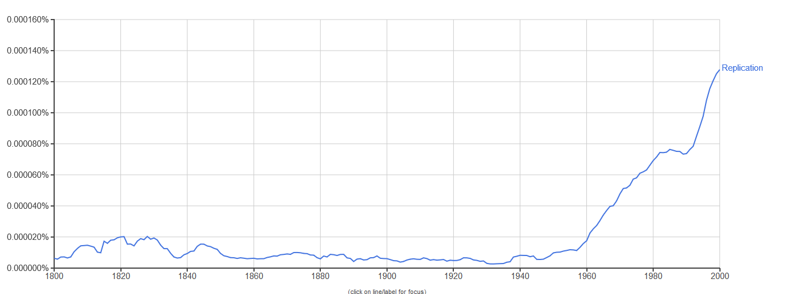

# Replication and Reproduction
**First published Wed Dec 5, 2001; substantive revision Thu Oct 27, 2022**

*Wilkins, John S., Bourrat, Pierrick*

The problem of replication and reproduction arises out of the history of genetics [see the entry gene for a historical review]. It is tied to the concept of the gene and its generalization in an evolutionary context [see the entry evolution]. Richard Dawkins introduced the notion of replicators—things that self-replicate—as a universalization of evolutionary understandings of genes. Dawkins argued that replicators are the *sine qua non* of evolution by natural selection [see the entry natural selection], while other accounts only require *reproduction* as one of its defining features. What exactly is a replicator? How are replicators different from genes? Can evolution by natural selection occur without the existence of replicators? Besides the biological domain, are there any other domains in which replicators have been postulated? To answer these questions, we will first provide some background for Dawkins’ notion of the replicator and its ties with the concepts of the gene and information. We will then introduce the distinction between *replicators* and *vehicles* in the context of biological evolution, followed by the extension of this to other domains. Finally, we will discuss some of the challenges to the idea that replicators are necessary conditions for evolution by natural selection.

## 1. Background

The notion of replication arose as a concern in the period immediately after the Second World War (see Figure 1), with the rise of information theory, communication theory, cybernetics, and Erwin Schrödinger’s 1944 book *What is Life?* Biologists immediately began to consider the informational aspect of life, in each of these theoretical frameworks, in areas ranging from neurology to molecular biology, but especially the latter (Brookes 1956; Eigen & de Maeyer 1966; Gatlin 1972; Johnson 1970; Linschitz 1953; Margalef 1957 [1958]; Quastler 1953; Rashevsky 1955)[^brookes-1956][^eigen-1966][^gatlin-1972][^johnson-1970][^linschitz-1953][^margalef-1957][^quastler-1953][^rashevsky-1955]. It was only after the development of communications theory by Shannon (1948)[^shannon-1948] and cybernetics by Wiener (1948)[^wiener-1948] after it that inheritance in biology took on a specifically informational tint (Griffiths & Stotz 2007)[^griffiths-2007]. This is the case in particular of the work of Watson and Crick on the double helix structure of DNA (Watson & Crick 1953)[^watson-1953], as well as Crick’s Central Dogma, which states that information cannot flow from protein to DNA. The Central Dogma (Crick 1958)[^crick-1958] was initially cast in terms of structural information (Šustar 2007; Figure 2) and later recast by Crick as a more cybernetic or computational kind of information (Crick 1970)[^crick-1970]. [See Eugene V. Koonin 2012 & 2015 for discussion of the nature of the Central Dogma in current biology.][^koonin-2012][^koonin-2015]

\*Figure 1.\* Yearly frequency of count for the word “replication” in Google text’s English corpus from 1800–2000 with smoothing = 3. Data obtained from Google Ngram Viewer (see Other Internet Resources).

Structural information is effectively based on the transfer of molecular primary sequences (linear sequence) in the synthesis of polypeptides; that is, it is the literal sequence of basic groups (amino acids), before the protein folds into secondary and higher conformations. This is a physical and causal account of information: the new molecule has its sequence because it was templated in some way by the “information”-imparting molecule (in this case, DNA to proteins). Griffiths and Stotz (see below) call this, accordingly, “Crick information”.

However, in the late 1950s, after the structure of DNA had become more widely understood, chemist Homer Jacobson proposed a *cybernetic* model of reproduction (Jacobson 1958)[^jacobson-1958], going so far as to make a literal model out of train sets and electronic circuits. Later, von Neumann proposed a theory of self-reproducing automata (Neumann 1966)[^neumann-1966], which has become a parallel but influential research program to the issue in biology (Mitchell 2009)[^mitchell-2009]. Jacob (1973)[^jacob-1973] cemented the logical description of heredity, but the ultimate classical source of the notion that genes are information comes from Williams’ classic 1966 book *Adaptation and Natural Selection*, in which he referred to genes as “cybernetic abstractions” (1966: 33).

The cybernetic notion of reproduction (and, later, replication) rested on the notion that genes were *controllers* of phenotypes; later, this came to be identified (e.g., by Gatlin) as synonymous with the “communication” conception of information that Shannon proposed. In biology, genes came to be seen as “programs” for phenotypes [*senders*] that passed themselves on to progeny [*receivers*], around 1961 (Peluffo 2015)[^peluffo-2015].

Williams’ book was one inspiration for Dawkins’ *Selfish Gene* (1976), and much of what Dawkins proposed about replicators is an extension of Williams’ views, in conjunction with those of William D. Hamilton (1964)[^hamilton-1964] and various ethological ideas. This view is now known as the gene’s eye view (for discussions see Okasha 2006, Chapter 5; Ågren 2021)[^ågren-2021][^okasha-2006].

Williams introduced the notion of a gene as a substrate neutral entity:

> I use the term ‘gene’ to mean that which separates and recombines with appreciable frequency, (1966: 20)

and he further defined an *evolutionary* gene (that is, one that is selectively important):

> [A] gene could be defined as any hereditary information for which there is a favorable or unfavorable selection bias equal to several or many times its rate of endogenous change. (1966: 25)

His answer to the question of what a gene is, is that a gene is evolutionary just insofar as it is something heritable that is subject to rates of selection that exceed the mutation rate. This is a definition, not a discovery. If it is favorably or unfavorably selected and heritable, it is an evolutionary gene. According to this definition, items that are not made of DNA can be classed as evolutionary genes so long as they match Williams’ definition (Lu & Bourrat 2018).

![a rectangle divided into three horizontal regions, the first region has a purple background and is titled 'Replication' and has a diagram with the word 'DNA' and an arrow going from 'DNA' and circling back to it; the second region has a yellow background and is titled 'Transcription' and the diagram continues with an arrow from 'DNA' in the previous region to the word 'RNA' in this region; the third region has a green background and is titled 'Translation' and the diagram continues with an arrow from 'RNA' in the previous region going into this region and ending.](../assets/replication/centraldogma.png)

\*Figure 2.\* The Central Dogma of genetics as envisaged by Crick around 1965 (Thieffry & Sarkar 1998)[^sarkar-1998][^thieffry-1998].

## 2. Genes and Information

The language of “codes” and “information” flows easily enough with respect to replication [see the entry biological information]. Transcription, translation, punctuation, redundancy, synonymy, editing, proofreading, errors, repairing of errors, messages, copies, and information all sound natural enough. Yet, the literature dealing with information is both extensive and factious. Several different formal analyses of information can be found and very little agreement about which analysis is best for which subjects. On one point, these scholars tend to agree—cybernetic information and communication-theoretic information will not do for replication in biological contexts. Some argue for semantic information (Godfrey-Smith 2000a; Sarkar 2000; Sterelny 2000b)[^godfrey-smith-2000a][^sarkar-2000][^sterelny-2000b]. The trouble is that no widely accepted version of semantic information exists. Winnie (2000)[^winnie-2000] distinguishes between Classical and Algorithmic Information Theory and opts for a revised version of the Algorithmic Theory. But, once again, the problem is that no such formal analysis currently exists.

In the face of all this disagreement and unfinished business, biologists such as Maynard Smith (2000) maintain either that informal analyses of “information” are good enough or that some future formal version of information theory will justify the sorts of inferences that they make. The sense of “information” used in the Central Dogma of molecular biology is more like a fit of template, or the primary structure of the protein sequence compared to the sequence of the DNA base pairs. Attempts have been made in what is now known as bioinformatics to use Classical Information Theory (Shannon’s theory of communication) to extract functional and phylogenetic information (Brooks & Wiley 1988; Gatlin 1972; Maclaurin 1998; Rodrick Wallace & Wallace 1998)[^brooks-1988][^gatlin-1972][^maclaurin-1998][^wallace-1998], but they appear to have been unsuccessful in the main.

While the most likely conclusion is that no version of information theory as currently formulated can handle “information” as it functions in biology (Griffiths 2001)[^griffiths-2001], attempts have continued to be made to formulate just such a version (Bergstrom & Rosvall 2011; Sternberg 2008)[^bergstrom-2011][^sternberg-2008]. However, this undercuts the motivation for appealing to information theory to elucidate genes in the first instance. Griffiths & Stotz (2013: 153) have argued for “Crick” information, which they define as “the specification of the order of amino acids in a polypeptide chain”. This specificity definition is more chemical than abstract [see the section below on Developmental Systems Theory].

The “informational gene” conception, as James R. Griesemer (2005)[^griesemer-2005] terms it, is a highly abstract concept of a process and the entities that comprise it. This is intentional, as it permits Darwinian dynamics to be applied to a range of phenomena, such as sociocultural, cybernetic, and medical processes. However, this raises a metaphysical concern, namely that the view that a gene is nothing but information is a version of Aristotelian hylomorphism [see the entry form versus matter]. That is, information is a type of form, which can be used to explain physical processes. Classical hylomorphism was roundly demolished as a *scientific* hypothesis when Daltonian elements were named and investigated in the nineteenth century. By 1900, terms like “substance” (for matter that is propertyless apart from mass and extension in space) and “form” had taken on a largely philosophical sense that differed extensively from Aristotle’s own physical views. Griesemer notes:

> We know that the informational genes are tied to matter and structure, but if evolutionary theory – to be general enough to cover cultural and conceptual change – must be devoid of all reference to concrete mechanism, it cannot follow from the theory, for example, that genes are inside organisms or are even parts of organisms, as Dawkins’s language suggests. Strictly, only the correlations between replicator and vehicle due to causal connections of a completely unspecified sort can be implied by such a theory. Striving to get matter and specific structure out of the theory in order to make it apply to immaterial realms may thus leave it bankrupt as an account of causal connection for the material, biological cases. (2005: 79)

And yet, this kind of hylomorphism has remained, even in science. Biologists have argued that form determined many properties of organisms in ways that could not be reduced to the actions of their parts, and this kind of thinking remained and was co-opted by the molecular biologists and geneticists. Thus, we get the Central Dogma of molecular biology:

> The Central Dogma
> This states that once ‘information’ has passed into protein *it cannot get out again*. In more detail, the transfer of information from nucleic acid to nucleic acid, or from nucleic acid to protein may be possible, but transfer from protein to protein, or from protein to nucleic acid is impossible. Information means here the *precise* determination of sequence, either of bases in the nucleic acid or of amino acid residues in the protein. (Crick 1958)[^crick-1958]

Read physically, this means only that the structure of the DNA molecule is not reproduced from the structure of proteins, a perfectly reasonable account of the molecular processes. However, because Crick used the word “information”, some scientists, including Dawkins, took this to mean that genes are informational entities, which “code” for organismic traits from the molecular level up to the entire organism and even beyond. This is striking in a purple passage of *The Blind Watchmaker*, where Dawkins describes genes as follows:

> It is raining DNA outside. [downy seeds from willow trees] … The cotton wool is mostly made of cellulose, and it dwarfs the tiny capsule that contains the DNA, the genetic information. The DNA content must be a small proportion of the total, so why did I say that it was raining DNA rather than cellulose? The answer is that it is the DNA that matters… whose coded characters spell out specific instructions for building willow trees… It is raining instructions out there, it’s raining programs; it’s raining tree-growing, fluff spreading, algorithms. That is not a metaphor, it is the plain truth. It couldn’t be any plainer if it were raining floppy disks. (1986: 111)

So, we now turn to Dawkins’ view of genes as replicators and the way in which he takes information to be cybernetic and physical at the same time.

## 3. Dawkins’ View

Richard Dawkins introduced the distinction between replicators and vehicles in *The Selfish Gene* (1976). For his purposes, Dawkins found the contrast between genes and organisms too restrictive and specific. Everyone agrees that genes are replicators, but genes may not be the only replicators. Dawkins also argued that perhaps more inclusive entities than single genes might also function as replicators. At the very least, the possibility should not be ignored. So, Dawkins adopted “replicator” as a more inclusive and general term than “gene”. In *The Extended Phenotype*, he defined a replicator as “anything in the universe of which copies are made” (Dawkins 1982b: 83)[^dawkins-1982b]. He also introduced the term “vehicle” for those entities produced by replicators that help these replicators increase in numbers by interacting effectively with their environments. This distinction can be expressed in terms of either entities or processes. According to Dawkins, replicators function in replication, while vehicles function in environmental interaction.

### 3.1 Genes as Replicators

A longstanding dispute in evolutionary biology concerns the levels at which selection can occur (Bourrat 2015b, 2021; Brandon 1996; Kerr & Godfrey-Smith 2002; Keller 1999; Lloyd 1988; Okasha 2006, 2016; Sober & Wilson 1998; Williams 1966)[^bourrat-2015b][^bourrat-2021][^brandon-1996][^godfrey-smith-2002][^keller-1999][^kerr-2002][^lloyd-1988][^okasha-2006][^okasha-2016][^sober-1998][^williams-1966] [see the entry on units and levels of selection]. Some authors see this dispute as concerning the levels at which replication can take place. Other authors take the levels of selection dispute to concern environmental interaction and insist that environmental interaction can take place at a variety of levels, from single genes, cells, and organisms to colonies, demes, and possibly entire species. Organisms certainly interact with their environments in ways that bias the transmission of their genes, but then so do entities that are both less inclusive than entire organisms (e.g., sperm cells) and more inclusive (e.g., beehives).

Dawkins argued that replication in *biological* evolution occurs exclusively at the level of the genetic material. The term “replication” refers first and foremost to copying, and genes are the self-replicating molecules of biology. Some critics (e.g., Lewontin 1991: 48)[^lewontin-1991] interpreted this to mean that a strand of DNA placed on a glass slide might start replicating all on its own. Of course, no biologist has ever held such a view. Genes do replicate themselves, but only with the aid of highly complicated molecular machinery. Too often, however, the importance of this machinery has gone unnoticed. To be sure, when we make copies on a photocopier, we are interested in the texts, figures, or just scrawls that appear on these sheets of paper. We are not interested in how the photocopier works, even if it does *all* the work.

In Dawkins’ early writings, replicators and vehicles played different but complementary and equally important roles in selection; however, as he honed his view of the evolutionary process, vehicles became less and less fundamental. Initially, Dawkins was content to dethrone the organism from its pride of place in biology. It is an important focus of environmental interaction, but other entities, both below and above the organismic level, can also function as vehicles. In later writings, however, Dawkins went even further to argue that phenotypic traits are what really matter for evolution by natural selection to occur and that they can be treated independently of their being organized into vehicles. More than that, features such as spider webs should be viewed as part of a spider’s phenotype. Hence, Dawkins titled his second book *The Extended Phenotype* (Dawkins 1982b)[^dawkins-1982b].

Dawkins never lost his fascination with vehicular adaptations, a fascination that his critics denigrate as Panglossian adaptationism. He filled his books with adaptationist scenarios, some more firmly supported by data than others; however, from the perspective of the structure of evolutionary theory, he held that replicators are much more important than vehicles. For example, Dawkins argued at some length that adaptations are always for the good of replicators, not vehicles (Lloyd 1992)[^lloyd-1992] [see the entry on units and levels of selection]. Vehicles *exhibit* these adaptations, but ultimately all adaptations must be *explicable* in terms of changes in gene frequencies. Thus, it comes as no surprise when Dawkins (1994: 617)[^dawkins-1994] proclaims that he “coined the term ‘vehicle’ not to praise it but to bury it”. As prevalent as organisms might be, as definite as the causal roles that they play in selection are, reference to them can and must be omitted from any perspicuous characterization of selection in the evolutionary process. Although Dawkins is far from a genetic *determinist*, he is certainly a genetic *reductionist*. Whether reductionism itself is good or bad is a moot question (Sarkar 1998)[^sarkar-1998].

According to Dawkins, replicators have three basic properties—*longevity*, *fecundity* and *copy-fidelity*. Longevity means longevity of the gene *type* in the form of copies through descent (Dawkins 1982b: 84; Hull 1980)[^dawkins-1982b][^hull-1980], although the stability of gene *tokens* is included in the definition in *The Selfish Gene* (1976: 18). No gene as a physical body lasts all that long. In mitosis, a gene loses half of its substance at each replication. What endures, he says, is not the entity itself but the information incorporated in its structure. It is this information that is copied with such high fidelity. Mutations do occur, but at very low frequencies. Even so, in some organisms, mutation rates must be too high because mechanisms have evolved that search out and repair such errors. Therefore, the genotype is an informational notion; information is equivalent to Aristotelian form. The type is the *form* of the tokens, in Dawkins’ view.

One source of variation in genes of sexual organisms supplementing mutation is crossover. Pairs of homologous chromosomes line up next to each other at meiosis, crossover, and recombine. For stretches of DNA in which different alleles exist, the result can be a change in information. Quite obviously, the shorter the stretch of DNA involved, the less likely that crossover will occur and the message change. Dawkins appeals to such dismantling of entities to argue against organisms functioning as replicators. In sexual organisms, organisms themselves are torn apart and repeatedly assembled each generation (Caporael 2003)[^caporael-2003]. If long stretches of DNA lack the necessary identity by descent to function as replicators, then sexual organisms certainly lack it. However, some other explanation has to be provided for asexual organisms because they pass on their overall structure largely unchanged from generation to generation. For example, R. A. Fisher, in *The Genetical Theory of Natural Selection* (Fisher 1930)[^fisher-1930] considered the entire genetic complement of asexual organisms to be a single gene, and this view has been repeated from time to time since. According to Dawkins, genes, and only genes, can function as replicators in biological evolution. How large these genetic units are depends on such things as the prevalence of sex, the frequency of crossover or lateral gene transfers, and the intensity of selection.

> If there were sex but no crossing-over, each chromosome would be a replicator, and we should speak of adaptations as being for the good of the chromosome. If there is no sex we can, by the same token, treat the entire genome of an asexual organism as a replicator. But the organism itself is not a replicator. (Dawkins 1982a: 95)[^dawkins-1982a]

Dawkins offered two reasons for organisms not being able to function as replicators. The first is the one he uses to delineate evolutionary genes. As is the case for long stretches of DNA, organisms are too easily and frequently broken up to be considered units of replication. A second reason is that they cannot pass on changes in their structure, although some phenotypic change may result in generational change. In fact, *some* epigenetic mechanisms have been shown to be passed on across generations (Jablonka & Raz 2009; see the entry on inheritance systems)[^jablonka-2009]. The amount of DNA that counts as a replicator certainly varies; but, according to Dawkins, nothing more inclusive than the genetic material functions as replicators in biological evolution.

In *The Selfish Gene*, although Dawkins wanted his definition of gene to be close to that of Williams’ (1966) “evolutionary gene”, it is not quite:

> A gene is defined as any portion of chromosomal material which potentially lasts for enough generations to serve as a unit of natural selection. (Dawkins 1976: 30)[^dawkins-1976]

Where Williams’ definition is substrate neutral, Dawkins’ is explicitly chromosomal and DNA-based. Where William’s “gene” refers to *any* entity, which is the reason why it is an informational notion, Dawkins’ gene, by contrast, is tied to DNA, a view later heavily criticized by Stent (1977)[^stent-1977], an influential molecular biologist at the time.

On Dawkins’ account, the limits of genes need not be absolutely sharp. Nor must all genes be of the same length. The greater the selection pressure, the smaller the gene. At the most fundamental level, selection takes place between alternative alleles residing at the same locus.

> As far as a gene is concerned, its alleles are its deadly rivals, but other genes are just a part of its environment, comparable to temperature, food, and predators, or companions. (Dawkins 1976: 40)[^dawkins-1976]

Alleles cannot cooperate with each other, only compete. That is where the “selfish” in “selfish gene” comes in. According to Dawkins (1976: 95)[^dawkins-1976], the selfish gene is not just one physical bit of DNA. It is “all replicas of a particular bit of DNA, distributed throughout the world” (for a recent defense of a similar approach, see Haig 2012)[^haig-2012]. Hence, genes do not form classes of spatiotemporally unrelated individuals but trees. They must be replicas. But, being a replica is not enough. The linear repetition of the “same gene” in the form of several hundred copies is quite common. These replicas, however, do not reside at the same *locus*. Although identical in structure, these genes do not compete with each other in the way that alleles at the same locus can. In the simplest and most basic sense, alleles compete with alternative alleles at the same locus. Any other sorts of competition and cooperation are merely extrapolations from this fundamental sense of allelic competition. Although genes may cooperate with each other in very complicated ways in embryological development, in replication they can be treated as “separate and distinct”. In development, the effects of genes blend. In replication, replicators do not blend.

### 3.2 Hull’s Interactors

Dawkins introduced the general notions of replicator and vehicle so that selection need not be limited exclusively to gene-based biological evolution. However, as the preceding discussion indicates, his later revisions to his general theoretical outlook were influenced strongly by the traditional perspective of genes and organisms. Genes contain the information necessary to produce organisms and their adaptations. Genes “ride around” in and “guide” organisms. As Dawkins describes them, vehicles are relatively discrete entities that “house” replicators and that can be regarded as machines programmed to preserve and propagate the replicators that ride inside them. Although these terms may be appropriate for the relations between genes and organisms, they interfere with a more general analysis of replication and selection. What really matters in selection is that entities at various levels of organization interact with their environments in such a way that the relevant replicators increase in relative frequency. The actual causal chain that connects replicators and vehicles need not be limited to development.

For example, Dawkins argues at some length that genes and only genes can function as replicators in biological evolution. He adds that “all adaptations are for the preservation of DNA; DNA itself just is” (Dawkins 1982a: 45)[^dawkins-1982a]. But, DNA itself exhibits adaptations. Anyone who has spent much time examining the molecular structure of DNA soon realizes that it is adapted to replicate. In addition, the proliferation of junk DNA, transposons, and meiotic drive are three examples in which the only phenotypes that matter are phenotypic characteristics of genes (Brandon 1996; Sterelny 1996: 388)[^brandon-1996][^sterelny-1996][^sterelny-1996-2]. Dawkins’ characterizations of replicators, vehicles, and the relations between the two are too closely tied to genes, organisms, and development. DNA can certainly replicate itself, but it can also function as a “vehicle”, even though it cannot code for, ride around in, or direct itself. In sum, a more general characterization of selection is needed, a characterization that does not assume that the only causal connection between replicators and vehicles is development from embryo to maturity. Such a generalization was offered by Hull (1980, 1981, 1988)[^hull-1980][^hull-1981][^hull-1988], who proposed that the relevant notion is “interactor” rather than “vehicle”, as interactors are causal and active while vehicles are passive entities.

## 4. Other Examples of Replicators

Although Dawkins finds it desirable to replace genes with replicators in his general characterization of the evolutionary process, he says very little about this more general notion in *The Selfish Gene*. Only one chapter (11) is dedicated to “memetic” evolution. Instead, as we saw, he discusses the special case of genes as replicators. The primacy of the genetic perspective in the characterization of replicators is claimed by some (Griesemer 2000b)[^griesemer-2000b] to be one of the chief weaknesses not only in Dawkins’ discussions but also in the work of his successors [see the section below on Reproducers]. Hull and his colleagues (Hull, Langman, & Glenn 2001)[^hull-2001] claim to be providing a general notion of replication, adequate to handle all different sorts of replication, when too often we are simply reading peculiarities of genetic replication into our general analysis of replication.

### 4.1 The Immune System

Does replication play the same role in other sorts of selection that it plays in gene-based biological evolution? The reaction of the immune system to antigens is closest to the standard biological example of replication and selection (Hull et al. 2001)[^hull-2001]. Certainly, immune systems arose through the same process as other functional systems. The basic structure of the human immune system is “built into our genes”, and the only genes that count in evolution are the ones that we received from our ancestors and can subsequently pass on to our progeny. In Dawkins’ (1982b: 83) terminology, the genes that code for our immune system are active, germ-line replicators. They are active because they influence their probability to be copied; they are germ-line because they can potentially have an infinity of descendants.

However, the genes that function in the reaction of the immune system to antigens have two peculiarities. First, they incorporate mechanisms designed to produce very high frequencies of mutation; second, none of the genes involved in the functioning of the immune system are germ-line. For instance, the genes that give rise to B-cells are designed to mutate extensively until one of these cells identifies an invader as foreign. It then proliferates extensively as it attacks the invader. As an organism matures, it accumulates more and more of the B-cells that have been successful in its past. More than this, as the process of proliferation continues, the strength of the affinities to binding sites increases. Initially, the primary antibodies almost always exhibit a weak affinity for their targets; however, as the reaction to the antigen continues, these affinities become stronger.

Within the confines of a single organism, the reaction of the immune system to antigens has all the characteristics of selection processes; however, when the organism dies, all of these adaptations are lost. In some species, females pass on not only the genes for the basic structure of their immune systems but also some of the machinery that past invasions of antigens have produced in them. However, these cells are rapidly removed from the offspring as it develops its own immune system. The reaction of the immune system to antigens departs from gene-based selection in biological evolution in two ways. First, from the organismal perspective, the genes that function in protecting an organism from invaders are not germ-line. They are somatic. Second, the relevant mutation rates are much, much higher in the immune system than in ordinary gene-based selection. Instead of mechanisms existing to discover mutations and repair them, mechanisms exist that encourage mutations—massively so. If the functioning of the immune system is to count as an adaptive process, some changes must be made. One possibility is to clarify what counts as a “germ-line” replicator and reject the notion that extremely low mutation rates are inherent in all selection processes [see the section below on Challenges to the Replicator].

### 4.2 Sociocultural Evolution

The temptation to regard cultures and societies as evolving entities in a way analogous to organisms has a long tradition. In *The Selfish Gene* (Chapter 11), Dawkins proposes a version of it that makes use of the concept of the replicator. He chose the word “meme” for a sociocultural replicator due to its similarities with the word gene:

> We need a name for the new replicator, a noun that conveys the idea of a unit of cultural transmission, or a unit of imitation. ‘Mimeme’ comes from a suitable Greek root, but I want a monosyllable that sounds a bit like ‘gene’ (Dawkins 1976: 192)[^dawkins-1976].

The basic idea underlying Dawkins’ proposal is that since evolution by natural selection in the biological domain requires replication, it must also be the case in the sociocultural domain, and that imitation, at least in many cases, is the way through which sociocultural entities, the memes, replicate.

Important differences exist between sociocultural evolution and biological evolution (Claidière & André 2012)[^claidière-2012] [see the entry on cultural evolution]. For example, Dawkins (1976)[^dawkins-1976] admits that he is on shaky ground when it comes to the high-fidelity copying required of replicators. Memes seem to get changed much more frequently than genes (see Sterelny (2006)[^sterelny-2006] for a review). In general, however, it is fair to say that the standards used to evaluate sociocultural transmission are not on par with those used to evaluate biological transmission. An overly idealized view of Mendelian genetics is contrasted with a much more realistic view of cultural change. So the criticism goes, one problem with memes is that they do not have discrete boundaries, do not all come in the same size, and, in their functioning, are strongly influenced by their environments. Genes, so the critics claim, have sharp boundaries, are all of the same size, and are immune to environmental influences. If sociocultural evolution is to be evaluated fairly, the same level of criticism must be applied to all putative examples of selection, from gene-based selection in biological evolution and the reaction of the immune system to antigens to the development of the central nervous system and social learning (Hull et al. 2001)[^hull-2001]. The collection of articles in Aunger (2000)[^aunger-2000] present the arguments for and against a memetic approach to culture, and a more recent discussion is available in Lewens (2015)[^lewens-2015].

Dawkins (1976)[^dawkins-1976] also places considerable emphasis on human brains as the “vehicles” for memetic evolution. He defines “meme” as an entity capable of being transmitted from one brain to another. Computers are also plausible vehicles for memes, as well as artifacts more generally, which can “store” and then release information when a copy of the artifact is made by emulation (*mimesis*): that is, without the presence of a demonstration. However, Dawkins’ discussion of memes is marred by the pervasiveness of the gene-organism perspective. For example, he defines “replicator” in terms of transmission of information—memes leaping from brain to brain or from brains to computers and back again. But, memes do not leap from brain to brain or from computer to computer. Their content is transmitted in a variety of ways, including books, audiotapes, conversations, and the like. As much as the physical basis changes, the message remains sufficiently unchanged. All instances of this message are equally memes, not just the ones residing in human brains and computers.

Several accounts of memetic replication have been proposed in the literature. Some consider that there is no replication in cultural evolution, but that memes are “attractor points” in culture (Atran 1998)[^atran-1998]. Others consider that the interactor is the meme itself (Blackmore 1999)[^blackmore-1999] or that the meme is the selected cultural heritable information, just as Williams’ “evolutionary gene” is the selected genetic heritable information, and the memetic interactor is the repertoire of behaviors it elicits (Wilkins 1998)[^wilkins-1998]. One view that has been offered several times is that memes are active neural structures (Aunger 1998, 2002; Delius 1991)[^aunger-1998][^aunger-2002][^delius-1991].

All the objections to the gene-meme analogy to one side, Dawkins (1976: 211)[^dawkins-1976] finds the chief difference between genetic and memetic change is that biological evolution is at bottom a war between alleles residing at the same locus: “Memes seem to have nothing equivalent to chromosomes and nothing equivalent to alleles”. First, the usual depiction of alleles residing at the same locus on homologous chromosomes so central to Mendelian genetics is an oversimplification; but, and more importantly, for at least half of the history of life on earth, replication and selection took place in the absence of chromosomes, meiosis, and the like. If gene-based biological evolution took place for so long in the absence of the Mendelian apparatus and still does so in many extant organisms, then demanding that memetic evolution proceeds by this very special and possibly aberrant sort of inheritance seems too strong. The cost of meiosis remains a serious problem in ordinary biological evolution. Demanding that cultural evolution incorporates this same highly problematic element in its own makeup seems strange in the extreme. If we are to develop a general analysis of selection, we must distinguish between essential and contingent features of this process.

Numerous evolutionary biologists question how fundamental to selection the perspective of alleles at a locus actually is. Almost everyone agrees that evolution involves changes in gene frequencies. However, few go on to add that evolution is *nothing but* changes in gene frequencies. When one looks at evolutionary biology, one discovers that it involves much more than changes in gene frequencies. To be successful, memetic evolution must be fleshed out.

In 2000, Aunger summarized the disputes between proponents and skeptics of the memetic approach as revolving around three levels:

> 1. whether culture is properly seen as composed of independently transmitted information units;
> 2. whether these so-called memes have the necessary qualifications to serve as replicators; and
> 3. whether a Darwinian or selectionist approach such as memetics is the most feasible or desirable form for a science of culture to take. (Aunger 2000: 11)[^aunger-2000]

However, over 20 years after the diagnosis, it seems that the memetic approach has, by and large, been abandoned, with some of its insights incorporated into other evolutionary approaches to culture. Perhaps the most successful is dual-inheritance theory (Richerson & Boyd 2008)[^richerson-2008], also known as gene-culture coevolution. A very general characterization of sociocultural evolution has been attempted by El Mouden, André, Morin, and Nettle (2014). This approach, which relies on the most abstract formalism used by evolutionary theorists—namely, the Price equation (for an introduction to the Price equation see Okasha 2006: Chapter 1)[^okasha-2006]—highlights some of the differences between biological and sociocultural evolution, and why a pure memetic approach seems difficult to implement as a general framework.

### 4.3 The Extended Replicator

Some of Dawkins’ critics think that genes play too important a role in his notion of replication. Replication, so they argue, can occur at other levels of organization as well. Just as Dawkins extended the notion of the phenotype, these authors propose to make the notion of replicators more general as well—to extend the replicator so to speak. Dawkins introduced his *Extended Phenotype* conception for two reasons. First, he wanted to extend the notion of a “phenotypic trait”. The sort of nest that a bird builds or the song that it sings can count as phenotypic traits just as much as the shape of its bill. Second, as mentioned earlier, Dawkins wanted to break the hold that organisms have over how we conceptualize the living world. Traits do tend to come bundled into reasonably discrete entities; but, for making inferences about the evolutionary process, traits can be treated as separate and distinct. However, as he proceeded, Dawkins eventually decided that extending the phenotype was not enough. He had to bury it. All sorts of fascinating mechanisms to one side, what really matters in selection takes place at the level of replicators.

Although such critics of Dawkins as Sterelny, Smith, and Dickison (1996) declined to join with Dawkins in his demotion of environmental interaction, they did agree with him that replicators are special. They play a special role in development. However, they do not limit replicators to genes, even in biological evolution. Sterelny et al. propose to extend the replicator to include nonstandard entities: “the set of developmental resources that are adapted from the transmission of similarity across the generations” (Sterelny 2001: 338)[^sterelny-2001]. For example, the sort of burrow that a particular organism digs is influenced by its genetic makeup; however, if these burrows are used over and over again, characteristics of these burrows can themselves be viewed as replicators. The effects of these burrows get passed on from generation to generation, but not via the DNA.

As more and more non-DNA replicators, including epigenetic inheritance, are acknowledged, Dawkins’ view began to grade into the conception of the Extended Replicator, which Sterelny et al. (1996) specify as any non-genetic as well as genetic replicators where “genetic” refers to DNA. These two views are so general that any case that can be described in one can be redescribed in the other. Differences lie in ease of description. According to Sterelny et al. (1996), the burrows that some organisms dig can function as replicators—extended replicators—while Dawkins portrays them as instances of extended phenotypes. The contrast is between selfish burrows and selfish genes for burrowing.

In the version of replication formulated by Sterelny et al. (1996), both copying and biofunction are crucial. Copying is quite obviously a causal phenomenon, but not any old causal connection will do. Similarity of copies is necessary but not sufficient. These copies must be copies of copies. One copy must produce another copy and that copy produce still another copy and so on. For one entity to be a copy of another, it must be the output of a process whose biofunction is to conserve function. The function of copying is to produce from one token another token, which is similar in the relevant respects. Genes fit this definition, but so do lots of examples of non-genetic transmission, such as habitat stability resulting from nest site imprinting, the song that a bird learns, and various microorganism symbionts, not to mention sociocultural transmission.

## 5. Challenges to the Replicator

### 5.1 Developmental Systems Theory

In the wake of Oyama’s *The Ontogeny of Information* (1985, 2000) and other work, notably that of Daniel Lehrman (1953)[^lehrman-1953] and Patrick Bateson (2001)[^bateson-2001], a view of biological evolution has arisen that emphasizes development (see also Griffiths & Gray 1994a)[^griffiths-1994a]. In the nineteenth century, development was an extremely active research program. The next great discoveries in biology were predicted to be in the area of development; however, this was not to be. First Mendelian genetics and then a version of evolutionary theory centered on population genetics took over biology, and they did so while avoiding development. Everyone knew that development was central to both evolution and reproduction, but no one could see how to integrate the masses of developmental data available into the emerging synthesis of evolutionary biology and genetics. As a result, development was left out of the Modern Synthesis (Beurton, Falk, & Rheinberger 2000; Gilbert 1991)[^beurton-2000][^gilbert-1991]. Considering how central development actually is in metazoan and metaphyte biology, the advances made while ignoring it are staggering.

Even so, developmental biology continued on its course until, at long last, we seem to understand development well enough to begin integrating it into the rest of biology. On the most conservative view, current versions of evolutionary theory can remain largely unchanged as development is grafted onto them. On a second view, both perspectives are likely to require some modification to achieve this integration. Our understanding of development may have to be modified, but so too for evolutionary theory (Pigliucci & Müller 2010)[^pigliucci-2010]. Finally, at the other extreme, development will all but replace evolutionary theory. In their more exuberant moments, some advocates of Developmental Systems Theory (DST) seem to be claiming just that. Just as some molecular biologists think that molecular biology is rapidly replacing all the rest of biology, some advocates of DST argue that developmental theories will simply replace current versions of evolutionary theory.

On some versions of the DST view, genes have no uniquely privileged role in repeated cycles of development (Griffiths 2001; Griffiths & Gray 1994b)[^griffiths-2001][^griffiths-1994b]. In fact, no element of the developmental matrix plays any privileged causal role—not genes, not organisms, not the environment, not anything. Everything counts as a resource; however, in particular situations, certain resources will play more important roles than other resources. In rejecting any privileged role for genes, advocates of DST are especially skeptical of one particular role supposedly played by genes—the transmission of information. According to some, information is central to developmentalism, but genes are not the only mechanisms for information transfer. According to others, information plays no role in the emerging developmentalist perspective. The developmental system as a whole is the unit of selection [see the entry on units and levels of selection]. If genes have no special role and whole developmental cycles are replicators, as some developmental systems theorists argue, the distinction between replicator and interactor becomes blurred.

In the continuing debate over developmental versus traditional theories of evolutionary biology, Sterelny et al. (1996) hold a fairly conservative position. They agree with the developmentalists that genes play no privileged role in the development of phenotypes from genotypes. Genes do play a role in this process, simply not a *privileged* role. Genes can serve as a causal bridge from phenotype to phenotype, but other entities can do so as well. Genes are not the only replicators in biological evolution. The repeated cycles in inheritance include many different sorts of constancies and repetitions—genes, cellular machinery, phenotypic traits including behaviors, and social structures. Information remains central to selection processes, but genes are not the only carriers of such information. Genes predict phenotypic characters only in the same sense that environmental factors predict them. Sterelny (2000a)[^sterelny-2000a] has argued that developmental considerations require no fundamental reevaluation of evolutionary conceptions along the lines of DST.

### 5.2 Evolution by Natural Selection without Replication

Godfrey-Smith (2009; see also Godfrey-Smith 2000b; Griesemer 2005)[^godfrey-smith-2000b][^griesemer-2005] contrasts the replicator/interactor approach to natural selection with a more classical approach. This latter approach is usually given as a “recipe” for evolution by natural selection, to use Godfrey-Smith’s terminology (see also Brandon 1990: 3.1)[^brandon-1990]. Ever since Darwin, a number of authors have proposed that for evolution by natural selection to occur, three conditions or ingredients are necessary. A population should exhibit (1) variation that (2) leads to differences in fitness between the entities forming the population [see the entry on fitness], (3) which are heritable (reviewed in Godfrey-Smith 2007)[^godfrey-smith-2007]. The most famous version of these recipes is that provided by Lewontin (1970)[^lewontin-1970].

There is a difference in emphasis between the two approaches in that the replicator/interactor approach focuses on the *entities* forming the population, while the classical approach provides a population description of evolutionary change. Another difference between the two approaches is that under the classical approach, replication is not required for evolution by natural selection to occur. In fact, as long as heritability is positive, and the two other conditions are satisfied, evolution by natural selection can occur (but will not necessarily do so, cf. Godfrey-Smith 2009: 25)[^godfrey-smith-2009]. An abstract definition of heritability ($h^2$)—although by no means fully general (see Bourrat 2015a, 2022)[^bourrat-2015a][^bourrat-2022]—is that it represents the slope of the regression of average offspring character on parent or mid-parent (in case of sexual species) character [see the entry on heritability]. Given that a positive heritability does not entail replication of character between parent and offspring, but is rather a special case in which heritability would be exactly 1 in the absence of environmental variation, the replicator/interactor perspective is subsumed by the classical approach. Godfrey-Smith concurs:

> From this point of view, we can see the replicator analysis as picking out a special case of what is covered (or supposed to be covered) by the classical view. (2009: 36; see also Godfrey-Smith 2000b)[^godfrey-smith-2000b]

To see why a lack of replication does not prevent evolution by natural selection from occurring, suppose a population of entities exists with different sizes, as presented in Figure 3(a), in which there is selection for larger entities. We assume that the entities reproduce asexually in discrete generations and that there is no environmental variation. At the parental generation, there are two types of individuals, with respective sizes of $\frac{3}{4}$ and 1. Due to the selection for size, entities of size $\frac{3}{4}$ produce 3 offspring while entities of size 1 produce 4 offspring. Suppose now that there is a positive heritability, as defined above, so that, on average, offspring resemble more their parent than they resemble other entities of the parental generation, as displayed on Figure 3(a), but only slightly so ($h^2 = 0.2$). After one generation, although there is no high-fidelity replication, the average size of the population has changed due to the effect of natural selection. This simple example demonstrates quite straightforwardly that replication is not required for evolution by natural selection to occur.

We said earlier that replication would imply a heritability of exactly 1 in the absence of environmental variation. Although this is correct, the reverse is not true. In fact, take again a similar population as in Figure 3(a), but this time assume a different pattern of inheritance for the two types of entities, as displayed in Figure 3(b). With this pattern of inheritance, although there is no replication, entities *on average* have the exact same character value as their parent. In the case of the entities of size $\frac{3}{4}$, *some* offspring have the exact same character as their parent, but that is not required either, as is the case with the entities of size 1, of which none of the offspring has the same character as their parent.

One possible response against regarding the classical approach to evolution by natural selection as unconditionally superior to the replicator/interactor approach is to argue that although evolution by natural selection can occur without replication, when this happens, the evolutionary change resulting is not a *pure* case of evolution by natural selection. Rather, it is evolution by natural selection mixed with some other evolutionary processes. A rationale for this claim is that the fact that offspring do not resemble their parent introduces some variation into the population of which the origin is not natural selection. In abstract terms, the introduction of variation can be regarded as a form of mutation (Bourrat 2019)[^bourrat-2019]. Under this interpretation, the classical approach, on the one hand, and the replicator/interactor approach, on the other hand, simply emphasize different aspects of evolutionary explanations. The classical approach gives us evolutionary explanations *in the context of other evolutionary processes occurring*, while the replicator/interactor approach gives us evolutionary explanations *of what the effect of natural selection would be in the absence of any other evolutionary process acting in the population*—that is, in its pure form. Understood that way, the two approaches do not necessarily need to be opposed.

Another problem with the idea of replication is that it is description dependent. Described finely, two objects can never be identical. The same applies to parents and offspring. This, in itself, does not represent a challenge to the replicator/interactor view. However, and more problematically, a coarser grain of description might lead parents and offspring to be regarded as copies of one another when a finer-grained description would show that they are not. Such a coarse-grained way of viewing evolutionary processes has been endorsed by some memeticists (see Boudry 2018; Dennett 2017 for explicit defences)[^boudry-2018][^dennett-2017]. However, without a principled way to choose which grain(s) of description ought to be used for the study of a particular evolutionary setting, the claim that replication is fundamental to evolution by natural selection in the context of other evolutionary processes occurring becomes arbitrary. This problem is a general one in evolutionary theory (see Bourrat, 2020)[^bourrat-2020], but is even more problematic in the context of cultural evolution where the line between genotype and phenotype is difficult to draw and multiple channels of transmission exist (Charbonneau & Bourrat 2021; Bourrat & Charbonneau 2022)[^bourrat-2021][^bourrat-2022][^charbonneau-2021].

### 5.3 Origins of Replicators

Another challenge to the replicator/interactor approach to evolution by natural selection is to see replicators themselves as a *product* of natural selection rather than as a necessary starting point. One premise of this argument is that some form of natural selection must have occurred on entities that initially were not replicating, perhaps not even reproducing. This is recognized by Dawkins, who notes in passing in the second chapter of *The Selfish Gene* that “Darwin’s ‘survival of the fittest’ is really a special case of a more general law of survival of the stable” (Dawkins 1976: 13)[^dawkins-1976] and that life originated from selection of molecules for stability.

(a) Population in which there is no replication and a low heritability ($h^2$), yet evolution by natural selection occurs.

(b) Population in which there is no replication, yet heritability is 1. Evolution by natural selection occurs.

\*Figure 3.\* Illustration of the idea that evolution by natural selection can occur without replication.

The idea that selection can occur without there being replicators was first introduced as “chemical selection” in line with the views of Oparin, who proposed that coacervates (colloidal droplets) could encapsulate protobiological chemicals and self-replicate without genes through mechanical fission, a view also independently proposed by Haldane (Oparin 1936 [1938]; Haldane 1929; see Kolb 2016)[^haldane-1929][^kolb-2016][^oparin-1936]. This was later extended by the work of Sidney Fox, who showed that proteinoid spheres could mechanically reproduce stably (Hsu & Fox 1976)[^hsu-1976].

If modern biological systems evolved from molecules that did not have the ability to reproduce, let alone replicate, one might ask: what is the simplest case of evolution by natural selection? It is a case in which different types of entities have different persistences but do not produce any offspring. In this model, the types with the property of persisting longer represent an increasing frequency of the total population over time. One problem, though in a model of persistence alone, is that each time one entity goes out of existence, it is not replaced by another entity; thus, over time, the population size tends towards zero. Although this does not mean that evolution by natural selection cannot occur in such populations, this places important constraints on the evolutionary dynamics of this population (Van Valen 1989). Further, it is possible to regard the ability for a population to maintain its size or increase its size as a primordial form of adaptation. This idea casts some doubt on the view that paradigmatic cases of evolution by natural selection require a population of entities that reproduce, a view championed by Godfrey-Smith (2009)[^godfrey-smith-2009]. Several authors, following in Van Valen’s footsteps, have recently argued that important cases of evolution by natural selection must involve reproduction, and that differential persistence with or without differential growth can be sufficient (Bouchard 2008, 2011; Bourrat, 2014; Charbonneau 2014; Doolittle 2014; Doolittle and Inkpen 2018; for a review, see Papale 2021)[^bouchard-2008][^bouchard-2011][^bourrat-2014][^charbonneau-2014][^doolittle-2014][^papale-2021]. Nonetheless, assuming a metapopulation, it is clear that populations with the ability to maintain or increase their size would out-compete those that are unable to do so. Thus, the ability for a population to sustain its population size might be regarded as a primordial form of adaptation without which other adaptations would be almost impossible to evolve.

A next “stage” in the evolution from primordial entities unable to reproduce to modern biological systems might thus have been for entities to produce new offspring entities (or multiply) without the ability to pass on their properties reliably. In such a situation, the size of a population could be maintained. The most extreme form of that would be to imagine a population of two types in which each type has the same probability to produce an offspring of the other types as its own type. With entities of the two types having different persistence, a modest form of evolution by natural selection is still possible. Versions of this model have been proposed by Wilkins, Stanyon, and Musgrave (2012), Earnshaw-Whyte (2012)[^earnshaw-whyte-2012], and Bourrat (2015a)[^bourrat-2015a]. Since there is, on average, no more resemblance between an offspring and its parent than any other entity of the parental generation, and evolution by natural selection is still observed in such a scenario, one might think that heritability is, strictly speaking, not a necessary condition for evolution by natural selection.

Wilkins et al. (2012) argue that, over time, in a reactor with limited incoming chemical species, hypercycles (as defined by Eigen et al. 1991)[^eigen-1991] of reactions will tend to include reaction types that are more stable and capture more source molecules and energy than variant reaction types, leading to the evolution by natural selection of replicator-like molecules as well as energetically efficient “metabolic” molecules. Recent work in biochemistry has added strength to that suggestion (Altstein 2015)[^altstein-2015]. Hence, given that no replicator is required for selection (in this case, chemical), replicator molecules can be seen as the *outcome* of selective evolution, not a necessary prior condition for it. In effect, the evolution of replicators is the first major transition of evolution, despite the view of Szathmáry and Maynard Smith that replicators needed to come first (Maynard Smith & Szathmáry 1995; Szathmáry & Maynard Smith 1997)[^maynard-1995][^szathmáry-1997]. Bourrat (2014)[^bourrat-2014] further developed this idea into a series of agent-based models. He showed that replication is an attractor in populations lacking heritability once small random mutations increasing or decreasing the fidelity of character inheritance are introduced.

### 5.4 Reproducers

The works on the origins of replicators tie in with the notion of the *reproducer* proposed by Griesemer (2000a,b, 2002, 2005; Wimsatt & Griesemer 2007)[^wimsatt-2007], although it was published first, based on a circulated manuscript by Griesemer, by Szathmáry and Maynard Smith (1997). A reproducer is an entity that develops and has a material overlap between the “parent” and “progeny”. This causal relationship between parents and progeny is called “progeneration”, the “increase in numerically distinct objects of a given kind”. Reproduction is a composite process of development and progeneration, leading to objects that are themselves capable of development and progeneration. Thus, the reproducer concept extends the notion of a developmental system.

Here, inheritance is a *system* property, not a property of parts, unless they are also reproducing systems, and is developmentally acquired. Organisms do not arise already capable of reproduction in the main, but must undergo orderly transitions before they may reproduce.

The relation between reproducers, and replicators and interactors, varies according to author. Griesemer treats replication as the terminal form of reproduction, once coding mechanisms have been evolved, which is itself an evolved form of multiplication (Griesemer 2000a: 76)[^griesemer-2000a]. Unlike Dawkins’ replicator concept, which Griesemer believes is based on a similarity relationship of “copying”, a reproducer requires *material overlap* of systems. However, replication arises when material overlap evolves progeneration, and progeneration evolves a codical inheritance system, as Figure 4 indicates.

![title is 'Modes of Multiplication'. This is a tree diagram. At the top is a node labeled 'Multiplication' below and to the left is a node labeled 'Copying' with the line connecting labeled 'nonmaterial overlap (property transmission)'. Below and to the right is 'Progeneration' with the line connecting labeled 'material overlap (parts transfer)'. Below 'Progeneration' is 'Reproduction' with the line connecting labeled 'material overlap of mechanisms of development'. Below 'Reproduction' is 'Inheritance' with the line connecting labeled 'material overlap of evolved mechanisms of development'. Below 'Inheritance' is 'Replication' with the line connected labeled 'material overlap of evolving coding mechanisms of development'. ](../assets/replication/replication.svg)

\*Figure 4.\* Wimsatt and Griesemer’s reproducer concept (Wimsatt & Griesemer 2007, 268)[^wimsatt-2007].

Others, particularly Jablonka and Lamb (2005, 2007), think that reproducers are distinct from replication and that some epigenetic inheritance systems are reproducers without being replicators. For them, a reproducer is the “target of selection” [see the entry on inheritance systems].

Godfrey-Smith (2009: 83; see also Okasha 2006: 14)[^okasha-2006] takes issue with Griesemer’s requirement of “material overlap” as being too narrow a definiendum of reproducers. He thinks that reproducers need not contribute actual material to their progeny (where they template for sequences, as in the case of viruses). Griesemer believes Godfrey-Smith has over-interpreted the requirement; he is primarily concerned with the idea that parents *cause* progeny (Griesemer 2014)[^griesemer-2014]. Charbonneau (2014)[^charbonneau-2014] furthers the move made by Godfrey-Smith, arguing that the existence of parent-offspring lineages is unnecessary for evolution by natural selection to occur.

An aspect of reproducers *sensu lato* that has fascinated some is that it does not imply a particular level of reproduction or progeneration; indeed, Szathmáry and Maynard Smith consider that the major transitions of evolution each involve an evolved mode of progeneration that is more inclusive or novel than what it evolved from (Maynard Smith & Szathmáry 1995; Szathmáry & Maynard Smith 1997)[^maynard-1995][^szathmáry-1997].

Godfrey-Smith also proposed a taxonomy of reproducers, dividing them into simple, collective, and scaffolded (Godfrey-Smith 2009: 87ff)[^godfrey-smith-2009]. Simple reproducers are

> entities that can reproduce … using their own machinery, in conjunction with external sources of energy and raw materials.

He gives an example of a bacterial cell. Collective reproducers

> … are reproducing entities with parts that themselves have the capacity to reproduce, where the parts do so largely through their own resources rather than the coordinated activity as a whole.

And, scaffolded reproducers

> are entities which get reproduced as part of the reproduction of some larger unit (a simple reproducer), or that are reproduced by some other entity.

Examples here includes viruses and chromosomes. Godfrey-Smith applies the scaffolded reproducer category to sociocultural evolution.

The notion of reproducers has also been applied to speciation and cladogenesis (A. Hamilton & Haber 2006)[^hamilton-2006]. While it may apply to populations, given that taxa do not share the kind of causal unity found in populations and organisms, it is unlikely to apply to species or supraspecific taxa, and macroevolution in general.

Recently, Veigl, Suarez, and Stencel (2022) have extended Griesemer’s reproducer. In lieu of “reproducer”, they propose the notion of the “reconstitutor”, which is a structure that is “re-produced” at every generation irrespectively of the causal origin of the reconstruction. While, as presented above, the idea that material overlap is a necessary condition for an entity to be a reproducer and, consequently, to be an entity involved in a process of evolution by natural selection seems overly restrictive, the notion proposed by Veigl et al. appears overly liberal for at least two reasons. First, without looking for the causal connections between entities involved in evolution by natural selection across generations, that is, what is transmitted, predicting an evolutionary trajectory at the level of these entities would be difficult. Second, the idea of the reconstitutor erases an important distinction made in evolutionary theory between two forms of evolution: namely, transformational and variational evolution (see Lewontin 1983)[^lewontin-1983]. These two forms of evolution are exemplified by change due to mutation and changes due to selection, respectively. The distinction between mutation and selection, along with drift, is at the heart of population genetics and general formulations of evolutionary theory such as the Price equation (e.g., Frank 2012, who emphasize the distinction between “selection” and “transmission” as two important and distinct evolutionary processes)[^frank-2012]. To adopt the reconstitutor as a fundamental evolutionary entity would require extremely strong arguments against the view that mutation and selection described at one level are fundamentally different evolutionary processes or, at the very least, clear advantages for the notion of the reconstitutor over the reproducer.

## 6. Conclusion

The idea that evolution by natural selection requires the existence of replicators has been a very useful heuristic in evolutionary biology, but also a way of motivating the application of an evolutionary thinking beyond the boundaries of evolutionary biology. We started by showing how the notion of gene can be abstracted away from its physical basis and characterized in purely informational terms. We then showed how Dawkins and Hull pursued this abstraction and attempted to free the gene from its biological substrate. This motivated responses both from proponents of the replicator concept, who furthered the abstraction, and also critics. As successful and inspiring as such an abstraction has been, it should not be reified: evolution by natural selection and adaptation can occur even in the absence of replicators. High fidelity certainly facilitates adaptive evolution, but this might be because replicators are themselves the product of evolution rather than necessary for it.

## References（引用注释）

> 原文参考文献已转为脚注引用：文内“作者-年份”引用组后附 [^key] 标记，完整条目见本文末脚注定义。

## Academic Tools

> |   | [How to cite this entry](https://plato.stanford.edu/cgi-bin/encyclopedia/archinfo.cgi?entry=replication). |
> | --- | --- |
> |   | [Preview the PDF version of this entry](https://leibniz.stanford.edu/friends/preview/replication/) at the [Friends of the SEP Society](https://leibniz.stanford.edu/friends/). |
> |   | [Look up topics and thinkers related to this entry](https://www.inphoproject.org/entity?sep=replication&redirect=True) at the Internet Philosophy Ontology Project (InPhO). |
> |   | [Enhanced bibliography for this entry](https://philpapers.org/sep/replication/) at [PhilPapers](https://philpapers.org/), with links to its database. |

## Other Internet Resources

- [Information on von Neumann’s self-reproducing automata](https://embryo.asu.edu/pages/john-von-neumanns-cellular-automata).
- [Introduction to the molecular aspects of DNA replication](https://www.atdbio.com/content/14/Transcription-Translation-and-Replication)
- [Google Ngram Viewer for replication](https://books.google.com/ngrams/graph?content=replication&year_start=1800&year_end=2000&corpus=15&smoothing=3&share=&direct_url=t1%3B%2Creplication%3B%2Cc0) (see Figure 1 above, note there are some differences from the figure due to changes in the database Ngram uses)

## Related Entries

biological development: theories of | biology: philosophy of | evolution | evolution: cultural | fitness | gene | genetics: genotype/phenotype distinction | heritability | information: biological | inheritance systems | life | molecular biology | natural selection | natural selection: units and levels of

### Acknowledgments

The original version of this article, entitled “Replication”, was written by the late David Hull. In January 2005, John Wilkins became a co-author, with the responsibility for revising and updating the entry, so as to keep it current. Thus, revisions on or after January 2005 were introduced by Wilkins and, from October 2018, by Wilkins and Pierrick Bourrat. Although the current version includes some of Hull’s original essay, it does not represent his final views.

The authors would like to thank Peter Godfrey-Smith and James Griesemer for their suggestions and comments, and the reviewers who made many useful comments and suggestions.

[^ågren-2021]: Ågren, Arvid J., 2021, *The Gene’s-Eye View of Evolution*, Oxford, New York: Oxford University Press.

[^altstein-2015]: Altstein, Anatoly D., 2015, “The Progene Hypothesis: The Nucleoprotein World and How Life Began”, *Biology Direct*, 10(1): 67. doi:10.1186/s13062-015-0096-z

[^atran-1998]: Atran, Scott, 1998, “Folk Biology and the Anthropology of Science: Cognitive Universals and the Cultural Particulars”, *Behavioral and Brain Sciences*, 21(4): 547–609. doi:10.1017/S0140525X98001277

[^aunger-1998]: Aunger, Robert, 1998, “The‘Core Meme’ Meme”, *Behavioral and Brain Sciences*, 21(4): 569–570. doi:10.1017/S0140525X98221273

[^aunger-2000]: –––, 2000, *Darwinizing Culture: The Status of Memetics as a Science*, Oxford: Oxford University Press. doi:10.1093/acprof:oso/9780192632449.001.0001

[^aunger-2002]: –––, 2002, *The Electric Meme: A New Theory of How We Think*, New York: Free Press.

[^bateson-2001]: Bateson, Patrick, 2001, “Behavioral Development and Darwinian Evolution”, in Oyama et al. 2001: 149–166.

[^bergstrom-2011]: Bergstrom, Carl and Martin Rosvall, 2011, “The Transmission Sense of Information”, *Biology and Philosophy*, 26(2): 159–176. doi:10.1007/s10539-009-9180-z

[^beurton-2000]: Beurton, Peter, Raphael Falk, and Hans-Jörg Rheinberger (eds), 2000, *The Concept of the Gene in Development and Evolution: Historical and Epistemological Perspectives*, Cambridge: Cambridge University Press. doi:10.1017/CBO9780511527296

[^blackmore-1999]: Blackmore, Susan J., 1999, *The Meme Machine*, Oxford; New York: Oxford University Press.

[^bouchard-2008]: Bouchard, Frédéric, 2008, “Causal Processes, Fitness, and the Differential Persistence of Lineages”, *Philosophy of Science*, 75(5): 560–570. doi:10.1086/594507

[^bouchard-2011]: –––, 2011, “Darwinism Without Populations: A More Inclusive Understanding of the ‘Survival of the Fittest’”, *Studies in History and Philosophy of Science Part C: Studies in History and Philosophy of Biological and Biomedical Sciences*, 42(1): 106–114. doi:10.1016/j.shpsc.2010.11.002

[^boudry-2018]: Boudry, Maarten, 2018, “Replicate after Reading: On the Extraction and Evocation of Cultural Information”, *Biology & Philosophy*, 33(3): 27. doi:10.1007/s10539-018-9637-z

[^bourrat-2014]: Bourrat, Pierrick, 2014, “From Survivors to Replicators: Evolution by Natural Selection Revisited”, *Biology and Philosophy*, 29(4): 517–538. doi:10.1007/s10539-013-9383-1

[^bourrat-2015a]: –––, 2015a, “How to Read ‘Heritability’ in the Recipe Approach to Natural Selection”, *The British Journal for the Philosophy of Science*, 66(4): 883–903. doi:10.1093/bjps/axu015

[^bourrat-2015b]: –––, 2015b, “Levels of Selection Are Artefacts of Different Fitness Temporal Measures”, *Ratio*, 28(1): 40–50. doi:10.1111/rati.12053

[^bourrat-2019]: –––, 2019, “In What Sense Can There Be Evolution by Natural Selection without Perfect Inheritance?”, *International Studies in the Philosophy of Science*, 32(1): 39–77. doi:10.1080/02698595.2019.1623485

[^bourrat-2020]: –––, 2020, “Natural Selection and the Reference Grain Problem”, *Studies in History and Philosophy of Science* (Part A), 80: 1–8. doi:10.1016/j.shpsa.2019.03.003

[^bourrat-2021]: –––, 2021, *Facts, Conventions, and the Levels of Selection*, Cambridge: Cambridge University Press. doi:10.1017/9781108885812

[^bourrat-2022]: Bourrat, Pierrick, and Mathieu Charbonneau, 2022, “Grains of Description in Biological and Cultural Transmission”, *Journal of Cognition and Culture*, 22(3–4): 185–202. doi:10.1163/15685373-12340131

[^brandon-1990]: Brandon, Robert N., 1990, *Adaptation and Environment*, Princeton, NJ: Princeton University Press.

[^brandon-1996]: –––, 1996, *Concepts and Methods in Evolutionary Biology*, Cambridge: Cambridge University Press.

[^brookes-1956]: Brookes, Bertram C., 1956, “An Introduction to the Mathematical Theory of Information”, *The Mathematical Gazette*, 40(333): 170–180. doi:10.2307/3608805

[^brooks-1988]: Brooks, Daniel R. and Edward O. Wiley, 1988, *Evolution as Entropy: Toward a Unified Theory of Biology*, second edition, Chicago: University of Chicago Press.

[^caporael-2003]: Caporael, Linnda, 2003, “Repeated Assembly”, in Steven J. Scher & Frederick Rauscher (eds.), *Evolutionary Psychology*, New York: Springer US, pp. 71–89. doi:10.1007/978-1-4615-0267-8_4

[^charbonneau-2014]: Charbonneau, Mathieu, 2014, “Populations Without Reproduction”, *Philosophy of Science*, 81(5): 727–740. doi:10.1086/677203

[^charbonneau-2021]: Charbonneau, Mathieu, and Pierrick Bourrat, 2021, “Fidelity and the Grain Problem in Cultural Evolution”, *Synthese* 199(3–4): 5815–36. doi:10.1007/s11229-021-03047-1

[^claidière-2012]: Claidière, Nicolas and Jean-Baptiste André, 2012, “The Transmission of Genes and Culture: A Questionable Analogy”, *Evolutionary Biology*, 39(1): 12–24. doi:10.1007/s11692-011-9141-8

[^crick-1958]: Crick, Francis H.C., 1958, “On Protein Synthesis”, in Frank K. Sanders (ed.), *Symposia of the Society for Experimental Biology, Number XII: The Biological Replication of Macromolecules*, Cambridge; New York: Cambridge University Press, pp. 138–163. [[Crick 1958 available online](https://profiles.nlm.nih.gov/ps/retrieve/ResourceMetadata/SCBBZY)]

[^crick-1970]: –––, 1970, “Central Dogma of Molecular Biology”, *Nature*, 227(5258): 561–3. doi:10.1038/227561a0

[^dawkins-1976]: Dawkins, Richard, 1976, *The Selfish Gene*, New York: Oxford University Press.

[^dawkins-1982a]: –––, 1982a, “Replicators and Vehicles”, in *Current Problems in Sociobiology*, King’s College Sociobiology Group (eds), Cambridge: Cambridge University Press, pp. 45–64.

[^dawkins-1982b]: –––, 1982b, *The Extended Phenotype: The Gene as the Unit of Selection*, Oxford; San Francisco: Freeman.

[^dawkins-1986]: –––, 1986, *The Blind Watchmaker*, Harlow: Longman Scientific and Technical.

[^dawkins-1994]: –––, 1994, “Burying the Vehicle”, *Behavioral and Brain Sciences*, 17(4): 616–617. doi:10.1017/S0140525X00036207

[^delius-1991]: Delius, Juan, 1991, “The Nature of Culture”, in Marion Stamp Dawkins, Tim R. Halliday, & Richard Dawkins (eds.), *The Tinbergen Legacy*, London: Chapman and Hall.

[^dennett-2017]: Dennett, Daniel C., 2017, *From Bacteria to Bach and Back: The Evolution of Minds*, New York: W. W. Norton & Company.

[^doolittle-2014]: Doolittle, W. Ford, 2014, “Natural Selection Through Survival Alone, and the Possibility of Gaia”, *Biology and Philosophy*, 29: 415–423. doi:10.1007/s10539-013-9384-0

[^earnshaw-whyte-2012]: Earnshaw-Whyte, Eugene, 2012, “Increasingly Radical Claims About Heredity and Fitness”, *Philosophy of Science*, 79(3): 396–412. doi:10.1086/666060

[^eigen-1966]: Eigen, Manfred and Leo de Maeyer, 1966, “Chemical Means of Information Storage and Readout in Biological Systems”, *Naturwissenschaften*, 53(3): 50–57. doi:10.1007/BF00594747

[^eigen-1991]: Eigen, Manfred, Christof K. Biebricher, Michael Gebinoga, and William C. Gardiner, 1991, “The Hypercycle. Coupling of RNA and Protein Biosynthesis in the Infection Cycle of an RNA Bacteriophage”, *Biochemistry*, 30(46): 11005–11018. doi:10.1021/bi00110a001

[^el-2014]: El Mouden, Claire, Jean-Baptiste André, Olivier Morin, and Daniel Nettle, 2014, “Cultural Transmission and the Evolution of Human Behaviour: A General Approach Based on the Price Equation”, *Journal of Evolutionary Biology*, 27(2): 231–241. doi:10.1111/jeb.12296

[^fisher-1930]: Fisher, Ronald Aylmer, 1930, *The Genetical Theory of Natural Selection*, Oxford: Clarendon Press.

[^frank-2012]: Frank, S. A., 2012, “Natural Selection. III. Selection versus Transmission and the Levels of Selection”, *Journal of Evolutionary Biology*, 25: 227–43.

[^gatlin-1972]: Gatlin, Lila L., 1972, *Information Theory and the Living System*, New York: Columbia University Press.

[^gilbert-1991]: Gilbert, Scott F., 1991, *A Conceptual History of Modern Embryology*, New York: Plenum Press.

[^godfrey-smith-2000a]: Godfrey-Smith, Peter, 2000a, “Information, Arbitrariness, and Selection: Comments on Maynard Smith”, *Philosophy of Science*, 67(2): 202–207. doi:10.1086/392770

[^godfrey-smith-2000b]: –––, 2000b, “The Replicator in Retrospect”, *Biology and Philosophy*, 15(3): 403–423. doi:10.1023/A:1006704301415

[^godfrey-smith-2007]: –––, 2007, “Conditions for Evolution by Natural Selection”, *The Journal of Philosophy*, 104(10): 489–516. doi:10.5840/jphil2007104103

[^godfrey-smith-2009]: –––, 2009, *Darwinian Populations and Natural Selection*, Oxford: Oxford University Press. doi:10.1093/acprof:osobl/9780199552047.001.0001

[^godfrey-smith-2002]: Godfrey-Smith, Peter and Benjamin Kerr, 2002, “Group Fitness and Multi-Level Selection: Replies to Commentaries”, *Biology and Philosophy*, 17(4): 539–549. doi:10.1023/A:1020583723772

[^griesemer-2000a]: Griesemer, James R., 2000a, “Development, Culture, and the Units of Inheritance”, *Philosophy of Science*, 67(Supplement. Proceedings of the 1998 Biennial Meetings of the Philosophy of Science Association. Part II: Symposia Papers): S348–S368. doi:10.1086/392831

[^griesemer-2000b]: –––, 2000b, “The Units of Evolutionary Transition”, *Selection*, 1(1–3): 67–80.

[^griesemer-2002]: –––, 2002, “What Is ‘Epi’ About Epigenetics?” *Annals of the New York Academy of Sciences*, 981(1): 97–110. doi:10.1111/j.1749-6632.2002.tb04914.x

[^griesemer-2005]: –––, 2005, “The Informational Gene and the Substantial Body: On the Generalization of Evolutionary Theory by Abstraction”, in Martin R. Jones & Nancy Cartwright (eds.), *Idealization XII: Correcting the Model. Idealization and Abstraction in the Sciences*, Amsterdam: Rodopi Publishers, pp. 59–115.

[^griesemer-2014]: –––, 2014, “Reproduction and Scaffolded Developmental Processes: An Integrated Evolutionary Perspective”, in Alessandro Minelli & Thomas Pradeu (eds.), *Towards a Theory of Development*, Oxford: Oxford University Press, pp. 183–202. doi:10.1093/acprof:oso/9780199671427.003.0012

[^griffiths-2001]: Griffiths, Paul E., 2001, “Genetic Information: A Metaphor in Search of a Theory”, *Philosophy of Science*, 68(3): 394–412. doi:10.1086/392891

[^griffiths-1994a]: Griffiths, Paul E. and Russell D. Gray, 1994a, “Developmental Systems and Evolutionary Explanation”, *Journal of Philosophy*, 91(6): 277–304. doi:10.2307/2940982

[^griffiths-1994b]: –––, 1994b, “Replicators and Vehicles? or Developmental Systems”, *Behavioral and Brain Sciences*, 17(4): 623–624. doi:10.1017/S0140525X00036281

[^griffiths-2007]: Griffiths, Paul E. and Karola Stotz, 2007, “Gene”, in Michael Ruse & David Hull (eds.), *Cambridge Companion to Philosophy of Biology*, Cambridge: Cambridge University Press, pp. 85–102. doi:10.1017/CCOL9780521851282.005

[^griffiths-2013]: –––, 2013, *Genetics and Philosophy: An Introduction*, Cambridge: Cambridge University Press. doi:10.1017/CBO9780511744082

[^haig-2012]: Haig, David, 2012, “The Strategic Gene”, *Biology and Philosophy*, 27(4): 461–479. doi:10.1007/s10539-012-9315-5

[^haldane-1929]: Haldane, John Burdon Sanderson, 1929, “Origin of Life”, *The Rationalist Annual*, 148: 3–10.

[^hamilton-2006]: Hamilton, Andrew and Matthew H. Haber, 2006, “Clades Are Reproducers”, *Biological Theory*, 1(4): 381–391. doi:10.1162/biot.2006.1.4.381

[^hamilton-1964]: Hamilton, William D., 1964, “The Genetical Evolution of Social Behaviour. II”, *Journal of Theoretical Biology*, 7(1): 17–52. doi:10.1016/0022-5193(64)90039-6

[^hsu-1976]: Hsu, Laura L. and Sidney W. Fox, 1976, “Interactions Between Diverse Proteinoids and Microspheres in Simulation of Primordial Evolution”, *Biosystems*, 8(2): 89–101. doi:10.1016/0303-2647(76)90012-5

[^hull-1980]: Hull, David L., 1980, “Individuality and Selection”, *Annual Review of Ecology and Systematics*, 11: 311–332. doi:10.1146/annurev.es.11.110180.001523

[^hull-1981]: –––, 1981, “Units of Evolution: A Metaphysical Essay”, in U.L. Jensen & Rom Harré (eds.), *The Philosophy of Evolution*, Brighton UK: Harvester Press, pp. 23–44.

[^hull-1988]: –––, 1988, “Interactors Versus Vehicles”, in Henry C. Plotkin (ed.), *The Role of Behavior in Evolution*, Cambridge, MA: MIT Press, pp. 19–50.

[^hull-2001]: Hull, David L., Rodney E. Langman, and Sigrid S. Glenn, 2001, “A General Account of Selection: Biology, Immunology, and Behavior”, *Behavioral and Brain Sciences*, 24(3): 511–28; discussion 528–73. doi:10.1017/S0140525X0156416X

[^jablonka-2005]: Jablonka, Eva and Marion J. Lamb, 2005, *Evolution in Four Dimensions: Genetic, Epigenetic, Behavioral, and Symbolic Variation in the History of Life*, Cambridge, MA: MIT Press.

[^jablonka-2007]: –––, 2007, “Précis of *Evolution in Four Dimensions*”, *Behavioral and Brain Sciences*, 30(4): 353–365. doi:10.1017/S0140525X07002221

[^jablonka-2009]: Jablonka, Eva and Gal Raz, 2009, “Transgenerational Epigenetic Inheritance: Prevalence, Mechanisms, and Implications for the Study of Heredity and Evolution”, *Quarterly Review of Biology*, 84(2): 131–76. doi:10.1086/598822

[^jacob-1973]: Jacob, François, 1973, *The Logic of Life: A History of Heredity*, New York: Pantheon Books.

[^jacobson-1958]: Jacobson, Homer, 1958, “On Models of Reproduction”, *American Scientist*, 46(3): 255–284.

[^johnson-1970]: Johnson, Horton A., 1970, “Information Theory in Biology After 18 Years”, *Science*, 168(3939): 1545–1550. doi:10.1126/science.168.3939.1545

[^keller-1999]: Keller, Laurent, 1999, *Levels of Selection in Evolution*, Princeton, NJ: Princeton University Press.

[^kerr-2002]: Kerr, Benjamin and Peter Godfrey-Smith, 2002, “Individualist and Multi-Level Perspectives on Selection in Structured Populations”, *Biology and Philosophy*, 17(4): 477–517, with commentaries, and replies by the authors: Godfrey-Smith and Kerr 2002. doi:10.1023/A:1020504900646

[^kolb-2016]: Kolb, Vera M., 2016, “Origins of Life: Chemical and Philosophical Approaches”, *Evolutionary Biology*, 43(4): 506–515. doi:10.1007/s11692-015-9361-4

[^koonin-2012]: Koonin, Eugene V., 2012, “Does the Central Dogma Still Stand?” *Biology Direct*, 7: 27–27. doi:10.1186/1745-6150-7-27

[^koonin-2015]: –––, 2015, “Why the Central Dogma? On the Nature of the Great Biological Exclusion Principle”, *Biology Direct*, 10: 52. doi:10.1186/s13062-015-0084-3

[^lehrman-1953]: Lehrman, Daniel S., 1953, “A Critique of Konrad Lorenz’s Theory of Instinctive Behavior”, *The Quarterly Review of Biology*, 28(4): 337–363. doi:10.1086/399858

[^lewens-2015]: Lewens, Tim, 2015, *Cultural Evolution: Conceptual Challenges*, Oxford, UK: Oxford University Press. doi:10.1093/acprof:oso/9780199674183.001.0001

[^lewontin-1970]: Lewontin, Richard C., 1970, “The Units of Selection”, *Annual Review of Ecology and Systematics*, 1: 1–18. doi:10.1146/annurev.es.01.110170.000245

[^lewontin-1983]: –––, 1983, “The Organism as the Subject and Object of Evolution”, *Scientia*, 77(18): 65.

[^lewontin-1991]: –––, 1991, *Biology as Ideology: The Doctrine of DNA*, Toronto: Anansi Press.

[^linschitz-1953]: Linschitz, H., 1953, *Information Theory in Biology*, Urbana, IL: University of Illinois Press.

[^lloyd-1988]: Lloyd, Elisabeth Anne, 1988, *The Structure and Confirmation of Evolutionary Theory*, (Contributions in Philosophy, no. 37), New York: Greenwood Press.

[^lloyd-1992]: –––, 1992, “Unit of Selection”, in *Keywords In Evolutionary Biology*, Evelyn Fox Keller and Elisabeth A. Lloyd (eds), Cambridge MA: Harvard University Press, pp. 334–342.

[^lu-2018]: Lu, Qiaoying and Pierrick Bourrat, 2018, “The Evolutionary Gene and the Extended Evolutionary Synthesis”, *The British Journal for the Philosophy of Science*, 69(5): 775–800. doi:10.1093/bjps/axx019

[^maclaurin-1998]: Maclaurin, James, 1998, “Reinventing Molecular Weismannism: Information in Evolution”, *Biology and Philosophy*, 13(1): 37–59. doi:10.1023/A:1006573021270

[^margalef-1957]: Margalef, Ramón, 1957 [1958], “La teoría de la información en ecología”, *Memorias de la Real Academia de Ciencias y Artes de Barcelona*, 23: 373–449. Translated as “Information Theory in Ecology”, by Wendell Hall in *Yearbook of the Society for General Systems Research*, 3: 36–71. [[Margalef 1957 [1958] available online (English)](http://www.vliz.be/en/imis?module=ref&refid=126440)]

[^maynard-2000]: Maynard Smith, John, 2000, “The Concept of Information in Biology”, *Philosophy of Science*, 67(2): 177–194. doi:10.1086/392768

[^maynard-1995]: Maynard Smith, John and Eörs Szathmáry, 1995, *The Major Transitions in Evolution*, Oxford, New York and Heidelberg: WH Freeman/Spektrum.

[^mitchell-2009]: Mitchell, Sandra D., 2009, *Unsimple Truths: Science, Complexity, and Policy*, Chicago: University of Chicago Press.

[^neumann-1966]: Neumann, John Von, 1966, *Theory of Self-Reproducing Automata*, Arthur W. Burks (ed.), Urbana, IL: University of Illinois Press.

[^okasha-2006]: Okasha, Samir, 2006, *Evolution and the Levels of Selection*, Oxford: Clarendon. doi:10.1093/acprof:oso/9780199267972.001.0001

[^okasha-2016]: –––, 2016, “The Relation Between Kin and Multilevel Selection: An Approach Using Causal Graphs”, *The British Journal for the Philosophy of Science*, 67(2): 435–470. doi:10.1093/bjps/axu047

[^oparin-1936]: Oparin, Aleksandr Ivanovich, 1936 [1938], *Vozniknovenie zhizni na zemle*, Moscow: Izd. Akad. Nauk SSSR. Translated as *The Origin of Life*, Sergius Morgulis (trans.), New York: Macmillan.

[^oyama-1985]: Oyama, Susan, 1985, *The Ontogeny of Information: Developmental Systems and Evolution*, Cambridge; New York: Cambridge University Press.

[^oyama-2000]: –––, 2000, *The Ontogeny of Information: Developmental Systems and Evolution*, second edition, Durham, NC: Duke University Press.

[^oyama-2001]: Oyama, Susan, Paul E. Griffiths, & Russell D. Gray (eds.), 2001, *Cycles of Contingency: Developmental Systems and Evolution*, Cambridge, MA and London: MIT Press: A Bradford Book.

[^papale-2021]: Papale, François, 2021, “Evolution by Means of Natural Selection without Reproduction: Revamping Lewontin’s Account”, *Synthese*, 198(11): 10429–55. doi:10.1007/s11229-020-02729-6

[^peluffo-2015]: Peluffo, Alexandre E., 2015, “The ‘Genetic Program’: Behind the Genesis of an Influential Metaphor”, *Genetics*, 200(3): 685–696. doi:10.1534/genetics.115.178418

[^pigliucci-2010]: Pigliucci, Massimo and Gerd B. Müller, 2010, *Evolution: The Extended Synthesis*, Cambridge MA: MIT Press.

[^quastler-1953]: Quastler, Henry, 1953, *Information Theory in Biology*, Urbana IL: University of Illinois Press.

[^rashevsky-1955]: Rashevsky, N., 1955, “Life, Information Theory, and Topology”, *The Bulletin of Mathematical Biophysics*, 17(3): 229–235. doi:10.1007/BF02477860

[^richerson-2008]: Richerson, Peter J. and Robert Boyd, 2008, *Not by Genes Alone: How Culture Transformed Human Evolution*, Chicago: University of Chicago Press.

[^sarkar-1998]: Sarkar, Sahotra, 1998, *Genetics and Reductionism*, Cambridge; New York: Cambridge University Press. doi:10.1017/CBO9781139173216

[^sarkar-2000]: –––, 2000, “Information in Genetics and Developmental Biology: Comments on Maynard Smith”, *Philosophy of Science*, 67(2): 208–213. doi:10.1086/392771

[^schrödinger-1944]: Schrödinger, Erwin, 1944, *What Is Life? The Physical Aspect of the Living Cell*, Cambridge: Cambridge University Press.

[^shannon-1948]: Shannon, Claude E., 1948, “A Mathematical Theory of Communication”, *The Bell System Technical Journal*, 27(3): 379–423, 27(4): 623–656. doi:10.1002/j.1538-7305.1948.tb01338.x and doi:10.1002/j.1538-7305.1948.tb00917.x

[^sober-1998]: Sober, Elliott and David Sloan Wilson, 1998, *Unto Others: The Evolution and Psychology of Unselfish Behavior*, Cambridge, MA: Harvard University Press.

[^stent-1977]: Stent, Gunther S., 1977, “You Can Take the Ethics Out of Altruism but You Can’t Take the Altruism Out of Ethics”, *Hastings Center Report*, 7(6): 33–36. doi:10.2307/3560881

[^sterelny-1996]: Sterelny, Kim, 1996, “The Return of the Group”, *Philosophy of Science*, 63(4): 562–584. doi:10.1086/289977

[^sterelny-2000a]: –––, 2000a, “Development, Evolution, and Adaptation”, *Philosophy of Science*, 67(Supplement. Proceedings of the 1998 Biennial Meetings of the Philosophy of Science Association): S369–S387. doi:10.1086/392832

[^sterelny-2000b]: –––, 2000b, “The ‘Genetic Program’ Program: A Commentary on Maynard Smith on Information in Biology”, *Philosophy of Science*, 67(2): 195–201. doi:10.1086/392769

[^sterelny-2001]: –––, 2001, “Niche Construction, Developmental Systems, and the Extended Replicator”, in Susan Oyama et al. 2001: 333–350.

[^sterelny-2006]: –––, 2006, “Memes Revisited”, *British Journal for the Philosophy of Science*, 57(1): 145–165. doi:10.1093/bjps/axi157

[^sterelny-1996-2]: Sterelny, Kim, Kelly C. Smith, and Michael Dickison, 1996, “The Extended Replicator”, *Biology and Philosophy*, 11(3): 377–403. doi:10.1007/BF00128788

[^sternberg-2008]: Sternberg, Richard, 2008, “DNA Codes and Information: Formal Structures and Relational Causes”, *Acta Biotheoretica*, 56(3): 205–232. doi:10.1007/s10441-008-9049-6

[^szathmáry-1997]: Szathmáry, Eörs and John Maynard Smith, 1997, “From Replicators to Reproducers: The First Major Transitions Leading to Life”, *Journal of Theoretical Biology*, 187(4): 555–571. doi:10.1006/jtbi.1996.0389

[^predrag-2007]: Šustar, Predrag, 2007, “Crick’s Notion of Genetic Information and the ’Central Dogma’ of Molecular Biology”, *British Journal for the Philosophy of Science*, 58(1): 13–24. doi:10.1093/bjps/axl018

[^thieffry-1998]: Thieffry, Denis and Sahotra Sarkar, 1998, “Forty Years Under the Central Dogma”, *Trends in Biochemical Sciences*, 23(8): 312–316. doi:10.1016/S0968-0004(98)01244-4

[^veigl-2022]: Veigl, Sophie J., Javier Suárez, and Adrian Stencel, 2022, “Rethinking Hereditary Relations: The Reconstitutor as the Evolutionary Unit of Heredity”, *Synthese*, 200(5): 367. doi:10.1007/s11229-022-03810-y

[^wallace-1998]: Wallace, Rodrick and Robert G. Wallace, 1998, “Information Theory, Scaling Laws and the Thermodynamics of Evolution”, *Journal of Theoretical Biology*, 192: 545–559.

[^watson-1953]: Watson, James D. and Francis H.C. Crick, 1953, “Molecular Structure of Nucleic Acids: A Structure for Deoxyribose Nucleic Acid”, *Nature*, 171(4356): 737–738. doi:10.1038/171737a0

[^wiener-1948]: Wiener, Norbert, 1948, *Cybernetics, or, Control and Communication in the Animal and the Machine*, Cambridge MA: Technology Press.

[^wilkins-1998]: Wilkins, John S., 1998, “What’s in a Meme? Reflections from the Perspective of the History and Philosophy of Evolutionary Biology”, *Journal of Memetics – Evolutionary Models of Information Transmission*, 2(1): 2–33. [[Wilkins 1998 available online](http://cfpm.org/jom-emit/1998/vol2/wilkins_js.html)]

[^wilkins-2012]: Wilkins, John S., Clem Stanyon, and Ian Musgrave, 2012, “Selection Without Replicators: The Origin of Genes, and the Replicator/Interactor Distinction in Etiobiology”, *Biology and Philosophy*, 27(2): 215–239. doi:10.1007/s10539-011-9298-7

[^williams-1966]: Williams, George C., 1966, *Adaptation and Natural Selection: A Critique of Some Current Evolutionary Thought*, Princeton NJ: Princeton University Press.

[^wimsatt-2007]: Wimsatt, William C. and James R. Griesemer, 2007, “Reproducing Entrenchments to Scaffold Culture: The Central Role of Development in Cultural Evolution”, *Integrating Evolution and Development: From Theory to Practice*, Roger Sansom and Robert N. Brandon (eds), Cambridge, MA: MIT Press, pp. 227–324.

[^winnie-2000]: Winnie, John A., 2000, “Information and Structure in Molecular Biology: Comments on Maynard Smith”, *Philosophy of Science*, 67(3): 517–526. doi:10.1086/392793
