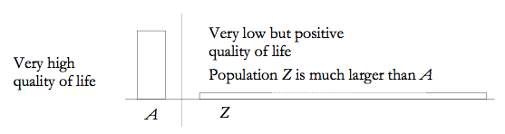
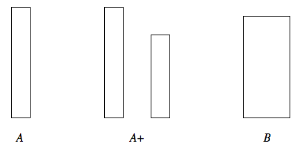

# The Repugnant Conclusion
**First published Thu Feb 16, 2006; substantive revision Mon Jan 16, 2017**

*Arrhenius, Gustaf, Ryberg, Jesper, Tännsjö, Torbjörn*

In Derek Parfit’s original formulation the Repugnant Conclusion is stated as follows: “For any possible population of at least ten billion people, all with a very high quality of life, there must be some much larger imaginable population whose existence, if other things are equal, would be better even though its members have lives that are barely worth living” (Parfit 1984)[^parfit-1984]. The Repugnant Conclusion highlights a problem in an area of ethics which has become known as *population ethics*. The last three decades have witnessed an increasing philosophical interest in questions such as “Is it possible to make the world a better place by creating additional happy people?” and “Is there a moral obligation to have children?” The main problem has been to find an adequate theory about the moral value of states of affairs where the number of people, the quality of their lives (or their life-time welfare or well-being—we shall use these terms interchangeably here), and their identities may vary. Since, arguably, any reasonable moral theory has to take these aspects of possible states of affairs into account when determining the normative status of actions, the study of population ethics is of general import for moral theory. As the name indicates, Parfit finds the Repugnant Conclusion unacceptable and many philosophers agree. However, it has been surprisingly difficult to find a theory that avoids the Repugnant Conclusion without implying other equally counterintuitive conclusions. Thus, the question as to how the Repugnant Conclusion should be dealt with and, more generally, what it shows about the nature of ethics has turned the conclusion into one of the cardinal challenges of modern ethics.

## 1. Arriving at the Repugnant Conclusion

Parfit is not the first philosopher to have noticed that influential moral views may have implications of the sort outlined in the Repugnant Conclusion. Henry Sidgwick was close to acknowledging the implication when he pointed out that “… the point up to which, on utilitarian principles, population ought to be encouraged to increase, is not that at which the average happiness is the greatest possible—as appears to be often assumed by political economists of the school of Malthus—but that at which the happiness reaches its maximum” (Sidgwick 1907 p. 418; for other early sources, see Broad 1930 pp. 249–250; McTaggart 1927 pp. 452–53; Narveson 1967)[^broad-1930][^mctaggart-1927][^narveson-1967][^sidgwick-1907]. However, it is Parfit who has brought the conclusion to recent philosophical attention both by stressing the importance of the conclusion and by showing how difficult it is to avoid it (Parfit 1984)[^parfit-1984].

Parfit was led to the Repugnant Conclusion by his considerations concerning how we ought to act in cases where our decisions have an impact on who will exist in the future. Consider the following two scenarios (see Parfit 1984 chapter 16)[^parfit-1984]:

1. A pregnant mother suffers from an illness which, unless she undergoes a simple treatment, will cause her child to have a permanent impairment which will cause significant suffering throughout the child’s life. If she receives the treatment and is cured her child will have no such impairment.
2. A woman suffers from an illness which means that, if she gets pregnant now, her child will have a permanent impairment which will cause significant suffering throughout the child’s life. If she postpones her pregnancy a few months until she has recovered, her child will have no such impairment.

What ought the women to do in the two cases? In case (1) the obvious answer is that the mother ought to undergo the treatment since her child will thereby get a better life. However, when we turn to case (2), it is problematic to appeal to the improved life of some child as the reason for taking action (i.e., postponing the pregnancy). If the woman postpones her pregnancy, then the child that is brought into existence will not be identical to the child she would have had, had she decided to become pregnant while she was ill (it will not be the same ovum and sperm that meet). Hence, the alternative for the child brought into existence during the mother’s illness is non-existence, and to claim that it would have been better for this child if the mother had postponed pregnancy is tantamount to claiming that the child’s non-existence would have been better for the child. Assuming that the child would have a life worth living, this seems wrong if not nonsensical. Indeed, in case (2), there are two hypothetical children and whether or not the mother postpones the pregnancy, neither child will have a “better life” as a result of the mother’s action. For both hypothetical children, the alternative is nonexistence. If the mother postpones her pregnancy while ill, the first child wouldn’t exist, and if she doesn’t postpone, the second child wouldn’t exist. (For a discussion, see Narveson 1967, Parfit 1984, appendix G; Adler 2012; Bykvist 2007c, 2015; Arrhenius & Rabinowicz 2015, McMahan 1981, 2009, 2013; Rabinowicz 2009; Holtug 2010; Fleurbaey & Voorhoeve 2015)[^adler-2012][^arrhenius-2015][^arrhenius-2015-2][^bykvist-2007c][^bykvist-2015][^fleurbaey-2015][^holtug-2010][^mcmahan-1981][^mcmahan-2009][^mcmahan-2013][^narveson-1967][^parfit-1984][^rabinowicz-2009].

How, if at all, should a change in the identity of the involved parties in the compared outcomes affect our moral evaluation? Parfit refers to this as “the Non-Identity Problem” (see the entry on the nonidentity problem). Following what would probably strike most people as the most plausible answer Parfit favors what he calls the “No-Difference View” (1984 p. 367), which implies that a change in identity should not affect the answer: the woman in case (2) ought to postpone her pregnancy, just as the woman in case (1) ought to undergo the treatment. A straightforward way of capturing the No-Difference View is total utilitarianism according to which the best outcome is the one in which there would be the greatest quantity of whatever makes life worth living (Parfit 1984 p. 387)[^parfit-1984]. However, this view implies that any loss in the quality of lives in a population can be compensated for by a sufficient gain in the quantity of a population; that is, it leads to the Repugnant Conclusion. Consider the following diagram:

*Figure 1*

The blocks above represent two populations, *A* and *Z*. The width of each block shows the number of people in the corresponding population, the height shows their quality of life or lifetime welfare. All the lives in the above diagram have lives worth living. People’s quality of life is much lower in *Z* than in *A* but, since there are many more people in *Z*, there is a greater quantity of welfare in *Z* as compared to *A*. Consequently, although the people in *A* lead very good lives and the people in *Z* have lives only barely worth living, *Z* is nevertheless better than *A* according to total utilitarianism. Thus, the attempt to provide a plausible solution to the Non-Identity Problem has led to a seemingly unacceptable conclusion.

Leaving the Non-Identity Problem aside, there are other arguments establishing that the Repugnant Conclusion is not easily avoided. Parfit has developed an argument to this effect. Consider the three population scenarios indicated in Fig. 2.

*Figure 2*

In population *A*, everybody enjoys a very high quality of life. In population *A*+ there is one group of people as large as the group in *A* and with the same high quality of life. But *A*+ also contains a number of people with a somewhat lower quality of life. In Parfit’s terminology *A*+ is generated from *A* by “mere addition”. Comparing *A* and *A*+ it is reasonable to hold that *A*+ is better than *A* or, at least, not worse. The idea is that an addition of lives worth living cannot make a population worse. Consider the next population *B* with the same number of people as *A*+, all leading lives worth living and at an average welfare level slightly above the average in *A*+, but lower than the average in *A*. It is hard to deny that *B* is better than *A*+ since it is better in regard to both average welfare (and thus also total welfare) and equality. However, if *A*+ is at least not worse than *A*, and if *B* is better than *A*+, then *B* is also better than *A* given full comparability among populations (i.e., setting aside possible incomparabilities among populations). By parity of reasoning (scenario *B*+ and *C*, *C*+ etc.), we end up with a population *Z* in which all lives have a very low positive welfare. Thus, the final conclusion is that *Z* is better than *A*, which is the Repugnant Conclusion. By what apparently constitute sound steps of reasoning we have arrived at an absurd conclusion. This is paradoxical. Thus, is ‘mere’ addition innocuous, as is here assumed? Well, if it is thought to be suspicious, there is a way of avoiding it by starting with a population like the one in *A* and adding new people living at a slightly lower level than the people in *A* in a manner that *increases* the well-being of existing people. You then proceed down the moral alphabet by levelling out the well-being between the best and worst off in a manner that gives more to those who are worst off than you take from those who are best off; in each step new people are added, in order to make this change of the situation possible (Parfit 1984; Tännsjö 2002)[^parfit-1984][^tännsjö-2002]. Moreover, there are other abstract arguments leading in the same direction, some of them presented by Parfit himself (see section 2.5 and 2.7). It seems then that the Repugnant Conclusion is very hard to get around.

The main challenge which Parfit presented in his celebrated work *Reasons and Persons* is to develop a theory of beneficence—theory X he calls it—which is able to solve the Non-Identity Problem, which does not lead to the Repugnant Conclusion and which thus manages to block the Mere Addition Paradox, without facing other unacceptable conclusions. However, Parfit’s own conclusion was that he had not succeeded in developing such a theory.

It might be tempting for people who have little sympathy with utilitarian thought to try to set the problems raised by the Repugnant Conclusion to the side, thinking that it constitutes a problem only for utilitarians. However, most people tend to believe that we have *some* obligation to make the world a better place, at least if we can do so without violating any deontological constraints, and at a not too high cost to ourselves. Clearly all who think along these lines, even without being utilitarians, are faced with the problem of the Repugnant Conclusion. We can assume that other values and considerations are not decisive for the choice between populations *A* and *Z* in Figure 1 (e.g., promises, rights). The Repugnant Conclusion is a problem for all moral theories which hold that welfare at least matters when all other things are equal.

## 2. Eight Ways of Dealing with the Repugnant Conclusion

Several philosophers have taken up the challenge from Parfit and have engaged in considerations as to what would constitute a satisfactory population ethics. Some theorists have done so by accepting the framework Parfit has set for the investigation; that is, they have carried on the work of developing an ethical theory that succeeds in meeting Parfit’s minimal requirements for adequacy. Other theorists have been less willing to accept the scenery as set by Parfit and have more or less radically challenged his requirements for a plausible theory. The Repugnant Conclusion has been placed at the centre of this discussion. The suggestions in the literature on how to deal with the Repugnant Conclusion can roughly be divided into eight categories: (1) introducing new ways of aggregating welfare into a measure of value; (2) questioning the way we can compare and measure welfare; (3) counting welfare differently depending on temporal or modal features; (4) revising the notion of a life worth living; (5) rejecting transitivity; (6) appeal to other values; (7) accepting the impossibility of a satisfactory population ethics; (8) accepting the Repugnant Conclusion.

### 2.1 Introducing new ways of aggregating welfare into a measure of value

#### 2.1.1 The average principle

One proposal that easily comes to mind when faced with the Repugnant Conclusion is to reject total utilitarianism in favor of a principle prescribing that the *average* welfare per life in a population is maximized. Average utilitarianism and total utilitarianism are extensionally equivalent in the sense that they yield the same ranking when the compared populations are of the same size. They may differ significantly in different-number cases, however. This is easily seen when the average approach is adopted in the comparison of the populations in Figure 1 and Figure 2. That the average well-being is all that matters implies that no loss in average well-being can be compensated for by a gain in total well-being. Thus in Figure 1, *A* is preferable to *Z*, i.e., the Repugnant Conclusion is avoided. In Figure 2, *A* is preferable to *A*+, i.e., the Mere Addition Paradox is blocked at the very first step.

Despite these advantages, average utilitarianism has not obtained much acceptance in the philosophical literature. This is due to the fact that the principle has implications generally regarded as highly counterintuitive. For instance, the principle implies that for any population consisting of very good lives there is a better population consisting of just one person leading a life at a slightly higher level of well-being (Parfit 1984 chapter 19)[^parfit-1984]. More dramatically, the principle also implies that for a population consisting of just one person leading a life at a very negative level of well-being, e.g., a life of constant torture, there is another population which is better even though it contains millions of lives at just a slightly less negative level of well-being (Parfit 1984)[^parfit-1984]. That total well-being should not matter when we are considering lives worth ending is hard to accept. Moreover, average utilitarianism has implications very similar to the Repugnant Conclusion (see Sikora 1975; Anglin 1977)[^anglin-1977][^sikora-1975].

#### 2.1.2 Variable value principles

An attempt to produce a compromise between a total principle and an average principle is provided by a variable value principle. The idea behind this view is that the value of adding worthwhile lives to a population varies with the number of already existing lives in such a way that it has more value when the number of these lives is small than when it is large (Hurka 1983, Ng 1989; Sider 1991)[^hurka-1983][^sider-1991]. Taking this view, Noah’s obligation to procreate after the Deluge was much stronger than our obligation today. Variable value principles are sometimes called “compromise theories” since they can be said to be a compromise between total and average utilitarianism (for a version that is sensitive to more aspects regarding welfare, see Temkin 1997, 2012)[^temkin-1997][^temkin-2012]. With small populations enjoying high welfare, a variable value principle behaves like total utilitarianism and assigns most of the value to the total sum of welfare. For large populations with low welfare, the principle mimics average utilitarianism and assigns most of the value to average welfare. This property is what makes it possible to avoid the Repugnant Conclusion. If the value of extra lives decreases asymptotically, then there may exist an upper limit to the total value of a population (exactly as the sum of the infinite series 1+1/2+1/4+ … has the upper limit 2). As long as population *A* in Fig. 1 has a total value above this limit this population will be preferable no matter how populous the low quality population *Z* is (Hurka 1983, Ng 1989; Sider 1991; Temkin 1997, 2012)[^hurka-1983][^sider-1991][^temkin-1997][^temkin-2012].

Depending on how precisely various different value principles are worked out they have different implications, which critics have regarded as devastating. For instance, on Ng’s explication of this view (Ng 1989) according to which the value of a population is determined by the product of the average welfare and a concave transformation of the number of lives, it follows that it can be better to add people with negative welfare rather than positive welfare to a population. More exactly, Ng’s theory implies the “Sadistic Conclusion” (Arrhenius 2000a)[^arrhenius-2000a]: For any number of lives with any negative welfare (e.g. tormented lives), there are situations in which it would be better to add these lives rather than some number of lives with positive welfare. Moreover, even if it might be reasonable to hold that the value of extra lives with positive welfare decreases asymptotically towards a limit, the analogous assumption about lives with negative welfare isn’t very attractive. Hence, given the reasonable assumption that the negative value of adding extra lives with negative welfare does not decrease relatively to population size, a proportional expansion in the population size can turn a good population into a bad one—a version of the so-called “Absurd Conclusion” (Parfit 1984)[^parfit-1984]. A population of one million people enjoying very high positive welfare and one person with negative welfare seems intuitively to be a good population. However, since there is a limit to the positive value of positive welfare but no limit to the negative value of negative welfare, proportional expansions (two million lives with positive welfare and two lives with negative welfare, three million lives with positive welfare and three lives with negative welfare, and so forth) will in the end yield a bad population.

#### 2.1.3 Critical level principles

Another way of modifying total utilitarianism is to introduce a critical level (Kavka 1982, Parfit 1984; Locke 1984; Blackorby *et al*. 1997, 2004, 2005; Broome 2004)[^blackorby-1997][^blackorby-2004][^blackorby-2005][^broome-2004][^kavka-1982][^parfit-1984]. As is the case with the variable value view, a critical level view is based on a split between prudential and moral value. However, in this case the split is even more radical. The idea is that a person’s life contributes positively to the value of a population only if the quality of the person’s life is above a certain positive critical level. Below this level the contributive value of a life is neutral (Kavka 1982)[^kavka-1982], negative (Blackorby *et al.* 1997, 2004, 2005; cf. Feldman’s theory below)[^blackorby-1997][^blackorby-2004][^blackorby-2005], or introduces incommensurability or vagueness in the ordering of populations (Blackorby *et al.* 2005; Broome 2004; Rabinowicz 2009; cf. Parfit 2016)[^blackorby-2005][^broome-2004][^parfit-2016][^rabinowicz-2009], even though the person leads a life worth living. In its simplest form, the critical level view is a modified version of total utilitarianism. The contributive value of a person’s life is her welfare minus a positive critical level. The value of a population is calculated by summing these differences for all individuals in the population. The critical level view thereby succeeds in avoiding the Repugnant Conclusion. Assuming the critical level is higher than the individual welfare levels in population *Z*, the Repugnant Conclusion is blocked since the value of *Z* is negative, and thus worse than *A*, according to the critical level view.

An obvious challenge to critical level thinking is to make clear what constitutes the appropriate critical level. On the one hand, the level has to be high enough to avoid versions of the Repugnant Conclusion; on the other, the level has to be low enough not to rule out additions of clearly good lives (for an attempted answer to this challenge see Blackorby *et al.* 1997; Broome 2004)[^blackorby-1997][^broome-2004]. Critics have also been sceptical to the idea that the addition of lives worth living (albeit below the critical level) contribute negatively to the value of a population. Finally, it has been shown that this view leads to the Sadistic Conclusion (see above).

### 2.2 Questioning the way we can compare and measure welfare

The Repugnant Conclusion may seem to rely on a certain view about welfare. It treats welfare on an additive scale, where low numbers, if added to themselves often enough, must become larger than any initial larger number. This is like the Archimedean property of the real numbers: For any positive numbers *x* and *y*, there is a natural number *n* such that *nx* is greater than *y*. Any finite number of lives in population *A* can therefore be outweighed by a sufficiently large number of lives in *Z* because the gain in the quantity of lower values outweighs the loss of certain higher values. However, some theorists—including Parfit—have suggested that this axiological assumption is mistaken. (Parfit 1986, 2016; Griffin 1986; Rachels 2001; Crisp 1988, 1992; Glover 1977; Edwards 1979; Lemos 1993; Skorupski 1999; Klint Jensen 1996; Portmore 1999; Riley 1993, 1999, 2008, 2009)[^crisp-1988][^crisp-1992][^edwards-1979][^glover-1977][^griffin-1986][^klint-1996][^lemos-1993][^parfit-1986][^parfit-2016][^portmore-1999][^rachels-2001][^riley-1993][^riley-1999][^riley-2008][^riley-2009]. The idea is that one type of good α can be superior to another type of good β, in the sense that any amount of α is better than any amount of β or that some amount of α is better than any amount of β. Suppose that what happens as we move down the alphabet from the high-quality population *A* to the low-quality population *Z* is that the best things in life are gradually lost. For instance, as Parfit has suggested, the first step from *A* to *B* involves the loss of Mozart’s music; in the move from *B* to *C* Haydn’s music is lost; in the move to *D* Venice is destroyed; and so on down the alphabet. All that is left in the final move to *Z* is “muzak and potatoes”. The claim is that the lives in the beginning of the sequence involve goods that are superior to the goods involved in the lives at the end of the sequence. The loss of the most worthwhile things in life cannot be compensated for by any gain in the quantity of muzak and potatoes. Consequently, whatever the number of people in population *Z*, there will be less welfare, or less valuable welfare, in this world as compared to population *A* and thus the Repugnant Conclusion is blocked.

This suggested way of blocking the Repugnant Conclusion obviously presupposes that the superiority view is justified in the first place (for a recent effort, see Parfit 2016)[^parfit-2016]. However, even if this is the case, critics have suggested that this view may still be consistent with some versions of the Repugnant Conclusion (e.g., Ryberg 1996b)[^ryberg-1996b]. Moreover, the superiority view has other implications that might be hard to accept. Assume that there are days of different qualities and that these can be arranged in a descending sequence of goodness or how much they would contribute to the well-being of a life. It seems plausible that there can be such a sequence where the difference in quality of any two adjacent days in the sequence is marginal. For example, consider two days of a life that only differ in respect to one pin-prick in the left thumb. Assume now, as Parfit suggests, that there are days of such quality that some number of these are better than any number of days eating potatoes and listening to muzak. One can then show (Arrhenius 2005; Klint Jensen 2008)[^arrhenius-2005][^klint-2008] that there must be two types of days, call them α-days and β-days, such that some number of α-days is better than any number of β-days although the difference in quality between these days is only marginal.

### 2.3 Counting welfare differently depending on temporal or modal features

Another approach to the problems in population ethics has been the suggestion that the crux of the problem resides in an all too “impersonal” morality and that the problems of population ethics can be solved by a shift to a so-called “person-affecting” morality (Narveson 1967, 1976, 1978; Roberts 1998, 2002, 2004, 2007, 2011)[^narveson-1967][^narveson-1976][^narveson-1978][^roberts-1998][^roberts-2002][^roberts-2004][^roberts-2007][^roberts-2011]. This move has been especially popular in the context of medical ethics where many of the problems of population ethics are actualised. Examples are embryo or egg selection, pre-implantation genetic testing, assisted reproduction programs, abortion, to mention just a few. The idea behind this approach is the contention—sometimes referred to as “the person-affecting restriction” or simply “the slogan”—that an outcome can only be better (or worse) than another if it is better (or worse) for someone (Narveson 1967: Glover 1977; Temkin 1993a)[^glover-1977][^narveson-1967][^temkin-1993a]. If a quite strict interpretation of this restriction is combined with the assumption that non-existence and existence are incomparable in value for a person, we may derive a view called *comparativism*: We should disregard the welfare of uniquely realisable people, that is, people who only exist in one of the compared outcomes (Heyd 1988; Bykvist 1998)[^bykvist-1998]. A person-affecting morality so understood deviates from impersonal morality in important respects. If there is an overlap between the populations in *A* and *Z*, then *A* is ranked as better than *Z* since the people existing in both populations are worse off in *Z* as compared to *A* and since we should disregard the welfare of uniquely realisable people. However, if there are different people in the involved populations, such as two future populations, then the two populations are ranked as equally good or as incomparable in value, which is not a very satisfactory solution to the Repugnant Conclusion. Moreover, comparativism implies that any very huge loss in welfare for uniquely realisable people is compensated by any very small gain for non-uniquely realisable people. Less strict interpretations of the person-affecting restriction and comparativism can to a certain extent avoid these problems, but at the price of implying the Repugnant Conclusion again (Arrhenius 2009a; Holtug 2004)[^arrhenius-2009a][^holtug-2004].

The comparativist interpretation of the distinction between “impersonal” and “person-affecting” theories is not the only one proposed in the literature. What the different theories that have been proposed under the banner of a person-affecting morality have in common, however, are that they are welfarist theories that count people’s welfare differently depending on the temporal location or the modal features of their lives. Apart from comparativists, we have *presentists* who draw a distinction between presently existing people and non-existing people (Narveson 1973; Heyd 1988); *necessitarians* who distinguish between people who exist or will exist irrespective of how we act and people whose existence is contingent on our choices (Singer 1993)[^singer-1993]; and *actualists* who differentiate between people that have existed, exist or who are going to exist in the actual world, on the one hand, and people who haven’t, don’t, and won’t exist, on the other (Bigelow and Pargetter 1988; Warren 1978; Parson 2002; for a critical discussion of actualism, see Carlson 1995; Arrhenius 2000b; Bykvist 1998, 2007b; Hare 2007; Howard-Snyder 2008)[^arrhenius-2000b][^bigelow-1988][^bykvist-1998][^bykvist-2007b][^carlson-1995][^hare-2007][^howard-snyder-2008][^parson-2002][^warren-1978]. These theories, apart from problems of their own, run into problems analogous to the problems of comparativism discussed above. For instance, presentism, in its strict guise according to which we only take into account the welfare of presently existing people, implies that any very small gain for present people outweighs any loss for future people, irrespective of how big it is. Again, a less strict interpretation of presentism (Dasgupta 1988, 1994)[^dasgupta-1988][^dasgupta-1994] can to a certain extent avoid this and related problems, but at the price of implying the Repugnant Conclusion again.

Actually, it is unclear whether presentism, necessitarianism, or actualism can escape any of the problems discussed above in connection with “impersonal” theories, and in particular the Repugnant Conclusion. For example, assume that *A* is a population of present people (for example, the present people in country *x*) enjoying very high welfare and that *B* is a larger population of present people (for example, the present population in country *y*) with very low welfare but with higher total welfare than *A*. Which population is the better one according to presentism? It all depends on which method the presentist selects for determining better, worse and equally good in regard to the welfare of present people. Since this case involves only present people, all the problems discussed above will reappear in the search of this method. Likewise for necessitarianism and actualism. Moreover, the restriction might not help us avoid the Repugnant Conclusion but rather imply it given some other attractive conditions (Arrhenius 2015)[^arrhenius-2015][^arrhenius-2015-2].

### 2.4 Revising the notion of a life worth living

The above discussion of the Repugnant Conclusion presumes that there are possible lives with a very high quality of life. However, Christoph Fehige (1998) and David Benatar (2006) have suggested that there are no lives enjoying positive welfare. Benatar claims that it is always worse for a person to begin to exist than never to have existed. According to Fehige, only frustrated preferences count, and they count negatively, whereas satisfied preferences have no positive value. These “Schopenhauerian” theories imply that there are no possible lives with positive welfare. On the contrary, most lives have negative welfare and the best possible lives only have neutral welfare.

Would the truth of such a theory of welfare make the Repugnant Conclusion acceptable? Yes in a way, since it would neutralise the Repugnant Conclusion by making it an empty truth. If there are no possible lives with a very high quality of life, then the Repugnant Conclusion is vacuously true, since the antecedent—“[f]or any possible population … with a very high quality of life”—is false of every possible population. Consequently, total utilitarianism would only imply the Repugnant Conclusion in a trivial and uninteresting sense.

However, the logic of Benatar’s theory has been challenged (Bradley 2010)[^bradley-2010] and a theory of welfare that denies the possibility of lives worth living is quite counter-intuitive (Ryberg 1996a)[^ryberg-1996a]. Fehige’s theory, for example, implies that a life of one year with complete preference satisfaction has the same welfare as a completely fulfilled life of a hundred years, and has higher welfare than a life of a hundred years with all preferences but one satisfied. Moreover, the last life is not worth living.

### 2.5 Rejecting transitivity

What makes the Repugnant Conclusion so perplexing is that strong arguments can be given which apparently force one into accepting the conclusion. In fact, several arguments to this effect—with affinity to the mere addition reasoning outlined above—have been presented (see e.g. Parfit 1986; Arrhenius 2000b; Kitcher 2000; Tännsjö 2002; Rachels 2004)[^arrhenius-2000b][^kitcher-2000][^parfit-1986][^rachels-2004][^tännsjö-2002]. Roughly, the arguments share the following structure: in comparison between three population scenarios the second scenario is considered better than the first and the third better than the second, leading to the conclusion that the third scenario is better than the first. By iterated application of this line of reasoning one ends up with the Repugnant Conclusion (that *Z* is better than *A*). One of the more radical approaches to such arguments has been to reject the transitivity of the relation “better than” (or “equally as good as”). According to transitivity, if *p* is better than *q*, and *q* is better than *r*, then *p* is better than *r*. However, if transitivity of “better than” is denied then the reasoning leading the Repugnant Conclusion is blocked (Temkin 1987, 2012; Persson 2004; Rachels 2004)[^persson-2004][^rachels-2004][^temkin-1987][^temkin-2012].

One of the questions raised by this radical proposal is whether arguments like the mere addition paradox themselves justify the rejection of transitivity or whether further arguments are needed since transitivity seems to be part of the meaning and logic of the relation “better than” (Broome 2004)[^broome-2004]. However, it has been suggested that there are two “better than”-concepts, one based on intrinsic value and one based on the stance that one ought to take towards the evaluated objects (Arrhenius 2004; Rabinowicz 2012)[^arrhenius-2004][^rabinowicz-2012]. The former is transitive in virtue of its meaning whereas the latter is non-transitive over different alternative sets, just like “ought to be chosen”. Moreover, Temkin (2012) argues that it is the latter “better than”-concept which is the important one for practical reasoning. This raises the question of the more general implications of this proposal for morality and practical reasoning and some worry that giving up the transitivity of “better than” would demand a major revision of our notion of practical reasoning (Temkin 1987, 2012)[^temkin-1987][^temkin-2012]. A transitive preference ordering has usually been assumed as part of the definition of a rational agent in economic and rational choice theory. For example, it seems that an agent with a non-transitive preference ordering can be exploited by a so-called ‘money-pump’ (see Section 5.1 of the entry on the philosophy of economics). The main problem with non-transitive value orderings in moral theory, however, is that such an ordering cannot form the basis of a satisfactory answer to the question of what one ought to choose. Coupled with the standard formulation of consequentialism (an action is right if and only if its outcome is at least as good as the outcomes of all the alternative actions, see the entry on consequentialism), for example, we get the counterintuitive result that no action is right in the mere addition paradox. Moreover, it has been shown that the mere addition argument and the like can be reconstructed on the normative level, in terms of what one ought to choose, without an appeal to transitivity (Arrhenius 2004)[^arrhenius-2004]. Instead of a non-transitive ordering of populations, one gets a situation in which all of the available actions are forbidden, i.e., a moral dilemma. Hence, it doesn’t look like we can exorcise the paradoxes of population ethics by giving up some formal condition like the transitivity of “better than”.

### 2.6 Appeal to other values

Fred Feldman has proposed a desert-adjusted version of utilitarianism, ‘justicism’ which he claims avoids the Repugnant Conclusion (Feldman 1997)[^feldman-1997]. In justicism, the value of an episode of pleasure is determined not only by the hedonic level but also by the recipient’s desert level. Feldman’s proposal is that there is some level of happiness that people deserve merely in virtue of being people. He assumes that this level corresponds to 100 units of pleasure and that people with very low welfare enjoy only one unit of pleasure. He suggests that the life of a person who deserves 100 units of pleasure and receives exactly that amount of pleasure has an intrinsic value of 200, whereas the life of a person deserving 100 units but who only receives one unit of pleasure has an intrinsic value of −49. It follows that any population consisting of people with very low welfare and desert level 100 has negative value, whereas any population with very high welfare has positive value. Consequently, it seems as if justicism avoids the Repugnant Conclusion. Moreover, the intuition behind Feldman’s explanation of the unacceptability of the Repugnant Conclusion—that there is some level of welfare that people deserve merely in virtue of being people—is compelling and probably widely shared and could give support to ideas such as the critical level view discussed above.

It has been pointed out, however, that Feldman’s reasoning involves a questionable interpretation of the *ceteris paribus* clause in the repugnant conclusion (Arrhenius 2003)[^arrhenius-2003]. He implicitly assumes that the *ceteris paribus* clause is satisfied whenever the people in the compared populations have the same desert level. A more plausible reading of the *ceteris paribus* clause is that it is satisfied if and only if the compared populations are (roughly) equally good in regard to all other axiologically relevant aspects apart from welfare, including their “desert value”. Hence, to satisfy the *ceteris paribus* clause, the compared populations should be equally good in regard to desert, that is, equally good in regard to the contributive value of the fit between what people deserve and what they get. Given this interpretation of the *ceteris paribus* clause, justicism does imply the repugnant conclusion. If *A* and *Z* are equally good in regard to desert, then justicism ranks *Z* as better than *A* since *Z* has greater total well-being.

One might also try to solve the Mere Addition Paradox by an appeal to egalitarian considerations. Consider populations *A* and *A*+ in figure 2 again. According to a well-known principle, Maximin, we should rank populations according to the welfare of the worst off: The lower the welfare of the worst off, the worse the population. Maximin ranks *A*+ as worse than *A* and thus stops the Mere Addition Paradox in its first step. However, Maximin has a number of other counterintuitive implications in population ethics since it imposes a kind of dictatorship of the worst off according to which the slightest gain in welfare for one of the worst off person outweighs a very large loss for any number of better off people.

Still, *A*+ is clearly more unequal than *A*, and it isn’t unreasonable to claim that *A*+ is in this respect worse than *A*. For example, according to Temkin (1993a, p. 200), “the ultimate intuition underlying egalitarianism is that it is bad … for some to be worse off than others through no fault of their own”. Clearly, this is the case in *A*+ since the extra people have not done anything to deserve to be worse off than the better off people. Moreover, as suggested by Temkin, one might hold the view that the greater the number of worst off, the worse the inequality. (Temkin 1993a, p. 200–2)[^temkin-1993a]. Consequently, since the number of worse off extra people in the Mere Addition Paradox has to be enormous to reach the *Z* population (see figure 1) by redistribution of welfare, the inequality involved would be considerable. Hence, there seems to be a prima facie case that egalitarian concerns can solve the Mere Addition Paradox.

The crucial question, however, is whether inequality makes *A*+ worse than *A* all things considered. Since *A*+ is clearly better than *A* in respect to total welfare, the pluralist egalitarian has to limit the importance of total welfare relative to the importance of inequality to reach this judgement. There are some promising ways the pluralist egalitarian could do this albeit it is as yet unclear whether these proposals will stand up to further scrutiny. More problematic for the egalitarian approach, however, is that the Repugnant Conclusion can be derived from conditions to which an egalitarian has no decisive objections (Tännsjö 2008; Arrhenius 2009b)[^arrhenius-2009b][^tännsjö-2008].

### 2.7 Accepting the impossibility of a satisfactory population ethics

Even though Parfit, despite his thorough investigations in *Reasons and Persons*, did not succeed in finding the sought-after ethical Theory X that would avoid the Repugnant Conclusion and other equally unattractive conclusions, this did not seem to destroy his hopes that such a theory could be found (Parfit 1984 p. 451)[^parfit-1984]. However, other theorists have regarded the search for this theory as having more gloomy prospects. This pessimism has been given a more formal content. It has been held that it can be proven that there is no population ethics that satisfies a set of apparently plausible adequacy conditions on such a theory. In fact, several such proofs have been suggested (Arrhenius 2000b, 2011)[^arrhenius-2000b][^arrhenius-2011]. What such a theorem would show about ethics is not quite clear. Arrhenius has suggested that an impossibility theorem leaves us with three options: (1) to abandon some of the conditions on which the theorem is based; (2) to become moral sceptics; or (3) to try to explain away the significance of the proofs—alternatives which do not invite an easy choice (cf. Temkin 2012)[^temkin-2012].

### 2.8 Accepting the Repugnant Conclusion

When confronted with the Repugnant Conclusion, many share the view that the conclusion is highly counterintuitive. However, it has been suggested that it is premature to conclude from this that the conclusion is morally unacceptable. Two sorts of reasons can be given in favor of the view that the conclusion should be accepted. According to the first, while it is correct that the conclusion is counterintuitive, there are nevertheless certain theoretical considerations outweighing this intuition to such an extent that we should accept it. The claim that no plausible theory can avoid the Repugnant Conclusion or that the rejection of the conclusion would force one into rejecting claims which it is hard to get around—e.g. such as the premises of the Mere Addition Paradox—may constitute such considerations (Tännsjö 2002; Holtug 2004; Huemer 2008)[^holtug-2004][^huemer-2008][^tännsjö-2002]. According to the second, the source of the unacceptability of the conclusion is the fact that we are deluded by our intuition (Sikora 1978, 2004; Mackie 1985; Tännsjö 1992, 1998, 2002; Hare 1993; Ryberg 1996a, 2004)[^hare-1993][^mackie-1985][^ryberg-1996a][^ryberg-2004][^ryberg-2004-2][^ryberg-2004-3][^sikora-1978][^sikora-1978-2][^tännsjö-1992][^tännsjö-1998][^tännsjö-2002]. Once we fully understand what the conclusion amounts to, we will cease to find it counterintuitive. For instance, it might be suggested that the repugnance, at least partly, is due to our limited apprehension of large numbers (Tännsjö 2002; Broome 2004)[^broome-2004][^tännsjö-2002]. We cannot imagine what it would be like for there to exist billions upon billions of people, and hence our intuition is not based on a sound picture of the moral significance of population *Z* (for a critical discussion of these kind of arguments, see Temkin 2012 and Pummer 2013)[^pummer-2013][^temkin-2012]. Moreover, several theorists have suggested that our intuition is misguided by a misapprehension of what it is like to lead a life in *Z*, i.e., a life that is barely worth living. The idea is that once we realize that such a life is not terrible but perhaps a life not much different from a normal privileged one, the conclusion loses its sting (Mackie 1985; Tännsjö 1992; Ryberg 1996a)[^mackie-1985][^ryberg-1996a][^tännsjö-1992]. Thus, on both views, though population ethics may constitute a complicated area of ethical research, it is at least devoid of what is traditionally regarded as one of the cardinal challenges.

However, this conclusion might not be much of a comfort since there are other impossibility results that do not rely on avoidance of the Repugnant Conclusions as one of its adequacy conditions but on avoidance of the intuitively even more unacceptable Very Repugnant Conclusion: For any perfectly equal population with very high positive welfare, and for any number of lives with any very negative welfare, there is a population consisting of the lives with negative welfare and lives with very low positive welfare which is better than the high welfare population, other things being equal (Arrhenius 2011)[^arrhenius-2011]. This conclusion seems much harder to accept than the Repugnant Conclusions. Here we are comparing one population where everybody enjoys very high quality of life with another population where people either have very low positive welfare or very negative welfare (any level of horrible suffering). Even if we were to accept the Repugnant Conclusion, we are not forced to accept the Very Repugnant Conclusion. We might, for example, accept the former but not the latter because we give greater moral weight to suffering than to happiness. Hence, to exorcise the paradoxes of population ethics, it is not sufficient to show that our intuition about the Repugnant Conclusion is wrong or epistemically unreliable. We also have to show that this is true of the Very Repugnant Conclusion, which might strike many as quite a tall order.

## References（引用注释）

> 原文参考文献已转为脚注引用：文内“作者-年份”引用组后附 [^key] 标记，完整条目见本文末脚注定义。

## Academic Tools

> |   | [How to cite this entry](https://plato.stanford.edu/cgi-bin/encyclopedia/archinfo.cgi?entry=repugnant-conclusion). |
> | --- | --- |
> |   | [Preview the PDF version of this entry](https://leibniz.stanford.edu/friends/preview/repugnant-conclusion/) at the [Friends of the SEP Society](https://leibniz.stanford.edu/friends/). |
> |   | [Look up topics and thinkers related to this entry](https://www.inphoproject.org/entity?sep=repugnant-conclusion&redirect=True) at the Internet Philosophy Ontology Project (InPhO). |
> |   | [Enhanced bibliography for this entry](https://philpapers.org/sep/repugnant-conclusion/) at [PhilPapers](https://philpapers.org/), with links to its database. |

## Other Internet Resources

[Please contact the author with suggestions.]

## Related Entries

consequentialism | desert | economics: philosophy of | economics [normative] and economic justice | ethics: environmental | justice: intergenerational | nonidentity problem | practical reason | Sidgwick, Henry | value: intrinsic vs. extrinsic | well-being

### Acknowledgments

The editors would like to thank Fairley Cessna for noticing a number of typographical errors in this entry and for taking the time to write to us about them.

[^adler-2012]: Adler, M., 2012, *Well-Being and Fair Distribution: Beyond Cost-Benefit Analysis*, Oxford: Oxford University Press.

[^anglin-1977]: Anglin, B., 1977, “The Repugnant Conclusion,” *Canadian Journal of Philosophy*, 7 (4): 745–754.

[^arrhenius-2000a]: Arrhenius, G., 2000a, “An Impossibility Theorem for Welfarist Axiology”, *Economics and Philosophy*, 16: 247–266.

[^arrhenius-2000b]: –––, 2000b, *Future Generations: A Challenge for Moral Theory*, F.D. Dissertation, Uppsala: University Printers.

[^arrhenius-2003]: –––, 2003, “Feldman’s Desert-Adjusted Utilitarianism and Population Ethics”, *Utilitas*, 15 (2): 225–236.

[^arrhenius-2004]: –––, 2004, “The Paradox of Future Generations and Normative Theory”, in J. Ryberg and T. Tännsjö (eds.) 2004.

[^arrhenius-2005]: –––, 2005, “Superiority in Value”, *Philosophical Studies*, 123 (1-2): 97–114; reprinted in M. Zimmerman and T. Rønnow-Rasmussen (eds.), *Recent Work on Intrinsic Value*, Dordrecht: Springer, 2006.

[^arrhenius-2009a]: –––, 2009a, “Can the Person Affecting Restriction Solve the Problems in Population Ethics?” in M. Roberts & D. Wassermand (eds.) 2009.

[^arrhenius-2009b]: –––, 2009b, “Egalitarianism and Population Change” in A. Gosseries & L. Meyer (eds.) 2009.

[^arrhenius-2011]: –––, 2011, “The Impossibility of a Satisfactory Population Ethics” in H. Colonius & E. Dzhafarov (eds.) 2011.

[^arrhenius-2015]: –––, 2015, “The Affirmative Answer to the Existential Question and the Person Affecting Restriction,” in I. Hirose and A. Reisner (eds.), *Weighing and Reasoning*, Oxford: Oxford University Press, 110–128.

[^arrhenius-2015-2]: Arrhenius, G. & Rabinowicz, W., 2015, “The Value of Existence,” in I. Hirose and J. Olson (eds.), *Oxford Handbook of Value Theory*, Oxford: Oxford University Press, 424–444.

[^bayles-1975]: Bayles, M.D., 1975–76, “Harm to the Unconceived”, *Philosophy and Public Affairs*, 5: 292–304.

[^bayles-1980]: –––, 1980, *Morality and Population Policy*, Tuscaloosa: University of Alabama Press.

[^benatar-2006]: Benatar, D., 2006, *Better Never to have Been: The Harm of Coming into Existence*, Oxford: Oxford University Press.

[^bigelow-1988]: Bigelow, J., and Pargetter, R., 1988 “Morality, Potential Persons and Abortion”, *American Philosophical Quarterly*, 25 (2): 173–81.

[^blackorby-1997]: Blackorby, C., W. Bossert and D. Donaldson, 1997, “Critical Level Utilitarianism and the Population-ethics Dilemma”, *Economics and Philosophy*, 13: 197–230.

[^blackorby-2004]: –––, 2004, “Critical-Level Population Principles and the Repugnant Conclusion”, in J. Ryberg and T. Tännsjö (eds.) 2004.

[^blackorby-2005]: –––, 2005, *Population Issues in Social Choice Theory, Welfare Economics, and Ethics*, Cambridge: Cambridge University Press.

[^blackorby-1984]: Blackorby, C., and D. Donaldson, 1984, “Social Criteria for Evaluating Population Change”, *Journal of Public Economics*, 25: 13–33.

[^boonin-vail-1996]: Boonin-Vail, D., 1996, “Don’t Stop Thinking About Tomorrow: Two Paradoxes About Duties to Future Generations”, *Philosophy and Public Affairs*, 25 (4): 267–307.

[^bradley-2010]: Bradley, B., 2010, “Benatar and the Logic of Betterness,” *Journal of Ethics and Social Philosophy*, March: 1–5; [available online](http://www.jesp.org/articles/download/BenataronBetternessNote.pdf).

[^broad-1930]: Broad, C. D., 1930 (1979), *Five Types of Ethical Theory*, London: Routledge and Kegan Paul.

[^broome-1992]: Broome, J., 1992, *Counting the Cost of Global Warming*, Cambridge: The White Horse Press.

[^broome-1999]: –––, 1999, *Ethics out of Economics*, Cambridge: Cambridge University Press.

[^broome-2004]: –––, 2004, *Weighing Lives*, Oxford: Oxford University Press.

[^broome-2005]: –––, 2005, “Should We Value Population?,”*The Journal of Political Philosophy* 13 (4): 399–413

[^bykvist-1998]: Bykvist, K., 1998, *Changing Preferences: A Study in Preferentialism*, F.D. Dissertation, Uppsala University.

[^bykvist-2007]: –––, 2007, “The Good, the Bad, and the Ethically Neutral,” *Economics and Philosophy*, 23: 97–105.

[^bykvist-2007b]: –––, 2007b, “Violations of Normative Invariance: Some Thoughts on Shifty Oughts,” *Theoria*, 73: 98–120.

[^bykvist-2007c]: –––, 2007c, “The Benefits of Coming into Existence,” *Philosophical Studies*, 135 (3): 335–362.

[^bykvist-2015]: –––, 2015, “Being and Wellbeing,” in I. Hirose and A. Reisner (eds.), *Weighing and Reasoning*, Oxford: Oxford University Press, 87–94.

[^carlson-1995]: Carlson, E., 1995, *Consequentialism Reconsidered*, Dordrecht: Kluwer Academic Publisher.

[^carlson-1998]: –––, 1998, “Mere Addition and Two Trilemmas of Population Ethics,” *Economics and Philosophy*, 14: 283–306.

[^colonius-2011]: Colonius, H. & Dzhafarov, E. (eds.), 2011, *Descriptive and Normative Approaches to Human Behavior*, Advanced Series on Mathematical Psychology, Singapore: World Scientific Publishing Company.

[^crisp-1988]: Crisp, R., 1988, *Ideal Utilitarianism: Theory and Practice*, D. Phil. Dissertation, University of Oxford.

[^crisp-1992]: –––, 1992, “Utilitarianism and the Life of Virtue”, *The Philosophical Quarterly*, 42: 139–160.

[^dasgupta-1988]: Dasgupta, P., 1988, “Lives and Well-Being”, *Social Choice and Welfare*, 5: 103–126.

[^dasgupta-1994]: –––, 1994, “Savings and Fertility: Ethical Issues”, *Philosophy & Public Affairs*, 23: 99–127.

[^edwards-1979]: Edwards, R. B., 1979, *Pleasures and Pains: A Theory of Qualitative Hedonism*, New York: Cornell University Press.

[^fehige-1998]: Fehige, C., 1998, “A Pareto Principle for Possible People”, in C. Fehige and U. Wessels, eds., *Preferences*, Berlin: Walter de Gruyter, 508–543.

[^fehige-1998-2]: Fehige, C. and U. Wessels: 1998, “Preferences—An Introduction”, in C. Fehige and U. Wessels, eds., *Preferences*, Berlin: Walter de Gruyter, xx–xliii.

[^feldman-1995]: Feldman, F., 1995, “Justice, Desert, and the Repugnant Conclusion”, *Utilitas*, 7: 189–206.

[^feldman-1997]: –––, 1997, *Utilitarianism, Hedonism, and Desert: Essays in Moral Philosophy*, Cambridge: Cambridge University Press.

[^fleurbaey-2015]: Fleurbaey, M. & Voorhoeve, A., 2015, “On the Social and Personal Value of Existence,” in I. Hirose and A. Reisner (eds.), *Weighing and Reasoning*, Oxford: Oxford University Press, 95–109.

[^glover-1977]: Glover, J., 1977, *Causing Death and Saving Lives*, UK: Penguin Books.

[^glover-1992]: –––, 1992, “Future People, Disability, and Screening”, in P. Laslett and J.S. Fishkin (eds.), *Justice Between Age Groups and Generations*, New Haven: Yale University Press, 127–14

[^gosseries-2009]: Gosseries, A. & Meyer, L. (eds.), 2009, *Intergenerational Justice*, Oxford: Oxford University Press.

[^griffin-1986]: Griffin, J., 1986, *Well-Being: Its Meaning, Measurement, and Moral Importance*, Oxford: Clarendon Press.

[^hanser-1990]: Hanser, M., 1990, “Harming Future People”, *Philosophy and Public Affairs*, 19: 47–70.

[^hare-2007]: Hare, C., 2007, “Voices from Another World: Must We Respect the Interests of People Who Do Not, and Will Never, Exist?,” *Ethics*, 117: 498–523.

[^hare-1993]: Hare, R., 1993, “Possible People” in his *Essays on Bioethics*, Oxford: Clarendon Press, 67–83.

[^heller-1997]: Heller, J. C., & N. Fotion (eds.), 1997, *Contingent Future Persons*, Dordrecht: Kluwer Academic Publishers.

[^heyd-1989]: Heyd, D., 1989, “Procreation and Value: Can Ethics Deal With Futurity Problems?”, *Philosophia*, 18: 151–170.

[^heyd-1992]: –––, 1992, *Genethics. Moral Issues in the Creation of People*, Berkeley: University of California Press.

[^holtug-2004]: Holtug, N., 2004, “Person-Affecting Moralities,” in J. Ryberg and T. Tännsjö (eds.) 2004, 129–162.

[^holtug-2010]: –––, 2010, *Persons, Interests, and Justice*, Oxford: Oxford University Press.

[^howard-snyder-2008]: Howard-Snyder, F., 2008, “Damned If You Do; Damned If You Don’t!,” *Philosophia*, 36: 1–15.

[^hudson-1987]: Hudson, J. L., 1987, “The Diminishing Marginal Value of Happy People,” *Philosophical Studies*, 51: 123–137.

[^huemer-2008]: Huemer, M., 2008, “In Defence of Repugnance,” *Mind*, 117 (468): 899–933.

[^hurka-1983]: Hurka, T., 1983, “Value and Population Size”, *Ethics*, 93: 496–507.

[^kavka-1982]: Kavka, G.S., 1982, “The Paradox of Future Individuals”, *Philosophy and Public Affairs*, 11: 93–112.

[^kitcher-2000]: Kitcher, P., 2000, “Parfit’s Puzzle”, *Noûs*, 34: 550–577.

[^klint-1996]: Klint Jensen, K., 1996, *Om afvejning af værdier*, Ph.D. Dissertation, University of Copenhagen.

[^klint-2008]: –––, 2008, “Millian Superiorities and the Repugnant Conclusion,” *Utilitas*, 20: 279–300.

[^lemos-1993]: Lemos, N. M., 1993, “Higher Goods and the Myth of Tithonus”, *The Journal of Philosophy*, 90 (9): 482–496.

[^locke-1987]: Locke, D., 1987, “The Parfit Population Problem”, *Philosophy*, 62: 131–157.

[^mackie-1985]: Mackie, J. L., 1985, “Parfit’s Population Paradox”, in J. Mackie & P. Mackie (eds.) *Persons and Values*, Oxford: Oxford University Press.

[^mcmahan-1981]: McMahan, J., 1981, “Problems of Population Policy”, *Ethics*, 92: 96–127.

[^mcmahan-2009]: –––, 2009, “Asymmetries in the Morality of Causing People to Exist”, in M. Roberts & D. Wasserman(eds.) *Harming Future Persons: Ethics, Genetics and the Nonidentity Problem*, Berlin: Springer.

[^mcmahan-2013]: –––, 2013, “Causing People to Exist and Saving People’s Lives,” *The Journal of Ethics*, 17: 5–35.

[^mctaggart-1927]: McTaggart, J. M. E., 1927, *The Nature of Existence*, Cambridge: Cambridge University Press.

[^narveson-1967]: Narveson, J., 1967, “Utilitarianism and New Generations”, *Mind*, 76: 62–72.

[^narveson-1976]: –––, 1976, “Moral Problems of Population.”, in M.D. Bayles, ed., *Ethics and Population*, Cambridge, MA: Schenkman Publishing Company Inc., 59–80

[^narveson-1978]: –––, 1978, “Future People and Us.”, in R.I. Sikora and B. Barry, eds., *Obligations to Future Generations*, Philadelphia: Temple University Press, 38–60.

[^ng-1989]: Ng, Y.-K., 1989, “What Should We Do About Future Generations? Impossibility of Parfit’s Theory X”, *Economics and Philosophy*, 5: 135–253.

[^österberg-1996]: Österberg, J, 1996, “Value and Existence: the Problem of Future Generations” in S. Lindström, R. Sliwinski, and J. Österberg (eds.) *Odds and Ends* (Uppsala Philosophical Studies), Uppsala: Department of Philosopy, Uppsala University, 1996.

[^parfit-1976]: Parfit, D., 1976, “On Doing the Best for Our Children.”, in M.D. Bayles, ed., *Ethics and Population*, Cambridge, Mass.; Schenkman Publishing Company Inc., 100–115.

[^parfit-1982]: –––, 1982, “Future Generations: Further Problems”, *Philosophy and Public Affairs*, 11: 113–172.

[^parfit-1984]: –––, 1984, *Reasons and Persons*, Oxford: Clarendon Press.

[^parfit-1986]: –––, 1986, “Overpopulation and the Quality of Life.”, in P. Singer, ed., *Applied Ethics*, Oxford: Oxford University Press, 145–164. Reprinted in J. Ryberg and T. Tännsjö (eds.) 2004.

[^parfit-2004]: –––, 2004. “Postscript”, in J. Ryberg and T. Tännsjö (eds.) 2004, 257.

[^parfit-2016]: –––, 2016, “Can We Avoid the Repugnant Conclusion? ”, *Theoria*, 82 (2): 110–27.

[^parson-2002]: Parson, J., 2002, “Axiological Actualism”, *Australasian Journal of Philosophy*, 80 (2): 137–147.

[^persson-2004]: Persson. I., 2004, “The Root of the Repugnant Conclusion and its Rebuttal”, in J. Ryberg and T. Tännsjö (eds.) 2004, 187–200.

[^portmore-1999]: Portmore, D. W., 1999, “Does the Total Principle Have Any Repugnant Implications?” *Ratio*, 12 (1): 80–98.

[^pummer-2013]: Pummer, T., 2013, “Intuitions about large number cases” *Analysis*, 73 (1): 80–98.

[^rabinowicz-2003]: Rabinowicz, W., 2003, “Ryberg’s Doubts About Higher and Lower Pleasures—Put to Rest?”, *Ethical Theory and Moral Practice*, 6: 231–7.

[^rabinowicz-2009]: –––, 2009, “Broome and the Intuition of Neutrality”, *Philosophical Issues*, 19 (1): 389–411.

[^rabinowicz-2012]: –––, 2012, “Value Relations Revisited”, *Economics and Philosophy*, 28 (2): 133–164.

[^rachels-2001]: Rachels, S., 2001, “A Set of Solutions to Parfit’s Problems”, *Noûs*, 35: 214–238.

[^rachels-2004]: –––, 2004, “Repugnance or Intransitivity: A Repugnant but Forced Choice”, in J. Ryberg and T. Tännsjö (eds.) 2004, 163–186.

[^riley-1993]: Riley, J., “On Quantities and Qualities of Pleasure”, *Utilitas*, 5: 291–300, 1993.

[^riley-1999]: –––, 1999, “Is Qualitative Hedonism Incoherent?”, *Utilitas*, 11: 347–58.

[^riley-2008]: –––, 2008, “Millian Qualitative Superiorities and Utilitarianism, Part I”, *Utilitas*, 20: 257–78.

[^riley-2009]: –––, 2009, “Millian Qualitative Superiorities and Utilitarianism, Part II”, *Utilitas*, 21: 127–43.

[^roberts-1998]: Roberts, M. A., 1998, *Child versus Childmaker: Future Persons and Present Duties in Ethics and the Law*, Lanham, MD: Rowman & Littlefield.

[^roberts-2002]: –––, 2002, “A New Way of Doing the Best That We Can: Person-based Consequentialism and the Equality Problem”, *Ethics*, 112: 315–350.

[^roberts-2004]: –––, 2004, “Person-Based Consequentialism and the Procreation Obligation”, in J. Ryberg and T. Tännsjö (eds.) 2004, 99–128.

[^roberts-2007]: –––, 2007, “The Non-Identity Fallacy: Harm, Probability and Another Look at Parfit’s Depletion Example,” *Utilitas*, 19 (3): 267–311.

[^roberts-2011]: –––, 2011, “The Asymmetry: A Solution,” *Theoria*, 77: 333–367.

[^roberts-2009]: Roberts, M. A. & Wassermand, D., 2009 (eds.) *Harming Future Persons: Ethics, Genetics and the Nonidentity Problem*, Springer.

[^ryberg-1996a]: Ryberg, J., 1996a, “Is the Repugnant Conclusion Repugnant?”, *Philosophical Papers*, 25: 161–177.

[^ryberg-1996b]: –––, 1996b, “Parfit’s Repugnant Conclusion,” *The Philosophical Quarterly*, 46 (183): 202–213.

[^ryberg-1998]: –––, 1998, “Generation-Relative Ethics – A Critical Note on Dasgupta”, *Theoria*, 69 (1): 23–33.

[^ryberg-2002]: –––, 2002, “Higher and Lower Pleasures – Doubts on Justification”, *Ethical Theory and Moral Practice*, 5: 415–29.

[^ryberg-2004]: –––, 2004, “The Repugnant Conclusion and Worthwhile Living”, in J. Ryberg and T. Tännsjö (eds.) 2004, 239–256.

[^ryberg-2004-2]: Ryberg, J. and T. Tännsjö, 2004 (eds.), *The Repugnant Conclusion. Essays on Population Ethics*, Dordrecht: Kluwer Academic Publishers.

[^ryberg-2004-3]: Ryberg, J. and T. Tännsjö, 2004, “Introduction”, in J. Ryberg and T. Tännsjö (eds.) 2004, 1–6.

[^sider-1991]: Sider, T. R., 1991, “Might Theory X be a Theory of Diminishing Marginal Value?”, *Analysis*, 51: 265–71.

[^sidgwick-1907]: Sidgwick, H., 1907, *The Methods of Ethics*, 7th edition, London: Macmillan.

[^sikora-1975]: Sikora, R. I., 1975, “Utilitarianism: The Classical Principle and the Average Principle,” *Canadian Journal of Philosophy*, 5: 409–419.

[^sikora-1978]: –––, 1978, “Is It Wrong to Prevent the Existence of Future Generations?” In R. I. Sikora and B. Barry (eds.) 1978, 112–166.

[^sikora-1981]: –––, 1981, “Classical Utilitarianism and Parfit’s Repugnant Conclusion: A Reply to McMahan,” *Ethics*, 92: 128–133.

[^sikora-1978-2]: Sikora, R. I. & Barry, B. (eds.), 1978, *Obligations to Future Generations*, Philadelphia: The White Horse Press.

[^singer-1980]: Singer, P., 1980, “A Utilitarian Population Principle”, in Bayles (ed.) 1980, 81–99.

[^singer-1993]: –––, 1993 *Practical Ethics*, 2ⁿᵈ ed., Cambridge: Cambridge University Press.

[^sprigge-1968]: Sprigge, T.L.S., 1968, “Professor Narveson’s Utilitarianism”, *Inquiry*, 11: 332–346.

[^tännsjö-1992]: Tännsjö, T., 1992, “Who are the Beneficiaries?”, *Bioethics*, 6: 288–296.

[^tännsjö-1997]: –––, 1997, “Doom Soon?”, *Inquiry*, 40: 243–252.

[^tännsjö-1998]: –––, 1998, *Hedonistic Utilitarianism*, Edinburgh: Edinburgh University Press.

[^tännsjö-2002]: –––, 2002, “Why We Ought to Accept the Repugnant Conclusion”, *Utilitas*, 14, 339–359, reprinted in J. Ryberg and T. Tännsjö (eds.) 2004, 219–238.

[^tännsjö-2008]: –––, 2008, “Egalitarianism and the Putative Paradoxes of Population Ethics”, *Utilitas*, 20: 187–198.

[^temkin-1987]: Temkin, L.S., 1987, “Intransitivity and the Mere Addition Paradox”, *Philosophy and Public Affairs*, 16: 138–187.

[^temkin-1993a]: –––, 1993a, *Inequality*, New York: Oxford University Press.

[^temkin-1993b]: –––, 1993b, “Harmful Goods, Harmless Bads.”, in R.G. Frey and C.W. Morris (eds.), *Value, Welfare, and Morality*, Cambridge: Cambridge University Press, 291–324.

[^temkin-1996]: –––, 1996, “A Continuum Argument for Intransitivity”, *Philosophy and Public Affairs*, 25: 175–210.

[^temkin-1997]: –––, 1997, “Rethinking the Good: Moral Ideals and the Nature of Practical Reasoning”, in J. Dancy (ed.), *Reading Parfit*, Malden, MA and Oxford: Blackwell, 290–301.

[^temkin-2012]: –––, 2012, *Rethinking the Good: Moral Ideals and the Nature of Practical Reasoning*, New York: Oxford University Press.

[^vallentyne-1995]: Vallentyne, P., 1995, “Taking Justice Too Seriously”, *Utilitas*, 7: 207–216.

[^vallentyne-2000]: ––– 2000, “Melinda Roberts, Child versus Childmaker: Future Persons and Present Duties in Ethics and the Law”, *Noûs*, 34: 634–647.

[^warren-1978]: Warren, M., 1978, “Do Potential People Have Moral Rights?”, pp. 14–30 in R. I. Sikora and B. Barry (eds.) *Obligations to Future Generations*, Philadelphia: Temple University Press.

[^woodward-1986]: Woodward, J., 1986, “The Non-Identity Problem”, *Ethics*, 96: 804–831.
