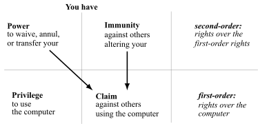

# Rights
**First published Mon Dec 19, 2005; substantive revision Sat Jun 7, 2025**

*Wenar, Leif, Cruft, Rowan*

Rights are entitlements (not) to perform certain actions, or (not) to be in certain states; or entitlements that others (not) perform certain actions or (not) be in certain states.

Rights dominate modern understandings of what actions are permissible and which institutions are just. Rights structure the form of governments, the content of laws, and the shape of morality as many now see it. To accept a set of rights is to approve a distribution of freedom and authority, and so to endorse a certain view of what may, must, and must not be done.

This entry begins by describing the nature of rights: their classification, their composition, and their function. It then reviews the history of the language of rights, and various relationships between rights and reasons. The major contemporary philosophical approaches to the justification of rights are compared, and the entry concludes by surveying criticisms of rights and “rights talk”. The focus throughout is on general theoretical issues (what rights are) and not on arguments over specific rights (what rights there are). Those looking for fuller introductions to rights may consider Jones 1994, Harel 2005, Campbell 2006, Ivison 2008, and Edmundson 2012.

## 1. Categories of Rights

> A right to life, a right to choose; a right to vote, to work, to strike; a right to one phone call, to dissolve parliament, to operate a forklift, to asylum, to equal treatment before the law, to feel proud of what one has done; a right to exist, to sentence an offender to death, to launch a nuclear first strike, to castle kingside, to a distinct genetic identity; a right to believe one’s eyes, to pronounce the couple husband and wife, to be left alone, to go to hell in one’s own way.

We encounter assertions of rights as we encounter sounds: persistently and in great variety. To make sense of this profusion of assertions we can class rights together by common attributes. Rights can be categorized, for example, according to:

> *Who* is alleged to have the right: Human rights, children’s rights, animal rights, workers’ rights, states’ rights, the rights of peoples.
>
> *What* *actions* or *states* or *objects* the asserted right pertains to: Rights of free expression, to pass judgment; rights of privacy, to remain silent; property rights, bodily rights.
>
> *Why* the right-holder (allegedly) has the right: Moral rights are grounded in moral reasons, legal rights derive from the laws of the society, customary rights exist by local convention.
>
> *How the asserted right can be affected* by the right-holder’s actions: The inalienable right to life, the forfeitable right to liberty, and the waivable right that a promise be kept.

Many of these categories have sub-categories. For instance, natural rights are the sub-class of moral rights that humans have because of their nature. Or again, the rights of political speech are a subclass of the rights of free expression.

The study of particular rights is primarily an investigation into how such categories and sub-categories overlap. There has been much discussion, for example, of whether human rights are natural rights, whether the right to privacy is a legal right, and whether the legal right to life is a forfeitable right. (For the central jurisprudential debate over the relation between legal and moral rights, see entries on legal positivism, natural law theories, and the nature of law.) Sometimes theorists will also do analytical work on a single subcategory: for example, Steiner (2013) questions whether inalienable or unwaivable rights are logically possible, and Andersson (2013) discusses who moral right-holders are, and M. Gilbert (2018) focuses on justifying what she calls “demand-rights”, which give the right-holder standing to demand its object.

## 2. The Analysis of Rights

Categorization sorts the profusion of rights assertions. To understand the exact meaning of any assertion of a right, we need to understand more precisely how rights are constructed and what they do.

An analysis of rights has two parts: a description of the internal structure of rights (their form), and a description of what rights do for those who hold them (their function). The Hohfeldian analysis of the form of rights is widely accepted, although there are scholarly quarrels about its details. Which theory gives the best account of the distinctive function of rights has been much more contentious; we turn to that debate in section 3.

### 2.1 The Form of Rights: The Hohfeldian Analytical System

Analysis reveals that most familiar rights, such as the right to free expression or the right of private property, have a complex internal structure. Such rights are ordered arrangements of basic components, much in the same way that most molecules are ordered arrangements of chemical elements. The four basic components of rights are known as “the Hohfeldian incidents” after Wesley Hohfeld (1879–1918), the American legal theorist who discovered them. These four basic “elements” are the privilege, the claim, the power, and the immunity. Each of these Hohfeldian incidents has a distinctive logical form, and the incidents fit together in characteristic ways to create complex “molecular” rights. Once one knows the Hohfeldian system, one can analyze precisely what any assertion of a right might mean.

#### 2.1.1 Privileges (or Liberties)

You have a right to pick up a shell that you find on the beach. This right is a privilege:

> *A* has a privilege to φ *if and only if* *A* has no duty not to φ.

To say that you have a right to pick up the shell is to say that you have *no duty not* to pick it up. You will not be violating any duty not to pick up the shell should you decide to do so. Similarly, your right to sit in an empty seat in the cinema, and your right to paint your bedroom red, are also privileges. Privilege-rights mark out what their bearer has no duty not to do. When US Presidents invoke “executive privilege”, they are denying that they have a duty not to withhold evidence: they assert a Hohfeldian privilege. Similarly, a license (to drive, to perform surgery, to kill) endows its holder with a privilege to engage in the licensed activity. The holder of a driver’s license has a privilege—no duty not—to operate (specified kinds of) motor vehicles (in particular ways).

(Some writers on rights have preferred to speak of “liberties” instead of “privileges” (e.g., Steiner 1994: 59–60)[^steiner-1994]. Others have given these two terms different definitions (e.g., Thomson 1990: 53–55)[^thomson-1990]. To avoid confusion, this entry will always use “privilege” and never “liberty” to refer to the incident defined above.)

#### 2.1.2 Claims

A contract between employer and employee confers on the employee a right to be paid her wages. This right is a claim:

> *A* has a claim that *B* φ *if and only if* *B* has a duty to *A* to φ.

The employee has a claim that the employer pays her her wages, which means that the employer has a duty to the employee to pay those wages. As seen in the definition and the example, every claim-right correlates to a duty in (at least) one duty-bearer. What is distinctive about the claim-right is that a duty-bearer’s duty is “directed at” or “owed to” the right-holder. What explains the “direction” of directed duties has been the subject of controversy, discussed in section 2.2.3.

Some claim-rights exist independently of voluntary actions like signing a contract; and some claim-rights correspond to duties in more than one agent. For example, a child’s claim-right against abuse exists independently of anyone’s actions, and the child’s claim-right correlates to a duty in every other person not to abuse them (in legal terms, the claim-right is *in rem*). This example of the child’s right also illustrates how some claim-rights can require duty-bearers to *refrain* from performing some action (i.e., that “phi” can be a negative verb such as “not abuse him”). Bodily rights and property rights are paradigmatic rights with claim-rights at their core.

#### 2.1.3 Powers

Privileges and claims define what Hart called “primary rules”: rules requiring that people perform or refrain from performing particular actions (Hart 1961)[^hart-1961]. Indeed, the primary rules for all physical actions are properly analyzed as privileges and claims. Were we to know all privileges and claims concerning physical actions, we would know for every possible physical action whether that action was permitted, required, or forbidden.

Two further Hohfeldian incidents define what Hart called “secondary rules”: rules that specify how agents can introduce and change primary rules.

The Hohfeldian power is the incident that enables agents to alter primary rules:

> *A* has a power *if and only if* *A* has the ability to alter her own or another’s Hohfeldian incidents.

A ship’s captain has the power-right to order a midshipman to scrub the deck. The captain’s exercise of this power changes the sailor’s normative situation: it imposes a new duty upon the sailor and so annuls one of the sailor’s Hohfeldian privileges (not to scrub the deck). Similarly, a promisor exercises a power-right to create in the promisee a claim that the promisor will perform a certain action. The promisor’s exercise of her power-right to promise creates in the promisee a claim that the promisor do what she promised to do. Or again, a neighbor waives his claim that you not enter his property by inviting you into his home, thus endowing you with a corresponding privilege. Ordering, promising, waiving, abandoning, consenting, selling, and sentencing are all examples of acts by which a right-holder exercises a power to change his own Hohfeldian incidents or those of another.

Powers can alter not only “first-order” privileges and claims, but “higher-order” incidents as well (Sumner 1987: 31)[^sumner-1987]. An admiral, for example, has the power-right to relieve a captain of her power-right to command a ship. Power-rights to alter the authority of others are, as we will see, definitive of all developed legal and political systems.

#### 2.1.4 Immunities

The fourth and final Hohfeldian incident is the immunity. When *A* has the ability to alter *B*’s Hohfeldian incidents, then *A* has a power. When *A* *lacks* the ability to alter *B*’s Hohfeldian incidents, then B has an immunity:

> *B* has an immunity *if and only if* *A* lacks the ability to alter *B*’s Hohfeldian incidents.

The United States Congress lacks the ability within the Constitution to impose upon American citizens a duty to kneel daily before a cross. Since the Congress lacks a power, the citizens have an immunity. This immunity is a core element of an American citizen’s right to religious freedom. Similarly, witnesses in court have a right not to be ordered to incriminate themselves, and civil servants have a right not to be dismissed when a new government comes to power. All of these rights are immunities, corresponding to an absence of a power in some other party to alter the right-holder’s normative situation in some way.

#### 2.1.5 Opposites and Correlatives

Hohfeld arranged the four incidents in tables of “opposites” and “correlatives” so as to display the logical structure of his system. In order to fill out the tables he added some further terminology. For instance, if a person *A* has a claim, then *A* lacks a “no-claim” (a no-claim is the opposite of a claim). And if a person *A* has a power, then some person *B* has a “liability” (a liability is the correlative of a power).

| **Opposites** |   |   |   |
| --- | --- | --- | --- |
| If *A* has | a Claim, | then *A* lacks | a No-claim. |
| … | a Privilege, | … | a Duty. |
| … | a Power, | … | a Disability. |
| … | an Immunity, | … | a Liability. |

| **Correlatives** |   |   |   |
| --- | --- | --- | --- |
| If *A* has | a Claim, | then some person *B* has | a Duty. |
| … | a Privilege, | … | a No-claim. |
| … | a Power, | … | a Liability. |
| … | an Immunity, | … | a Disability. |

#### 2.1.6 Molecular Rights

Each of the “atomic” incidents—the privilege, claim, power, and immunity—can be a right when it occurs in isolation. And as mentioned above these atomic incidents also bond together in characteristic ways to form complex rights. Following, for example, is part of the “molecular” structure of the property right that you have over your computer:

Part of the “Molecular” Structure of a Property Right [An extended description of this figure is in the supplement.]

In the figure, the “first-order” rights are your legal rights directly over your property—in this case, your computer. The privilege on this first level entitles you to use your computer. The claim correlates to a duty in every other person not to use your computer.

The “second-order” rights are your legal rights concerning the alteration of these first-order rights. You have several powers with respect to your claim—you may waive the claim (granting others permission to touch the computer), annul the claim (abandoning the computer as your property), or transfer the claim (making the computer into someone else’s property). Also on the second order, your immunity prevents others from altering your first-order claim over your computer. Your immunity, that is, prevents others from waiving, annulling, or transferring your claim over your computer. The four incidents together constitute a significant portion of your property right.

Of course all of these incidents are qualified: you have no privilege to use your computer as a weapon, or to use your computer to hack into someone else’s machine; and your immunity may not entirely block out the state’s power of expropriation (if for example the computer becomes evidence in a criminal case). These qualifications to the incidents carve the contours of your property right, but they do not affect its basic shape.

There may also be more incidents associated with ownership than shown in the figure above. Carl Wellman (1985, 1995) describes each right as having a “defining core” surrounded by “associated elements” which may be present or absent in a particular case. Your property right, for instance, may also be protected by a qualified third-order immunity against the government altering your second-order rights over your property (for example, under the “Takings Clause” of the Fifth Amendment to the US Constitution the government cannot simply annul your right to sell a parcel of your land).

#### 2.1.7 Active and Passive Rights

The distinction between active and passive rights (Lyons 1970)[^lyons-1970] maps neatly onto the Hohfeldian incidents. The privilege and the power are “active” rights that concern their holders’ own actions. The claim and the immunity are “passive” rights that regulate the actions of others. Active rights are signaled by statements of the form “*A* has a right to φ”; while passive rights are signaled by statements of the form “*A* has a right that *B* φ” (in both of these formulas, “φ” is an active verb).

A naval captain has an (active) privilege-right to walk the decks and an (active) power-right to order that the ship set sail. A player in a chess tournament has a (passive) claim-right that their opponent not distract them, and a professor has a (passive) immunity-right that her university not fire them for publishing unpopular views.

#### 2.1.8 Negative and Positive Rights

A distinction between negative and positive rights is popular among some normative theorists, especially those with a bent toward libertarianism. The holder of a negative right is entitled to non-interference, while the holder of a positive right is entitled to provision of some good or service. A right against assault is a classic example of a negative right, while a right to welfare assistance is a prototypical positive right (Narveson 1988 [2001])[^narveson-1988].

Since both negative and positive rights are passive rights, some rights are neither negative nor positive. Privileges and powers cannot be negative rights; and privileges, powers, and immunities cannot be positive rights. The (privilege-) right to enter a building, and the (power-) right to enter into a binding agreement, are neither negative nor positive.

It is sometimes said that negative rights are easier to satisfy than positive rights. Negative rights can be respected simply by each person refraining from interfering with each other, while it may be difficult or even impossible to fulfill everyone’s positive rights if the sum of people’s claims outstrips the resources available.

However, when it comes to the enforcement of rights, this difference disappears. Funding a legal system that enforces citizens’ negative rights against assault may require more resources than funding a welfare system that realizes citizens’ positive rights to assistance. As Holmes and Sunstein (1999: 43) put it, in the context of citizens’ rights to state enforcement, all rights are positive. Moreover, the point is often made that the moral urgency of securing positive rights may be just as great as the moral urgency of securing negative rights (Shue 1980 [1996])[^shue-1980]. Whatever is the justificatory basis for ascribing rights—autonomy, need, or something else—there might be just as strong a moral case for fulfilling a person’s right to adequate medical care as there is for protecting that person’s right not to be assaulted.

Some argue that certain purportedly pre-institutional or “natural” positive rights—such as a natural right to health care—cannot be genuine rights because they have no determinate duty-bearers and entail no determinate duties in the absence of institutions. For example, against whom do I have a claim to health care in the absence of institutionalized medical systems? And what could I justifiably claim in such a “state of nature”? By contrast, pre-institutional “natural” negative rights—such as a natural right not to be assaulted—still entail clear duties (of non-interference) for determinate duty-bearers even in the absence of institutions. This point, originally made by O’Neill (1996, 2005), has grounded a growing body of work on the nature and status of positive human rights, or as O’Neill calls them, human rights to goods and services. (Tomalty 2014)[^tomalty-2014].

### 2.2 The Function of Rights: The Will Theory and the Interest Theory

#### 2.2.1 Conceptual Analysis versus Definitional Stipulation

All rights can be represented by Hohfeldian diagrams, like the diagram of the property right “molecule” above (Halpin 2017)[^halpin-2017]. However, some diagrams of Hohfeldian incidents that we can construct do not correspond to any right. To take a simple example from Hart (1982: 191–92), your city council lacks the Hohfeldian power to award you a pension; so by definition you have a Hohfeldian immunity against your city council awarding you a pension. Yet it would be odd to say that you have a right against your city council awarding you a pension. You thus have an immunity, but not a right. Not all (collections of) Hohfeldian incidents are rights; it is only those (collections of) Hohfeldian incidents that have a certain *function* (or perhaps certain *functions*) that are rights. To take an analogy: all engagement rings are rings, but only rings with a certain function are engagement rings. What, then, is the function of rights?

The question of the distinctive function of rights is the question of what rights do for those who hold them. Before discussing the two major positions on this issue, we can survey some statements that theorists have made that may appear to be describing which Hohfeldian incidents are rights:

- “In the strictest sense” all rights are claims. (Hohfeld 1919: 36)[^hohfeld-1919]
- To have a right is to have a “valid claim”. (Feinberg 1970: 257)[^feinberg-1970]
- “Rights are built around the claims of patients on an agent”. (Walen 2019: 58)[^walen-2019]
- “A right, in the most important sense, is the conjunction of a [privilege] and a claim-right”. (Mackie 1979: 169)[^mackie-1979]
- “Rights are permissions rather than requirements. Rights tell us what the bearer is at liberty to do”. (Louden 1983: 95)[^louden-1983]
- “No one ever has a right to do something; he only has a right that some one else shall do (or refrain from doing) something”. (Williams 1956: 1145 [1968: 125])[^williams-1956]
- “A person who says to another ‘I have a right to do it’ is not saying that … it is not wrong to do it. He is claiming that the other has a duty not to interfere”. (Raz 1994: 275)[^raz-1994]
- “A right is an established way of acting”. (R. Martin 1993: 1)[^martin-1993]
- “It is hard to think of rights except as capable of *exercise*”. (Hart 1982: 185)[^hart-1982]
- “A right is a *power* which a creature ought to possess”. (Plamenatz 1938: 82)[^plamenatz-1938]
- “All rights are essentially property rights”. (Steiner 1994: 93)[^steiner-1994]
- “Rights are themselves *property*, things we own”. (Feinberg 1973: 75)[^feinberg-1973]
- “Rights are generally understood to be valuable possessions”. (M. Gilbert 2018: 6)[^gilbert-2018]

At first, this survey might remind one the proverb of the blind men, each of whom is feeling a different part of an elephant. However, we should distinguish between two different aims that a theorist might have when they make a statement of the form “All rights are *x*”. A theorist may be *attempting to analyze* the meaning of our ordinary concept of rights, or they may be *stipulating a definition* of “rights” within her own ethical, political or legal theory.

Consider, for example, Mill’s famous assertion in *Utilitarianism*:

> When we call anything a person’s right, we mean that he has a valid claim on society to protect him in the possession of it, either by the force of law, or by that of education and opinion… To have a right, then, is, I conceive, to have something which society ought to defend me in the possession of. (Mill 1861 [2002: 54])[^mill-1861]

As an analysis of the everyday concept of a right, Mill’s assertion would be weak. For example, for centuries many people have asserted that God has the right to command his creatures; yet presumably no one who asserts such a right would commit to the idea that society ought to defend God in the possession of the power to command. To take another example, there seems nothing incoherent in the thought that individuals have a right not to be protected by society; yet this thought could not make sense on Mill’s characterization of what rights are. (On Mill, see also Hart 1982: 100–04.)[^hart-1982]

Mill’s statement is better seen not as an analysis of the everyday concept, but as a stipulative definition of the term “right”. Mill stipulates this particular definition because the idea of “those possessive relations that are valuable enough that it is worthwhile for society to institute sanctions to protect them” is an idea that works well within his larger utilitarian theory. So where Mill’s statement departs from the common understanding of rights, we should charitably read Mill as prescribing, instead of describing, usage. Many authors’ pronouncements about rights are charitably interpreted as these kinds of exercises in stipulation, rather than as attempts to analyze the ordinary concept of rights.

To take an example from the scholarly literature, it is not uncommon to encounter a general statement that all rights are (or at least include) claim-rights (see, e.g., Raz 1986: 166, 173–75; Steiner 1994: 55; Kramer, Simmonds, & Steiner 1998: 9–14)[^kramer-1998][^raz-1986][^steiner-1994]. These “all rights are claims” statements are better interpreted as stipulative, rather than as analyses of common usage. “All rights are claims” positions cannot recognize, for example, the rights in the Hobbesian state of nature, in which each person has unlimited privilege-rights of self-defense yet no claim-rights against attack. Neither could an “all rights are claims” theory recognize that the US Constitution gives Congress the sole (power-) right to declare war. The statement that rights are claims is prescriptive for, not descriptive of, usage.

Occasionally a theorist will say that they are presenting neither an analysis of the ordinary concept of a right, nor merely stipulating a new meaning for the term “right”, but are rather offering some third type of characterization. For instance, Carl Wellman (1995: 136) says that his narrow specification of “a right” is needed to provide “a clearer and more revealing map of the law”. Raz (1986: 166) frames a contrasting “philosophical definition” that, he says, “illuminates a tradition of political and moral discourse in which different theories offer incompatible views of what rights there are and why”. Whether there is room for such a third category of “philosophical definition”, which goes beyond both ordinary analysis and stipulation, is contested (Wenar 2008)[^wenar-2008].

#### 2.2.2 The Will Theory and the Interest Theory

There are two main theories of the function of rights: the will theory and the interest theory. Each theory presents itself as capturing an ordinary understanding of what rights do for those who hold them. Which theory offers the better account of the functions of rights has been the subject of spirited dispute, literally for ages.

Will theorists maintain that a right makes the right-holder “a small scale sovereign” (Hart 1982: 183)[^hart-1982]. More specifically, a will theorist asserts that the function of a right is to give its holder control over another’s duty. Your property right diagrammed in the figure above is a right, says the will theorist, because it contains a power to waive (or annul, or transfer) others’ duties. You are the “sovereign” of your computer, in that you may permit others to touch it or not at your discretion. Similarly a promisee is “sovereign” over the action of the promisor: a promisee has a right because she has the power to waive (or annul) the promisor’s duty to keep the promise. In Hohfeldian terms, will theorists assert that every right includes a Hohfeldian power over a claim. In colloquial terms, will theorists believe that all rights confer control over others’ duties to act in particular ways.

Interest theorists disagree. Interest theorists maintain that the function of a right is to further the right-holder’s interests. An owner has a right, according to the interest theorist, not because owners have choices, but because the ownership makes owners better off. A promisee has a right because promisees have some interest in the performance of the promise, or (alternatively) some interest in being able to form voluntary bonds with others (Owens 2012)[^owens-2012]. Your rights, the interest theorist says, are the Hohfeldian incidents you have that are good for you.

The contest between will-based and interest-based theories of the function of rights has been waged for hundreds of years. Influential will theorists include Kant, Savigny, Hart, Kelsen, Carl Wellman, and Steiner. Important interest theorists include Bentham, Ihering, Austin, Lyons, MacCormick, Raz, and Kramer. Each theory has stronger and weaker points as an account of what rights do for right-holders.

The will theory captures the powerful link between rights and normative control. To have a right is to have the ability to determine what others may and may not do, and so to exercise authority over a certain domain of affairs. The resonant connection between rights and authority (the authority to control what others may do) is for will theorists a matter of definition.

However, the will theory’s account of the function of rights struggles to explain many rights that most think there are. Within the will theory, there can be no such thing as an unwaivable right: a right over which its holder has no power. Yet intuitively it would appear that unwaivable rights are some of the most important rights that we have: consider, for example, the unwaivable right not to be enslaved (MacCormick 1977: 197)[^maccormick-1977].

Moreover, since the will theorist holds that all rights confer sovereignty, she cannot acknowledge that beings incapable of exercising sovereignty have rights. Within the will theory, it is impossible for incompetents like infants, animals, and comatose adults to have rights. Yet we ordinarily would not doubt that these incompetents can have rights, for example the right not to be tortured (MacCormick 1982: 154–66)[^maccormick-1982]. Attempts to avoid this problem by maintaining that incapable beings hold rights that confer sovereignty exercised on their behalf by another (for example, that infants’ rights confer sovereignty exercised on the infants’ behalf by parents) struggle to provide non-circular accounts of the requisite concept of “sovereignty exercised on behalf of another right-holder” (Cruft 2019: ch. 3)[^cruft-2019]. Will theories also have difficulties explaining bare privilege-rights (such as in the Hobbesian state of nature), which are not rights of authority over others.

The interest theory is more capacious than the will theory. It readily accommodates both unwaivable rights (the possession of which may be good for their holders) and the rights of incompetents (who have interests that rights can protect). The interest theory also taps into the deeply plausible connection between holding rights and being better off.

However, the interest theory is also misaligned with any ordinary understanding of rights. We commonly accept that people can have interests in *x* without having a right to *x*; and contrariwise that people can have a right to *x* without having interests sufficient to explain this. In the first category are “third party beneficiaries” (Lyons 1994, 36–46)[^lyons-1994]. You may have a powerful interest in the lottery paying out for your spouse’s winning ticket, but you have no right that the lottery pays out to your spouse. In the second category are many of the rights of office-holders and role-bearers (Jones 1994: 31–32; Wenar 2013b)[^jones-1994][^wenar-2013b]. Whatever interest a judge may have in sentencing a convict to life in prison, the judge’s interests cannot justify ascribing to her the power to make such a dramatic change in the convict’s normative situation.

The difficulties of the interest theory have often been noted in Raz’s version, which is perhaps the most prominent. In Raz’s account,

> *X* has a right if *X* can have rights, and, other things being equal, an aspect of *X*’s well-being (his interest) is a sufficient reason for holding some other person(s) to be under a duty. (Raz 1986: 166)[^raz-1986]

Yet there appear to be many rights for which the interests of the putative right-holder are not sufficient to hold other person(s) to be under a duty. For example, Raz himself notices that the interest of a journalist in protecting his sources is not itself sufficient reason to hold others to be under a duty not to pressure the journalist to reveal his sources (Raz 1986: 179, 247–8)[^raz-1986]. Raz says that it is rather the interests of the general public in an active and independent media that grounds the journalist’s right to protect his sources. Yet as Kamm then objects to Raz,

> If the satisfaction of interests of others is the reason why the journalist gets a right to have his interest protected, his interest is *not sufficient* to give rise to the duty of noninterference with his speech. (Kamm 2002: 485; for defenses of Raz, see Pallikkathayil 2016, Mullins 2019)[^kamm-2002][^mullins-2019][^pallikkathayil-2016]

Nor does this difficulty only affect the rights of office-holders like journalists; Raz admits that weighty rights such as the rights of free expression and freedom of contract are not justified solely by the interests of the individual citizens who hold them, but also by the ways that these rights further the common good (Raz 1994: 30–43, 131)[^raz-1994]. Or again, parents may have the right to receive child benefit payments from the state, but here only the interests of the children, and not the interests of the parents, could be sufficient to hold the state to be under a duty (see also May 2012, 2015)[^may-2012][^may-2015].

Raz’s version of the interest theory continues to be the most widely-cited account of the function of rights, despite such concerns that are now commonplace in the specialist literature. Kramer’s version of the interest theory is the major contemporary alternative: it maintains that although a given right need not be grounded or justified by its holders’ interests, it must necessarily do for the right-holder something that would typically be in the interests of a party of the right-holder’s type (person, animal, group) (Kramer 2013, 2017, 2024)[^kramer-2013][^kramer-2017][^kramer-2024].

Will theorists and interest theorists have developed their positions with increasing technical sophistication. The issues that divide the two camps are clearly defined, and the debates between them are often intense (Kramer, Simmonds, & Steiner 1998; Van Duffel 2012a; Kramer 2013; McBride 2017a; Frydrych 2018; Bowen 2020)[^bowen-2020][^frydrych-2018][^kramer-2013][^kramer-1998][^mcbride-2017a][^van-2012a]. The seemingly interminable debate between these two major theories has driven some to conclude that the debate itself rests on the mistaken premise that there is a single concept of a right for which these theories provide rival analyses (Van Duffel 2012b; Hayward 2013; Valentini 2023)[^hayward-2013][^valentini-2023][^van-2012b]. The deadlock has encouraged other theorists to develop alternative positions on the function of rights.

“Demand” theories fill out the idea that, as Feinberg (1973: 58–59) puts it,

> A right is something a man can stand on, something that can be demanded or insisted upon without embarrassment or shame.

For Darwall (2006: 18), to have a claim-right,

> includes a second-personal authority to resist, complain, remonstrate, and perhaps use coercive measures of other kinds, including, perhaps, to gain compensation if the right is violated.

On Skorupski’s account (2010: XII.6, XIV.2–3) rights specify what the right-holder may demand of others, where “demand” implies the permissibility of compelling performance or exacting compensation for non-performance. Like the will theory, these demand theories center on the agency of the right-holder. They do not turn on the right-holder’s power over the duty of another, so they do not share the will theory’s difficulty with unwaivable rights. They may, however, have more difficulties in explaining power-rights. Demand theories also share the will-theory’s challenges in explaining the rights of parties incapable of demanding, and in explaining privilege-rights.

M. Gilbert (2018) develops not a demand theory of rights, but a theory of a special class of rights that she calls “demand-rights”. In her formulation, “*X* has a demand-right against *Y* if and only if *X* has the standing to demand of *Y* that *Y* φ” (2018: 70). Gilbert’s paradigm of a demand-right is a promissory right: the promisee has the standing to demand performance from the promisor, meaning that the promisee has the authority to demand that the promisor do what she promised to do. M. Gilbert (2014) explains this standing to demand in terms of her theory of joint commitment.

Other analyses of what rights do for right-holders are varied. Scanlon (2003, 2013) defends the position that rights are constraints on the discretion of individuals or institutions to act. Sreenivasan (2005, 2010) puts forward a “hybrid” analysis of the claim-right that grafts the interest theory onto the will theory: here the function of the claim-right is to endow the right-holder with the amount of control over another’s duty that advances her interests. Wenar (2005) abandons the idea that all rights have any single function, and develops a “several functions” theory on which rights perform six distinct functions. Wenar (2013b) then sets out a “kind desire” theory of claim-rights, which turns on what role-bearers like journalists and parents want as such, and more generally on what beings (like humans) want qua the kinds of beings that they are. Setiya (2025) sets out an alternative “valid consent” theory of moral claim-rights, which aims to explain (where interest, will and demand theories do not) what he calls the “Reciprocity Thesis”—the thesis that when *A* has a moral claim-right that *B* φ, *B* therefore has no moral claim-right against being made to φ by *A*, ceteris paribus.

Scanlon’s analysis is criticized in M. Gilbert 2004, Wenar 2013a; Sreenivasan’s and Wenar’s analyses are critiqued in Kramer and Steiner 2007, and May 2012. Kramer’s, Sreenivasan’s and Wenar’s theories are criticized and developed in essays by Kramer, May, Penner, Sreenivasan, McBride, and Cruft in McBride 2017a; Cruft’s theory is critiqued in May 2022; Kramer’s theory is modified in Kurki 2018; Wenar’s theory is defended in Schaab 2018.

#### 2.2.3 The Direction of a Duty

Recently, theorists have attempted to make progress on the question of the function of rights by scrutinizing the claim-right in particular, and by shifting attention onto the duty that corresponds to it. On the standard account what is distinctive about the claim-right is that a duty-bearer’s duty is “directed at” or “owed to” the right-holder. (The promisor, for example, owes a duty of performance to the promisee.) Yet what could account for the directionality of such “directed duties”? (May 2015)[^may-2015]

After all, not all duties are directed to specific others. For example, the moral duty of affluent people to give some of their wealth to charity is not owed to any specific person. And “directed duties” appear to have special normative significance. The violation of any duty may be *wrong* (it may be wrong for a rich person to give nothing to charity). But the violation of a directed duty is more than just a wrong: it is *a wronging* of the being to whom the duty is owed (Thompson 2004)[^thompson-2004]. And unlike a mere wrong, the wronging of some being calls, ceteris paribus, for apology and compensation. Cruft (2013) further argues that the violation of any duty owed to a being is disrespectful of that being. The question is what could possibly account for the extra significance of the duties that have direction.

Darwall (2012) asserts that his second-personal theory of morality best explains the relation between duty-bearer and right-holder. Cruft (2019) argues that the directed duty-bearer is required by the form of her duty to conceive of the right-holder second-personally, as “you, on whom I act”; this approach is criticized in Bowen 2022, May 2022, Fornaroli 2021.

Cornell (2015) argues against the commonly accepted thesis that one can wrong only those to whom one has directed duties, maintaining for example that someone who overhears a lie and comes to harm through acting on this is wronged by the lie even though the liar did not owe to them her duty to speak honestly. For critical discussion, see Fornaroli 2025, which is part of a body of new work emerging on directed duties and the relation between rights and “directedness”, including Hedahl 2013, May 2015, Schaab 2018, Fornaroli 2021, Zylberman 2016, Kamm 2022. For the related claim that some directed duties—those central to personal relationships—do not correlate with rights, see A. Martin 2021.

## 3. The History of the Language of Rights

Intellectual historians have disputed the origins of rights. These debates are sometimes framed in terms of when “the concept of a right” emerged. Yet insofar as it is really the emergence of the *concept* of a right that is at issue, the answer lies beyond the competence of the intellectual historian and within the domain of the anthropologist. Even the most primitive social order must include rules specifying that certain individuals or groups have special permission to perform certain actions. Moreover, even the most rudimentary human communities must have rules specifying that some are entitled to tell others what they must do. Such rules ascribe rights: privileges and powers respectively. The genesis of the concept of a right was simultaneous with reflective awareness of such social norms, however our forebears decided to describe those norms.

The more productive characterization of the debate within intellectual history concerns when a *word* (or phrase) appeared that has a meaning close to the meaning of our modern word. This debate turns on when in history the pre-modern “objective” sense of “right” came also to bear our modern, “subjective” sense of “a right”.

“Right” in its older, objective sense means “what is just” or “what is fair” (Finnis 1980: 206)[^finnis-1980]. Aristotle uses dikaion, for example, to indicate that a society is “rightly ordered”: that it displays the correct structure of human relationships. “Right” in this objective sense can also be attributed to individuals. The Roman jurist Ulpian, for instance, held that justice means rendering each their right (ius). In this sense, a person’s “right” is what is due to him given his role or status. This objective sense of “right” is not the same as our modern idea of “a right”. For instance, Ulpian noted that the ius of a parricide was to be sewn into a sack of snakes and tossed into the Tiber (Tierney 1997: 16)[^tierney-1997].

There has been a long and divisive scholarly inquiry into when our modern, subjective sense of “a right” became established as a meaning of some word or phrase. The history is uncertain partly because the ancient authors often used words imprecisely, and smeared their meanings across and beyond the Hohfeldian categories. The intellectual historians themselves have occasionally congested the discussion by taking different features of rights as definitive of the modern concept. Moreover, the scholarly debate has sometimes accepted over-optimistic assumptions about the sharpness of conceptual boundaries.

Nevertheless, two broad trends in the scholarly discussions have emerged. The first is to push the origins of a term indicating a modern, subjective sense of “a right” back further into history: from Locke to Hobbes to Grotius in the seventeenth century, then to Gerson in the fifteenth century, then to Ockham in the fourteenth, perhaps even to Gratian in the twelfth (Brett 1997; Tierney 1997; Siedentop 2014; Lisska & Tierney 2015)[^brett-1997][^lisska-2015][^siedentop-2014][^tierney-1997]. Donahue (2010) even argues that ius is used in a subjective sense throughout the works of the classical Roman jurists in the first century BCE to the third century CE; Miller (1996) finds subjective rights already in Aristotle’s *Politics*.

The second and related trend has been to establish that terms referring to active rights (what we would call privilege-rights and power-rights) predate terms referring to passive rights (what we would call claim-rights and immunity-rights). It appears that the earliest medieval debates using recognizably modern rights-language, for instance, concerned topics such as whether the pope has a (power-) right to rule an earthly empire, and whether the poor have a (privilege-) right to take what they need from the surplus of the rich.

## 4. Rights and Freedom

Most rights entitle their holders to freedom in some sense; indeed holding a right can entail that one is free in one or more of a variety of senses. In the most general terms, the active incidents—the privilege and the power—entitle their holders to *freedom to* act in certain ways. The passive incidents—the claim and the immunity—often entitle their holders to *freedom from* undesirable actions or states.

We can be more specific. A single privilege-right makes its holder “free to” in the sense of non-forbiddenness. A spy with a security clearance, for instance, may have a privilege-right that means they are free to enter a highly classified facility of their own government. One can be free in this non-forbidden way without having the physical ability to do what one is free to do. The spy, for instance, still has “no duty not” to enter the classified facility even when they are languishing in a distant foreign prison. The actions that one is free to do in this sense may or may not be physically possible for one at the moment, but at least they are not disallowed by the relevant norms (Steiner 1994)[^steiner-1994].

Someone who has a pair of privilege rights—no duty to perform the action, no duty not to perform the action—is free in an additional sense of having discretion over whether to perform the action or not. For example, you may be free to join a protest march, or not, as you like. This dual non-forbiddenness again does not imply physical ability. A right-holder may be permitted to perform or not perform some action, but this still does not mean that she is capable of performing the action that she is free to perform.

In contrast, the holder of a power-right does have an ability. This is the *normative* ability to exercise authority in a certain way (Sumner 1987: 28)[^sumner-1987]. This normative ability confers freedom in a different sense. A judge is free to sentence a convicted criminal to prison. The judge is not merely allowed to sentence the prisoner: her power-right gives her the ability—that is, the authority—to do so. Her (power-) right makes her free to sentence in a way that non-judges are not free to sentence.

As for the passive rights, many claim-rights entitle their holders to be free from the physical interference or surveillance of others. Other claim-rights entitle their holders to be free from undesirable conditions like hunger or fear. Immunity-rights parallel claim-rights one level up. Immunity-rights make their holders free from the authority of others, and so entitle their holders to be free from conditions like tyranny or exploitation.

A legal system can be seen as a distribution of all of these varieties of freedom. Any legal system will set out rules specifying who is free to act in which ways, and who should be free from which unwanted actions and conditions. A developed legal system will also determine who has the authority (and so who is free) to interpret and enforce these rules.

More generally, any political constitution can be seen as a multi-leveled structure of rights that distributes authority over rules of conduct in a distinctive way. A democratic constitution, for example, may give voters the power to elect legislators, who have certain powers to enact laws, which the judiciary has certain powers to interpret, and the police have certain powers to enforce, leaving certain courses of conduct open as legal for citizens to pursue. The facts about who should be free to do what within any legal or political system, as well as the facts about who should be free from which actions and conditions, can be represented as complex, layered structures of rights—exponentially more complex than in the diagram of the property right above.

## 5. Rights and Reasons

### 5.1 Rights as Trumps

Though there are disputes over the function of rights and the history of rights language, most agree that rights have special normative force. The reasons that rights provide are distinctively powerful or weighty reasons, which override reasons of some other sorts. Dworkin’s metaphor is of rights as “trumps” (Dworkin 1984)[^dworkin-1984]. Rights permit their holders to act in certain ways, or give reasons to treat their holders in certain ways or permit their holders to act in certain ways, even if some social aim would be served by doing otherwise. As Mill wrote of the trumping power of the right to free expression: “If all mankind minus one were of one opinion, mankind would be no more justified in silencing that one person than he, if he had the power, would be in silencing mankind” (Mill 1859 [1989: 20])[^mill-1859].

But whatever “trumping” character is essential to all rights, it must be compatible with the existence of trivial rights, such as my right to fill in my tax return with either blue or black ink, or your promissory right that I check on your houseplants while you are away. Most theorists would agree that *A*’s claim-right gives *B* what Raz (1975: 35–48) calls an exclusionary reason: a second-order reason not to act on some first-order reason. Exclusionary reasons have a distinctive force, but they need not be very important. For example, your promissory right that I check on your houseplants might exclude from my reasoning the fact that I just cannot be bothered to do the checking, while nonetheless permitting me to act on other overriding reasons. Related ideas include McDowell’s suggestion that some reasons—perhaps those entailed by rights—“silence” what would otherwise be countervailing reasons (McDowell 1998: 90–93)[^mcdowell-1998] or that rights are what Kagan (1998: 72) calls deontological “constraints” that should not be violated in order to minimize their own violation.

How and whether rights become imbued with their special normative force is a matter of ongoing scholarly inquiry. As Sreenivasan (2010) notes, a Hohfeldian claim-right in itself only entails the existence of a duty with a certain structure, and not a duty with a certain force. *A* has a claim against *B* if and only if *B* has a duty to *A*: in this definition it is the “direction” of *B*’s duty (that it is owed to *A*) which correlates *B*’s duty to *A*’s right; nothing is said in the definition about the duty’s strength. When and why “directed duties”—as above, those owed to an entity—have greater normative priority than “undirected duties” remains an open question. (See Thompson 2004 and Darwall 2012 on “bipolar” judgments.)[^darwall-2012][^thompson-2004] Whatever priority rights have, it seems that sometimes this priority is limited to some domain: the legal right of British actors to smoke onstage during a performance, for instance, need not be upheld though the heavens fall.

Dworkin’s metaphor suggests that rights trump non-right objectives, such as increasing national wealth. What of the priority of one right with respect to another? We can keep to the trumps metaphor while recognizing that some rights have a higher priority than others. Within the trump suit, a jack still beats a seven or a three. Your right of way at a flashing yellow light has priority over the right of way of the driver facing a flashing red; and the right of way of an ambulance with sirens on trumps you both.

This metaphor of trumps leads naturally to the question of whether there is any right that has priority to absolutely all other normative considerations: whether there is an “ace of rights”. Gewirth (1981) asserts that there is at least one such absolute right: the right of all persons not to be made the victim of a homicidal project. For such a right to be absolute, it would have to trump every other consideration whatsoever: other rights, economic efficiency, saving lives, everything. Not all would agree with Gewirth that even this very powerful right overrides every conceivable normative concern. Some would think it might be justifiable to infringe even this right were this somehow necessary, for example, to prevent the deaths of a great many people.

### 5.2 Conflicts of Rights?

Dworkin’s trumping metaphor makes it tempting to characterize the normative force of rights in the strong terms of *conclusive* reasons. Were we to go this route, we would need to temper the “conclusiveness” of the conclusive reasons implied by rights assertions to accommodate the facts that some rights have priority to others, that some rights are relatively trivial, and that few if any rights outweigh all non-right considerations in all circumstances.

This line of thought can be developed by saying that the reasons associated with rights are conclusive *within the area covered by the right*, but are not conclusive outside of that area. The theoretical position at the end of this line of thought is called “specificationism” (Shafer-Landau 1995; Oberdiek 2008)[^oberdiek-2008][^shafer-landau-1995]. The specificationist holds that each right is defined by an elaborate set of qualifications that specify when it does and when it does not apply: a set of qualifications that define the right’s “space”.

The test of specificationism is how convincingly it can explain what occurs when rights appear to conflict. Rights do often appear to conflict (Sinnott-Armstrong 1996; Kamm 2007: 262–301)[^kamm-2007][^sinnott-armstrong-1996]. For example, on a certain day it may seem that the public’s right to protest is conflicting with the government’s right to keep order on public property. When confronted with a case like this one, we will judge that one or the other (say, the public’s) right should prevail. However, we do not believe that one of these rights is always stronger than the other. Given different circumstances, our judgment might favor the other (in this case, the government’s) right. When rights appear to conflict like this, the usefulness of the image of rights as trumps begins to dim.

A specificationist will attempt to dispel any appearance of conflict of rights. For example, a specificationist will say that what is colloquially referred to as “the public’s right to protest” is actually, on closer examination,

> the public’s right to protest, unless the protest would cause serious risk to life or property, or would lead to the spread of a deadly disease, or…

Similarly, the government’s right should really be specified more fully as the right:

> to control what happens on public property, but not to the extent of stopping peaceful protest, unless the protest would lead to the spread of deadly disease, but not…

On the specificationist view, rights fit together like pieces in a jigsaw puzzle, so that in each circumstance there is only one right which determines what is permitted, forbidden or required. Rights never conflict: they are always, to use Steiner’s phrase, “compossible” (Steiner 1994)[^steiner-1994].

Feinberg (1980: 221–51) and Thomson (1990: 82–104) object to this specificationist view of rights. First, fully specified rights would be unknowable: no one could set out all of the qualifications that define even the simplest right. Second, rights so understood lose their explanatory force: for the specificationist rights can only be the conclusions, not the premises, of arguments concerning which side in any dispute should prevail. Third, specificationists cannot explain the “moral residue” of a “defeated” right. For instance, consider a case in which your property right in the pie cooling on your window sill conflicts with John’s right to do what he must do to keep from starving. John’s right may prevail in this case; still, after John rightfully eats your pie he should apologize to you, and compensate you if he can. Thomson alleges that specificationists cannot explain this, since on their view there is no right of yours that John has violated.

Thomson prefers the view that there really are conflicts of rights, and suggests that we should speak of a “defeated” right as being permissibly “infringed” (instead of “violated”), leaving residual obligations on the infringer. Frederick (2014) chases down some specificationist replies to these objections, and concludes that although moral rights are strong moral considerations, they are only pro tanto. Liberto (2014) develops a more sophisticated specificationist position, which is critiqued by Montague (2015). Mullins (2020) offers a logical framework of practical reasoning that claims to capture the dynamics of the debate over specification; Zylberman (2022) sets out a “holistic specificationism” while Rettig (forthcoming) defends a qualified generalism.

### 5.3 Support among Rights

Philosophers have discussed not only how rights can conflict, but how they sometimes support one another. For example, Henry Shue has argued that both rights of security and rights of subsistence are “basic rights” because they are indispensable for the full enjoyment of all other rights—while other rights are non-basic because they are not indispensable for the enjoyment of these two. If the enjoyment or realization of a controversial right is an important precondition for the enjoyment of an uncontroversial right, one can defend the controversial right by documenting its strong supporting role. Such a “linkage argument” is used by Shue to defend the right to subsistence as a basic right, and by Sen to defend rights to democracy and freedom of the press as supportive of the right to adequate nutrition in developing countries (Shue 1980 [1996], Sen 1999)[^sen-1999][^shue-1980]. Shue’s and Sen’s assertions have been criticized as exaggerated (Nickel 2008; Myhrvold-Hanssen 2003 [in Other Internet Resources])[^nickel-2008].

Nickel (2008, 2010, 2016) develops a sophisticated typology of supporting relations between rights (see also Gilabert 2010)[^gilabert-2010]. One right strongly supports another when it is logically or practically inconsistent to endorse the implementation of the second right without endorsing the simultaneous implementation of the first. For example, the right to bodily security strongly supports the right to freedom of assembly. One right weakly supports another when it is useful but not essential to it. The right to education, for example, weakly supports the right to a fair trial. Nickel argues that the strength of supporting relations between rights varies with quality of implementation. Poorly implemented rights provide little support to other rights, while rights that are more effectively implemented tend to provide greater support to other rights. The right to due process supports the right to equal treatment for members of different racial and ethnic groups—but the support will be soft if the right to due process is only weakly implemented.

Rights that weakly support each other are interdependent. Rights that strongly support each other are indivisible. Beginning with the 1968 Proclamation of Tehran, the United Nations has promoted the idea that

> Since human rights and fundamental freedoms are indivisible, the full realization of civil and political rights without the enjoyment of economic, social and cultural rights is impossible. (Proclamation of Tehran #13; see Whelan 2010)[^whelan-2010]

Nickel holds that this indivisibility thesis exaggerates the density and strength of supporting relations among human rights. He allows, however, that many supporting relations exist between rights—particularly under high-quality implementation—and endorses the use of linkage arguments when indispensability can be shown. (It is worth noting that much of what Nickel says about supporting relations between rights can be applied mutatis mutandis to supporting relations between duties, and also to relations between non-rights values.)

### 5.4 Rights to Do Wrong

Are there rights to do wrong? Many have thought so. Waldron (1993: 63) gives the example of antiwar protesters organizing a rowdy demonstration near a Remembrance Day service; Carl Wellman (1997: 33) offers the illustration of edging into a checkout line with a full cart, just ahead of a tired parent carrying triplets. The puzzle is how the positive normative force of “a right” can exist so close to an opposed negative normative pole, “wrong”. In Hohfeldian terms, how can there be a right (no duty not) to do what it is wrong (duty not) to do? (Similar questions arise about “the abuse of rights” (Schauer 1981)[^schauer-1981].)

There are two main readings of rights to do wrong. The first reading characterizes rights to wrong as rights against interference (Enoch 2002; Øverland 2007; Bolinger 2017)[^bolinger-2017][^enoch-2002][^øverland-2007]. Rights entitle their holders to make choices, and as Waldron (1993) says the importance of a person’s having choices would be diminished if she were forced to do the right thing. Even though the person has no (privilege-) right to perform an action that is wrong, it would nevertheless violate an important (claim-) right of hers for others to compel her not to do that thing. To take the speech example, we respect the autonomy of speakers when we allow them to speak unmolested—even when they do wrong by expressing themselves in disrespectful ways. (For a defense of Waldron’s reading against objections from Galston 1983 and George 1993, see Herstein 2012; but see also the further objections in Bolinger 2017, Laborde 2021. On the existence and value of legal rights to do legal wrongs, see Herstein 2014.)[^bolinger-2017][^galston-1983][^george-1993][^herstein-2012][^herstein-2014][^laborde-2021][^waldron-1993]

The second reading of rights to do wrong sees them as involving a mid-sentence shift in domains of reasons. There is no mystery, after all, in having a *legal right* to do something *morally* wrong. The potential for a legal right to do a moral wrong arises from the fact that the domains of legal and moral reasons are not perfectly overlapped. One has a legal privilege to edge in front of the tired mother in the check-out line, but this is something that one has a moral duty not to do. Similarly, one might have a moral privilege to do what one has no customary privilege to do (a moral right to do a customary wrong), and so on. Each domain of reasons is distinct, and however conclusive are the reasons that any particular rights-assertion implies, these are only reasons within a single domain of reasons (moral, or legal, or customary).

A related question concerns how it can come to be permissible to treat A in certain ways that would, but for the actions or situation of A, be wrong. For example, it is wrong purposefully to impose a hardship on another person, unless that person has acted in a way that merits punishment. Christopher Wellman (2017) makes a close study of how it can be permissible to punish, concluding that the best explanation is that the wrongdoer has *forfeited* her right against hard treatment. A separate line of scholarship running through work by Thomson (1990), McMahan (1994), Otsuka (1994), Lazar (2009) and Frowe (2014), debates how it can be permissible to attack innocents during war (see Walen 2019: 2–8)[^walen-2019].

### 5.5 Rights to Believe, Feel, and Want

Moral rights, legal rights, and customary rights all define domains of rights within the realm of *rights of conduct*: rights concerning how agents may and should *act*. When our reasons within these three different domains conflict, we may have reasons of different kinds to act in different ways. Yet there are also rights entirely beyond the realm of conduct. These are rights to *believe*, to *feel* and to *want*. For example, the prime minister asserts that he had a right to believe what his advisors told him. The artist says she has a right to feel angry at her critics. The frustrated suburbanite complains they have a right to want more out of life.

The realm of rights of rights to believe, to feel, and to want are the realms of *epistemic*, of *affective*, and of *conative* rights. Together with the realm of rights of conduct, these are the four realms of rights. Each of these four realms of rights defines a separate conceptual space: there are no epistemic rights to act, and no affective rights to believe. What is distinctive about the three realms of rights beyond the rights of conduct is that they seem only to contain only privilege-rights (Wenar 2003)[^wenar-2003]. One may, for example, have a privilege-right to believe what one’s eyes tell one, and a privilege-right to feel proud of what one has done. It is interesting to consider why these epistemic, affective, and conative realms contain no claims, powers, or immunities, and what the relation is between rights in these realms and rights of conduct (Watson 2021)[^watson-2021].

Philosophers have long been interested in epistemic rights in particular (Altschul 2010 [Other Internet Resources]; Graham & Pedersen 2020)[^graham-2020], though there is also skepticism about this category (Glick 2010)[^glick-2010]. William James, for instance, calls *The Will to Believe*,

> an essay in justification of faith, a defense of our right to adopt a believing attitude in religious matters, in spite of the fact that our merely logical intellect may not have been coerced.

James’s “radical” conclusion in the essay is that “we have the right to believe at our own risk any hypothesis that is live enough to tempt our will” (James 1896 [1956: 2, 29])[^james-1896].

Similarly, the deepest questions in Kant’s philosophy are framed in terms of rights. In the *Critique of Pure Reason* (1781/87), the Transcendental Deduction of the Categories aims to prove the validity of the employment of the concepts of pure understanding. In the *Critique of Practical Reason* (1788), the Deduction of Freedom aims to demonstrate our entitlement to regard ourselves as free. In both Deductions, the central question is a quaestio iuris: “By what right?” Kant’s questions are: By what right do we employ the categories; and by what right do we think of ourselves as free?

### 5.6 Who Can Hold Rights?

Many kinds of being are regularly described as right-holders, including living humans, animals, groups, business corporations, states and social institutions. Other kinds of beings have a controversial status as right-holders, with some theorists affirming that they hold rights and others disagreeing: examples include dead and future people, rivers, ecosystems, AI networks, planets, works of art, fictional characters, and even abstract normative entities such as Love or Reason. Contrastingly, some kinds of things seem never to be considered right-holders: rocks, gases, flames, artefacts like cars or hammers, and such abstract objects as the number three or the color blue.

What determines whether a particular type of being should be included in the class that can hold rights? Theories such as the Will Theory or the Interest Theory—theories of rights’ distinctive function—carry implications for who can qualify as a right-holder. Section 2.2.2 notes that classic Will Theorists have to conclude that babies, animals, and any other beings unable to exercise powers of control over duties cannot qualify as right-holders. In the same way, Wenar’s Kind-Desire Theory entails that entities incapable of wanting something, given their kind, cannot hold rights: this excludes rocks, cars and numbers from being right-holders. And the Interest Theory implies that entities for which things can go neither better nor worse—such as numbers or colors—cannot hold rights.

Alongside limits driven by accounts of rights’ distinctive function, further limits on who can be right-holders are often introduced on independent grounds. Such moves are especially prevalent among Interest Theorists, for many entities that possess interests in a broad sense—such as artefacts and works of art—nonetheless seem incapable of holding rights, and this requires explanation. Raz (1986: 166), for example, maintains that only beings whose well-being is of “ultimate value” or else who are “artificial persons” can be right-holders.

Kramer also holds that “ultimate value is the hallmark of the beings who are included in the category of potential holders of claim-rights” (2024: 317). Kramer argues that living humans, dead and future people, certain groups and corporations, and many but not all non-human animals are included in the class of potential legal right-holders, and many of these are also holders of pre-legal moral rights. At the same time, he argues that plants, ecological entities such as rivers or rock formations, fictional entities and artworks are excluded because they lack “self-reflective attunedness that is characteristic of conscious engagement with oneself and with the world”, despite the fact that the furtherance of the interests of many such entities is intrinsically valuable (Kramer 2024: 318)[^kramer-2024].

There is much work on the possibility of dead people holding rights, including Baier 1981, Belliotti 1979, Brecher 2002, Bowen 2022, Fabre 2008, Stemplowska 2020. There is also much work on the idea of future people’s rights, including Fabre 2009, Woods 2016, Kramer 2024—see also entries on the non-identity problem and broader work on intergenerational justice. There is an equally extensive literature on animal rights and rights of ecosystems. Some legal systems have made ground-breaking claims to accord legal rights to rivers and mountains; such claims are scrutinized in Kramer 2024 and J. Gilbert 2024. Group rights and rights of corporations are discussed in their own entry, and emerging topics include the possibility of rights against the self (Muñoz & Baron-Schmitt 2024; Schaab 2021)[^muñoz-2024][^schaab-2021], and the possibility of rights held by AI systems and robots (Basl & Bowen 2020; Schwitzgebel & Garza 2015)[^basl-2020][^bowen-2020][^schwitzgebel-2015].

## 6. Three Approaches to the Justification of Rights

There are two leading philosophical approaches to explaining which fundamental rights of conduct there are, and why these rights should be respected. These two approaches are broadly identifiable as deontological and consequentialist. Status (deontological) theories hold that human beings have attributes that make it fitting to ascribe certain rights to them, and make respect for these rights appropriate. Instrumental (consequentialist) theories hold that respect for particular rights is a means for bringing about some valuable state of affairs. Each approach has characteristic strengths and weaknesses; the long-running contest between them is ongoing.

Quinn (1993: 170) sketches a modern status theory this way:

> A person is constituted by his body and his mind. They are parts or aspects of him. For that very reason, it is fitting that he have primary say over what may be done to them—not because such an arrangement best promotes overall human welfare, but because any arrangement that denied him that say would be a grave indignity. In giving him this authority, morality recognizes his existence as an individual with ends of his own—an independent *being*. Since that is what he is, he deserves this recognition.

Quinn contrasts his status approach to rights with one that ascribes rights “because such an arrangement best promotes overall human welfare”. His target is consequentialist theories of rights, the paradigm of which are utilitarian theories. We met such a utilitarian theory of rights above in John Stuart Mill’s conceptualization of rights as “something which society ought to defend me in the possession of”. Mill believed that society ought to defend the individual in possession of her rights because doing so would bring about the greatest utility summed across the members of that society.

The two approaches differ sharply over the role of consequences in the justification of ascribing rights. As Quinn (1993: 173) says about the status approach:

> It is not that we think it fitting to ascribe rights because we think it is a good thing that rights be respected. Rather we think respect for rights a good thing precisely because we think people actually have them—and… that they have them because it is fitting that they should.

Within a status approach, rights are not means for the promotion of good consequences. They are rather, in Nozick’s phrase, *side constraints* on the pursuit of good consequences (Nozick 1974: 29)[^nozick-1974]. A status approach frowns on any rights violation, even for the sake of maximizing the non-violation of rights overall (as in a “utilitarianism of rights”). Such an approach emphasizes the “agent-relative” reasons that each person has to avoid violating the rights of others. Sophisticated status theorists allow that respect for rights necessarily serves certain aspects of human welfare or certain interests, but these are status interests in the fulfillment of rights: interests created by or logically subsequent to the rights rather than independent interests that the rights serve (see Ripstein’s [2013: 180] “rights theory of interests”).

A status-based justification thus begins with the nature of the right-holder and arrives immediately at the right. The instrumental approach starts with the desired consequences and works backward to see which rights-ascriptions will produce those consequences.

### 6.1 Status-Based Rights

Status theories belong to the tradition of natural rights theories. All natural rights theories fix upon features that humans have by their nature, which make respect for certain rights appropriate, and agree that human reason can grasp that it is appropriate to treat beings with such features in certain ways. Non-religious theories tend to fix upon the same sorts of attributes described in more or less metaphysical or moralized terms: free will, rationality, autonomy, or the ability to regulate one’s life in accordance with one’s chosen conception of the good life.

Natural rights theory reached its high point in the early modern era, in the work of Grotius, Hobbes, Pufendorf, and especially Locke. Locke argued that men have rights to “life, liberty, and estate” in a pre-political state of nature, and that these natural rights put limits on the legitimate authority of the state (Locke 1689, Section 87)[^locke-1689]. Locke’s influence can be seen in the revolutionary American and French political documents of the eighteenth century, and especially in Jefferson’s Declaration of Independence (1776):

> We hold these truths to be self-evident, that all men are created equal, that they are endowed by their Creator with certain unalienable rights, that among these are Life, Liberty, and the Pursuit of Happiness.

The revival of status theory within contemporary philosophy began with Nozick’s *Anarchy, State, and Utopia* (1974). While Nozick does acknowledge a debt to Locke’s theory of property, he centers his explanation of the moral force of individual rights on the Kantian imperative not to treat humanity merely as a means to an end. Each person’s rights impose side-constraints on others’ pursuit of their goals, Nozick says, because each person possesses an inviolability that all others must respect. “Individuals have rights”, he wrote, “and there are things no person or group may do to them (without violating their rights)” (Nozick 1974: ix)[^nozick-1974].

Many find grounding rights directly in individual dignity appealing. For example, Kamm (2007: 247) explains the right of free expression as follows:

> The right to speak may simply be the only appropriate way to treat people with minds of their own and the capacity to use means to express it… To say that any given person is not entitled to the strong right to free speech is… a way of saying that certain crucial features of human nature are not sufficient to generate the right in anyone. And this seems to be a mistake.

Moreover, status-based rights are attractively robust. While the justifications of instrumental rights are always contingent on calculations concerning consequences, status-based rights tend to be strong, almost unqualified rights, which some believe properly expresses the great value of each person.

However, one does not wish to be carried from the great importance of each individual to the implausible position that all fundamental rights are absolute. As Nagel (2002: 36) allows while defending a status view, “there are evils great enough so that one would be justified in murdering or torturing an innocent person to prevent them”. This leaves the status theorist needing to explain how a theory which rejects consequences so resolutely at the outset can concede their importance later on.

Moreover, the simplicity of the status approach to rights can also appear to be a liability. On close examination, the fundamental rights that most people believe in are intricately “shaped”. For example, the right to free speech sometimes contains a right to say what the speaker knows to be untrue. Yet we tend to be more tolerant of deceitful speech in political campaigns than we are of deceitful speech in advertising or in the courtroom. It is an open question whether status theory has the conceptual resources to explain why individual rights should be shaped in these specific ways.

Status theory also faces the challenge of vindicating its foundations and its scope. Why after all is it “fitting” to ascribe individuals rights? The Kantian value of inviolability can look puzzling when presented independently of a metaphysical grounding. As Nagel (2002: 34) admits, “it has proven extremely difficult to account for such a basic, individualized value such that it becomes morally intelligible”. This is a quiet echo of Bentham’s protest that the doctrine of natural rights “is from beginning to end so much flat assertion: it lays down as a fundamental and inviolable principle whatever is in dispute” (Bentham 1796 [1987: 66])[^bentham-1796]. Cruft (2010: 451) has attempted to deepen the theory of the non-instrumental value of basic rights, by showing that such rights are constitutive of “relationships that bind all humans together in fellowship as members of a shared-proto-community”.

Even so, status theorists must also resolve an internal debate over which rights should be thought to express an individual’s inviolability. Nozick holds that status-based rights include rights to whatever property one has acquired, while other status theorists reject this “right libertarianism” in favor of “left libertarianism” that matches strong rights to self-ownership with initially equal shares of “world-ownership” (Vallentyne & Steiner 2000; Otsuka 2003)[^otsuka-2003][^vallentyne-2000]. Status theories also need to pay particular attention to the rights that society should enforce in cases of widespread non-compliance with “ideal” rights (Quong & Stone 2015)[^quong-2015].

### 6.2 Instrumental Rights

Instrumental theories see rights as instruments for independently valuable results. We can distinguish two broad types of instrumental theory: First, distributive instrumental theories justify systems of rights as useful or necessary means for achieving an optimal distribution of advantages. The archetypal instrumental theory is some form of two-level consequentialism, such as rule utilitarianism. Within such a theory, rights are rules the general observance of which will lead to an optimal distribution of advantages. In rule utilitarianism, the optimal distribution is the one that contains the greatest aggregate utility.

A second instrumental approach is non-distributive. It justifies particular individual rights as means that serve particular goods of particular individuals, independently of the wider consequences of the rights. Raz’s interest theory of rights fits this pattern: according to Raz, my right to education is justified by the fact that my own interests in education are sufficient to place others under a duty to educate me (Raz 1986: 166)[^raz-1986]. This account justifies my right instrumentally in terms of its use in securing education for me, but independently of my right’s wider effects on education or other goods for others, and independently of implications for the distribution of such rights to others.

Important questions for instrumental theorists concern the demarcation of the goods that a given right is justified as serving, and the extent to which a right is justified instrumentally on its own or as part of a system with others’ rights. For example, is my right not to be tortured justified simply by how it serves me, or by how it serves others beyond me? What about my right to an allotted parking space? The latter seems most plausibly justifiable as part of a system which serves many, while the former might appear justifiable independently of its role in a system, and independently of whether it serves others beyond me as right-holder (for discussion, see Cruft 2019: Ch. 8)[^cruft-2019]. Addressing these questions helps clarify the extent to which an instrumental justification of rights is “distributive” or not.

Further important questions concern cases that seem broadly teleological but not instrumental. Owens justifies my promissory rights by appeal to the value that the power of promising has in serving my “normative interests”: interests in control over the normative landscape (Owens 2012)[^owens-2012]. This is a teleological defense of promissory rights, but the power-right to promise appears not as an instrument serving our normative interests, but rather as constituting the very thing—normative control—in which we have a right-justifying interest, and the claim-rights created by promising are again not instruments to serve our normative interests, even though their justification on this account is teleological.

Classic consequentialist justifications of rights face classic objections, for example that the resulting rights will be too flimsy. If rights are justified only insofar as they generate the best consequences, it may seem that the theory will need to prune its rights, perhaps severely, whenever maximum utility lies elsewhere. Why is it not a rule in a two-level system, for example, that one should frame an innocent man if this would prevent a major riot? Why should it not be a rule that one should “violate” the right of an innocent not to be killed if this would prevent the killings of two innocents elsewhere? While status-based rights can appear to be too strong, consequentialist rights can appear to be too weak. (See Pettit 1988 for a counter-argument.)[^pettit-1988]

Weak rights are a problem for utilitarianism because its focus on maximization makes it indifferent to certain facts about how utility is distributed across individuals. However, utilitarianism is not the only kind of distributive instrumental theory. For example, a pure egalitarian theory will portray rights as instruments for achieving a more equal distribution of advantages. A prioritarian theory will define an optimal distribution in a manner similar to egalitarianism, except that it will give extra weight to the interests of those worse off. Other distributive instrumental theories characterize “optimal distribution” in other ways (Sumner 1987: 171)[^sumner-1987]. Distributive theories that do not define an optimal distribution in terms of maximization may face less pressure than utilitarianism does from concerns about weak rights (Scanlon 1977)[^scanlon-1977]. And non-distributive instrumental theories are able to side-step these concerns about strength by focusing solely on the justification of a given individual’s right, and leaving the question of its comparative strength to depend on related but independent factors.

Nonetheless, all instrumental theories—even non-distributive ones—will have to address longstanding questions about the commensurability and interpersonal comparison of interests. Since instrumental theorists work with overall evaluations of how well off individuals would be were certain rights ascribed, they must explain how distinct categories of interests (e.g., health, income, opportunities for self-expression, social recognition) trade off against one another, either across many people (as in distributive approaches) or within a given individual life (as in non-distributive approaches).

Status theories are subject to the objection that they lack the conceptual resources to explain why the rights we believe in are intricately “shaped” to accommodate the particularities of different contexts and different right-holders. Instrumental theories are vulnerable to the mirror-image objection. An instrumental theorist—distributive or non-distributive—can appeal to any number of distinct interests, which are at stake for any number of differently-situated individuals, to explain why a certain right should be held only by certain persons or only in certain circumstances. The danger for such a theorist is that the wealth of normative resources at her command will permit the ascription of whatever rights she favors. The theorist begins with the rights that she wants to justify, then gives a “just so” story in terms of an optimal distribution of interests that leads to exactly those rights (Tushnet 1984; Frey 1984)[^frey-1984][^tushnet-1984]. Moreover all instrumental justifications rely on empirical predictions concerning which ascriptions of rights would produce which consequences, and there will typically be enough slack in these empirical predictions for instrumental theorists to fudge their derivations in order to reach the desired rights.

Both status theories and instrumental theories of rights have held a perennial attraction. Because of this, many have been tempted to search for a hybrid approach that would combine what is plausible in each (e.g., Sen 1982)[^sen-1982].

### 6.3 Contractual and Justificatory Rights

A third approach to the justification of rights might be called “contractual”. Here rights are characterized neither as naturally fitting for independent beings nor as tools to promote the best state of affairs. Rather, rights define principles that would be chosen by properly situated and motivated agents agreeing to the basic terms of their relations (e.g., principles chosen in Rawls’s original position, or principles within Scanlon’s contractualism that no one could reasonably reject). The fact that these principles would be agreed to under the specified conditions is their justification.

The rights that define fundamental principles within these theories are phrased in terms of what the theories’ agents have strong reason to want. So, for example, Rawls states that the role of a citizen’s right of personal property

> is to allow a sufficient material basis for a sense of personal independence and self-respect, both of which are essential for the development and exercise of the two moral powers. (Rawls 1993: 298)[^rawls-1993]

And Scanlon says that reasonable individuals

> have reason to insist … on basic rights, which give them important forms of protection and control over their own lives. (Scanlon 2003: 4)[^scanlon-2003]

Forst (2007 [2012]; 2014, 2016) combines critical and contractualist theory into a sophisticated account of rights. Beginning with a status-based fundamental right to justification, he shows how suitably idealized demands for justification from individuals subordinated within real relations of power can ground specific rights to relief from and redress for actual injustices. Forst’s framework shows the enduring theoretical appeal and practical potential of the Kantian tradition of understanding rights.

## 7. Critiques of Rights

Rights are subject to many criticisms. Some critics attack particular rights, for example arguing that there are no genuinely natural rights (Bentham 1796, Darby 2009)[^bentham-1796][^darby-2009] or no pre-institutional positive rights (O’Neill 1996)[^o’neill-1996], or no human rights (Geuss 2001)[^geuss-2001], or few morally justifiable property rights (Cruft 2019)[^cruft-2019], or that in postcolonial contexts human rights language is conceptually impoverished or distorting (Flikschuh 2011; Hope 2016)[^flikschuh-2011][^hope-2016]. Some criticize liberalism’s racialized and gendered oppression and exclusion (Mills 2017; Schwartzman 2006)[^mills-2017][^schwartzman-2006], of which rights are one part.

Sometimes the very idea of a right is criticized for its essential features. A principal concern about the very idea is that rights highlight a particular party—the right-holder—at the expense of others, including duty-bearers and third parties. Yet duty-bearers and third parties are often as profoundly affected by a given right as the right-holder is, for example due to the burden of having to fulfill duties entailed by the right, or due to “third party effects” of the exercise of the right. These effects are obscured, so the critic maintains, by thinking in terms of rights, and the concept of rights thereby serves the ideological function of making us care primarily about right-holders.

Such a concern about how rights highlight the right-holder can be found in a wide range of critical work, from feminists and Marxists to utilitarians and to conservatives. One feminist version of this concern highlights how the concept of a right focuses attention on people who hold the status of “heads of households”, at the expense of those lacking this status (Okin 1989)[^okin-1989]. A conservative version of the concern maintains that positive rights (e.g., to education or health care) focus attention on needy claimants while diverting attention away from the costs on those with duties to meet such claims (Cranston 1973)[^cranston-1973]. A Marxist version of the same concern highlights how property rights focus attention on wealthy property holders while obscuring the costs imposed—by the need to respect others’ property, and by third party effects of others’ trades—on those with little wealth.

The general concern arises from the way that the concept of rights gives special status to a particular party as “the right-holder” in relation to a duty. Two related critiques are driven by this same feature: one is that “rights thinking” generates selfishness and individualism, the other is that rights are incompatible with proper recognition of the moral status of the community or group. Both concerns are found in Marx, who attacked the revolutionary eighteenth century American and French political documents that proclaimed the fundamental “rights of man”: liberty, equality, security, property, and the free exercise of religion. Marx objected that these alleged rights derive from a false conception of the human individual as unrelated to others, as having interests that can be defined without reference to others, and as always potentially in conflict with others. While many in leftist traditions disagree and see space for rights to protect our social needs and our interests in working together with others (Gould 1988)[^gould-1988], for Marx the rights-bearing individual is an “isolated monad… withdrawn behind his private interests and whims and separated from the community” (Marx 1844 [1987: 146])[^marx-1844].

Somewhat similar criticisms are made by philosophers from African and East Asian philosophical traditions. To say that a person has a right not to be assaulted is partly to say that that person is the party who is wronged if the person is assaulted (Thompson 2004)[^thompson-2004]. But some might argue that it is better to say that the group or everyone is wronged by the assault. On this sort of view, singling out the particular individual for special status mistakenly overlooks their social embeddedness, and overlooks how harming the individual involves harming wider society. Along these lines, Ihara argues that in certain contexts—games, dance, ritual activities—it is unnatural to ascribe individual rights, and is more appealing to regard harms to individuals as fundamentally harms to the group. By contrast, he notes that the language of rights “re-conceptualizes the activity in a way that makes basic the individual, and not the team” (Ihara 2004: 12)[^ihara-2004].

There is an ongoing debate about the extent to which the traditional ideas of Confucianism have a place for this idea of rights, with its special status for individual right-holders and the attendant idea that the right-holder can call on this status to make claims in their own name. Scholars like Ihara and Rosemont think that traditional Confucian thought has no space for this individual-focused idea, even though it contains important conceptions of human equality and worth (Ihara 2004: 24; see also Rosemont 2004)[^ihara-2004][^rosemont-2004]. Other theorists of Confucianism and rights disagree; for instance, Chan argues that

> Confucians will regard human rights as a fallback apparatus to protect fundamental individual interests—they are important when virtuous relationships break down and mediation fails to reconcile conflicts. (Chan 2011: 99)[^chan-2011]

In a related though distinct critical line of argument, some African communitarian authors question the individualism of the concept of rights. Menkiti writes that “as far as Africans are concerned, the reality of the communal world takes precedence over the relative individual life histories, whatever these may be” (Menkiti 1984: 171, building on Mbiti 1969)[^mbiti-1969][^menkiti-1984]. If read in what Gyekye calls a “radical communitarian” way, these authors imply that it is impossible to make proper sense of an individual’s good, needs or interests in the way required by rights theory: a way that distinguishes or prioritizes the individual’s good over the communal world.

For example, Raz’s Interest Theory maintains that *X* has a right if and only if *X*’s interest is sufficient to place others under a duty (see Section 2.2.2 above). Suppose it makes no sense to refer to “*X*’s interest ” because what is good for *X* cannot be isolated from or distinguished from what is good for others or the wider group: *X* has no interests, only the group does. Or suppose that although *X* does have individual interests, these are never of importance sufficient to ground duties; rather, only the good of people taken collectively has this kind of normative importance. If either of these scenarios really is the case (that is, either *X* has no individual interests, or *X* has them but they lack right-grounding importance), then it seems that *X* cannot hold rights under Raz’s account, though perhaps *X*’s group can. Some North American or Western European communitarian theories may have similar implications, such as Taylor 1979 or Sandel 1982.

Many African communitarians offer positions less opposed to rights: positions that recommend a tempering of the individualism of current rights and human rights practice, alongside a claim that communitarian values can be compatible with individual rights so long as they are framed appropriately (Gyekye 1997, Ajei 2015, Wingo 2010; see also Chan 2011)[^ajei-2015][^chan-2011][^gyekye-1997][^wingo-2010]. Nonetheless, the extent to which rights are compatible with non-individualistic normative and cultural frameworks remains a matter of live debate (Buchanan 2013: ch. 7; Ishay 2004 [2008])[^buchanan-2013][^ishay-2004].

## References（引用注释）

> 原文参考文献已转为脚注引用：文内“作者-年份”引用组后附 [^key] 标记，完整条目见本文末脚注定义。

## Academic Tools

> |   | [How to cite this entry](https://plato.stanford.edu/cgi-bin/encyclopedia/archinfo.cgi?entry=rights). |
> | --- | --- |
> |   | [Preview the PDF version of this entry](https://leibniz.stanford.edu/friends/preview/rights/) at the [Friends of the SEP Society](https://leibniz.stanford.edu/friends/). |
> |   | [Look up topics and thinkers related to this entry](https://www.inphoproject.org/entity?sep=rights&redirect=True) at the Internet Philosophy Ontology Project (InPhO). |
> |   | [Enhanced bibliography for this entry](https://philpapers.org/sep/rights/) at [PhilPapers](https://philpapers.org/), with links to its database. |

## Other Internet Resources

- Altschul, Jon, 2010, “[Epistemic Entitlement](https://www.iep.utm.edu/ep-en/)”, entry in the *Internet Encyclopedia of Philosophy*.
- Myhrvold-Hanssen, Thomas L., 2003, “[Democracy, News Media, and Famine Prevention: Amartya Sen and the Bihar Famine of 1966–67 (Word doc)](http://www.disasterdiplomacy.org/docs/MyhrvoldHanssenBiharFamine.doc)”, published at [Disaster Diplomacy](https://disasterdiplomacy.org/).

## Related Entries

animals: moral status of | communitarianism | consequentialism | justice: intergenerational | legal rights | liberalism | libertarianism | Locke, John | nature of law | nature of law: legal positivism | nature of law: natural law theories | nonidentity problem | property and ownership | reasons for action: agent-neutral vs. agent-relative | rights: group | rights: human

[^ackerly-2013]: Ackerly, Brooke, 2013, “Feminist and Activist Approaches to Human Rights”, in *Human Rights: Politics and Practice*, second edition, Michael Goodhart (ed.), Oxford: Oxford University Press, 27–41 (ch. 2).

[^ajei-2015]: Ajei, Martin Odei, 2015, “Human Rights in a Moderate Communitarian Political Framework”, *South African Journal of Philosophy*, 34(4): 491–503. doi:10.1080/02580136.2015.1119920

[^andersson-2013]: Andersson, Anna-Karin Margareta, 2013, “Choices, Interests, and Potentiality: What Distinguishes Bearers of Rights?”, *The Journal of Value Inquiry*, 47(3): 175–190. doi:10.1007/s10790-013-9378-9

[^baier-1981]: Baier, Annette, 1981, “The Rights of Past and Future Persons”, in *Responsibilities to Future Generations: Environmental Ethics*, Ernest Partridge (ed.), Buffalo, NY: Prometheus Books, 171–183.

[^basl-2020]: Basl, John and Joseph Bowen, 2020, “AI as a Moral Right-Holder”, in *The Oxford Handbook of Ethics of AI*, Markus D. Dubber, Frank Pasquale, and Sunit Das (eds), New York: Oxford University Press, 288–306. doi:10.1093/oxfordhb/9780190067397.013.18

[^belliotti-1979]: Belliotti, Raymond A., 1979, “Do Dead Human Beings Have Rights?”, *The Personalist*, 60(2): 201–210.

[^bentham-1796]: Bentham, Jeremy, 1796 [1987], “Anarchical Fallacies: Being an Examination of the Declaration of Rights Issued during the French Revolution”, written in 1796. First published in 1816 in French. First published in English in the *The Works of Jeremy Bentham, Volume 2*, John Bowring (ed.), 1843, 489–534. Reprinted in Waldron 1987a: 46–76.

[^bolinger-2017]: Bolinger, Renee Jorgensen, 2017, “Revisiting the Right to Do Wrong”, *Australasian Journal of Philosophy*, 95(1): 43–57. doi:10.1080/00048402.2016.1179654

[^bowen-2020]: Bowen, Joseph, 2020, “Beyond Normative Control: Against the Will Theory of Rights”, *Canadian Journal of Philosophy*, 50(4): 427–443. doi:10.1017/can.2019.57

[^bowen-2022]: –––, 2022, “Addressing the Addressive Theory of Rights”, *Journal of Applied Philosophy*, 39(2): 183–193. doi:10.1111/japp.12495

[^brecher-2002]: Brecher, Bob, 2002, “Our Obligation to the Dead”, *Journal of Applied Philosophy*, 19(2): 109–119. doi:10.1111/1468-5930.00208

[^brett-1997]: Brett, Annabel S., 1997, *Liberty, Right, and Nature: Individual Rights in Later Scholastic Thought* (Ideas in Context 44), Cambridge/New York: Cambridge University Press.

[^buchanan-2013]: Buchanan, Allen E., 2013, *The Heart of Human Rights*, Oxford: Oxford University Press. doi:10.1093/acprof:oso/9780199325382.001.0001

[^campbell-2006]: Campbell, Tom, 2006, *Rights: A Critical Introduction* (Routledge Contemporary Political Philosophy), London/New York: Routledge. doi:10.4324/9780203870099

[^chan-2011]: Chan, Joseph C.W., 2011, “Confucianism and Human Rights”, in *Religion and Human Rights: An Introduction*, John Witte and M. Christian Green (eds), Oxford/New York: Oxford University Press, 87–102 (ch. 5). doi:10.1093/acprof:osobl/9780199733453.003.0005

[^cornell-2015]: Cornell, Nicolas, 2015, “Wrongs, Rights, and Third Parties”, *Philosophy & Public Affairs*, 43(2): 109–143. doi:10.1111/papa.12054

[^cranston-1973]: Cranston, Maurice, 1973, *What Are Human Rights?*, London: Bodley Head.

[^cruft-2010]: Cruft, Rowan, 2010, “On the Non-Instrumental Value of Basic Rights”, *Journal of Moral Philosophy*, 7(4): 441–461. doi:10.1163/174552410X535071

[^cruft-2013]: –––, 2013, “Why Is It Disrespectful to Violate Rights?”, *Proceedings of the Aristotelian Society*, 113(2pt2): 201–224. doi:10.1111/j.1467-9264.2013.00352.x

[^cruft-2017]: –––, 2017, “The Circularity of the Interest and Will Theories of Rights”, in McBride 2017a: 169–186 (ch. 8).

[^cruft-2019]: –––, 2019, *Human Rights, Ownership, and the Individual*, Oxford/New York: Oxford University Press. doi:10.1093/oso/9780198793366.001.0001

[^darby-2009]: Darby, Derrick, 2009, *Rights, Race, and Recognition*, Cambridge/New York: Cambridge University Press. doi:10.1017/CBO9780511626616

[^darwall-2006]: Darwall, Stephen L., 2006, *The Second-Person Standpoint: Morality, Respect, and Accountability*, Cambridge, MA: Harvard University Press.

[^darwall-2012]: –––, 2012, “Bipolar Obligation”, in *Oxford Studies in Metaethics Volume 7*, Russ Shafer-Landau (ed.), Oxford: Oxford University Press, 333–358 (ch. 11). doi:10.1093/acprof:oso/9780199653492.003.0011

[^donahue-2010]: Donahue, Charles, 2010, “Ius in Roman Law”, in *Christianity and Human Rights: An Introduction*, John Witte, Jr and Frank S. Alexander (eds), Cambridge: Cambridge University Press, 64–80. doi:10.1017/CBO9780511761713.004

[^dworkin-1984]: Dworkin, Ronald, 1984, “Rights as Trumps”, in Waldron 1984: 153–167 (ch. 7).

[^edmundson-2012]: Edmundson, William A., 2012, *An Introduction to Rights* (Cambridge Introductions to Philosophy and Law), second edition, New York: Cambridge University Press. doi:10.1017/CBO9780511820670

[^enoch-2002]: Enoch, David, 2002, “A Right to Violate One’s Duty”, *Law and Philosophy*, 21(4): 355–384.

[^fabre-2008]: Fabre, Cécile, 2008, “Posthumous Rights”, in Kramer, Grant, Colburn, and Hatzistavrou 2008: 225–238 (ch. 12). doi:10.1093/acprof:oso/9780199542895.003.0012

[^fabre-2009]: –––, 2009, “Preconception Rights”, in *Hillel Steiner and the Anatomy of Justice: Themes and Challenges*, Stephen de Wijze, Matthew H. Kramer, and Ian Carter (eds), New York: Routledge.

[^feinberg-1970]: Feinberg, Joel, 1970, “The Nature and Value of Rights”, *The Journal of Value Inquiry*, 4(4): 243–257. doi:10.1007/BF00137935

[^feinberg-1973]: –––, 1973, *Social Philosophy* (Foundations of Philosophy Series), Englewood Cliffs, NJ: Prentice-Hall.

[^feinberg-1980]: –––, 1980, *Rights, Justice, and the Bounds of Liberty*, Princeton, NJ: Princeton University Press.

[^finnis-1980]: Finnis, John, 1980, *Natural Law and Natural Rights* (Clarendon Law Series), Oxford/New York: Clarendon Press.

[^flikschuh-2011]: Flikschuh, Katrin, 2011, “On the Cogency of Human Rights”, *Jurisprudence*, 2(1): 17–36. doi:10.5235/204033211796290335

[^fornaroli-2021]: Fornaroli, Giulio, 2021, “Is There Moral Magic in the Word ‘Right’? Cruft on Rights and the Elusive ‘Deontically Infused Good’: A Discussion of Rowan Cruft’s, *Human Rights, Ownership, and the Individual*, 2019”, *Law and Philosophy*, 40(4): 443–454. doi:10.1007/s10982-020-09402-6

[^fornaroli-2025]: –––, 2025, “Rights, Wronging, and Equality of Status”, *Law and Philosophy*, 44(1): 61–88. doi:10.1007/s10982-024-09506-3

[^forst-2007]: Forst, Rainer, 2007 [2012], *Das Recht auf Rechtfertigung: Elemente einer konstruktivistischen Theorie der Gerechtigkeit* (Suhrkamp-Taschenbuch Wissenschaft 1762), Frankfurt am Main: Suhrkamp. Translated as *The Right to Justification: Elements of a Constructivist Theory of Justice* (New Directions in Critical Theory), Jeffrey Flynn (trans.), New York: Columbia University Press, 2012.

[^forst-2014]: –––, 2014, *Justice, Democracy and the Right to Justification: Rainer Forst in Dialogue* (Critical Powers), London/New York: Bloomsbury Academic.

[^forst-2016]: –––, 2016, “The Justification of Basic Rights: A Discourse-Theoretical Approach”, *Netherlands Journal of Legal Philosophy*, 45(3): 7–28. doi:10.5553/NJLP/221307132016045003002

[^frederick-2014]: Frederick, Danny, 2014, “Pro‐Tanto versus Absolute Rights”, *The Philosophical Forum*, 45(4): 375–394. doi:10.1111/phil.12044

[^frey-1984]: Frey, R. G., 1984, “Act-Utilitarianism, Consequentialism, and Moral Rights”, in *Utility and Rights*, R. G. Frey (ed.), Oxford: Basil Blackwell, 61–85 (ch.3).

[^frowe-2014]: Frowe, Helen, 2014, *Defensive Killing,* Oxford: Oxford University Press.

[^frydrych-2018]: Frydrych, David, 2018, “The Theories of Rights Debate”, *Jurisprudence*, 9(3): 566–588. doi:10.1080/20403313.2018.1451028

[^galston-1983]: Galston,William A. 1983, “On the Alleged Right to Do Wrong: A Response to Waldron”, *Ethics*, 93(2): 320–324.

[^george-1993]: George, Robert P. 1993, *Making Men Moral,* Oxford: Oxford University Press.

[^geuss-2001]: Geuss, Raymond, 2001, *History and Illusion in Politics*, Cambridge/New York: Cambridge University Press.

[^gewirth-1981]: Gewirth, Alan, 1981, “Are There any Absolute Rights?”, in Waldron 1984: 91–109 (ch. 4).

[^gilabert-2010]: Gilabert, Pablo, 2010, “The Importance of Linkage Arguments for the Theory and Practice of Human Rights: A Response to James Nickel”, *Human Rights Quarterly*, 32(2): 425–438. doi:10.1353/hrq.0.0143

[^gilbert-2024]: Gilbert, Jeremie, 2024, “Human Rights & the Right of Nature: Friends or Foes?”, *Fordham International Law Journal*, 47(4): 447–484.

[^gilbert-2004]: Gilbert, Margaret, 2004, “Scanlon on Promissory Obligation: The Problem of Promisees’ Rights”, *Journal of Philosophy*, 101(2): 83–109. doi:10.5840/jphil200410126

[^gilbert-2014]: –––, 2014, *Joint Commitment: How We Make the Social World*, New York: Oxford University Press. doi:10.1093/acprof:oso/9780199970148.001.0001

[^gilbert-2018]: –––, 2018, *Rights and Demands: A Foundational Inquiry*, First edition, Oxford: Oxford University Press. doi:10.1093/oso/9780198813767.001.0001

[^gilligan-1982]: Gilligan, Carol, 1982 [1993], *In a Different Voice: Psychological Theory and Women’s Development*, Cambridge, MA: Harvard University Press. Edition with a new introduction, 1993.

[^gould-1988]: Gould, Carol C., 1988, *Rethinking Democracy: Freedom and Social Cooperation in Politics, Economy, and Society*, Cambridge/New York: Cambridge University Press.

[^glendon-1991]: Glendon, Mary Ann, 1991, *Rights Talk: The Impoverishment of Political Discourse*, New York: Free Press.

[^glick-2010]: Glick, Jeffrey, 2010, “Justification and the Right to Believe”, *The Philosophical Quarterly*, 60(240): 532–544. doi:10.1111/j.1467-9213.2009.628.x

[^graham-2020]: Graham, Peter J. and Nikolaj J. L. L. Pedersen (eds), 2020, *Epistemic Entitlement*, Oxford: Oxford University Press. doi:10.1093/oso/9780198713524.001.0001

[^griffin-1986]: Griffin, James, 1986, *Well-Being: Its Meaning, Measurement, and Moral Importance*, Oxford/New York: Clarendon Press. doi:10.1093/0198248431.001.0001

[^gutmann-1985]: Gutmann, Amy, 1985, “Review: Communitarian Critics of Liberalism”, *Philosophy & Public Affairs*, 14(3): 308–322.

[^gyekye-1997]: Gyekye, Kwame, 1997, *Tradition and Modernity: Philosophical Reflections on the African Experience*, New York: Oxford University Press. doi:10.1093/acprof:oso/9780195112252.001.0001

[^halpin-2017]: Halpin, Andrew, 2017, “The Value of Hohfeldian Neutrality When Theorising about Legal Rights”, in McBride 2017a: 1–30 (ch. 1).

[^harel-2005]: Harel, Alon, 2005, “Theories of Rights”, in *The Blackwell Guide to the Philosophy of Law and Legal Theory*, Martin P. Golding and William A. Edmundson (eds), Malden, MA: Blackwell, 191–206 (ch. 13). doi:10.1002/9780470690116.ch13

[^hart-1961]: Hart, H. L. A., 1961, *The Concept of Law* (Clarendon Law Series), Oxford: Clarendon Press.

[^hart-1982]: –––, 1982, *Essays on Bentham: Studies in Jurisprudence and Political Theory*, Oxford/New York: Clarendon Press. doi:10.1093/acprof:oso/9780198254683.001.0001

[^hayward-2013]: Hayward, Tim, 2013, “On Prepositional Duties”, *Ethics*, 123(2): 264–291. doi:10.1086/668706

[^hedahl-2017]: Hedahl, Marcus, 2017, “The Significance of a Duty’s Direction: Claiming Priority Rather than Prioritizing Claims”, *Journal of Ethics and Social Philosophy*, 7(3): 1–29. doi:10.26556/jesp.v7i3.75

[^herstein-2012]: Herstein, Ori J., 2012, “Defending the Right To Do Wrong”, *Law and Philosophy*, 31(3): 343–365. doi:10.1007/s10982-011-9126-x

[^herstein-2014]: –––, 2014, “A Legal Right to Do Legal Wrong”, *Oxford Journal of Legal Studies*, 34(1): 21–45. doi:10.1093/ojls/gqt022

[^hohfeld-1919]: Hohfeld, Wesley Newcomb, 1919, *Fundamental Legal Conceptions as Applied in Judicial Reasoning: And Other Legal Essays.*, Walter Wheeler Cook (ed.), New Haven, CT: Yale University Press.

[^holmes-1999]: Holmes, Stephen and Cass R. Sunstein, 1999, *The Cost of Rights: Why Liberty Depends on Taxes*, New York: W.W. Norton.

[^hope-2016]: Hope, Simon, 2016, “Human Rights: Sometimes One Thought Too Many?”, *Jurisprudence*, 7(1): 111–126. doi:10.1080/20403313.2016.1148429

[^ignatieff-2003]: Ignatieff, Michael, 2003, “Human Rights, Sovereignty and Intervention”, in *Human Rights, Human Wrongs: The Oxford Amnesty Lectures, 2001*, Nicholas Owen (ed.), Oxford/New York: Oxford University Press, 49–87 (ch. 2).

[^ihara-2004]: Ihara, Craig K., 2004, “Are Individual Rights Necessary? A Confucian Perspective”, in Shun and Wong 2004: 11–30 (ch. 1). doi:10.1017/CBO9780511606960.003

[^ishay-2004]: Ishay, Micheline, 2004 [2008], *The History of Human Rights: From Ancient Times to the Globalization Era*, Berkeley, CA: University of California Press. Edition with new preface, 2008.

[^ivison-2008]: Ivison, Duncan, 2008, *Rights* (Central Problems of Philosophy), Montréal/Ithaca, NY: McGill-Queen’s University Press.

[^james-1896]: James, William, 1896 [1956], “The Will to Believe”, *The New World*, 5: 327–347. Collected in *The Will to Believe: And Other Essays in Popular Philosophy*, New York/London and Bombay: Longmans, Green, and Co., 1897. Reprinted in *The Will to Believe: And Other Essays in Popular Philosophy, and Human Immortality*, New York: Dover Publications, 1956. Page references are to the 1956 edition.

[^jones-1994]: Jones, Peter, 1994, *Rights*, Houndmills: Macmillan and New York: St. Martin’s Press. doi:10.1007/978-1-349-23671-8

[^kagan-1998]: Kagan, Shelly, 1998, *Normative Ethics* (Dimensions of Philosophy Series), Boulder, CO: Westview Press.

[^kamm-1992]: Kamm, F. M., 1992, “Non-Consequentialism, the Person as an End-in-Itself, and the Significance of Status”, *Philosophy & Public Affairs*, 21(4): 354–389.

[^kamm-2002]: –––, 2002, “Rights”, in *The Oxford Handbook of Jurisprudence and Philosophy of Law*, Jules L. Coleman and Scott J. Shapiro (eds), Oxford/New York: Oxford University Press, 476–513 (ch. 12).

[^kamm-2007]: –––, 2007, *Intricate Ethics: Rights, Responsibilities, and Permissible Harm* (Oxford Ethics Series), Oxford/New York: Oxford University Press. doi:10.1093/acprof:oso/9780195189698.001.0001

[^kamm-2022]: –––, 2022, *Rights and Their Limits: In Theory, Cases, and Pandemics*, New York/Oxford University Press. doi:10.1093/oso/9780197567739.001.0001

[^kant-1781]: Kant, Immanuel, 1781/87, *Critik der reinen Vernunft*, Riga: Hartknoch; second edition 1787. Translated as *Critique of Pure Reason*, Paul Guyer and Allen W. Wood (eds), Cambridge/New York: Cambridge University Press. doi:10.1017/CBO9780511804649

[^kant-1788]: –––, 1788, *Kritik der praktischen Vernunft*, Riga: Hartknoch. Translated as *Critique of Practical Reason* (Cambridge Texts in the History of Philosophy), Mary J. Gregor (ed./tran.), Cambridge/New York: Cambridge University Press, 1997; second edition 2015. doi:10.1017/CBO9781316136478

[^kramer-2001]: Kramer, Matthew H., 2001, “Getting Rights Right”, in *Rights, Wrongs and Responsibilities*, Matthew H. Kramer (ed.), London: Palgrave Macmillan UK, 28–95. doi:10.1057/9780230523630_2

[^kramer-2013]: –––, 2013, “Some Doubts about Alternatives to the Interest Theory of Rights”, *Ethics*, 123(2): 245–263. doi:10.1086/668705

[^kramer-2017]: –––, 2017, “In Defence of the Interest Theory of Right-Holding: Rejoinders to Leif Wenar on Rights”, in McBride 2017a: 49–84 (ch. 3).

[^kramer-2024]: –––, 2024, *Rights and Right-Holding: A Philosophical Investigation*, Oxford/New York: Oxford University Press. doi:10.1093/oso/9780198891222.001.0001

[^kramer-2008]: Kramer, Matthew H., Claire Grant, Ben Colburn, and Antony Hatzistavrou (eds), 2008, *The Legacy of H.L.A. Hart: Legal, Political, and Moral Philosophy*, Oxford: Oxford University Press. doi:10.1093/acprof:oso/9780199542895.001.0001

[^kramer-1998]: Kramer, Matthew H., N. E. Simmonds, and Hillel Steiner, 1998, *A Debate over Rights: Philosophical Enquiries*, Oxford/New York: Clarendon Press. doi:10.1093/acprof:oso/9780198298991.001.0001

[^kramer-2007]: Kramer, Matthew H. and Hillel Steiner, 2007, “Theories of Rights: Is There a Third Way?”, *Oxford Journal of Legal Studies*, 27(2): 281–310. doi:10.1093/ojls/gqi039

[^kurki-2018]: Kurki, Visa A. J., 2018, “Rights, Harming and Wronging: A Restatement of the Interest Theory”, *Oxford Journal of Legal Studies*, 38(3): 430–450. doi:10.1093/ojls/gqy005

[^laborde-2021]: Laborde, Cécile, 2021, “Legal Toleration and Rights to Do Wrong”, in *Oxford Studies in Political Philosophy, Volume 8*, David Sobel and Steven Wall (eds), Oxford: Oxford University Press, 161–189 (ch. 6). doi:10.1093/oso/9780192856906.003.0006

[^lazar-2009]: Lazar, Seth, 2009, “Responsibility, Risk, and Killing in Self-Defense”, *Ethics*, 119: 699–728.

[^liberto-2014]: Liberto, Hallie, 2014, “The Moral Specification of Rights: A Restricted Account”, *Law and Philosophy*, 33(2): 175–206. doi:10.1007/s10982-013-9183-4

[^lisska-2015]: Lisska, Anthony J. and Brian Tierney, 2015, “Philosophy of Law in the Later Middle Ages”, in *A Treatise of Legal Philosophy and General Jurisprudence, Volume 6: A History of the Philosophy of Law from the Ancient Greeks to the Scholastics*, Fred D. Miller and Carrie-Ann Biondi (eds), second edition, Dordrecht: Springer, 311–333. doi:10.1007/978-94-017-9885-3_13

[^locke-1689]: Locke, John 1689 [1960], *Two Treatises of Government*, P. Laslett (ed.), Cambridge/New York: Cambridge University Press, 1960.

[^louden-1983]: Louden, Robert B., 1983, “Rights Infatuation and the Impoverishment of Moral Theory”, *The Journal of Value Inquiry*, 17(2): 87–102. doi:10.1007/BF00158554

[^lyons-1970]: Lyons, David, 1970, “The Correlativity of Rights and Duties”, *Noûs*, 4(1): 45–57. doi:10.2307/2214291

[^lyons-1994]: –––, 1994, *Rights, Welfare, and Mill’s Moral Theory*, New York: Oxford University Press. doi:10.1093/oso/9780195082173.001.0001

[^maccormick-1977]: MacCormick, Neil, 1977, “Rights in Legislation”, in *Law, Morality and Society: Essays in Honour of H. L. A. Hart*, P. M. S. Hacker and Joseph Raz (eds), Oxford: Clarendon Press, 189–209.

[^maccormick-1982]: –––, 1982, *Legal Right and Social Democracy: Essays in Legal and Political Philosophy*, Oxford/New York: Clarendon Press. doi:10.1093/acprof:oso/9780198255024.001.0001

[^mackie-1979]: Mackie, J. L., 1979, “Can There be a Rights-Based Moral Theory?”, in Waldron 1984: 168–181 (ch. 8).

[^martin-2021]: Martin, Adrienne M., 2021, “Personal Bonds: Directed Obligations without Rights”, *Philosophy and Phenomenological Research*, 102(1): 65–86. doi:10.1111/phpr.12620

[^martin-1985]: Martin, Rex, 1985, *Rawls and Rights*, Lawrence, KS: University Press of Kansas.

[^martin-1993]: –––, 1993, *A System of Rights*, Oxford/New York: Clarendon Press. doi:10.1093/0198292937.001.0001

[^marx-1844]: Marx, Karl, 1844 [1987], “Zur Judenfrage”, *Deutsch–Französische Jahrbücher.* Translated as “On the Jewish Question”; page reference in the text is to the reprint in Waldron 1987a: 137–50.

[^may-2012]: May, Simon Căbulea, 2012, “Moral Status and the Direction of Duties”, *Ethics*, 123(1): 113–128. doi:10.1086/667835

[^may-2015]: –––, 2015, “Directed Duties”, *Philosophy Compass*, 10(8): 523–532. doi:10.1111/phc3.12239

[^may-2017]: –––, 2017, “Desires, Interests and Claim-Rights”, in McBride 2017a: 85–98 (ch. 4).

[^may-2022]: –––, 2022, “Address, Interests, and Directed Duties”, *Journal of Applied Philosophy*, 39(2): 194–201. doi:10.1111/japp.12508

[^mbiti-1969]: Mbiti, John S., 1969, *African Religions & Philosophy*, New York: Praeger.

[^mcbride-2017a]: McBride, Mark (ed.), 2017a, *New Essays on the Nature of Rights*, Oxford/Portland, OR: Hart Publishing. doi:10.5040/9781509910175

[^mcbride-2017b]: –––, 2017b, “The Tracking Theory of Rights”, in McBride 2017a: 149–168 (ch. 7).

[^mcdowell-1998]: McDowell, John, 1998, *Mind, Value, and Reality*, Cambridge, MA: Harvard University Press.

[^mcmahan-1994]: McMahan, Jeff, 1994, “Self-Defense and the Problem of the Innocent Attacker”, *Ethics*, 104: 252–90.

[^menkiti-1984]: Menkiti, Ifeanyi A., 1984, “Person and Community in African Traditional Thought”, in *African Philosophy: An Introduction*, Richard A. Wright (ed.), third edition, Lanham, MD: University Press of America, 171–181.

[^mill-1859]: Mill, John Stuart, 1859 [1989], *On Liberty*, London: John W. Parker and son. Reprinted in his *“On Liberty” and Other Writings* (Cambridge Texts in the History of Political Thought), Stefan Collini (ed.), Cambridge/New York: Cambridge University Press, 1989.

[^mill-1861]: –––, 1861 [2002], “Utilitarianism”, *Fraser’s Magazine*, 61(October): 391–406, 61(November): 525–534; 61(December): 659–673. Collected in *Utilitarianism*, London: Parker, Son & Bourn, 1863. Reprinted George Sher (ed.), second edition, Indianapolis: Hackett, 2002.

[^miller-1996]: Miller, Fred D., 1996, “Aristotle and the Origins of Natural Rights”, *The Review of Metaphysics*, 49(4): 873–907.

[^mills-2017]: Mills, Charles W., 2017, *Black Rights/White Wrongs: The Critique of Racial Liberalism* (Transgressing Boundaries. Studies in Black Politics and Black Communities), New York: Oxford University Press. doi:10.1093/acprof:oso/9780190245412.001.0001

[^montague-2015]: Montague, Phillip, 2015, “Specification and Moral Rights”, *Law and Philosophy*, 34(3): 241–256. doi:10.1007/s10982-014-9222-9

[^mulhall-1992]: Mulhall, Stephen and Adam Swift, 1992, *Liberals and Communitarians*, Oxford/Cambridge, MA: Blackwell.

[^mullins-2019]: Mullins, Robert, 2019, “Rights, Roles and Interests”, *Journal of Ethics and Social Philosophy*, 16(2): 95–115. doi:10.26556/jesp.v16i2.398

[^mullins-2020]: –––, 2020, “Moral Conflict and the Logic of Rights”, *Philosophical Studies*, 177(3): 633–651. doi:10.1007/s11098-018-1197-1

[^muñoz-2024]: Muñoz, Daniel and Nathaniel Baron-Schmitt, 2024, “Wronging Oneself”, *The Journal of Philosophy*, 121(4): 181–207. doi:10.5840/jphil2024121416

[^nagel-2002]: Nagel, Thomas, 2002, *Concealment and Exposure: And Other Essays*, Oxford/New York: Oxford University Press. doi:10.1093/oso/9780195152937.001.0001

[^narveson-1988]: Narveson, Jan, 1988 [2001], *The Libertarian Idea*, Philadelphia: Temple University Press. Reprinted with a new preface, Peterborough, Ontario/Orchard Park, NY: Broadview Press, 2001.

[^nozick-1974]: Nozick, Robert, 1974, *Anarchy, State, and Utopia*, New York: Basic Books.

[^nickel-2008]: Nickel, James W., 2008, “Rethinking Indivisibility: Towards A Theory of Supporting Relations between Human Rights”, *Human Rights Quarterly*, 30(4): 984–1001. doi:10.1353/hrq.0.0046

[^nickel-2010]: –––, 2010, “Indivisibility and Linkage Arguments: A Reply to Gilabert”, *Human Rights Quarterly*, 32(2): 439–446. doi:10.1353/hrq.0.0145

[^nickel-2016]: –––, 2016, “Can a Right to Health Care Be Justified by Linkage Arguments?”, *Theoretical Medicine and Bioethics*, 37(4): 293–306. doi:10.1007/s11017-016-9369-5

[^oberdiek-2008]: Oberdiek, John, 2008, “Specifying Rights Out of Necessity”, *Oxford Journal of Legal Studies*, 28(1): 127–146. doi:10.1093/ojls/gqm028

[^okin-1989]: Okin, Susan Moller, 1989, *Justice, Gender, and the Family*, New York: Basic Books.

[^o’neill-1996]: O’Neill, Onora, 1996, *Towards Justice and Virtue: A Constructive Account of Practical Reasoning*, Cambridge/New York: Cambridge University Press. doi:10.1017/CBO9780511621239

[^o’neill-2002]: –––, 2002, *A Question of Trust* (The BBC Reith Lectures 2002), Cambridge: Cambridge University Press.

[^o’neill-2005]: –––, 2005, “The Dark Side of Human Rights”, *International Affairs*, 81(2): 427–439. doi:10.1111/j.1468-2346.2005.00459.x

[^otsuka-1994]: Otsuka, Michael, 1994, “Killing the Innocent in Self-Defense”, *Philosophy and Public Affairs*, 23: 74–94.

[^otsuka-2003]: –––, 2003, *Libertarianism without Inequality*, Oxford/New York: Clarendon Press. doi:10.1093/0199243956.001.0001

[^øverland-2007]: Øverland, Gerhard, 2007, “The Right to Do Wrong”, *Law and Philosophy*, 26(4): 377–404. doi:10.1007/s10982-006-9004-0

[^owens-2012]: Owens, David, 2012, *Shaping the Normative Landscape*, Oxford: Oxford University Press. doi:10.1093/acprof:oso/9780199691500.001.0001

[^pallikkathayil-2016]: Pallikkathayil, Japa, 2016, “Revisiting the Interest Theory of Rights: Discussion of *The Morality of Freedom*”, *Jerusalem Review of Legal Studies*, 14(1): 147–157. doi:10.1093/jrls/jlw003

[^penner-2017]: Penner, James, 2017, “Legal Powers and the Will and Interest Theories of Rights”, in McBride 2017a: 99–126 (ch. 5).

[^pettit-1988]: Pettit, Philip, 1988, “The Consequentialist Can Recognise Rights”, *The Philosophical Quarterly*, 38(150): 42–55. doi:10.2307/2220266

[^plamenatz-1938]: Plamenatz, J. P., 1938, *Consent, Freedom and Political Obligation* (Oxford Classical & Philosophical Monographs), London: Oxford University Press.

[^proclamation-1968]: Proclamation of Tehran, 1968, *Final act of the International Conference on Human Rights: Teheran, 22 April to 13 May 1968*. [[Proclamation of Tehran 1968 available online](https://digitallibrary.un.org/record/701853?v=pdf)]

[^quinn-1993]: Quinn, Warren, 1993, *Morality and Action* (Cambridge Studies in Philosophy), Cambridge/New York: Cambridge University Press. doi:10.1017/CBO9781139172677

[^quong-2015]: Quong, Jonathan and Rebecca Stone, 2015, “Rules and Rights”, in *Oxford Studies in Political Philosophy, Volume 1*, David Sobel, Peter Vallentyne, and Steven Wall (eds), Oxford: Oxford University Press, 222–249 (ch. 9). doi:10.1093/acprof:oso/9780199669530.003.0010

[^rainbolt-2006]: Rainbolt, George W., 2006, *The Concept of Rights* (Law and Philosophy Library, 73), Dordrecht: Springer. doi:10.1007/1-4020-3977-8

[^rawls-1993]: Rawls, John, 1993, *Political Liberalism* (The John Dewey Essays in Philosophy 4), New York: Columbia University Press.

[^raz-1975]: Raz, Joseph, 1975, *Practical Reason and Norms* (Hutchinson University Library), London: Hutchinson.

[^raz-1986]: –––, 1986, *The Morality of Freedom*, Oxford/New York: Clarendon Press. doi:10.1093/0198248075.001.0001

[^raz-1994]: –––, 1994, *Ethics in the Public Domain: Essays in the Morality of Law and Politics*, Oxford/New York: Clarendon Press. doi:10.1093/acprof:oso/9780198260691.001.0001

[^rettig-2023]: Rettig, Cristián, forthcoming, “Rights and Practical Reasoning: A Practical View on the Specificationism vs Generalism Debate”, *The Journal of Value Inquiry*, first online:12 August 2023,15 pages. doi:10.1007/s10790-023-09946-5

[^ripstein-2013]: Ripstein, Arthur, 2013, “Possession and Use”, in *Philosophical Foundations of Property Law*, James Penner and Henry Smith (eds), Oxford: Oxford University Press, 156–181 (ch. 7). doi:10.1093/acprof:oso/9780199673582.003.0007

[^rosemont-2004]: Rosemont, Henry Jr, 2004, “Whose Democracy? Which Rights? A Confucian Critique of Modern Western Liberalism”, in Shun and Wong 2004: 49–71. doi:10.1017/CBO9780511606960.005

[^sandel-1982]: Sandel, Michael J., 1982, *Liberalism and the Limits of Justice*, Cambridge/New York: Cambridge University Press. Second edition, 1998. doi:10.1017/CBO9780511810152 (1998)

[^scanlon-1977]: Scanlon, Thomas M., 1977, “Rights, Goals, and Fairness”, in Waldron 1984: 137–152 (ch. 6).

[^scanlon-2003]: –––, 2003, *The Difficulty of Tolerance: Essays in Political Philosophy*, Cambridge/New York: Cambridge University Press. doi:10.1017/CBO9780511615153

[^scanlon-2013]: –––, 2013, “Reply to Leif Wenar”, *Journal of Moral Philosophy*, 10(4): 400–405. doi:10.1163/17455243-01004013

[^schaab-2018]: Schaab, Janis David, 2018, “Why It Is Disrespectful to Violate Rights: Contractualism and the Kind-Desire Theory”, *Philosophical Studies*, 175(1): 97–116. doi:10.1007/s11098-017-0857-x

[^schaab-2021]: –––, 2021, “On the Supposed Incoherence of Obligations to Oneself”, *Australasian Journal of Philosophy*, 99(1): 175–189. doi:10.1080/00048402.2020.1714677

[^schauer-1981]: Schauer, Frederick, 1981, “Can Rights Be Abused?”, *The Philosophical Quarterly*, 31(124): 225–230. doi:10.2307/2219111

[^schneider-1986]: Schneider, Elizabeth M., 1986, “The Dialectic of Rights and Politics: Perspectives from the Women’s Movement”, *New York University Law Review*, 61(4): 589–653.

[^schwartzman-2006]: Schwartzman, Lisa H., 2006, *Challenging Liberalism: Feminism as Political Critique*, University Park, PA: Pennsylvania State University Press.

[^schwitzgebel-2015]: Schwitzgebel, Eric and Mara Garza, 2015, “A Defense of the Rights of Artificial Intelligences”, *Midwest Studies In Philosophy*, 39: 98–119. doi:10.1111/misp.12032

[^sen-1982]: Sen, Amartya, 1982, “Rights and Agency”, *Philosophy & Public Affairs*, 11(1): 3–39.

[^sen-1999]: –––, 1999, *Development as Freedom*, New York: Knopf.

[^setiya-2025]: Setiya, Kieran, 2025, “What Is a Right?”, *Australasian Journal of Philosophy*, 103(1): 106–117. doi:10.1080/00048402.2024.2379266

[^shafer-landau-1995]: Shafer-Landau, Russ, 1995, “Specifying Absolute Rights”, *Arizona Law Review*, 37(1): 209–226.

[^shapiro-1986]: Shapiro, Ian, 1986, *The Evolution of Rights in Liberal Theory: An Essay in Critical Anthropology*, Cambridge/New York: Cambridge University Press.

[^shue-1980]: Shue, Henry, 1980 [1996], *Basic Rights: Subsistence, Affluence, and U.S. Foreign Policy*, Princeton, NJ: Princeton University Press. Second edition, 1996.

[^shun-2004]: Shun, Kwong-loi and David B. Wong (eds), 2004, *Confucian Ethics: A Comparative Study of Self, Autonomy, and Community*, Cambridge/New York: Cambridge University Press. doi:10.1017/CBO9780511606960

[^siedentop-2014]: Siedentop, Larry, 2014, “Inventing the Individual: The Origins of Western Liberalism”, in *Inventing the Individual: the Origins of Western Liberalism*, Cambridge, MA: Harvard University Press. doi:0.4159/9780674736245

[^sinnott-armstrong-1996]: Sinnott-Armstrong, Walter, 1996, “Moral Dilemmas and Rights”, in *Moral Dilemmas and Moral Theory*, H. E. Mason (ed.), New York: Oxford University Press, 48–65 (ch. 4). doi:10.1093/oso/9780195096811.003.0005

[^skorupski-2010]: Skorupski, John, 2010, *The Domain of Reasons*, Oxford/New York: Oxford University Press. doi:10.1093/acprof:oso/9780199587636.001.0001

[^sreenivasan-2005]: Sreenivasan, Gopal, 2005, “A Hybrid Theory of Claim-Rights”, *Oxford Journal of Legal Studies*, 25(2): 257–274. doi:10.1093/ojls/gqi013

[^sreenivasan-2010]: –––, 2010, “Duties and Their Direction”, *Ethics*, 120(3): 465–494. doi:10.1086/652303

[^sreenivasan-2017]: –––, 2017, “Public Goods, Individual Rights and Third-Party Benefits”, in McBride 2017a: 127–148 (ch. 6).

[^steiner-1994]: Steiner, Hillel, 1994, *An Essay on Rights*, Oxford/Cambridge, MA: Blackwell.

[^steiner-2013]: –––, 2013, “Directed Duties and Inalienable Rights”, *Ethics*, 123(2): 230–244. doi:10.1086/668708

[^stemplowska-2020]: Stemplowska, Zofia, 2020, “Duties to the Dead: Is Posthumous Mitigation of Injustice Possible?”, in *Oxford Studies in Political Philosophy, Volume 6*, David Sobel, Peter Vallentyne, and Steven Wall (eds), Oxford: Oxford University Press, 32–60 (ch. 2). doi:10.1093/oso/9780198852636.003.0002

[^sumner-1987]: Sumner, L. W., 1987, *The Moral Foundation of Rights*, Oxford/New York: Clarendon Press.

[^taylor-1979]: Taylor, Charles, 1979, “Atomism”, in *Powers, Possessions, and Freedom: Essays in Honour of C. B. Macpherson*, Alkis Kontos (ed.), Toronto/Buffalo: University of Toronto Press, 39–62.

[^thompson-2004]: Thompson, Michael, 2004, “What Is It to Wrong Someone? A Puzzle About Justice”, in *Reason and Value: Themes from the Moral Philosophy of Joseph Raz*, R. Jay Wallace, Philip Pettit, Samuel Scheffler, and Michael Smith (eds), Oxford: Clarendon, 333–384 (ch. 14).

[^thomson-1990]: Thomson, Judith Jarvis, 1990, *The Realm of Rights*, Cambridge, MA: Harvard University Press.

[^thomson-1991]: –––, 1991, “Self-Defense”, *Philosophy and Public Affairs*, 20: 283–310.

[^tierney-1997]: Tierney, Brian, 1997, *The Idea of Natural Rights: Studies on Natural Rights, Natural Law, and Church Law, 1150–1625* (Emory University Studies in Law and Religion 5), Atlanta, GA: Scholars Press.

[^tomalty-2014]: Tomalty, Jesse, 2014, “The Force of the Claimability Objection to the Human Right to Subsistence”, *Canadian Journal of Philosophy*, 44(1): 1–17. doi:10.1080/00455091.2014.900211

[^tushnet-1984]: Tushnet, Mark, 1984, “An Essay on Rights”, *Texas Law Review*, 62(8): 1363–1404.

[^valentini-2023]: Valentini, Laura, 2023, “Rethinking Moral Claim Rights”, *Journal of Political Philosophy*, 31(4): 433–451. doi:10.1111/jopp.12306

[^vallentyne-2000]: Vallentyne, Peter and Hillel Steiner (eds), 2000, *Left-Libertarianism and Its Critics: The Contemporary Debate*, Basingstoke/New York: Palgrave.

[^van-2012a]: Van Duffel, Siegfried, 2012a, “In Defence of the Will Theory of Rights”, *Res Publica*, 18(4): 321–331. doi:10.1007/s11158-012-9193-3

[^van-2012b]: –––, 2012b, “The Nature of Rights Debate Rests on a Mistake”, *Pacific Philosophical Quarterly*, 93(1): 104–123. doi:10.1111/j.1468-0114.2011.01418.x

[^waldron-1984]: Waldron, Jeremy (ed.), 1984, *Theories of Rights* (Oxford Readings in Philosophy), Oxford: Oxford University Press.

[^waldron-1987a]: ––– (ed.), 1987a, *“Nonsense upon Stilts”: Bentham, Burke, and Marx on the Rights of Man*, London/New York: Methuen.

[^waldron-1987b]: –––, 1987b, “Nonsense Upon Stilts?—A Reply”, in Waldron 1987a: 151–209.

[^waldron-1993]: –––, 1993, *Liberal Rights: Collected Papers, 1981–1991* (Cambridge Studies in Philosophy and Public Policy), Cambridge/New York: Cambridge University Press.

[^walen-2019]: Walen, Alec, 2019, *The Mechanics of Claims and Permissible Killing in War*, New York: Oxford University Press. doi:10.1093/oso/9780190872045.001.0001

[^watson-2021]: Watson, Lani, 2021, *The Right to Know: Epistemic Rights and Why We Need Them*, London: Routledge. doi:10.4324/9780429438912

[^wellman-1985]: Wellman, Carl, 1985, *A Theory of Rights: Persons under Laws, Institutions, and Morals*, Totowa, NJ: Rowman & Allanheld.

[^wellman-1995]: –––, 1995, *Real Rights*, New York: Oxford University Press. doi:10.1093/oso/9780195095005.001.0001

[^wellman-1997]: –––, 1997, *An Approach to Rights: Studies in the Philosophy of Law and Morals* (Law and Philosophy Library, 29), Dordrecht/Boston: Kluwer Academic Publishers. doi:10.1007/978-94-015-8812-6

[^wellman-2017]: Wellman, Christopher Heath, 2017, *Rights Forfeiture and Punishment*, New York: Oxford University Press. doi:10.1093/acprof:oso/9780190274764.001.0001

[^wenar-2003]: Wenar, Leif, 2003, “Epistemic Rights and Legal Rights”, *Analysis*, 63(2): 142–146. doi:10.1093/analys/63.2.142

[^wenar-2005]: –––, 2005, “The Nature of Rights”, *Philosophy & Public Affairs*, 33(3): 223–252. doi:10.1111/j.1088-4963.2005.00032.x

[^wenar-2008]: –––, 2008, “The Analysis of Rights”, in Kramer, Grant, Colburn, and Hatzistavrou 2008: 251–274 (ch. 14). doi:10.1093/acprof:oso/9780199542895.003.0014

[^wenar-2013a]: –––, 2013a, “Rights and What We Owe to Each Other”, *Journal of Moral Philosophy*, 10(4): 375–399. doi:10.1163/174552412X628968

[^wenar-2013b]: –––, 2013b, “The Nature of Claim-Rights”, *Ethics*, 123(2): 202–229. doi:10.1086/668707

[^whelan-2010]: Whelan, Daniel J., 2010, *Indivisible Human Rights: A History* (Pennsylvania Studies in Human Rights), Philadelphia, PA: University of Pennsylvania Press.

[^williams-1956]: Williams, Glanville, 1956 [1968], “The Concept of Legal Liberty”, *Columbia Law Review*, 56(8): 1129–1150. Reprinted in *Essays in Legal Philosophy*, Robert S. Summers (ed.), Berkeley, CA: University of California Press, 121–145. doi:10.2307/1119777

[^wingo-2010]: Wingo, Ajume, 2010, “The Odyssey of Human Rights”, *Transition*, 102: 120–138. doi:10.2979/trs.2010.-.102.120

[^woods-2016]: Woods, Kerri, 2016, “The Rights of (Future) Humans *qua* Humans”, *Journal of Human Rights*, 15(2): 291–306. doi:10.1080/14754835.2015.1106310

[^zylberman-2016]: Zylberman, Ariel, 2016, “Why Human Rights? Because of *You*”, *Journal of Political Philosophy*, 24(3): 321–343. doi:10.1111/jopp.12085

[^zylberman-2022]: –––, 2022, “Moral Rights without Balancing”, *Philosophical Studies*, 179(2): 549–569. doi:10.1007/s11098-021-01670-9
