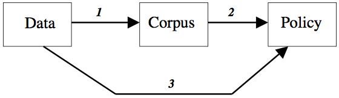

# Risk
**First published Tue Mar 13, 2007; substantive revision Thu Dec 8, 2022**

*Hansson, Sven Ove*

Since the 1970s, studies of risk have grown into a major interdisciplinary field of research. Although relatively few philosophers have focused their work on risk, there are important connections between risk studies and several philosophical subdisciplines. This entry summarizes the most well-developed of these connections and introduces some of the major topics in the philosophy of risk. It consists of seven sections dealing with the definition of risk and with treatments of risk related to epistemology, the philosophy of science, the philosophy of technology, ethics, decision theory, and the philosophy of economics.

## 1. Defining risk

In non-technical contexts, the word “risk” refers, often rather vaguely, to situations in which it is possible but not certain that some undesirable event will occur. In technical contexts, the word has several more specialized uses and meanings. Five of these are particularly important since they are widely used across disciplines:

1. risk = an *unwanted event* that may or may not occur.

An example of this usage is: “Lung cancer is one of the major risks that affect smokers.”

1. risk = the *cause* of an unwanted event that may or may not occur.

An example of this usage is: “Smoking is by far the most important health risk in industrialized countries.” (The unwanted event implicitly referred to here is a disease caused by smoking.) Both (1) and (2) are qualitative senses of risk. The word also has quantitative senses, of which the following is the oldest one:

1. risk = the *probability* of an unwanted event that may or may not occur.

This usage is exemplified by the following statement: “The risk that a smoker’s life is shortened by a smoking-related disease is about 50%.”

1. risk = the statistical *expectation value* of an unwanted event that may or may not occur.

The expectation value of a possible negative event is the product of its probability and some measure of its severity. It is common to use the number of killed persons as a measure of the severity of an accident. With this measure of severity, the “risk” (in sense 4) associated with a potential accident is equal to the statistically expected number of deaths. Other measures of severity give rise to other measures of risk.

Although expectation values have been calculated since the 17ᵗʰ century, the use of the term “risk” in this sense is relatively new. It was introduced into risk analysis in the influential Reactor Safety Study, WASH-1400 (Rasmussen et al., 1975, Rechard 1999)[^rasmussen-1975][^rechard-1999]. Today it is the standard technical meaning of the term “risk” in many disciplines. It is regarded by some risk analysts as the only correct usage of the term.

1. risk = the fact that a decision is made under conditions of *known probabilities* (“decision under risk” as opposed to “decision under uncertainty”)

In addition to these five common meanings of “risk” there are several other more technical meanings, which are well-established in specialized fields of inquiry. Some of the major definitions of risk that are used in economic analysis will be introduced below in section 7.1.

Although most of the above-mentioned meanings of “risk” have been referred to by philosophers, a large part of the philosophical literature on risk refers to risk in the more informal sense that was mentioned at the beginning of this section, namely as a state of affairs in which an undesirable event may or may not occur. Several philosophers have criticized the technical definitions of risk for being too limited and not covering all aspects that should be included in risk assessments (Buchak 2014; Pritchard 2015; Shrader-Frechette 1991)[^buchak-2014][^pritchard-2015][^shrader-frechette-1991]. Linguistic evidence indicates that technical definitions of risk have had virtually no impact on the non-technical usage of the word (Boholm et al. 2016)[^boholm-2016].

*Terminological note:* Some philosophers distinguish between “subjective” and “objective” probabilities. Others reserve the term “probability” for the subjective notion. Here, the former terminology is used, i.e. “probability” can refer either to subjective probability or to objective chances.

## 2. Epistemology

When there is a risk, there must be something that is unknown or has an unknown outcome. Therefore, knowledge about risk is knowledge about lack of knowledge. This combination of knowledge and lack thereof contributes to making issues of risk complicated from an epistemological point of view.

In non-regimented usage, “risk” and “uncertainty” differ along the subjective—objective dimension. Whereas “uncertainty” seems to belong to the subjective realm, “risk” has a strong objective component. If a person does not know whether or not the grass snake is poisonous, then she is in a state of uncertainty with respect to its ability to poison her. However, since this species has no poison there is no risk to be poisoned by it. The relationship between the two concepts “risk” and “uncertainty” seems to be in part analogous to that between “truth” and “belief”.

Regimented decision-theoretical usage differs from this. In decision theory, a decision is said to be made “under risk” if the relevant probabilities are available and “under uncertainty” if they are unavailable or only partially available. Partially determined probabilities are sometimes expressed with probability intervals, e.g., “the probability of rain tomorrow is between 0.1 and 0.4”. (The term “decision under ignorance” is sometimes used about the case when no probabilistic information at all is available.)

Although this distinction between risk and uncertainty is decision-theoretically useful, from an epistemological point of view it is in need of clarification. Only very rarely are probabilities known with certainty. Strictly speaking, the only clear-cut cases of “risk” (known probabilities) seem to be idealized textbook cases that refer to devices such as dice or coins that are supposed to be known with certainty to be fair. In real-life situations, even if we act upon a determinate probability estimate, we are not fully certain that this estimate is exactly correct, hence there is uncertainty. It follows that almost all decisions are made “under uncertainty”. If a decision problem is treated as a decision “under risk”, then this does not mean that the decision in question is made under conditions of completely known probabilities. Rather, it means that a choice has been made to simplify the description of this decision problem by treating it as a case of known probabilities. This is often a highly useful idealization in decision theory. However, in practical applications it is important to distinguish between those probabilities that can be treated as known and those that are uncertain and therefore much more in need of continuous updating. Typical examples of the former are the failure frequencies of a technical component that are inferred from extensive and well-documented experience of its use. The latter case is exemplified by experts’ estimates of the expected failure frequencies of a new type of component.

A major problem in the epistemology of risk is how to deal with the limitations that characterize our knowledge of the behaviour of unique complex systems that are essential for estimates of risk, such as the climate system, ecosystems, the world economy, etc. Each of these systems contains so many components and potential interactions that important aspects of it are unpredictable. However, in spite of this uncertainty, reasonably reliable statements about many aspects of these systems can be made. Anthropogenic climate change is an example of this. Although many details are unknown, the general picture is clear, and there is no reasonable doubt about the existence of anthropogenic climate change, about its major causes and mechanisms, or the overall nature of the risks that it creates for our societies (Mayer et al. 2017; Lewandowsky et al. 2018)[^lewandowsky-2018][^mayer-2017]. The epistemological status of such partial knowledge about complex systems, and the nature of the uncertainty involved, are still in need of further clarification (McKinney 1996, Shrader-Frechette 1997)[^mckinney-1996][^shrader-frechette-1997].

In the risk sciences, it is common to distinguish between “objective risk” and “subjective risk”. The former concept is in principle fairly unproblematic since it refers to a frequentist interpretation of probability. The latter concept is more ambiguous. In the psychometric literature on risk from the 1970s, subjective risk was often conceived as a subjective estimate of objective risk. In more recent literature, a more complex picture has emerged. Subjective appraisals of (the severity of) risk depend to a large extent on factors that are not covered in traditional measures of objective risk, such as control and tampering with nature. If the terms are taken in this sense, subjective risk is influenced by the subjective estimate of objective risk, but cannot be identified with it. In the psychological literature, subjective risk is often conceived as the individual’s overall assessment of the seriousness of a danger or alleged danger. Such individual assessments are commonly called “risk perception”, but strictly speaking the term is misleading. This is not a matter of perception, but rather a matter of attitudes and expectations. Subjective risk can be studied with methods of attitude measurement and psychological scaling (Sjöberg 2004)[^sjöberg-2004].

The probabilistic approach to risk dominates in philosophy as well as in other disciplines, but some philosophers have investigated an alternative, modal account of risk. According to this account, “[t]o say that a target event is risky is to say that (keeping relevant initial conditions for that event fixed) it obtains in close possible worlds” (Pritchard 2016, 562)[^pritchard-2016]. The risk is smaller, the more distant the nearest possible world is in which the target event takes place. This approach has interesting connections with psychological accounts of risk, but it is far from clear how distance between possible worlds should be defined and determined.

## 3. Philosophy of science

The role of values in science has been particularly controversial in issues of risk. Risk assessments have frequently been criticized for containing “hidden” values that induce a too high acceptance of risk (Cranor 2016; 2017; Intemann 2016; Heinzerling 2000)[^cranor-2016][^heinzerling-2000]. There is also a discussion on the need to strengthen the impact of certain values in risk assessment, such as considerations of justice (Shrader-Frechette 2005a), human rights (Shrader-Frechette 2005b), and the rights and welfare of future people (Caney 2009; Ng 2005)[^caney-2009]. Issues of risk have also given rise to heated debates on what levels of scientific evidence are needed for policy decisions. The proof standards of science are apt to cause difficulties whenever science is applied to practical problems that require standards of proof or evidence different from those of science.

A decision to accept or reject a scientific statement (for instance an hypothesis) is in practice always subject to the possibility of error. The chance of such an error is often called the inductive risk (Hempel 1965, 92)[^hempel-1965]. There are two major types of errors. The first of these consists in concluding that there is a phenomenon or an effect when in fact there is none. This is called an error of type I (false positive). The second consists in missing an existing phenomenon or effect. This is called an error of type II (false negative). In the internal dealings of science, errors of type I are in general regarded as more problematic than those of type II. The common scientific standards of statistical significance substantially reduce the risk of type I errors but do not protect against type II errors (Shrader-Frechette 2008; John 2017)[^john-2017].

Many controversies on risk assessment concern the balance between risks of type I and type II errors. Whereas science gives higher priority to avoiding type I errors than to avoiding type II errors, the balance can shift when errors have practical consequences. This can be seen from a case in which it is uncertain whether there is a serious defect in an airplane engine. A type II error, i.e., acting as if there were no such a defect when there is one, would in this case be counted as more serious than a type I error, i.e., acting as if there were such a defect when there is none. (The distinction between type I and type II errors depends on the delimitation of the effect under study. In discussions of risk, this delimitation is mostly uncontroversial. Lemons et al. 1997; van den Belt and Gremmen 2002.)[^lemons-1997][^belt-2002]

In this particular case it is fairly uncontroversial that avoidance of type II error should be given priority over avoidance of type I error. In other words, it is better to delay the flight and then find out that the engine was in good shape than to fly with an engine that turns out to malfunction. However, in other cases the balance between the two error types is more controversial. Controversies are common, for instance, over what degree of evidence should be required for actions against possible negative effects of chemical substances on human health and the environment.

*Figure 1.*

Figure 1. The use of scientific data for policy purposes.

Such controversies can be clarified with the help of a simple but illustrative model of how scientific data influence both scientific judgments and practical decisions (Hansson 2008). Scientific knowledge begins with data that originate in experiments and other observations. (See Figure 1.) Through a process of critical assessment, these data give rise to the scientific corpus (arrow 1). Roughly speaking, the corpus consists of those statements that could, for the time being, legitimately be made without reservation in a (sufficiently detailed) textbook. When determining whether or not a scientific hypothesis should be accepted, for the time being, as part of the corpus, the onus of proof falls on its adherents. Similarly, those who claim the existence of an as yet unproven phenomenon have the burden of proof. These proof standards are essential for the integrity of science.

The most obvious way to use scientific information for policy-making is to employ information from the corpus (arrow 2). For many purposes, this is the only sensible thing to do. However, in risk management decisions, exclusive reliance on the corpus may have unwanted consequences. Suppose that toxicological investigations are performed on a substance that has not previously been studied from a toxicological point of view. These investigations turn out to be inconclusive. They give rise to science-based suspicions that the substance is dangerous to human health, but they do not amount to full scientific proof in the matter. Since the evidence is not sufficient to warrant an addition to the scientific corpus, this information cannot influence policies in the standard way (via arrows 1 and 2). There is a strict requirement to avoid type I errors in the process represented by arrow 1, and this process filters out information that might in this case have been practically relevant and justified certain protective measures.

In cases like this, a direct road from data to policies is often taken (arrow 3). This means that a balance between type I and type II errors is determined in the particular case, based on practical considerations, rather than relying on the standard scientific procedure with its strong emphasis on the avoidance of type I errors.

It is essential to distinguish here between two kinds of risk-related decision processes. One consists in determining which statements about risks should be included in the scientific corpus. The other consists in determining how risk-related information should influence practical measures to protect health and the environment. It would be a strange coincidence if the criteria of evidence in these two types of decisions were always the same. Strong reasons can be given for strict standards of proof in science, i.e. high entry requirements for the corpus. At the same time, there can be valid policy reasons to allow risk management decisions to be influenced by scientifically plausible indications of danger that are not yet sufficiently well-confirmed to qualify for inclusion into the scientific corpus.

The term *inductive risk* is usually reserved for the (type I and type II) risks that follow directly from the acceptance or rejection of an hypothesis. The term *epistemic risk* is used for a wider category of risks in belief formation, such as risks taken when choosing a methodology, accepting a background assumption, or deciding how to interpret data (Biddle 2016)[^biddle-2016].

Policy issues concerning risk have often been the targets of extensive disinformation campaigns characterized by science denial and other forms of pseudoscience (Oreskes 2010). Several philosophers have been active in the repudiation of invalid claims and the defence of science in risk-related issues (Cranor 2005; 2016; 2017; Goodwin 2009; Prothero 2013; Shrader-Frechette 2014; Hansson 2017)[^cranor-2005][^goodwin-2009][^hansson-2017][^prothero-2013].

## 4. Philosophy of technology

Safety and the avoidance of risk are major concerns in practical engineering. Safety engineering has also increasingly become the subject of academic investigations. However, these discussions are largely fragmented between different areas of technology. The same basic ideas or “safety philosophies” are discussed under different names for instance in chemical, nuclear, and electrical engineering. Nevertheless, much of the basic thinking seems to be the same in the different areas of safety engineering (Möller and Hansson 2008)[^möller-2008].

Simple safety principles, often expressible as rules of thumb, have a central role in safety engineering. Three of the most important of these are inherent safety, safety factors, and multiple barriers.

Inherent safety, also called primary prevention, consists in the elimination of a hazard. It is contrasted with secondary prevention that consists in reducing the risk associated with a hazard. For a simple example, consider a process in which inflammable materials are used. Inherent safety would consist in replacing them by non-inflammable materials. Secondary prevention would consist in removing or isolating sources of ignition and/or installing fire-extinguishing equipment. As this example shows, secondary prevention usually involves added-on safety equipment. The major reason to prefer inherent safety to secondary prevention is that as long as the hazard still exists, it can be realized by some unanticipated triggering event. Even with the best of control measures, if inflammable materials are present, some unforeseen chain of events can start a fire.

Safety factors are numerical factors employed in the design process for our houses, bridges, vehicles, tools, etc., in order to ensure that our constructions are stronger than the bare minimum expected to be required for their functions. Elaborate systems of safety factors have been specified in norms and standards. A safety factor most commonly refers to the ratio between a measure of the maximal load not leading to a specified type of failure and a corresponding measure of the maximal expected load. It is common to make bridges and other constructions strong enough to withstand twice or three times the predicted maximal load. This means that a safety factor of two or three is employed.

Safety factors are also used in regulatory toxicology and ecotoxicology. For instance, in food toxicology, the highest dose allowed for human exposure has traditionally been calculated as one hundredth of the highest dose (per kilogram body weight) that gave no observable negative effect in experimental animals. Today, higher safety factors than 100 have become common (Dourson and Stara 1983; Pressman et al. 2017)[^dourson-1983][^pressman-2017].

Safety barriers are often arranged in chains. Ideally, each barrier is independent of its predecessors so that if the first fails, then the second is still intact, etc. For example, in an ancient fortress, if the enemy managed to pass the first wall, then additional layers would protect the defending forces. Some engineering safety barriers follow the same principle of concentric physical barriers. Others are arranged serially in a temporal or functional rather than a spatial sense. One of the lessons that engineers learned from the *Titanic* disaster is that improved construction of early barriers is not of much help if it leads to neglect of the later barriers (in that case lifeboats).

The major problem in the construction of safety barriers is how to make them as independent of each other as possible. If two or more barriers are sensitive to the same type of impact, then one and the same destructive force can get rid of all of them in one swoop. For instance, if three safety valves are installed in one and the same factory hall, each with the probability 1/1,000 of failure, it does not follow that the probability of all three failing is $1 \times 10^{-9}$. The three valves may all be destroyed in the same fire, or damaged by the same mistake in maintenance operations. This is a common situation for many types of equipment.

Inherent safety, safety factors, and multiple barriers have an important common feature: They all aim at protecting us not only against risks that can be assigned meaningful probability estimates, but also against dangers that cannot be probabilized, such as the possibility that some unanticipated type of event gives rise to an accident. It remains, however, for philosophers of technology to investigate the principles underlying safety engineering more in detail and to clarify how they relate to other principles of engineering design (Doorn and Hansson 2015)[^doorn-2015].

Many attempts have been made to predict the risks associated with emerging and future technologies. The role of philosophers in these endeavours has often been to point out the difficulties and uncertainties involved in such predictions (Allhoff 2009; Gordijn 2005)[^allhoff-2009][^gordijn-2005]. Experience shows that even after extensive efforts to make a new product safe, there is a need for post market surveillance (PMS) in order to discover unexpected problems. For instance, before the massive introduction of automobile air bags around 1990, safety engineers performed laboratory tests of different crash scenarios with dummies representing a variety of body weights and configurations (including infants and pregnant women). But in spite of the adjustments of the construction that these tests gave rise to, inflated airbags caused a considerable number of (mostly minor) injuries. By carefully analyzing experiences from actual accidents, engineers were able to substantially reduce the frequency and severity of such injuries (Wetmore 2008)[^wetmore-2008]. For pharmaceutical drugs and some medical devices, post market surveillance is legally required in many jurisdictions.

## 5. Ethics

### 5.1 A difficulty for moral theories

Until recently, problems of risk have not been treated systematically in moral philosophy. A possible defence of this limitation is that moral philosophy can leave it to decision theory to analyse the complexities that indeterminism and lack of knowledge give rise to in real life. According to the conventional division of labour between the two disciplines, moral philosophy provides assessments of human behaviour in well-determined situations. Decision theory takes assessments of these cases for given, adds the available probabilistic information, and derives assessments for rational behaviour in an uncertain and indeterministic world. On this view, no additional input of moral values is needed to deal with indeterminism or lack of knowledge, since decision theory operates exclusively with criteria of rationality.

Examples are easily found that exhibit the problematic nature of this division between the two disciplines. Compare the act of throwing down a brick on a person from a high building to the act of throwing down a brick from a high building without first making sure that there is nobody beneath who can be hit by the brick. The moral difference between these two acts is not obviously expressible in a probability calculus. An ethical analysis of the difference will have to refer to the moral aspects of risk impositions as compared to intentional ill-doing. More generally speaking, a reasonably complete account of the ethics of risk must distinguish between intentional and unintentional risk exposure and between voluntary risk-taking, risks imposed on a person who accepts them, and risks imposed on a person who does not accept them. This cannot be done in a framework that treats risks as probabilistic mixtures of outcomes. In principle, these outcomes can be so widely defined that they include all relevant moral aspects, including rights infringements as well as intentionality and other pertinent mental states. However, this would still not cover the moral implications of risk taking *per se*, since these are not inherent properties of any of the potential outcomes.

Methods of moral analysis are needed that can guide decisions on risk-takings and risk impositions. A first step is to investigate how standard moral theories can deal with problems of risk that are presented in the same way as in decision theory, namely as the (moral) evaluation of probabilistic mixtures of (deterministic) scenarios.

### 5.2 Utilitarianism

In utilitarian theory, there are two obvious approaches to such problems. One is the *actualist* solution. It consists in assigning to a (probabilistic) mixture of potential outcomes a utility that is equal to the utility of the outcome that actually materializes. To exemplify this approach, consider a decision whether or not to reinforce a bridge before it is used for a single, very heavy transport. There is a 50% risk that the bridge will fall down if it is not reinforced. Suppose that a decision is made not to reinforce the bridge and that everything goes well; the bridge is not damaged. According to the actualist approach, the decision was right. This is, of course, contrary to common moral intuitions.

The other established utilitarian approach is the maximization of expected utility. This means that the utility of a mixture of potential outcomes is defined as the probability-weighted average of the utilities of these outcomes.

The expected utility criterion has been criticized along several lines. One criticism is that it disallows a common form of cautiousness, namely disproportionate avoidance of large disasters. For example, provided that human deaths are valued equally and additively, as most utilitarians are prone to do, this framework does not allow that one prefers a probability of 1 in 1000 that one person will die to a probability of 1 in 100000 that fifty persons will die. The expected utility framework can also be criticized for disallowing a common expression of strivings for fairness, namely disproportionate avoidance of high-probability risks for particular individuals. Hence, in the choice between exposing one person to a probability of 0.9 to be killed and exposing each of one hundred persons to a probability of 0.01 of being killed, it requires that the former alternative be chosen. In summary, expected utility maximization prohibits what seem to be morally reasonable standpoints on risk-taking and risk imposition.

However, it should be noted that the expected utility criterion does not necessarily follow from utilitarianism. Utilitarianism in a wide sense (Scanlon 1982)[^scanlon-1982] is compatible with other ways of evaluating uncertain outcomes (most notably with actual consequence utilitarianism, but in principle also for instance with a maximin criterion). Therefore, criticism directed against expected utility maximization does not necessarily show a defect in utilitarian thinking.

### 5.3 Rights-based moral theories

The problem of dealing with risk in rights-based moral theories was formulated by Robert Nozick: “Imposing how slight a probability of a harm that violates someone’s rights also violates his rights?” (Nozick 1974, 74)[^nozick-1974].

An extension of a rights-based moral theory to indeterministic cases can be obtained by prescribing that if *A* has a right that *B* does not bring about a certain outcome, then *A* also has a right that *B* does not perform any action that (at all) increases the probability of that outcome. Unfortunately, such a strict extension of rights is untenable in social practice. Presumably, *A* has the right not to be killed by *B*, but it would not be reasonable to extend this right to all actions by *B* that give rise to a very small increase in the risk that *A* dies — such as driving a car in the town where *A* lives. Such a strict interpretation would make human society impossible.

Hence, a right not to be risk-exposed will have to be defeasible so that it can be overridden in some (but not necessarily all) cases when the increase in probability is small. However, it remains to find a credible criterion for when it should be overridden. As Nozick observed, a probability limit is not credible in “a tradition which holds that stealing a penny or a pin or anything from someone violates his rights. That tradition does *not* select a threshold measure of harm as a lower limit, in the case of harms certain to occur” (Nozick 1974, 75)[^nozick-1974].

### 5.4 Deontological moral theories

The problem of dealing with risks in deontological theories is similar to the corresponding problem in rights-based theories. The duty not to harm other people can be extended to a duty not to perform actions that increase their risk of being harmed. However, society as we know it is not possible without exceptions to this rule. The determination of criteria for such exceptions is problematic in the same way as for rights-based theories. All reasonable systems of moral obligations will contain a general prohibition against actions that kill another person. Such a prohibition can (and should) be extended to actions that involve a large risk that a person is killed. However, it cannot be extended to all actions that lead to a minuscule increase in the risk that a person is killed, since that would exclude many actions and behaviours that few of us would be willing to give up. A limit must be drawn between reasonable and unreasonable impositions of risk. It seems as if such delimitations will have to appeal to concepts, such as probabilities and/or the size of the benefits obtained by taking a risk, that are not part of the internal resources of deontological theories.

### 5.5 Contract theories

Contract theories may appear somewhat more promising than the theories discussed above. The criterion that they offer for the deterministic case, namely consent among all those involved, can also be applied to risky options. It could be claimed that risk impositions are acceptable if and only if they are supported by a consensus. Such a consensus, as conceived in contract theories, is either actual or hypothetical.

Actual consensus is unrealistic in a complex society where everyone performs actions with marginal but additive effects on many people’s lives. According to the criterion of actual consensus, any local citizen will have a veto against anyone else who wants to drive a car in the town where she lives. In this way citizens can block each other, creating a society of stalemates.

Hypothetical consensus has been developed as a criterion in contract theory in order to deal with inter-individual problems. We are invited to consider a hypothetical initial situation in which the social order of a future society has not yet been decided. When its future citizens meet to choose a social order, each of them is ignorant of her or his position in any of the social arrangements which they can choose among. According to John Rawls’s theory of justice, they will then all opt for a maximin solution, i.e. a social order in which the worst position that anyone can have in that society is as good as possible. In arguing for that solution, Rawls relied heavily on the assumption that none of the participants knows anything at all about the probability that she will end up in one or other of the positions in a future social order (Rawls 1957; 1971; 1974)[^rawls-1957]. John Harsanyi, who discussed this problem prior to Rawls, assumed that the probability of finding oneself in a particular social position is equal to the share of the population that will have the position in question, and that this is also known by all participants. Hence, if a fifth of the population in a certain type of society will be migrant workers, then each participant in Harsanyi’s initial situation will assume that she has a twenty per cent probability of becoming a migrant worker, whereas none of the participants in Rawls’s initial situation will have a clue what that probability can be. In Harsanyi’s initial situation, the participants will choose the social order with the highest expected utility (probability-weighted utility), thus taking all potential future positions into account, rather than only the least favourable one (Harsanyi 1953; 1955; 1975)[^harsanyi-1953].

However, in discussions about various risks in our existing societies we do not have much use for the hypothetical initial situations of contract theory. The risks and uncertainties in real life are of quite a different nature than the hypothetical uncertainty (or ignorance) about one’s own social position and conditions which is a crucial requirement in the initial situation. The thought experiment of an initial situation does not seem to provide us with any intellectual tools for the moral appraisal of risks in addition to those to which we have access even without trying to think away who we are.

### 5.6 Summary and outlook

In summary, the problem of appraising risks from a moral point of view does not seem to have any satisfactory solution in the common versions of the above-mentioned types of moral theories. The following are three possible elements of a solution:

1. It may be useful to shift the focus from risks, described two-dimensionally in terms of probability and severity (or one-dimensionally as the product of these), to actions of risk-taking and risk-imposing. Such actions have many morally relevant properties in addition to the two dimensions mentioned, such as who contributes causally to the risk and in what ways and with what intentions, and how the risk and its associated benefits are distributed.
2. Important moral intuitions are accounted for by assuming that each person has a prima facie moral right not to be exposed to risk of negative impact, such as damage to her health or her property, through the actions of others. However, this is a prima facie right that has to be overridden in quite a few cases, in order to make social life at all possible. Therefore, the recognition of this right gives rise to what can be called an *exemption problem*, namely the problem of determining when it is rightfully overridden.
3. Part of the solution to the exemption problem may be obtained by allowing for reciprocal exchanges of risks and benefits. Hence, if *A* is allowed to drive a car, exposing *B* to certain risks, then in exchange *B* is allowed to drive a car, exposing *A* to the corresponding risks. In order to deal with the complexities of modern society, this principle must also be applied to exchanges of different types of risks and benefits. Exposure of a person to a risk can then be regarded as acceptable if it is part of an equitable social system of risk-taking that works to her advantage. Such a system can be required to contain mechanisms that eliminate, or compensate for, social inequalities that are caused by disease and disability. (Hansson 2003; 2013)[^hansson-2003]

Discussions on the overall issue of risk acceptance can be found in Macpherson (2008), Hansson (2013) and Oberdiek (2014). Justice in risk impositions is discussed in Ferretti 2010 and Heyward & Roser 2016. Issues of rights and risks are discussed in Thomson 1986 and, with a particular emphasis on responsibilities, in Kermisch 2012 and van de Poel, et al. 2012.

## 6. Decision theory

Decision theory is concerned with determining the best way to achieve as valuable an outcome as possible, given the values that we have. In decision theory, our values and goals are taken as given, and the analysis concerns how best to achieve them to an as high degree as possible. Decision-making under risk and uncertainty is one of the major topics in decision theory. It is usually assumed that if the values of a set of potential outcomes are known (for instance from moral philosophy), then purely instrumental considerations are sufficient for determining how best to act under risk or uncertainty in order to achieve the best possible result. (For a critical discussion of that presumption, see Hansson 2013, 49–51.)[^hansson-2013] The values taken for given in decision-theoretical analysis can, but need not, be moral values of the types that are developed and analyzed in moral philosophy.

### 6.1 Decision weights

Decision theory has traditionally had a predilection for consequentialism, whose structure is suitable for most formal models of decision-making. The standard decision-theoretical approach to risk is maximization of expected utility, which can be seen as a smooth extension of (act) utilitarianism. In expected utility theory, the value associated with an uncertain situation is equal to the sum of the probability-weighted values of all its possible outcomes. Let $p$ be a function that assigns probabilities to outcomes, and $u$ a function that assigns values to them. Then the value associated with a situation with three possible outcomes $x_1$, $x_2$ and $x_3$, is equal to

$$p(x_1) \cdot u(x_1) + p(x_2) \cdot u(x_2)+ p(x_3) \cdot u(x_3).$$

However, influential proposals have been made for alternative decision rules. There are two major types of justification for such endeavours. First, examples have been put forward in which it would seem implausible to claim that expected utility maximization is the only normatively reasonable decision rule (Allais 1953; Ellsberg 1961)[^allais-1953][^ellsberg-1961]. Secondly, numerous psychological experiments have shown that human decision-makers tend to deviate substantially from expected utility maximization. The first type of justification puts the normative soundness of expected utility in question, where the second exposes its shortcomings as a descriptive model.

In an important class of alternative decision rules, the probabilities used in expected utility calculations are replaced by some other numbers (“decision weights”). This approach was proposed by William Fellner (1961). In most of these constructions, all probabilities are transformed by some transformation function *r*. Instead maximizing the standard expected utility $$p(x) \cdot u(x)$$ the agent will then maximize $$r(p(x)) \cdot u(x)$$

Several decision rules with this structure have been proposed. One of the earliest was Handa (1977). Currently, the best known proposal in this tradition is prospect theory (Kahneman and Tversky 1979; Tversky and Kahneman 1986)[^kahneman-1979][^tversky-1986], which was developed in order to describe observations from psychological decision experiments more accurately than in expected utility theory. Prospect theory a is a fairly complex theory that also deviates in other ways from expected utility theory. The traditional focus on outcomes is replaced by a focus on losses and gains, which are treated asymmetrically. (See also Section 7.3.)

A problem with the function $r$, as defined above, is that the transformed probabilities which it gives rise to will not add up to 1 except in the trivial case when *r* is the identity function (Fishburn 1978)[^fishburn-1978]. To solve this problem, Quiggin (1982) introduced the rule of maximizing *anticipated utility* (also called utility with rank dependent probabilities). Instead of replacing $p(x)$ by a function of the individual probability, $r(p(x))$, he replaced it by a function that also depends on the other probabilities and utilities involved in the problem. The outcomes are first ordered from worst to best, which results in a vector $\langle x_1, x_2 ,\ldots , x_n\rangle$ of outcomes, such that $u(x_1) \leq u(x_2) \leq \ldots \leq u(x_n)$. A decision weight can then be assigned to each outcome, taking into account both its probability and its position in the ranked sequence of outcomes. Since the decision-weight can be different for outcomes with the same probability, Fishburn’s trivialization result does not apply here. There is evidence indicating that rank-dependent utility models may be more empirically adequate than prospect theory (Harrison and Ross 2017)[^harrison-2017].

Other models have been proposed that replace the probabilities in expected utility maximization by some other type of decision weight (Gilboa and Schmeidler 1994; Buchak 2014)[^buchak-2014][^gilboa-1994].

### 6.2 Pessimism, cautiousness and the precautionary principle

In decision-theoretical analysis of risk, it is important to distinguish between two pairs of concepts that are both related to risk: Pessimism vs. optimism and cautiousness vs. risk-taking.

Pessimism and optimism concerns a person’s patterns of value-related beliefs about future events. A person is pessimistic about some future development to the extent that she assigns a higher probability to undesired outcomes, and a lower probability to desired ones, than the most plausible assignment. She is optimistic to the extent that she assigns higher probabilities to desired outcomes, and lower probabilities to undesired ones, than the most plausible assignment.

Cautiousness (risk aversion) and risk-seeking (risk affinity) concern a person’s decisions and actions, rather than her beliefs. When making a choice between different action alternatives, a cautious (risk-averse) person tends to choose an alternative with as small probabilities as possible for the worst outcomes. She does so even if it prevents her from maximizing the expected utility of her choice. In contrast, a risk-seeking person looks for options with a high probability for the best outcomes, and she does this even at the expense of not maximizing the expected utility of her choice. (See also section 7.2.)

The *precautionary principle* is often believed to be a general instruction to be cautious. However, this is not what is usually meant by the term “the precautionary principle”. This is a principle that is defined in international treaties and in European legislation. According to these definitions, the precautionary principle concerns how we should act when it is scientifically reasonable to suspect a risk to health or the environment, but the evidence is not strong enough to show conclusively that the risk exists. The precautionary principle says that in such cases we may, and often should, take measures against the potential danger. This definition has been the standard at least since 1992, when the precautionary principle was included both in the United Nations’ Rio Declaration and in the European Union’s Treaty of Rome, which is now called the Treaty on the Functioning of the European Union (Pyhälä et al., 2010)[^pyhälä-2010]. Its practical application depends on the interpretation of scientific evidence that indicates the presence of a danger, but is not strong enough for scientists to treat the existence of that danger as known. The evaluation of such evidence raises methodological and epistemological issues that are in need of further clarification, not least with conceptual tools developed in the philosophy of science.

There is also a still ongoing philosophical discussion about other definitions of a precautionary principle. Many of these proposals are closer to general (decision-theoretical) cautiousness than the more narrowly defined legal concept (Munthe 2011)[^munthe-2011].

## 7. Risk in economic analysis

Risks have a central role in economic activities. In capitalist market economies, taking economic risks is an essential part of the role of the entrepreneur. Decisions on investments and activities on financial markets can only be understood against the background of the risks involved. Therefore it is no surprise that modern economic theory, with its emphasis on mathematical models of economic activities, has developed several formal models of risk-taking.

### 7.1 Measures of economic risks

Portfolio analysis, which was developed in the 1950s by Harry Markowitz (1952), James Tobin (1958) and others, was an important step forward in the economic analysis of risk. These authors employed a simple statistical measure, namely the standard deviation (or alternatively the variance, that is the square of the standard deviation) as a measure of riskiness. Hence, in a comparison between two investment alternatives, the one whose economic outcome is calculated to have the largest standard deviation is regarded as the most risky one. In a comparison between different such alternatives, each of them can be characterized by two numbers, namely its expectation value and its standard deviation or riskiness. Investors typically prefer investments with as high expectation values and as low riskiness as possible. However, investors differ in the relative weight that they assign to expectations respectively risk avoidance. Given these decision weights, an individual’s optimal portfolio can be determined.

Since the late 1960s, alternative measures of risk have been developed. Perhaps the most influential of these was provided by Michael Rothschild and Joseph Stiglitz (1970): If we move probability mass from the centre to the tails of a probability distribution, while keeping its mean unchanged, then we increase the risk associated with the distribution. A measure based on this principle (mean preserving spread) can be constructed that has more attractive mathematical properties than those of the older standard deviation measure.

### 7.2 Measures of attitudes to risks

We differ in our attitudes to risk. Some of us willingly take risks which others deem much too large. The notion of certainty-equivalent outcomes can be used to specify such differences. Consider a risky outcome *X*. Another outcome *Y* is a certainty-equivalent outcome for *X* if and only if (1) *Y* involves no uncertainty and (2) *X* and *Y* are considered by the agent to be equally good. For instance, let *X* be a lottery ticket with a 50 per cent chance of winning something to which you assign 10 utiles (utility units) and a 50 per cent chance of winning nothing. The expected utility of this ticket is 5 utiles. Now suppose that you are indifferent between receiving 3 utiles for sure and receiving *X*. Then your attitude is risk averse. The general criterion for risk aversion (risk avoidance, cautiousness) is that $CE(X) < EU(X)$. Similarly, you are risk neutral concerning *X* if $CE(X) = EU(X)$ and you are risk affine (risk seeking, risk loving) if $EU(X) < CE(X)$.

In economics, risk aversion is usually related to money. Let *X* represent a lottery ticket with a 50 per cent chance of winning € 100, and suppose that you consider this ticket to be worth € 30. We then have $EU(X) = u(100)/2$, and $CE(X) = u(30)$. This means that $u(30) = u(100)/2$. If this is a consistent pattern, then the utility of money, as illustrated in a diagram with amounts *x* of money on the x axis and their utilities $u(x)$ on the y axis, will be represented by a concave (hill-like) curve. Similarly, if a risk affine behaviour will be represented by a convex (valley-like curve). Provided that the utility function *u* is twice continuously differentiable, this can be expressed more precisely in the form of the Arrow-Pratt measure of risk aversion/affinity, according to which the agent’s risk aversion at any point *x* is equal to $-u''(x)/u'(x)$. Hence, a person with the utility function $u_1$ is more risk averse at a point *x* than one with utility function $u_2$ if and only if $$-{u_1}''(x)/{u_1}'(x) > -{u_2}''(x)/{u_2}'(x)$$ (Arrow 1965; Pratt 1964)[^arrow-1965][^pratt-1964]. The Arrow-Pratt measure has the advantage of being invariant under transformations of the utility function that preserve the preference relation that it represents (i.e. it is invariant under multiplication of the utility with a positive constant and addition of an arbitrary constant). On the other hand, it can be questioned on philosophical grounds whether risk attitudes can be adequately represented by variations in the utility of money. It can be argued that cautiousness and the utility of money are two separate issues and that they should therefore have independent representations.

### 7.3 Experimental economics

Studies in experimental economics reveal that actual agents often do not conform with theoretically derived rationality criteria. One of the most popular descriptive theories that tries to capture actual behaviour under risk is prospect theory, which was developed by Daniel Kahneman and Amos Tversky around 1980 (Kahneman & Tversky 1979; Tversky & Kahneman 1986)[^kahneman-1979][^tversky-1986]. It distinguishes between two stages in a decision process. In the first phase, the *editing* phase, gains and losses in the different options are identified. They are defined relative to some neutral reference point that is usually the current asset position. In the second phase, the *evaluation* phase, the options are evaluated in a way that resembles expected utility analysis, but both utilities and probabilities are replaced by other, similar measures. Utility is replaced by a measure that is asymmetrical between gains and losses. Objective probabilities are transformed by a function that gives more weight to probability differences close to the ends than to those near the centre of the distribution. Thus it makes a greater difference to decrease the probability of a negative outcome from 2 to 1 per cent than to decrease it from 51 to 50 percent.

Prospect theory can explain some of the ways in which actual behaviour deviates from standard economic models of rational behaviour under risk. Hence the overweighting of probability changes close to zero or unity can be used to explain why people both buy insurance and buy lottery tickets. However, prospect theory is not plausible as a normative theory for rational behaviour under risk. Probably, normative and descriptive theories of risk will have to go in different directions.

### 7.4 Risk-benefit analysis

Risk-benefit analysis (RBA), also called cost-benefit analysis (CBA) is a collection of decision-aiding techniques that weigh advantages against disadvantages in numerical terms. In a typical risk-benefit analysis, multi-dimensional problems are reduced to a single dimension. This is achieved by assigning monetary values to all potential outcomes. Usually, uncertain outcomes are evaluated according to the expected utility model. This means that the disvalue of a risk is obtained by multiplying the probability of the undesired event by a monetary value representing its severity (Sen 2000; Sunstein 2005)[^sen-2000][^sunstein-2005].

In order to make overall alternatives comparable in simple numerical terms, all consequences, including losses of human lives, have to be assigned monetary values. The discussion about assigning monetary value to human lives seems to have had its origin in criticism by the American Air Force against a report from the RAND Corporation in 1950. The report recommended a military strategy that would result in mortality rates for crew members that the military considered to be unacceptably high. This was because loss of crew members was not included in the calculations. This omission had the same effect as setting the value of a soldier’s life at zero. In response to the criticism, the RAND Corporation began to include a life value in their analyses, but they had considerable difficulties in deriving this value (Banzhof 2014). Their employee Thomas Schelling proposed that life values should be derived from a marginal analysis of individuals’ own valuation of risks of death (Schelling 1968)[^schelling-1968]. If a person would accept a death risk of 1/10,000 against a compensation of $400, then that is taken to express a life value of 10,000 $\times$ $400 or $4,000,000.

Most of the philosophical discussion on risk-benefit analysis has been focused on the assignment of a monetary value to the loss of a human life (MacLean 1994; Heinzerling 2000; 2002)[^heinzerling-2000][^maclean-1994]. It has been claimed that lives and money are incommensurable, and that the determination and use of such “live values” express a lack of respect for human lives. Defenders of risk-benefit analysis have countered that these values are just technical constructs representing what society tends to pay (alternative: ought to pay) in order to save a human life. Risk-benefit analysis can help decision-makers to save as many lives as possible, given that they have a fixed amount of resources that they can assign to life-saving policies (Sunstein 2005)[^sunstein-2005].

Many of the value assignments used in cost-benefit analysis are based on estimates or measurements of (hypothetical) willingness to pay. Such estimates will give more influence to affluent people since they can pay more than others to have it their way. This can be corrected with income-based adjustments of the reported willingness to pay. However, there are considerable problems involved in the performance and interpretation of willingness-to-pay studies (Grüne-Yanoff 2009)[^grüne-yanoff-2009].

Risk-benefit analysis gives rise to several other philosophical problems of considerable philosophical interest (Hansson 2007)[^hansson-2007]. Due to its quantitative nature, it tends to leave out problems that are difficult to quantify, such as risks of cultural impoverishment, social isolation, and increased tensions between social strata. Furthermore, due to its aggregative structure, risk-benefit analysis often leaves out social justice and other distributional aspects, although these are in fact accessible to quantitative treatment.

## References（引用注释）

> 原文参考文献已转为脚注引用：文内“作者-年份”引用组后附 [^key] 标记，完整条目见本文末脚注定义。

## Academic Tools

> |   | [How to cite this entry](https://plato.stanford.edu/cgi-bin/encyclopedia/archinfo.cgi?entry=risk). |
> | --- | --- |
> |   | [Preview the PDF version of this entry](https://leibniz.stanford.edu/friends/preview/risk/) at the [Friends of the SEP Society](https://leibniz.stanford.edu/friends/). |
> |   | [Look up topics and thinkers related to this entry](https://www.inphoproject.org/entity?sep=risk&redirect=True) at the Internet Philosophy Ontology Project (InPhO). |
> |   | [Enhanced bibliography for this entry](https://philpapers.org/sep/risk/) at [PhilPapers](https://philpapers.org/), with links to its database. |

## Other Internet Resources

[Please contact the author with suggestions.]

## Related Entries

causation: in the law | causation: probabilistic | consequentialism | contractarianism | economics: philosophy of | game theory | luck: justice and bad luck | scientific knowledge: social dimensions of | technology, philosophy of

[^allais-1953]: Allais, M., 1953, “Le comportement de l’homme rationnel devant le risque: critique des postulats et axiomes de l’école Américaine”, *Econometrica*, 21: 503–546.

[^allhoff-2009]: Allhoff, F., 2009, “Risk, Precaution, and Emerging Technologies”, *Studies in Ethics, Law, and Technology*, 3(2), published online 25 June, 2009. doi:10.2202/1941-6008.1078

[^arrow-1965]: Arrow, K.J., 1965, *Aspects of the Theory of Risk-Bearing. Yrjö Jahnsson Lectures*. Helsinki: Yrjö Jahnssonin Säätiö.

[^banzhaf-2014]: Banzhaf, H.S., 2014, “Retrospectives: the Cold-War origins of the value of statistical life”, *Journal of Economic Perspectives* 28(4): 213–26.

[^biddle-2016]: Biddle, J.B., 2016, “Inductive risk, epistemic risk, and overdiagnosis of disease”, *Perspectives on Science* 24(2): 192–205.

[^boholm-2016]: Boholm, M. et al., 2016, “The Concepts of Risk, Safety, and Security: Applications in Everyday Language.”, *Risk Analysis* 36 (2): 320–338.

[^buchak-2014]: Buchak, L., 2014, *Risk and Rationality*, Oxford: Oxford University Press.

[^caney-2009]: Caney, S., 2009, “Climate Change and the Future: Discounting for Time, Wealth, and Risk”, *Journal of Social Philosophy*, 40(2): 163–186.

[^cranor-1997]: Cranor C., 1997, “The Normative Nature of Risk Assessment: Features and Possibilities”, *Risk: Health, Safety & Environment*, 8: 123–36.

[^cranor-2005]: –––, 2005. “The Science Veil Over Tort Law Policy: How Should Scientific Evidence Be Utilized in Toxic Tort Law?”, *Law and Philosophy*, 24(2): 139–210.

[^cranor-2016]: –––, 2016, *Toxic Torts: Science, Law and the Possibility of Justice* (second edition), Cambridge: Cambridge University Press.

[^cranor-2017]: –––, 2017, *Tragic Failures: How and Why We Are Harmed by Toxic Chemicals*, Oxford: Oxford University Press, 2017.

[^doorn-2015]: Doorn, N., and S.O. Hansson, 2015, “Design for the value of safety”, in J. van den Hoven, I. van de Poel, and P. Vermaas (eds), *Handbook of Ethics, Values and Technological Design*, Dordrecht: Springer, 491–511.

[^dourson-1983]: Dourson, M.L., & Stara, J.F., 1983, “Regulatory history and experimental support of uncertainty (safety) factors”, *Regulatory Toxicology and Pharmacology* 3(3): 224–238.

[^ellsberg-1961]: Ellsberg, D., 1961, “Risk, Ambiguity, and the Savage Axioms”, *Quarterly Journal of Economics*, 75: 643–669.

[^fellner-1961]: Fellner, W. 1961, “Distortion of subjective probabilities as a reaction to uncertainty”, *Quarterly Journal of Economics*, 75: 670–689.

[^ferretti-2010]: Ferretti, M.P., 2010, “Risk and Distributive Justice: The Case of Regulating New Technologies”, *Science and Engineering Ethics*, 16(3): 501–515.

[^fishburn-1978]: Fishburn, P.C., 1978, “On Handa’s ‘New theory of cardinal utility’ and the maximization of expected return”, *Journal of Political Economy*, 86: 321–324.

[^gigerenzer-2002]: Gigerenzer, G., 2002, *Calculated Risks: How to Know When Numbers Deceive You*, New York: Simon and Schuster.

[^gilboa-1994]: Gilboa, I. and D. Schmeidler, 1994, “Additive representations of non-additive measures and the Choquet integral”, *Annals of Operations Research*, 52: 43–65.

[^goodwin-2009]: Goodwin, W., 2009, “How Does the Theologizing of Physics Contribute to Global Warming?”, *Environmental Philosophy*, 6(2): 21–42.

[^gordijn-2005]: Gordijn, B., 2005, “Nanoethics: From Utopian Dreams and Apocalyptic Nightmares Towards a More Balanced View”, *Science and Engineering Ethics*, 11(4): 521–533.

[^grüne-yanoff-2009]: Grüne-Yanoff, T., 2009, “Mismeasuring the Value of Statistical Life”, *Journal of Economic Methodology*, 16 (2): 109–123.

[^handa-1977]: Handa, J., 1977, “Risk, probabilities, and a new theory of cardinal utility”, *Journal of Political Economy*, 85: 97–122.

[^hansson-2003]: Hansson, S. O., 2003, “Ethical criteria of risk acceptance”, *Erkenntnis*, 59: 291–309.

[^hansson-2004]: –––, 2004, “Weighing Risks and Benefits”, *Topoi*, 23: 145–152.

[^hansson-2006]: –––, 2006, “Economic (ir)rationality in risk analysis”, *Economics and Philosophy*, 22: 231–241.

[^hansson-2007]: –––, 2007, “Philosophical Problems in Cost-Benefit Analysis”, *Economics and Philosophy* 23: 163–183.

[^hansson-2013]: –––, 2013, *The Ethics of Risk: Ethical analysis in an uncertain world*, New York: Palgrave MacMillan.

[^hansson-2017]: –––, 2017, “Science denial as a form of pseudoscience”, *Studies in History and Philosophy of Science*, 63:39–47.

[^harrison-2017]: Harrison, G.W. and D. Ross, 2017, “The empirical adequacy of cumulative prospect theory and its implications for normative assessment”, *Journal of Economic Methodology*, 24: 150–165.

[^harsanyi-1953]: Harsanyi, J.C., 1953, “Cardinal utility in welfare economics and in the theory of risk-taking”, *Journal of Political Economy*, 61: 434–435.

[^harsanyi-1955]: Harsanyi, J.C., 1955, “Cardinal welfare, individualistic ethics, and interpersonal comparisons of utility”, *Journal of Political Economy*, 63: 309–321.

[^harsanyi-1975]: Harsanyi, J.C., 1975, “Can the maximin principle serve as a basis for morality? A critique of John Rawls’s theory”, *American Political Science Review*, 69: 594–606.

[^heinzerling-2000]: Heinzerling, L., 2000, “The rights of statistical people.”, *Harvard Environmental Law Review* 24: 189–207.

[^heinzerling-2002]: –––, 2002, “Markets for arsenic”, *Georgetown Law Journal*, 90: 2311–2339.

[^hempel-1965]: Hempel, C.G., 1965, *Aspects of scientific explanation, and other essays in the philosophy of science*, New York: Free Press.

[^heyward-2016]: Heyward, C., and D. Roser (eds.), 2016, *Climate Justice in a Non-Ideal World*, Oxford: Oxford University Press.

[^intemann-2015]: Intemann, K., 2015, “Distinguishing Between Legitimate and Illegitimate Values in Climate Modeling.”, *European Journal for Philosophy of Science*, 5(2): 217–232.

[^jellinek-1981]: Jellinek, S. D., 1981, “On The Inevitability Of Being Wrong”, *Annals of the New York Academy of Science*, 363: 43–47.

[^john-2017]: John, S., 2017, “From Social Values to P-Values: The Social Epistemology of the Intergovernmental Panel on Climate Change”, *Journal of Applied Philosophy*, 34 (2): 157–171.

[^kahneman-1979]: Kahneman, D. and A. Tversky 1979, “Prospect theory: An analysis of decision under risk”, *Econometrica*, 47: 263–293.

[^kermisch-2012]: Kermisch, C., 2012, “Risk and Responsibility: A Complex and Evolving Relationship”, *Science and Engineering Ethics*, 18(1): 91–102.

[^lemons-1997]: Lemons, J., et al., 1997, “The Precautionary Principle: Scientific Uncertainty and Type I and Type II Errors”, *Foundations of Science*, 2(2): 207–236.

[^lewandowsky-2018]: Lewandowsky, S., J. Cook & E. Lloyd, 2018, “The ‘Alice in Wonderland’ Mechanics of the Rejection of (Climate) Science: Simulating Coherence by Conspiracism”, *Synthese* 195 (1):175–196.

[^maclean-1986]: MacLean, D. (ed.), 1986, *Values at Risk* (Maryland Studies in Public Philosophy), Totowa, NJ: Rowman and Littlefield.

[^maclean-1994]: –––, 1994, “Cost-benefit analysis and procedural values”, *Analyse & Kritik*, 16(2): 166–180.

[^machina-1987]: Machina, M.D. and M. Rothschild, 1987, “Risk”, in J. Eatwell, M. Milgate, and P. Newman (eds.), *The New Palgrave: A Dictionary of Economic Theory and Doctrine* (Volume 4), London and New York: Macmillan and Stockton, pp. 201–205.

[^macpherson-2008]: Macpherson, J.A.E., 2008, “Safety, Risk Acceptability, and Morality”, *Science and Engineering Ethics*, 14(3): 377–390.

[^markowitz-1952]: Markowitz, H.M., 1952, “Portfolio Selection”, *Journal of Finance*, 7(1): 77–91.

[^mayer-2017]: Mayer, L. et al., 2017, “Understanding Scientists’ Computational Modeling Decisions About Climate Risk Management Strategies Using Values-Informed Mental Models”, *Global Environmental Change* 42:107–116.

[^mckerlie-1986]: McKerlie, D., 1986, “Rights and Risk”, *Canadian Journal of Philosophy*, 16: 239–52.

[^mckinney-1996]: McKinney, W.J., 1996, “Prediction and Rolston’s Environmental Ethics: Lessons From the Philosophy of Science”, *Science and Engineering Ethics*, 2(4): 429–440.

[^möller-2008]: Möller, N. and S.O. Hansson, 2008, “Principles of engineering safety: risk and uncertainty reduction”, *Reliability Engineering and System Safety*, 93: 776–783.

[^munthe-2011]: Munthe, Christian, 2011, *The Price of Precaution and the Ethics of Risk*, Dordrecht: Springer.

[^ng-2005]: Ng, Y.-K., 2005, “Intergenerational Impartiality: Replacing Discounting by Probability Weighting”, *Journal of Agricultural and Environmental Ethics*, 18(3): 237–257.

[^nozick-1974]: Nozick, Robert, 1974, *Anarchy, State, and Utopia*, New York: Basic Books.

[^oberdiek-2014]: Oberdiek, J., 2014, *Imposing Risk: A Normative Framework*, Oxford: Oxford University Press.

[^pratt-1964]: Pratt, J. W., 1964, “Risk Aversion in the Small and in the Large”, *Econometrica*, 32: 122–136.

[^pressman-2017]: Pressman, P., R. Clemens, W. Hayes, & C. Reddy, 2017, “Food additive safety: A review of toxicologic and regulatory issues”, *Toxicology Research and Application* 1:1–22.

[^pritchard-2015]: Pritchard, D., 2015, “Risk”, *Metaphilosophy*, 46(3): 436–461.

[^pritchard-2016]: –––, 2016, “Epistemic risk”, *Journal of Philosophy* 113(11): 550–571.

[^prothero-2013]: Prothero, D., 2013, “The Holocaust Denier’s Playbook and the Tobacco Smokescreen: Common Threads in the Thinking and Tactics of Denialists and Pseudoscientists”, pp. 341–358 in M. Pigliucci and M. Boudry (eds), *Philosophy of Pseudoscience. Reconsidering the demarcation problem*, Chicago: University of Chicago Press.

[^pyhälä-2010]: Pyhälä, M., A.C. Brusendorff & H. Paulomäki, 2010, “The precautionary principle”, pp. 203–226 in M. Fitzmaurice, D. M. Ong & P. Merkouris (eds.), *Research Handbook on International Environmental Law*. Cheltenham: Edward Elgar.

[^quiggin-1982]: Quiggin, J., 1982, “A theory of anticipated utility”, *Journal of Economic Behavior & Organization*, 3: 323–343.

[^rasmussen-1975]: Rasmussen, Norman, *et al*., 1975, “Reactory Safety Study”, *WASH-1400*, Washington, DC: US NRC.

[^rawls-1957]: Rawls, J., 1957, “Justice as Fairness”, *Journal of Philosophy*, 54: 653–662.

[^rawls-1971]: –––, 1971, *A Theory of Justice*, Cambridge, Mass.: Harvard University Press.

[^rawls-1974]: –––, 1974, “Some Reasons for the Maximin Criterion”, *American Economic Review*, 64: 141–146.

[^rechard-1999]: Rechard, R.P., 1999, “Historical relationship between performance assessment for radioactive waste disposal and other types of risk assessment”, *Risk Analysis*, 19(5): 763–807.

[^rothschild-1970]: Rothschild, M. and J. Stiglitz, 1970, “Increasing risk: 1. A definition”, *Journal of Economic Theory*, 2: 225–243.

[^scanlon-1982]: Scanlon, T.M., 1982, “Contractualism and Utilitarianism,” in A. Sen and B. Williams, *Utilitarianism and Beyond*, Cambridge: Cambridge University Press.

[^schelling-1968]: Schelling, T.C., 1968, “The Life You Save May Be Your Own”, in *Problems in Public Expenditure Analysis*, S.B. Chase, Jr. (ed.), 127–162. Washington, DC: Brookings Institution.

[^schelling-1996]: –––, 1996, “Research By Accident”, *Technological Forecasting And Social Change*, 53: 15–20.

[^sen-2000]: Sen, A., 2000, “The discipline of cost-benefit analysis”, *Journal of Legal Studies*, 29: 931–952.

[^shrader-frechette-1991]: Shrader-Frechette, K., 1991, *Risk and Rationality. Philosophical Foundations for Populist Reforms*, Berkeley: University of California Press.

[^shrader-frechette-1997]: –––, 1997, “Hydrogeology and Framing Questions Having Policy Consequences”, *Philosophy of Science* (Supplement), 64: S149–S160.

[^shrader-frechette-2005]: –––, 2005, “Flawed Attacks on Contemporary Human Rights: Laudan, Sunstein, and the Cost-Benefit State”, *Human Rights Review*, 7(1): 92–110.

[^shrader-frechette-2005-2]: –––, 2005, *Environmental Justice: Creating Equality, Reclaiming Democracy*, New York: Oxford University Press.

[^sjöberg-2004]: Sjöberg, L., 2004, “The Methodology of Risk Perception Research”, *Quality and Quantity*, 34: 407–418.

[^sunstein-2005]: Sunstein, C.R., 2005, “Cost-Benefit Analysis and the Environment”, *Ethics*, 115: 351–385.

[^thompson-1985]: Thompson, P. B., 1985, “Risking or Being Willing: Hamlet and the DC-10”, *Journal of Value Inquiry*, 19: 301–310.

[^thomson-1985]: Thomson, J.J., 1985, “Imposing Risks”, in *To Breathe Freely*, Mary Gibson (ed.), Totowa, NJ: Rowman and Allanheld, 124–140.

[^thomson-1986]: –––, 1986, *Rights, Restitution and Risk: Essays in Moral Philosophy*, Cambridge, Mass.: Harvard University Press.

[^tobin-1958]: Tobin, J., 1958, “Liquidity preference as behavior towards risk”, *Review of Economic Studies* 25(2): 65–86.

[^tversky-1986]: Tversky, A. and D. Kahneman, 1986, “Rational Choice and the Framing of Decisions”, *Journal of Business*, 59: 251–278.

[^belt-2002]: van den Belt, H. and B. Gremmen., 2002, “Between Precautionary Principle and ‘Sound Science’: Distributing the Burdens of Proof.”, *Journal of Agricultural and Environmental Ethics*, 15(1): 103–122.

[^poel-2012]: van de Poel, I., et al., 2012, “The Problem of Many Hands: Climate Change as an Example”, *Science and Engineering Ethics*, 18(1): 49–67.

[^wagner-1995]: Wagner, W. E., 1995, “The Science Charade In Toxic Risk Regulation”, *Columbia Law Review*, 95: 1613–1723.

[^weinberg-1972]: Weinberg, A. M., 1972, “Science and Trans-Science”, *Minerva*, 10: 209–222.

[^wetmore-2008]: Wetmore, J.M., 2008, “Engineering with Uncertainty: Monitoring Air Bag Performance”, *Science and Engineering Ethics*, 14(2): 201–218.
