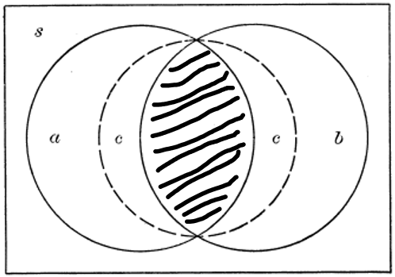
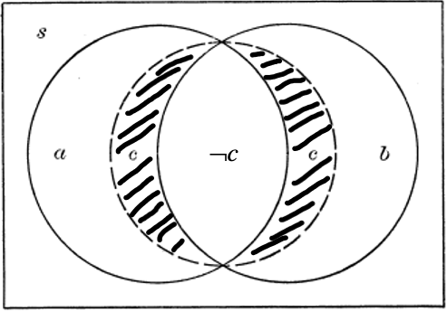

# Josiah Royce

*Parker, Kelly A., Pratt, Scott*

![Portrait of Josiah Royce (1914)[^royce-1914]](../assets/royce/Josiah_Royce_MS29_small_bw.jpg) Josiah Royce Collection Ms. 29, Special Collections, The Milton S. Eisenhower Library of The Johns Hopkins University
**First published Tue Aug 3, 2004; substantive revision Thu Jan 15, 2026**

Josiah Royce (1855–1916) was the leading American proponent of absolute idealism, the metaphysical view (also maintained by G. W. F. Hegel and F. H. Bradley) that all aspects of reality, including those we experience as disconnected or contradictory, are ultimately unified in the thought of a single all-encompassing consciousness. Royce also made original contributions in ethics, philosophy of community, philosophy of religion and logic. His major works include *The Religious Aspect of Philosophy* (1885), *The World and the Individual* (1899–1901), *The Philosophy of Loyalty* (1908), and *The Problem of Christianity* (1913). Royce’s friendly but longstanding dispute with William James, known as “The Battle of the Absolute,” deeply influenced both philosophers’ thought. In his later works, Royce reconceived his metaphysics as an “absolute pragmatism” grounded in semiotics. This view dispenses with the Absolute Mind of previous idealism and instead characterizes reality as a universe of ideas or signs which occur in a process of being interpreted by an infinite community of minds. These minds, and the community they constitute, may themselves be understood as signs. Royce’s ethics, philosophy of community, philosophy of religion, and logic reflect this metaphysical position.

## 1. Life

Royce was born November 20, 1855, in the remote mining town of Grass Valley, California, to Josiah and Sarah Eleanor Bayliss Royce. Sarah Royce was a devout Christian who headed a primary school in Grass Valley. Royce’s mother and older sisters directed his early education. At age 11 he entered school in San Francisco. He graduated from the newly established University of California in Oakland with a B. A. degree in Classics in 1875. Royce then traveled to Germany to study philosophy for one year, mastering the language and attending lectures in Heidelberg, Leipzig, and Göttingen. On his return, he entered the Johns Hopkins University in Baltimore, Maryland, where he earned a Ph. D. in 1878.

He taught composition and literature at the University of California, Berkeley from 1878–1882. During this time he published numerous philosophical articles, as well as his *Primer of Logical Analysis*. He married Katherine Head in 1880. The couple had three children (Christopher 1882; Edward 1886; Stephen 1889) and remained married until Josiah’s death. Not content in California, so far from the intellectual life of the East Coast, Royce sought help in attaining a new post from his acquaintances there. In his later ethical writings Royce would stress the centrality of action intended to realize a sound ideal that one has freely embraced. When offered the opportunity to replace William James during a one year sabbatical at Harvard University, Royce acted: he accepted the offer of half of James’s salary, resigned his California appointment altogether, and moved his wife and newborn son across the continent in the summer of 1882.

In Cambridge, Royce commenced to work doggedly and in diverse areas. In January 1883 he arrived at an insight that proved fundamental to his philosophy: in order for our ordinary concepts of truth and error to be meaningful, there must be an Absolute Knower, an actual infinite mind that encompasses the totality of all actual truths and possible errors. This insight formed the core of his first major philosophical publication, The *Religious Aspect of Philosophy*, which appeared in 1885. Royce received a permanent appointment as assistant professor at Harvard in that same year. (During his three decades at Harvard Royce would teach such notable students as T. S. Eliot, George Santayana, and W. E. B. Du Bois.) He taught full time, gave many public lectures, published his *History of California* in 1886, and a novel in 1887. In 1888 he experienced a nervous breakdown, from which he recovered after a sea voyage of some months’ duration.

Royce was appointed Professor of the History of Philosophy at Harvard in 1892 and served as Chair of the Department of Philosophy from 1894–98. During these years Royce established himself as a leading figure in American academic philosophy with his many reviews, lectures and books, including *The Spirit of Modern Philosophy* (1892) and *The Conception of God* (1895). In 1898 Royce attended a series of lectures by Charles S. Peirce, “Reasoning and the Logic of Things,” which significantly influenced his understanding of the relation between logic and metaphysics.

Royce delivered the prestigious Gifford Lectures at the University of Aberdeen in two series, the first in 1899 and the second the following year. He regarded this as the opportunity to consolidate his years of hard thought and study, so as to produce a definitive and original statement of his metaphysics. The result was his two volume opus *The World and the Individual* (1899–1901).

The Gifford Lectures marked a turning point in Royce’s life and thought. He had worked out his philosophical theories in minute detail. His public reputation as a philosopher was sealed (Royce was elected president of the American Psychological Association in 1902 and of the American Philosophical Association in 1903). The year 1900 apparently represented the culmination of his life’s work. Royce was only 45 years old, though, and this culmination proved also to be a starting point for significant growth.

Reviews of *The World and the Individual* praised Royce’s philosophical acumen but raised significant objections to his conclusions. Peirce, in particular, pointedly criticized Royce’s use of logic. Royce set out to reconsider his central arguments and, at the same time, undertook an ambitious program of study in mathematical logic. In his teaching and publications after 1900, two philosophical strains came to the forefront. One was a growing reliance on formal logical and mathematical concepts as the basis for his metaphysical speculation (the first hint of this appears in the “Supplementary Essay” to the first volume of *The World and the Individual*). The second was an emphasis on philosophy as a means to understand the concrete phenomena of life: the nature of human society, of religious experience, of ethical action, of suffering and the problem of evil.

After 1907 Royce’s emphasis on the relevance of philosophy for living took on a clear personal dimension. In that year Christopher, who had come with Josiah and Katherine across the continent as a newborn 25 years earlier, and who had graduated from Harvard at age 18, showed symptoms of severe depression and psychotic delusions. In 1908 his parents committed him to a state mental hospital with little hope that he would recover. In August of 1910 William James died, leaving Royce without his closest friend, neighbor and colleague. In September of the same year Christopher Royce died of typhoid fever, leaving Josiah and Katherine without their firstborn child. Royce had earlier stated his philosophy in a somewhat abstract and formal way, so that it might help him discover metaphysical truth. Perhaps under the weight of these later sorrows, Royce returned to his system seeking wisdom and understanding in addition to truth.

Although he by no means abandoned systematic and theoretical philosophy, Royce began to write more about what today would be called “practical” or “applied” philosophy. His major work on ethics, *The Philosophy of Loyalty*, appeared in 1908. Later he would address ethics in even more practical terms, not as a philosophy but as an “art” of loyalty. He published a collection of essays under the title *Race Questions, Provincialism, and Other American Problems* in 1908; another collection, entitled *William James and Other Essays on the Philosophy of Life*, appeared in 1911. Four of the six essays in *The Hope of the Great Community*, written in the last year of his life and published posthumously in 1916, directly concerned global politics and the Great War.

Royce and James had always disagreed deeply concerning the proper understanding of religious phenomena in human life. When James delivered the Gifford Lectures in 1901 and 1902, he directed many arguments against Royce’s idealism, though he did not there target his friend by name. James’s lectures, published as *The Varieties of Religious Experience*, were a popular and academic success. Royce believed that James, who had never been regularly affiliated with an established church or religious community, had in that work placed too much emphasis on the extraordinary religious experiences of extraordinary individuals. Royce’s first education was into a strongly Protestant world view, he always retained a respect for the conventions of organized Christianity, and his writings exhibit a consistent and deep familiarity with Scripture. He sought a philosophy of religion that could help one understand and explain the phenomena of ordinary religious faith as experienced by communities of ordinary people. There was a deeper difference between them, as well, and it centered on a metaphysical point. Royce’s 1883 insight concerning the Absolute was at bottom a religious insight. Contrary to the open-ended pluralism and pragmatism of James, Royce was convinced that the object and source of religious experience was an actual, infinite, and superhuman being. Royce did not attempt to work out his religious philosophy until after James’s death, however. In 1911 Royce finally composed the lectures that responded to James. These were published in 1912 as *The Sources of Religious Insight*. It is here that the theoretical and practical threads of his late thought began to come together. Royce himself said of the *Sources*: “It contains the whole of me in a brief compass” (Clendenning 1970, 570)[^clendenning-1970].

In early 1912, Royce suffered a stroke. During his recovery, he continued to explore the philosophy of religion outlined in the *Sources*, with an eye toward adapting these ideas specifically to Christianity. He also returned to Peirce’s writings, seeking the solution to certain nagging problems in his own metaphysics. He found in Peirce’s semeiotic, or theory of signs, the technical tools he needed to address both issues at once. *The Problem of Christianity* presents, in place of the earlier Absolute Knower, the concept of an infinite community of interpretation guided by a shared spirit of truth-seeking. This Universal Community, which constitutes reality, develops greater understanding over time through its members’ continual development of the meaning of signs. Within this framework Royce endeavored to reconcile and explain many key Christian doctrines and experiences.

Though Royce lived only a few years beyond this late philosophical breakthrough, his last period brought the true culmination and flowering of his life’s work. Besides *The Sources of Religious Insight* and *The Problem of Christianity*, notable available works include *The Hope of the Great Community*, his last Harvard seminar on Metaphysics (1915–16) and a series of lectures given at the University of California at Berkeley. These lectures at his alma mater were to have ended with a talk entitled “The Spirit of the Community.” When the Great War broke out, Royce set this manuscript aside and sketched a practical proposal to use the economic power of insurance to mediate hostilities among nations and hence reduce the attraction of war in the future. *War and Insurance* (1914) was a daring political and economic proposal on behalf of the Universal Community.

Royce died on September 14, 1916. Though scholars now recognize the originality and strength of his last works, he was unable to respond to critics or to press his case for the last crucial innovations to his philosophy. His reputation was eclipsed as other philosophers used Royce’s earlier writings as a foil in developing their own doctrines of pragmatism, realism, empiricism, and logical analysis. While scholars of American intellectual life have always acknowledged the historical importance of Royce’s influence, recent years have brought a revival of interest in Royce’s thought on its own terms. Royce’s work is proving especially fruitful for theologians and philosophers interested in speculative philosophy and metaphysics, practical and theoretical ethics, philosophy of religion, and the philosophy of community.

## 2. Philosophy

Royce’s early studies in Germany and at the Johns Hopkins University concentrated on the development of post-Kantian idealism. His philosophical work as a whole may be regarded as a committed idealist’s effort to understand the place of finite individuals in an infinite universe, a theme that Royce captured most succinctly in his Gifford Lectures title, “The World and the Individual.” This theme will serve as a touchstone in the following survey of Royce’s work in metaphysics and epistemology, ethics and practical philosophy, religious philosophy, and logic.

### 2.1 Metaphysics and Epistemology: Idealism and Interpretation

Royce announced the beginning of his professional career with a novel defense of absolute idealism, “the argument from error.” Kant had introduced the notion of a “transcendental argument” by asking what the world must be like in order for knowledge of the world to be possible. In *The Religious Aspect of Philosophy* Royce took the experience of error — a particularly compelling aspect of the phenomenon of knowing — as the starting point for his own transcendental argument. According to the correspondence theory of knowledge an idea (or judgment) is true if it correctly represents its object; error obtains when an idea does not correctly represent its object. It is indisputable that finite minds do sometimes entertain erroneous ideas. Royce pointed out that in such a case the mind must contain an (erroneous) idea and its (false) object, while simultaneously intending, or “pointing toward,” the idea’s true object. If the mind is able to intend the true object then that object is somehow available to the mind. How can it be that the true object is in this way available to the mind, but not known? Consider what happens in an ordinary example of error: if I think that my keys are on the table, but later discover that they are in my pocket, I do not conclude that my keys never existed as the object of my thought. Rather, I focus on an idea that I had all along — that my keys do definitely exist somewhere. The keys, their location, and all other facts about them are the true object of an idea. At the moment when I discover that my keys are not on the table, it becomes apparent that this true object was only imperfectly available to me. The fact that such error does occur indicated to Royce that the true object of any idea must exist, in a fully determinate or absolute state, in some actual mind, or mind-like entity, with which my own mind is or may be connected. From the possibility of error, Royce concluded that there is an Absolute Knower, a mind for which all thoughts do correspond correctly and adequately to their true objects.

One objection to the argument from error is that another type of objective reality, some other sort of being external to one’s finite mind, might explain the possibility of error just as well. Royce took up this objection in the first volume of *The World and the Individual*, which was subtitled “The Four Historical Conceptions of Being.” In this extended argument Royce critiqued what he regarded as the main competing conceptions of objective reality so as to strengthen his case for idealism. The first conception of being Royce considered was *realism*, the view that the world exists entirely independently of our thoughts or ideas about it. The world is what it is, in short, without any reference to our thoughts. While this view has great common-sense appeal and does provide for an objectively existing sphere of being against which our ideas can apparently be measured, Royce pointed out a fundamental problem. Realism, so defined, introduces a radical metaphysical dualism. Between my ideas, and a sphere of being that by definition exists completely independent of those ideas, there is a gap that cannot be bridged. Realism posits an objective realm that is utterly independent and hence, strictly speaking, is utterly meaningless to thought. The theory of *mysticism*, the second conception of being Royce considered, likewise meets with problems. This view maintains that the real is the ineffable immediate fact that is present to the mind. Mysticism avoids the problem of an unbridgeable gap between idea and reality by completely denying any such gap. The difficulty here is that one cannot then distinguish between idea and reality. If reality is in the end the immediate content of my idea, then error in my idea of reality would simply appear to be impossible. The third conception of being, which Royce identified with Kantian *critical rationalism*, is presented as a correct but incomplete view. Royce characterized critical rationalism as the view that “What is, gives warrant to ideas, makes them true, and enables us to define determinate, or valid, possible experiences” (Royce 1899–1901 [1976, 266])[^royce-1899][^royce-1901]. The real is that which, in conforming to given universal structures or categories of experience, is capable of validating certain ideas. The connection between my ideas and an objectively existing sphere of being is clearly established: my ideas and that sphere both conform to the same categories of experience. The independence of objective reality, and hence the possibility of error, is likewise preserved: I may form an idea of a definite possible experience (e.g., that my keys are on the table) but then discover that reality does not validate my idea (I can in fact check the table surface and discover that my keys are not there). The critical rationalist conception is inadequate, in Royce’s view, because it is restricted to describing the universal forms and possibilities of experienced reality. It cannot in Royce’s view account for the concrete, actual individual facts that impose themselves in experience. These are simply and mysteriously “given” in the critical rationalist theory.

Royce endeavored to extend and complete critical rationalism in his explanation of the “*fourth conception of being*.” To say that an idea intends its object means more than that the idea may be validated by a “possible experience.” An idea in this respect embodies a purpose: that its meaning shall be fulfilled in experience. In Royce’s view this requires a world that is more than the abstract or merely hypothetical content posited by the description of a possible experience. What is needed is a definite, actual individual being that exists “in an absolutely final form.” Royce thus agreed with critical rationalism in saying that a true idea is one that may be fulfilled or validated by a possible experience. He argues further, though, that such a possible experience requires the existence of an actual being (e.g., the particular set of keys in my pocket) that is in principle capable of being experienced. It is this being, the actual individual, and not the mere possible experience of it, that is the object of knowledge and “the essential nature of Being” (Royce 1899–1901, [1976, 348])[^royce-1899][^royce-1901]. The “fourth conception of being” detailed in *The World and the Individual* provides the metaphysical background for the remainder of Royce’s thought. It presents a view of the totality of Being as an actual Infinite Individual that is itself timeless, encompassing as it does all valid past, present, and future possible experience of fact. All finite beings, such as ourselves, are but fragments of this Absolute Mind or eternal truth.

In his last period Royce embraced what may be called a hermeneutic epistemology. While he still maintained the central notion that a true idea correctly represents its object, he arrived at a new understanding of the nature of representation. Earlier, he had rather uncritically taken “representation” to be a straightforward correspondence relation in which the idea merely copied its object. Under the influence of Peirce’s theory of signs, however, Royce came to appreciate the creative, synthetic, and selective aspects of representation. The new semiotic conception is detailed in the chapter of *The Problem of Christianity* entitled “Perception, Conception and Interpretation.” Knowledge is not at bottom merely the accurate and complete perception of an object, as empiricism would have it. Nor is it the accurate and complete conception of an idea, as rationalism maintains. Knowledge is instead a process of interpretation: the true idea selects, emphasizes, and re-presents those aspects of the object that will be meaningfully fulfilled in subsequent experience. Royce’s “absolute pragmatism,” like other versions of pragmatism, thus offers an alternative to rationalism and empiricism.

This revised understanding of knowledge as interpretation prompted, if it did not exactly require, a corresponding change in Royce’s notion of the Infinite Mind whose reality was established in the argument from error. As long as knowledge is regarded as possessing perceptions or conceptions that correspond to objects, the Infinite Mind is naturally envisioned as something that “contains” the totality of all perceptions or conceptions. If knowledge is instead regarded as a process of interpretation, though, the Infinite Mind may be regarded as the mind that carries this process forward. Royce had long sought an explicitly non-Hegelian account of Absolute Mind. In *The Problem of Christianity* he was finally able to replace the old terminology of the Absolute with a description of an infinite Community of Interpretation. This community is the totality of all those minds capable of representing aspects of Being to one another or to their future selves. Royce summarized the metaphysical implications of this new view by saying “the real world is the Community of Interpretation… If the interpretation is a reality, and if it truly interprets the whole of reality, then the community reaches its goal [i.e., a complete representation of Being], and the real world includes its own interpreter” (Royce 1913 [2001, 339])[^royce-1913][^royce-1913-2]. In this late period Royce remained firmly committed to idealism. He renounced the notion that the Absolute is complete at any actual time, though, and instead preferred to think of the possible totality of all truth simply as the eternal.

### 2.2 Ethics and Practical Philosophy

That Royce’s metaphysical solution to the problem of error was of broad relevance for the rest of his philosophy is clear: “The existence of error…must be explained as due to the same conditions as those which make possible finite life, evil, individuality, and conflict in general” (Robinson 123). Error is possible, according to Royce, only if there is an infinite being for which all intended objects could be realized. This Being (whether conceived as Absolute Mind or the infinite Community of Interpretation) also makes individual human life comprehensible. Royce’s considerable attention to speculative metaphysics is complemented by his concern for the practical implications of that metaphysics. The infinite manifests itself in the realm of individual beings bound within the finite constraints of time and space. Ethics and religion have their basis in this relation of the individual to the infinite real world, a relation Royce characterized in terms of loyalty.

#### 2.2.1 The Philosophy of Loyalty

Near the end of *The Philosophy of Loyalty* Royce wrote:

> Human life taken merely as it flows, viewed merely as it passes by in time and is gone, is indeed a lost river of experience that plunges down the mountains of youth and sinks in the deserts of age. Its significance comes solely through its relations to the air and the ocean and the great deeps of universal experience. For by such poor figures I may, in passing, symbolize that really rational relation of our personal experience to universal conscious experience…. (Royce 1908 [1995, 179–80])[^royce-1908][^royce-1908-2]

Royce’s ethics is rooted in his analysis of the conditions necessary for an individual life to be meaningful. It is not enough that one’s actions merely conform to the strictures of conventional morality — a trained animal might well fulfill such minimal conditions of morality. To lead a morally significant life, one’s actions must express a self-consciously asserted will. They must contribute toward realizing a plan of life, a plan that is itself unified by some freely chosen aim. Such an aim and its corresponding plan of life could not easily be created by an individual out of the chaos of conflicting personal desires and impulses that we all encounter. Rather, such aims and plans are found already largely formed in social experience: we come to consciousness in a world that proffers countless well-defined causes and programs for their accomplishment. These programs extend through time and require the contributions of many individuals for their advancement. When one judges a cause to be worthwhile and freely embraces such a program, several momentous things happen. The individual’s will is focused and defined in terms of the shared cause. The individual becomes allied with a community of others who are also committed to the same cause. Finally, a morally significant commitment to the cause and to the community develops. This commitment is what Royce calls “loyalty.” The moral life may be understood in terms of the multiple loyalties that a person exhibits.

Just as the truth value of an idea is a matter of whether its intended object is fulfilled in reality, the moral value of actions is a matter of whether they are loyal, whether they tend to fulfill the community’s intended aim. Loyalty is a necessary condition for moral validity; defined narrowly, as Royce preferred, loyalty may even be a sufficient condition for moral validity. Royce’s narrow definition of loyalty, of “true loyalty,” is intended to rule out loyalty to morally evil causes and the communities that serve them. Royce observed that the highest moral achievements throughout history have involved individuals’ loyalty to ideals that promote the formation and expansion of communities of loyalty. Many of the worst deeds have also involved a high degree of loyalty, but this loyalty is directed exclusively to a particular group and is expressed in the destruction of the conditions for others’ loyal actions, of those other persons, and even of one’s own community and cause. Royce generalized the difference between true loyalty and vicious or “predatory” loyalty as follows:

> a cause is good, not only for me, but for mankind, in so far as it is essentially a *loyalty to loyalty*, that is, an aid and a furtherance of loyalty in my fellows. It is an evil cause in so far as, despite the loyalty that it arouses in me, it is destructive of loyalty in the world of my fellows. (Royce 1908 [1995, 56])[^royce-1908][^royce-1908-2]

While every community hopes for the accomplishment of its central cause, and sees that cause’s fulfillment as its highest achievement, Royce placed particularly high emphasis on the phenomenon of loyalty to a lost cause. A lost cause is not in Royce’s view a hopeless cause, but rather one that cannot be fulfilled within the actual lifetime of the community or any of its members. Many lost causes are rightly lost, of course, and there is a problematic aspect to Royce’s use of this term. Royce’s contemporaries would have understood “the lost cause” as a reference to “the mythology of pre-Civil War southern society,” a romanticized view of the Confederate States’ defense of slavery and segregation in the U.S. Civil War (Fischer 2012, 32)[^fischer-2012]. Royce identified military action as an example of predatory loyalty, however, so his veiled reference to the lost cause of the Confederacy is a very poor example of loyalty. Besides such misguided “evil causes,” though, there are a number of legitimate causes that are, by this definition, “lost” simply in virtue of their scope and magnitude. Such causes are not hopeless, however. It is precisely these causes that establish ideals capable of evoking our highest hope and moral commitment.

Chief among these are the universal causes of the full attainment of truth, the complete determination of the nature of reality through inquiry and interpretation, and of the establishment of universal loyalty to loyalty itself. In practice, the formula of “loyalty to loyalty” demands that one’s moral and intellectual sphere become ever broader and remain critical at all levels. All the communities we actually know, those we inhabit and identify with, are finite and to some degree “predatory” in Royce’s sense. This is clearly true of small social cliques, isolated intellectual communities, parochial religious groups, self-interested unions and corporations, local political movements, and other such groups. Roycean loyalty requires one to scrutinze the aims and actions of such communities and to work to reform their disloyal aspects. The philosophy of loyalty calls us first of all, then, to create and embrace more cosmopolitan and inclusionary communities. It should be clear that this is only the first important step of an infinite process aimed at realizing the ideal of universal loyalty. Any actual community, whether it be the United Nations or a bickering family, will in fact fall short of perfect loyalty. When it does so, each must answer to the same critical scrutiny and calls for reform. There is no expectation that these high ideals of perfect loyalty, truth and reality will ever be fully realized. These “lost causes” are indispensable, in Royce’s view, as the source of absolute norms for any community and its members.

Royce maintained that the logic of volition, pursued far enough, compels us to embrace precisely these lost causes as our own. In the course of his extended debate with James over the adequacy of pragmatism as a doctrine, Royce came to accept many of James’s principles. One, inspired by James’s well-known essay “The Will to Believe,” is that any philosophical view is at bottom an expression of individual volition. Given the fact of our existence in the world, we must first decide how we are to approach that world, and then develop our philosophical theories accordingly. A second principle that Royce adopted is the pragmatist view of truth: truth is the property possessed by those ideas that succeed in the long run. Royce’s main disagreements with other versons of pragmatism concern the way these two principles are typically understood. Royce maintained that although there are several possible attitudes of the will that one might adopt toward the world (including Schopenhauer’s “will to live” and its opposite, resignation) only one — loyalty to the ideal of an ultimate truth — is correct. The other possible attitudes of the will are self-refuting. He accordingly referred to his own position as “Absolute Voluntarism” (Royce 1913 [2001, 349])[^royce-1913][^royce-1913-2]. Royce offered a similar argument concerning the pragmatist notion of truth (Royce 1913 [2001, 279])[^royce-1913][^royce-1913-2]. Explicitly adopting one of Peirce’s concepts, Royce argues that to define truth using any conception of “the long run” — short of the ideal end of inquiry — is self-refuting. Given the apparent finality of this argument (which is, again, a variation of the Argument from Error) Royce called his position “Absolute Pragmatism.”

Royce’s philosophy of loyalty resembles existentialism in certain respects. Notable among these are the notions that we come to moral awareness in a world of already established aims and social projects, that moral responsibility requires a self-conscious and deliberate individual choice to embrace particular causes, and that the highest forms of ethical conduct involve dedication and effort in service of a cause that offers no promise of final success. Royce differs from later existentialists such as Camus and Sartre, however, in several important respects. Royce would not accept their notion that human efforts are finally absurd, unfolding against a backdrop of a meaningless and indifferent universe. On the contrary, Royce maintained that the concepts of ultimate meaning and reality are powerful and legitimate forces in our lives. With existentialism, Royce recognized the very real chasms that separate one person’s feelings, thoughts, and will from another: the experience of another may be inscrutable. At the same time, though, he insisted that we acknowledge the equally important fact that in ordinary social life minds frequently do work in concert. Groups of people often are unified in feeling, thought, and will by something that transcends any of the individuals present (Royce 1913 [2001, 239])[^royce-1913][^royce-1913-2].

#### 2.2.2 Theory of Community

Royce was one of the first American philosophers to recognize the important challenge of Nietzsche’s moral vision, which celebrates those individuals who seek to exercise their autonomous will to a “socially idealized” power. Such heroic individualism, also associated with Walt Whitman, Ralph Waldo Emerson, and William James, proves unsatisfactory in Royce’s view (Royce 1908 [1995, 41])[^royce-1908][^royce-1908-2]. Their inspiring ethical visions are doomed to ineffectiveness precisely because of their extreme individualism. “There is only one way to be an ethical individual. That is to choose your cause, and then to serve it, as the Samurai his feudal chief, as the ideal knight of romantic story his lady, — in the spirit of all the loyal” (Royce 1908 [1995, 47])[^royce-1908][^royce-1908-2]. These particular examples are meant to illustrate the essentially social character of loyalty in general: “My life means nothing, either theoretically or practically, unless I am a member of a community” (Royce 1913 [2001, 357])[^royce-1913][^royce-1913-2].

One of the more striking features of Royce’s philosophy is its emphasis on communities as being logically prior to individuals. As we have seen, Royce considered the notions of truth and knowledge unintelligible for the individual unless we posit an ultimate knower of objective truth, the infinite community of minds. The notions of personal identity and purpose are likewise unintelligible unless we posit a community of persons that defines causes and establishes social roles for those individuals to embrace. The concept of community is thus central both to Royce’s ethics and his metaphysics. Not just any association or collection of individuals is a community. Community can only exist where individual members are in communication with one another so that there is, to some extent and in some relevant respect, a congruence of feeling, thought, and will among them. It is also necessary to consider the temporal dimensions of community. “A community constituted by the fact that each of its members accepts as a part of his own individual life and self the same *past* events that each of his fellow-members accepts, may be called a *community of memory*.” Similarly, “A community constituted by the fact that each of its members accepts, as part of his own individual life and self, the same expected *future* events that each of his fellows accepts, may be called a *community of expectation* or…*a community of hope*” (PC 248). These common past and future events, which all members hold as identical parts of their own lives, are the basis of their loyalty to the community.

As discussed in connection with Royce’s ethical theory, some communities are defined by true loyalty, or adherence to a cause that harmonizes with the universal ideal of “loyalty to loyalty.” He referred to such communities as “genuine communities” or “communities of grace.” Other communities are defined by a vicious or predatory loyalty. These degenerate “natural communities” tend toward the destruction of others’ causes and possibilities of loyalty. Finally, beyond the actual communities that we directly encounter in life there is the ideal “Beloved Community” of all those who would be fully dedicated to the cause of loyalty, truth and reality itself.

Royce stressed that the sharing of individuals’ feelings, thoughts, and wills that occurs in any community (including the Beloved Community) should not be taken to imply a mystical blurring or annihilation of personal identities. Individuals remain individuals, but in forming a community they attain to a kind of second-order life that extends beyond any of their individual lives. Where a number of individuals’ loyalty to a cause is coordinated in community over time, Royce spoke non-figuratively of a super-human personality at work: a genuine community is united by a guiding or “interpreting spirit.” The interpreting spirit may on occasion be embodied by a single person such as a leader or other exemplar, but this is not always the case.

### 2.3 Philosophy of Religion

Though his writings contain a great deal of insight that is relevant for a strictly naturalistic philosophy, religious concerns figure prominently from Royce’s first major publication, *The Religious Aspect of Philosophy*, to his last two, *The Sources of Religious Insight* and *The Problem of Christianity*. As has been indicated, the main focus of Royce’s early work was metaphysical. In *The World and the Individual* he plainly identified the object of his inquiry as “the Individual of Individuals, namely the Absolute, or God himself” (Royce 1899–1901, 1:40)[^royce-1899][^royce-1901]. Critics of Royce’s early works admired his metaphysical argumentation but found his conception of God wanting. Peirce observed that the Absolute Mind bore little resemblance to the God that people seek in churches — it is not the kind of being anyone would worship. James objected that if all our errors and sorrows are in fact reconciled in the Absolute, then finite persons would seem to be exonerated from ultimate responsibility for their actions: they might as well enjoy a lifelong “moral holiday.” With *The Philosophy of Loyalty* Royce began to devote more attention to the practical questions of ethics and the philosophy of community. In his last works he drew upon the notion of loyalty to explain the nature of religious experience in human communities.

Royce stated that “the central and essential postulate” of every religion is that “man needs to be saved” (Royce 1912 [2001, 8–9])[^royce-1912]. Salvation is necessary because of a combination of two factors. The first is “the idea that there is some aim or end of human life which is more important than all other aims.” The second is that “man as he now is, or as he naturally is, is in great danger of so missing this highest aim as to render his whole life a senseless failure” (Royce 1912 [2001, 12])[^royce-1912]. Salvation comes in the form of guidance toward understanding and accomplishing the highest aim of life, so far as we are able. Given the limitations and fallibility of the human perspective, Royce maintained that this guidance must come from some super-human or divine source. Religion is the sphere of life in which finite human beings are able to get into touch with this divine source of wisdom and guidance.

In *The Sources of Religious Insight* Royce considered and rejected several common conceptions of religion before making his case for a religion of loyalty. His discussion of natural *social life* as a source of religious insight may be read as a critique of the “Social Gospel” movement. His consideration of *reason* is notable not for its familiar observation that reason is inadequate to religious knowledge, but for his pragmatist critique of the adequacy of mere reason even for scientific knowledge. Finally, his careful consideration and rejection of *individualism* in religion is a direct critique of the Jamesean view of religious experience. Royce employed his familiar dialectical method to make his case for religious insight through participation in the loyal community, the “invisible church” guided by a divine spirit and devoted to the highest ideals of goodness. In the *Sources* Royce offered a view of religion as common experience. It is “common” both in the sense that it does not consist primarily of the kind of extraordinary experiences that James emphasized, and in the sense that it is a fundamentally social rather than individual experience of reality.

#### 2.3.1 Christianity

While the *Sources* concerns the nature of religious experience in general, *The Problem of Christianity* focuses on the question “In what sense, if any, can the modern man consistently be, in creed, a Christian?” (Royce 1913 [2001, 62])[^royce-1913][^royce-1913-2]. Royce’s answer actually rejects the sort of static concepts and beliefs usually implied by devotion to specific creeds, including those identified with Christianity. While his view pivots on the Christian notion of divine incarnation, it is not the incarnation of God in Jesus but rather the incarnation of the Spirit in the living church that Royce emphasized: “the Church, rather than the person of the founder, ought to be viewed as the central idea of Christianity” (Royce 1913 [2001, 43])[^royce-1913][^royce-1913-2]. The Christian church’s primary importance, for Royce, is as a paradigm of community. He regarded the Pauline church as the best exemplar of a graced community: at its best, the church strives to embody the guiding Interpreter Spirit, so as to become a Universal Community of Interpretation “whose life comprises and unifies all the social varieties and all the social communities which…we know to be real” (Royce 1913 [2001, 340])[^royce-1913][^royce-1913-2]. Doctrines and creeds may change; the particular institutions that identify themselves as churches may or may not actually be communities of grace. What matters in the end is the process of interpretation — the process of communicating and understanding one another in actual, imperfect, finite communities of grace bound together by loyalty and striving toward the ultimate and ideal Beloved Community.

Royce was critical of many historical churches because they had in his view lost sight of the spirit that ought to guide them. At the same time, he identified grace at work in many communities that were not self-consciously religious. He had great respect for non-Christian religions, paying especially careful attention to Buddhism (Royce took the trouble to learn Sanskrit, and *The Problem of Christianity* includes a very sympathetic presentation of Buddhism). In the end, however, Royce was a philosopher who worked within the intellectual context of Western Christianity. He maintained that only the Christian model of the loyal community successfully combines the true spirit of universal interpretation with an appreciation of the “infinite worth” of the individual as a unique member of the ideal Beloved Community, the Kingdom of Heaven (Royce 1913 [2001, 193])[^royce-1913][^royce-1913-2].

#### 2.3.2 The Problem of Evil

The problem of evil is a persistent theme throughout Royce’s writings. He struggled with tragedy in his personal life and sought to understand it better through philosophy. As an idealist he also had to struggle with evil as a problem of metaphysics. Idealism maintains that all deeds and events are ultimately taken up and reconciled in a final perspective. This seems to suggest that the evil, sorrow, and pain that run through human life are illusory — or what seems even less comprehensible, that our experience of suffering is somehow good, that it is “all for the best.” While some idealists have accepted these apparent implications of their metaphysics, Royce maintained that evil is a real fact of the world. He insisted that we confront evil *as* evil and not regard it as a means to attain a preordained but inscrutable Divine purpose. He sought to understand evil philosophically. In seeking that understanding he was not content to explain it away or to salve its effects by appealing to a clever theodicy.

Royce embraced a theistic process metaphysics that recognizes evil as a real force and suffering as an irreducible fact of experience. In “The Problem of Job” Royce addressed the traditional problem of evil: “Grant Job’s own presupposition that God is a being other than this world, that he is its external creator and ruler, and then all solutions fail. God is either then cruel or helpless, as regards all finite ill of the sort that Job endures.” If we consider that God is not a separate being, then “When you suffer, *your sufferings are God’s* sufferings, not his external work, not his external penalty, not the fruit of his neglect, but identically his own personal woe. In you God himself suffers, precisely as you do, and has all your concern in overcoming this grief.” Grief is not “a physical means to an external end,” but rather “a logically necessary and eternal constituent of the divine life” (McDermott 1969, 843)[^mcdermott-1969]. Though Royce believed that events are collectively tending toward an ultimate reconciliation in the eternal perspective of the Beloved Community, they are not erased even in that ideal perspective. The events of life (joyful and sorrowful alike) persist, both as experiences of the individuals who undergo them and also as God’s own experiences.

Royce did not seek to explain away or lessen the reality of evil: it is in his view a brute fact of being, an inevitable result of the world’s existence in time. Given the fact of evil, the most important question concerns how we finite beings ought to respond to it. His answer was that we should adopt the attitude of loyalty to goodness and truth, which as real forces in the world are the metaphysical opposite of evil. The loyal member of a genuine community confronts evil and wills to overcome it through the very fact of loyalty to its opposite. Evil can never be eradicated — this is another way of saying that loyalty to loyalty is a lost cause. Though the *success* of this high cause lies in the unreachable future, the *meaning* of our response is manifest in our present lives.

Royce’s powerful and original explanation of the doctrine of atonement in *The Problem of Christianity* details how the loyal community can best respond to human evil. The highest kind of transgression in an ethics of loyalty is treason, or the willful betrayal of one’s own cause and the community of people who serve it. The traitor is one who has freely embraced a cause and joined with a community of grace in service of that cause, but who then culpably commits some act that undermines the cause and the community. Such a betrayal is but one step away from moral suicide: it threatens to destroy the network of purposes and concrete social relationships that define the traitor’s self (Royce 1913 [2001, 162])[^royce-1913][^royce-1913-2]. Atonement occurs when the traitor and the community are reconciled, when they are both saved from the evil deed through some act of the will.

Royce found traditional Christian accounts of atonement unsatisfactory. They do not adequately explain how both the traitor and the community are reconciled and saved in the human sphere. Much less do they explain the mysterious details of how atonement reconciles the sinner with God. The traitor who recognizes the magnitude of what has been lost through the act of betrayal lives in a state that Royce called “the hell of the irrevocable” (Royce 1913 [2001, 162])[^royce-1913][^royce-1913-2]. Royce sought an explanation of atonement that acknowledges the irrevocable nature of a deed that has been done, and which changes everything for the sinner and the community that has been harmed. “Penal satisfaction” theories of atonement simply do not speak to the sinner’s situation: to be told that an angry God demands repayment or retribution for the betrayal, and that this price has been paid (by the violent death of Jesus Christ, or by any other sacrifice) does not repair the sinner’s own devastated moral universe. The sinner “is dealing, not with the ‘angry God’ of a well-known theological tradition, but with himself” (Royce 1913 [2001, 170–71])[^royce-1913][^royce-1913-2]. Royce seeks a theory that first makes sense of the immediate human aspect of atonement. If one can be found, it may then be considered theologically. A theory of “penal satisfaction,” which claims to answer theological questions, but remains meaningless or mysterious in human terms, is simply unsatisfactory.

The concrete human evil of treason is that the traitor’s loyalty to the cause, and with it the moral relations that bound the community together, have been broken and cannot be restored to their previous state. “Moral theories” of atonement account for change in the traitor’s person but fail to explain how the “wounded or shattered community” can be repaired (Royce 1913 [2001, 175])[^royce-1913][^royce-1913-2]. Such theories, in Royce’s account, explain that in contemplating Christ’s willing sacrifice of his own life for the sake of the human community, the sinner experiences deep repentance and develops a new capacity for love of the betrayed community. The sinner’s soul is purified and made better (Royce 1913 [2001, 172])[^royce-1913][^royce-1913-2]. Such a process may bring the sinner to realize the hellish magnitude of irrevocable treason. Royce pointed out, though, that such a process by itself does nothing to reconcile the sinner to the community or to repair that community. Such reconciliation and healing requires something more than a change in the individual’s heart.

This brought Royce to consider theories of atonement that center upon the community’s act of forgiveness. Forgiveness, as an act of the community and not the sinner, is clearly essential to atonement. Moreover, it involves a recognition of human frailty — not just the moral frailty of the sinner in question, but that of all humans. Forgiveness involves a recognition that anyone might commit such an act, that the cause of perfect loyalty is a lost cause. Even when it can occur, though, forgiveness does not restore the community to the innocent state of harmony and “unscarred love” that existed before the betrayal (Royce 1913 [2001, 177–78])[^royce-1913][^royce-1913-2]. Atonement moves the community and the traitor beyond the irrevocable deed of betrayal. This cannot be done by an act of forgiveness that returns the community and its relations to the way things were before. “The way things were” is irrevocably gone.

In its human aspect atonement occurs through an interpretive act that creates new relationships among the members, including the traitor, together with a new understanding and fresh embracing of their unifying cause. The act of atonement “can only be accomplished by the community, or on behalf of the community, through some steadfastly loyal servant who acts, so to speak, as the incarnation of the spirit of the community itself” (Royce 1913 [2001, 180])[^royce-1913][^royce-1913-2]. This person acts as a mediating third party between the traitor and the betrayed community. Things are not made the same as they were before through atonement, but are in an important respect made better — precisely because of the unique circumstances created by the original act of treason. Through the atoning act genuine community is restored and all the individuals involved may emerge as wiser, more resolved servants of their common cause. In this sense, Royce wrote, “*The world, as transformed by this creative deed, is better than it would have been had all else remained the same, but had that deed of treason not been done at all*” (Royce 1913 [2001, 180])[^royce-1913][^royce-1913-2].

Royce indicated that this insight about the human aspect of atonement provides the basis for a theological understanding of the atonement involved in Christ’s teachings and death. He did not himself articulate the details of a theological doctrine of atonement, however. He stated “the central postulate” of “the highest form of human spirituality” as follows: “*No baseness or cruelty of treason so deep or so tragic shall enter our human world, but that loyal love shall be able in due time to oppose to just that deed of treason its fitting deed of atonement*” (Royce 1913 [2001, 186])[^royce-1913][^royce-1913-2]. This postulate cannot be proved true, of course, but human communities can assert it and act upon it as if it were true. Christian doctrine, as Royce presents it, takes this same postulate as “a report concerning the supernatural works of Christ” (Royce 1913 [2001, 186])[^royce-1913][^royce-1913-2]. In *The Problem of Christianity* Royce had set out to answer the question “In what sense, if any, can the modern man consistently be, in creed, a Christian?” One form of his answer, based on this theory of atonement, is that communities can and should act upon the faith that, through the spirit of genuine community, atonement is always possible as a response to human sin and evil.

### 2.4 Race

In 1908 Royce published a collection of essays entitled *Race Questions, Provincialism, and Other American Problems*. The key essay, “Race Questions and Prejudices,” had appeared in the *International Journal of Ethics* in 1906. This established Royce as one of the most prominent white philosophers of his time to address racial prejudice, drawing upon the leading ethnological research of his day. Royce’s philosophy enters debates about race in another important way, as well. Martin Luther King, Jr. adapted Royce’s concept of the Beloved Community—which King had likely learned through his mentor, Howard W. Thurman—as an important rhetorical and visionary ideal for the U. S. civil rights movement (Jensen and King 2017)[^jensen-2017].[^note-1]

This history suggested Royce’s philosophy as a promising source for contemporary dialogues about race and community. Scholars including Jacquelyn Kegley and Shannon Sullivan have proposed models of egalitarian, anti-racist Roycean “genuine communities” (See Kegley 1997, and Sullivan’s introduction to Royce 1908 [2009].)[^royce-1908][^royce-1908-2][^kegley-1997] Tommy J. Curry has argued, however, that Royce’s philosophy is tainted by racist ideas: it does not have a progressive vision of social justice or of resisting anti-Black racism (Curry 2018)[^curry-2018]. The debate over racist elements in Royce’s philosophy has been extensive.[^note-2] Beyond its implications for our appraisal and use of Royce’s work, the controversy illustrates the challenges contemporary scholars face when confronting ugly facts about the historical figures they study. Here we will survey the concerns that have been raised about apparent anti-Black and colonial themes in Royce’s work. Such a survey may help outline considerations that are relevant for scholars addressing other problematic figures.

It is common to dismiss objectionable features of a past thinker’s work under the excuse that “everyone is a product of their times,” and thus cannot be fairly judged for embracing views and language that were then widely accepted. The presumption is that we can excise the objectionable elements, while still carrying the main ideas forward. On this view, we can excuse the objectionable parts as something like incidental errors, which can be corrected without affecting the substance of what was written. Such elements should be identified and placed in context but, unlike mere typographical errors, the offending material should be fully acknowledged and not merely erased.

Royce’s use of the phrase “lost cause” in explaining the concept of loyalty can perhaps be treated in this manner. While the phrase does carry the baggage of reference to a mythical vision of the racist and sexist Confederacy (Fischer 2012, 32)[^fischer-2012], it is not restricted to that reference. People embrace many admirable “lost causes,” in the sense that their causes can never be perfectly fulfilled. These communities and their causes can serve as exemplars of Roycean loyalty; explicitly rejecting the problematic Lost Cause of the Confederacy as one of these does not affect Royce’s point.[^note-3] That he chose “The Lost Cause” and the decision by Robert E. Lee to defend the Confederacy as positive exemplars of loyalty can be challenged on Royce’s own principles—Royce elsewhere explicitly rejected the “disastrous” association of loyalty with warfare (1995 [1908], 7–8). The fact that he failed to do so can be seen both as a useful warning to philosophers who fail to be adequately critical of their own commitments, and as further evidence that loyalty is a useful concept in understanding moral commitments and where they can go wrong.

A much greater concern arises when it is clear that a figure embraced objectionable views, acted upon them and included them as elements of their philosophy. Curry and others have shown that Royce did embrace several problematic positions. Royce was indeed ahead of many others in rejecting biological or “scientific” racism, and with it the view that ostensible “racial characteristics” are fixed or essential. He instead embraced a form of cultural racism in which white civilization, and especially Anglo-American civilization,[^note-4] was considered superior to Black, Asian, and other racial/cultural societies. Accordingly, Royce assumed that the ideal “beloved community” would emerge from the Anglo-American culture of the late 19th century, and would develop in a way that reflects Anglo-American principles, values, and institutions. Royce maintained that racial characteristics arise from environment and culture; under different influences, then, different characteristics will develop. This assumption led Royce to regard British colonialism as a “civilizing” force rather than an oppressive one, and to advocate for a similar imposition of civilizing administrative measures in the American south. It led him to assume that foreigners and non-white people ought to be assimilated into Anglo-American communities; he did not entertain the possibility that they might develop genuine communities built on their own history and culture. Finally, it led him to advocate for a “wise provincialism” in which different communities reflect the distinctive culture and history of their members. Such a model does acknowledge the importance of diversity and pluralism, but Royce seems to have thought that this diversity would be constrained within the core Anglo-American values and institutions to which everyone had already been assimilated. This limited provincial diversity thus apparently arose not from respect for the value of different cultures, but from a need to maintain order by not appearing intolerably oppressive (Curry 2018, 27)[^curry-2018].

We ought not to read Royce’s rejection of scientific racism as a complete rejection of racist ideas. We must recognize his praise of colonialist models of governance, and his account of the way communities ought to receive newcomers, as arising from racist assumptions. It is necessary to acknowledge these problematic assumptions in his work. Anyone who wishes to apply Royce’s philosophy to contemporary problems must understand why he included these assumptions, and, if possible, avoid them in their own thinking.

Finally, we must consider whether Royce’s version of white supremacist thinking is a necessary structural element in his philosophy. Curry has established that to overlook these assumptions is to present an inaccurate representation of what Royce actually thought, and of why he thought it. It is not clear, however, that one would need to retain any of these assumptions in developing a contemporary theory of community, metaphysics, religion, or logic that draws on Royce’s work (Pratt 2014 and 2021)[^pratt-2014][^pratt-2021]. Some scholars have argued that it may be possible to develop an anti-racist vision of community based on Roycean principles (Tunstall 2021, 28–29; Jackson 2021, 68–70; Barnette 2021, 102–04)[^barnette-2021][^jackson-2021][^tunstall-2021]. Royce conceived the Beloved Community as an ideal unified around a common set of loyalties. Racist, militaristic, nationalistic, and other “predatory” loyalties would be eliminated in the historical emergence of this community, and it would retain contributions from many distinctive cultures (Jackson 2021, 63)[^jackson-2021]. Moving beyond Royce’s unitary ideal, we might instead envision a pluralist, multicultural world that contains many kinds of beloved communities. It should be noted that some scholars, including Curry, maintain that Royce’s thought is simply not suitable for this kind of project. Both visions are logically possible, but whether either one is practically possible is not a question for philosophy. This is a matter for people to work out the hard way, in the complex world of history and politics, rather than in the deliberately simplified realm of theory.

## 3. Logic

Royce understood logic as the science of order focused on “problems regarding, *not* the methods by which a thinker succeeds, nor yet the norms, but rather the *Forms*, the *Categories*, the *Types of Order*, which characterize any realm of objects” (Royce 1913a, 69)[^royce-1913a]. In a variety of work beginning with *The World and The Individual* (1900) continuing through the remainder of his life in published and unpublished papers, Royce proposed a logical system with both formal and informal, philosophical implications. He called his logic “System $\Sigma$.”

### 3.1 Elements of System $\Sigma$

#### 3.1.1 Modes of Action

The logic of $\Sigma$ begins, according to Royce, with the ontological claim that the terms of the logic “may be defined as, ‘certain possible modes of action that are open to any rational being who can act at all, and who can also reflect upon his own modes of possible action’ ” (1913a, 130–1).[^note-5] Hence the subject matter of logic is “objects” understood not as fixed entities but as “modes of action.” Note that for Royce, a ‘rational being’ is a purposive being: that is, an agent understood as something capable of action toward a purpose. In *World and the Individual* he wrote: “At any moment your ideas, in so far as they are rational, embody a purpose” (1900, 441–2). “And so,” he said elsewhere, “the empirical world is a whole, a life fulfilling the purposes of our ideas. It is that or it is nothing” (1900, 368). The logic that Royce proposed is therefore a logic of action where actions are taken as purposive.

As an ontological starting point, modes of action should be understood as “general” terms, in the sense proposed by C. S. Peirce. Generals, for Peirce, are like habits in that they specify a general state of affairs that can be realized in multiple different ways (Peirce, 1931, 2:148)[^peirce-1931]. Generals stand in contrast to universals. While universals are deductively complete categories, generals are emergent categories where some particulars fit closely to the features specified by the general concept and others less so. The category of oak tree, for example, can be realized by a wide range of particular oak trees from tall, full trees, to small, stunted trees, to trees broken by ice and wind. Each is, in a general sense, an oak tree, but each realizes the concept in a particular way. The concept of species is likewise general in that a species includes marginal cases that are not clearly in the category or clearly out of it. While it is tempting (especially in the case of terms that are defined in a particular field of inquiry) to suppose that categories are the nominal constructs of inquirers, Peirce argued that generals are themselves real (not nominal), so that natural kinds or categories are the products of evolving and intersecting activities, and as such are as much discovered as they are created for purposes of inquiry (Peirce, 8:12; Mayorga, 2007)[^mayorga-2007].

Modes of action are similarly general. Talk about the relation between actions $A$ and $B$ is talk about the relation between two general ways of acting. When $A$ is actually taken, then it is a particular token of the type of action $A$ and it stands in a distinctive relation with other modes of action with which it is compatible and still other modes of action with which it is not. By framing his logic as a logic of modes of action, Royce could include both categories of commonly understood actions (walking, talking, reading, judging), but was also able to include any sort of persistent being by seeing a being as a process involving distinctive characteristic actions in relation to general categories or modes of action. An apple is a thing that acts like an apple; a mountain is a thing that acts like a mountain; a fine pinot noir is thing that acts like a fine pinot noir. The power of this approach is that the objects of logic are necessarily understood as ongoing activities that both close off possibilities and open new ones with each action.

#### 3.1.2 Fundamental Operations

The primary operation in Royce’s logic is the *exclusive disjunction*[^note-6], an operation or possible operation that divides actions into two “obverse” or incompatible categories where if one action from a category is taken, it eliminates the possibility of taking an action in the other. For example, an exclusive disjunction is present when an agent selects a candidate on a ballot. To select the candidate is to lose the option to choose another or to simply opt out of voting. Put another way, actions are exclusively related when they are incompatible, that is, they cannot be taken together. Royce’s logic is founded on the relation that expresses the operation of judgment, that is, the selection by an agent of one alternative over another where the alternatives are incompatible. System $\Sigma$ is a logic of modes of action and a logic of agency.

Exclusively-related actions also introduce the operation of *negation*. When an action is negated, it is not taken (or is excluded from the possibility of being taken). So, if action $A$ and action $B$ are related by exclusive disjunction, then if action $A$ is taken, action $B$ is negated, $\neg B$.

The exclusive relation that holds between incompatible actions also provides a context for Royce’s notion of *equivalence* (Royce 1905, 391)[^royce-1905]. An action, $A$, is logically equivalent to another action, $B$, if and only if they are compatible (one can be taken without excluding the other). So, for example, if $A$ and $B$ are compatible and $B$ and $\neg B$ are incompatible, then $A$ and $\neg B$ are also incompatible. If so, then $A = B$. In the case of voting just mentioned, the three-term relation (voting for candidate $M$, voting for someone else, and not voting at all) are together incompatible. If we consider the first option, voting for $M$, then the other two options are equivalent because they equally eliminate voting for $M$ if one or the other is taken. Equivalence then is relative to compatibility in a given situation defined by a set of incompatible or “obverse” possibilities.

Exclusive disjunction and equivalence suggest two other basic relations among actions: *symmetry and asymmetry* (Royce 1905, 379–385; 1913a, 97–100)[^royce-1905]. Exclusive disjunctions are symmetrical in that their order in relation to the disjunctive terms does not matter. That is, if $A$ or $\neg A$ is an exclusive disjunction, then $\neg A$ or $A$ is also. Equivalence is also symmetrical in that if $A$ and $B$ are equivalent, then $B$ and $A$ are also equivalent. In either case, the actions are not ordered with respect to each other. When actions are ordered such that $A$ is antecedent to $B$ (or vice versa), then the relation is asymmetrical.

In general, the process of ordering is a twofold transformation. Possibilities of action emerge as symmetrical exclusive disjunctions and are transformed into asymmetrical relations such that one action is antecedent to the other. If $A$ or $B$ is an exclusive disjunction, then taking action $A$ results in the negation of action $B$, such that $\neg B$ is a consequence of the antecedent taking of $A$. The symmetrical exclusive disjunction is transformed by the action of an agent into the asymmetrical antecedent/consequent relation.

### 3.2 The Basic Relations of System $\Sigma$

Given exclusive disjunction, equivalence, symmetry, and asymmetry, Royce proposed that such relations could be expressed as a single ordering relation, the *obverse* or $O$-*relation*.[^note-7] Represented ‘$O(A \: B)$’, the $O$-relation marks two possible courses or modes of action, $A$ and $B$, and indicates that these courses of action are incompatible: that is, $O(A\: B)$ can be read as the assertion that action A and action B cannot both be taken or that if $A$ is taken $B$ cannot be taken and vice versa. $O$-relations simultaneously represent a state of affairs such that two possible courses of action are available, one of which can be actualized and the other excluded. $O$-relations are also such that, in the course of things, one of the disjuncts must be taken. If $O(A\: B)$, then it is also the case that “neither” is not an option in just the way that “neither” is not an option for $O(A \: \neg A)$. The $O$-relation can include as many terms as are, when taken together, incompatible and, regardless of the number of terms, they may still be reduced to the dyad $O(a \:\neg a)$. Taken as a set of incompatible actions, $O(A \: B)$ is an $O$-*collection* (Royce 1905, 390)[^royce-1905], as are $O(A\: B\: C)$ and $O(A\: B\: C\: \ldots \: n)$. Now if $A$ and $B$ are incompatible (and so then are $\neg A$ and $\neg B$), it is also the case that $\neg A$ and $B$ are compatible as are $\neg B$ and $A$. These terms are then related by the compatibility relation, equivalence, or the $E$-*relation* (Royce 1905, 390–391)[^royce-1905] such that $E(\neg A\: B)$ and $E(A \:\neg B)$.

Royce summarized the central ontological claims of his system this way: “whatever else the world contains, if it only contains a reasonable being who knows and intends his own acts, then this being is aware of a certain relation, the relation between performing and not performing any act which he considers in advance of action. And thus relations amongst acts are in such wise necessary facts, that whoever acts at all, or whoever, even in ideal, contemplates *possible courses of action*, must regard at least some of these relations as present in the realm of his conceived *modes of action*” (1913a, 120–1. When Royce introduced the formal system $\Sigma$ in his 1905 paper, “The Relation of the Principles of Logic to the Foundations of Geometry,” he proposed six “laws” to which $O$-collections must conform. Restated, these six laws are as follows:

1. If $O(\alpha )$ then $O(\alpha \: \beta )$, whatever actions $b$ includes.
2. If $\beta $ is a collection of elements that are all complements of some other collection $\delta $ and $O(\beta)$, then $O(\delta)$.[^note-8]
3. There exists at least one element of $\Sigma$.
4. If an element $x$ of $\Sigma$ exists, then $y$ exists such that $x \ne y$.
5. If $A \ne B$ (and so incompatible or $O(A\: B)$), then there exists another element or action, $C$, such that $E(A\: C)$ and $E(B\: C)$ and $O(A\: B\: C)$.
6. For some set of actions, *λ*, and action $A$ such that $O(\lambda \: A)$, there exists another action $B$ such that $O(\lambda\: B)$ and that for any element of *λ*, such as $1_n$, $O(A\: B\: 1_n )$.

The six laws are offered by Royce as postulates, but they are intended to provide both relational and ontological parameters for ordering. The first two laws establish the existence of exclusive disjunctions which are necessary for a world in which there are agents. Laws three and four establish that the universe is such that it includes a principle of generation or emergence—there is at least one thing, and if there is one thing there are infinitely many more.[^note-9] The fifth and sixth laws stipulate the constraints on emergent actions. The fifth law establishes paradoxical objects that, while compatible with two different incompatible objects, are not compatible with these objects when taken together. Likewise, the sixth law established that $O$-collections also generate new objects or terms that extend the possibilities included in a given O-collection. The six laws provide the generative landscape in which agents emerge and operate. They also reinforce the idea that agency is predicated on both selecting possibilities and losing them permanently so that agency, whatever else it involves, entails both opportunity and sacrifice.[^note-10]

System $\Sigma$ then is the process of transforming symmetrically related possibilities to asymmetrical ordered action through the negation of some possible action(s). In most general terms, this allows us to think of $O$-relations as modal and conditional. If the $O$-relation holds of actions $A$ and $B$, then it is the case that if $A$ is negated (not taken or sacrificed) then $B$ follows. Rather than being a material conditional $(\neg A \supset B)$, the antecedent and consequent are necessarily related. If $O(A\: B)$ then $\Box (A \supset \neg B)$ and $\Box (\neg A \supset B)$.[^note-11] Consequently, the dyadic $O$-relation, $O(A\: B)$ can also be represented as $\Box (A \equiv \neg B)$ and so as $\Box (A \supset \neg B) \wedge \Box (B \supset \neg A)$. Given the equivalence relation, it follows that $B$ is equivalent to $\neg A$ and so can be substituted for $B$ so that $O(A\: \neg A)$ and $\Box (A \equiv \neg \neg A)$. $O$-relations, however, are not limited to dyadic relations. Consider three possible courses of action such that taking any one requires the elimination of the other two courses of action (for example, selecting one of three paths at a fork in the road). This situation can be represented as $O(A\: B\: C)$. Note that if $A$ is taken, then neither $B$ or $C$ can be taken so that together, $(B \lor C)$ is equivalent to $\neg A$. Likewise, if $B$ is taken, then $(A \lor C)$ is equivalent to $\neg B$ and so on. So $O(A\: B\: C)$ is also

$$ \Box [(A \equiv \neg (B \lor C)) \wedge (B \equiv \neg (A \lor C)) \wedge (C \equiv \neg (A \lor B))] $$

However, since the fifth law allows that every pair of incompatible actions generates a third term making the initial dyadic $O$-relation a triadic $O$-relation, conditional relations require an additional relation that represents both the compatibility of the resulting terms and the asymmetrical order created. Royce proposes the F-relation for this purpose. An $F$-*relation* (like the symmetrical $E$-relation) represents the terms of the original $O$-relation modified so that they are compatible.[^note-12] It also adds an additional symbol (the vertical stroke) to mark the place of the antecedent term that makes the $F$-relation asymmetrical.[^note-13]

Consider $O(a\: b)$ By the fifth law, $O(a\: b)$ adds a third term, $c$, which is at once compatible with $a$ and $b$ (that is, $E(a\: c)$ and $E(b\: c)$) and taken together with $a$ and $b$ form $O(a\: b\: c)$. This third element, following the work of A.B. Kempe (1890), is “between” $a$ and $b$. Royce (like Kempe) captures this betweenness by requiring that the new third term be compatible with both terms but not reducible to them. In effect, the fifth law says that whenever two actions are incompatible, there exists an action “between” the two that can, with a correct transformation, order the obverse actions. Using Royce’s illustration, Figure 1 represents $O(a\: b\: c)$ where $c$ is compatible with $a$ and $b$ and the region where all three fields overlap, there are no elements. Figure 2 represents $ F(\neg c | a\: b )$ where the region $\neg c$ overlaps, and so is compatible with, regions $A$ and $B$.

\*Figure 1.\* $O (a\: b\: c)$

\*Figure 2.\* $F (\neg c | a\: b)$

As Royce explains, “The $F$-relation, so long as ‘obverses’ or ‘negatives’ exist, follows immediately from, and is equivalent to, an $O$-relation. For, in the diagram [above] if $s$ is the total surface in which $a$, $b$, and $c$ are included, then when ‘$c$ is between $a$ and $b$,’ ‘$a$, $b$, and $\neg c$ ($\neg c$ being the obverse of $c$) constitute an $O$-collection,’ or ‘are in the $O$-relation’ ” (Royce 1905, 387)[^royce-1905].

The $O$-relation is transformed into an $F$-relation by negating one of the three terms, selecting one term as the *antecedent* and another term as the “*origin*.” This is written as $F (\neg A | B\: C)$, where the term to the left of the vertical stroke is the antecedent, and the two remaining terms are the consequent and the action “in terms of which” the antecedent and consequent are so ordered. The expression can be read: If $A$ is not taken then $B$ follows with respect to $C$. “It is this origin, [$C$],” Royce observes, “which gives ‘sense’ to the pair [$A\: B$] in the expression [$A \supset B$ with respect to $C$]” (1905, 407).

While $O$-relations are indeterminate as to outcome, since the terms are symmetrically related, F-relations mark the selection of possible courses of action and so establish the linear, asymmetrical relations of agential action. Royce concludes: “Wherever a linear series is in question, wherever an origin of coordinates is employed, wherever ‘cause and effect,’ ‘ground and consequence,’ orientation in space or direction of tendency in time are in question, the dyadic asymmetrical relations involved are essentially the same as the relation here symbolized by [$p \supset q$ with respect to $y$]” (1905, 407).

The conditionals that result from the initial $O$-collection include $\neg A \supset B$ with respect to $C$, $\neg B \supset A$ with respect to $C$, $\neg C \supset A$ with respect to $B$, and so on. Since $O$-relations are symmetrical, there are as many alternative “courses” of action as there are possibilities of negation and selection of antecedents and origins. Since the conditionals are possibilities, they could also be represented “$\Diamond (\neg C \supset B)$, $A$” where $A$ represents a shared propositional parameter.[^note-14] “It is now possible,” Royce concludes, “to point out that the elements of $\Sigma$ possess the properties of a system of logical classes, or of entities to which the ordinary algebra of logic applies” (1905, 427). The resulting conditionals operate in a system that is like a relevant possible world logic were the truth of the conditional is dependent on its truth assignment through the propositional parameter that orders antecedent and consequent. However, Royce cautions against reliance on logics that are primarily interested in conditional relations. Such interest is a result of our “intellectual habits” but “in several respects inferior to the more direct expression in terms of $O$-relations. … When, in fact, we attempt to describe the relations of the system $\Sigma$ merely in terms of the antecedent-consequent relation, we not only limit ourselves to an arbitrary choice of origin, but miss the power to survey at a glance relations of more than a dyadic, or triadic character” (381–2).

### 3.3 Modal Logic of Agency

As an idealist philosopher, Royce entered the study of logic (with other idealists of his time) interested in the operations of the will and the formalization of judgment. The central operation in judgment is the selection of one alternative and the rejection of others. In the debates about the central logical operations that emerged in the 1890s and early 20ᵗʰ century, realist philosophers argued against founding logic on the basic relation that emerges in judgments. Rather, they argued in favor of using the inclusive disjunction as the starting point. The reason given for this alternative was that the inclusive disjunction provided a better model for the logic of burgeoning empirical science in two ways. First, it began with objects already in existence that can be put in relation to other already existing objects. Second, the exclusive disjunction requires the recognition of objects that do not exist in the ordinary sense (negated objects, for example). When the debates ended with the start of World War One, the realist logicians held the field and Royce’s alternative (and the work of other idealist logicians) faded from view.

Royce’s development of system $\Sigma$ occurred before modal logic was formalized. While Royce uses the language of necessity and possibility in his discussion of logic, his system has no formal place for it. In fact, his student, C. I. Lewis, seeing the need to account for modal operators in understanding the conditionals of logic, proposed the first modal system in 1918, two years after Royce’s death. Lewis’s introduction of the strict conditional as a means of correcting Russell and Whitehead’s material conditional system required the introduction of modal operators to serve, in effect, as the parameter needed to connect the antecedent and consequent of conditionals (Pratt 2007)[^pratt-2007].

Royce’s project was framed as one fundamentally concerned with action as he observed in a 1906 paper. “[T]he fundamental logical relations,” he wrote, “are characteristic not only of our world of thought, but also of our world of action. For will-acts involve acceptance and refusal, affirmation and negation, a consciousness of consequences, a facing of alternatives, a union of various acts in one act; so that the logic of action is in form precisely the same as the logic of abstract thought” (1906, 100). From this perspective, Royce observed in an unpublished lecture from 1905, “There is a fundamental relation which may be called the logical relation par excellence. It is the relation between ‘yes’ and ‘no’, the relation which characterizes two mutually exclusive alternatives, that together exhaust all the possibilities. It is the relation that one faces, when one has a choice to make. It is also the relation that obtains between any logical class and the negative of that class” (1905a, 6). The $O$-relation then marks both necessity and possibility (that is, it marks a necessary relation between ‘yes’ and ‘no’ and it exhausts the possibilities). As I observed earlier, the $O$-relation can be captured in modern modal logic by representing it as the conjunction of two conditionals such that $O(A\: B)$ is $\Box (A \equiv \neg B)$. Although not founded as a modal logic, system $\Sigma$ is modal in its operations and so potentially formalizable in modal terms.

### 3.4 Royce’s Logic and Formal Mathematics

Royce was deeply interested in the developing theories of logic, mathematics, and geometry in the 1890s and early 1900s. While he had a lifelong interest in logic and mathematics, it was not until 1898, when he attended a series of lectures by C. S. Peirce titled *Reasoning and the Logic of Things* (1898 [1992]), that he undertook a thorough study of the work of Cantor, Dedekind, Klein, Cayley and Kempe. Royce regarded Peirce’s lectures as “epoch marking,” as he noted in a letter to James (1970, 422), in part because new mathematical theory gave him a way to address a central criticism of his metaphysics.

In the years immediately prior to the Peirce lectures, Royce’s metaphysical views had been sharply criticized on the grounds that his concept of the Absolute had made individuals unreal, subsumed by the whole (Howison in Royce 1897, 98–9)[^royce-1897]. Royce countered the criticism, by arguing that the Absolute was a system that was composed of real individuals (2000, 297, 314–5). Royce, however, was unable to provide a compelling formal argument for the possibility of a system in which the parts of a whole could also be distinct, a view rejected with a well-known argument of F. H. Bradley (Royce 1959, 477–485). Peirce’s 1898 lecture included a case for his then-current conception of continuity (he proposed several) in which the unified whole was a logical consequence of a universe of discrete individuals (Moore 2007)[^moore-2007], that is, where “we have now reached a multitude so vast that the individuals of such a collection melt into one another and lose their distinct identities” (Peirce 1898 [1992, 159])[^peirce-1898]. In making his case, Peirce called on resources from Boole, Cantor, Dedekind and Kempe among others. By 1900, Royce offered his own version of continuity, the concept of an infinite, self-representative system. Published as a lengthy “supplementary essay” to *The World and Individual*, First Series, and framed as an answer to Bradley, Royce aimed to provide a proof that a single infinite system could contain multitudes of distinct individuals.

By 1901, Royce had begun to reframe his metaphysics in terms of the *Erlanger Programm*, devised by Klein (1893) as a means of classifying different geometries by identifying what is invariant across transformations in each system. Klein demonstrated that the invariants of projective geometry could be captured in a set of postulates that would also hold for Euclidean and other non-Euclidean geometries each of which included the invariants of projective geometry and additional invariants (Bell, 1940, 442–448)[^bell-1940]. Royce argued that Kempe’s system, and Royce’s own System $\Sigma$, were defined by abstract postulates that would be necessary for any system of order whatever including projective geometry. In unpublished notes from 1901, Royce explicitly attributed the source of his discussion to the *Erlanger Programm* and argued that invariants of the sort identified by Kempe are illustrated in projective geometry, “just” land transactions, “Kant’s moral world,” musical performance, and selves. For Royce, the invariants of geometry and so findings based upon their analysis could directly inform the analysis of other ordering processes (1901, 96–110).

The publication of “The Relation of the Principles of Logic to the Foundations of Geometry” (1905) and “An Extension of the Algebra of Logic” (1913b) were significant works of pure mathematics but were also intended to illustrate invariants across transformations of all sorts. Burch (2011)[^burch-2011] has left open the question of how Royce’s work in mathematical logic is related to his general philosophical project, but has argued that Royce nevertheless made a significant contribution to mathematical logic by developing the concept of a Boolean Ring and an algebra identical to the system devised at about the same time by Russian logician, Ivan Ivanovich Zhegalkin, renowned as “the ‘father’ of the Russian school of logic” (231). Central to the Boolean Ring operations and to the larger System $\Sigma$ is Royce’s development of the operation of symmetric difference (discussed elsewhere as the $O$-relation), which is also viewed as one of Royce’s major contributions by later reviewers, Burton and Leblanc (1952). While Burch suggests the possibility of a full exposition of System $\Sigma$, apart from Royce’s own there is currently no such treatment available. Burch also discusses Royce’s work in philosophical logic in the introduction to a paper by Royce addressing Russell’s paradox as presented in Russell’s 1903 *The Principles of Logic*. This paper, Burch argues, both demonstrates Royce’s familiarity with developments in modern logic at the time and presents an alternative resolution of the paradox similar to Frege’s response while also offering a non-foundational set theory (1987). Other important assessments of Royce’s work in mathematics and logic include early reviews by Sheffer (1908)[^sheffer-1908], De Laguna (1906), and C. I. Lewis (1916)[^lewis-1916], and more recent assessments in papers by Crouch (2011)[^crouch-2011] and Scanlan (2011)[^scanlan-2011].

## References（引用注释）

> 原文参考文献已转为脚注引用：文内“作者-年份”引用组后附 [^key] 标记，完整条目见本文末脚注定义。

### Primary Literature

> [The Josiah Royce Edition](https://hrc.csub.edu/josiah-royce-edition/). Historical Research Center, California State University, Bakersfield.

> Skrupskelis, I. K., “Annotated Bibliography of the Published Works of Josiah Royce,” in McDermott (1969 [2005, vol. 2: 1167–1226]).

#### Works by Royce

#### Royce’s Unpublished Writings

> Harvard University Archives, Royce Papers: 156 boxes: 98 folio boxes, 47 document boxes, 11 media boxes.

> Frank Oppenheim, with the assistance of Dawn Aberg and John Kaag, 2011, *Comprehensive Index of the Josiah Royce Papers in the Harvard University Archives*, Indiana University-Purdue University Indianapolis. [Oppenheim Comprehensive Index](https://hrc.csub.edu/josiah-royce-edition/oppenheim-comprehensive-index/)
>
> “Royce, Josiah, [1855–1916: Papers of Josiah Royce: An Inventory](http://nrs.harvard.edu/urn-3:HUL.ARCH:hua16003),” (HUG 1755), Cambridge, MA: Harvard University Library, 2009;

#### Other Primary Literature

### Secondary Literature

## Academic Tools

> |   | [How to cite this entry](https://plato.stanford.edu/cgi-bin/encyclopedia/archinfo.cgi?entry=royce). |
> | --- | --- |
> |   | [Preview the PDF version of this entry](https://leibniz.stanford.edu/friends/preview/royce/) at the [Friends of the SEP Society](https://leibniz.stanford.edu/friends/). |
> |   | [Look up topics and thinkers related to this entry](https://www.inphoproject.org/entity?sep=royce&redirect=True) at the Internet Philosophy Ontology Project (InPhO). |
> |   | [Enhanced bibliography for this entry](https://philpapers.org/sep/royce/) at [PhilPapers](https://philpapers.org/), with links to its database. |

## Other Internet Resources

- [The Josiah Royce Society](http://www.roycesociety.org)

## Related Entries

Bradley, Francis Herbert | Dewey, John | Emerson, Ralph Waldo | evil: problem of | existentialism | Hegel, Georg Wilhelm Friedrich | idealism | James, William | Kant, Immanuel | Nietzsche, Friedrich | Peirce, Charles Sanders | pragmatism | process philosophy | rationalism vs. empiricism | realism | Russell, Bertrand | Sartre, Jean-Paul | Whitehead, Alfred North

### Acknowledgments

Editors Note: Kelly Parker contributed Sections 1 (“Life”) and 2 (“Philosophy”), and Scott Pratt contributed Section 3 (“Logic”).

## Notes（原文脚注）

[^note-1]: Tommy J. Curry cautions that King’s vision of the Beloved Community was not identical to Royce’s; he argues that the two versions are in fact incompatible (2018, 190–97).

[^note-2]: There have been a number of articles and conference presentations on this debate; the “Symposium on Curry’s *Another white Man’s Burden*,” 2021, *Pluralist*, 16(2), provides an overview of the debate, along with six papers and a review of Curry’s book.

[^note-3]: Scholars could for example acknowledge the objectionable baggage of Royce’s phrase, then subsequently and deliberately reject using the example in their own discussions of Roycean loyalty.

[^note-4]: More broadly, Royce seemed to embrace the notion of a singular “Western civilization” rooted in Greek, Roman, and Judeo-Christian history.

[^note-5]: Royce rightly observed that “Such objects as ‘the modes of action’ have never been regarded heretofore as logical entities in the sense in which classes and propositions have been so regarded. But in fact our modes of action are subject to the same general laws to which propositions are subject” (1913a, 131).

[^note-6]: In his 1905 “Foundations” paper, Royce observed “the ‘yes-no’ relation—the earliest exact relation defined by the human mind” (1905, 386; 1905a, 6).

[^note-7]: Royce noted that the $O$-relation was initially proposed as the “symmetrical copula” of “inconsistency” in the logical algebra developed by Christine Ladd-Franklin in 1883 (1905, 384). If $A$ is inconsistent with $B$, then if $A$ is true, $B$ is false or $A$ implies not $B$. Note that unlike the material conditional $(A \supset B)$, the implication entailed by the inconsistency relation is a strict condition $(A \Rightarrow B)$.

[^note-8]: A complement is defined as a term obversely related to another such that if *β* is a collection of modes of action and $O(\beta \:q)$, then $q$ is a complement of $\beta $. A resultant is a compatible relation such that if $O(\beta\: q)$ and $O(q \: r)$, then both $r$ and $\beta $ are obverses of $q$ and so related to each other such that $r$ is a resultant of $\beta $.

[^note-9]: This principle is a central commitment of the neo-Hegelian idealism that Royce shared with other late 19ᵗʰ century Anglo-American idealists where negation is generative and implied by the existence of individuals. If there exists an $x$ there must also exist something $\neg x$. One of the central claims of the realist philosophers in their opposition to idealism was that logic should contain no generative principles but instead should map the relation of existing things (the objects of empirical study). Negation then is a propositional characteristic but not an ontological one. For Royce, since logic applied equally to propositions and objects or actions, negation was a real and generative property (Pratt, 2011)[^pratt-2011].

[^note-10]: See Robert Burch (2011)[^burch-2011] for a discussion Royce’s late work on the tetradic relations (not discussed here).

[^note-11]: That is, the conditionals are strict conditionals of the sort proposed by Royce’s student, C. I. Lewis. It will be seen later that the conditionals are more complex and, rather than being strict conditionals related by necessity, conditionals in System $\Sigma$ are conditionals related by shared parameters (and so understood relationally).

[^note-12]: See Royce’s extended discussion of $F$-relations (1905, 405 ff.).

[^note-13]: Royce argued that the $F$-relation is simply an $O$-relation in another form (1905, 387). From an agency perspective, this seems incorrect since the $F$-relation also represents action carried out and alternative possibilities lost. It may be that Royce’s reductive view of $F$-relations is a claim about what is needed to produce action. $F$-relations, even as they mark actual accomplishments, arise on the basis of possibilities that are framed and known through O-relations. In the *Foundations* paper Royce noted that “logical relations can be indifferently stated as $O$-relations, or stated as $F$-relations … In fundamental meaning all these relations spring from a common root” (1905, 387). His student, Henry Sheffer challenged this conclusion (Sheffer, 1908; Scanlan, 2011; Pratt, 2011)[^pratt-2011][^scanlan-2011][^sheffer-1908].

[^note-14]: While the strict conditional $\Box (\neg C \supset B)$ solves the shared parameter issue of the material conditional by asserting a necessary connection, the $\Sigma$ version links $\neg C$ and $B$ through the propositional parameter $A$ that must hold in whatever possible world where $\neg C \supset B$ is true. On this model, since each propositional parameter either holds or doesn’t in each world, when $A$ is a parameter, the $\neg C \supset B$ is true, but when $B$ is the shared parameter, it is not.

[^royce-nd]: A collection of works relevant to Royce studies, including a growing critical edition of his works, is available online:

[^royce’s-nd]: The most complete bibliography of Royce’s published writings is:

[^this-nd]: This bibliography, as well as a more recent one by André De Tienne, are available from the Royce Edition [website](https://hrc.csub.edu/josiah-royce-edition/royce-bibliographies/).

[^clendenning-1970]: Clendenning, J. (ed.), 1970, *The Letters of Josiah Royce*, Chicago: University of Chicago Press.

[^hocking-1998]: Hocking, W. E., R. Hocking and F. Oppenheim (eds.), 1998, *Metaphysics / Josiah Royce: His Philosophy 9 Course of 1915–1916*, Albany: State University of New York Press.

[^mcdermott-1969]: McDermott, J. J. (ed.), 1969 [2005], *The Basic Writings of Josiah Royce*, New York: Fordham University Press, 2 volumes.

[^oppenheim-2001]: Oppenheim, F. (ed.), 2001, *Josiah Royce’s Late Writings: A Collection of Unpublished and Scattered Works*, Bristol: Thoemmes Press, 2 vols.

[^robinson-1951]: Robinson, D. S. (ed.), 1951, *Royce’s Logical Essays: Collected Logical Essays of Josiah Royce*, Dubuque: W. C. Brown Co.

[^royce-1881]: Royce, J., 1881, *Primer of Logical Analysis for the Use of Composition Students*, San Francisco: A. L. Bancroft and Co.

[^royce-1885]: –––, 1885, *The Religious Aspect of Philosophy*, Boston: Houghton Mifflin.

[^royce-1886]: –––, 1886, *California from the Conquest in 1846 to the Second Vigilance Committee in San Francisco [1856]: A Study of the American Character*, Boston: Houghton Mifflin.

[^royce-1887]: –––, 1887, *The Feud of Oakfield Creek: A Novel of California Life*, Boston: Houghton Mifflin.

[^royce-1892]: –––, 1892, *The Spirit of Modern Philosophy: An Essay in the Form of Lectures*, Boston: Houghton Mifflin.

[^royce-1897]: –––, 1897 [2000], *The Conception of God*, New York: Macmillan; new edition with an introduction by Randall E. Auxier, Bristol: Thoemmes Press, 2000

[^royce-1898]: –––, 1898, *Studies of Good and Evil*, New York: D. Appleton.

[^royce-1899]: –––, 1899–1901 [1976], *The World and the Individual*, Gloucester, MA: Peter Smith.

[^royce-1901]: –––, 1901, “Attempt at another statement of Kempe’s defining laws of the System $\Sigma$,” *The Papers of Josiah Royce*, Box 101, Folder 14, Harvard University Archives.

[^royce-1903]: –––, 1903, *Outlines of Psychology: An Elementary Treatise with Some Practical Applications*, New York: Macmillan.

[^royce-1905]: –––, 1905, “The Relation of the Principles of Logic to the Foundations of Geometry,” in Robinson 1951, 379–441.

[^royce-1905a]: –––, 1905a, “Symmetrical and Unsymmetrical Relations in the Exact Sciences,” *The Papers of Josiah Royce*, Box 72, Harvard University Archives.

[^royce-1906]: –––, 1906, “The Present State of the Question regarding the First Principles of Theoretical Science,” *Proceedings of the American Philosophical Society*, 45(182): 82–102.

[^royce-1908]: –––, 1908 [1995], *The Philosophy of Loyalty*, Nashville: Vanderbilt University Press.

[^royce-1908-2]: –––, 1908 [2009], *Race Questions, Provincialism, and Other American Problems*, expanded edition, S. Pratt and S. Sullivan (eds.), New York: Fordham University Press.

[^royce-1911]: –––, 1911, *William James and Other Essays on the Philosophy of Life*, New York: Macmillan.

[^royce-1912]: –––, 1912 [2001], *The Sources of Religious Insight*, Washington, D.C: Catholic University of America Press.

[^royce-1913]: –––, 1913 [2001], *The Problem of Christianity*, Washington, D.C: Catholic University of America Press.

[^royce-1913a]: –––, 1913a, “The Principles of Logic,” in *Encyclopaedia of the Philosophical Sciences*, London: Macmillan, 67–135.

[^royce-1913b]: –––, 1913b, “An Extension of the Algebra of Logic,” in Robinson 1951, 293–309.

[^royce-1913-2]: –––, 1913–1914, *Josiah Royce’s Seminar 1913–1914: As Recorded in the Notebooks of Harry T. Costello*, G. Smith (ed.), New Brunswick: Rutgers University Press, 1963.

[^royce-1914]: –––, 1914, *War and Insurance*, New York: Macmillan.

[^royce-1916]: –––, 1916, *The Hope of the Great Community*, New York: Macmillan.

[^royce-1919]: –––, 1919, *Lectures on Modern Idealism*, J. Loewenberg (ed.), New Haven: Yale University Press.

[^royce-1920]: –––, 1920, *Fugitive Essays*, J. Loewenberg (ed.), Cambridge, MA: Harvard University Press.

[^royce’s-nd-2]: Royce’s papers can be found in:

[^royce’s-nd-3]: Royce’s unpublished writings are indexed and described in the following two works:

[^james-1985]: James, W., 1985 [1902], *The Varieties of Religious Experience* (The Works of William James), Frederick Burkhardt (ed.), Cambridge, Mass.: Harvard University Press.

[^lewis-1916]: Lewis, C. I., 1916, “Types of Order and the System $\Sigma$,” *The Philosophical Review*, 25(3): 407–419

[^peirce-1931]: Peirce, C. S., et al., 1931, *Collected Papers of Charles Sanders Peirce*, Cambridge, MA: The Belknap Press of Harvard University Press.

[^peirce-1898]: Peirce, C. S., 1898 [1992], *Reasoning and the Logic of Things: The Cambridge Conferences Lectures of 1898*, Kenneth Laine Ketner (ed.), introduction by K.L. Ketner and Hilary Putnam, Cambridge, MA: Harvard University Press, 1992.

[^auxier-2000]: Auxier, R. (ed.), 2000, *Critical Responses to Josiah Royce, 1885–1916*, Bristol: Thoemmes Press, 3 vols.

[^auxier-2013]: –––, 2013, *Time, Will, and Purpose: Living Ideas from the Philosophy of Josiah Royce*, Chicago: Open Court Publishing Company.

[^barnette-2021]: Barnette, K., 2021, “Review of *Another white Man’s Burden: Josiah Royce’s Quest for a Philosophy of white Racial Empire*,” *Pluralist*, 16(2): 98–104.

[^bell-1940]: Bell, E. T., 1940, *The Development of Mathematics*, New York: Dover.

[^burch-1987]: Burch, R. W., 1987, “An Unpublished Logic Paper by Josiah Royce,” *Transactions of the C. S. Peirce Society*, 23(2): 173–204.

[^burch-2011]: –––, 2011, “Royce, Boolean Rings, and the T-Relation,” *Transactions of the C. S. Peirce Society*, 46(2): 221–241.

[^burton-1952]: Burton, L. J. and H. Leblanc, 1952, “Reviewed Work(s): The Relation of the Principles of Logic to the Foundations of Geometry by Josiah Royce,” *The Journal of Symbolic Logic*, 17(2): 145–146.

[^clendenning-1999]: Clendenning, J., 1999, *The Life and Thought of Josiah Royce*, revised and expanded edition, Nashville: Vanderbilt University Press.

[^crouch-2011]: Crouch, J. Brent, 2011, “Between Frege and Peirce: Josiah Royce’s Structural Logicism,” *Transactions of the Charles S. Peirce Society*, 46(2): 155–177.

[^curry-2018]: Curry, T. J., 2018, *Another white Man’s Burden: Josiah Royce’s Quest for a Philosophy of white Racial Empire*, Albany: State University of New York Press.

[^curry-2021]: –––, 2021, “Hayti Was the Measure: Anti-Black Racism and the Echoes of Empire in Josiah Royce’s Philosophy of Loyalty,” *Pluralist*, 16(2): 73–97.

[^de-1906]: De Laguna, Theodore, 1906, “Reviewed Work(s): The Relation of the Principles of Logic to the Foundations of Geometry by J. Royce,” *The Journal of Philosophy, Psychology and Scientific Methods*, 3(13): 357–361.

[^fischer-2012]: Fischer, M., 2012, “Locating Royce’s Reasoning on Race,” *Philosophy Faculty Publications*, 144. [[Fischer 2012 available online](https://ecommons.udayton.edu/phl_fac_pub/144)]

[^jackson-2021]: Jackson, M. M., 2021, “Is Royce’s Philosophy of Loyalty Another White Man’s Burden?” *Pluralist*, 16(2): 59–72.

[^jensen-2017]: Jensen, K. and P. King, 2017, “Beloved Community: Martin Luther King, Howard Thurman, and Josiah Royce,” *AMITY: The Journal of Friendship Studies*, 4(1): 15–31.

[^kegley-1997]: Kegley, J. A. K., 1997, *Genuine Individuals and Genuine Communities: A Roycean Public Philosophy*, Nashville: Vanderbilt University Press.

[^kegley-2008]: –––, 2008, *Josiah Royce in Focus*, Bloomington: Indiana University Press.

[^kuklick-1985]: Kuklick, B., 1985, *Josiah Royce: An Intellectual Biography*, Indianapolis: Hackett Publishing Company, Inc.

[^marcel-1956]: Marcel, G., 1956, *Royce’s Metaphysics*, trans. V. and G. Ringer, Henry Regnery Company; originally published as *La Métaphysique de Royce*, Paris, 1945.

[^mayorga-2007]: Mayorga, R. M. Perez-Teran, 2007, *From Realism to “Realicism”*, Lanham: Lexington Books.

[^moore-2007]: Moore, M., 2007, “The Genesis of the Peircean Continuum,” *Transactions of the Charles S. Peirce Society*, 43(3): 425–469.

[^oppenheim-1980]: Oppenheim, F. M., 1980, *Royce’s Voyage Down Under: A Journey of the Mind*, Lexington: University Press of Kentucky.

[^oppenheim-1987]: –––, 1987, *Royce’s Mature Philosophy of Religion*, Notre Dame: University of Notre Dame Press.

[^oppenheim-1993]: –––, 1993, *Royce’s Mature Ethics*, Notre Dame: University of Notre Dame Press.

[^oppenheim-2005]: –––, 2005, *Reverence for the Relations of Life: Re-Imagining Pragmatism via Josiah Royce’s Interactions with Peirce, James, and Dewey*, Notre Dame,: University of Notre Dame Press.

[^parker-2014]: Parker, K. A. and J. Bell (eds.), 2014, *The Relevance of Royce*, New York: Fordham University Press.

[^parker-2012]: Parker, K. A. and K. P. Skowroński (eds.), 2012, *Josiah Royce for the Twenty-first Century: Historical, Ethical, and Religious Interpretations*, New York: Lexington Books.

[^pratt-2007]: Pratt, S. L., 2007, “New Continents: The Future of Royce’s Logic,” *History and Philosophy of Logic*, 28(2): 133–150.

[^pratt-2011]: –––, 2011, “The Politics of Disjunction,” *Transactions of the C. S. Peirce Society*, 46(2): 202–220.

[^pratt-2014]: –––, 2014, “Race, Culture, and Pluralism: Royce’s Logical ‘Primitives’,” in *The Relevance of Royce*, K. A. Parker and J. Bell (eds.), New York: Fordham University Press, 132–150.

[^pratt-2021]: –––, 2021, “Decolonizing Natural Logic,” in *Logical Skills, Social Historical Perspectives* (Studies in Universal Logic), J. Brumberg and C. Rosental (eds.), Cham: Springer Nature Switzerland AG. doi:10.1007/978-3-030-58446-7_2

[^russell-1903]: Russell, B., 1903 [1996], *The Principles of Mathematics*, 2nd edition, New York: W. W. Norton Company, 1996.

[^scanlan-2011]: Scanlan, M., 2011, “Sheffer’s Criticism of Royce’s Theory of Order,” *Transactions of the C. S. Peirce Society*, 46(2): 178–201.

[^sheffer-1908]: Sheffer, H. M., 1908, *A Program of Philosophy Based on Modern Logic*, Ph.D. Thesis, Philosophy Department, Harvard University, Harvard University Archives.

[^smith-1969]: Smith, J. E., 1969, *Royce’s Social Infinite: The Community of Interpretation*, Hamden, CT: Archon Books.

[^symposium-2021]: Symposium on Curry’s *Another white Man’s Burden*, 2021, *Pluralist*, 16(2): 1–104.

[^trotter-2001]: Trotter, G., 2001, *On Royce*, Belmont, CA: Wadsworth.

[^tunstall-2009]: Tunstall, D. A., 2009, *Yes, But Not Quite: Encountering Josiah Royce’s Ethico-Religious Insight*, New York: Fordham University Press.

[^tunstall-2021]: –––, 2021, “The Good Royce and the Bad Royce: Or, Is Saving Royce from Himself Worth It?” *Pluralist*, 16(2): 22–29.
