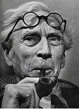

# Bertrand Russell

*Irvine, Andrew David*

*Photo by Larry Burrows*
# Bertrand Russell
**First published Thu Dec 7, 1995; substantive revision Tue Oct 15, 2024**

Bertrand Arthur William Russell (1872–1970) was a British philosopher, logician, essayist and social critic best known for his work in mathematical logic and analytic philosophy. His most influential contributions include his championing of logicism (the view that mathematics is in some important sense reducible to logic), his refining of Gottlob Frege’s predicate calculus (which still forms the basis of most contemporary systems of logic), his theories of definite descriptions, logical atomism and logical types, and his theory of neutral monism (the view that the world consists of just one type of substance which is neither exclusively mental nor exclusively physical).

Together with G.E. Moore, Russell is generally recognized as one of the founders of modern analytic philosophy. His famous paradox, theory of types and work with A.N. Whitehead on *Principia Mathematica* invigorated the study of logic throughout the twentieth century (Schilpp 1944, xiii; Wilczek 2010, 74)[^schilpp-1944][^wilczek-2010]. In the public mind, he was famous as much for his evangelical atheism as for his contributions to technical philosophy.

Over the course of a long career, Russell also made important contributions to a broad range of other subjects, including ethics, politics, educational theory and religious studies, cheerfully ignoring Hooke’s admonition to the Royal Society against “meddling with Divinity, Metaphysics, Moralls, Politicks, Grammar, Rhetorick, or Logick” (Kreisel 1973, 24)[^kreisel-1973]. Generations of general readers have also benefited from his popular writings on a wide variety of topics in both the humanities and the natural sciences. Like Voltaire, to whom he has been compared (Times of London 1970, 12)[^times-1970], he wrote with style and wit and had enormous influence.

After a life marked by controversy – including dismissals from both Trinity College, Cambridge and City College, New York – Russell was awarded the Order of Merit in 1949 and the Nobel Prize for Literature in 1950. Noted also for his many spirited anti-nuclear protests and for his campaign against western involvement in the Vietnam War, Russell remained a prominent public figure until his death at the age of 97.

Interested readers may listen to [two sound clips](russell.russell-soundclips.md) of Russell speaking.

## 1. Russell’s Chronology

A short chronology of the major events in Russell’s life is as follows:

| (1872) | Born May 18 at Ravenscroft in Trelleck, Monmouthshire, UK. |
| --- | --- |
| (1874) | Death of mother and sister. |
| (1876) | Death of father; Russell’s grandfather, Lord John Russell (the former Prime Minister) and grandmother succeed in overturning Russell’s father’s will to win custody of Russell and his brother, rather than have them raised as free-thinkers. |
| (1878) | Death of grandfather; Russell’s grandmother, Lady Russell, supervises Russell’s upbringing at Pembroke Lodge, London. |
| (1883) | Receives his first lessons in geometry from his brother Frank. |
| (1890) | Enters Trinity College, Cambridge; meets Whitehead. |
| (1893) | Awarded first-class BA in Mathematics. |
| (1894) | Completes the Moral Sciences Tripos (Part II); appointed Honorary British Attaché in Paris; marries Alys Pearsall Smith. |
| (1895) | Studies at the University of Berlin. |
| (1896) | Appointed lecturer at the London School of Economics; lectures in the US at Johns Hopkins and Bryn Mawr. |
| (1899) | Appointed lecturer at Trinity College, Cambridge. |
| (1900) | Meets Peano at the First International Congress of Philosophy in Paris. |
| (1901) | Reappointed lecturer at Cambridge; discovers Russell’s paradox. |
| (1902) | Corresponds with Frege. |
| (1905) | Develops his theory of descriptions. |
| (1907) | Runs for parliament and is defeated. |
| (1908) | Elected Fellow of the Royal Society. |
| (1910) | Fails to receive Liberal Party nomination for parliament because of his atheism; reappointed lecturer at Trinity College, Cambridge. |
| (1911) | Meets Wittgenstein; elected President of the Aristotelian Society; separates from Alys; lectures at the École des Hautes Études Sociales in Paris. |
| (1914) | Visits Harvard and teaches courses in logic and the theory of knowledge; meets T.S. Eliot. |
| (1915) | Reappointed lecturer at Trinity College, Cambridge. |
| (1916) | Fined 100 pounds and dismissed from Trinity College as a result of his anti-war writings; denied a passport and so unable to lecture at Harvard. |
| (1918) | Imprisoned for five months as a result of his anti-war writings. |
| (1920) | Visits Russia. |
| (1921) | Divorce from Alys and marriage to Dora Black; visits China and Japan. |
| (1922) | Runs for parliament and is defeated. |
| (1923) | Runs for parliament and is defeated. |
| (1924) | Lectures in the US. |
| (1927) | Lectures in the US; opens experimental school in the UK with Dora. |
| (1929) | Lectures in the US. |
| (1931) | Lectures in the US; becomes the third Earl Russell upon the death of his brother. |
| (1935) | Divorce from Dora. |
| (1936) | Marriage to Patricia (Peter) Helen Spence. |
| (1938) | Appointed visiting professor of philosophy at Chicago. |
| (1939) | Appointed professor of philosophy at the University of California at Los Angeles. |
| (1940) | Appointment at City College New York revoked prior to Russell’s arrival as the result of public protests and a legal judgment in which Russell was found to be “morally unfit” to teach at the college; delivers the William James Lectures at Harvard. |
| (1941) | Appointed lecturer at the Barnes Foundation in Pennsylvania. |
| (1942) | Dismissed from Barnes Foundation, but wins a lawsuit against the Foundation for wrongful dismissal. |
| (1944) | Reappointed a Fellow of Trinity College. |
| (1948) | Involved in a plane crash en route to Norway, he and other passengers save themselves by swimming in the ocean until help arrives. |
| (1949) | Awarded the Order of Merit; elected a Lifetime Fellow at Trinity College. |
| (1950) | Awarded Nobel Prize for Literature; visits Australia. |
| (1951) | Lectures in the US. |
| (1952) | Divorce from Patricia (Peter) and marriage to Edith Finch. |
| (1955) | Releases Russell-Einstein Manifesto. |
| (1957) | Elected President of the first Pugwash Conference. |
| (1958) | Becomes founding President of the Campaign for Nuclear Disarmament. |
| (1961) | Imprisoned for one week in connection with anti-nuclear protests. |
| (1963) | Establishes the Bertrand Russell Peace Foundation. |
| (1966) | Launches the International War Crimes Tribunal. |
| (1970) | Dies February 02 at Penrhyndeudraeth, Wales. |

Attempts to sum up Russell’s life have been numerous. One of the more famous comes from the Oxford philosopher A.J. Ayer. As Ayer writes, “The popular conception of a philosopher as one who combines universal learning with the direction of human conduct was more nearly satisfied by Bertrand Russell than by any other philosopher of our time” (1972a, 127). Another telling comment comes from the Harvard philosopher W.V. Quine: “I think many of us were drawn to our profession by Russell’s books. He wrote a spectrum of books for a graduated public, layman to specialist. We were beguiled by the wit and a sense of new-found clarity with respect to central traits of reality” (1966c, 657).

Despite such comments, perhaps the most memorable encapsulation of Russell’s life and work comes from Russell himself. As Russell tells us,

> Three passions, simple but overwhelmingly strong, have governed my life: the longing for love, the search for knowledge, and unbearable pity for the suffering of mankind. These passions, like great winds, have blown me hither and thither, in a wayward course, over a great ocean of anguish, reaching to the very verge of despair.
>
> I have sought love, first, because it brings ecstasy – ecstasy so great that I would often have sacrificed all the rest of life for a few hours of this joy. I have sought it, next, because it relieves loneliness – that terrible loneliness in which one shivering consciousness looks over the rim of the world into the cold unfathomable lifeless abyss. I have sought it finally, because in the union of love I have seen, in a mystic miniature, the prefiguring vision of the heaven that saints and poets have imagined. This is what I sought, and though it might seem too good for human life, this is what – at last – I have found.
>
> With equal passion I have sought knowledge. I have wished to understand the hearts of men. I have wished to know why the stars shine. And I have tried to apprehend the Pythagorean power by which number holds sway above the flux. A little of this, but not much, I have achieved.
>
> Love and knowledge, so far as they were possible, led upward toward the heavens. But always pity brought me back to earth. Echoes of cries of pain reverberate in my heart. Children in famine, victims tortured by oppressors, helpless old people a hated burden to their sons, and the whole world of loneliness, poverty, and pain make a mockery of what human life should be. I long to alleviate this evil, but I cannot, and I too suffer.
>
> This has been my life. I have found it worth living, and would gladly live it again if the chance were offered me. (1967, 3–4)

By any standard, Russell led an enormously full life. In addition to his ground-breaking intellectual work in logic and analytic philosophy, he involved himself for much of his life in politics. As early as 1904 he spoke out frequently in favour of internationalism and in 1907 he ran unsuccessfully for Parliament. Although he stood as an independent, he endorsed the full 1907 Liberal platform. He also advocated extending the franchise to women, provided that such a radical political change could be introduced through constitutionally recognized means (Wood 1957, 71)[^wood-1957]. Three years later he published his *Anti-Suffragist Anxieties* (1910).

With the outbreak of World War I, Russell became involved in anti-war activities and in 1916 he was fined 100 pounds for authoring an anti-war pamphlet. Because of his conviction, he was dismissed from his post at Trinity College, Cambridge (Hardy 1942)[^hardy-1942]. Two years later, he was convicted a second time, this time for suggesting that American troops might be used to intimidate strikers in Britain (Clark 1975, 337–339)[^clark-1975]. The result was five months in Brixton Prison as prisoner No. 2917. In 1922 and 1923 Russell ran twice more for Parliament, again unsuccessfully, and together with his second wife, Dora, he founded an experimental school that they operated during the late 1920s and early 1930s (Russell 1926; Park 1963)[^park-1963]. Perhaps not surprisingly, some of Russell’s more radical activities – including his advocacy of post-Victorian sexual norms – were linked in many people’s minds to his atheism, made famous in part by his 1948 BBC debate with the Jesuit philosopher Frederick Copleston over the existence of God (Leal and Marraud 2022)[^leal-2022].

Although Russell became the third Earl Russell upon the death of his brother in 1931, Russell’s radicalism continued to make him a controversial figure well through middle-age. While teaching at UCLA in the United States in the late 1930s, he was offered a teaching appointment at City College, New York. The appointment was revoked following a series of protests and a 1940 judicial decision which found him morally unfit to teach at the College (Dewey and Kallen 1941; Irvine 1996; Weidlich 2000)[^dewey-1941][^irvine-1996][^weidlich-2000]. The legal decision had been based partly on Russell’s atheism and partly on his fame as an advocate of free love and open marriages.

In 1954, Russell delivered his famous “Man’s Peril” broadcast on the BBC, condemning the Bikini H-bomb tests. A year later, he and Albert Einstein released the Russell-Einstein Manifesto calling for the curtailment of nuclear weapons. In 1957, he became a prime organizer of the first Pugwash Conference, which brought together a large number of scientists concerned about the nuclear issue. He became founding president of the Campaign for Nuclear Disarmament in 1958 and Honorary President of the Committee of 100 in 1960.

In 1961, Russell was once again imprisoned, this time for a week in connection with anti-nuclear protests. The media coverage surrounding his conviction only served to enhance Russell’s reputation and to further inspire the many idealistic youth who were sympathetic to his anti-war and anti-nuclear message. Beginning in 1963, he began work on a variety of additional issues, including lobbying on behalf of political prisoners under the auspices of the Bertrand Russell Peace Foundation.

Throughout much of his life, Russell saw himself primarily as a writer rather than as a philosopher, listing “Author” as his profession on his passport. As he says in his *Autobiography*, “I resolved not to adopt a profession, but to devote myself to writing” (1967, 125). Upon being awarded the Nobel Prize for Literature in 1950, Russell used his acceptance speech once again to emphasize themes relating to his social activism.

Over the years, Russell has served as the subject of numerous creative works, including T.S. Eliot’s “Mr Apollinax” (1917), D.H. Lawrence’s “The Blind Man” (1920), Aldous Huxley’s *Chrome Yellow* (1921), Bruce Duffy’s *The World as I Found It* (1987) and the graphic novel by Apostolos Doxiadis and Christos Papadimitriou, *Logicomix: An Epic Search for Truth* (2009).

Readers wanting additional information about Russell’s life are encouraged to consult Russell’s five autobiographical volumes: *Portraits from Memory and other Essays* (A1956b), *My Philosophical Development* (1959) and *The Autobiography of Bertrand Russell* (3 volumes, 1967, 1968, 1969). In addition, John Slater’s accessible *Bertrand Russell* (1994) gives a short but informative introduction to Russell’s life, work and influence. More detailed sources of biographical information include Ronald Clark’s authoritative *The Life of Bertrand Russell* (1975), Ray Monk’s two volumes, *Bertrand Russell: The Spirit of Solitude* (1996) and *Bertrand Russell: The Ghost of Madness* (2000), and the first volume of Andrew Irvine’s *Bertrand Russell: Critical Assessments* (1999).

For a chronology of Russell’s major publications, readers are encouraged to consult the Primary Literature section of the Bibliography below. For a complete, descriptive bibliography, see *A Bibliography of Bertrand Russell* (3 volumes, 1994), by Kenneth Blackwell and Harry Ruja. A less detailed list appears in Paul Arthur Schilpp, *The Philosophy of Bertrand Russell* (1944).

For a detailed bibliography of the secondary literature surrounding Russell up to the close of the twentieth century, see Andrew Irvine, *Bertrand Russell: Critical Assessments*, Volume 1 (1999). For a list of new and forthcoming books relating to Russell, see the [Forthcoming Books](https://library.mcmaster.ca/spaces/archives/forthcoming) page at the Bertrand Russell Archives.

## 2. Russell’s Work in Logic

Russell’s main contributions to logic and the foundations of mathematics include his discovery of Russell’s paradox, also known as the Russell-Zermelo paradox (Linsky 2013)[^linsky-2013], his development (together with Whitehead) of the theory of types, his championing of logicism (the view that mathematics is, in some significant sense, reducible to formal logic), his impressively general theory of logical relations, and his formalization of the mathematics of quantity and of the real numbers. Much of this work emerged as a result of Russell’s desire to refine Gottlob Frege’s revolutionary predicate calculus (a logic displaying valid inferences among statements in which properties are predicated of objects) and then to apply it to mathematical contexts. As Edward Zalta notes, Frege’s new logic introduced a formal mechanism for regimenting reasoning, one that “took functions to be more basic than relations” (Zalta 2024)[^zalta-2024]. The result was a formal language and theory of inference of immense new power.

Russell discovered the paradox that bears his name in 1901, while working on his *Principles of Mathematics* (1903). The paradox arises in connection with the set of all sets that are not members of themselves. Such a set, if it exists, will be a member of itself if and only if it is not a member of itself. In his 1901 draft of the *Principles of Mathematics*, Russell summarizes the problem as follows:

> [S]ome predicates can be predicated of themselves. Consider now those … of which this is not the case. … [T]here is no predicate which attaches to all of them and to no other terms. For this predicate will either be predicable or not predicable of itself. If it is predicable of itself, it is one of those referents by relation to which it was defined, and therefore, in virtue of their definition, it is not predicable of itself. Conversely, if it is not predicable of itself, then again it is one of the said referents, of all of which (by hypothesis) it is predicable, and therefore again it is predicable of itself. This is a contradiction. (CP, Vol. 3, 195)

The paradox is significant since, using classical logic, all sentences are entailed by a contradiction. Russell’s discovery thus prompted a large amount of work in logic, set theory, and the philosophy and foundations of mathematics.

Russell’s response to the paradox came between 1903 and 1908 with the development of his theory of types. It was clear to Russell that some form of restriction needed to be placed on the original comprehension (or abstraction) axiom of naïve set theory, the axiom that formalizes the intuition that any coherent condition (or property) can be used to determine a set. Russell’s basic idea was that reference to sets such as the so-called Russell set (the set of all sets that are not members of themselves) could be avoided by arranging all sentences into a hierarchy, beginning with sentences about individuals at the lowest level, sentences about sets of individuals at the next lowest level, sentences about sets of sets of individuals at the next lowest level, and so on. Using a vicious circle principle similar to that adopted by the mathematician Henri Poincaré, together with his so-called “no class” theory of classes (in which class terms gain meaning only when situated in the appropriate context), Russell was able to explain why the unrestricted comprehension axiom fails: propositional functions, such as the function “$x$ is a set”, may not be applied to themselves since self-application would involve a vicious circle. As a result, all objects for which a given condition (or predicate) holds must be at the same level or of the same “type”. Sentences about these objects will then always be higher in the hierarchy than the objects themselves.

Although first introduced in 1903, the theory of types was further developed by Russell in his 1908 article “Mathematical Logic as Based on the Theory of Types” and in the three-volume work he co-authored with Alfred North Whitehead, *Principia Mathematica* (1910, 1912, 1913). The theory thus admits of two versions, the “simple theory” of 1903 and the “ramified theory” of 1908. Both versions of the theory came under attack: the simple theory for being too weak, the ramified theory for being too strong. For some, it was important that any proposed solution be comprehensive enough to resolve all known paradoxes at once. For others, it was important that any proposed solution not disallow those parts of classical mathematics that remained consistent, even though they appeared to violate the vicious circle principle. (For discussion of related paradoxes, see Chapter 2 of the Introduction to Whitehead and Russell (1910), as well as the entry on paradoxes and contemporary logic in this encyclopedia.)

Russell himself had recognized several of these same concerns as early as 1903, noting that it was unlikely that any single solution would resolve all the known paradoxes. Together with Whitehead, he was also able to introduce a new axiom, the axiom of reducibility, which lessened the vicious circle principle’s scope of application and so resolved many of the most worrisome aspects of type theory. Even so, critics claimed that the axiom was simply too ad hoc to be justified philosophically. (For additional discussion see Linsky 1990, Linsky 2002 and Wahl 2011.)[^linsky-1990][^linsky-2002][^linsky-2011][^wahl-2011]

Of equal significance during this period was Russell’s defense of logicism, the theory that mathematics is in some important sense reducible to logic. First defended in his 1901 article “Recent Work on the Principles of Mathematics”, and later in greater detail in his *Principles of Mathematics* and in *Principia Mathematica*, Russell’s logicism consisted of two main theses. The first was that all mathematical truths can be translated into logical truths or, in other words, that the vocabulary of mathematics constitutes a proper subset of the vocabulary of logic. The second was that all mathematical proofs can be recast as logical proofs or, in other words, that the theorems of mathematics constitute a proper subset of the theorems of logic. As Russell summarizes, “The fact that all Mathematics is Symbolic Logic is one of the greatest discoveries of our age; and when this fact has been established, the remainder of the principles of mathematics consists in the analysis of Symbolic Logic itself” (1903, 5).

Like Gottlob Frege, Russell’s basic idea for defending logicism was that in some contexts numbers may be identified with classes of classes and that number-theoretic statements may be explained in terms of quantifiers and identity. Thus the number 1 can be identified with the class of all unit classes, the number 2 with the class of all two-membered classes, and so on. Statements such as “There are at least two books” would be recast as statements such as “There is a book, $x$, and there is a book, $y$, and $x$ is not identical to $y$”. Statements such as “There are exactly two books” would be recast as “There is a book, $x$, and there is a book, $y$, and $x$ is not identical to $y$, and if there is a book, $z$, then $z$ is identical to either $x$ or $y$”. Number-theoretic operations may then be explained in terms of set-theoretic operations such as intersection, union and difference. In *Principia Mathematica*, Whitehead and Russell were able to provide many detailed derivations of major theorems in set theory, finite and transfinite arithmetic, and elementary measure theory. They were also able to develop a sophisticated theory of logical relations and a unique method of founding the real numbers. Even so, the issue of whether set theory itself can be said to have been successfully reduced to logic remained controversial. A fourth volume on geometry was planned but never completed.

Russell’s most important writings relating to these topics include not only his *Principles of Mathematics* (1903), “Mathematical Logic as Based on the Theory of Types” (1908), and (with Whitehead) *Principia Mathematica* (1910, 1912, 1913), but also his earlier *Essay on the Foundations of Geometry* (1897) and his *Introduction to Mathematical Philosophy* (1919a), the last of which was written while Russell was serving time in Brixton Prison as a result of his anti-war activities. Coincidentally, it was at roughly this same time that Ludwig Wittgenstein, Russell’s most famous pupil, was completing his *Tractatus Logico-Philosophicus* (1921) while being detained as a prisoner of war at Monte Cassino in Italy during World War I.

Anyone needing assistance in deciphering the symbolism found in the more technical of Russell’s writings is encouraged to consult the Notation in *Principia Mathematica* entry in this encyclopedia.

## 3. Russell’s Work in Analytic Philosophy

In much the same way that Russell used logic in an attempt to clarify issues in the foundations of mathematics, he also used logic in an attempt to clarify issues in philosophy. As one of the founders of analytic philosophy, Russell made significant contributions to a wide variety of areas, including metaphysics, epistemology, ethics and political theory. His advances in logic and metaphysics also had significant influence on Ludwig Wittgenstein, Rudolf Carnap and the Vienna Circle.

According to Russell, it is the philosopher’s job to discover a logically ideal language – a language capable of describing the world in such a way that we will not be misled by the accidental, imprecise, surface structure of natural language. As Russell writes, “Ordinary language is totally unsuited for expressing what physics really asserts, since the words of everyday life are not sufficiently abstract. Only mathematics and mathematical logic can say as little as the physicist means to say” (1931, 82). Just as atomic facts (the associations of properties and relations with individuals) combine to form molecular facts in the world itself, such a language will allow for the description of these facts using logical connectives such as “and” and “or”. In addition to the existence of atomic and molecular facts, Russell also held that general facts (facts about “all” of something) are needed to complete our picture of the world. Famously, he vacillated on whether negative facts are also required (1918, 1919).

The reason Russell believes many ordinarily accepted statements are open to doubt is that they appear to refer to entities that may be known only through inference. Thus, underlying Russell’s various projects was not only his use of logical analysis, but also his long-standing aim of discovering whether, and to what extent, knowledge is possible. “There is one great question”, he writes in 1911. “Can human beings *know* anything, and if so, what and how? This question is really the most essentially philosophical of all questions” (Slater 1994, 67)[^slater-1994].

Motivating this question was the traditional problem of the external world. If our knowledge of the external world comes through inferences to the best explanation, and if such inferences are always fallible, what guarantee do we have that our beliefs are true? Russell’s response to this question during the early years of the twentieth century was partly metaphysical and partly epistemological. On the metaphysical side, Russell developed his influential theory of logical atomism, in which the world is said to consist of a complex of logical atoms (such as “little patches of colour”) together with their properties and relations. (The theory was crucial for influencing Wittgenstein’s theory of the same name.) Together these atoms and their properties form the facts which, in turn, combine to form logically complex objects. What we normally take to be inferred entities (for example, enduring physical objects) are then understood as logical constructions formed from the immediately given entities of sensation, viz., “sensibilia”.

On the epistemological side, Russell argues that it is also important to show how each questionable entity may be reduced to, or defined in terms of, other entities whose existence is more certain. For example, on this view, a physical object that normally might be thought to be known only through inference may be defined instead

> as a certain series of appearances, connected with each other by continuity and by certain causal laws. … More generally, a ‘thing’ will be defined as a certain series of aspects, namely those which would commonly be said to be *of* the thing. To say that a certain aspect is an aspect *of* a certain thing will merely mean that it is one of those which, taken serially, *are* the thing. (1914a, 106–107)

The reason we are able to do this, says Russell, is that

> our world is not wholly a matter of inference. There are things that we know without asking the opinion of men of science. If you are too hot or too cold, you can be perfectly aware of this fact without asking the physicist what heat and cold consist of. … We may give the name ‘data’ to all the things of which we are aware without inference. (1959, 23)

We can then use these data (or “sensibilia” or “sense data”) with which we are directly acquainted to construct the relevant objects of knowledge. Similarly, numbers may be reduced to collections of classes; points and instants may be reduced to ordered classes of volumes and events; and classes themselves may be reduced to propositional functions.

It is with these kinds of examples in mind that Russell suggests we adopt what he calls “the supreme maxim in scientific philosophizing”, namely the principle that “Whenever possible, logical constructions”, or as he also sometimes puts it, “logical fictions”, are “to be substituted for inferred entities” (1914c, 155; cf. 1914a, 107, and 1924, 326). Anything that resists construction in this sense may be said to be an ontological atom. Such objects are atomic, both in the sense that they fail to be composed of individual, substantial parts, and in the sense that they exist independently of one another. Their corresponding propositions are also atomic, both in the sense that they contain no other propositions as parts, and in the sense that the members of any pair of true atomic propositions will be logically independent of one another. Russell believes that formal logic, if carefully developed, will mirror precisely, not only the various relations between all such propositions, but their various internal structures as well.

It is in this context that Russell introduces his famous distinction between two kinds of knowledge of truths: that which is direct, intuitive, certain and infallible, and that which is indirect, derivative, uncertain and open to error (1905, 41f; 1911; 1912; and 1914b). To be justified, every indirect knowledge claim must be capable of being derived from more fundamental, direct or intuitive knowledge claims. The kinds of truths that are capable of being known directly include truths about immediate facts of sensation and truths of logic. Examples are discussed in *The Problems of Philosophy* (1912a) where Russell states that propositions with the highest degree of self-evidence (what he here calls “intuitive knowledge”) include “those which merely state what is given in sense, and also certain abstract logical and arithmetical principles, and (though with less certainty) some ethical propositions” (1912a, 109).

Eventually, Russell supplemented this distinction between direct and indirect knowledge of truths with his equally famous distinction between knowledge by acquaintance and knowledge by description. As Russell explains, “I say that I am acquainted with an object when I have a direct cognitive relation to that object, i.e. when I am directly aware of the object itself. When I speak of a cognitive relation here, I do not mean the sort of relation which constitutes judgment, but the sort which constitutes presentation” (1911, 209). Russell introduced the distinction in a paper delivered to the Cambridge Moral Sciences Club, in part in response to a talk given to the same society by Emily Elizabeth Constance Jones a few months earlier. Later, he clarifies his point by adding that acquaintance involves, not knowledge of truths, but knowledge of things (1912a, 44). Thus, while intuitive knowledge and derivative knowledge both involve knowledge of propositions (or truths), knowledge by acquaintance and knowledge by description both involve knowledge of things (or objects). This distinction is slightly complicated by the fact that, even though knowledge by description is in part based upon knowledge of truths, it is still knowledge of things, and not of truths. (I am grateful to Russell Wahl for reminding me of this point.) Since it is things with which we have direct acquaintance that are the least questionable members of our ontology, it is these objects upon which Russell ultimately bases his epistemology.

Also relevant was Russell’s reliance upon his so-called regressive method (Irvine 1989; Mayo-Wilson 2011)[^irvine-1989][^mayo-wilson-2011] and his eventual abandoning of foundationalism in favour of a more recognizably coherentist approach to knowledge (Irvine 2004)[^irvine-2004]. As Russell puts it, even in logic and mathematics

> We tend to believe the premises because we can see that their consequences are true, instead of believing the consequences because we know the premises to be true. But the inferring of premises from consequences is the essence of induction; thus the method in investigating the principles of mathematics is really an inductive method, and is substantially the same as the method of discovering general laws in any other science. (1907, 273–274)

Russell’s contributions to metaphysics and epistemology are also unified by his views concerning the centrality of scientific knowledge and the importance of there being an underlying methodology common to philosophy and science. In the case of philosophy, this methodology expresses itself through Russell’s use of logical analysis (Hager 1994; Irvine 2004)[^hager-1994][^irvine-2004]. In fact, Russell often claims that he has more confidence in his methodology than in any particular philosophical conclusion.

This broad conception of philosophy arose in part from Russell’s idealist origins (Hylton 1990a; Griffin 1991)[^griffin-1991][^hylton-1990a]. This is so, even though Russell tells us that his one, true revolution in philosophy came as a result of his break from idealism. Russell saw that the idealist doctrine of internal relations led to a series of contradictions when working with the kinds of asymmetrical (and other) relations necessary for mathematics. As he reports,

> It was towards the end of 1898 that Moore and I rebelled against both Kant and Hegel. Moore led the way, but I followed closely in his footsteps. … [Our rebellion centred upon] the doctrine that fact is in general independent of experience. Although we were in agreement, I think that we differed as to what most interested us in our new philosophy. I think that Moore was most concerned with the rejection of idealism, while I was most interested in the rejection of monism. (1959, 54)

The two ideas were closely connected through the so-called doctrine of internal relations. In contrast to this doctrine, Russell proposed his own new doctrine of *external* relations:

> The doctrine of internal relations held that every relation between two terms expresses, primarily, intrinsic properties of the two terms and, in ultimate analysis, a property of the whole which the two compose. With some relations this view is plausible. Take, for example, love or hate. If A loves B, this relation exemplifies itself and may be said to consist in certain states of mind of A. Even an atheist must admit that a man can love God. It follows that love of God is a state of the man who feels it, and not properly a relational fact. But the relations that interested me were of a more abstract sort. Suppose that A and B are events, and A is earlier than B. I do not think that this implies anything in A in virtue of which, independently of B, it must have a character which we inaccurately express by mentioning B. Leibniz gives an extreme example. He says that, if a man living in Europe has a wife in India and the wife dies without his knowing it, the man undergoes an intrinsic change at the moment of her death. (1959, 54–55)

This is the type of doctrine Russell opposed, especially with respect to the asymmetrical relations necessary for mathematics. For example, consider two numbers, one of which is found earlier than the other in a given series:

> If A is earlier than B, then B is not earlier than A. If you try to express the relation of A to B by means of adjectives of A and B, you will have to make the attempt by means of dates. You may say that the date of A is a property of A and the date of B is a property of B, but that will not help you because you will have to go on to say that the date of A is earlier than the date of B, so that you will have found no escape from the relation. If you adopt the plan of regarding the relation as a property of the whole composed of A and B, you are in a still worse predicament, for in that whole A and B have no order and therefore you cannot distinguish between “A is earlier than B” and “B is earlier than A”. As asymmetrical relations are essential in most parts of mathematics, this doctrine was important. (1959, 55)

Thus, by the end of 1898 Russell had abandoned the idealism that he had been encouraged to adopt as a student at Cambridge, along with his original Kantian methodology (Griffin 2022)[^griffin-2022]. In its place he adopted a new, pluralistic realism. As a result, he soon became famous as an advocate of “the new realism” and of his “new philosophy of logic”, emphasizing as he did the importance of modern logic for philosophical analysis. The underlying themes of this revolution included Russell’s belief in pluralism, his emphasis on anti-psychologism and his belief in the importance of science. Each of these themes remained central to his philosophy for the remainder of his life (Hager 1994; Weitz 1944)[^hager-1994][^weitz-1944].

Russell’s most important writings relating to these topics include “Knowledge by Acquaintance and Knowledge by Description” (1911), *The Problems of Philosophy* (1912a), *Our Knowledge of the External World* (1914a), “On the Nature of Acquaintance” (1914b, published more completely in *Collected Papers*, Volume 7), “The Philosophy of Logical Atomism” (1918, 1919), “Logical Atomism” (1924), *The Analysis of Mind* (1921), *The Analysis of Matter* (1927a), *Human Knowledge: Its Scope and Limits* (1948), and *Theory of Knowledge* (CP, Volume 7).

## 4. Russell’s Theory of Definite Descriptions

Russell’s philosophical method has at its core the making and testing of hypotheses through the weighing of evidence. Hence Russell’s comment that he wished to emphasize the “scientific method” in philosophy. His method also requires the rigorous analysis of problematic propositions using the machinery of first-order logic. It was Russell’s belief that by using the new logic of his day, philosophers would be able to exhibit the underlying “logical form” of natural-language statements. Discovering a statement’s logical form, in turn, would help resolve various problems of reference associated with the ambiguity and vagueness of natural language.

Since the introduction of the modern predicate calculus, it has been common to use three separate logical notations (“$Px$”, “$x = y$”, and “$\exists x$”) to represent three separate senses of the natural-language word “is”: the *is* of predication, e.g. “Cicero is wise”; the *is* of identity, e.g. “Cicero is Tully”; and the *is* of existence, e.g. “Cicero is”. It was Russell’s suggestion that, just as we use logic to make clear these distinctions, we can also use logic to discover other ontologically significant distinctions, distinctions that should be reflected in the analysis we give of each sentence’s logical form.

Russell’s view (at least during the early part of the twentieth century) was that the subject matter of philosophy is then distinguished from that of the sciences only by the generality and *a prioricity* of philosophical statements, not by the underlying methodology of the discipline. In philosophy, just as in mathematics, Russell believed that it was by applying logical machinery and insights that advances in analysis would be made.

Russell’s most famous example of his new “analytic method” concerns so-called denoting phrases, phrases that include both definite descriptions and proper names. Like Alexius Meinong, Russell had initially adopted the view that every denoting phrase (for example, “Scott”, “the author of *Waverley*”, “the number two”, “the golden mountain”) denoted, or referred to, an existing entity. On this view, even fictional and imaginary entities had to be real in order to serve as truth-makers for true sentences such as “Unicorns have exactly one horn”. By the time his landmark article, “On Denoting”, appeared in 1905, Russell had modified his extreme realism, substituting in its place the view that denoting phrases need not possess a theoretical unity. As Russell puts it, the assumption that every denoting phrase must refer to an existing entity was the type of assumption that exhibited “a failure of that feeling for reality which ought to be preserved even in the most abstract studies” (1919a, 165).

While logically proper names (words such as “this” or “that” which refer to sensations of which an agent is immediately aware) do have referents associated with them, descriptive phrases (such as “the largest number less than pi”) should be viewed merely as collections of quantifiers (such as “all” and “some”) and propositional functions (such as “$x$ is a number”). As such, they are not to be viewed as referring terms but, rather, as “incomplete symbols”. In other words, they are to be viewed as symbols that take on meaning within appropriate contexts, but that remain meaningless in isolation.

Put another way, it was Russell’s insight that some phrases may contribute to the meaning (or reference) of a sentence without themselves being meaningful. As he explains,

> If “the author of *Waverley*” meant anything other than “Scott”, “Scott is the author of *Waverley*” would be false, which it is not. If “the author of *Waverley*” meant “Scott”, “Scott is the author of *Waverley*” would be a tautology, which it is not. Therefore, “the author of *Waverley*” means neither “Scott” nor anything else – i.e. “the author of *Waverley*” means nothing, Q.E.D. (1959, 85)

If Russell is correct, it follows that in a sentence such as

**(1)**

The present King of France is bald,

the definite description “The present King of France” plays a role quite different from the role a proper name such as “Scott” plays in the sentence

**(2)**

Scott is bald.

Letting $K$ abbreviate the predicate “is a present King of France” and $B$ abbreviate the predicate “is bald”, Russell assigns sentence (1) the logical form

**(1′)**

There is an $x$ such that $Kx$, for any $y$, if $Ky$ then $y=x$, and $Bx$.

Alternatively, in the notation of the predicate calculus, we write

**(1″)**

$\exists x[(Kx \amp \forall y(Ky \rightarrow y=x)) \amp Bx]$.

In contrast, by allowing $s$ to abbreviate the name “Scott”, Russell assigns sentence (2) the very different logical form

**(2′)**

$Bs$.

This distinction between logical forms allows Russell to explain three important puzzles.

The first concerns the operation of the Law of Excluded Middle and how this law relates to denoting terms. According to one reading of the Law of Excluded Middle, it must be the case that either “The present King of France is bald” is true or “The present King of France is not bald” is true. But if so, both sentences appear to entail the existence of a present King of France, clearly an undesirable result given that France is a republic (and so has no king). Russell’s analysis shows how this conclusion can be avoided. By appealing to analysis (1″), it follows that there is a way to deny (1) without being committed to the existence of a present King of France, namely by changing the scope of the negation operator and thereby accepting that “It is not the case that there exists a present King of France who is bald” is true.

The second puzzle concerns the Law of Identity as it operates in (so-called) opaque contexts. Even though “Scott is the author of *Waverley*” is true, it does not follow that the two referring terms “Scott” and “the author of *Waverley*” need be interchangeable in every situation. Thus, although “George IV wanted to know whether Scott was the author of *Waverley*” is true, “George IV wanted to know whether Scott was Scott” is, presumably, false.

Russell’s distinction between the logical forms associated with the use of proper names and definite descriptions again shows why this is so. To see this, we once again let $s$ abbreviate the name “Scott”. We also let $w$ abbreviate “*Waverley*” and $A$ abbreviate the two-place predicate “is the author of”. It then follows that the sentence

**(3)**

$s=s$

is not at all equivalent to the sentence

**(4)**

$\exists x[(Axw \amp \forall y(Ayw \rightarrow y=x)) \amp x=s]$.

Sentence (3), for example, is a necessary truth, while sentence (4) is not.

The third puzzle relates to true negative existential claims, such as the claim “The golden mountain does not exist”. Here, once again, by treating definite descriptions as having a logical form distinct from that of proper names, Russell is able to give an account of how a speaker may be committed to the truth of a negative existential without also being committed to the belief that the subject term has reference. That is, the claim that Scott does not exist is not true since

**(5)**

$\neg\exists x(x=s)$

is self-contradictory. (For Russell, since all names refer and words that fail to refer are at most *potential* names, there must exist at least one thing that is identical to $s$, since it is a logical truth that $s$ is identical to itself.)

In contrast, the claim that a golden mountain does not exist may be true since, assuming that $G$ abbreviates the predicate “is golden” and $M$ abbreviates the predicate “is a mountain”, there is nothing contradictory about

**(6)**

$\neg\exists x(Gx \amp Mx)$.

Russell’s most important writings relating to his theory of descriptions include not only “On Denoting” (1905), but also *The Principles of Mathematics* (1903), *Principia Mathematica* (1910) and *Introduction to Mathematical Philosophy* (1919). (See too Kaplan 1970, Kroon 2009, Stevens 2011 and Pollock 2022.)[^kaplan-1970][^kroon-2009][^pollock-2022][^stevens-2011]

## 5. Russell’s Theory of Neutral Monism

Yet another of Russell’s contributions is his defence of neutral monism, the view that the world consists of just one type of substance which is neither exclusively mental nor exclusively physical. Like idealism (the view that nothing exists but the mental) and physicalism (the view that nothing exists but the physical), neutral monism rejects dualism (the view that there exist distinct mental and physical substances). However, unlike both idealism and physicalism, neutral monism holds that this single existing substance may be viewed in some contexts as being mental and in others as being physical. As Russell puts it,

> “Neutral monism” – as opposed to idealistic monism and materialistic monism – is the theory that the things commonly regarded as mental and the things commonly regarded as physical do not differ in respect of any intrinsic property possessed by the one set and not by the other, but differ only in respect of arrangement and context. (CP, Vol. 7, 15)

To help understand this general suggestion, Russell introduces his analogy of a postal directory:

> The theory may be illustrated by comparison with a postal directory, in which the same names come twice over, once in alphabetical and once in geographical order; we may compare the alphabetical order to the mental, and the geographical order to the physical. The affinities of a given thing are quite different in the two orders, and its causes and effects obey different laws. Two objects may be connected in the mental world by the association of ideas, and in the physical world by the law of gravitation. … Just as every man in the directory has two kinds of neighbours, namely alphabetical neighbours and geographical neighbours, so every object will lie at the intersection of two causal series with different laws, namely the mental series and the physical series. ‘Thoughts’ are not different in substance from ‘things’; the stream of my thoughts is a stream of things, namely of the things which I should commonly be said to be thinking of; what leads to its being called a stream of thoughts is merely that the laws of succession are different from the physical laws. (CP, Vol. 7, 15)

In other words, when viewed as being mental, a thought or idea may have associated with it other thoughts or ideas that seem related even though, when viewed as being physical, they have very little in common. As Russell explains, “In my mind, Caesar may call up Charlemagne, whereas in the physical world the two were widely sundered” (CP, Vol. 7, 15). Even so, it is a mistake, on this view, to postulate two distinct types of thing (the idea of Caesar and the man Caesar) that are composed of two distinct kinds of substance (the mental and the physical). Instead, “The whole duality of mind and matter, according to this theory, is a mistake; there is only one kind of stuff out of which the world is made, and this stuff is called mental in one arrangement, physical in the other” (CP, Vol. 7, 15).

Russell began shifting to this view after hearing Wittgenstein’s criticism of his 1913 *Theory of Knowledge* manuscript. The criticism led to Russell’s acceptance of the view “that William James had been right” to deny the relational character of sensations and that the idea of mental sense-data ultimately would have to be abandoned (1959, 134). In place of the term “sense-data”, Russell introduced the term “event particulars” to refer to the basic building blocks found in nature that result in both physical events and mental sensations. Predecessors to this idea appear in the work of Ernst Mach and William James under a variety of names, including “realistic empiricism”, “radical empiricism” and “empirio-criticism”. (See Lockwood 1981, Tully 1993 and especially Banks 2014.)[^banks-2014][^lockwood-1981][^tully-1993]

Central to Wittgenstein’s criticism of Russell’s 1913 manuscript was Russell’s multiple-relation theory of judgment, the theory that judgment is a non-binary relation between a judging subject and a variety of objects, properties and relations. The theory stands in contrast to a dual-relation theory of judgment, a theory asserting that judgment is a two-place relation between a subject and a proposition. If the dual-relation theory is correct, Russell’s judging that five plus seven equals twelve will be represented by

> Judges(Russell, that five plus seven equals twelve).

If the multiple-relation theory is correct, Russell’s judging that five plus seven equals twelve will be represented by

> Judges(Russell, 5, plus, 7, equals, 12).

Russell abandoned his acceptance of the dual-relation theory in 1910 in favour of the multiple-relation theory.

As Wittgenstein records in his *Tractatus*, the objection was that “the correct explanation of the form of the proposition, ‘$A$ makes the judgement $p$’, must show that it is impossible for a judgement to be a piece of nonsense. (Russell’s theory does not satisfy this requirement.)” (5.5422). Today, debate continues over exactly how this comment should be interpreted (Carey 2007; Lebens 2017)[^carey-2007][^lebens-2017]. Intuitively the objection might be put as follows: judgments concern the truth or falsehood of propositions (or perhaps sentences); but if this is correct, a judgment needs to be a dual relation between a judging subject and a proposition (or sentence); a plurality of objects together with a relation is not one thing but many, so unlike a proposition it has no unity; so even if the plurality is ordered, it will fail to stand in a single relation to a subject; it follows that no relation between a judging subject and a plurality can be a relation of judgment. This objection, or something like it, appears to have led to Russell’s abandonment of his manuscript. It also appears to have played a role in the development of Wittgenstein’s picture theory of language (see Wittgenstein).

Russell seems to have first coined the phrase “neutral monism” in his 1914 *Monist* article, “On the Nature of Acquaintance”, while criticizing James’ view. In 1919, he changed his position and accepted neutral-monism in his article, “On Propositions”. Decades later, in 1964, he remarked that “I am not conscious of any serious change in my philosophy since I adopted neutral monism” (Eames 1967, 511)[^eames-1967]. Even so, over the next several decades Russell continued to do a large amount of original work, authoring such books as *The Analysis of Mind* (1921), *The Analysis of Matter* (1927a), *An Inquiry into Meaning and Truth* (1940) and *Human Knowledge: Its Scope and Limits* (1948).

As Erik Banks points out, Russell understood neutral monism to be helpful in two respects. First, it would help “explain the relation of sensations to the physical world in which sensations naturally occur as physical phenomena *without* contradicting the results of physics”. Second, it would “articulate a scientific realism based upon the event particular and perspectival relations and obtaining objects like extended atoms, bodies, and physical space and time from events and relations of some kind” (2014, 135). In this respect, Russell’s adoption of neutral monism exhibited “a realistic and naturalistic bent ... more continuous with science” and more in line with Whitehead’s process view than Wittgenstein’s growing “linguistic anti-naturalism” (2014, 115, 137). It was in this context that Russell also made his famous remark to the effect that, in Banks’ words, physics describes the mathematical “skeleton of the world” without saying anything about its “intrinsic character” (2014, 135):

> Physics itself is exceedingly abstract and reveals only mathematical characteristics of the material with which it deals. It does not tell us anything as to the intrinsic character of this material. Psychology is preferable in this respect but it is not causally autonomous ... But by bringing physics and psychology together, we are able to include psychical events in the material of physics and to give physics the greater concreteness which results from our more intimate acquaintance with the subject matter of our own experience. (1927, 10)

Today several authors, including David Chalmers (1996, 155), Thomas Nagel (2002, 209) and Erik Banks (2014, 114), have shown renewed interest in considering this general approach to the mental-physical distinction.

In addition to the above titles by Russell, Russell’s most influential writings relating to his theories of metaphysics and epistemology include *Our Knowledge of the External World* (1914a), “The Relation of Sense-Data to Physics” (1914c), “The Philosophy of Logical Atomism” (1918, 1919), “On Propositions: What They Are and How They Mean” (1919b) and *An Outline of Philosophy* (1927b).

## 6. Russell’s Atheism

Russell sums up his views about religion quite plainly: “My own view on religion is that of Lucretius. I regard it as a disease born of fear and as a source of untold misery to the human race” (A1957, 18). According to Russell, not only are most religious beliefs intellectually and morally pernicious, the religious point of view itself “is a conception quite unworthy of free men” (A1957, 17). Throughout his life, Russell thus put significant effort into opposing religious ideas and institutions of all kinds. As he reports in his *Autobiography*, upon arriving at Brixton Prison in 1918, “I was much cheered on my arrival by the warder at the gate, who had to take particulars about me. He asked my religion, and I replied ‘agnostic’. He asked how to spell it, and remarked with a sigh: ‘Well, there are many religions, but I suppose they all worship the same God’. This remark kept me cheerful for about a week” (1968, 34).

Russell’s discussions about religion fall largely into four categories: his criticisms of arguments favouring the existence of God; his observation that religion has historically served to impede the advancement of knowledge; his observation that religion has regularly advanced theories of morality that are more harmful than good; and his analysis of religion, not simply as a body of belief but as a mode of feeling.

Perhaps most importantly, Russell opened the door to the demystification of religion, writing in plain language at a time when people had been told that serious discussions about religion required a detailed knowledge of Latin and church history. The result was twofold: first, that many people came to understand religion as a subject about which they were entitled to develop their own beliefs and views; second, that arguments from ecclesiastical authority suddenly became less formidable and less influential than they had been for centuries. In this respect, it is not too much to say that Russell did as much to usher in the twentieth century’s age of secularism as Luther did to usher in the sixteenth century’s age of Protestantism. As the Nobel Prize committee noted, the 1950 award went to Russell “in recognition of his varied and significant writings in which he champions humanitarian ideals and freedom of thought” (Nobel Media 2020)[^nobel-2020]. Russell himself reports that he received the award primarily for his anti-religious book, *Marriage and Morals* (1969, 30).

Russell’s analysis of traditional arguments in favour of the existence of God appears in both his popular and his philosophical writings. In his book on Leibniz, he discusses Leibniz’s treatment of several such arguments, noting that they are “the weakest part in Leibniz’s philosophy, the part most full of inconsistencies” (1900, sec. 106, p. 172). In his more popular writings, he repeatedly emphasizes his views about religion, noting that “The fact that an opinion has been widely held is no evidence whatever that it is not utterly absurd” (1929, 58). In his 1922 booklet *Free Thought and Official Propaganda*, he tells his readers that “I am myself a dissenter from all known religions, and I hope that every kind of religious belief will die out” (1922a, 1). Later, in his 1941 collection of essays *Let the People Think*, he adds that “modern science gives us no indication whatever of the existence of the soul” (A1941, 113), and in the preface to his 1957 book *Why I Am Not a Christian and Other Essays on Religion and Related Subjects*, he notes that “I am as firmly convinced that religions do harm as I am that they are untrue” (1957, xi).

Russell’s criticism of arguments traditionally offered in favour of the existence of God includes his discussions of the

1. First Cause Argument,
2. Problem of Evil,
3. Ontological Argument,
4. Teleological Argument,
5. Argument from Pre-established Harmony,
6. Natural Law Argument,
7. Argument from Morality,
8. Remediation of Injustice Argument, and
9. Argument from Religious Experience.

Underlying these discussions is David Hume’s suggestion that belief needs to be proportioned to the available evidence, an idea neatly summed up in Russell’s teapot analogy:

> If I were to suggest that between the Earth and Mars there is a china teapot revolving about the sun in an elliptical orbit, nobody would be able to disprove my assertion provided I were careful to add that the teapot is too small to be revealed even by our most powerful telescopes. But if I were to go on to say that, since my assertion cannot be disproved, it is intolerable presumption on the part of human reason to doubt it, I should rightly be thought to be talking nonsense. If, however, the existence of such a teapot were affirmed in ancient books, taught as the sacred truth every Sunday, and instilled into the minds of children at school, hesitation to believe in its existence would become a mark of eccentricity and entitle the doubter to the attentions of the psychiatrist in an enlightened age or of the Inquisitor in an earlier time. It is customary to suppose that, if a belief is widespread, there must be something reasonable about it. I do not think this view can be held by anyone who has studied history. (1952, 547–8)

Among Russell’s responses to specific arguments favoring the existence of God are the following:

(i) The *First Cause* (or *Cosmological*) *Argument* is the argument that since everything has a cause, there must have been a first cause, and it is to this first cause that we give the name God. In response to this argument, Russell notes the obvious: If everything must have a cause, then God must have a cause. If everything must have a creator, then God must have a creator. Alternatively, if God can exist without a cause, then it is just as likely that the world can exist without a cause. In fact, this is even more likely than the existence of an uncaused, hypothetical, supernatural creator who manufactures and then intervenes in the world, since there “is no reason to suppose that the world had a beginning at all” (A1957, 4). To those who suggest that unlike God, since every *part* of the world has a cause, it follows that the world itself must have a cause, Russell notes that just because every man has a mother it does not follow that the human race must have a mother (A1957, 152). Put in more formal language, although causation connects each contingent stage of the world to the next, it need not follow that there is an “extramundane” creator of the world as a whole (1900, sec. 109, p. 176). To those who claim that without such a creator, there can never be sufficient reason for “why there are any states at all”, Russell points out that the traditional view of God as being uncaused because he exists necessarily is simply inconsistent with God’s creation of a contingent universe. For Russel, no series of contingent states can have come about by the necessity that accompanies God’s actions, since the contingency of existential propositions rests on the assertion that God acts, not from necessity but contingently (1900, sec. 110, p. 177). Thus, either the world itself has no supernatural cause or the supernatural cause itself will act and exist contingently, and so it, too, cannot be necessary and must require a creator.

(ii) Related to the First Cause Argument is the *Problem of Evil*. Like Epicurus, Russell holds that the creation of a contingent world could never eliminate God’s responsibility for the existence of evil:

> The world, we are told, was created by a God who is both good and omnipotent. Before He created the world He foresaw all the pain and misery that it would contain; He is therefore responsible for all of it. It is useless to argue that the pain in the world is due to sin. In the first place, this is not true; it is not sin that causes rivers to overflow their banks or volcanoes to erupt. But even if it were true, it would make no difference. If I were going to beget a child knowing that the child was going to be a homicidal maniac, I should be responsible for his crimes. If God knew in advance the sins of which man would be guilty, He was clearly responsible for all the consequences of those sins when He decided to create man. (A1957, 22)

(iii) In response to the *Ontological Argument*, the argument that since perfection implies existence, the idea of a non-existent, perfect God is self-contradictory, Russell points out that the argument rests ultimately on the mistaken claim that existence is a property or, in Russell’s terminology, a predicate. His reasoning, like that of Immanuel Kant, is that if existence were a predicate then, like all other predicates, it would (or would not) be part of the nature of any given substance. But upon being created, each such substance would acquire a new predicate. “Hence the special position of existence, as a contingent and synthetic predicate, falls to the ground. If all substances always contain all their predicates, then all substances always contain or do not contain the predicate existence, and God must be as powerless over this predicate as over any other. To add the predicate existence must be metaphysically impossible. Thus, either creation is self-contradictory, or, if existence is not a predicate, the ontological argument is unsound” (1900, sec. 115, p. 185).

(iv) In response to the *Teleological Argument* (or *Argument from Design*), the argument that the complexity and purpose we find in the world shows that there must have been a creator, Russell points out that “since the time of Darwin we understand much better why living creatures are adapted to their environment. It is not that their environment was made to be suitable to them, but that they grew to be suitable to it, and that is the basis of adaption. There is no evidence of design about it” (A1957, 6). Russell also reminds his readers about the pre-Darwin observation made famous by David Hume, that “it is a most astonishing thing that people can believe that this world, with all the things that are in it, with all its defects”, is the best that an omnipotent, omniscient creator could have been able to create in millions of years. (A1957, 6).

(v) In response to the *Argument from Pre-established Harmony*, the argument that “The world is so well constructed, we are told, that it must have had a highly skillful Architect” or, as Leibniz preferred to say, that “the harmony of all the monads can only have arisen from a common cause” (1900, sec. 114, p. 183), Russell notes that this is simply a version of the Argument from Design and, humorously, that “Being more palpably inadequate than any of the others, it has acquired a popularity which they have never enjoyed” (1900, sec. 114, p. 183).

(vi) In response to the *Natural Law Argument*, the argument that the existence of laws of nature shows that there must have been a lawgiver, Russell points out that the argument arises simply as a result of a confusion between natural and human laws (A1957, 5). Human laws are commands that we choose to follow or ignore. In contrast, laws of nature are simply descriptions of how things in fact are. There is thus no need to assume a lawmaker unless the Argument from Design is sound, which it is not. Alternatively, if we assume there must have been a lawmaker who brought about these laws, this raises the question of why the lawmaker chose to make these laws and not others: “If you say that He did it simply from His own good pleasure, and without any reason, you then find that there is something which is not subject to law, and so your train of natural law is interrupted. If you say, as more orthodox theologians do, that in all the laws which God issues He had a reason for giving those laws rather than others – the reason, of course, being to create the best universe, although you would never think it to look at it – if there was a reason for the laws which God gave, then God himself was subject to law, and therefore you do not get any advantage by introducing God as an intermediary” (A1957, 5–6). In either case, there is no need to postulate a supernatural lawmaker.

(vii) In response to the *Argument from Morality* (or the *Divine Command Theory Argument*), the argument that there could be no right or wrong unless God existed, Russell adapts the reply given by Socrates to Euthyphro 2,300 years earlier (Plato, *Euthyphro*, 5d–15e). Assuming there is a difference between right and wrong, is this difference due to God’s commands or not? If it is, then for God there must have originally been “no difference between right and wrong, and it is no longer a significant statement to say that God is good” (A1957, 8). Alternatively, if we take a more traditional theological line and insist that God is good, and it is for this reason that God commands some actions and not others, then we will also have to say “that right and wrong have some meaning which is independent of God’s fiat, because God’s fiats are good and not bad independently of the mere fact that He made them. If you are going to say that, you will then have to say that it is not only through God that right and wrong came into being, but that they are in their essence logically anterior to God” (A1957, 8). Of course, we might then feel compelled to suggest the existence of a superior deity, one who ordered the God who created world to act as he did, but this option will be of no value to the traditional theist. There is also “the line that some of the gnostics took up – a line which I often thought was a very plausible one – that as a matter of fact this world that we know was made by the devil at a moment when God was not looking”, but again, this is not the kind of option that would give comfort to the traditional theist (A1957, 8).

(viii) In response to the *Remediation of Injustice Argument*, the argument that God is needed to bring justice to the world, to ensure that at the end of time the scales of justice have been balanced, Russell asks what evidence we have that such remediation is ever going to occur. “In the part of this universe that we know there is great injustice, and often the good suffer, and often the wicked prosper, and one hardly knows which of those is the more annoying; but if you are going to have justice in the universe as a whole you have to suppose a future life to redress the balance of life here on earth. So they say that there must be a God, and there must be heaven and hell in order that in the long run there may be justice” (A1957, 9). Despite such wishful thinking, we have no concrete evidence that such remediation is ever going to occur: “Supposing you got a crate of oranges that you opened, and you found all the top layer of oranges bad, you would not argue: ‘The underneath ones must be good, so as to redress the balance’. You would say: ‘Probably the whole lot is a bad consignment’, and that is really what a scientific person would argue about the universe” (A1957, 9).

(ix) Finally, in response to the *Argument from Religious Experience*, the argument that people report having had direct experience of the supernatural or the divine, Russell simply notes that we are just as likely to make mistakes when reporting such experiences as we are to make mistakes in other areas of our lives: “If you have jaundice you see things yellow that are not yellow. You’re making a mistake” (A1957, 161). Thus, it is our total body of evidence that needs to be considered when making such judgments, a body of evidence that leans heavily against the existence of anything divine or supernatural.

On the question of whether religion has impeded the advancement of knowledge and introduced harmful theories of morality, Russell writes equally plainly: “The objections to religion are of two sorts – intellectual and moral. The intellectual objection is that there is no reason to suppose any religion true; the moral objection is that religious precepts date from a time when men were more cruel than they are, and therefore tend to perpetuate inhumanities which the moral conscience of the age would otherwise outgrow” (A1957, 23). The conclusion to be drawn, says Russell, is that religious faith has served as a shield against the advancement of knowledge, both in ethics and in the sciences: “When two men of science disagree, they do not invoke the secular arm; they wait for further evidence to decide the issue, because, as men of science, they know that neither is infallible. But when two theologians differ, since there are no criteria to which either can appeal, there is nothing for it but mutual hatred and an open or covert appeal to force” (A1957, 173). Today, no one

> believes that the world was created in 4004 BC; but not so very long ago skepticism on this point was thought an abominable crime … It is no credit to the orthodox that they do not now believe all the absurdities that were believed 150 years ago. The gradual emasculation of the Christian doctrine has been effected in spite of the most vigorous resistance, and solely as the result of the onslaughts of Freethinkers (A1957, 28).

The tortures of the Inquisition, the condoning of slavery in the Bible and the Koran, the burning of women and men for witchcraft, the coming together to pray for deliverance at times of plague (which only led to the further spread of disease), all resulted from religious beliefs and practices. The conclusion, says Russell, is obvious: “the more intense has been the religion of any period and the more profound has been the dogmatic belief, the greater has been the cruelty and the worse has been the state of affairs” (A1957, 15).

In his own time, Russell was criticized severely for his view that the church’s attempt to keep sexual knowledge away from the young was “extremely dangerous to mental and physical heath” (A1957, 21). Against the practice of his time, he advocated sex education for the young. He also recommended temporary, childless marriages for those not ready to begin a family and held that “Christian ethics inevitably, through the emphasis laid upon sexual virtue, did a great deal to degrade the position of women” (1929, 60–61). In support of his view that the writings handed down by the church fathers were “full of invectives against Woman”, he quotes the historian, W.E.H. Lecky: “Woman was represented as the door to hell, as the mother of all human ills. She should be ashamed at the very thought that she is a woman. She should live in continual penance, on account of the curses she has brought upon the world” (1929, 61). Russell concludes that “It is only in quite modern times that women have regained the degree of freedom which they enjoyed in the Roman Empire” (1929, 60–61).

Among Russell’s critics, it was argued that in this case and others like it, Russell had simply got his facts wrong:

> It is incredible that a philosopher of note could be so unreliable, so unfamiliar with the fact that early Christianity has exalted the conception of women in the adoration given to Mary and the saints, and that by treating marriage as a sacrament it emancipated women of all classes from the old traditions of the absolute authority of parents and the seignorial power of feudal lords. It is intellectual blindness not to recognize the revolutionary import of early Christianity, whatever the contemporary feeling concerning the sacrament of marriage may be, when it set itself like a wall against the tides of boundless sensuality and impressed upon the Roman world the sanctity of human life. (Kayden 1930, 88)[^kayden-1930]

Contrary to what was often said about his personal life, it is also worth noting that Russell did not practice or defend a libertine ethic. He thought that sex was a natural need, like food and drink, but that it should not be trivialized by disassociating it “from serious emotion and from feelings of affection” (1929, 127). As Alan Wood notes, the result was that “More than anyone else, he changed the outlook on sex morality of a whole new generation; and during his lifetime he saw the cause of Women’s Rights, once regarded as a crank’s crusade, end up as an established part of the laws and customs of the land” (Wood 1957, 166)[^wood-1957]. As Wood also notes,

> Perhaps the finest tribute to his success is that few people now even realize the nature of the old ideas. Russell, it must be repeated, was fighting a cruel and indefensible state of affairs where sexual ignorance was deliberately fostered, so a boy might think the changes of puberty were signs of some dreadful disease, and a girl might marry without knowing anything of what lay ahead of her on her bridal night; where women were taught to look on sex, not as a source of joy, but of painful matrimonial duty; where prudery went to the extent of covering the legs of pianos in draperies; where artificial mystery evoked morbid curiosity, and where humbug went hand in hand with unhappiness … . (Wood 1957, 174)[^wood-1957]

Underlying Russell’s writings on religion was also his observation that religion is not simply a body of doctrine but also a vehicle for the expression of emotion. This explains why arguments against the existence of the supernatural, although influential among intellectuals, are not the main driving force behind most religious belief (A1957, 9). Instead, religion is based largely on fear and ignorance: our fear of the mysterious, our lack of knowledge of natural causes, our fear of death (A1957, 16).

With regard to the propositional content of religion, or what Russell calls theology, Russell notes that central to the idea of Christianity are belief in God, belief in immortality and, at the very least, “belief that Christ was, if not divine, at least the best and wisest of men. If you are not going to believe that much about Christ, I do not think you have any right to call yourself a Christian” (A1957, 2). Since it is this propositional content that varies from religion to religion, it turns out, as a matter of logic, that at most one religion can be true (A1957, xi).

Even so, as Jack Pitt writes, Russell is more than just a “heroic heretic hounding the sacred cows of a sterile tradition while spreading a new gospel of human freedom and secular enlightenment” (Pitt 1975, 152)[^pitt-1975]. Instead, “Russell sees religion (as distinct from theology) as essentially a mode of feeling, perhaps as a set of attitudes which inevitably have practical consequences for the ethical tone and style of a person’s life” (Pitt 1975, 160)[^pitt-1975]. Russell confirms this when he notes that

> Religion has three main aspects. In the first place, there are a man’s serious personal beliefs, insofar as they have to do with the nature of the world and the conduct of life. In the second place there is theology. In the third place there is institutionalized religion, i.e., the churches. The first of these aspects is somewhat vague, the but word “religion” is coming more and more to be used in this sense. … What makes my attitude towards religion complex is that, although I consider some form of personal religion highly desirable, and feel many people unsatisfactory through the lack of it, I cannot accept the theology of any well-known religion, and I incline to think that most churches at most times have done more harm than good. (Schilpp 1944, 725–6)[^schilpp-1944].

One suggestion about the source of this three-fold division is connected to Russell’s love of Lady Ottoline Morrell, with whom he exchanged some 3,500 letters. Separating religious feelings from religious belief would have allowed Russell to find some common ground with Morrell’s spiritually, without having to accept any particular theology. (See Swanson 2019, 93–4 for a helpful discussion)[^swanson-2019]. An alternative (and at least equally plausible) view is that the complexity of Russell’s view was generated by the fact that even our most serious emotions and most important feelings need not result solely from the propositional content of our beliefs. Among Russell’s most famous suggestions about the nature of the good life is his observation that “The good life is one inspired by love and guided by knowledge” (A1957, 44). For Russell, this is a view so basic that it is more like a goal than a description. As a result, it becomes impossible to think of it as a claim purely connected to propositional content. As Russell explains,

> Suppose, for instance, your child is ill. Love makes you wish to cure it, and science tells you how to do so. There is not an intermediate stage of ethical theory, where it is demonstrated that your child had better be cured. Your act springs directly from desire for an end, together with knowledge of means. This is equally true of all acts, whether good or bad. (A1957, 48)

Just as for Hume, the result is that in many cases, emotion drives belief: “I cannot, therefore, prove that my view of the good life is right; I can only state my view, and hope that as many as possible will agree” (A1957, 44).

These observations should not be interpreted as giving unfettered licence to religious belief. As Russell points out “some very important virtues are more likely to be found among those who reject religious dogmas than among those who accept them. I think this applies especially to the virtue of truthfulness or intellectual integrity. I mean by intellectual integrity the habit of deciding vexed questions in accordance with the evidence, or of leaving them undecided where the evidence is inconclusive” (A1957, 169). In the case of religion, it is not simply that such virtues are ignored. Instead, they are positively frustrated:

> If theology is thought necessary to virtue and if candid inquirers see no reason to think the theology true, the authorities will set to work to discourage candid inquiry. In former centuries, they did so by burning the inquirers at the stake. In Russia they still have methods which are little better; but in Western countries the authorities have perfected somewhat milder forms of persuasion. Of these, schools are perhaps the most important: the young must be preserved from hearing the arguments in favour of the opinions which the authorities dislike, and those who nevertheless persist in showing an inquiring disposition will incur social displeasure and, if possible, be made to feel morally reprehensible. (A1957, 171)

Societies as well as individuals, says Russell, need to choose whether the good life is one that is guided by honest inquiry and the weighing of evidence, or by the familiarity of superstition and the comforts of religion.

Russell’s writings on religion and related topics include Chapter 15 of his *A Critical Exposition of the Philosophy of Leibniz* (1900), as well as *A Free Man’s Worship* (1923b), *Why I Am Not a Christian* (1927c), reprinted in *Why I am Not a Christian and Other Essays on Religion and Related Subjects* (A1957), “The Existence and Nature of God” (1939), “Is There a God?” (1952) and *What I Believe* (A2013).

## 7. Russell’s Social and Political Philosophy

Russell’s significant social influence stems from three main sources: his long-standing social activism, his many writings on the social and political issues of his day (as well as on more theoretical concerns), and his popularizations of numerous technical writings in philosophy and the natural sciences. Although it was available to him, he only rarely took advantage of his seat in the House of Lords to attempt to advance his political views. As Kirk Willis notes, in his nearly 40 years as a Labour peer he spoke publicly in the Lords only six times (2002, 97).

Among Russell’s many popularizations are his two best-selling works, *The Problems of Philosophy* (1912) and *A History of Western Philosophy* (1945). Both of these books, as well as his numerous books popularizing science, have done much to educate and inform generations of general readers. His *History* is still widely read and did much to initiate twentieth-century research on a wide range of historical figures from the Presocratics to Leibniz. His *Problems* is still used as an introductory textbook over a century after it was first published. Both books can be read by the layman with satisfaction. Other popular books, particularly those relating to developments in modern science such as *The ABC of Atoms* (1923a) and *The ABC of Relativity* (1925), are now of more historical interest. Even so, they continue to convey something of the intellectual excitement associated with advances in twentieth-century science and philosophy.

Naturally enough, Russell saw a link between education in this broad sense and social progress. As he put it, “Education is the key to the new world” (1926, 83). Partly this is due to our need to understand nature, but equally important is our need to understand each other:

> The thing, above all, that a teacher should endeavor to produce in his pupils, if democracy is to survive, is the kind of tolerance that springs from an endeavor to understand those who are different from ourselves. It is perhaps a natural human impulse to view with horror and disgust all manners and customs different from those to which we are used. Ants and savages put strangers to death. And those who have never traveled either physically or mentally find it difficult to tolerate the queer ways and outlandish beliefs of other nations and other times, other sects and other political parties. This kind of ignorant intolerance is the antithesis of a civilized outlook, and is one of the gravest dangers to which our overcrowded world is exposed. (1950, 121)

It is in this same context that Russell became famous for suggesting that a widespread reliance upon evidence, rather than superstition, would have enormous social consequences: “I wish to propose for the reader’s favourable consideration”, says Russell, “a doctrine which may, I fear, appear wildly paradoxical and subversive. The doctrine in question is this: that it is undesirable to believe a proposition when there is no ground whatever for supposing it true” (A1928, 11).

Unlike Russell’s views about the importance of education, the precise connection between Russell’s political activism and his more theoretical work has been more controversial. In part, this has been because Russell himself repeatedly maintained that he saw no significant connection between his philosophical work and his political activism. Others have seen things differently. One of the best summaries is given by Alan Wood:

> Russell sometimes maintained, partly I think out of perverseness, that there was no connection between his philosophical and political opinions. … But in fact I think there are perfectly obvious connections between Russell’s philosophical and other views. … To begin with, it is natural enough to find an analytic anti-monist philosopher like Russell upholding the individual against the state, whereas Hegel did the reverse … [In addition, the] whole bent of Russell’s mind in philosophy was an attempt to eliminate the *a priori* and to accentuate the empirical; and there was exactly the same trend in his political thinking … Unless it is realized that Russell’s approach to political questions was usually empirical and practical, based on the evidence of the moment and not on *a priori* principles and preconceptions, it is quite impossible to understand why his views appeared to vary so much. This was perfectly legitimate, and even praiseworthy, in a world which never stays the same, and where changing circumstances continually change the balance of arguments on different sides. (Wood 1957, 73–4)[^wood-1957]

Thus, in addition to Russell’s numerous contributions to the politics of his day, he also contributed significantly to our understanding of the social world around us. Among Russell’s more theoretical contributions were his anticipation of John Mackie’s error theory in ethics, the view that moral judgments are cognitive (that is, they are either true or false), but because of their content they in fact are invariably false. (Mackie’s paper “The Refutation of Morals” appeared in 1946; Russell’s paper “Is There an Absolute Good?”, although not published until 1988 was first delivered publicly in 1922.)

Russell also anticipated the modern theory of emotivism (as introduced by A.J. Ayer in his 1936 *Language, Truth and Logic*), arguing that “Primarily, we call something ‘good’ when we desire it, and ‘bad’ when we have an aversion from it” (1927b, 242), a view that “he had been flirting with since 1913” (see the entry on Russell’s Moral Philosophy in this encyclopedia; see too Schilpp 1944, 719f)[^schilpp-1944]. Even so, Russell remained less than satisfied with his views on meta-ethics for most of his life (CP, Vol. 11, 310).

This dissatisfaction appears not to have extended to his work in political theory. There Russell focused primarily on the notion of power, or what he called “the production of intended effects” (1938, 35). As V.J. McGill writes, “The concept of power overshadows all of Russell’s political and economic writings” (Schilpp 1944, 581)[^schilpp-1944]. Russell himself summarizes his point of view with the observation that “The laws of social dynamics are – so I shall contend – only capable of being stated in terms of power in its various forms” (1938, 15). As a result, it is only by understanding power in all its human instantiations that we understand the social world around us.

Russell’s cataloging of the perceived evils of his age are well known. As Popper neatly sums up Russell’s general outlook, “we are clever, perhaps too clever, but we are also wicked; and this mixture of cleverness and wickedness lies at the root of our troubles” (1956, 365). Even so, underlying Russell’s criticism of both the political left and the political right lies a common worry: the unequal distribution of power. As McGill sums up, “Evidently he has become convinced that the thirst for Power is the primary danger of mankind, that possessiveness is evil mainly because it promotes the power of man over man” (Schilpp 1944, 581)[^schilpp-1944]. The problem with this analysis and of Russell’s desire for a more equitable distribution of power is that any proposed solution appears to lead to paradox:

> Suppose certain men join a movement to disestablish Power, or to distribute it more equally among the people! If they are successful, they carry out the behest of Power, becoming themselves as powerful, in terms of Mr. Russell’s definition, as any tyrant. Even though they spread the good life to millions, the more successful they are, the more usurpatious and dangerous. (Schilpp 1944, 586)[^schilpp-1944]

Like his writings about religion, Russell’s writings in ethics and politics brought him to the attention of large numbers of non-academic readers. His most influential books on these topics include his *Principles of Social Reconstruction* (1916), *On Education* (1926), *Marriage and Morals* (1929), *The Conquest of Happiness* (1930), *The Scientific Outlook* (1931), and *Power: A New Social Analysis* (1938).

## 8. Contemporary Russell Scholarship

Since his death in 1970, Russell’s reputation as a philosopher has continued to grow. This increase in reputation has been accompanied by a corresponding increase in scholarship. Older first-hand accounts of Russell’s life, such as Dora Russell’s *The Tamarisk Tree* (1975, 1981, 1985), Katharine Tait’s *My Father Bertrand Russell* (1975) and Ronald Clark’s *The Life of Bertrand Russell* (1975), have been supplemented by later accounts, including Caroline Moorehead’s *Bertrand Russell* (1992), John Slater’s *Bertrand Russell* (1994), and Ray Monk’s *Bertrand Russell: The Spirit of Solitude* (1996) and *Bertrand Russell: The Ghost of Madness* (2000).

This increase in scholarship has benefited greatly from the existence of the [Bertrand Russell Archives](http://www.mcmaster.ca/russdocs/russell.htm) at McMaster University, where the bulk of Russell’s library and literary estate is housed, and from the [Bertrand Russell Research Centre](http://www.humanities.mcmaster.ca/~russell/), also housed at McMaster. Books such as Nicholas Griffin’s *Selected Letters of Bertrand Russell* (1992, 2001), Gregory Landini’s *Russell’s Hidden Substitutional Theory* (1998) and Bernard Linsky’s *The Evolution of Principia Mathematica* (2011) have helped make public archival material that in the past has been available only to specialists. Since 1983 the [Bertrand Russell Editorial Project](http://www.humanities.mcmaster.ca/~russell/brprojct.htm), initiated by John Slater and Kenneth Blackwell, has also begun to release authoritative, annotated editions of Russell’s [*Collected Papers*](http://www.humanities.mcmaster.ca/~russell/brprojct.htm). When complete, this collection will run to an estimated 36 volumes and will bring together all of Russell’s writings, other than his correspondence and previously published monographs.

Recent scholarship has also helped remind readers of the influence Russell’s students had on Russell’s philosophy. Ludwig Wittgenstein and Frank Ramsey especially presented Russell with helpful criticisms of his work, as well as with new problems to solve. Both men pushed Russell to develop new theories in logic and epistemology. Despite the fact that Wittgenstein was less than satisfied with Russell’s Introduction to his *Tractatus Logico-Philosophicus* (1921), Michael Potter’s *Wittgenstein’s Notes on Logic* (2009) and the introductory materials published in Russell’s *Theory of Knowledge: The 1913 Manuscript* (CP, Vol. 7) show the extent and fruitfulness of the interaction between teacher and student (Landini 2007)[^landini-2007].

Since Russell’s death, debate has also taken place over the ultimate importance of Russell’s contributions, not just to philosophy but to other disciplines as well. Advocates of Russell’s inclusion in the canon remind readers that few have done more to advance both formal logic and analytic philosophy. As the twentieth-century philosopher P.F. Strawson concludes, Russell’s influence “on the philosophy of his and our time has perhaps been greater than that of any other single individual” (Strawson 1984, 104)[^strawson-1984].

Critics of Russell’s inclusion in the canon, or at least of his canonization, remind readers of Russell’s early enthusiasm for British imperialism (1967, 134) and of his controversial comments about eugenics and race (1929, 259, 266). Others have noted his apparent early antisemitism and his advocacy of a pre-emptive nuclear war against the Soviet Union following World War II (Hook 1976, Stone 1981, Perkins 1994, Blitz 2002)[^blitz-2002][^hook-1976][^perkins-1994][^stone-1981]. On the issue of a pre-emptive war, Russell himself later denied he had ever advocated such a course of action. However, after carefully reviewing the historical record, biographer Ronald Clark comes to a different conclusion. Clark is also unequivocal about Russell’s lack of sincerity on the issue: “If the suggestion that he deliberately tried to conceal his earlier views is repugnant, the record does not really allow any other conclusion to be drawn” (Clark 1975, 530)[^clark-1975]. Perhaps as a result of such observations, some readers remain undecided when attempting to evaluate Russell’s overall contribution to the intellectual life of the twentieth century.

Monk’s two volumes are a significant case in point. In addition to his ground-breaking biographical work, Monk relates Wittgenstein’s humorous suggestion that all of Russell’s books should be bound in two colours, “those dealing with mathematical logic in red – and all students of philosophy should read them; those dealing with ethics and politics in blue – and no one should be allowed to read them” (Monk 2000, 278)[^monk-2000]. Others, such as Peter Stone, have argued that such caricatures are based on “a misunderstanding of the nature of Russell as a political figure” (2003, 89) and that “Whatever one thinks of Russell’s politics, he was one of the few public figures in the west to stand against capitalism without succumbing to illusions about Stalinist Russia. If for no other reason than this, Russell deserves some credit for his political instincts” (2003, 85). (See, for example, Russell 1920 and 1922c, and Russell et al. 1951.)

How is the ordinary reader to decide between such conflicting evaluations? Unlike Russell’s work in logic and related areas, in politics he is still usually understood to be more of an advocate than a theoretician. As a result, his reputation as a political thinker has not been as high as in logic and analytic philosophy more broadly.

Even so, in addition to his numerous disciplinary contributions, Russell’s lasting reputation has benefited enormously from his continued willingness to abandon unsupported theories and beliefs whenever new and better evidence presented itself. A short anecdote recounted in Russell’s *Autobiography* is typical. As a young man, he says, he spent part of each day for many weeks

> reading Georg Cantor, and copying out the gist of him into a notebook. At that time I falsely supposed all his arguments to be fallacious, but I nevertheless went through them all in the minutest detail. This stood me in good stead when later on I discovered that all the fallacies were mine. (1967, 127)

As a result, “Against my will, in the course of my travels, the belief that everything worth knowing was known at Cambridge gradually wore off. In this respect”, says Russell, “my travels were very useful to me” (1967, 133).

This change in outlook resulted in Russell’s frank and repeated admission that not all questions admit of easy answers. It is only through patient, fallible, scientific and logical investigation – “by which I mean the habit of basing our beliefs upon observations and inferences as impersonal, and as much divested of local and temperamental bias, as is possible for human beings” – that knowledge ultimately is able to advance (1946, 864).

## References（引用注释）

> 原文参考文献已转为脚注引用：文内“作者-年份”引用组后附 [^key] 标记，完整条目见本文末脚注定义。

### Primary Literature

#### Major Books and Articles by Russell

#### Major Anthologies of Russell’s Writings

#### *The Collected Papers of Bertrand Russell*

##### In Print

##### Planned

### Secondary Literature

## Academic Tools

> |   | [How to cite this entry](https://plato.stanford.edu/cgi-bin/encyclopedia/archinfo.cgi?entry=russell). |
> | --- | --- |
> |   | [Preview the PDF version of this entry](https://leibniz.stanford.edu/friends/preview/russell/) at the [Friends of the SEP Society](https://leibniz.stanford.edu/friends/). |
> |   | [Look up topics and thinkers related to this entry](https://www.inphoproject.org/entity?sep=russell&redirect=True) at the Internet Philosophy Ontology Project (InPhO). |
> |   | [Enhanced bibliography for this entry](https://philpapers.org/sep/russell/) at [PhilPapers](https://philpapers.org/), with links to its database. |

## Other Internet Resources

- [Bertrand Russell](http://www.bbc.co.uk/programmes/b01p8fsr) (BBC In Our Time, 2012)
- [Bertrand Russell](https://heritage.humanists.uk/bertrand-russell/) (Humanist Heritage)
- [Bertrand Russell](https://www.bbc.co.uk/programmes/p00h9lz3) (The Reith Lectures, BBC Radio 4)
- [Bertrand Russell](http://genealogy.math.ndsu.nodak.edu/id.php?id=66811) (Mathematics Genealogy Project)
- [Bertrand Russell](http://www.npg.org.uk/collections/search/person/mp03901/bertrand-arthur-william-russell-3rd-earl-russell?search=sas&sText=bertrand+russell) (National Portrait Gallery)
- [Bertrand Russell](https://mathshistory.st-andrews.ac.uk/Biographies/Russell/) (University of St Andrew’s MacTutor History of Mathematics Archive)
- [Bertrand Russell Archives](http://www.mcmaster.ca/russdocs/russell.htm)
- [Bertrand Russell Collected Letters](https://russell.humanities.mcmaster.ca/our-work/collected-letters/)
- [Bertrand Russell Collected Papers](https://russell.humanities.mcmaster.ca/our-work/collected-papers/)
- [Bertrand Russell Gallery](http://www.humanities.mcmaster.ca/~bertrand/)
- [Bertrand Russell Research Centre](http://www.humanities.mcmaster.ca/~russell/)
- [Bertrand Russell Society](https://bertrandrussellsociety.org/)
- [*Bertrand Russell Society Quarterly*](http://www.lehman.cuny.edu/faculty/rcarey/BRSQ/)
- [Bertrand Russell’s *Introduction to Mathematical Philosophy*](http://people.umass.edu/klement/russell-imp.html)
- [Bertrand Russell’s Nobel Prize in Literature (1950)](https://www.nobelprize.org/prizes/literature/1950/summary/)
- [Copleston–Russell Debate on the Existence of God (1948)](http://thedailyhatch.org/2012/06/18/bertrand-russell-v-frederick-copleston-debate-transcript-and-audio-part-1/) (The Daily Hatch)
- [*Russell: The Journal of Bertrand Russell Studies*](https://russell.humanities.mcmaster.ca/our-work/journal-of-bertrand-russell-studies/)
- [Writings by Bertrand Russell](http://www.users.drew.edu/~jlenz/brtexts.html)

## Related Entries

descriptions | epistemology | Frege, Gottlob | Gödel, Kurt | Jones, Emily Elizabeth Constance | knowledge: by acquaintance vs. description | logic: classical | logical atomism: Russell’s | logical constructions | logicism and neologicism | mathematics, philosophy of | Moore, George Edward | neutral monism | *Principia Mathematica* | *Principia Mathematica*: notation in | propositional function | Russell, Bertrand: moral philosophy | Russell’s paradox | type theory | Whitehead, Alfred North | Wittgenstein, Ludwig

### Acknowledgments

Thanks are due to Jimmy Altham, Erik Banks, Kenneth Blackwell, Francisco Rodríguez-Consuegra, Fred Kroon, Mark Mercer, Jim Robinson, Russell Wahl, John Woods and several anonymous referees for their helpful comments on earlier versions of this material.

[^major-nd]: Major Books and Articles by Russell

[^major-nd-2]: Major Anthologies of Russell’s Writings

[^collected-nd]: *The Collected Papers of Bertrand Russell*

[^collected-1896]: 1896, *German Social Democracy*, London: Longmans, Green.

[^collected-1897]: 1897, *An Essay on the Foundations of Geometry*, Cambridge: At the University Press.

[^collected-1900]: 1900, *A Critical Exposition of the Philosophy of Leibniz*, Cambridge: At the University Press.

[^collected-1901]: 1901, “Recent Work on the Principles of Mathematics”, *International Monthly*, 4: 83–101; reprinted as “Mathematics and the Metaphysicians”, in Bertrand Russell, *Mysticism and Logic and Other Essays*, New York, London: Longmans, Green & Co., 1918, 74–96; also appearing in *Collected Papers*, Volume 3.

[^collected-1903]: 1903, *The Principles of Mathematics*, Cambridge: At the University Press.

[^collected-1905]: 1905, “On Denoting”, *Mind*, 14: 479–493; reprinted in Bertrand Russell, *Essays in Analysis*, London: Allen and Unwin, 1973, 103–119; and in Bertrand Russell, *Logic and Knowledge*, London: George Allen and Unwin, 1956, 41–56; also appearing in *Collected Papers*, Volume 4.

[^collected-1907]: 1907, “The Regressive Method of Discovering the Premises of Mathematics”, in Bertrand Russell, *Essays in Analysis*, London: Allen and Unwin, 1973, 272–283; also appearing in *Collected Papers*, Volume 5.

[^collected-1908]: 1908, “Mathematical Logic as Based on the Theory of Types”, *American Journal of Mathematics*, 30: 222–262; reprinted in Bertrand Russell, *Logic and Knowledge*, London: Allen and Unwin, 1956, 59–102; also appearing in *Collected Papers*, Volume 5.

[^collected-1910]: 1910, 1912, 1913 (with Alfred North Whitehead), *Principia Mathematica*, 3 volumes, Cambridge: Cambridge University Press; 2nd edn, 1925 (Volumes 1), 1927 (Volumes 2, 3); abridged as *Principia Mathematica to \*56*, Cambridge: Cambridge University Press, 1962.

[^collected-1911]: 1911, “Knowledge by Acquaintance and Knowledge by Description”, *Proceedings of the Aristotelian Society*, 11: 108–128; reprinted in Bertrand Russell, *Mysticism and Logic and Other Essays*, New York, London: Longmans, Green & Co., 1918, 209–232; also appearing in *Collected Papers*, Volume 6.

[^collected-1912a]: 1912a, *The Problems of Philosophy*, London: Williams and Norgate; New York: Henry Holt and Company.

[^collected-1912b]: 1912b, “On the Relations of Universals and Particulars”, *Proceedings of the Aristotelian Society*, 12: 1–24; reprinted in Bertrand Russell, *Logic and Knowledge*, London: Allen and Unwin, 1956, 105–124; also appearing in *Collected Papers*, Volume 6.

[^collected-1914a]: 1914a, *Our Knowledge of the External World*, Chicago and London: The Open Court Publishing Company.

[^collected-1914b]: 1914b, “On the Nature of Acquaintance”, *Monist*, 24: 1–16, 161–187, 435–453; reprinted in *Logic and Knowledge*, London: George Allen and Unwin, 1956, 127–174; also appearing in *Collected Papers*, Volume 7.

[^collected-1914c]: 1914c, “The Relation of Sense-Data to Physics”, *Scientia*, 16: 1–27; reprinted in *Mysticism and Logic and Other Essays*, New York, London: Longmans, Green & Co., 1918, 145–179; also appearing in *Collected Papers*, Volume 8.

[^collected-1916]: 1916, *Principles of Social Reconstruction*, London: George Allen and Unwin; reprinted as *Why Men Fight*, New York: The Century Company, 1917.

[^collected-1917]: 1917, *Political Ideals*, New York: The Century Company.

[^collected-1918]: 1918, 1919, “The Philosophy of Logical Atomism”, *Monist*, 28: 495–527; 29: 32–63, 190–222, 345–380; reprinted in Bertrand Russell, *Logic and Knowledge*, London: Allen and Unwin, 1956, 177–281; also appearing in *Collected Papers*, Volume 8.

[^collected-1919a]: 1919a, *Introduction to Mathematical Philosophy*, London: George Allen and Unwin; New York: The Macmillan Company.

[^collected-1919b]: 1919b, “On Propositions: What They Are and How They Mean”, *Proceedings of the Aristotelian Society*, Supplementary Volume 2: 1–43; also appearing in *Collected Papers*, Volume 8.

[^collected-1920]: 1920, *The Practice and Theory of Bolshevism*, London: George Allen and Unwin Ltd.

[^collected-1921]: 1921, *The Analysis of Mind*, London: George Allen and Unwin; New York: The Macmillan Company.

[^collected-1922a]: 1922a, *Free Thought and Official Propaganda*, London: Watts & Co. and George Allen and Unwin Ltd.

[^collected-1922b]: 1922b, “Is There an Absolute Good?”, in *Collected Papers*, Volume 9.

[^collected-1922c]: 1922c, *The Problem of China*, London: George Allen and Unwin Ltd.

[^collected-1923a]: 1923a, *The ABC of Atoms*, London: Kegan Paul, Trench, Trubner & Co., Ltd.

[^collected-1923b]: 1923b, *A Free Man’s Worship*, Portland, Maine: Thomas Bird Mosher; reprinted as *What Can A Free Man Worship?* Girard, Kansas: Haldeman-Julius Publications, 1927.

[^collected-1924]: 1924, “Logical Atomism”, in J.H. Muirhead (ed.), *Contemporary British Philosophers*, London: Allen and Unwin, 1924, 356–383; reprinted in Bertrand Russell, *Logic and Knowledge*, London: Allen and Unwin, 1956, 323–343; also appearing in *Collected Papers*, Volume 9.

[^collected-1925]: 1925, *The ABC of Relativity*, London: Kegan Paul, Trench, Trubner & Co., Ltd.

[^collected-1926]: 1926, *On Education, Especially in Early Childhood*, London: George Allen and Unwin; reprinted as *Education and the Good Life*, New York: Boni and Liveright, 1926; abridged as *Education of Character*, New York: Philosophical Library, 1961.

[^collected-1927a]: 1927a, *The Analysis of Matter*, London: Kegan Paul, Trench, Trubner; New York: Harcourt, Brace.

[^collected-1927b]: 1927b, *An Outline of Philosophy*, London: George Allen and Unwin; reprinted as *Philosophy*, New York: W.W. Norton, 1927.

[^collected-1927c]: 1927c, *Why I Am Not a Christian*, London: Watts; New York: The Truth Seeker Company.

[^collected-1929]: 1929, *Marriage and Morals*, London: George Allen and Unwin; New York: Horace Liveright.

[^collected-1930]: 1930, *The Conquest of Happiness*, London: George Allen and Unwin; New York: Horace Liveright.

[^collected-1931]: 1931, *The Scientific Outlook*, London: George Allen and Unwin; New York: W.W. Norton.

[^collected-1938]: 1938, *Power: A New Social Analysis*, London: George Allen and Unwin; New York: W.W. Norton.

[^collected-1939]: 1939, “The Existence and Nature of God”, in John G. Slater (ed.), *A Fresh Look at Empiricism, 1927–42* (*The Collected Papers of Bertrand Russell*: Volume 10), London and New York: Routledge, 1996, 253–68.

[^collected-1940]: 1940, *An Inquiry into Meaning and Truth*, London: George Allen and Unwin; New York: W.W. Norton.

[^collected-1945]: 1945, *A History of Western Philosophy*, New York: Simon and Schuster; London: George Allen and Unwin, 1946; rev. edn, 1961.

[^collected-1948]: 1948, *Human Knowledge: Its Scope and Limits*, London: George Allen and Unwin; New York: Simon and Schuster.

[^collected-1949a]: 1949a, *Authority and the Individual*, London: George Allen and Unwin; New York: Simon and Schuster.

[^collected-1949b]: 1949b, *The Philosophy of Logical Atomism*, Minneapolis, Minnesota: Department of Philosophy, University of Minnesota; reprinted as *Russell’s Logical Atomism*, D.F. Pears (ed.), Oxford: Fontana/Collins, 1972.

[^collected-1951]: 1951 (with L.B. Schapiro, C.D. Darlington, Francis Watson, W.N. Ewer and Victor Feather), *Why Communism Must Fail*, London: The Batchworth Press.

[^collected-1952]: 1952, “Is There a God?” in John G. Slater (ed.), *Last Philosophical Testament, 1943–68* (*The Collected Papers of Bertrand Russell*: Volume 11), London and New York: Routledge, 1997, 542–548.

[^collected-1954]: 1954, *Human Society in Ethics and Politics*, London: George Allen and Unwin; New York: Simon and Schuster.

[^collected-1959]: 1959, *My Philosophical Development*, London: George Allen and Unwin; New York: Simon and Schuster.

[^collected-1961]: 1961, *Has Man a Future?*, London: Allen and Unwin.

[^collected-1963]: 1963, *Unarmed Victory*, London: Allen and Unwin; New York: Simon and Schuster.

[^collected-1967]: 1967, 1968, 1969, *The Autobiography of Bertrand Russell*, 3 volumes, London: George Allen and Unwin; Boston: Little Brown and Company (Volumes 1 and 2), New York: Simon and Schuster (Volume 3).

[^collected-1967a]: 1967a, *War Crimes in Vietnam*, London: Allen and Unwin; New York: Monthly Review Press.

[^a1910-nd]: A1910, *Philosophical Essays*, London: Longmans, Green.

[^a1918-1976]: A1918, *Mysticism and Logic and Other Essays*, New York, London: Longmans, Green & Co.; reprinted as *A Free Man’s Worship and Other Essays*, London: Unwin Paperbacks, 1976.

[^a1928-nd]: A1928, *Sceptical Essays*, London: George Allen and Unwin; New York: W.W. Norton.

[^a1935-nd]: A1935, *In Praise of Idleness and Other Essays*, London: George Allen and Unwin; New York: W.W. Norton.

[^a1941-nd]: A1941, *Let the People Think*, London: Watts & Co.

[^a1950-nd]: A1950, *Unpopular Essays*, London: George Allen and Unwin; New York: Simon and Schuster.

[^a1956a-1901]: A1956a, *Logic and Knowledge: Essays, 1901–1950*, Robert Charles Marsh (ed.), London: George Allen and Unwin; New York: The Macmillan Company.

[^a1956b-nd]: A1956b, *Portraits From Memory and Other Essays*, London: George Allen and Unwin; New York: Simon and Schuster.

[^a1957-nd]: A1957, *Why I am Not a Christian and Other Essays on Religion and Related Subjects*, London: George Allen and Unwin; New York: Simon and Schuster.

[^a1961a-1903]: A1961a, *The Basic Writings of Bertrand Russell, 1903–1959*, Robert E. Egner and Lester E Denonn (eds.), London: George Allen and Unwin; New York: Simon and Schuster.

[^a1961b-1962]: A1961b, *Fact and Fiction*, London: Allen and Unwin; New York: Simon and Schuster, 1962.

[^a1968-nd]: A1968, *The Art of Philosophizing and Other Essays*, New York: Philosophical Library.

[^a1969-nd]: A1969, *Dear Bertrand Russell*, Barry Feinberg and Ronald Kasrils (eds.), London: George Allen and Unwin; Boston: Houghton Mifflin.

[^a1973-nd]: A1973, *Essays in Analysis*, Douglas Lackey (ed.), London: George Allen and Unwin.

[^a1992-nd]: A1992, *The Selected Letters of Bertrand Russell, Volume 1*, Nicholas Griffin (ed.), London: Allen Lane, and New York: Houghton Mifflin.

[^a1999a-nd]: A1999a, *Russell on Ethics*, Charles R. Pigden (ed.), London: Routledge.

[^a1999b-nd]: A1999b, *Russell on Religion*, Louis I. Greenspan and Stefan Anderson (eds.), London: Routledge.

[^a2001-nd]: A2001, *The Selected Letters of Bertrand Russell, Volume 2*, Nicholas Griffin (ed.), London: Routledge.

[^a2003-nd]: A2003, *Russell on Metaphysics*, Stephen Mumford (ed.), London: Routledge.

[^a2013-nd]: A2013, *What I Believe*, London: Routledge.

[^cp-1888]: CP, Vol. 1, *Cambridge Essays, 1888–99*, Kenneth Blackwell, Andrew Brink, Nicholas Griffin, Richard A. Rempel and John G. Slater (eds.), London, Boston, Sydney: George Allen and Unwin, 1983.

[^cp-1896]: CP, Vol. 2, *Philosophical Papers, 1896–99*, Nicholas Griffin and Albert C. Lewis (eds.), London and New York: Routledge, 1990.

[^cp-1900]: CP, Vol. 3, *Toward the* Principles of Mathematics, *1900–02*, Gregory H. Moore (ed.), London and New York: Routledge, 1993.

[^cp-1903]: CP, Vol. 4, *Foundations of Logic, 1903–05*, Alasdair Urquhart (ed.), London and New York: Routledge, 1994.

[^cp-1905]: CP, Vol. 5, *Toward* Principia Mathematica, *1905–08*, Gregory H. Moore (ed.), London and New York: Routledge, 2014.

[^cp-1909]: CP, Vol. 6, *Logical and Philosophical Papers, 1909–13*, John G. Slater (ed.), London and New York: Routledge, 1992.

[^cp-1913]: CP, Vol. 7, *Theory of Knowledge: The 1913 Manuscript*, Elizabeth Ramsden Eames (ed.), London, Boston, Sydney: George Allen and Unwin, 1984; paperbound, 1992.

[^cp-1914]: CP, Vol. 8, *The Philosophy of Logical Atomism and Other Essays, 1914–19*, John G. Slater (ed.), London: George Allen and Unwin, 1986.

[^cp-1919]: CP, Vol. 9, *Essays on Language, Mind and Matter, 1919–26*, John G. Slater (ed.), London: Unwin Hyman, 1988.

[^cp-1927]: CP, Vol. 10, *A Fresh Look at Empiricism, 1927–42*, John G. Slater (ed.), London and New York: Routledge, 1996.

[^cp-1943]: CP, Vol. 11, *Last Philosophical Testament, 1943–68*, John G. Slater (ed.), London and New York: Routledge, 1997.

[^cp-1902]: CP, Vol. 12, *Contemplation and Action, 1902–14*, Richard A. Rempel, Andrew Brink and Margaret Moran (eds.), London, Boston, Sydney: George Allen and Unwin, 1985.

[^cp-1914-2]: CP, Vol. 13, *Prophecy and Dissent, 1914–16*, Richard A. Rempel (ed.), London: Unwin Hyman, 1988.

[^cp-1916]: CP, Vol. 14, *Pacifism and Revolution, 1916–18*, Richard A. Rempel, Louis Greenspan, Beryl Haslam, Albert C. Lewis and Mark Lippincott (eds.), London and New York: Routledge, 1995.

[^cp-1919-2]: CP, Vol. 15, *Uncertain Paths to Freedom: Russia and China, 1919–22*, Richard A. Rempel and Beryl Haslam (eds.), London and New York: Routledge, 2000.

[^cp-1935]: CP, Vol. 21, *How to Keep the Peace: The Pacifist Dilemma, 1935–38*, Andrew G. Bone and Michael D. Stevenson (eds.), London and New York: Routledge, 2008.

[^cp-1950]: CP, Vol. 26, *Cold War Fears and Hopes, 1950–52*, Andrew G. Bone (ed.), London and New York: Routledge, 2020.

[^cp-1954]: CP, Vol. 28, *Man’s Peril, 1954–55*, Andrew G. Bone (ed.), London and New York: Routledge, 2003.

[^cp-1955]: CP, Vol. 29, *Détente or Destruction, 1955–57*, Andrew G. Bone (ed.), London and New York: Routledge, 2005.

[^vol-1922]: Vol. 16, *Labour and Internationalism, 1922–25*.

[^vol-1925]: Vol. 17, *Authority versus Enlightenment, 1925–27*.

[^vol-1927]: Vol. 18, *Behaviourism and Education, 1927–31*.

[^vol-1931]: Vol. 19, *Science and Civilization, 1931–33*.

[^vol-1933]: Vol. 20, *Fascism and Other Depression Legacies, 1933–34*.

[^vol-1938]: Vol. 22, *The CCNY Case, 1938–40*.

[^vol-1941]: Vol. 23, *The Problems of Democracy, 1941–44*.

[^vol-1944]: Vol. 24, *Civilization and the Bomb, 1944–47*.

[^vol-1948]: Vol. 25, *Defense of the West, 1948–50*.

[^vol-1952]: Vol. 27, *Culture and the Cold War, 1952–53*.

[^vol-1957]: Vol. 30, *Campaign for Nuclear Disarmament, 1957–59*.

[^vol-1960]: Vol. 31, *The Committee of 100, 1960–62*.

[^vol-1963]: Vol. 32, *A New Plan for Peace and Other Essays, 1963–64*.

[^vol-1965]: Vol. 33, *The Vietnam Campaign, 1965–66*.

[^vol-1967]: Vol. 34, *International War Crimes Tribunal, 1967–70*.

[^vol-nd]: Vol. 35, *Newly Discovered Papers*.

[^vol-nd-2]: Vol. 36, *Indexes*.

[^andersson-1994]: Andersson, Stefan, 1994, *In Quest of Certainty*, Stockholm: Almqvist & Wiksell.

[^ayer-1971]: Ayer, A.J., 1971, *Russell and Moore*, Cambridge: Harvard University Press.

[^ayer-1972a]: –––, 1972a, “Bertrand Russell as a Philosopher”, *Proceedings of the British Academy*, 58: 127–151; reprinted in A.D. Irvine (ed.) (1999) *Bertrand Russell: Critical Assessments*, 4 volumes, London: Routledge, Volume 1, 65–85.

[^ayer-1972b]: –––, 1972b, *Russell*, London: Fontana/Collins.

[^banks-2014]: Banks, Erik C., 2014, *The Realistic Empiricism of Mach, James and Russell: Neutral Monism Reconceived*, Cambridge: Cambridge University Press.

[^blackwell-1983]: Blackwell, Kenneth, 1983, “‘Perhaps You will Think Me Fussy …’: Three Myths in Editing Russell’s *Collected Papers*”, in H.J. Jackson (ed.), *Editing Polymaths*, Toronto: Committee for the Conference on Editorial Problems, 99–142.

[^blackwell-1985]: –––, 1985, *The Spinozistic Ethics of Bertrand Russell*, London: George Allen and Unwin.

[^blackwell-1994]: –––, and Harry Ruja, 1994, *A Bibliography of Bertrand Russell*, 3 volumes, London: Routledge.

[^blitz-2002]: Blitz, David, 2002, “Did Russell Advocate Preventive Atomic War Against the USSR?” *Russell*, 22: 5–45.

[^bostock-2012]: Bostock, David, 2012, *Russell’s Logical Atomism*, Oxford: Oxford University Press.

[^broad-1973]: Broad, C.D., 1973, “Bertrand Russell, as Philosopher”, *Bulletin of the London Mathematical Society*, 5: 328–341; reprinted in A.D. Irvine (ed.) (1999) *Bertrand Russell: Critical Assessments*, 4 volumes, London: Routledge, vol 1, 1–15.

[^burke-1994]: Burke, Tom, 1994, *Dewey’s New Logic: A Reply to Russell*, Chicago: University of Chicago Press.

[^carey-2007]: Carey, Rosalind, 2007, *Russell and Wittgenstein on the Nature of Judgement*, London: Continuum.

[^carnap-1931]: Carnap, Rudolf, 1931, “The Logicist Foundations of Mathematics”, *Erkenntnis*, 2: 91–105; reprinted in Paul Benacerraf, and Hilary Putnam (eds.), *Philosophy of Mathematics*, 2nd edn, Cambridge: Cambridge University Press, 1983, 41–52; reprinted in E.D. Klemke (ed.), *Essays on Bertrand Russell*, Urbana: University of Illinois Press, 1970, 341–354; and reprinted in David F. Pears (ed.), *Bertrand Russell: A Collection of Critical Essays*, Garden City, New York: Anchor Books, 1972, 175–191.

[^chalmers-1996]: Chalmers, David J., 1996, *The Conscious Mind: In Search of a Fundamental Theory*, Oxford: Oxford University Press.

[^chomsky-1971]: Chomsky, Noam, 1971, *Problems of Knowledge and Freedom: The Russell Lectures*, New York: Vintage.

[^church-1974]: Church, Alonzo, 1974, “Russellian Simple Type Theory”, *Proceedings and Addresses of the American Philosophical Association*, 47: 21–33.

[^church-1976]: –––, 1976, “Comparison of Russell’s Resolution of the Semantical Antinomies with That of Tarski”, *Journal of Symbolic Logic*, 41: 747–760; reprinted in A.D. Irvine, *Bertrand Russell: Critical Assessments*, Volume 2, New York and London: Routledge, 1999, 96–112.

[^clark-1975]: Clark, Ronald William, 1975, *The Life of Bertrand Russell*, London: Jonathan Cape and Weidenfeld & Nicolson.

[^clark-1981]: –––, 1981, *Bertrand Russell and His World*, London: Thames and Hudson.

[^collins-2012]: Collins, Jordan E., 2012, *A History of the Theory of Types: Developments after the Second Edition of* Principia Mathematica, Saarbrücken: Lambert Academic Publishing.

[^connelly-2021]: Connelly, James R., 2021, *Wittgenstein’s Critique of Russell’s Multiple-Relation Theory of Judgement*, London and New York: Anthem Press.

[^copi-1971]: Copi, Irving, 1971, *The Theory of Logical Types*, London: Routledge and Kegan Paul.

[^demopoulos-2013]: Demopoulos, William, 2013, *Logicism and Its Philosophical Legacy*, London and New York: Cambridge University Press.

[^dewey-1941]: Dewey, John, and Horace M. Kallen (eds.), 1941, *The Bertrand Russell Case*, New York: Viking.

[^doxiadis-2009]: Doxiadis, Apostolos, and Christos Papadimitriou, 2009, *Logicomix: An Epic Search for Truth*, New York: St Martin’s Press.

[^duffy-1987]: Duffy, Bruce, 1987, *The World as I Found It*, New York: Ticknor & Fields.

[^eames-1967]: Eames, Elizabeth R., 1967, “The Consistency of Russell’s Realism”, *Philosophy and Phenomenological Research*, 27: 502–511.

[^eames-1969]: –––, 1969, *Bertrand Russell’s Theory of Knowledge*, London: George Allen and Unwin.

[^eames-1989]: –––, 1989, *Bertrand Russell’s Dialogue with his Contemporaries*, Carbondale: Southern Illinois University Press.

[^eliot-1917]: Eliot, T.S., 1917, “Mr Apollinax”, *Prufrock and Other Observations*, London: Egoist Press.

[^elkind-2023]: Elkind, Landon D.C. and Alexander Klein (eds.), 2023, *Philosophical Women in Russell's Circle*, London and New York: Palgrave Macmillan.

[^elkind-2018]: Elkind, Landon D.C. and Gregory Landini (eds.), 2018, *The Philosophy of Logical Atomism: A Centenary Reappraisal*, London: Palgrave Macmillan.

[^feinberg-1969]: Feinberg, Barry, and Ronald Kasrils (eds.), 1969, *Dear Bertrand Russell*, London: George Allen and Unwin.

[^feinberg-1973]: –––, 1973, 1983, *Bertrand Russell’s America*, 2 volumes, London: George Allen and Unwin.

[^gabbay-2009]: Gabbay, Dov M., and John Woods (eds.), 2009, *Handbook of the History of Logic: Volume 5 — Logic From Russell to Church*, Amsterdam: Elsevier/North Holland.

[^galaugher-2013]: Galaugher, Jolen, 2013, *Russell’s Philosophy of Logical Analysis*, London: Palgrave Macmillan.

[^gandon-2012]: Gandon, Sébastien, 2012, *Russell’s Unknown Logicism*, New York: Palgrave Macmillan.

[^gandy-1973]: Gandy, R.O., 1973, “Bertrand Russell, as Mathematician”, *Bulletin of the London Mathematical Society*, 5: 342–348; reprinted in A.D. Irvine, *Bertrand Russell: Critical Assessments*, Volume 1, New York and London: Routledge, 1999, 16–23.

[^gödel-1944]: Gödel, Kurt, 1944, “Russell’s Mathematical Logic”, in Paul Arthur Schilpp (ed.), *The Philosophy of Bertrand Russell*, 3rd edn, New York: Tudor, 1951, 123–153; reprinted in Paul Benacerraf and Hilary Putnam (eds.), *Philosophy of Mathematics*, 2nd edn, Cambridge: Cambridge University Press, 1983, 447–469; reprinted in David F. Pears (ed.) (1972) *Bertrand Russell: A Collection of Critical Essays*, Garden City, New York: Anchor Books, 192–226; and reprinted in A.D. Irvine (ed.) *Bertrand Russell: Critical Assessments*, Volume 2, New York and London: Routledge, 1999, 113–134.

[^grattan-guinness-1977]: Grattan-Guinness, I., 1977, *Dear Russell, Dear Jourdain: A Commentary on Russell’s Logic, Based on His Correspondence with Philip Jourdain*, New York: Columbia University Press.

[^grattan-guinness-2000]: –––, 2000, *The Search for Mathematical Roots, 1870–1940*, Princeton, Oxford: Princeton University Press.

[^griffin-1991]: Griffin, Nicholas, 1991, *Russell’s Idealist Apprenticeship*, Oxford: Clarendon.

[^griffin-2003]: ––– (ed.), 2003, *The Cambridge Companion to Bertrand Russell*, Cambridge: Cambridge University Press.

[^griffin-2014]: ––– (ed.), 2014, *Bertrand Russell, A Pacifist at War: Letters and Writings 1914–1918*, Nottingham: Spokesman Books.

[^griffin-2022]: –––, 2022, “Russell on Relations, 1898: A Reconsideration”, *Russell*, 42: 5–39.

[^griffin-2009]: –––, and Dale Jacquette (eds.), 2009, *Russell vs Meinong: the Legacy of “On Denoting”*, New York: Routledge.

[^griffin-2013]: –––, and Bernard Linsky (eds.), 2013, *The Palgrave Centenary Companion to Principia Mathematica*, London: Palgrave Macmillan.

[^griffin-2011]: –––, and Bernard Linsky and Kenneth Blackwell (eds.), 2011, *Principia Mathematica at 100*, Hamilton, ON: Bertrand Russell Research Centre; also published as Special Issue Volume 31, Number 1 of *Russell*.

[^hager-1994]: Hager, Paul J., 1994, *Continuity and Change in the Development of Russell’s Philosophy*, Dordrecht: Nijhoff.

[^hardy-1942]: Hardy, Godfrey H., 1942, *Bertrand Russell and Trinity*, Cambridge: Cambridge University Press, 1970.

[^hintikka-2009]: Hintikka, Jaakko, 2009, “Logicism”, in A.D. Irvine (ed.), *Philosophy of Mathematics*, Amsterdam: Elsevier/North Holland, 271–290.

[^hochberg-2001]: Hochberg, Herbert, 2001, *Russell, Moore, and Wittgenstein*, New York: Hansel-Hohenhausen.

[^hook-1966]: Hook, Sidney, 1966, “Lord Russell and the War Crimes Trial”, *The New Leader*, 49 (24 October); reprinted in A.D. Irvine (ed.) (1999) *Bertrand Russell: Critical Assessments*, 4 volumes, London: Routledge, Volume 4, 181.

[^hook-1976]: –––, 1976, “Bertrand Russell the Man”, *Commentary*, July 1976, 52–54.

[^huxley-1921]: Huxley, Aldous, 1921, *Chrome Yellow*, London: Chatto & Windus.

[^hylton-1990a]: Hylton, Peter W., 1990a, *Russell, Idealism, and the Emergence of Analytic Philosophy*, Oxford: Clarendon.

[^hylton-1990b]: –––, 1990b, “Logic in Russell’s Logicism”, in David Bell and Neil Cooper (eds.), *The Analytic Tradition: Philosophical Quarterly Monographs*, Volume 1, Cambridge: Blackwell, 137–172.

[^ironside-1996]: Ironside, Philip, 1996, *The Social and Political Thought of Bertrand Russell: The Development of an Aristocratic Liberalism*, London: Cambridge University Press.

[^irvine-1989]: Irvine, A.D., 1989, “Epistemic Logicism and Russell’s Regressive Method”, *Philosophical Studies*, 55: 303–327.

[^irvine-1996]: –––, 1996, “Bertrand Russell and Academic Freedom”, *Russell*, 16: 5–36.

[^irvine-1999]: ––– (ed.), 1999, *Bertrand Russell: Critical Assessments*, 4 volumes, London: Routledge.

[^irvine-2004]: –––, 2004, “Russell on Method”, in Godehard Link (ed.), *One Hundred Years of Russell’s Paradox*, Berlin and New York: Walter de Gruyter, 481–500.

[^irvine-2009]: ––– (ed.), 2009, *Philosophy of Mathematics*, Amsterdam: Elsevier/North Holland.

[^irvine-1993]: –––, and G.A. Wedeking (eds.), 1993, *Russell and Analytic Philosophy*, Toronto: University of Toronto Press.

[^jager-1972]: Jager, Ronald, 1972, *The Development of Bertrand Russell’s Philosophy*, London: George Allen and Unwin.

[^kaplan-1970]: Kaplan, David, 1970, “What is Russell’s Theory of Descriptions?” in Wolfgang Yourgrau and Allen D. Breck (eds.), *Physics, Logic, and History*, New York: Plenum, 277–288; reprinted in David F. Pears (ed.), *Bertrand Russell: A Collection of Critical Essays*, Garden City, New York: Anchor Books, 1972, 227–244.

[^kayden-1930]: Kayden, Eugene M., 1930, “A Tract on Sex and Marriage”, *Sewanee Review*, 38: 104–108; reprinted in A.D. Irvine (ed.) 1999, *Bertrand Russell: Critical Assessments*, 4 volumes, London: Routledge, Volume 4, 86–89.

[^klement-2001]: Klement, Kevin C., 2001, “Russell’s Paradox in Appendix B of the Principles of Mathematics: Was Frege’s Response Adequate?” *History and Philosophy of Logic*, 22: 13–28.

[^klement-2003]: –––, 2003, “Russell’s 1903–05 Anticipation of the Lambda Calculus”, *History and Philosophy of Logic*, 24: 15–37.

[^klement-2010]: –––, 2010, “The Functions of Russell’s No Class Theory”, *Review of Symbolic Logic*, 3–4: 633–664.

[^klement-2012]: –––, 2012, “Neo-logicism and Russell’s Logicism”, *Russell*, 32: 127–59.

[^klemke-1970]: Klemke, E.D. (ed.), 1970, *Essays on Bertrand Russell*, Urbana: University of Illinois Press.

[^korhonen-2013]: Korhonen, Anssi, 2013, *Logic as Universal Science: Russell’s Early Logicism and Its Philosophical Context*, London: Palgrave Macmillan.

[^kreisel-1973]: Kreisel, Georg, 1973, “Bertrand Arthur William Russell, Earl Russell: 1872–1970”, *Biographical Memoirs of Fellows of the Royal Society*, 19, 583–620; reprinted in A.D. Irvine (ed.) (1999) *Bertrand Russell: Critical Assessments*, 4 volumes, London: Routledge, Volume 1, 24–64.

[^kroon-2006]: Kroon, Fred W., 2006, “Russellian Descriptions and Meinongian Assumptions”, in A. Bottani and R. Davies (eds.), *Modes of Existence: Papers in Ontology and Philosophical Logic*, Heusenstamm: Ontos Verlag, 83–106.

[^kroon-2009]: –––, 2009, “Existence in the Theory of Definite Descriptions”, *Journal of Philosophy*, 106: 365–389.

[^landini-1998]: Landini, Gregory, 1998, *Russell’s Hidden Substitutional Theory*, New York and Oxford: Oxford University Press.

[^landini-2002]: –––, 2002, “Russell’s Theory of Definite Descriptions as a Paradigm for Philosophy”, in Dale Jacquette, *A Companion to Philosophical Logic*, Oxford: Blackwell, 2002, pp. 194–223.

[^landini-2007]: –––, 2007, *Wittgenstein’s Apprenticeship with Russell*, Cambridge: Cambridge University Press.

[^landini-2011]: –––, 2011, *Russell*, London and New York: Routledge.

[^landini-2022]: –––, 2022, *Repairing Bertrand Russell’s 1913* Theory of Knowledge, London: Palgrave Macmillan.

[^lapointe-2018]: Lapointe, Sandra (ed.), 2018, *Logic from Kant to Russell: Laying the Foundations for Analytic Philosophy*, London and New York: Routledge.

[^leal-2022]: Leal, Fernando and Hubert Marraud, 2022, *How Philosophers Argue: An Adversarial Collaboration on the Russell-Copleston Debate*, Cham, Switzerland: Springer.

[^lebens-2017]: Lebens, Samuel, 2017, *Bertrand Russell and the Nature of Propositions: A History and Defence of the Multiple Relation Theory of Judgement*, London and New York: Routledge.

[^leithauser-1982]: Leithauser, Gladys Garner, and Nadine Cowan Dyer, 1982, “Bertrand Russell and T.S. Eliot: Their Dialogue”, *Russell*, 2: 7–28.

[^lewis-1968]: Lewis, John, 1968, *Bertrand Russell: Philosopher and Humanist*, London: Lawrence and Wishart.

[^link-2004]: Link, Godehard (ed.), 2004, *One Hundred Years of Russell’s Paradox*, Berlin and New York: Walter de Gruyter.

[^linsky-1990]: Linsky, Bernard, 1990, “Was the Axiom of Reducibility a Principle of Logic?” *Russell*, 10: 125–140; reprinted in A.D. Irvine (ed.), *Bertrand Russell: Critical Assessments*, 4 volumes, London: Routledge, 1999, Volume 2, 150–264.

[^linsky-1999]: –––, 1999, *Russell’s Metaphysical Logic*, Stanford: CSLI Publications.

[^linsky-2002]: –––, 2002, “The Resolution of Russell’s Paradox in *Principia Mathematica*”, *Philosophical Perspectives*, 16: 395–417.

[^linsky-2011]: –––, 2011, *The Evolution of Principia Mathematica: Bertrand Russell’s Manuscripts and Notes for the Second Edition*, Cambridge: Cambridge University Press.

[^linsky-2013]: –––, 2013, “Ernst Schroeder and Zermelo’s Anticipation of Russell’s Paradox”, in Karine Fradet and François Lepage, *La crise des fondements:quelle crise?*, Montréal: Les Cahiers d’Ithaque, 7–23; trans. by Chen Lei as “Luosu Beilun de Yuyanzhe: Shiluode yu Cemeiluo”, *Shijie Zhexue*, 3 (2013): 136–144.

[^linsky-2005]: –––, and Guido Imaguire (eds.), 2005, *On Denoting 1905–2005*, Munich: Philosophia-Verlag.

[^lockwood-1981]: Lockwood, Michael, 1981, “What was Russell’s Neutral Monism?” *Midwest Studies in the Philosophy of Science*, 6: 145–158.

[^lycan-1981]: Lycan, William, 1981, “Logical Atomism and Ontological Atoms”, *Synthese*, 46: 207–229.

[^maclean-2014]: Maclean, Gülberk Koç, 2014, *Bertrand Russell’s Bundle Theory of Particulars*, London and New York: Bloomsbury Academic.

[^mares-2007]: Mares, Edwin, 2007, “The Fact Semantics for Ramified Type Theory and the Axiom of Reducibility” *Notre Dame Journal of Formal Logic*, 48 (2): 237–251.

[^mayo-wilson-2011]: Mayo-Wilson, Conor, 2011, “Russell on Logicism and Coherence”, in Nicholas Griffin, Bernard Linsky and Kenneth Blackwell (2011) *Principia Mathematica at 100*, in *Russell* (Special Issue), 31(1): 63–79.

[^monk-1996]: Monk, Ray, 1996, *Bertrand Russell: The Spirit of Solitude*, London: Jonathan Cape.

[^monk-2000]: –––, 2000, *Bertrand Russell: The Ghost of Madness*, London: Jonathan Cape.

[^monk-1996-2]: –––, and Anthony Palmer (eds.), 1996, *Bertrand Russell and the Origins of Analytic Philosophy*, Bristol: Thoemmes Press.

[^monro-1960]: Monro, D.H., 1960, “Russell’s Moral Theories”, *Philosophy*, 35: 30–50; reprinted in David F. Pears (ed.), *Bertrand Russell: A Collection of Critical Essays*, Garden City, New York: Anchor Books, 1972, 325–355; and reprinted in A.D. Irvine, *Bertrand Russell: Critical Assessments*, Volume 4, New York and London: Routledge, 1999, 65–85.

[^moorehead-1992]: Moorehead, Caroline, 1992, *Bertrand Russell*, New York: Viking.

[^nagel-2002]: Nagel, Thomas, 2002, *Concealment and Exposure and Other Essays*, New York: Oxford University Press.

[^nakhnikian-1974]: Nakhnikian, George (ed.), 1974, *Bertrand Russell’s Philosophy*, London: Duckworth.

[^nasim-2012]: Nasim, Omar W., 2012, “The Spaces of Knowledge: Bertrand Russell, Logical Construction, and the Classification of the Sciences”, *British Journal for the History of Philosophy*, 20: 1163–1182.

[^nobel-2020]: Nobel Media, 2020, “The Nobel Prize in Literature 1950”, [[Nobel Media 2020 available online](https://www.nobelprize.org/prizes/literature/1950/summary)].

[^ongley-2013]: Ongley, John, and Rosalind Carey, 2013, *Russell: A Guide for the Perplexed*, London and New York: Bloomsbury.

[^park-1963]: Park, Joe, 1963, *Bertrand Russell on Education*, Columbus: Ohio State University Press.

[^patterson-1993]: Patterson, Wayne, 1993, *Bertrand Russell’s Philosophy of Logical Atomism*, New York: Lang.

[^pears-1967]: Pears, David F., 1967, *Bertrand Russell and the British Tradition in Philosophy*, London: Collins.

[^pears-1972]: ––– (ed.), 1972, *Bertrand Russell: A Collection of Critical Essays*, New York: Doubleday.

[^perkins-1994]: Perkins, Ray, Jr, 1994, “Bertrand Russell and Preventive War”, *Russell*, 14: 135–53.

[^pigden-2019]: Pigden, Charles, 2019, “Two Arguments for Emotivism and a Methodological Moral”, *Russell*, 39: 5–35.

[^pitt-1975]: Pitt, Jack, 1975, “Russell on Religion”, *International Journal for Philosophy of Religion*, 6: 40–53; reprinted in A.D. Irvine (ed.) 1999, *Bertrand Russell: Critical Assessments*, 4 volumes, London: Routledge, Volume 4, 152–163.

[^pollock-2022]: Pollock W.J., 2022, “Russell versus Donnellan on Descriptions”, *Russell*, 42: 40–51.

[^popper-1956]: Popper, Karl, 1956, “The History of Our Time: An Optimist’s View”, in *Conjectures and Refutations*, 4th edition, London and Henley: Routledge and Kegan Paul, 1972, 364–76.

[^potter-2009]: Potter, Michael, 2009, *Wittgenstein’s Notes on Logic*, Oxford: Oxford University Press.

[^potter-2006]: Potter, Michael K., 2006, *Bertrand Russell’s Ethics*, London and New York: Continuum Books.

[^proops-2006]: Proops, Ian, 2006, “Russell’s Reasons for Logicism”, *Journal of the History of Philosophy*, 44: 267–292.

[^putnam-1967]: Putnam, Hilary, 1967, “The Thesis that Mathematics is Logic”, in Ralph Schoenman (ed.), *Bertrand Russell: Philosopher of the Century*, London: Allen and Unwin, 273–303; reprinted in Hilary Putnam, *Mathematics, Matter and Method*, Cambridge: Cambridge University Press, 1975, 12–42.

[^quine-1938]: Quine, W.V., 1938, “On the Theory of Types”, *Journal of Symbolic Logic*, 3: 125–139.

[^quine-1960]: –––, 1960, *Word and Object*, Cambridge: MIT Press.

[^quine-1966a]: –––, 1966a, *Selected Logic Papers*, New York: Random House.

[^quine-1966b]: –––, 1966b, *Ways of Paradox*, New York: Random House.

[^quine-1966c]: –––, 1966c, “Russell’s Ontological Development”, *Journal of Philosophy*, 63: 657–667; reprinted in E.D. Klemke, *Essays on Bertrand Russell*, Urbana, Chicago, London: University of Illinois Press, 3–14.

[^ramsey-1931]: Ramsey, Frank P., 1931, *The Foundations of Mathematics*, London: Kegan Paul, Trench, Trubner.

[^ramsey-1990]: –––, 1990, *Philosophical Papers*, Cambridge: Cambridge University Press.

[^roberts-1979]: Roberts, George W. (ed.), 1979, *Bertrand Russell Memorial Volume*, London: Allen and Unwin.

[^rodríguez-consuegra-1991]: Rodríguez-Consuegra, Francisco A., 1991, *The Mathematical Philosophy of Bertrand Russell: Origins and Development*, Basel: Birkhauser; reprinted 1993.

[^russell-1975]: Russell, Dora, 1975, 1981, 1985, *The Tamarisk Tree*, 3 volumes, New York: Putnam.

[^ryan-1988]: Ryan, Alan, 1988, *Bertrand Russell: A Political Life*, New York: Hill and Wang.

[^savage-1989]: Savage, C. Wade, and C. Anthony Anderson (eds.), 1989, *Rereading Russell: Essays on Bertrand Russell’s Metaphysics and Epistemology*, Minneapolis: University of Minnesota Press.

[^schilpp-1944]: Schilpp, Paul Arthur (ed.), 1944, *The Philosophy of Bertrand Russell*, Chicago: Northwestern University.

[^schoenman-1967]: Schoenman, Ralph (ed.), 1967, *Bertrand Russell: Philosopher of the Century*, London: Allen and Unwin.

[^schultz-1992]: Schultz, Bart, 1992, “Bertrand Russell in Ethics and Politics”, *Ethics*, 102: 594–634.

[^shapiro-2005]: Shapiro, Stewart (ed.), 2005, *The Oxford Handbook of Philosophy of Mathematics and Logic*, Oxford: Oxford University Press.

[^slater-1994]: Slater, John G., 1994, *Bertrand Russell*, Bristol: Thoemmes.

[^soames-2014]: Soames, Scott, 2014, *The Analytic Tradition in Philosophy* (Volume 1: The Founding Giants. Princeton), Princeton: Princeton University Press.

[^stevens-2005]: Stevens, Graham, 2005, *The Russellian Origins of Analytical Philosophy*, London and New York: Routledge.

[^stevens-2011]: –––, 2011, *The Theory of Descriptions*, New York: Palgrave Macmillan.

[^stone-1981]: Stone, I.F., 1981, “Bertrand Russell as a Moral Force in World Politics”, *Russell*, 1: 7–25.

[^stone-2003]: Stone, Peter, 2003, “Ray Monk and the Politics of Bertrand Russell”, *Russell*, 23: 82–91.

[^strawson-1950]: Strawson, Peter F., 1950, “On Referring”, *Mind*, 59: 320–344; reprinted in Anthony Flew (ed.), *Essays in Conceptual Analysis*, London: Macmillan, 1960, 21–52, and reprinted in E.D. Klemke (ed.), *Essays on Bertrand Russell*, Urbana: University of Illinois Press, 1970, 147–172.

[^strawson-1984]: –––, 1984, “First Steps in Superiority”, *Times Literary Supplement*, 3 February 1984, 104.

[^sullivan-2013]: Sullivan, Arthur, 2013, *Reference and Structure in the Philosophy of Language: A Defense of the Russellian Orthodoxy*, London and New York: Routledge.

[^swanson-2011]: Swanson, Carolyn, 2011, *Reburial of Nonexistents: Reconsidering the Meinong-Russell Debate*, Amsterdam/New York: Rodopi.

[^swanson-2019]: –––, 2019, “Russell”, in G. Oppy (ed.), *A Companion to Atheism and Philosophy*, Oxford: Wiley, 83–96.

[^tait-1975]: Tait, Katharine, 1975, *My Father Bertrand Russell*, New York: Harcourt Brace Jovanovich.

[^thomas-1976]: Thomas, John E., and Kenneth Blackwell (eds.), 1976, *Russell in Review*, Toronto: Samuel Stevens, Hakkert and Company.

[^times-1970]: Times of London, The, 1970, “Earl Russell, OM FRS”, *The Times*, 03 February (issue 57784), 12.

[^tully-1993]: Tully, Robert E., 1993, “Three Studies of Russell’s Neutral Monism”, *Russell*, 13: 5–35, 185–202.

[^urquhart-1988]: Urquhart, Alasdair, 1988, “Russell’s Zig-Zag Path to the Ramified Theory of Types”, *Russell*, 8: 82–91.

[^vellacott-1980]: Vellacott, Jo, 1980, *Bertrand Russell and the Pacifists in the First World War*, Brighton, Sussex: Harvester Press.

[^wahl-2011]: Wahl, Russell, 2011, “The Axiom of Reducibility”, in Nicholas Griffin, Bernard Linsky and Kenneth Blackwell (2011) *Principia Mathematica at 100*, in *Russell* (Special Issue), 31(1): 45–62.

[^wahl-2019]: ––– (ed.), 2019, *The Bloomsbury Companion to Bertrand Russell*, New York and London: Bloomsbury Publishing.

[^weidlich-2000]: Weidlich, Thom, 2000, *Appointment Denied: The Inquisition of Bertrand Russell*, Amherst, New York: Prometheus Books.

[^weitz-1944]: Weitz, Morris, 1944, “Analysis and the Unity of Russell’s Philosophy”, in Paul Arthur Schilpp (ed.), *The Philosophy of Bertrand Russell*, 3rd edn, New York: Tudor, 1951, 55–121.

[^willis-2002]: Willis, Kirk 2002, “Russell in the Lords”, *Russell*, 22(2): 97–200.

[^wittgenstein-1921]: Wittgenstein, Ludwig, 1921, *Logisch-philosophische Abhandlung*; trans. as *Tractatus Logico-Philosophicus*, London: Kegan Paul, Trench, Trubner, 1922.

[^wittgenstein-1956]: –––, 1956, *Remarks on the Foundations of Mathematics*, Oxford: Blackwell.

[^wilczek-2010]: Wilczek, Gerhard, 2010, *Important Scientists and Philosophers of Our Times*, Munich: Buch & Media.

[^wood-1957]: Wood, Alan, 1957, *Bertrand Russell: The Passionate Sceptic*, London: Allen and Unwin.

[^zalta-2024]: Zalta, Edward, 2024, “Gottlob Frege”, *Stanford Encyclopedia of Philosophy* (Fall 2024 Edition), Edward N. Zalta and Uri Nodelman (eds.), URL <[https://plato.stanford.edu/archives/fall2024/entries/frege/](https://plato.stanford.edu/archives/fall2024/entries/frege/)>.
