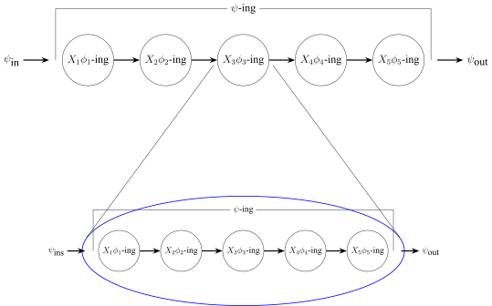
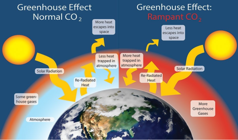

# Mechanisms in Science
**First published Wed Nov 18, 2015; substantive revision Thu Aug 1, 2024**

*Craver, Carl, Tabery, James, Illari, Phyllis*

The concept of mechanism has been an important organizing principle in science and philosophy since at least the early modern period (Dijksterhuis 1950 [1961]; Boas 1952)[^boas-1952][^dijksterhuis-1950]. The nature of that organizing principle, and precisely how it scaffolds the organization of material knowledge, has changed considerably over time. In late twentieth century philosophy of science, the term “mechanism” came to stand for a kind of theoretical structure according to which some capacity or behavior of a whole or an endstate of a process is explained in terms of the organization and activities of components or antecedents. The goal of discovering mechanisms is an explicit, guiding aim for many contemporary sciences, especially the special sciences.

But what is a mechanism? Why is mechanistic knowledge so important? How is it related to the primary goals of science, such as prediction, explanation and control? Are there general strategies guiding the search for mechanisms? Are mechanisms “real”? How are mechanisms at different levels related to one another? What is required of a mechanistic explanation? And what are the characteristic fallacies of mechanistic explanation? This family of questions, and others besides, became a major focus in the philosophy of science at the turn of the twenty-first century. The philosophers who took up these questions in earnest tended to approach the topic through detailed case studies from key developments in twentieth century biology, with particular attention to the assumptions, constraints, and norms revealed through scientific practice (see, e.g., Bechtel & Richardson 1993; Thagard 2000; Darden 2005; Craver 2007; Craver & Darden 2013)[^bechtel-1993][^craver-2007][^craver-2013][^craver-2007-2][^craver-2013-2][^craver-2013-3][^darden-2005][^darden-2013][^thagard-2000]. Here we discuss the many areas of the philosophy of science in which the concept of mechanism has been deployed to make explicit and transparent key aspects of the scientific enterprise.

## 1. Why Did the “New Mechanism” Emerge in Late-Twentieth Century Philosophy of Science?

The term “mechanism” has been used both as a laudatory term, expressing the highest achievement of a given domain (especially science and metaphysics), and as a term of derision, representing a blinkered view of science or a narrow, lifeless, and bleak philosophical orientation toward the world (Nicholson 2013; Dupré & Nicholson 2018)[^dupré-2018][^nicholson-2013][^nicholson-2018]. The mechanism of the seventeenth century, as articulated by Descartes, Gassendi, and Boyle, was not univocal but came to be associated with commitments to the unity of matter and the ultimate explicability of all change in terms of local motion and contact action (see Boas 1952; Dijksterhuis 1950 [1961]; Gabbey 2004; Garber 1992; Roux 2017)[^boas-1952][^dijksterhuis-1950][^gabbey-2004][^garber-1992][^roux-2017]. This form of mechanism emerged largely as a reaction to Aristotelian emphases on formal and final causes. The banner of “mechanism” was used as a rallying cry in various times and places and sciences in the nineteenth and twentieth century (see, e.g., Allen 2005; Nicholson 2014. For example, see Loeb as discussed in Pauly 1987 or Helmholz as discussed in Sulloway 1979)[^allen-2005][^nicholson-2014][^pauly-1987][^sulloway-1979]. It embodied the ideals of the science: to mathematize, to find deterministic laws, to render things intelligible via assimilation to contact action. In many cases, advocacy for mechanism was largely a reaction to and would-be vanquisher of forms of organicism and vitalism. No single person held all these views, and arguably no single view is common among them all.

In contrast to these earlier instantiations, the so-called “New Mechanism” of the late twentieth and early twenty-first centuries developed as a reaction to and would be successor of logical empiricist approaches to the philosophy of science. In that service, the material commitments of mechanistic views conflicted with the content-neutral, formal emphasis of the logical empiricists. The methodology, moreover, took seriously the idea that what one could say about the structure of an explanation, theory, or science must be responsive not only to the demands of logical rigor but also to the facts about science as practiced.

The origins of the New Mechanism trace, almost without exception, to programs in the history and philosophy of science, such as the Conceptual Foundations of Science (CFS) Program at the University of Chicago, and the History and Philosophy of Science Department (HPS) at the University of Pittsburgh, or both, in the 1970s. Students and faculty at the University of Chicago, included Lindley Darden (CFS), Jon Elster (Philosophy; Political Science), Stuart Kauffman (Biology), Richard Levins (Biology), William Lycan (Philosophy), Ken Schaffner (CFS), Bill Bechtel (CFS), Bob Richardson (CFS) and, later, Stuart Glennan (CFS). A converging strand of development ran through the University of Pittsburgh: Peter Machamer and Schaffner (both trained at Chicago and later joined HPS), Wesley Salmon and John Haugeland (Philosophy), and their student, Carl Craver (HPS).

This sociological fact helps explain the case-based methodology of the new mechanists: they were especially attentive to the details of historical exemplars of science as practiced: e.g., how claims are tested, how models are related to the world, how explanations and experiments are evaluated. They emphasized that the language of contemporary biomedical and physiological sciences is animated by background assumptions about mechanisms. That historical fact, they argued, offers a window on the structure of the special sciences generally. This historical, practice-centered approach built upon the criticisms of logical empiricism by, for example, Kuhn (1962), Lakatos (1977), and Laudan (1977). But importantly, mechanists saw in the concept of a mechanism a fecund, material alternative to the logical structure at the backbone of the increasingly anomaly-ridden, formal approaches of logical empiricism. The new mechanists presented their work as a unified treatment of the norms governing work in the special sciences that, importantly, was modeled on what scientists actually say and do when they make discoveries, test models, evaluate explanations, integrate levels, and the like.

These mechanists built this alternative picture by drawing together strands from philosophy, theoretical biology, and artificial intelligence and showing them at work in their case studies. Herbert Simon’s (1969) *Sciences of the Artificial* introduced the idea of nested “hierarchies” of “nearly decomposable systems” as heuristics for understanding complex systems. Stuart Kaufman (1971 [1976]) developed an account of “articulation of parts explanations” in developmental biology. Lycan (1990) saw in levels of explanation a metaphysical alternative to reductionism as a viable scientific worldview. Wimsatt (1976a, 1976b, 1997) was for many early mechanists a crucial figure connecting this theoretical work to discussions of reduction and emergence in the philosophy of science. These strands began to coalesce into an overarching perspective with Bechtel and Richardson’s (1993 [2010]) *Discovering Complexity*. That book introduced the idea of mechanism as a scaffold for a model of scientific discovery grounded in reverse engineering methods such as decomposition and localization. The next major step in this development, discussed in Section 3, connected this budding view with Wesley Salmon’s defense of a causal-mechanical theory of scientific explanation.

## 2. What Is a Mechanism?

The first decade of philosophical work in the new mechanism was directed at defining the concept of mechanism. Glennan’s definition was arguably the first:

> A mechanism underlying a behavior is a complex system which produces that behavior by… the interaction of parts according to direct causal laws. (Glennan 1996: 52)[^glennan-1996].

Within a decade, definitions multiplied, each with its own commitments and implications:

> Mechanisms are entities and activities organized such that they are productive of regular changes from start or set-up to termination conditions. (Machamer, Darden, & Craver 2000: 3)
>
> MECH: a necessary condition for a representation to be an acceptable model of a mechanism is that the representation (i) describe an organized or structured set of parts or components, where (ii) the behavior of each component is described by a generalization that is invariant under interventions, and where (iii) the generalizations governing each component are also independently changeable, and where (iv) the representation allows us to see how, in virtue of (i), (ii) and (iii), the overall output of the mechanism will vary under manipulation of the input to each component and changes in the components themselves. (Woodward 2002: S375)[^woodward-2002]
>
> A mechanism for a behavior is a complex system that produces that behavior by the interaction of a number of parts, where the interaction between parts can be characterized by direct, invariant, change-relating generalizations. (Glennan 2002: S344)[^glennan-2002]
>
> A mechanism is a structure performing a function in virtue of its component parts, component operations, and their organization. The orchestrated functioning of the mechanism is responsible for one or more phenomena. (Bechtel & Abrahamsen 2005: 423)[^bechtel-2005]

This proliferation of definitions is noteworthy for two reasons. First, it signaled that philosophers had begun to take “mechanism” seriously as a philosophical explicandum, on par with “law”, “cause”, and “reduction” (see the entries on laws of nature, the metaphysics of causation, and reductionism in biology). The concept of mechanism had previously been mentioned in connection with many purposes (see, e.g., Fodor 1968; Schaffner 1974; Wimsatt 1976a; Cartwright 1989)[^cartwright-1989][^fodor-1968][^schaffner-1974][^wimsatt-1976a], but the concept of mechanism was left unexplicated, an “unanalyzed term” (Schaffner 1993: 287)[^schaffner-1993]. The characterizations reflect a desire to meet that challenge directly.

This proliferation also quickly revealed that different characterizations of mechanism were designed for different purposes: epistemology, explanation, history, metaphysics, methodology, etc. They required different things of a mechanism, with different implications for epistemology, metaphysics, and scientific practice (Tabery 2004; Levy 2013; Andersen 2014a, 2014b)[^andersen-2014a][^levy-2013][^levy-2013-2][^tabery-2004]. Are the components in a mechanism entities, parts, or components? Do those units engage in operations, activities, or interactions? Is a mechanism a complex system or a structure performing a function? Must the product be a function, a regularity, an endstate? Must the complex system behave regularly? Must all mechanisms be composed of modular components? Different answers seem appropriate in different contexts.

To capture what is common across this diversity, Glennan and others adopted a “minimal mechanism” definition that has broadly been adopted (Glennan 2017; Glennan & Illari 2017a; Glennan, Illari, & Weber 2022; for additional characterizations of a mechanism, see Illari & Williamson 2012; Fagan 2012; Ioannidis & Psillos 2018; 2022)[^fagan-2012][^glennan-2017][^glennan-2017a][^illari-2012][^ioannidis-2018]:

> *A mechanism for a phenomenon consists of entities (or parts) whose activities and interactions are organized so as to be responsible for the phenomenon.*

Reference to regularity is omitted to make space for ephemeral mechanisms that work only once or irregularly (Machamer 2004; Bogen 2005; Skipper & Millstein 2005; Steel 2008; Glennan 2009; Leuridan 2010; DesAutels 2011; Andersen 2011, 2014a, 2014b; Krickel 2014)[^andersen-2011][^bogen-2005][^desautels-2011][^glennan-2009][^krickel-2014][^leuridan-2010][^machamer-2004][^skipper-2005][^steel-2008]. The idea that the product of the mechanism must be a function is also eliminated to incorporate mechanisms that serve no end. There is no mention in minimal mechanism of Woodward’s Simon-inspired “modularity” or “separability” requirement, allowing for mechanisms with degrees of near-decomposability. This minimal definition contains abstract terms (phenomenon, entities, parts, activities, interactions and responsible for) that can be made concrete in lax or demanding ways, depending on one’s intellectual needs.

### 2.1 Depicting Mechanisms

The canonical visual representation of a mechanism underlying a phenomenon is shown in Figure 1. At the top is the phenomenon, a system *S* engaged in behavior $\psi.$ This is the behavior of the mechanism as a whole. Beneath it are the parts (the *X*s) and their activities (the $\phi$s) organized together. The dotted, vertically-oriented lines display the parts and activities as contained within the system engaged in this behavior. This diagram emphasizes compositional relationships, and so spatio-temporal inclusion relations, between a behaving mechanism as a whole and the activities of its parts.

*Figure 1:*

Figure 1: Representation of a mechanism as an acting entity (adapted from Craver 2007)[^craver-2007][^craver-2007-2]. [An extended description of figure 1 is in the supplement.]

Figure 2 is an alternative and interchangeable representation of a mechanism as an extended temporal process between inputs and outputs (adapted from Craver, Glennan, & Povich 2021)[^povich-2021]. Relations among inputs and outputs constitute the behavior of the mechanism as a whole. The mechanism is made of items that mediate between those inputs and outputs (see Pearl 2014)[^pearl-2014]. This figure also makes it easier to understand etiological mechanistic explanations, in which the endpoint $(\psi_{\textrm{out}})$ is the explanandum phenomenon and the antecedent process is its etiological (causal) history. This representation also allows that the same entity might appear over and over again, engaged in different activities at different temporal stages of the mechanism (or the same activity again). It also allows that the entities might not be clearly localized and spatially isolated from one another (for further discussion, see Gebharter 2014; Gebharter & Kaiser 2014)[^gebharter-2014][^gebharter-2014-2][^kaiser-2014].

*Figure 2:*

Figure 2: Representation of a mechanism as an etiological process. [An extended description of figure 2 is in the supplement.]

Figure 3 integrates the hierarchical orientation of Figure 1 and the processual characterization of Figure 2, showing how levels of mechanisms appear from this processual perspective.

*Figure 3:*

Figure 3: Representation of a mechanism as a process spanning multiple levels of mechanistic organization. [An extended description of figure 3 is in the supplement.]

Consider an example. The “greenhouse effect” refers to the climate mechanism that traps solar energy within the Earth’s atmosphere. This naturally occurring process is essential to life on Earth because it allows the Earth to retain some of the sun’s heat. Human release of high levels of carbon dioxide, methane, nitrous oxide, and other gases into the atmosphere has begun to perturb this system. The sun emits electromagnetic radiation in the visible and ultraviolet frequencies, which pass through the Earth’s atmosphere. The Earth, at its normal temperatures, emits radiation mainly in the infrared. The greenhouse gases, though, specifically absorb electromagnetic radiation in the infrared, resulting in heat that gets in but can’t get out. Figure 4 depicts some key components in this mechanism (e.g., the sun, Earth, the atmosphere), the relevant operations of those parts (e.g., radiating solar energy, re-radiating heat, trapping heat), and the organizational relationship between those elements of the mechanism (e.g., that earth is *surrounded by* the atmosphere, which is *made of* gasses as parts). The difference left to right depicts the explanation of how human activities contribute to the earth’s warming.

*Figure 4:*

Figure 4: A representation of the climate mechanism responsible for a warming planet (*Source: National Park Service*). [An extended description of figure 4 is in the supplement.]

Each of these interchangeable representations has five elements: (1) the phenomenon, (2) the parts, (3) what the parts are doing, and (4) the organization of the system, which (5) often includes reference to levels. We now discuss how these elements might be further specified.

#### 2.1.1 Phenomenon

All mechanisms are mechanisms *of* some phenomenon, a consequential truism first articulated by Kaufman (1971 [1976]) and sometimes dubbed “Glennan’s Law” (see, e.g., Glennan 1996, 2002)[^glennan-1996]. For example, the mechanism of protein synthesis synthesizes proteins. The boundaries of a mechanism—what is in the mechanism and what is not—are fixed by their relevance to the phenomenon (see also Section 5). Kaiser and Krickel (2017) argue that phenomena should generally be construed as *object-involving occurrents*, where an object (or system) is engaged in a certain occurring, which could be a process, an event, or a state. An object might be a cell or an ion channel; examples of occurrents include, respectively, contracting and activating.

What is it for a mechanism to “be responsible for” a phenomenon? This might mean that the mechanism *produces the phenomenon*. Such language is most appropriate when the explanandum phenomenon is the (presumed) terminus of a causal process (as in figure 2), what Salmon (1984) dubbed the etiological aspect of causal-mechanical explanation. In other cases, “responsible” might be better explicated as “underlying”, especially when one seeks what Salmon (1984) calls constitutive explanations. Figure 1 emphasizes a spatial interpretation of underlying: being made of smaller parts. Figure 2 emphasizes causal mediation: to underlie an input-output relationship is to be the mechanism in virtue of which those inputs are transformed into those outputs. Some combination of these two perspectives is surely required of any adequate way of thinking about mechanisms (see Section 3.1 on Constitutive and Etiological Explanation).

Some understand “responsible for” in still other ways, e.g., in terms of “maintaining” (Craver & Darden 2013)[^craver-2013][^craver-2013-2][^craver-2013-3][^darden-2013] or “controlling” (Bich & Bechtel 2022; Bechtel 2022; see also the entry on philosophy of cell biology)[^bechtel-2022][^bich-2022]. These ways of talking often can be inter-translated with one another (e.g., the product is produced, the product*ion* has an underlying mechanism) so long as one is clear about precisely what the phenomenon is supposed to be. Kästner (2021) argues that these different ways of being “responsible for” allow scientists to integrate different kinds of explanatory knowledge about complex systems.

#### 2.1.2 Parts

What is a part of a mechanism? The axioms of mereology are too abstract and formal to capture the rich sense of parthood characteristic of mechanistic sciences (see Sanford 1993; Craver 2007; Wimsatt 1976a; see the entry on mereology)[^craver-2007][^craver-2007-2][^sanford-1993][^wimsatt-1976a]. Again, different intellectual projects lead scholars to adopt stronger and weaker constraints.

In metaphysical disputes about the nature and limits of physicalism, some have committed to the idea that mechanisms are composed of “physical parts”, though the idea of being “physical” is itself a promissory note for further analysis. Some emphasize features of causal processes: parts are items that make intelligible contributions to some phenomenon (Haugeland 1998; Machamer, Darden, & Craver 2000; Kaiser & Krickel 2017)[^haugeland-1998][^kaiser-2017]. On that view, parts are individuated only secondary to units of activity.

Parts have also been understood as nearly decomposable components, where the interactions within components are stronger than between components (Haugeland 1998; Simon 1969)[^haugeland-1998][^simon-1969] or as modular sub-components (Woodward 2001)[^woodward-2001]. Glennan proposes an even stronger requirement:

> The parts of mechanisms must have a kind of robustness and reality apart from their place within that mechanism. It should in principle be possible to take the part out of the mechanism and consider its properties in another context. (Glennan 1996: 53)[^glennan-1996]

This notion is perhaps too strong to accommodate the more ephemeral parts of some biochemical mechanisms or of the mechanisms of natural selection (Skipper & Millstein 2005; but see Illari & Williamson 2010)[^illari-2010][^skipper-2005].

#### 2.1.3 Cause

Four ways of unpacking the cause in causal mechanism have emerged over time (Oleksowicz 2021)[^oleksowicz-2021]. First, the conserved-quantity approach, developed by Phil Dowe (2011), takes mechanistic causation to be the transmission of conserved quantities (e.g., momentum, mass-energy) within and by a mechanism. Second, mechanists such as Jim Bogen (2005, 2008), Darden (2013), and Machamer (2004), have advocated for an activity-based account, where the search for some general, unifying notion of causation is non-reductively replaced with the identification of specific, productive activities. Such accounts typically look to science determine what are and are not activities (e.g., pulling, firing, resting) and what are the key features of those activities (see also Illari & Williamson 2013)[^illari-2013][^illari-2013-2]. Counterfactual accounts are a third variant found in the mechanism literature, often employing a manipulationist view of counterfactual causation. To say that one component is a cause of another is to say, roughly, that one could change the second by intervening on the first (Woodward 2002; Craver 2007)[^craver-2007][^craver-2007-2][^woodward-2002]. Finally, mechanistic accounts of causation, provided by Glennan (1996, 2009, 2017), understand non-fundamental causation as derivative from the concept of a mechanism; the truth-makers for causal claims at one level are mechanisms at a lower level.

Each of these accounts has faced criticism. The conserved-quantity account, it has been noted, struggles to do useful work outside fundamental physics and have difficulty accommodating mechanisms of omission and double prevention (Glennan 2002; Williamson 2011)[^glennan-2002][^williamson-2011]. Activity-based accounts are faulted for not saying anything deeper about what activities are (Psillos 2004)[^psillos-2004], for failing to account for the relationship between causal and explanatory relevance (Woodward 2002)[^woodward-2002], and for failing to make sense of cases of polygenic effects (Persson 2010)[^persson-2010]. Critics of counterfactual approaches tend to emphasize difficulties of stating truth-conditions on the relevant counterfactuals and emphasize actual (vs. possible) causation in mechanisms (Bogen 2005, 2008; Machamer 2004)[^bogen-2005][^machamer-2004]. Glennan’s mechanistic account has been charged with circularity, since the concept of a mechanism invariably contains a causal element. These accounts of causation are, for the most part, borrowed from classic discussions in metaphysics and reflect different ways of responding to Hume’s causal skepticism; the problems associated with them often turn on their (in)adequacy as a response (Andersen 2014a, 2014b; Matthews & Tabery 2017)[^andersen-2014a][^matthews-2017].

#### 2.1.4 Organization

“Organization” is a distinguishing feature of mechanisms as opposed to aggregates (see entry on levels of organization in biology; Wimsatt 1997). Aggregate properties are simple sums of the properties of the parts. Organization is non-aggregative arrangement, where different parts enter into a variety of organizing relations, interacting with one another to do something the individuals cannot do on their own.

There are many forms of organization, including spatial, temporal, causal, or hierarchical (Paoletti 2021). Spatial organization, for example, includes location, size, shape, position, and orientation; temporal organization includes the order, rate, and duration of the component activities. Dynamical models in particular may reveal complex temporal organization in interactive mechanisms (Bechtel 2006, 2011, 2013; see also the entry on philosophy of cell biology)[^bechtel-2006]. There are also more abstract patterns of organization (Alon 2007; see Levy 2014; Levy & Bechtel 2013)[^alon-2007][^bechtel-2013][^bechtel-2013-2][^levy-2013][^levy-2014][^levy-2013-2].

Modular organization, in which components are nearly decomposable sub-parts of a mechanism, has been of particular interest. Some counterfactual accounts of mechanism (Woodward 2001, 2002, 2014; Menzies 2012)[^menzies-2012][^woodward-2001] require that the causal relations in mechanisms be “modular” in the sense that it should be physically possible to intervene on a putative cause variable in a mechanism without disrupting the functional relationships among the other variables in the mechanism. Steel (2008) articulates a weaker form of modularity in his probabilistic analysis of mechanisms—one that follows directly from Simon’s (1969) idea of nearly decomposable systems. On Simon’s view, the parts of a system have more and stronger causal relations with other components in the system than they do with items outside the system. The idea of modularity, and the relations among these distinct articulations, are ripe for future work (see Matthews 2019)[^matthews-2019].

#### 2.1.5 Levels

Mechanisms and theories about them typically span multiple levels (see Craver 2007)[^craver-2007][^craver-2007-2]. Mechanistic thinking about levels traces to Simon’s (1969) parable of the often-distracted watchmakers, Tempus and Hora. Simon argued that Tempus, who builds hierarchically decomposable watches, will build more watches than Hora, who builds holistic watches, given that decomposable watches tend to fail locally while holistic watches tend to fail globally. For analogous reasons, Simon argues, evolved structures are more likely to be nearly decomposable into hierarchically organized assemblages at multiple levels of organization.

From a mechanistic perspective, levels are not monolithic divides in the furniture of the universe (as represented by Oppenheim & Putnam 1958)[^oppenheim-1958], nor are they fundamentally a matter of size or of the exclusivity of causal interactions within a level (Wimsatt 1976a)[^wimsatt-1976a]. Rather, levels of mechanisms are defined locally within a multilevel mechanism: one item is at a lower level of mechanisms than another when the first item is a part of the second and when the first item is organized (spatially, temporally, actively) with the other components such that together they realize the second item (Povich & Craver 2017)[^povich-2017][^povich-2017-2]. Povich and Craver define levels of mechanisms in terms of a relationship between the behavior $(\psi)$ exhibited by a system (*S*) and the activity $(\phi)$ of some component part (*X*) of that system (see Figure 1 above). On this account, *X*’s $\phi$-ing is at a lower level of mechanistic organization than *S*’s $\psi$-ing if and only if (i) *X* is a part of *S*, and (ii) *X*’s $\phi$-ing is a component in *S*’s $\psi$-ing. In short, to say that something is at a lower mechanistic level than the mechanism as a whole is to say that it is a working part of the mechanism. Alternatively, but equivalently (see Figure 3), if *A* is described as an input-output relation $(A_{\textrm{in}} \rightarrow A_{\textrm{out}}),$ then the lower-level components are the causal intermediates between input and output (Craver, Glennan, & Povich 2021; see also Prychytko 2021)[^povich-2021]. Levels of mechanisms seem to play a central role in structuring the relations among many different models in contemporary biology (e.g., between Mendelian and molecular genetics (Darden 2006)[^darden-2006], between learning and memory and channel physiology (Craver 2007)[^craver-2007][^craver-2007-2], and between population-level variation and developmental mechanisms (Tabery 2009, 2014)[^tabery-2009]).

Some crucial features of this account should be noted:

- **Parts and wholes.** Mechanistic levels are a species of part-whole relation delimited by the causal organization characteristic of mechanism. Unlike Oppenheim and Putnam, however, mechanistic levels are composed by a distinctive mechanistic componency relation.
- **Relata.** The relata are the behavior of a mechanism as a whole, at the higher level, and the components and activities in the mechanism at the lower level.
- **Relevance.** Because the componency relation is defined by constitutive relevance (see Section 3.2), interlevel relations are defined relative to a specified top-most phenomenon. Different choices of phenomena are generally associated with different decompositions and so a different interlevel structure (Simon 1969; Kauffman 1971 [1976]. This is why levels of mechanism are local rather than monolithic.
- **Size.** Levels of mechanisms are not defined by size relations, though a size ordering follows from the fact that things at lower-levels can take up no more space than things at higher levels. Unlike size-driven views of levels (see Wimsatt 1976a)[^wimsatt-1976a], this view allows that things of radically different sizes might be found at the same level. Explanations might require going up a size level, as when facts about independent assortment are explained by reference to chromosomes during cell division (see Darden 2006)[^darden-2006].

This view of levels forms the abstract background against which mechanistic views of reduction, emergence, interlevel causation, and interfield relations are articulated (see Section 6 below).

This background picture has been widely discussed and criticized. Leuridan (2012) argues that this view of levels is incoherent, perhaps presupposing the idea of part-hood it should explicate. Potochnik and McGill (2012) argue that the concept of level mischaracterizes the messy relations found in science and insists on a homogeneous composition of things at a single level (though arguably this is not true of mechanistic levels). di Frisco (2017) argues against mechanistic conceptions of levels, largely on the ground that it has no content over and above claims about token composition and defends instead a time-scale based account of levels that will hold across types. Eronen (2013; 2015), in contrast, rejects the mechanistic notion of levels on the grounds that it imposes no homogenous composition of things at a single level, which while true is taken by advocates of the notion as one of its distinctively positive. Brooks (2017) defends the continued utility of the levels metaphor, including levels of mechanisms, in scientific practice. Kaiser (2015) develops a broader notion of levels in the same spirit as the mechanistic approach, but not restricted to mechanistic part-whole relations. Bertolaso and Buzzoni (2017) respond to Eronen’s criticisms and provide a pluralistic account of higher-level causes grounded in the mechanistic literature and exemplified in recent work in cancer epigenetics. Harbecke (2015) uses the mechanistic theory plus some features of his regularity account of constitution to recover a notion of level that works in the neurosciences.

Philosophical work in this area remains active; see, for example, Brooks 2017; DiFrisco 2017; Povich & Craver 2017; Kästner 2018; Kästner & Anderson 2018; Fazekas & Kertész 2011; DiFrisco, Love, & Wagner 2020; and Piekarski 2022; and Bechtel 2022; see also the entry on levels of organization in biology.

### 2.2 What Mechanisms Are Not

The term “mechanism” has a complex history, bringing with it many dangers in the effort to use the term for a new, highly proprietary project. New mechanists have therefore been especially vocal in distancing their view from some especially misleading associations.

1. Mechanisms are not necessarily *deterministic*. They might be stochastic. They might be composed of stochastic activities (Bogen 2005, 2008)[^bogen-2005], or chancy simply because of instability in the arrangement and interaction of the component parts.
2. Mechanisms are not limited to *push-pull dynamics*. Descartes’ mechanism had this feature, but new mechanists explicitly liberalize the notion to allow other kinds of causing.
3. Appeal to mechanisms is not necessarily *reductionistic*. The assumption that mechanism and reductionism go hand-in-hand is probably the most commonly misplaced intuition about the concept. Much of the early work by philosophers of mechanism focused on fields like biology and psychology, where the express purpose was to make sense of how mechanisms scaffold the effort to build multilevel explanations, and mechanistic organization has been a key argument in favor of higher-level causes (Bechtel 2009; McCauley & Bechtel 2001; Section 6 below)[^bechtel-2009][^mccauley-2001].
4. Not all mechanisms are *machines*. All machines have mechanisms within them, but machines and their mechanism are individuated separately. Machines are designed for a function; mechanisms need not be (Darden 2006)[^darden-2006]. Machines can be on or off; mechanisms are how things work and, when they involve machines, they are machines in action rather than merely a static and inert arrangement of parts.
5. Mechanisms are often not *sequential* or *linear*. Mechanisms can have feedback loops and cycles (Bechtel 2011)[^bechtel-2011]. They can also be organized so as to maintain an equilibrium, something that might appear static but is in fact the product of active regulation (Bechtel 2022)[^bechtel-2022].
6. Mechanisms are not necessarily *localized.* Components of mechanisms might be distributed and might violate intuitions about the boundaries of objects. The assumption of localization is often an important heuristic in the search for mechanisms (Bechtel & Richardson 1993 [2010])[^bechtel-1993]; however, it is an heuristic that sometimes has to be abandoned.
7. Mechanisms are not just *fictions/metaphors*. When a scientist says that there is a mechanism that makes proteins in living organisms, she is not just using a machine metaphor; rather, she is saying that there are in fact parts and activities organized in living organisms such that they produce proteins.
8. Mechanisms do not necessarily come *pre-packaged* out in nature. Mechanisms are bounded, instead, by relevance to the phenomenon they explain.

### 2.3 What Are Not Mechanisms

Some object that there’s so little left to the idea of mechanism once it sheds its historical associations and evades its detractors’ criticisms as to make the notion trivial (Dupré 2013; Shapiro 2017; Weiskopf 2011; Woodward 2017)[^dupré-2013][^shapiro-2017][^weiskopf-2011][^woodward-2017].

Consider just mechanistic theories of explanation: the history of science contains many other conceptions of scientific explanation and understanding that are at odds with this commitment. Some have held that the world should be understood in terms of divine motives. Others emphasize explanations in terms of telos and purpose. Others have held that the aim of science is prediction, not explanation, and so downplay the value of mechanistic knowledge. Still others emphasize laws, a common contrast with mechanisms (Leuridan 2010; Craver & Kaiser 2013)[^craver-2013][^craver-2013-2][^craver-2013-3][^leuridan-2010].

But what, the critic might push further, does *not* count as a mechanism? Here are some of the more obvious contrast classes:

1. *Entities* (or *objects*) are not mechanisms. Mechanisms do things. If an object is not doing something (i.e., if there is no phenomenon), then it is not a mechanism. (But see Section 5 for how this links up with types, tokens, and kinds.)
2. *Correlational patterns* are not mechanisms. Mechanisms explain at least many correlations, and many correlations can be used to characterize causal or mechanistic relations, but correlations patterns themselves are not mechanistic.
3. Mere *temporal sequences*. Wednesday follows Tuesday, but not in a mechanistic sense, again, because they are not causally related.
4. Mere *spatial arrangements*. One can describe how parts are organized in space without regard to whether or how those parts are organized causally. A jigsaw puzzle, for example, is not a mechanism.
5. *Inferences*, *reasons*, and *arguments* are not mechanisms. Though there are mechanisms by which inference and reasoning are realized, what makes something an inference or a reason is logical relation and not (merely) a causal relationship between premise and conclusion. Likewise, mathematical proofs are not mechanisms.
6. *Symmetries* are not mechanisms. Many kinds of symmetry are of fundamental importance in different areas of physics (e.g., translational symmetries, rotational symmetries). These are features of physical systems that are highly general facts or assumptions, not mechanisms.
7. *Fundamental laws* and *fundamental causal relations* are not mechanisms. If a law or causal relation is fundamental, then (by definition) there is no mechanism for it.
8. *Relations of logical and mathematical necessity are not mechanisms.* Such truths hold in all possible worlds and so do not depend for their truth on facts about the causal structure of this world.
9. *Taxonomies* are not mechanisms. The periodic table, for example, does not describe a mechanism, though it contains information about how innumerable mechanisms work.

Importantly, to be a non-mechanism is not to be worthless. Not everything scientists do involves the search for mechanisms. But much of it does.

## 3. Why Does So Much Scientific Practice Revolve Around Mechanistic Explanation?

Those who unite under the label of mechanism in contemporary philosophy have by and large attempted to build a charitable and defensible reconstruction of what “mechanism” might mean as an objective for sciences as diverse as economics, cognitive science, molecular biology and different branches of physics. In that effort, they emphasized the centrality of causation (over strict deterministic laws) and the importance of integrating explanations across levels of organization.

Many scientists think of explanation in broadly causal-mechanical terms: to explain a phenomenon *P* is to know the causes for or the mechanisms underlying *P*. This idea contrasts with the covering law (CL) model of explanation, developed by logical empiricists such as Ayer (1936) and Hempel (1965), according to which explanations are arguments with law statements as premises, and by unificationists (the U model), such as Friedman and Kitcher, who associate explanatory power with reducing the number of brute facts or argument schemas that must be taken for granted while maximizing scope and stringency (see the entry on 20th century theories of scientific explanation).

There is now broad consensus that both the CL model and the U model fail to express accurately the norms governing the scientific practices of constructing, evaluating, and revising scientific explanations. One common thread of criticism (Bromberger 1966; Salmon 1984; Scriven 1959)[^bromberger-1966][^salmon-1984][^scriven-1959] is that they cannot distinguish laws from regularities (the light postulate vs. the fact that no golden bust of Donald Trump is greater than 500 kg), causal laws from non-causal regularities (deriving the length of the shadow from the height of the flagpole rather than vice versa), or predictions from explanations (predicting storms from barometer readings vs. pressure changes). (See other entries on laws of nature, ceteris paribus laws, and the metaphysics of causation.) At the core, the CL model, the U model, and the empiricist approaches each exemplify, arguably preclude explicit reference to the causal and mechanistic structures scientists claim to seek when they build, test, and revise their explanations.

Considerable confusion can be avoided by carefully distinguishing the representations used to convey information about a mechanism (models) and the mechanisms (causal structures) themselves. The same confusion attends the CL model, in which one can emphasize arguments (models) or laws (nomic structures). Some philosophers write and think in ontic mode, emphasizing the first of these (Salmon 1989; Lewis 1986; Craver 2014; Strevens 2013)[^craver-2014][^lewis-1986][^salmon-1989][^strevens-2013]. Other authors write in representational mode (for example, C. Wright & Bechtel 2007)[^wright-2007]. Failing to understand and track this difference leads often to absurdity (see Illari 2013; see also Kästner & Haueis 2021)[^illari-2013][^illari-2013-2][^kästner-2021][^kästner-2021-2].

### 3.1 Etiological and Constitutive Causal-Mechanical Explanations

Salmon (1984) distinguished two “aspects” of causal mechanical explanation, two ways of situating something in the causal structure of the world: etiological and constitutive. Etiological explanations reveal the causal history of the explanandum phenomenon. For example, the rising temperature explains why the balloon expands. Constitutive explanations, in contrast, explain a phenomenon by describing the mechanism underlying it, revealing its internal causal structure. For example, the balloon expands when heated because the mean kinetic energy of the molecules increases and their collective impact with the container thus assumes a greater force. Salmon focused on etiological explanations and did not develop an account of the constitutive aspect. This lacuna became a primary focus of new mechanists.

*Contra* some critics (by, e.g., Woodward 2017; Rescorla 2018)[^rescorla-2018][^woodward-2017], it is not part of the mechanistic theory of explanation that phenomenal laws must lack explanatory content. This charge rests on the failure adequately to distinguish these two aspects of explanation. Etiological explanations can and often do cite causes for an effect (e.g., smoking as the explanation for lung cancer) without describing the mechanism linking the cause to the effect. Even if the causal relationship is sustained by a mechanism (as in Glennan 1996)[^glennan-1996] and even if assumptions about those mechanisms are crucial for evaluating evidence about causal relations (Russo & Williamson 2007; Illari 2011; Illari & Ruso 2014; see Section 4.2)[^illari-2011][^illari-2014][^russo-2007], etiological explanations work by providing information about how the explanandum is situated with respect to the antecedent causal structure. And one might satisfy this requirement by describing a single, salient difference-maker. Constitutive explanations, in contrast, are defined by the fact that they provide information about the internal causal structure of the explanandum. The gas law does not explain why balloons expand when heated; rather it says that they always do. Whether or not phenomenal laws are explanatory are depends on the explanandum and the contextually salient aspect of explanation under request.

### 3.2 Limits of the CL Model of Constitutive Explanations

The key norms governing the practices of building, evaluating, and revising constitutive mechanistic explanations are poorly reflected in the rational reconstructions of the covering law model and the U model. A key advance in the work on constitutive mechanistic explanation has been to make those norms explicit. These norms frame our discussion:

1. **Purely Phenomenal Explanations.** That a powder has a hallucinogenic virtue does not explain, but rather redescribes its capacity to produce hallucinations. Constitutive mechanistic explanations of that phenomenon explain why the powder causes hallucinations.
2. **Relevance.** Scientific explanations include only relevant factors about how a mechanism works; they exclude irrelevant factors.
3. **Correctness.** To know the explanation is to know how the mechanism actually works, not merely how it might have worked. What counts as correct enough varies with pragmatic context.
4. **Completeness.** Mechanistic explanations can be more or less complete for different pragmatic ends. Scientific progress often (but by no means invariably) involves filling in schema terms for phenomena with details of the underlying mechanism.
5. **Intelligibility.** Explanatory models ought to induce understanding in consumers with the relevant background knowledge.

The CL model, as applied to laws of nature, arguably has difficulty with each of these norms (see Craver 2007)[^craver-2007][^craver-2007-2]. A redescription with appropriate bridge laws might count as an explanation according to that model (*contra* norm 1). The CL model requires that explanations must be true, satisfying the spirit of norm 2 but in a way which famously rules out the use of idealized models in explanations. Just as the view supplies no account of causal relevance ( norm 3), it places no constraints on the relevance of variables appearing in constitutive explanations (except that they should be in true generalizations). The CL model counts any sound argument that cites true conditions and laws as a complete explanation; this fails to accommodate the idea that constitutive explanations might be more or less complete for a given purpose (*contra* norm 4). The intelligibility of CL explanations (norm 5) lies in the inferential (logical) relation between explanans and explanandum, but whether anyone understands the explanans and what it tells us about the phenomenon is (for better or worse) not a condition on the explanation. Similar complaints have been raised against the U model, the empiricists’ nearest descendant.

Early work on constitutive mechanistic explanation was motivated by these limitations in the CL mode and the U model. It was also motivated as an effort to fill in an important promissory note in the most prominent work on causal explanation (Salmon 1984; Woodward 2003)[^salmon-1984][^woodward-2003]: namely, to analyze the constitutive aspect of causal-mechanical explanation,

### 3.3 Purely Phenomenal Models

The idea of a purely phenomenal model is familiar from the practice of scientific modeling (Mauk 2000; Kay 2018)[^kay-2018][^mauk-2000], and has been broadly adopted by mechanists (see, e.g., Bunge 1963; 1997; Craver 2007; Glennan 2002, 2005; Kaplan & Bechtel 2011; Kaplan & Hewitson 2021; Kaplan & Craver 2011)[^bechtel-2011][^bunge-1963][^craver-2007][^craver-2007-2][^glennan-2002][^kaplan-2011][^kaplan-2011-2][^kaplan-2011-3][^kaplan-2021]. Craver and Kaplan (2020) offer this definition:

> a model, *M*, is a phenomenal model of a mechanism if and only if it describes the inputs to, modulators of, and outputs from a mechanism without describing its relevant internal causal structure. (2020: 296)

To distinguish purely phenomenal models from constitutive explanatory models, these authors describe a “model-to-mechanism mapping” (3M) requirement on constitutive explanations: for a model of a mechanism to go beyond being a purely phenomenal redescription, it must reveal some details about the underlying mechanism. Specifically:

> In successful explanatory models in cognitive and systems neuroscience (a) the variables in the model correspond to components, activities, properties, and organizational features of the target mechanism that produces, maintains or underlies the phenomenon, and (b) the (perhaps mathematical) dependencies posited among these variables in the model correspond to the (perhaps quantifiable) causal relations among the components of the target mechanism. (Kaplan & Craver 2011: 611)[^kaplan-2011][^kaplan-2011-2][^kaplan-2011-3]

This passage has been misread in many telling ways. It does not assert that a model must describe all the details of a mechanism to count as explanatory. Nor does it assert that a model that contains more details about a mechanism is always better or more explanatory than a model that contains fewer details (the so-called “more details better” thesis as originally articulated by Levy & Bechtel 2013 and repeated by Levy 2014; Chirimuuta 2014; Batterman & Rice 2014. The 3M requirement is nothing more or less than the inverse of the truism that a constitutive explanation must convey some information about the underlying mechanism (Craver & Kaplan 2020 call this SDN: Some details are necessary)[^craver-2020]. Third, 3M should not be read (see, Kaplan 2011: 347)[^kaplan-2011][^kaplan-2011-2][^kaplan-2011-3], as denying the importance of idealized and abstract models. Whether it is compatible with the minimal models discussed by, e.g., Batterman and Rice, and what this does or not entail for such putative explanations, is still an area of active interest (Povich 2018; 2021)[^povich-2018].

Finally, 3M is consistent, as explained above, with the thesis that so-called phenomenological laws might convey explanatory information, as in an etiological explanation. One can explain the gas’ expansion by adverting to the fact that it was heated without going into the molecular theory of gasses. That is compatible with 3M and the thesis that phenomenal models (as defined above) are explanatorily empty as constitutive explanations for those phenomena (see Siegel & Craver 2024)[^siegel-2024][^siegel-2024-2].

### 3.4 Constitutive Explanatory Relevance

A central task of a theory of causal (etiological) explanation is to explicate the notion of causal and explanatory relevance by which things are included or excluded from explanations. (See entries on counterfactual theories of causation, probabilistic theories of causation, and manipulationist theories of causation.) An analogous problem confronts any theory of constitutive explanation; to sort relevant components from irrelevant parts (Craver 2007; Ylikoski 2013)[^craver-2007][^craver-2007-2][^ylikoski-2013]. A mechanism (*S*) exhibiting (responsible for) phenomenon $(\psi)$ is composed of many different entities (*x*), with various properties, engaging in myriad activities $(\phi)$ organized together (see Figure 1 above in Section 2). The philosophical puzzle is to articulate a principle by which entities, activities, and organizational features that contribute to the phenomenon are sorted from those that do not. The aim is to articulate a theory of constitutive relevance.

#### 3.4.1 Against Causation Across Levels of Mechanisms

Can the idea of causal relevance serve as a basis for explanatory relevance in both constitutive and etiological explanations? This option, without further elaboration, faces some significant, perhaps insurmountable, conceptual challenges.

The fact that the behavior of a mechanism is composed in some sense of the entities and activities of its parts, combined with certain familiar assumptions about causal relations, suggests that there can be no causal relationships between items at different levels of mechanisms (Lewis 1986; Kim 1992; Povich and Craver 2017)[^kim-1992][^lewis-1986][^povich-2017][^povich-2017-2]. Why is interlevel causation problematic for mechanistic levels? One source of the problem is that the putative interlevel causes and effects are not independent of one another (Lewis 1986)[^lewis-1986]; they stand in compositional relations. And because they compose one another, the parts and the wholes change simultaneously (in apparent violation of the temporal asymmetry of causation) and symmetrically (in apparent violation of causal asymmetry of cause and effect) (as Kim1992 emphasizes; see Gebharter (2014, 2022) on how to translate the mechanistic approach into a diachronic formalism of Causal Bayes nets that nonetheless adheres to the strictures presented here). Finally, if one understands the activities of parts as causally between the start and finish of the mechanism (see Prychitko 2021)[^prychitko-2021], the transformation that constitutes the whole is incomplete (i.e., does not yet exist) when the part changes, and the change to the part comes after the portion of the whole that occurs before it (Craver, Glennan, and Povich 2021)[^povich-2021]. For these reasons, causation across levels of mechanisms is at best conceptually awkward.

How can one square this conceptual awkwardness with the fact that so many scientists seem to find the idea of top-down causation illuminating? Craver and Bechtel (2007) argue that claims asserting interlevel causation are in fact hybrid propositions, combining non-causal claims about relations between part and whole with causal claims expressing relations between things not related as part and whole. Another, compatible, alternative is to take many sensible claims about interlevel causation to involve a different conception of “level” from mechanistic levels, such as levels of size, levels of theories, or levels of complexity, where these reasons against part-whole causal relations do not (univocally) apply. See the entry on levels of organization in biology.

#### 3.4.2 Constitutive Relevance as Mutual Manipulability

What is constitutive relevance if not a causal relationship between wholes and parts? One important starting place has been the mutual manipulability account (MM) of constitutive relevance (originally formulated in Craver 2007)[^craver-2007][^craver-2007-2]. Craver uses MM to articulate a sufficient condition on constitutive relevance. The account was based in the experimental manipulations used to test interlevel relations in practice. According to this account, if it can be shown

1. that the putative component is spatially within *S*,
2. that some ideal interventions on the putative component (*x*’s $\phi$-ing) changes the phenomenon (*S*’s $\psi$-ing), and
3. that some ideal interventions on *S*’s $\psi$-ing change *x*’s $\phi$-ing, that is sufficient to establish that *x* is a component in the mechanism.

MM, however, has not proved entirely satisfying. First, it offers only a sufficient condition; Craver (2007), for example, discusses examples of intuitively relevant parts that do not satisfy the condition. Second, the use of interventionist counterfactuals in conditions (ii) and (iii) suggests a causal interpretation, contravening the explicit denial of interlevel causation (as argued by Baumgartner & Gebharter 2016; though see Krickel 2018a,b)[^baumgartner-2016][^krickel-2018a]. Third, the notion of an “ideal” intervention, borrowed from Woodward’s account of causal relevance, cannot apply (absent clarification) to constitutive explanations. An ideal intervention on a system cannot intervene on both the independent and the dependent variable at the same time. However, when one intervenes to make *S* $\psi$ (or to prevent *S* from $\psi$-ing), one invariably also intervenes on the components of *S*’s $\psi$-ing. And when one intervenes on the components of *S*’s $\psi$-ing, one often intervenes on *S*’s $\psi$-ing. Because *x*’s $\phi$-ing and *S*’s $\psi$-ing are related as part to whole, they are not independent, and so cannot be causally related, as just discussed (see Baumgartner 2010, 2013; Leuridan 2012; yet see Menzies 2012; Woodward 2015)[^baumgartner-2010][^leuridan-2012][^menzies-2012][^woodward-2015]. Finally, MM appears to presuppose the idea of being “contained within”; the boundaries of mechanisms are themselves determined by considerations of relevance (Leuridan 2012)[^leuridan-2012]. These criticisms suggest to many that MM, if it is coherent, is at best an account of the evidence by which claims of constitutive relevance are tested (see Couch 2011; see also Romero 2015)[^couch-2011][^romero-2015].

A path out of these problems has begun to emerge through the work of Menzies (2012), Harinen (2018), Krickel (2018a and 2018b) and Prychytko (2021). Echoing work on causal mediation (see, e.g., Pearl 2014)[^pearl-2014], Menzies suggests that a component is a necessary link in a causal chain between input and output. Building on this work, Craver, Glennan, and Povich (2021) distinguish the epistemic aims of MM from a metaphysical theory of constitutive relevance as causal betweenness. According to that view, MM (properly formulated) works as an epistemic condition because the interlevel experiments, in fact, are tests of different causal claims that pose no special problem of interpretation in the language of the interventionist theory of causation.

A second approach involves a regularity account of constitutive relevance modeled on Mackie’s notion of understanding a cause as an INUS condition: (Mackie 1980; see also Cummins 1983)[^cummins-1983][^mackie-1980]. On this account, a constitutively relevant component is an **I**nsufficient but **N**on-redundant part of an **U**nnecessary but **S**ufficient mechanism for a given phenomenon (Couch 2011; 2023; see also Harbecke 2010, 2015)[^couch-2011][^harbecke-2010]. As a theory with impeccable empiricist credentials, this view looks good out of the gate. Its legs will be tested as a theory of the metaphysics and in its ability to deal with mechanism tokens rather than types.

A third approach to constitutive relevance relies on the idea that interventions on the behavior of a mechanism as a whole are “fat-handed” with respect to the activities of the components. An intervention is fat-handed to the extent that alters more than one causally relevant variable at once (Eberhardt and Scheines 2007)[^eberhardt-2007]. Romero (2015) , soon followed by Baumgartner and Gebharter (2015) argued that interventions on the behavior of a mechanism as a whole are invariably fat-handed with respect to interventions on their parts. Baumgartner and Casini (2017) use this idea to develop an “abductive theory” of constitution, where the conclusion that parts are constituents of a mechanism is arrived at abductively from recognition that phenomena and their constituents are unbreakably coupled via common causes. For criticisms of this account, see Krickel (2018a; 2018b).

This debate will bear fruit especially if it is pursued with mindful respect to the complex relationships (not identities) between questions of epistemology, metaphysics, and scientific practice. In attempting to articulate a regulative ideal for scientific explanation one might take it as a mark of success to bring these three aspects of the scientific endeavor, i.e., the world, our understanding of it, and our means of knowing it, together into a mutually satisfying picture of the science of mechanisms.

### 3.5 Completeness and Correctness

Theories of explanation famously wrestle with puzzles specifying the norms of completeness and correctness for explanations. Can one say that an explanation should be correct without asserting that no idealized model is explanatory? Can one assess explanations for their completeness without insisting that abstract models (which necessarily drop detail) must be non-explanatory or explanatorily deficient in some respect? These issues, while not unique to mechanistic explanation, have been discussed with some vigor in the effort to clarify these norms in this mechanistic context.

At the heart of this discussion is a distinction between the mechanisms themselves and the models (or explanatory texts) scientists use to represent them. Two subtly different problems of scientific explanation, one concerning texts and the other concerning their referents, are apt to be conflated, leading to considerable confusion. Although the distinction is often characterized as between an “ontic” and an “epistemic” conception, those terms are not always used in the same way. Contrary to the sense introduced by (Coffa 1974; Salmon 1989)[^coffa-1974][^salmon-1989], the apparent fault line is between those who emphasize the ontic aspect of explanation (e.g., Salmon 1989; Strevens 2013)[^salmon-1989][^strevens-2013] and those who emphasize *representational* aspects of explanation (see Bechtel & Abrahamsen 2005)[^bechtel-2005]. This way of casting the matter, however, is somewhat misleading, given that no defender of the ontic approach denies that scientists use representations to convey explanations (as emphasized by Illari 2013)[^illari-2013][^illari-2013-2]. Speaking in the ontic mode, one emphasizes the worldly relations to which a correct explanatory model would refer; speaking in the representational mode, one emphasizes instead the way information about the worldly relations is being conveyed. These are entirely different topics.

It is also illuminating to note the important distinction between a model that contains explanatorily relevant information about a mechanism and a mechanistic model. A model of a mechanism, in a broad sense of “of”, might be any representation (physical model, mathematical structure, etc.) produced or used to convey information about a mechanism, i.e., its representational target. See the SEP entry on models in science). A mechanistic model, specifically, is a model of mechanism that represents the component entities and activities and shows how they act and interact with one another (see Glennan 2005)[^glennan-2005]. But a model or representation of a mechanism might depict, for example, the evolution of the states of the mechanism as a whole over time or merely features of its anatomical layout. They would not be mechanistic in this fuller sense, though they do contain mechanically relevant information. Many models, mechanistic or not, are typically combined in the process of giving detailed mechanistic explanations (see Hochstein 2016, 2017)[^hochstein-2016].

#### 3.5.1 Completeness

Models represent intelligibly in virtue of abstracting, i.e., dropping detail from, their mechanistic targets. It is a pragmatic matter whether and when a model of a mechanism is “complete enough;” it depends on the aims and expectations for which the model is constructed. Glennan (2005) explains that there is no hard line between complete and incomplete models; they are always evolving, through articulation and refinement of their commitments, and invariably incomplete in some sense. That said, the effort to identify gaps in one’s understanding of a mechanism often drives mechanistic research in practice.

Building on this simple idea, Darden distinguished mechanism schemas and mechanism sketches (Darden & Cain 1989; Darden 1996. Mechanism schemas are abstract descriptions of mechanisms that can be filled in with details to yield a specific type or token mechanism. For example, the schema, “DNA → RNA → Protein” can be filled in with a specific sequence of bases in DNA, its complement in RNA, and a corresponding amino acid sequence in the protein; the arrows can be filled in, showing how transcription and translation work. A mechanism sketch, in contrast, is an incomplete representation of a mechanism that specifies some of the relevant entities, activities, and organizational features but leaves gaps that cannot yet be filled. Black boxes, question marks, and filler-terms (such as “activate”, “cause”, or “inhibitor”) are used in practice to hold the place for some entity, activity or process yet to be discovered. The distinction between sketches and schemas is perhaps too dichotomous to accommodate what is in fact always a matter of relative completeness and abstraction.

All models of mechanisms abstract away from potentially obfuscating details (Strevens 2008; Levy & Bechtel 2013)[^bechtel-2013][^bechtel-2013-2][^levy-2013][^levy-2013-2][^strevens-2008], even explanatorily relevant details. But surely to assert as much is already to commit oneself to the idea that there is more to be known about the mechanism than the explanatory model expresses. Craver and Kaplan (2020) suggest one should let the mechanism itself serve as a measure of completeness: the mechanism contains all and only the relevant parts, properties, activities, and organizational features for the phenomenon in question. A complete model or family of models (should such a thing be desired, if possible, in practice) would describe the mechanism in all its gory details. They call this idea “Salmon completeness”. Even this inclusive model is restricted to relevant facts about the mechanism (weeding out irrelevancies). Note also that the effort to define and endpoint of completeness for this rather normative purpose does not commit one to the idea that Salmon-incomplete models are useless, non-explanatory, or even necessarily deficient for the purposes at hand. Such a view would arguably entail that we have never had an explanation and never will, in principle.

Some object to what they see as the mechanist’s emphasis on detail (Chirimuuta 2014; Levy & Bechtel 2013; Batterman & Rice 2014; Weiskopf 2011; Woodward 2017)[^batterman-2014][^bechtel-2013][^bechtel-2013-2][^chirimuuta-2014][^levy-2013][^levy-2013-2][^weiskopf-2011][^woodward-2017]. They associate mechanism with an obsessive focus on smallest details without regard to relevance (a sense that is, indeed, common enough in science). Such “mechanism” is often missing the forest for the trees. But this objection appears to be directed at a common caricature of the mechanist rather than at anything any new mechanist has asserted. For rejoinders, see Povich (2017; 2018).

In assessments of completeness, it is perhaps better to ask questions about the amount of explanatory information a model contains than about whether the model is explanatory simpliciter. A model of a mechanism has explanatory value, one might think, to the extent that it contains information about how the mechanism actually works. It is a further question how much information that model contains and so how explanatory that model is (cf. Lewis 1986 on causal explanation. For an exploration of the sense of “information” involved in such claims, see Povich 2021)[^lewis-1986][^povich-2021].

Why has there been any friction here at all? For many philosophers and scientists (including at least some of the authors of this essay), it increasingly appears that science is often unproductively driven, and often in the name of mechanism, by a self-sustaining need to deploy the latest fancy tools to deliver ever more detailed data about the microscopic and often irrelevant aspects of a system. To recognize completeness as a norm can be seen as giving comfort to these unproductive endeavors. Another possible source of this apparent conflict arises for those who deny that there is a fact of the matter about what belongs in the set of all and only the relevant components. It might help, however, to think of completeness as a relative notion, definable without knowing an absolute endpoint.

#### 3.5.2 Correctness

Just as there is a difference between understanding and misunderstanding, there is a difference between explaining and apparently explaining. Explaining is what happens when apparent explaining succeeds. In the case of mechanistic explanations, a constitutive explanation for a phenomenon involves providing information about the components, properties, activities and organizational features that actually produce, underlie, or maintain it. Apparent explanations can be produced by models that describe parts, properties, activities and organizational features that perhaps could exhibit the phenomenon but that do not actually produce, underlie, or maintain it.

To capture these common-sense ideas, mechanists emphasize the distinction between a how-possibly schema and a how-actually-enough schema. A how-possibly schema describes how entities and activities might be organized to produce a phenomenon. A how-possibly model is a hypothesis about how the mechanism works. Such models might be true (enough) or false. A true (enough) how-possibly model is (though we may not know it) also a how-actually (enough) model. A how-actually-enough schema describes how entities and activities are in fact (or close enough) organized to produce the phenomenon. The term “how-actually-enough” captures the idea that the requisite “accuracy” of a mechanistic model can vary considerably from one pragmatic context to another (Weisberg 2013)[^weisberg-2013]. A false how possibly model (Dray 1968; Brandon 1984)[^brandon-1984][^dray-1968] is a false hypothesis about how the mechanism works. (For a subtly different take, see Brainard 2020)[^brainard-2020].

Some object to the idea of correctness on the grounds that models of mechanisms often introduce idealizing assumptions to bring the relevant feature of the mechanism most clearly into view: infinite populations, frictionless planes, perfect geometrical shapes are presumed in order to strip the model of detail that does not matter for, or would only obstruct, the intended purposes of the model. This fact poses a significant problem for anyone who claims a model must be true to be explanatory (such as the covering law model and some representationalist theories). Those who emphasize the ontic aspect of explanation typically allow that idealized models convey information about features of the mechanism. A model might be correct in some respects and not others. And how correct a model must be depends, again, on how the model is being used in practice (see Povich 2015; 2018)[^povich-2015]. Some mechanists and critics simply resist the idea that there is a fact of the matter about how a mechanism works. Arguably, most of the recent work on mechanisms has been carried out against a backdrop of tacit or explicit commitments to some form of perspectival realism (see Section 5 of the entry on scientific realism).

### 3.6 Intelligibility

A model that makes use of representational structures that the audience is unprepared to comprehend will fail as a vehicle of understanding. This banal observation has nothing to do with explanation per se but with human communication more generally; communication fails when an audience is unequipped to digest the message. We should therefore separate the intelligibility of the model or text *per se* from the intelligibility of the model as a representation of an explanation specifically. Call this latter explanatory intelligibility. Our question now: How do models render mechanisms explanatorily intelligible?

The most obvious answer is perhaps: By providing a *mechanistic model*: a model that represents the component entities and activities and shows how they act and interact with one another such that they are responsible (etiologically, constitutively) for the phenomenon (see Glennan 2005)[^glennan-2005]. Many things contribute to the intelligibility of mechanistic models. They represent an orderly temporal sequence of changes and so exhibit stages by which something unfolds. They depict these orderly changes as the result of component forms of change that are taken antecedently as unproblematic or, perhaps, simpler (in the sense that they must be organized together with other activities to produce the phenomenon) than the phenomenon itself. Third, they represent a kind of teleological perspective, in which an endpoint of the mechanism is achieved as a consequence of the activities at earlier stages. Fourth, mechanistic models, when possible, represent spatial arrangements that explain why the activities unfold as they do: things are inside or outside a membrane, things change conformations, things are fitted to one another in a kind of joint productivity (Fagan 2012)[^fagan-2012]. One might say that mechanistic models provide a species of narrative intelligibility (as Siegel 2024 suggests)[^siegel-2024][^siegel-2024-2] by which one comes to see how an end-state is produced through the activities of actors arranged in time and space.

But one can convey information about a mechanism with models that are not “mechanistic” in this sense. Giving a mechanistic explanation often involves combining information contained in many different models, only some of which are mechanistic models (see Hochstein 2016)[^hochstein-2016] Dynamical models, for example, can be used to describe the temporal evolution of a phenomenon or the temporal arrangement of a mechanism’s parts (Kaplan & Bechtel 2011; Kaplan 2011; Ross 2015)[^bechtel-2011][^kaplan-2011][^kaplan-2011-2][^kaplan-2011-3][^ross-2015]. Network models can be used to describe, for example, spatial and causal information about the organization of parts (Levy 2013, 2014; Levy & Bechtel 2013)[^bechtel-2013][^bechtel-2013-2][^levy-2013][^levy-2013-2] or general topological constraints on the behavior of the mechanism as a whole (see Huneman 2010)[^huneman-2010]. Levy, in particular, emphasizes the role of abstraction on network diagrams in generating abstract descriptions of higher-level patterns in the organization of complex systems, repeated motifs of organization that behave in relevantly similar ways (Levy 2014)[^levy-2014] across very different kinds of mechanisms. So-called minimal models show that a phenomenon results not from any particular arrangement of component parts but rather from general constraints assumed to govern any arrangement of the relevant kinds of component parts (see, e.g., Batterman & Rice 2014; Povich 2018)[^batterman-2014][^povich-2018]. Cascades and causal pathways (Ross 2021)[^ross-2021] are often used to convey information about possible canals of causal influence and directions of change possible in a system responsible for many phenomena without describing any one set of actual causal interactions responsible for a single phenomenon.

Hochstein (2016, 2017) argues that most explanations require many different models, each of which provides a piece of explanatory information that must be integrated with the others to understand know how the mechanism works. Because they make different idealizing assumptions and abstract away from different features of the mechanism, any conjunction of all the models is bound to contain contradictions. The assumption of a one to one correspondence between models and explanations is a philosophical fiction belied by scientific practice. The idea that all models must be mechanistic to convey information about the mechanism is a simple conflation. What intelligibility we recover in our quest to know the causal structure of the world often emerges at the intersection of different half truths and outright lies, different kinds of models that tell us different things about the parts, their interactions, and their organization across multiple levels of mechanistic organization. Or so advocates of the ontic conception are prone to say on the topic of intelligibility.

## 4. How Do Scientists Discover Mechanisms?

In contrast to those who would draw a hard line between discovery and justification and assign reflections on justification to psychologists and educational scholars (Reichenbach 1938; Popper 1959; Hanson 1958; Laudan 1980; and Nickles 1985; see also entries on scientific discovery, scientific method, Hans Reichenbach, and Karl Popper)[^hanson-1958][^laudan-1980][^nickles-1985][^popper-1959][^reichenbach-1938], the concept of mechanism has proved an important inroad into thinking about heuristics of scientific discovery (see esp. Bechtel & Richardson 1993 [2010]; Darden 2006; Craver & Darden 2013)[^bechtel-1993][^craver-2013][^craver-2013-2][^craver-2013-3][^darden-2006][^darden-2013]. This discussion, unfortunately, has remained fairly disconnected from the formal, computational literature on causal discovery and search (Spirtes, Clymour, & Scheines 1993 [2000]; Pearl 2009)[^pearl-2009]. Useful work can be directed at exploring what, precisely, each of these approaches to discovering the world’s causal structures has to offer, their limits, and their possibilities of fruitful interaction (though see Gebharter 2017; Gebharter and Kaiser 2014)[^gebharter-2014][^gebharter-2017][^gebharter-2014-2][^kaiser-2014]. Recent work on causal mediation affords another fruitful avenue of collaboration, especially in light of recent developments in understanding constitutive relevance (see Weinberger 2019)[^weinberger-2019].

The material structure of a mechanism, even minimal mechanism, offers inroads in thinking concretely about how to reason one’s way through a scientific discovery problem. Historical exemplars of mechanism discovery (e.g., Harvey’s circulation of the blood, Crick’s central dogma, Hodgkin and Huxley’s work on the action potential) reveal a taxonomy of reasoning strategies at play in discovering the mechanism for a phenomenon.

This orientation and approach trace to Bechtel and Richardson’s *Discovering Complexity* (1993 [2010]), which is organized around a flowchart of choice-points in mechanism discovery. The process of searching for mechanisms begins with a provisional characterization of the phenomenon. Then follow strategies for *localizing* the mechanism within the system and *decomposing* the phenomenon into distinct sub-functions. The flowchart also contains various “exit ramps” for what happens when these assumptions fail. Craver and Darden (2013) discuss decomposition as just one of a dozen or so strategies scientists use to address different questions in the search for mechanisms (see also the entries on philosophy of cell biology and experiment in biology).

### 4.1 Strategies of Discovery

Darden’s work on discovery strategies in Mendelian genetics (Darden 1986, 1991)[^darden-1986] expanded as she explored more specific strategies of mechanism discovery (Darden 2006, 2009, 2018)[^darden-2006]. Darden characterizes the process of mechanism discovery as extended, iterative, and piecemeal; it is composed of cycles of construction, evaluation, and revision of mechanism schemas in light of theoretical and empirical constraints.

Construction strategies are strategies for generating new mechanism schemas. Darden shows that scientists often *borrow a schema type* from another area of science, as when selection-type mechanisms were borrowed to understand how the immune system works, or assemble a mechanism from known modules of functional activity (*modular sub-assembly*) (Darden 2006)[^darden-2006]. Sometimes, scientists know one part of the mechanism and attempt to work forward (*forward chaining*) or backward (*backward chaining*) through to the other parts and activities. Far from being philosophically inscrutable, discovery proceeds as scientists use what they know about the working entities and activities in the mechanism to infer what could come next or before (Darden 2006; see also the entries for how this worked in the cases of genetics and molecular biology)[^darden-2006]. More formal approaches to causal discovery abstract from the material details required to explicate this common form of reasoning in science (cf. Norton 2003)[^norton-2003].

*Robotic simulation* is a construction strategy, premised on the idea that building something is a way of coming to understand it or of best demonstrating your understanding (e.g., Jacques Loeb 1912 as described in Pauly 1987; Haugeland 1998; Dretske 1994)[^dretske-1994][^haugeland-1998][^loeb-1912][^pauly-1987]. Edoardo Datteri discusses this robotic strategy at work in learning how sensorimotor mechanisms such as chemotaxis, phonotaxis, and hippocampal navigation contribute in ways that theoretical models of the same systems cannot (Datteri 2009; Datteri & Tamburrini 2007)[^datteri-2009][^datteri-2007].

Evaluation strategies involve *constraint-based reasoning* to shape the space of possible mechanisms for a given phenomenon in light of available evidence. Some of these involve discovering aspects of a mechanism’s organization through observation; others involve manipulating the mechanism with patterns of interventions. For example, one might intervene to remove a putative component to see if and how the mechanism functions in its absence (*inhibitory* experiments). Or one might *stimulate* that component to see if one can drive the mechanism or modulate its behavior. Or one might *activate* a mechanism by placing it in the precipitating conditions for the phenomenon and observe how the entity or activity changes as the mechanism works. Bechtel and Richardson (1993) discuss these under the heading of “interlevel experiments” (see also Harinen 2018)[^harinen-2018].

Revision strategies involve considering varieties of error and their plausible sources: in the experimental apparatus, in data analysis, or, as in the case of “monster anomalies” and “special case” anomalies, in the target population itself. Possibilities for revision might involve adjusting any of the major features of a mechanism: the phenomenon, various parts, their activities, their organization; one often exploits the near-modular organization of a mechanism to tweak one’s theory in one part while leaving much of the rest as it is.

The effort to describe such strategies, and their application to problem areas in science, has been a productive area of research (see, for example, Bechtel 2009, 2019; Braillard 2015; Gervais & Weber 2015; Zednik 2015; van Eck & Mennes 2018)[^bechtel-2009][^braillard-2015][^braillard-2015-2][^gervais-2015][^zednik-2015]. Open projects include the continued exploration of strategies at work in different areas of science, for different kinds of mechanisms, and to answer different kinds of questions about them. Finally, as mentioned above, the relationship between these heuristics and causal discovery methods in the computational sciences seems prime for exploration (see Spring & Illari 2019, and also the entry on computer simulation in science)[^illari-2019][^spring-2019].

### 4.2 Mechanistic Evidence and Medical Discoveries

The concept of mechanism has become an important fulcrum in disputes in the philosophy of medicine that, in fact, ramify across the mechanistic sciences (see the entries on philosophy of medicine and philosophy of biomedicine). One dispute concerns the relation between statistical and mechanistic evidence in the evaluation of a causal hypothesis. Mechanistic evidence is understood to be evidence about the mechanism’s parts and their diverse forms of organization. Is one more valuable than the other? Is “mechanistic evidence” of minimal value, as indicated by its position on the hierarchy of evidence in evidence-based medicine? Or is “mechanistic evidence” required to render statistical forms of evidence reliable and meaningful?

Thagard (1998, 2000) uses the discovery that *H. pylori* bacteria cause ulcers as an exemplar for investigating how causal and mechanistic discoveries are made. Thagard draws attention to both statistical evidence that ulcers are associated with *H. pylori* and to mechanistic evidence that can explain how the agent of infection could persist in a hostile environment, to argue for the causal hypothesis. Russo and Williamson argue that both types of evidence are typically required to justify causal inference; the correlational evidence establishes that there is a difference-making relation between some cause and some effect, while the mechanistic evidence establishes how exactly the cause produces its effect—the “Russo-Williamson Thesis” (Russo & Williamson 2007)[^russo-2007].

Philosophers have since refined this thesis, pointing out that “type of evidence” could refer to different methodologies for gathering evidence or to different objects of evidence. Difference-making methodologies include observational studies and randomized controlled trials, while mechanistic methodologies might include interventionist experiments or research involving non-human animal models; likewise, the object of evidence could be the evidence of an associated difference or it could be the evidence concerning the mechanism linking the cause and effect (Illari 2011; Campaner 2011; Scholl 2013; Fiorentino & Dammann 2015; Vineis, Illari, & Russo 2017)[^campaner-2011][^fiorentino-2015][^illari-2011][^scholl-2013]. Evidence-based medicine hierarchies, which rank different kinds of evidence in terms of their epistemic strength, tend to prioritize evidence from difference-making methodologies (such as randomized controlled trials and meta-analyses) over mechanistic evidence; in reply, these philosophers argue that the different types of evidence are on a par (each with its own strengths and weaknesses) and advocate for integrating difference-making and mechanistic evidence, a sentiment which aligns with the emphasis on mechanism integration discussed below (Clarke et al. 2013, 2014)[^clarke-2013].

Steel (2008) focuses on strategies for extrapolating from a sample population or a model organism to the structure of a mechanism in the target. Steel considers how researchers get around what he calls the extrapolator’s circle: determining how we could know that the model and the target are similar in causally relevant respects without already knowing the causal relationship in the target. Steel breaks the extrapolator’s circle by developing a mechanisms-based extrapolation strategy—the strategy of *comparative process tracing*. One need not compare the mechanism in its entirety, but can find convincing evidence by targeting attention at key similarities. For additional discussion, see Illari and Russo 2014; Darden, Pal, Kundu, and Moult 2018; Parkkinen et al. 2018; and Auker-Howlett & Wilde 2020.

## 5. Are Mechanisms Real?

Are mechanisms real? Are they objective bits of furniture in the world? Does the world come “pre-carved” into mechanisms? Is there a causal structure of things independent of its registration in the human mind? Not surprisingly, mechanists differ in their commitments on these metaphysical questions, as they do on causation, constitution, relevance and a host of other specific matters. Yet because this question persists, it is worth surveying some things that mechanists have said about the topic. In doing so, it becomes apparent that the dominant thread of mechanistic research defends a rather nuanced and individually varying blend of the perspectival and the objective. Here we lay out some key components of a view that deserves status as something like a default view.

The perspectival element of this default view appears most prominently in discussions of the importance of the phenomenon in framing mechanistic explanations, in discussions of functional explanation, and in discussions of the relationship between mechanisms and natural kinds. The objective component of the default view, rooted in facts about causation and constitution that are independent of human perspective, only comes into view against the backdrop of these perspectival determinants.

### 5.1 Mechanisms Are Defined Relative to Phenomena

A central claim across many areas of the mechanism literature is that mechanisms are defined only relative to a phenomenon. Bechtel and Richardson (1993 [2010]) begin their decision-tree of mechanism discovery with the characterization of the phenomenon. Glennan (1996: 52) writes, “One cannot even identify a mechanism without saying what it is that the mechanism does”. This idea, which traces at least to Stuart Kauffman’s discussion of articulation of parts explanations, is now sometimes called “Glennan’s Law” (see, e.g., Glennan 1996, 2002)[^glennan-1996]. On all these views, mechanisms are defined only relative to the phenomenon they cause, underlie, or otherwise explain (see Section 2.2 point 8). Which phenomena we are interested in causing, creating, or explaining is surely a perspectival matter. So some kind of perspectival element is presumed in most of the literature on mechanisms.

Notice, however, that the choice of phenomenon is not entirely arbitrary. For example, the phenomenon has to exist (unlike the id or witches), it has to have causal powers, it has to survive the kind of scrutiny that scientific constructs routinely survive. Indeed, as Bechtel and Richardson note, mechanism discovery typically involves “reconstituting the phenomenon”, shifting our understanding of what we are trying to explain as we learn more about it and as we seek its putative explanation. We should not forget that the choice of which phenomena are appropriate targets for explanation is in part an empirical matter, a matter of how things have to go when you look at things more closely and try to explain them.

So at the level of phenomena, we find a mixture of perspectival and objective constraints. Our explanatory and translational interests focus attention on key portions of the causal structure of the world. But we can be objectively wrong about where we are directing our interests. Indeed, being wrong is probably common, as the causal structure of the world is often very messy, in the words of William James: it is “busy and buzzing confusion”. The task of building mechanistic explanations is an effort to tame that confusion, to make sense of that world in ways that are intellectually and pragmatically fruitful.

### 5.2 Dividing Mechanisms into Parts

The question of how the component entities and activities of a mechanism are to be distinguished from one another is itself an immensely complicated issue that blends perspectival and objective elements. How do you chunk a mechanism into components, paragraphs of activity, non-overlapping enough with one another to constitute distinct existences? Just as we can ask whether the world comes pre-chunked into mechanisms, we can ask whether a mechanism comes pre-chunked into parts.

To settle this matter, we need a principle to tell us when we have one part and when we have two. And surely this chunking procedure that we perform will be guided by things that are relevant to us: which chunkings render the working of the mechanism transparent to us, which chunkings give us relatively simple generalizations we can deploy, which chunking best highlights the intended target of our intervention. But again, the process is not without objective constraint.

One source of constraint comes from patterns in the relevant portion of the causal structure of the world. If we envision that causal structure as a network of causes, with nodes and edges, Simon argued, we can understand components as sub-networks in that structure made of nodes that interact with one another more or more strongly than they do with items outside that node (Simon 1969)[^simon-1969]. Components are, in other words, to be identified as modules, in a sense that there now exist algorithms to detect (e.g., Fortunato 2010)[^fortunato-2010]. Of course, one can decide to ignore the advice of the clustering algorithm, lumping things it tells you to split or splitting things it tells you to lump, but the point Simon emphasizes is that, in many systems, especially evolved systems, we should expect them to display nested hierarchies of nearly decomposable components within nearly decomposable components.

There are theoretical and empirical reasons to believe that large swathes of the world are multiply nearly decomposable, that the ‘buzzing confusion’ can be chunked up in different useful ways. Simon (1969) gave us the parable of the watchmakers, Tempus and Hora (see section 2.1.5). Tempus builds nearly decomposable watches, and Hora builds holistic watches with no neatly separable parts. When they are interrupted, as they frequently are, Tempus loses all his work on that one part, but Hora loses whatever progress she’s made on the watch as a whole and must start from scratch. The analogy to evolution is indirect but powerful (Steel 2008)[^steel-2008]: systems with nearly decomposable organization can suffer damage to a part without global collapse; systems that develop through the operation of nearly decomposable mechanisms can sustain interruptions to one part of that process while maintaining development around that failure; systems with nearly decomposable structure afford opportunities for evolutionary tinkering that holistic systems do not. Modular organization—in the sense of near decomposability—is precisely what we should expect in evolved systems or, more broadly, in systems that display robustness in the face of changing environmental conditions. Moreover, that seems to be what the sciences are telling us about the parts of the world they study (see, for example, Melo & Marroig 2015; Kashtan & Alon 2005; Kreimer et al. 2008; Wagner 1996)[^kashtan-2005][^kreimer-2008][^melo-2015][^wagner-1996]. If one does attempt to “cut nature” at joints that fail to respect lines of near-decomposability, one is likely to have difficulty finding economical generalizations to express the composing relations. This is because chunking will crosscut thickets of interactions that render their behavior intelligible to us most at their interfaces, where the variables are relatively few in number. Are we forced to pay attention to nature about these decisions? No. But we are well advised to do so as best we can. So while our perspectives are important, the causal structure of the world plays a large part.

### 5.3 Functions

Mechanisms are often described in terms of functions. Sometimes, the phenomenon to be explained is some function performed by a mechanism. Sometimes the operations of the parts are described as functions, as in the “localization of function” in neuroscience. Yet what precisely this means varies considerably from one mechanist to the next.

Sometimes the idea of function is understood in a more objective sense. One way is to conceive of function as a distinctive kind of etiology (*à la* Wimsatt 1974; L. Wright 1973; Neander 1991)[^neander-1991][^wimsatt-1974][^wright-1973]. Garson (2013), for example, requires that a mechanism, in order to be a mechanism for a phenomenon, must have been selected in some sense for having performed that phenomenon. Other mechanists see functional ascription, much like mechanistic description, as an organizing principle for foregrounding some causal relations and backgrounding others in a world of busy buzzing causal confusion. Following Cummins’ (1975) view of analytic explanations, Craver (2013) for example describes the attribution of functions as an “upward looking” effort to situate something in the causal structure of the world, such as the intake valve in the behavior of an engine or the kidney in the context of the osmoregulatory system. To describe its role-function in this sense is simply to see it as part of a higher-level mechanism, to foreground the causal relations relevant to what that mechanism does and to background everything else:

> Theoretical terms such as vesicle, neurotransmitter, receptor, channel, and ocular dominance column are conspicuously functional, describing entities not in terms of size, shape, and motion but in terms of their job or role in the behavior of a system. (Craver 2013: 134)[^craver-2013][^craver-2013-2][^craver-2013-3]

The idea of a role-function applies not only to biological and social systems but even to systems for which talk of natural selection is strained at best; see Illari and Williamson (2012), who treat functions as “characteristic activities” in astrophysics. This growing use of Cummins’ account of role-functions is recognized even by critical recent papers (e.g., Dewhurst & Isaac 2023)[^dewhurst-2023].

Both Craver and Cummins are committed to the idea that such functional descriptions are perspectival. One might see the kidney as a component in blood pressure regulation and the valve as part of a noise production mechanism, and this will lead one to foreground different aspects and background those we previously found so interesting. But notice that, as with the case of phenomena, once we have decided what we find interesting, the facts pick up from there. For a role-functional description to be true, it has to capture how the item is situated in that higher-level causal mechanism; this is an objective matter, independent of whether anyone ever notices. And it implies, straightforwardly, strong constraints on the content of functional ascription and, so, on how such ascriptions can be and are tested in practice.

### 5.4 Kinds of Mechanisms and Mechanism Boundaries

A theme emerges from this philosophical work: the world has a causal structure that places, however messily at times, objective constraints on the phenomenon, the decomposition of parts, and the descriptions of the roles things play, although we might choose to attend to different causal facts depending on our interests. Nothing in this, so far, tarnishes the objectivity of mechanisms. On these views, the boundaries of mechanisms, what is in and what is out, are determined fundamentally by relevance to the phenomenon of the mechanism, although which phenomena we are interested in depends on pragmatic interests. In the process of discovery, too, findings about parts and boundaries may lead us to reconstitute or recharacterize the phenomena. Yet even this view is consistent with the view that there are phenomena and that, given those phenomena, there is an objective fact about what things are and are not causally or constitutively relevant to them.

Craver (2009) critically examines the idea that in the special sciences one can identify kinds with the mechanisms underlying homeostatic property clusters, the HPC view of natural kinds (Boyd 1991, 1999, 2000; Kornblith 1993; see also Tobin 2017, and the entry on natural kinds)[^boyd-1991][^kornblith-1993][^tobin-2017]. According to one, narrow understanding of that view, the similarity of property clusters is underwritten by the existence of a mechanism that maintains their co-occurrence. Some mechanists argue that there is no uniquely correct grain of abstraction saying when the mechanism is the same or different enough for inclusion in the kind:

> The pluralist will insist that the boundaries of kinds are not completely arbitrary—as radical constructivists might hold. The legitimate causal kinds have to respect the causal structure of things; but that causal structure can be described in many ways (abstracting more or less, and here rather than there) each yielding a possibly legitimate way of carving the taxonomy of kinds, depending on one’s needs. (Francken, Slors, & Craver 2022: 12)

In that paper, they describe a “cycle” of kinds, containing two hermeneutically circular loops that feed back on one another in the effort to define psychological kinds.

Glennan and Illari (2017a) take on the principles by which mechanisms are and can be sorted into kinds of mechanism. They argue there is not one single way, but rather multiple useful (and equally objectively grounded) ways of building principled taxonomies of mechanisms, including varieties of phenomena, varieties of entities, activities and interactions, varieties of organization and etiology. These different ways of abstracting to types of mechanism, even for the same phenomenon, strongly indicate that whether two items are of the same type will depend on what type we care about. But once we settle that, there would appear to be a further fact of the matter. Again, mechanisms show a curious blend of the perspectival and the objective, recognized in the mechanisms literature.

### 5.5 Grades of Perspectival Realism

Let us call this kind of blending of the perspectival and the objective or real *perspectival realism* (following Giere 2006)[^giere-2006] to acknowledge the contributions of both to our understanding of mechanisms. Different metaphysical presumptions, epistemological proclivities, and downright intuitions divide mechanists into how much to weight these two aspects of the position.

One interesting possible difference among mechanists is how they interpret Glennan’s law. Strong versions of Glennan’s law, for example, seem to suggest that the determination of the phenomenon, by itself, determines what will or will not be in the mechanism. And Dewhurst and Isaac (2023) seem to interpret mechanists as embracing something like that direction of fit.

Many mechanists acknowledge the historical fact that the characterization of the phenomenon and the understanding of the mechanism often co-evolve (starting with Bechtel and Richardson (1993 [2010]). That is, the conceptual entailment relationship between the phenomenon and the set of all and only relevant components should not be taken to suggest anything about the historical process by which one comes to understand a mechanism, where that understanding develops at two or more levels at once. As Churchland (1993) argues, our understandings of what is going on at different levels tend to “co-evolve” under mutual adjustment and calibration; how we think of parts and wholes remains fluid over the course of a research program. Francken, Slors, and Craver (2022) add to this co-evolutionary process a consideration of the experimental methods for testing capacities and activities at different levels of organization. We face a large hermeneutic circle precisely because, in the final analysis, the mechanism must contain all and only the relevant components for the phenomenon.

Some disagreement here appears to be verbal, about whether the above-discussed intrusions of perspectivism into one’s account of mechanisms is sufficient to defile any claim to realism. Others may insist that the degree of objective constraint on kinds of mechanism, their boundaries, and their components, is sufficient to warrant, at least in many cases, a stronger commitment to a world that comes, in some sense, packaged into mechanisms. This brings us to the second interesting possible difference among mechanists: just how messy they think the “blooming, buzzing confusion” of the causal structure of the world is.

In early work, Glennan makes claims like:

> These mechanisms are systems consisting of stable arrangements of parts. In virtue of these arrangements, the systems as a whole have stable dispositions—the behaviors of these mechanisms. (Glennan 2002: S345)[^glennan-2002]

This might suggest that Glennan (2002) has stronger faith in a certain causal stability in the world than Francken, Slors, and Craver (2022). Compare more recent work by Glennan and Illari (2017a), though. Following their acknowledgment that mechanism tokens don’t sort neatly into kinds, they continue,

> However, the fact that there are many ways to carve up the world does not mean that there isn’t a world out there that constrains and makes sense of our carvings. We think our account is consistent with what Mitchell calls a “pluralist realist approach to ontology, which suggests not that there are multiple worlds, but that there are multiple correct ways to parse our world”. (Glennan & Illari 2017a: 99; quoting Mitchell 2009: 13)[^glennan-2017a][^mitchell-2009]

Here, mechanist’s seem, almost universally, to endorse a form of perspectival realism in the tradition of Giere (2006).

Bechtel contrasts with Glennan as he considers scientists’ interests, and their cognitive and other epistemic capacities, as paramount, making claims such as, “Explanation is fundamentally an epistemic activity performed by scientists” (Bechtel 2008: 18)[^bechtel-2008], and, with Cory Wright, “explaining refers to a ratiocinative practice governed by certain norms” (C. Wright & Bechtel 2007: 51)[^wright-2007].

Glennan, and Illari are keen to emphasize that the choices that scientists make are not arbitrary, but instead are strongly constrained by empirical work, emphasizing the engagement with the world that goes into mechanism discovery. Bechtel, of course, does not think scientists’ choices are arbitrary, and he is very interested in empirical work. However, he is particularly interested in the constraints that scientists’ cognitive and other epistemic capacities impose on mechanism discovery, and this naturally makes him cautious about mechanism realism. So it seems that for Bechtel, scientists’ (and human cognitive) capacities dominate in the story of characterizing and recharacterizing the phenomenon, and deciding on parts, boundaries and kinds of mechanisms. But note that this is perfectly consistent with a broad perspectival realism that simply takes the causal structure of the world to be significantly more messy, and therefore less able to determine all these choices, than Glennan (2002), and possibly even Francken, Slors, and Craver (2022), seem to think.

Ultimately, then, a perspectival realism broadly captures a range of key views in the mechanisms literature, that form at least a kind of default view, albeit one that can be adopted, or rejected (see Buzzoni (2016) for critical discussion). Key mechanists who disagree still share quite a lot of substantive agreement, and their disagreements are not entirely clear, but are quite nuanced, and take significant interpretation of their work.

## 6. How Do Different Scientific Disciplines Relate to One Another?

Historically, the term “mechanism” has been associated with explanatory reductionism, in which the behavior of the whole is explained in terms of the organization and activities of the parts. In contemporary philosophy, however, the idea of mechanism has tended rather to be associated with forms of explanatory and integrative anti-reductionism and, for some, metaphysical antireductionism as well (see Section 3). These anti-reductionist sentiments have at the core the idea that mechanisms and mechanistic explanations typically span multiple levels of organization, as introduced in Section 2.1.5.[^note-1]

### 6.1 Explanatory Reductionism

According to the CL model of explanation (e.g., Hempel 1965)[^hempel-1965], reductive explanations involve explaining a derivative law in terms of more fundamental laws. In schematic form, such explanations involve identifying the kind-terms of the higher-level laws with kind terms from the lower-level laws (using “bridge laws”) and showing the higher-level laws to be a deductive consequence of the lower-level laws (see Schaffner 1993 for its fullest development; see the SEP entry on Scientific Reduction)[^schaffner-1993].

Mechanists argued that this model is too demanding in some respects and too lax in others. It is too demanding, first, in its reliance on the idea of “laws of nature”, which many have argued are scarce in the special sciences, perhaps because such language is inapt for describing a world with variation, equifinality, and frailty (Beatty 1995; Mitchell 1997, 2000; Woodward 2003)[^beatty-1995][^mitchell-1997][^woodward-2003]. It is too demanding, second, in requiring that the explanation be an argument. Few if any actual interlevel explanations can be spelled out as arguments, and, in actual science, considerable refinement and restriction are required to bring the two sets of laws into sufficient alignment to allow anything like a derivation to go through. Even advocates of the CL model of reduction (e.g., Schaffner 1993; Churchland 1986)[^churchland-1986][^schaffner-1993] argued for this reason that reduction is “peripheral” to explanations in scientific practice, at best a regulative ideal or, worse, a mopping-up exercise to be performed after the difficult work of building the lower-level explanation is complete.

Others argued that the CL model of downward-looking explanations is too lax to capture the norms scientists seem to enforce in evaluating explanations. In failing to mark adequately the difference between accidental regularities and causes, the constraints on the CL model of reduction admit explanations involving mere correlations and causally irrelevant generalizations. They also admit explanations that involve only non-explanatory re-descriptions.

The mechanistic alternative is that downward-looking explanations provide information about the parts and activities underlying the explanandum phenomenon. This view of downward-looking explanation eschews an overly rigid law requirement and the argument requirement in the CL model. It is designed instead to reflect the goals of explanation as revealed in the investigative practices of scientists.

Finally, new mechanists almost universally defend talk of causes and explanations at higher levels of organization as scientifically legitimate and necessary (see, e.g., Craver 2007; Glennan 2010; 2017; Krickel 2018 a,b)[^craver-2007][^craver-2007-2][^glennan-2010]. Specifically, they argue that there are true difference-making relations at higher levels that are not true of the relations among component parts. Glennan argues that these truths hold in virtue of lower-level mechanisms.

### 6.2 Ontological Reductionism

It is not universally agreed that one can separate issues of explanatory reduction from issues of ontological reduction. Salmon (1989) advocated for an ontic view of explanation, and it has been endorsed by many champions of causal (e.g., Strevens 2008, 2013)[^strevens-2008], mechanistic (e.g., Hochstein 2016)[^hochstein-2016], and counterfactual (Povich 2017)[^povich-2017][^povich-2017-2] explanation. On that view, the aim is to characterize the ontological referent of explanatory texts and models. Others (such as Bechtel & Abrahamsen 2005)[^bechtel-2005], think that norms of explanator texts, such as intelligibility, should drive one’s ontological commitments.

One tradition of broadly mechanistic thought (including thinkers such as Simon 1969; Cummins 1983; Lycan 1990)[^cummins-1983][^lycan-1990][^simon-1969] has argued that the organization of parts gives rise to higher-level phenomena that are quite literally more than simple sums of their parts. Wimsatt, for example, distinguishes aggregates, simple sums of the properties of type identical components (as the mass of a pile of sand is a sum of the masses of the individual grains), from systems in which the organization of the components matters. In aggregates, as opposed to systems, the parts can be intersubstituted for one another without changing the property of the whole; they can be disaggregated and reaggregated, restoring the property of the whole; the parts do not interact with one another in a way that is relevant to the property of the whole; and the spatial and temporal organization of the parts is irrelevant to the property of the whole. These things are all false for systems (non-aggregates), explaining why they have properties that are, literally, more than a simple sum of the parts (see by Bechtel 2013; Craver 2007)[^bechtel-2013][^bechtel-2013-2][^craver-2007][^craver-2007-2]. (Note that Kim 1998, a prominent critic of non-reductive physicalism, describes this point as both obvious and important for understanding the structure of the world.)[^kim-1998]

If higher-level capacities and causings are (token- or type-) identified with their lower-level realizers, the mechanistic defense of higher-level causings is arguably a form of reductive functionalism (Polger 2004, 2010)[^polger-2004]. In a series of articles, Gillett (2002a,b,c), Melnyk (2003), and Piccinini and Craver (2011) argue that mechanistic reduction is compatible with realism about higher-level causes and indeed an important part of their legitimacy as higher level causes (see, for examples, the contributors to the metaphysical sections of Schouten and Looren de Jong’s (2007; See Piccinini (2020) for a more recent exploration of these issues.

Some have offered mechanistic accounts of the nature of the constitution relation. Harbecke (2015) defends a regularity theory of constitution, for example, and shows that many of the norms for evaluating mechanistic explanation make sense in light of that notion. Carl Gillett (2002a,b) distinguishes dimensioned and flat views of the realization relation, noting that the former involves the realization of properties of wholes by properties of the parts, of which mechanistic realization is a species (though see Polger 2010 for a response and Couch 2023 for further development)[^couch-2023][^polger-2010].

Discussions of the legitimacy of higher-level causes (including debates about the causal closure of the physical and causal overdetermination) often turn on metaphysical commitments that vary considerably among not just philosophers but mechanists specifically. Some mechanists emphasize the explanatory power of only cellular and molecular phenomena (e.g., Bickle 2003, 2020)[^bickle-2003] and defend a world of lowest-level causes. Others, such as Craver (2007), Bechtel (2008), Glennan (2010), and Gillett (2002c), defend the idea of higher-level causes.

#### 6.2.1 Mechanism, Reduction, and Emergence

The relationship between mechanism and emergence is hard to specify, given varying definitions of emergence (see the entry on emergence) and varying metaphysical commitments among mechanists. Yet a few remarks are in order. (See Gillett 2002b for a useful review.)[^gillett-2002b]

First, for many people, emergence is defined by the whole being more than the sum of its parts. Because mechanisms are non-aggregative, all of them exhibit emergence in this weak sense. *Mechanistic (or organizational) emergence* thus understood is ubiquitous and extremely important for understanding both how scientists explain things and how the domains of the special sciences are related to one another.

Also familiar and uncontroversial is *epistemic emergence*, the inability to predict the properties or behaviors of wholes from properties and behaviors of the parts. Epistemic emergence can arise as a result of ignorance, such as failing to recognize a relevant variable, or from failing to know how different variables interact in complex networks. It might also result from limitations on human cognitive abilities or in current-generation representational tools (Bedau 1997; Boogerd, Bruggeman, Richardson, et al. 2005; Richardson & Stephan 2007)[^bedau-1997][^richardson-2007]. The practical necessity of studying mechanisms by decomposing them into component parts raises the epistemic challenge of putting the parts back together again in a way that actually works (Bechtel 2013)[^bechtel-2013][^bechtel-2013-2]; epistemic emergence might stand in the way.

Mechanistic emergence and epistemic emergence contrast with spooky emergence (Richardson & Stephan 2007)[^richardson-2007], cases in which new properties exist with no sufficient basis in constitutive mechanisms. It is not clear that emergent properties in this sense are properly said to be properties *of the mechanisms* at all; and it is not clear in what sense the emergent property is “emergent” rather than simply an effect of a cause. Spooky emergence is often conjoined with thoughts of top-down and bottom-up causation, ideas that are hard to square with mechanistic notions of levels (see section 3.4.2) and that are, in fact, mundane and unexciting when applied to, e.g., levels of size or levels of scientific fields. In short, such forms of spooky emergence are altogether distinct from, and so gain no plausibility from, verbal association with, organizational/mechanistic and epistemic emergence.

#### 6.2.2 Mechanism and Realization

Many philosophers now believe that the requirement of type-identity built into the classical model of reduction does not accommodate ordinary cases in which higher-level capacities and properties are multiply realized in their lower-level realizers. What is the idea of mechanistic realization?

Some scholars have found the notion of mechanism helpful as a way of fleshing out the ontological relationship of (a kind of) realization. One important distinction is between flat and dimensioned views of realization: According to the “flat view” (Gillett 2002a and 2002b)[^gillett-2002a][^gillett-2002b], realization is a relationship between different properties of one and the same thing (Kim 1998)[^kim-1998]. The subset view, which holds that a property P1 (e.g., mean kinetic energy of the gas) realizes property P2 (e.g., temperature of the gas) when the causal powers distinctive of P2 (temperature) are a subset of the causal powers distinctive of P2 (mean kinetic energy), is an example of the flat view. P1 and P2 are both attributed to the same thing, the gas (Gillett 2002a,b)[^gillett-2002a]. The dimensioned view describes realization as a relationship holding between the properties of wholes and the properties of the parts and their organization. This view of realization comports with the explanatory aims of the special sciences and fits nicely with the evidential base on which interlevel claims are grounded (see Aizawa & Gillett 2009. Gillett has since expanded this notion to handle the realization of objects, properties, and processes (Gillett 2013)[^gillett-2013]; for criticism and alternatives, see Polger 2010; Melnyk 2003, 2010).

### 6.3 Interfield integration and Integrative Pluralism

What does mechanism add to discussions about the unity of science that fueled discussions of reductionism in the philosophy of science? If one rejects a tidy correspondence between levels, theories, and fields of science (as mechanists are apt to do; see Darden 2006; Craver & Darden 2013)[^craver-2013][^craver-2013-2][^craver-2013-3][^darden-2006][^darden-2013], and replaces it with only a set of local, multilevel structures framed by reference to a top-most explanandum phenomenon, an alternative picture of scientific integration emerges.

On the mechanistic account, integration is not a relationship between theories but a relationship within single mechanistic theories (Darden & Maull 1977)[^darden-1977]. And these theories are not merely abstract, formal structures composed of logical relations; instead they are further structured by material relations such as causation, part-and-whole, spatial containment, temporal succession, and geometric arrangement. These material commitments allow one to provide an account of levels and to highlight the kinds of evidence by which interfield integrations are evaluated. Furthermore, while classical reduction is exclusively focused on downward-looking explanations, the effort to build multilevel mechanistic explanations requires one to look outward and upward as well to see how phenomena at many different levels are related to one another (Bechtel 2009)[^bechtel-2009].

The abstract structure of a multilevel mechanism introduced in Section 2.1.5 becomes a scaffold onto and around which the findings of diverse fields can converge in the service of building a mechanistic explanation (see Bechtel 1988; Glennan 2017)[^bechtel-1988][^glennan-2017] or, perhaps more appropriately, a cluster of overlapping and related mechanistic explanations (e.g., wild type and mutant; healthy and diseased) (see Darden 2006; Spring & Illari 2019)[^darden-2006][^illari-2019][^spring-2019]. Case-studies in such mechanistic integration include Darden’s (2005) extended discussion of the relation between Mendelian and molecular genetics, Bechtel’s (2006) studies of cell biology and fermentation, Bechtel and Richardson’s (1993) exploration of localization of function in neuroscience and cell biology, Craver’s studies of the action potential and the neurobiology of learning and memory (2007), and Ylikoski’s studies with colleagues of mechanistic explanations in the social sciences (Hedstrom & Ylikoski 2011; Ylikoski 2017)[^ylikoski-2011][^ylikoski-2017].

The mechanistic perspective exhibits the kind of integrative pluralism Mitchell (2003, 2009) advocates for the special sciences. The construction of mechanistic explanations is collaborative and piecemeal, adding incremental constraints to an developing picture of how a mechanism works at a level and across levels, as well as at a time and across times (Craver & Darden 2013)[^craver-2013][^craver-2013-2][^craver-2013-3][^darden-2013]. The many scientific disciplines that investigate a phenomenon co-exist and co-inform one another by integratively contributing constraints upon the etiological, constitutive, and contextual mechanistic explanations of that phenomenon (Bechtel 2009; Tabery 2014)[^bechtel-2009][^tabery-2014].

Although some mechanists have tended to emphasize the locality of such integrations as occurring within the search for a particular explanation, mechanistic integration across a cluster of related mechanisms (Darden 2006; Illari 2019)[^darden-2006][^illari-2019] might offer a kind of wide-scope unity, expanding beyond the confines of any particular mechanism to provide quite general explanations types of phenomena.

## 7. Conclusion

The past two decades have seen truly explosive growth in the recognition of the centrality of mechanisms to our contemporary conception of science. The term, however, continues to function as an organizational concept onto which our greatest hopes and fears of science can be projected. It is the object of our collective quest, the wellspring of translational knowledge and understanding. At the same time, it embodies our deepest assumptions about the nature of explanation, the aims of science, the constraints on acceptable solutions to scientific problems. it is therefore a lightning rod for dispute over what science ought to be, what it ought to aim to achieve, and how it most efficiently can achieve that. Philosophical reflection on mechanism arose in response to the need to engage that discussion in a language appropriate to the practice of science. And now that it has been said, it is difficult indeed to think about science without thinking about mechanisms.

## References（引用注释）

> 原文参考文献已转为脚注引用：文内“作者-年份”引用组后附 [^key] 标记，完整条目见本文末脚注定义。

## Academic Tools

> |   | [How to cite this entry](https://plato.stanford.edu/cgi-bin/encyclopedia/archinfo.cgi?entry=science-mechanisms). |
> | --- | --- |
> |   | [Preview the PDF version of this entry](https://leibniz.stanford.edu/friends/preview/science-mechanisms/) at the [Friends of the SEP Society](https://leibniz.stanford.edu/friends/). |
> |   | [Look up topics and thinkers related to this entry](https://www.inphoproject.org/entity?sep=science-mechanisms&redirect=True) at the Internet Philosophy Ontology Project (InPhO). |
> |   | [Enhanced bibliography for this entry](https://philpapers.org/sep/science-mechanisms/) at [PhilPapers](https://philpapers.org/), with links to its database. |

## Other Internet Resources

[Please contact the authors with suggestions.]

## Related Entries

Aristotle, Special Topics: causality | biology: experiment in | biomedicine, philosophy of | Boyle, Robert | causation: and manipulability | causation: counterfactual theories of | causation: in physics | causation: probabilistic | causation: the metaphysics of | cell biology, philosophy of | Descartes, René: physics | emergent properties | empiricism: logical | Gassendi, Pierre | genetics | Helmholtz, Hermann von | laws of nature | laws of nature: *ceteris paribus* | levels of organization in biology | Lewis, David | Lewis, David: metaphysics | life | medicine, philosophy of | mereology | models in science | molecular biology | natural kinds | Popper, Karl | reduction, scientific | reduction, scientific: in biology | Reichenbach, Hans | Salmon, Wesley | scientific discovery | scientific explanation: 20th century theories | scientific method | scientific realism

## Notes（原文脚注）

## Notes to Mechanisms in Science

[^note-1]: These views on interlevel explanation, the metaphysics of reduction, interlevel causation, and emergence are all articulated in terms of a very specific idea of a “level of mechanisms” (introduced in Section 2.1.5) and do not apply to other notions of level, such as size scales, disciplinary differences, and levels of complexity (see Craver 2007a: Chapter 5 for a critical review). There is because of this considerable danger of equivocation and misunderstanding.

[^aizawa-2009]: Aizawa, Kenneth, and Carl Gillett, 2009, “The (Multiple) Realization of Psychological and Other Properties in the Sciences”, *Mind & Language*, 24(2): 181–208. doi:10.1111/j.1468-0017.2008.01359.x

[^allen-2005]: Allen, Garland E., 2005, “Mechanism, Vitalism and Organicism in Late Nineteenth and Twentieth-Century Biology: The Importance of Historical Context”, *Studies in History and Philosophy of Science Part C: Studies in History and Philosophy of Biological and Biomedical Sciences*, 36(2): 261–283. doi:10.1016/j.shpsc.2005.03.003

[^alon-2007]: Alon, Uri, 2007, *An Introduction to Systems Biology: Design Principles of Biological Circuits* (Mathematical and Computational Biology Series 10), Boca Raton, FL: Chapman & Hall/CRC.

[^andersen-2011]: Andersen, Holly K., 2011, “Mechanisms, Laws, and Regularities”, *Philosophy of Science*, 78(2): 325–331. doi:10.1086/659229

[^andersen-2012]: –––, 2012, “The Case for Regularity in Mechanistic Causal Explanation”, *Synthese*, 189(3): 415–432. doi:10.1007/s11229-011-9965-x

[^andersen-2014a]: –––, 2014a, “A Field Guide to Mechanisms: Part I”, *Philosophy Compass*, 9(4): 274–283. doi:10.1111/phc3.12119

[^andersen-2014b]: –––, 2014b, “A Field Guide to Mechanisms: Part II”, *Philosophy Compass*, 9(4): 284–293. doi:10.1111/phc3.12118

[^anscombe-1971]: Anscombe, G. E. M., 1971 [1993], *Causality and Determination: An Inaugural Lecture*, Cambridge: Cambridge University Press. Reprinted as “Causality and Determination”, in *Causation*, Ernest Sosa and Michael Tooley (eds), Oxford/New York: Oxford University Press, 1993, 88–104.

[^auker-2020]: Auker‐Howlett, Daniel and Michael Wilde, 2020, “Reinforced Reasoning in Medicine”, *Journal of Evaluation in Clinical Practice*, 26(2): 458–464. doi:10.1111/jep.13269

[^ayer-1936]: Ayer, Alfred J., 1936, *Language, Truth, and Logic*, London: Gollancz, 2nd Edition, 1946.

[^batterman-2014]: Batterman, Robert W. and Collin C. Rice, 2014, “Minimal Model Explanations”, *Philosophy of Science*, 81(3): 349–376. doi:10.1086/676677

[^baumgartner-2010]: Baumgartner, Michael, 2010, “Interventionism and Epiphenomenalism”, *Canadian Journal of Philosophy*, 40(3): 359–383. doi:10.1080/00455091.2010.10716727

[^baumgartner-2013]: –––, 2013, “Rendering Interventionism and Non-Reductive Physicalism Compatible: Rendering Interventionism and Non-Reductive Physicalism Compatible”, *Dialectica*, 67(1): 1–27. doi:10.1111/1746-8361.12008

[^baumgartner-2017]: Baumgartner, Michael and Lorenzo Casini, 2017, “An Abductive Theory of Constitution”, *Philosophy of Science*, 84(2): 214–233. doi:10.1086/690716

[^baumgartner-2016]: Baumgartner, Michael and Alexander Gebharter, 2016, “Constitutive Relevance, Mutual Manipulability, and Fat-Handedness”, *The British Journal for the Philosophy of Science*, 67(3): 731–756. doi:10.1093/bjps/axv003

[^beatty-1995]: Beatty, John, 1995, “The Evolutionary Contingency Thesis”, in *Concepts, Theories, and Rationality in the Biological Sciences: The Second Pittsburgh-Konstanz Colloquium in the Philosophy of Science, University of Pittsburgh, October 1–4, 1993* (Pittsburgh-Konstanz Series in the Philosophy and History of Science), Gereon Wolters, James G. Lennox, and Peter McLaughlin (eds), Konstanz : Pittsburgh, Pa: UVK, Universitätsverlag Konstanz; University of Pittsburgh Press, 45–81 (ch. 2).

[^bechtel-1988]: Bechtel, William, 1988, *Philosophy of Science: An Overview for Cognitive Science* (Tutorial Essays in Cognitive Science), Hillsdale, NJ: L. Erlbaum.

[^bechtel-2006]: –––, 2006, *Discovering Cell Mechanisms: The Creation of Modern Cell Biology* (Cambridge Studies in Philosophy and Biology), New York: Cambridge University Press. doi:10.1017/CBO9781139164962

[^bechtel-2008]: –––, 2008, *Mental Mechanisms: Philosophical Perspectives on Cognitive Neuroscience*, New York: Routledge. doi:10.4324/9780203810095

[^bechtel-2009]: –––, 2009, “Looking Down, Around, and Up: Mechanistic Explanation in Psychology”, *Philosophical Psychology*, 22(5): 543–564. doi:10.1080/09515080903238948

[^bechtel-2011]: –––, 2011, “Mechanism and Biological Explanation”, *Philosophy of Science*, 78(4): 533–557. doi:10.1086/661513

[^bechtel-2013]: –––, 2013, “Addressing the Vitalist’s Challenge to Mechanistic Science: Dynamic Mechanistic Explanation”, in *Vitalism and the Scientific Image in Post-Enlightenment Life Science, 1800–2010* (History, Philosophy and Theory of the Life Sciences 2), Sebastian Normandin and Charles T. Wolfe (eds), Dordrecht/New York: Springer, 345–370. doi:10.1007/978-94-007-2445-7_14

[^bechtel-2019]: –––, 2019, “Analysing Network Models to Make Discoveries about Biological Mechanisms”, *The British Journal for the Philosophy of Science*, 70(2): 459–484. doi:10.1093/bjps/axx051

[^bechtel-2022]: –––, 2022, “Levels in Biological Organisms: Hierarchy of Production Mechanisms, Heterarchy of Control Mechanisms”, *The Monist*, 105(2): 156–174. doi:10.1093/monist/onab029

[^bechtel-2005]: Bechtel, William and Adele A. Abrahamsen, 2005, “Explanation: A Mechanist Alternative”, *Studies in History and Philosophy of Science Part C: Studies in History and Philosophy of Biological and Biomedical Sciences*, 36(2): 421–441. doi:10.1016/j.shpsc.2005.03.010

[^bechtel-2013-2]: –––, 2013, “Thinking Dynamically About Biological Mechanisms: Networks of Coupled Oscillators”, *Foundations of Science*, 18(4): 707–723. doi:10.1007/s10699-012-9301-z

[^bechtel-1993]: Bechtel, William and Robert C. Richardson, 1993 [2010], *Discovering Complexity: Decomposition and Localization as Strategies in Scientific Research*, Princeton, NJ: Princeton University Press. Reprinted Cambridge, MA: The MIT Press, 2010. doi:10.7551/mitpress/8328.001.0001

[^bedau-1997]: Bedau, Mark A., 1997, “Weak emergence”, *Philosophical Perspectives*, 11: 375–399.

[^bertolaso-2017]: Bertolaso, Marta and Marco Buzzoni, 2017, “Causality and Levels of Explanation in Biology”, in *Philosophical and Scientific Perspectives on Downward Causation*, Michele Paolini Paoletti and Francesco Orilia (eds), New York: Routledge, 164–179.

[^bich-2022]: Bich, Leonardo and William Bechtel, 2022, “Organization Needs Organization: Understanding Integrated Control in Living Organisms”, *Studies in History and Philosophy of Science*, 93: 96–106. doi:10.1016/j.shpsa.2022.03.005

[^bickle-2003]: Bickle, John, 2003, *Philosophy and Neuroscience: A Ruthlessly Reductive Account* (Studies in Brain and Mind 2), Dordrecht: Springer Netherlands. doi:10.1007/978-94-010-0237-0

[^bickle-2020]: –––, 2020, “Laser Lights and Designer Drugs: New Techniques for Descending Levels of Mechanisms ‘in a Single Bound’?”, *Topics in Cognitive Science*, 12(4): 1241–1256. doi:10.1111/tops.12452

[^boas-1952]: Boas, Marie, 1952, “The Establishment of the Mechanical Philosophy”, *Osiris*, 10: 412–541.

[^bogen-2005]: Bogen, Jim, 2005, “Regularities and Causality; Generalizations and Causal Explanations”, *Studies in History and Philosophy of Science Part C: Studies in History and Philosophy of Biological and Biomedical Sciences*, 36(2): 397–420. doi:10.1016/j.shpsc.2005.03.009

[^bogen-2008]: –––, 2008, “The Hodgkin-Huxley Equations and the Concrete Model: Comments on Craver, Schaffner, and Weber”, *Philosophy of Science*, 75(5): 1034–1046. doi:10.1086/594544

[^boogerd-2013]: Boogerd, Fred C., Frank J. Bruggeman, and Robert C. Richardson, 2013, “Mechanistic Explanations and Models in Molecular Systems Biology”, *Foundations of Science*, 18(4): 725–744. doi:10.1007/s10699-012-9302-y

[^boogerd-2005]: Boogerd, Fred C., Frank J. Bruggeman, Robert C. Richardson, Achim Stephan, and Hans V. Westerhoff, 2005, “Emergence and Its Place in Nature: A Case Study of Biochemical Networks”, *Synthese*, 145(1): 131–164. doi:10.1007/s11229-004-4421-9

[^boyd-1991]: Boyd, Richard, 1991, “Realism, Anti-Foundationalism and the Enthusiasm for Natural Kinds”, *Philosophical Studies*, 61(1–2): 127–148. doi:10.1007/BF00385837

[^boyd-1999]: –––, 1999, “Homeostasis, Species, and Higher Taxa”, in *Species: New Interdisciplinary Essays*, Robert A. Wilson (ed.), Cambridge, MA: The MIT Press, 141–186. doi:10.7551/mitpress/6396.003.0012

[^boyd-2000]: –––, 2000, “Kinds as the ‘Workmanship of Men’: Realism, Constructivism, and Natural Kinds”, in *Rationalität, Realismus, Revision / Rationality, Realism, Revision: Proceedings of the 3rd International Congress of the Society for Analytical Philosophy September 15–18, 1997 in Munich*, Julian Nida-Rümelin (ed.), Berlin/New York: De Gruyter, 52–89. doi:10.1515/9783110805703.52

[^braillard-2015]: Braillard, Pierre-Alain, 2015, “Prospect and Limits of Explaining Biological Systems in Engineering Terms”, in Braillard and Malaterre 2015: 319–344. doi:10.1007/978-94-017-9822-8_14

[^braillard-2015-2]: Braillard, Pierre-Alain and Christophe Malaterre (eds), 2015, *Explanation in Biology: An Enquiry into the Diversity of Explanatory Patterns in the Life Sciences* (History, Philosophy and Theory of the Life Sciences 11), Dordrecht: Springer. doi:10.1007/978-94-017-9822-8

[^brainard-2020]: Brainard, Lindsay, 2020, “How to Explain How-Possibly”, *Philosophers’ Imprint*, 20(13): 1–23.

[^brandon-1984]: Brandon, Robert N., 1984, “Grene on Mechanism and Reductionism: More Than Just a Side Issue”, *PSA: Proceedings of the Biennial Meeting of the Philosophy of Science Association*, 1984(2): 344–353. doi:10.1086/psaprocbienmeetp.1984.2.192513

[^bromberger-1966]: Bromberger, Sylvain, 1966, “Why-questions”, in Robert Garland Colodny (ed.), *Mind and Cosmos: Essays in Contemporary Science and Philosophy*, Pittsburgh: University of Pittsburgh Press, pp. 86–11.

[^brooks-2017]: Brooks, Daniel S., 2017, “In Defense of Levels: Layer Cakes and Guilt by Association”, *Biological Theory*, 12(3): 142–156. doi:10.1007/s13752-017-0272-8

[^bunge-1963]: Bunge, Mario, 1963, “A General Black Box Theory”, *Philosophy of Science*, 30(4): 346–358.

[^bunge-1997]: –––, 1997, “Mechanism and Explanation”, *Philosophy of the Social Sciences*, 27(4): 410–465.

[^buzzoni-2016]: Buzzoni, Marco, 2016, “Mechanisms, Experiments, and Theory-Ladenness: A Realist–Perspectivalist View”, *Axiomathes*, 26(4): 411–427. doi:10.1007/s10516-016-9301-7

[^campaner-2011]: Campaner, Raffaella, 2011, “Understanding Mechanisms in the Health Sciences”, *Theoretical Medicine and Bioethics*, 32(1): 5–17. doi:10.1007/s11017-010-9166-5

[^cartwright-1989]: Cartwright, Nancy, 1989, *Nature’s Capacities and Their Measurement*, Oxford: Clarendon. doi:10.1093/0198235070.001.0001

[^chao-2013]: Chao, Hsiang-Ke, Szu-Ting Chen, and Roberta L. Millstein (eds), 2013, *Mechanism and Causality in Biology and Economics* (History, Philosophy and Theory of the Life Sciences 3), Dordrecht/London: Springer. doi:10.1007/978-94-007-2454-9

[^chemero-2008]: Chemero, Anthony and Michael Silberstein, 2008, “After the Philosophy of Mind: Replacing Scholasticism with Science”, *Philosophy of Science*, 75(1): 1–27. doi:10.1086/587820

[^chirimuuta-2014]: Chirimuuta, Mazviit, 2014, “Minimal Models and Canonical Neural Computations: The Distinctness of Computational Explanation in Neuroscience”, *Synthese*, 191(2): 127–153. doi:10.1007/s11229-013-0369-y

[^churchland-1986]: Churchland, Patricia Smith, 1986, *Neurophilosophy: Toward a Unified Science of the Mind-Brain* (Computational Models of Cognition and Perception), Cambridge, MA: MIT Press. doi:10.7551/mitpress/4952.001.0001

[^churchland-1993]: –––, 1993, “The Co-Evolutionary Research Ideology”, in *Readings in Philosophy and Cognitive Science*, Alvin I. Goldman (ed.), Cambridge, MA: The MIT Press, 745–768 (ch. 34). doi:10.7551/mitpress/5782.003.0043

[^clarke-2013]: Clarke, Brendan, Donald Gillies, Phyllis Illari, Federica Russo, and Jon Williamson, 2013, “The Evidence That Evidence-Based Medicine Omits”, *Preventive Medicine*, 57(6): 745–747. doi:10.1016/j.ypmed.2012.10.020

[^clarke-2014]: –––, 2014, “Mechanisms and the Evidence Hierarchy”, *Topoi*, 33(2): 339–360. doi:10.1007/s11245-013-9220-9

[^coffa-1974]: Coffa, J. A., 1974, “Hempel’s ambiguity”, *Synthese*, 28(2): 141–163.

[^colaço-2020]: Colaço, David, 2020, “Recharacterizing Scientific Phenomena”, *European Journal for Philosophy of Science*, 10(2): article 14. doi:10.1007/s13194-020-0279-z

[^comte-1830]: Comte, Auguste, 1830 [1970], *Cours de Philosophie Positive*, 6 vols., Paris: Bachelier. Selections translated as *Introduction to Positive Philosophy*, Frederick Ferré (trans.), Indianapolis, IN: Bobbs-Merrill, 1970.

[^couch-2011]: Couch, Mark B., 2011, “Mechanisms and Constitutive Relevance”, *Synthese*, 183(3): 375–388. doi:10.1007/s11229-011-9882-z

[^couch-2023]: –––, 2023, “Clarifying the Relation Between Mechanistic Explanations and Reductionism”, *Frontiers in Psychology*, 14: 984949. doi:10.3389/fpsyg.2023.984949.

[^craver-2001]: Craver, Carl F., 2001, “Role Functions, Mechanisms, and Hierarchy”, *Philosophy of Science*, 68(1): 53–74. doi:10.1086/392866

[^craver-2007]: –––, 2007, *Explaining the Brain: Mechanisms and the Mosaic Unity of Neuroscience*, Oxford: Clarendon Press. doi:10.1093/acprof:oso/9780199299317.001.0001

[^craver-2009]: –––, 2009, “Mechanisms and Natural Kinds”, *Philosophical Psychology*, 22(5): 575–594. doi:10.1080/09515080903238930

[^craver-2013]: –––, 2013, “Functions and Mechanisms: A Perspectivalist View”, in *Functions: Selection and Mechanisms* (Synthese Library 363), Philippe Huneman (ed.), Dordrecht: Springer, 133–158. doi:10.1007/978-94-007-5304-4_8

[^craver-2014]: –––, 2014, “The Ontic Account of Scientific Explanation”, in Kaiser, Scholz, Plenge, and Hüttemann 2014: 27–52. doi:10.1007/978-94-007-7563-3_2

[^craver-2007-2]: Craver, Carl F. and William Bechtel, 2007, “Top-down Causation Without Top-down Causes”, *Biology & Philosophy*, 22(4): 547–563. doi:10.1007/s10539-006-9028-8

[^craver-2013-2]: Craver, Carl F. and Lindley Darden, 2013, *In Search of Mechanisms: Discoveries across the Life Sciences*, Chicago/London: University of Chicago Press.

[^craver-2021]: Craver, Carl F., Stuart Glennan, and Mark Povich, 2021, “Constitutive Relevance & Mutual Manipulability Revisited”, *Synthese*, 199(3–4): 8807–8828. doi:10.1007/s11229-021-03183-8

[^craver-2013-3]: Craver, Carl F. and Marie I. Kaiser, 2013, “Mechanisms and Laws: Clarifying the Debate”, in Chao, Chen, and Millstein 2013: 125–145 (ch. 7). doi:10.1007/978-94-007-2454-9_7

[^craver-2020]: Craver, Carl F. and David M. Kaplan, 2020, “Are More Details Better? On the Norms of Completeness for Mechanistic Explanations”, *The British Journal for the Philosophy of Science*, 71(1): 287–319. doi:10.1093/bjps/axy015

[^cummins-1975]: Cummins, Robert, 1975, “Functional Analysis”, *The Journal of Philosophy*, 72(20): 741–765. doi:10.2307/2024640

[^cummins-1983]: –––, 1983, *The Nature of Psychological Explanation*, Cambridge, MA: MIT Press.

[^darden-1986]: Darden, Lindley, 1986, “Reasoning in Theory Construction: Analogies, Interfield Connections, and Levels of Organization”, in *Foundations of Biology*, Paul Weingartner and Georg Dorn (eds), Vienna: Holder-Pichler-Tempsky, pp. 99–107.

[^darden-1991]: –––, 1991, *Theory Change in Science: Strategies from Mendelian Genetics* (Monographs on the History and Philosophy of Biology), Oxford/New York: Oxford University Press. doi:10.1093/oso/9780195067972.001.0001

[^darden-2005]: –––, 2005, “Relations among Fields: Mendelian, Cytological and Molecular Mechanisms”, *Studies in History and Philosophy of Science Part C: Studies in History and Philosophy of Biological and Biomedical Sciences*, 36(2): 349–371. doi:10.1016/j.shpsc.2005.03.007

[^darden-2006]: –––, 2006, *Reasoning in Biological Discoveries: Essays on Mechanisms, Interfield Relations, and Anomaly Resolution* (Cambridge Studies in Philosophy and Biology), New York: Cambridge University Press. doi:10.1017/CBO9780511498442

[^darden-2009]: –––, 2009, “Discovering Mechanisms in Molecular Biology: Finding and Fixing Incompleteness and Incorrectness”, in *Models of Discovery and Creativity*, Joke Meheus and Thomas Nickles (eds), Dordrecht: Springer, 43–55. doi:10.1007/978-90-481-3421-2_3

[^darden-2013]: –––, 2013, “Mechanisms Versus Causes in Biology and Medicine”, in Chao, Chen, and Millstein 2013: 19–34 (ch. 1). doi:10.1007/978-94-007-2454-9_2

[^darden-2017]: –––, 2017, “Strategies for Discovering Mechanisms”, in Glennan and Illari 2017b: 255–266 (ch. 19).

[^darden-1989]: Darden, Lindley and Joseph A. Cain, 1989, “Selection Type Theories”, *Philosophy of Science*, 56(1): 106–129. doi:10.1086/289475

[^darden-2018]: Darden, Lindley, Lipika R. Pal, Kunal Kundu, and John Moult, 2018, “The Product Guides the Process: Discovering Disease Mechanisms”, in *Building Theories: Heuristics and Hypotheses in Sciences* (Studies in Applied Philosophy, Epistemology and Rational Ethics 41), David Danks and Emiliano Ippoliti (eds), Cham: Springer International Publishing, 101–117. doi:10.1007/978-3-319-72787-5_6

[^darden-1977]: Darden, Lindley and Nancy Maull, 1977, “Interfield Theories”, *Philosophy of Science*, 44(1): 43–64. doi:10.1086/288723

[^datteri-2009]: Datteri, Edoardo, 2009, “Simulation Experiments in Bionics: A Regulative Methodological Perspective”, *Biology & Philosophy*, 24(3): 301–324. doi:10.1007/s10539-008-9133-y

[^datteri-2007]: Datteri, Edoardo and Guglielmo Tamburrini, 2007, “Biorobotic Experiments for the Discovery of Biological Mechanisms”, *Philosophy of Science*, 74(3): 409–430. doi:10.1086/522095

[^desautels-2011]: DesAutels, Lane, 2011, “Against Regular and Irregular Characterizations of Mechanisms”, *Philosophy of Science*, 78(5): 914–925. doi:10.1086/662558

[^dewhurst-2023]: Dewhurst, Joe and Alistair M. C. Isaac, 2023, “The Ups and Downs of Mechanism Realism: Functions, Levels, and Crosscutting Hierarchies”, *Erkenntnis*, 88(3): 1035–1057. doi:10.1007/s10670-021-00392-y

[^difrisco-2017]: DiFrisco, James, 2017, “Time Scales and Levels of Organization”, *Erkenntnis*, 82(4): 795–818. doi:10.1007/s10670-016-9844-4

[^difrisco-2020]: DiFrisco, James, Alan C. Love, and Günter P. Wagner, 2020, “Character Identity Mechanisms: A Conceptual Model for Comparative-Mechanistic Biology”, *Biology & Philosophy*, 35(4): article 44. doi:10.1007/s10539-020-09762-2

[^dijksterhuis-1950]: Dijksterhuis, Eduard Jan, 1950 [1961], *De mechanisering van het wereldbeeld*, Amsterdam: Meulenhoff. Translated as *The Mechanization of the World Picture*, C. Dikshoorn (trans.), Oxford: Clarendon Press, 1961.

[^dowe-2011]: Dowe, Phil, 2011, “The Causal‐process‐model Theory of Mechanisms”, in *Causality in the Sciences*, Phyllis McKay Illari, Federica Russo, and Jon Williamson (eds), Oxford/New York: Oxford University Press, 865–879 (ch. 40). doi:10.1093/acprof:oso/9780199574131.003.0040

[^dray-1968]: Dray, William H., 1968, “On Explaining How-Possibly”:, *The Monist*, 52(3): 390–407. doi:10.5840/monist196852339

[^dretske-1994]: Dretske, Fred, 1994, “If You Can’t Make One, You Don’t Know How It Works”, *Midwest Studies in Philosophy*, 19: 468–482. doi:10.1111/j.1475-4975.1994.tb00299.x

[^dupré-2013]: Dupré, John, 2013, “Living Causes”, *Aristotelian Society Supplementary Volume*, 87: 19–37. doi:10.1111/j.1467-8349.2013.00218.x

[^dupré-2018]: Dupré, John and Daniel J. Nicholson, 2018, “A Manifesto for a Processual Philosophy of Biology”, in Nicholson and Dupré 2018: 3–46. doi:10.1093/oso/9780198779636.003.0001

[^eberhardt-2007]: Eberhardt, Frederick, & Richard Scheines, 2007, “Interventions and Causal Inference”, *Philosophy of Science*, 74(5): 981–995.

[^eronen-2013]: Eronen, Markus I., 2013, “No Levels, No Problems: Downward Causation in Neuroscience”, *Philosophy of Science*, 80(5): 1042–1052. doi:10.1086/673898

[^eronen-2015]: –––, 2015, “Levels of Organization: A Deflationary Account”, *Biology & Philosophy*, 30(1): 39–58. doi:10.1007/s10539-014-9461-z

[^fagan-2012]: Fagan, Melinda Bonnie, 2012, “The Joint Account of Mechanistic Explanation”, *Philosophy of Science*, 79(4): 448–472. doi:10.1086/668006

[^fazekas-2011]: Fazekas, Peter and Gergely Kertész, 2011, “Causation at Different Levels: Tracking the Commitments of Mechanistic Explanations”, *Biology & Philosophy*, 26(3): 365–383. doi:10.1007/s10539-011-9247-5

[^fiorentino-2015]: Fiorentino, Alexander R. and Olaf Dammann, 2015, “Evidence, Illness, and Causation: An Epidemiological Perspective on the Russo–Williamson Thesis”, *Studies in History and Philosophy of Science Part C: Studies in History and Philosophy of Biological and Biomedical Sciences*, 54: 1–9. doi:10.1016/j.shpsc.2015.09.010

[^fodor-1968]: Fodor, Jerry A., 1968, *Psychological Explanation: An Introduction to the Philosophy of Psychology* (A Random House Study in Problems of Philosophy), New York: Random House.

[^fortunato-2010]: Fortunato, Santo, 2010, “Community Detection in Graphs”, *Physics Reports*, 486(3–5): 75–174. doi:10.1016/j.physrep.2009.11.002

[^francken-2022]: Francken, Jolien C., Marc Slors, and Carl F. Craver, 2022, “Cognitive Ontology and the Search for Neural Mechanisms: Three Foundational Problems”, *Synthese*, 200(5): 378. doi:10.1007/s11229-022-03701-2

[^gabbey-2004]: Gabbey, Alan, 2004, “What Was ‘Mechanical’ about ‘The Mechanical Philosophy’?”, in *The Reception of the Galilean Science of Motion in Seventeenth-Century Europe* (Boston Studies in the Philosophy and History of Science 239), Carla Rita Palmerino and J. M. M. H. Thijssen (eds), Dordrecht: Springer Netherlands, 11–23. doi:10.1007/978-1-4020-2455-9_2

[^garber-1992]: Garber, Daniel, 1992, *Descartes’ Metaphysical Physics* (Science and Its Conceptual Foundations), Chicago: University of Chicago Press.

[^garson-2013]: Garson, Justin, 2013, “The Functional Sense of Mechanism”, *Philosophy of Science*, 80(3): 317–333. doi:10.1086/671173

[^gebharter-2014]: Gebharter, Alexander, 2014, “A Formal Framework for Representing Mechanisms?”, *Philosophy of Science*, 81(1): 138–153. doi:10.1086/674206

[^gebharter-2017]: –––, 2017, *Causal Nets, Interventionism, and Mechanisms: Philosophical Foundations and Applications* (Synthese Library 381), Cham: Springer. doi:10.1007/978-3-319-49908-6

[^gebharter-2022]: –––, 2022, “A Causal Bayes Net Analysis of Glennan’s Mechanistic Account of Higher-Level Causation (and Some Consequences)”, *The British Journal for the Philosophy of Science*, 73(1): 185–210. doi:10.1093/bjps/axz034

[^gebharter-2014-2]: Gebharter, Alexander and Marie I. Kaiser, 2014, “Causal Graphs and Biological Mechanisms”, in Kaiser, Scholz, Plenge, and Hüttemann 2014: 55–85. doi:10.1007/978-94-007-7563-3_3

[^gervais-2015]: Gervais, Raoul and Erik Weber, 2015, “The Role of Orientation Experiments in Discovering Mechanisms”, *Studies in History and Philosophy of Science Part A*, 54: 46–55. doi:10.1016/j.shpsa.2015.08.015

[^giere-2006]: Giere, Ronald N., 2006, *Scientific Perspectivism*, Chicago: University of Chicago Press.

[^gillett-2002a]: Gillett, Carl, 2002a, “The Dimensions of Realization: A Critique of the Standard View”, *Analysis*, 62(4): 316–323. doi:10.1093/analys/62.4.316

[^gillett-2002b]: –––, 2002b, “The Metaphysics of Realization, Multiple Realizability, and the Special Sciences”, *The Journal of Philosophy*, 100(11): 591–603.

[^gillett-2002c]: –––, 2002c, “The Varieties of Emergence: Their Purposes, Obligations and Importance”, *Grazer Philosophische Studien*, 65: 95–121. doi:10.1163/18756735-90000795

[^gillett-2013]: –––, 2013, “Constitution, and Multiple Constitution, in the Sciences: Using the Neuron to Construct a Starting Framework”, *Minds and Machines*, 23(3): 309–337. doi:10.1007/s11023-013-9311-9

[^glennan-1996]: Glennan, Stuart S., 1996, “Mechanisms and the Nature of Causation”, *Erkenntnis*, 44(1): 49–71. doi:10.1007/BF00172853

[^glennan-2002]: –––, 2002, “Rethinking Mechanistic Explanation”, *Philosophy of Science*, 69(S3): S342–S353. doi:10.1086/341857

[^glennan-2005]: –––, 2005, “Modeling Mechanisms”, *Studies in History and Philosophy of Science Part C: Studies in History and Philosophy of Biological and Biomedical Sciences*, 36(2): 443–464. doi:10.1016/j.shpsc.2005.03.011

[^glennan-2009]: –––, 2009, “Productivity, Relevance and Natural Selection”, *Biology & Philosophy*, 24(3): 325–339. doi:10.1007/s10539-008-9137-7

[^glennan-2010]: –––, 2010, “Mechanisms, Causes, and the Layered Model of the World”, *Philosophy and Phenomenological Research*, 81(2): 362–381. doi:10.1111/j.1933-1592.2010.00375.x

[^glennan-2017]: –––, 2017, *The New Mechanical Philosophy*, Oxford: Oxford University Press. doi:10.1093/oso/9780198779711.001.0001

[^glennan-2017a]: Glennan, Stuart and Phyllis Illari, 2017a, “Varieties of Mechanisms”, in Glennan and Illari 2017b: 91–103 (ch. 7).

[^glennan-2017b]: ––– (eds), 2017b, *The Routledge Handbook of Mechanisms and Mechanical Philosophy*, London/New York: Routledge. doi:10.4324/9781315731544

[^glennan-2022]: Glennan, Stuart, Phyllis Illari, and Erik Weber, 2022, “Six Theses on Mechanisms and Mechanistic Science”, *Journal for General Philosophy of Science*, 53(2): 143–161. doi:10.1007/s10838-021-09587-x

[^hanson-1958]: Hanson, Norwood Russell, 1958, *Patterns of Discovery: An Inquiry into the Conceptual Foundations of Science*, Cambridge: Cambridge University Press.

[^harbecke-2010]: Harbecke, Jens, 2010, “Mechanistic Constitution in Neurobiological Explanations”, *International Studies in the Philosophy of Science*, 24(3): 267–285. doi:10.1080/02698595.2010.522409

[^harbecke-2015]: –––, 2015, “Regularity Constitution and the Location of Mechanistic Levels”, *Foundations of Science*, 20(3): 323–338. doi:10.1007/s10699-014-9371-1

[^harinen-2018]: Harinen, Totte, 2018, “Mutual Manipulability and Causal Inbetweenness”, *Synthese*, 195(1): 35–54. doi:10.1007/s11229-014-0564-5

[^haugeland-1998]: Haugeland, John, 1998, *Having Thought: Essays in the Metaphysics of Mind*, Cambridge, MA: Harvard University Press.

[^hedström-2010]: Hedström, Peter, & Petri Ylikoski, 2010, “Causal Mechanisms in the Social Sciences”, *Annual Review of Sociology*, 36: 49–67.

[^hempel-1965]: Hempel, Carl G., 1965, *Aspects of Scientific Explanation: And Other Essays in the Philosophy of Science*, New York: Free Press.

[^hochstein-2016]: Hochstein, Eric, 2016, “One Mechanism, Many Models: A Distributed Theory of Mechanistic Explanation”, *Synthese*, 193(5): 1387–1407. doi:10.1007/s11229-015-0844-8

[^hochstein-2017]: –––, 2017, “Why One Model Is Never Enough: A Defense of Explanatory Holism”, *Biology & Philosophy*, 32(6): 1105–1125. doi:10.1007/s10539-017-9595-x

[^hodgkin-1952]: Hodgkin, Alan L. and Andrew F. Huxley, 1952, “A Quantitative Description of Membrane Current and Its Application to Conduction and Excitation in Nerve”, *The Journal of Physiology*, 117(4): 500–544. doi:10.1113/jphysiol.1952.sp004764

[^huneman-2010]: Huneman, Philippe, 2010, “Topological Explanations and Robustness in Biological Sciences”, *Synthese*, 177(2): 213–245. doi:10.1007/s11229-010-9842-z

[^illari-2011]: Illari, Phyllis McKay, 2011, “Mechanistic Evidence: Disambiguating the Russo–Williamson Thesis”, *International Studies in the Philosophy of Science*, 25(2): 139–157. doi:10.1080/02698595.2011.574856

[^illari-2013]: –––, 2013, “Mechanistic Explanation: Integrating the Ontic and Epistemic”, *Erkenntnis*, 78(S2): 237–255. doi:10.1007/s10670-013-9511-y

[^illari-2019]: –––, 2019, “Mechanisms, Models and Laws in Understanding Supernovae”, *Journal for General Philosophy of Science*, 50(1): 63–84. doi:10.1007/s10838-018-9435-y

[^illari-2014]: Illari, Phyllis McKay and Federica Russo, 2014, *Causality: Philosophical Theory Meets Scientific Practice*, Oxford: Oxford University Press.

[^illari-2010]: Illari, Phyllis McKay and Jon Williamson, 2010, “Function and Organization: Comparing the Mechanisms of Protein Synthesis and Natural Selection”, *Studies in History and Philosophy of Science Part C: Studies in History and Philosophy of Biological and Biomedical Sciences*, 41(3): 279–291. doi:10.1016/j.shpsc.2010.07.001

[^illari-2012]: –––, 2012, “What Is a Mechanism? Thinking about Mechanisms *across* the Sciences”, *European Journal for Philosophy of Science*, 2(1): 119–135. doi:10.1007/s13194-011-0038-2

[^illari-2013-2]: –––, 2013, “In Defence of Activities”, *Journal for General Philosophy of Science*, 44(1): 69–83. doi:10.1007/s10838-013-9217-5

[^ioannidis-2018]: Ioannidis, Stavros and Stathis Psillos, 2018, “Mechanisms in Practice: A Methodological Approach”, *Journal of Evaluation in Clinical Practice*, 24(5): 1177–1183. doi:10.1111/jep.12971

[^ioannidis-2022]: –––, 2022, *Mechanisms in Science: Method or Metaphysics?*, Cambridge/New York: Cambridge University Press. doi:10.1017/9781009019668

[^kaiser-2015]: Kaiser, Marie I., 2015, *Reductive Explanation in the Biological Sciences*, Cham: Springer International Publishing.

[^kaiser-2017]: Kaiser, Marie I. and Beate Krickel, 2017, “The Metaphysics of Constitutive Mechanistic Phenomena”, *The British Journal for the Philosophy of Science*, 68(3): 745–779. doi:10.1093/bjps/axv058

[^kaiser-2014]: Kaiser, Marie I., Oliver R. Scholz, Daniel Plenge, and Andreas Hüttemann (eds), 2014, *Explanation in the Special Sciences: The Case of Biology and History* (Synthese Library 367), Dordrecht/New York: Springer. doi:10.1007/978-94-007-7563-3

[^kaplan-2011]: Kaplan, David Michael, 2011, “Explanation and Description in Computational Neuroscience”, *Synthese*, 183(3): 339–373. doi:10.1007/s11229-011-9970-0

[^kaplan-2012]: –––, 2012, “How to Demarcate the Boundaries of Cognition”, *Biology & Philosophy*, 27(4): 545–570. doi:10.1007/s10539-012-9308-4

[^kaplan-2011-2]: Kaplan, David Michael, & William Bechtel, 2011, “Dynamical Models: An Alternative or Complement to Mechanistic Explanations?” *Topics in Cognitive Science*, 3(2): 438–444.

[^kaplan-2011-3]: Kaplan, David Michael, and Carl F. Craver, 2011, “The Explanatory Force of Dynamical and Mathematical Models in Neuroscience: A Mechanistic Perspective”, *Philosophy of Science* 78(4): 601–27. doi:10.1086/661755

[^kaplan-2021]: Kaplan, David M. and Christopher L. Hewitson, 2021, “Modelling Bayesian Computation in the Brain: Unification, Explanation, and Constraints”, in *Neural Mechanisms: New Challenges in the Philosophy of Neuroscience* (Studies in Brain and Mind 17), Fabrizio Calzavarini and Marco Viola (eds), Cham: Springer International Publishing, 11–33. doi:10.1007/978-3-030-54092-0_2

[^kashtan-2005]: Kashtan, Nadav and Uri Alon, 2005, “Spontaneous Evolution of Modularity and Network Motifs”, *Proceedings of the National Academy of Sciences*, 102(39): 13773–13778. doi:10.1073/pnas.0503610102

[^kästner-2015]: Kästner, Lena, 2015, “Learning About Constitutive Relations”, in *Recent Developments in the Philosophy of Science: EPSA13 Helsinki* (European Studies in Philosophy of Science), Uskali Mäki, Ioannis Votsis, Stéphanie Ruphy, and Gerhard Schurz (eds), Cham: Springer International Publishing, 155–167. doi:10.1007/978-3-319-23015-3_12

[^kästner-2018]: –––, 2018, “Integrating Mechanistic Explanations through Epistemic Perspectives”, *Studies in History and Philosophy of Science Part A*, 68: 68–79. doi:10.1016/j.shpsa.2018.01.011

[^kästner-2021]: –––, 2021, “Integration and the Mechanistic Triad: Producing, Underlying and Maintaining Mechanistic Explanations”, in *Neural Mechanisms: New Challenges in the Philosophy of Neuroscience* (Studies in Brain and Mind 17), Fabrizio Calzavarini and Marco Viola (eds), Cham: Springer, 337–361 (ch. 15). doi:10.1007/978-3-030-54092-0_15

[^kästner-2018-2]: Kästner, Lena and Lise Marie Andersen, 2018, “Intervening into Mechanisms: Prospects and Challenges”, *Philosophy Compass*, 13(11): e12546. doi:10.1111/phc3.12546

[^kästner-2021-2]: Kästner, Lena and Philipp Haueis, 2021, “Discovering Patterns: On the Norms of Mechanistic Inquiry”, *Erkenntnis*, 86(6): 1635–1660. doi:10.1007/s10670-019-00174-7

[^kauffman-1971]: Kauffman, Stuart A., 1971 [1976], “Articulation of Parts Explanation in Biology and the Rational Search for Them”, in *PSA 1970: Proceedings of the 1970 Biennial Meeting of the Philosophy of Science Association* (Boston Studies in the Philosophy of Science 8), Roger C. Buck and Robert S. Cohen (eds.), Dordrecht: D. Reidel, 257–272. Reprinted in *Topics in the Philosophy of Biology* (Boston Studies in the Philosophy of Science 27), Marjorie Grene and Everett Mendelsohn (eds), Dordrecht/Boston: D. Reidel, 245–263. doi:10.1086/psaprocbienmeetp.1970.495768 doi:10.1007/978-94-010-1829-6_11

[^kay-2018]: Kay, Kendrick N., 2018, “Principles for Models of Neural Information Processing”, *NeuroImage*, New advances in encoding and decoding of brain signals, 180: 101–9. doi:10.1016/j.neuroimage.2017.08.016

[^kim-1992]: Kim, Jaegwon, 1992, “‘Downward Causation’ in Emergentism and Nonreductive Physicalism”, in *Emergence or Reduction? Essays on the Prospects of Nonreductive Physicalism* (Foundations of Communication and Cognition = Grundlagen der Kommunikation und Kognition), Ansgar Beckermann, Hans Flohr, and Jaegwon Kim (eds), Berlin/New York: W. de Gruyter, 119–138.

[^kim-1998]: –––, 1998, *Mind in a Physical World: An Essay on the Mind-Body Problem and Mental Causation* (Representation and Mind), Cambridge, MA: MIT Press. doi:10.7551/mitpress/4629.001.0001

[^kornblith-1993]: Kornblith, Hilary, 1993, *Inductive Inference and Its Natural Ground: An Essay in Naturalistic Epistemology*, Cambridge, MA: MIT Press. doi:10.7551/mitpress/3730.001.0001

[^kreimer-2008]: Kreimer, Anat, Elhanan Borenstein, Uri Gophna, and Eytan Ruppin, 2008, “The Evolution of Modularity in Bacterial Metabolic Networks”, *Proceedings of the National Academy of Sciences*, 105(19): 6976–6981. doi:10.1073/pnas.0712149105

[^krickel-2014]: Krickel, Beate, 2014, *The Metaphysics of Mechanism*, PhD Dissertation, Humboldt-Universität zu Berlin.

[^krickel-2018a]: –––, 2018a, “Causation and Constitution”, in her *The Mechanical World: The Metaphysical Commitments of the New Mechanistic Approach* (Studies in Brain and Mind 13), Cham: Springer International Publishing, 129–153. doi:10.1007/978-3-030-03629-4_7

[^krickel-2018b]: –––, 2018b, “Saving the Mutual Manipulability Account of Constitutive Relevance”, *Studies in History and Philosophy of Science Part A*, 68: 58–67. doi:10.1016/j.shpsa.2018.01.003

[^kuhn-1962]: Kuhn, Thomas S., 1962 [1970], *The Structure of Scientific Revolutions*, Chicago: University of Chicago Press. Second edition, enlarged, 1970.

[^laudan-1977]: Laudan, Larry, 1977, *Progress and Its Problems: Toward a Theory of Scientific Growth*, Berkeley, CA: University of California Press.

[^laudan-1980]: –––, 1980, “Why Was the Logic of Discovery Abandoned?”, in *Scientific Discovery, Logic, and Rationality* (Boston Studies in the Philosophy of Science 56), Thomas Nickles (ed.), Dordrecht/Boston: D. Reidel, 173–183. doi:10.1007/978-94-009-8986-3_6

[^leuridan-2010]: Leuridan, Bert, 2010, “Can Mechanisms Really Replace Laws of Nature?”, *Philosophy of Science*, 77(3): 317–340. doi:10.1086/652959

[^leuridan-2012]: –––, 2012, “Three Problems for the Mutual Manipulability Account of Constitutive Relevance in Mechanisms”, *The British Journal for the Philosophy of Science*, 63(2): 399–427. doi:10.1093/bjps/axr036

[^levine-1987]: Levine, Joseph, 1987, “The Nature of Psychological Explanation by Robert Cummins: A Critical Notice”, *The Philosophical Review*, 96(2): 249–274. doi:10.2307/2185159

[^levy-2013]: Levy, Arnon, 2013, “Three Kinds of New Mechanism”, *Biology & Philosophy*, 28(1): 99–114. doi:10.1007/s10539-012-9337-z

[^levy-2014]: –––, 2014, “What Was Hodgkin and Huxley’s Achievement?”, *The British Journal for the Philosophy of Science*, 65(3): 469–492. doi:10.1093/bjps/axs043

[^levy-2021]: –––, 2021, “Idealization and Abstraction: Refining the Distinction”, *Synthese*, 198(S24): 5855–5872. doi:10.1007/s11229-018-1721-z

[^levy-2013-2]: Levy, Arnon and William Bechtel, 2013, “Abstraction and the Organization of Mechanisms”, *Philosophy of Science*, 80(2): 241–261. doi:10.1086/670300

[^lewis-1973]: Lewis, David, 1973, “Causation”, *The Journal of Philosophy*, 70(17): 556–567. doi:10.2307/2025310

[^lewis-1986]: –––, 1986, “Causal Explanation”, in hist *Philosophical Papers, Volume II*, New York: Oxford University Press, 214–240. doi:10.1093/0195036468.003.0007

[^loeb-1912]: Loeb, Jacques, 1912, *The Mechanistic Conception of Life: Biological Essays*, Chicago, IL: The University of Chicago Press.

[^lycan-1990]: Lycan, William G., 1990, “The Continuity of Levels of Nature”, in *Mind and Cognition: A Reader*, William G. Lycan (ed.), Oxford/New York: Basil Blackwell, 77–96.

[^oleksowicz-2021]: Oleksowicz, Michał, 2021, “New Mechanism and Causality: The Case of Interactive Causal Pluralism”, *Revista Portuguesa de Filosofia*, 77(4): 1175–1208. doi:10.17990/RPF/2021_77_4_1175

[^machamer-2004]: Machamer, Peter, 2004, “Activities and Causation: The Metaphysics and Epistemology of Mechanisms”, *International Studies in the Philosophy of Science*, 18(1): 27–39. doi:10.1080/02698590412331289242

[^machamer-2000]: Machamer, Peter, Lindley Darden, and Carl F. Craver, 2000, “Thinking about Mechanisms”, *Philosophy of Science*, 67(1): 1–25. doi:10.1086/392759

[^mackie-1980]: Mackie, John Leslie, 1980, *The Cement of the Universe: A Study of Causation* (Clarendon Library of Logic and Philosophy), paperback edition, Oxford: Clarendon. doi:10.1093/0198246420.001.0001

[^matthews-2019]: Matthews, Lucas J., 2019, “Isolability as the Unifying Feature of Modularity”, *Biology & Philosophy*, 34(2): article 20. doi:10.1007/s10539-019-9672-4

[^matthews-2017]: Matthews, Lucas J. and James Tabery, 2017, “Mechanisms and the Metaphysics of Causation”, in Glennan and Illari 2017b: 131–143 (ch. 10).

[^mauk-2000]: Mauk, Michael D., 2000, “The Potential Effectiveness of Simulations versus Phenomenological Models”, *Nature Neuroscience*, 3(7): 649–651. doi:10.1038/76606

[^mccauley-2001]: McCauley, Robert N. and William Bechtel, 2001, “Explanatory Pluralism and Heuristic Identity Theory”, *Theory & Psychology*, 11(6): 736–760. doi:10.1177/0959354301116002

[^melnyk-2003]: Melnyk, Andrew, 2003, *A Physicalist Manifesto: Thoroughly Modern Materialism* (Cambridge Studies in Philosophy), New York: Cambridge University Press. doi:10.1017/CBO9780511498817

[^melnyk-2010]: –––, 2010, “Comments on Sydney Shoemaker’s Physical Realization”, *Philosophical Studies*, 148(1): 113–123. doi:10.1007/s11098-010-9500-9

[^menzies-2012]: Menzies, Peter, 2012, “The Causal Structure of Mechanisms”, *Studies in History and Philosophy of Science Part C: Studies in History and Philosophy of Biological and Biomedical Sciences*, 43(4): 796–805. doi:10.1016/j.shpsc.2012.05.008

[^melo-2015]: Melo, Diogo and Gabriel Marroig, 2015, “Directional Selection Can Drive the Evolution of Modularity in Complex Traits”, *Proceedings of the National Academy of Sciences*, 112(2): 470–475. doi:10.1073/pnas.1322632112

[^mitchell-1997]: Mitchell, Sandra D., 1997, “Pragmatic Laws”, *Philosophy of Science*, 64(S4): S468–S479. doi:10.1086/392623

[^mitchell-2000]: –––, 2000, “Dimensions of Scientific Law”, *Philosophy of Science*, 67(2): 242–265. doi:10.1086/392774

[^mitchell-2003]: –––, 2003, *Biological Complexity and Integrative Pluralism* (Cambridge Studies in Philosophy and Biology), Cambridge/New York: Cambridge University Press. doi:10.1017/CBO9780511802683

[^mitchell-2009]: –––, 2009, *Unsimple Truths: Science, Complexity, and Policy*, Chicago: University of Chicago Press.

[^neander-1991]: Neander, Karen, 1991, “Functions as Selected Effects: The Conceptual Analyst’s Defense”, *Philosophy of Science*, 58(2): 168–184. doi:10.1086/289610

[^nicholson-2013]: Nicholson, Daniel J., 2013, “Organisms≠Machines”, *Studies in History and Philosophy of Science Part C: Studies in History and Philosophy of Biological and Biomedical Sciences*, 44(4): 669–678. doi:10.1016/j.shpsc.2013.05.014

[^nicholson-2014]: –––, 2014, “The Return of the Organism as a Fundamental Explanatory Concept in Biology”, *Philosophy Compass*, 9(5): 347–359. doi:10.1111/phc3.12128

[^nicholson-2018]: Nicholson, Daniel J. and John Dupré (eds), 2018, *Everything Flows: Towards a Processual Philosophy of Biology*, Oxford: Oxford University Press. doi:10.1093/oso/9780198779636.001.0001

[^nickles-1985]: Nickles, Thomas, 1985, “Beyond Divorce: Current Status of the Discovery Debate”, *Philosophy of Science*, 52(2): 177–206. doi:10.1086/289239

[^norton-2003]: Norton, John D., 2003, “A Material Theory of Induction”, *Philosophy of Science*, 70(4): 647–670. doi:10.1086/378858

[^oppenheim-1958]: Oppenheim, Paul and Hilary Putnam, 1958, “Unity of Science as a Working Hypothesis”, in *Concepts, Theories, and the Mind-Body Problem* (Minnesota Studies in the Philosophy of Science 2), Herbert Feigl, Michael Scriven, and Grover Maxwell (eds), Minneapolis, MN: University of Minnesota Press, 3–36.

[^paolini-2021]: Paolini Paoletti, Michele, 2021, “Mechanisms and Relations”, *Erkenntnis*, 86(1): 95–111. doi:10.1007/s10670-018-0095-4

[^parkkinen-2018]: Parkkinen, Veli-Pekka, Christian Wallmann, Michael Wilde, Brendan Clarke, Phyllis Illari, Michael P Kelly, Charles Norell, Federica Russo, Beth Shaw, and Jon Williamson, 2018, *Evaluating Evidence of Mechanisms in Medicine: Principles and Procedures* (SpringerBriefs in Philosophy), Cham: Springer International Publishing. doi:10.1007/978-3-319-94610-8

[^pauly-1987]: Pauly, Philip J., 1987, *Controlling Life: Jacques Loeb and the Engineering Ideal in Biology* (Monographs on the History and Philosophy of Biology), New York: Oxford University Press.

[^pearl-2009]: Pearl, Judea, 2009, *Causality: Models, Reasoning, and Inference*, second edition, Cambridge/New York: Cambridge University Press. doi:10.1017/CBO9780511803161

[^pearl-2014]: –––, 2014, “Interpretation and Identification of Causal Mediation.”, *Psychological Methods*, 19(4): 459–481. doi:10.1037/a0036434

[^persson-2010]: Persson, Johannes, 2010, “Activity-Based Accounts of Mechanism and the Threat of Polygenic Effects”, *Erkenntnis*, 72(1): 135–149. doi:10.1007/s10670-009-9195-5

[^piccinini-2020]: Piccinini, Gualtiero, 2020, *Neurocognitive Mechanisms: Explaining Biological Cognition*, Oxford: Oxford University Press. doi:10.1093/oso/9780198866282.001.0001

[^piccinini-2011]: Piccinini, Gualtiero and Carl Craver, 2011, “Integrating Psychology and Neuroscience: Functional Analyses as Mechanism Sketches”, *Synthese*, 183(3): 283–311. doi:10.1007/s11229-011-9898-4

[^piekarski-2022]: Piekarski, Michal, 2022, “Motivation, Counterfactual Predictions and Constraints: Normativity of Predictive Mechanisms”, *Synthese*, 200: 352. doi:10.1007/s11229-022-03837-1

[^polger-2004]: Polger, Thomas W., 2004, *Natural Minds*, Cambridge, MA: MIT Press. doi:10.7551/mitpress/4863.001.0001

[^polger-2007]: –––, 2007, “Realization and the Metaphysics of Mind1”, *Australasian Journal of Philosophy*, 85(2): 233–259. doi:10.1080/00048400701343085

[^polger-2010]: –––, 2010, “Mechanisms and Explanatory Realization Relations”, *Synthese*, 177(2): 193–212. doi:10.1007/s11229-010-9841-0

[^popper-1959]: Popper, Karl Raimund, 1959, *The Logic of Scientific Discovery*, London: Hutchinson.

[^potochnik-2012]: Potochnik, Angela and Brian McGill, 2012, “The Limitations of Hierarchical Organization”, *Philosophy of Science*, 79(1): 120–140. doi:10.1086/663237

[^povich-2015]: Povich, Mark Adam, 2015, “Mechanisms and Model-Based Functional Magnetic Resonance Imaging”, *Philosophy of Science*, 82(5): 1035–1046.

[^povich-2017]: –––, 2017, “Model and World: Generalizing the Ontic Conception of Scientific Explanation”, PhD, Washington University in St. Louis. doi:10.7936/K7125R3K

[^povich-2018]: –––, 2018, “Minimal Models and the Generalized Ontic Conception of Scientific Explanation”, *The British Journal for the Philosophy of Science*, 69(1): 117–137. doi:10.1093/bjps/axw019

[^povich-2021]: –––, 2021, “Information and Explanation: An Inconsistent Triad and Solution”, *European Journal for Philosophy of Science*, 11(2): article 43. doi:10.1007/s13194-021-00368-3

[^povich-2017-2]: Povich, Mark, and Carl F. Craver, 2017, “Mechanistic Levels, Reduction, and Emergence”, in Glennan and Illari 2017b: 185–197 (ch. 14).

[^prychitko-2021]: Prychitko, Emily, 2021, “The Causal Situationist Account of Constitutive Relevance”, *Synthese*, 198(2): 1829–1843. doi:10.1007/s11229-019-02170-4

[^psillos-2004]: Psillos, Stathis, 2004, “A Glimpse of the Secret Connexion: Harmonizing Mechanisms with Counterfactuals”, *Perspectives on Science*, 12(3): 288–319. doi:10.1162/1063614042795426

[^reichenbach-1938]: Reichenbach, Hans, 1938, *Experience and Prediction: An Analysis of the Foundations and the Structure of Knowledge*, Chicago, IL: The University of Chicago Press.

[^rescorla-2018]: Rescorla, Michael, 2018, “An Interventionist Approach to Psychological Explanation”, *Synthese*, 195(5): 1909–1940. doi:10.1007/s11229-017-1553-2

[^richardson-2007]: Richardson, Robert C. and Achim Stephan, 2007, “Mechanism and Mechanical Explanation in Systems Biology”, in *Systems Biology: Philosophical Foundations*, Fred C. Boogerd, Frank J. Bruggeman, Jan-Hendrik S. Hofmeyr, and Hans V. Westerhoff (eds), Amsterdam/Boston: Elsevier, 123–144. doi:10.1016/B978-044452085-2/50008-5

[^romero-2015]: Romero, Felipe, 2015, “Why There Isn’t Inter-Level Causation in Mechanisms”, *Synthese*, 192(11): 3731–3755. doi:10.1007/s11229-015-0718-0

[^ross-2015]: Ross, Lauren N., 2015, “Dynamical Models and Explanation in Neuroscience”, *Philosophy of Science*, 82(1): 32–54. doi:10.1086/679038

[^ross-2021]: –––, 2021, “Causal Concepts in Biology: How Pathways Differ from Mechanisms and Why It Matters”, *The British Journal for the Philosophy of Science*, 72(1): 131–158. doi:10.1093/bjps/axy078

[^roux-2017]: Roux, Sophie, 2017, “From the Mechanical Philosophy to Early Modern Mechanisms”, In Glennan and Illari 2017b: 26–45 (ch. 3).

[^russo-2007]: Russo, Federica and Jon Williamson, 2007, “Interpreting Causality in the Health Sciences”, *International Studies in the Philosophy of Science*, 21(2): 157–170. doi:10.1080/02698590701498084

[^salmon-1975]: Salmon, Wesley C., 1975, “Theoretical Explanation”, in *Explanation*, Oxford: Basil Blackwell, 118–145.

[^salmon-1977]: –––, 1977, “An ‘At-At’ Theory of Causal Influence”, *Philosophy of Science*, 44(2): 215–224. doi:10.1086/288739

[^salmon-1984]: –––, 1984, *Scientific Explanation and the Causal Structure of the World*, Princeton, NJ: Princeton University Press.

[^salmon-1989]: –––, 1989, “Four Decades of Scientific Explanation”, in *Scientific Explanation* (Minnesota Studies in the Philosophy of Science, 13), P. Kitcher and W.C. Salmon (eds), 3–219.

[^salmon-1997]: –––, 1997, “Causality and Explanation: A Reply to Two Critiques”, *Philosophy of Science*, 64(3): 461–477. doi:10.1086/392561

[^salmon-1998]: –––, 1998, *Causality and Explanation*, New York: Oxford University Press. doi:10.1093/0195108647.001.0001

[^sanford-1993]: Sanford, David H., 1993, “The Problem of the Many, Many Composition Questions, and Naive Mereology”, *Noûs*, 27(2): 219–228. doi:10.2307/2215757

[^schaffner-1974]: Schaffner, Kenneth F., 1974, “The Peripherality of Reductionism in the Development of Molecular Biology”, *Journal of the History of Biology*, 7(1): 111–139. doi:10.1007/BF00179296

[^schaffner-1993]: –––, 1993, *Discovery and Explanation in Biology and Medicine* (Science and Its Conceptual Foundations), Chicago, IL: University of Chicago Press.

[^scholl-2013]: Scholl, Raphael, 2013, “Causal Inference, Mechanisms, and the Semmelweis Case”, *Studies in History and Philosophy of Science Part A*, 44(1): 66–76. doi:10.1016/j.shpsa.2012.04.002

[^scholl-2015]: Scholl, Raphael and Kärin Nickelsen, 2015, “Discovery of Causal Mechanisms: Oxidative Phosphorylation and the Calvin–Benson Cycle”, *History and Philosophy of the Life Sciences*, 37(2): 180–209. doi:10.1007/s40656-015-0061-2

[^schouten-2007]: Schouten, Maurice Kenneth Davy and Huibert Looren de Jong (eds), 2007, *The Matter of the Mind: Philosophical Essays on Psychology, Neuroscience, and Reduction*, Malden, MA: Blackwell.

[^scriven-1959]: Scriven, Michael, 1959, “Explanation and Prediction in Evolutionary Theory: Satisfactory Explanation of the Past Is Possible Even When Prediction of the Future Is Impossible”, *Science*, 130(3374): 477–482. doi:10.1126/science.130.3374.477

[^scriven-1975]: –––, 1975, “Causation as Explanation”, *Noûs*, 9(1): 3–16. doi:10.2307/2214338

[^shapiro-2017]: Shapiro, Lawrence A., 2017, “Mechanism or Bust? Explanation in Psychology”, *The British Journal for the Philosophy of Science*, 68(4): 1037–1059. doi:10.1093/bjps/axv062

[^siegel-2024]: Siegel, Gabriel, 2024, “Scientific understanding as narrative intelligibility.”, *Philosophical Studies*, 181: 2843–2866. doi:10.1007/s11098-024-02217-4

[^siegel-2024-2]: Siegel, Gabriel and Carl F. Craver, 2024, “Phenomenological Laws and Mechanistic Explanations”, *Philosophy of Science*, 91(1): 132–150. doi:10.1017/psa.2023.65

[^simon-1969]: Simon, Herbert A., 1969, *The Sciences of the Artificial* (Karl Taylor Compton Lectures 1968), Cambridge, MA: MIT Press.

[^skipper-2005]: Skipper, Robert A. and Roberta L. Millstein, 2005, “Thinking about Evolutionary Mechanisms: Natural Selection”, *Studies in History and Philosophy of Science Part C: Studies in History and Philosophy of Biological and Biomedical Sciences*, 36(2): 327–347. doi:10.1016/j.shpsc.2005.03.006

[^spirtes-1993]: Spirtes, Peter, Clark N. Glymour, and Richard Scheines, 1993 [2000], *Causation, Prediction, and Search* (Lecture Notes in Statistics 81), New York: Springer-Verlag. Second edition, Cambridge, MA: MIT Press, 2000. doi:10.7551/mitpress/1754.001.0001

[^spring-2019]: Spring, Jonathan M. and Phyllis Illari, 2019, “Building General Knowledge of Mechanisms in Information Security”, *Philosophy & Technology*, 32(4): 627–659. doi:10.1007/s13347-018-0329-z

[^steel-2008]: Steel, Daniel, 2008, *Across the Boundaries: Extrapolation in Biology and Social Science* (Environmental Ethics and Science Policy Series), Oxford/New York: Oxford University Press. doi:10.1093/acprof:oso/9780195331448.001.0001

[^strevens-2008]: Strevens, Michael, 2008, *Depth: An Account of Scientific Explanation*, Cambridge, MA: Harvard University Press. doi:10.2307/j.ctv1dv0tnw

[^strevens-2013]: –––, 2013, “No Understanding without Explanation”, *Studies in History and Philosophy of Science Part A*, 44(3): 510–515. doi:10.1016/j.shpsa.2012.12.005

[^sullivan-2009]: Sullivan, Jacqueline A., 2009, “The Multiplicity of Experimental Protocols: A Challenge to Reductionist and Non-Reductionist Models of the Unity of Neuroscience”, *Synthese*, 167(3): 511–539. doi:10.1007/s11229-008-9389-4

[^sulloway-1979]: Sulloway, Frank J., 1979, *Freud, Biologist of the Mind: Beyond the Psychoanalytic Legend*, New York: Basic Books.

[^tabery-2004]: Tabery, James G., 2004, “Synthesizing Activities and Interactions in the Concept of a Mechanism”, *Philosophy of Science*, 71(1): 1–15. doi:10.1086/381409

[^tabery-2009]: –––, 2009, “Difference Mechanisms: Explaining Variation with Mechanisms”, *Biology & Philosophy*, 24(5): 645–664. doi:10.1007/s10539-009-9161-2

[^tabery-2014]: –––, 2014, *Beyond Versus: The Struggle to Understand the Interaction of Nature and Nurture* (Life and Mind: Philosophical Issues in Biology and Psychology), Cambridge, MA: MIT Press. doi:10.7551/mitpress/9780262027373.001.0001

[^thagard-1998]: Thagard, Paul, 1998, “Explaining Disease: Causes, Correlations, and Mechanisms”, *Minds and Machines*, 8: 61–78. doi:10.1023/A:1008286314688

[^thagard-2000]: –––, 2000, *How Scientists Explain Disease*, Princeton, NJ: Princeton University Press.

[^tobin-2017]: Tobin, Emma, 2017, “Mechanisms and Natural Kinds” in Glennan and Illari 2017b: 198–210 (ch. 15).

[^van-2018]: Van Eck, Dingmar and Julie Mennes, 2018, “Mechanism Discovery and Design Explanation: Where Role Function Meets Biological Advantage Function”, *Journal for General Philosophy of Science*, 49(3): 413–434. doi:10.1007/s10838-017-9383-y

[^vineis-2017]: Vineis, Paolo, Phyllis Illari, and Federica Russo, 2017, “Causality in Cancer Research: A Journey through Models in Molecular Epidemiology and Their Philosophical Interpretation”, *Emerging Themes in Epidemiology*, 14(1): article 7. doi:10.1186/s12982-017-0061-7

[^wagner-1996]: Wagner, Günter P., 1996, “Homologues, Natural Kinds and the Evolution of Modularity”, *American Zoologist*, 36(1): 36–43. doi:10.1093/icb/36.1.36

[^weinberger-2019]: Weinberger, Naftali, 2019, “Mechanisms without Mechanistic Explanation”, *Synthese*, 196(6): 2323–2340. doi:10.1007/s11229-017-1538-1

[^weisberg-2013]: Weisberg, Michael, 2013, *Simulation and Similarity: Using Models to Understand the World*, Oxford/New York: Oxford University Press. doi:10.1093/acprof:oso/9780199933662.001.0001

[^weiskopf-2011]: Weiskopf, Daniel A., 2011, “Models and Mechanisms in Psychological Explanation”, *Synthese*, 183(3): 313–338. doi:10.1007/s11229-011-9958-9

[^williamson-2011]: Williamson, Jon, 2011, “Mechanistic Theories of Causality Part I”, *Philosophy Compass*, 6(6): 421–432. doi:10.1111/j.1747-9991.2011.00400.x

[^wimsatt-1974]: Wimsatt, William C., 1974, “Complexity and Organization”, in *PSA 1972: Proceedings of the 1972 Biennial Meeting of the Philosophy of Science Association* (Boston Studies in the Philosophy of Science 20), Kenneth F. Schaffner and Robert S. Cohen (eds), Dordrecht: Springer Netherlands, 67–86. doi:10.1007/978-94-010-2140-1_5

[^wimsatt-1976a]: –––, 1976a, “Reductionism, Levels of Organization, and the Mind-Body Problem”, in *Consciousness and the Brain: A Scientific and Philosophical Inquiry*, Gordon G. Globus, Maxwell Grover, and Irwin Savodnik (eds), New York: Plenum Press, 199–267.

[^wimsatt-1976b]: –––, 1976b, “Reductive Explanation: A Functional Account”, in *PSA 1974: Proceedings of the 1974 Biennial Meeting of the Philosophy of Science Association* (Boston Studies in the Philosophy of Science 32), R. S. Cohen, C. A. Hooker, A. C. Michalos, and J. W. Van Evra (eds), Dordrecht: Springer Netherlands, 671–710. doi:10.1007/978-94-010-1449-6_38

[^woodward-2001]: Woodward, Jim [James], 2001, “Law and Explanation in Biology: Invariance Is the Kind of Stability That Matters”, *Philosophy of Science*, 68(1): 1–20. doi:10.1086/392863

[^woodward-2002]: –––, 2002, “What Is a Mechanism? A Counterfactual Account”, *Philosophy of Science*, 69(S3): S366–S377. doi:10.1086/341859

[^woodward-2003]: –––, 2003, *Making Things Happen: A Theory of Causal Explanation* (Oxford Studies in Philosophy of Science), Oxford/New York: Oxford University Press. doi:10.1093/0195155270.001.0001

[^woodward-2014]: –––, 2014, “A Functional Account of Causation; or, A Defense of the Legitimacy of Causal Thinking by Reference to the Only Standard That Matters—Usefulness (as Opposed to Metaphysics or Agreement with Intuitive Judgment)”, *Philosophy of Science*, 81(5): 691–713. doi:10.1086/678313

[^woodward-2015]: –––, 2015, “Interventionism and Causal Exclusion”, *Philosophy and Phenomenological Research*, 91(2): 303–347. doi:10.1111/phpr.12095

[^woodward-2017]: –––, 2017, “Explanation in Neurobiology: An Interventionist Perspective”, in *Explanation and Integration in Mind and Brain Science*, David M. Kaplan (ed.), Oxford: Oxford University Press, 70–100 (ch. 4).

[^woody-2013]: Woody, Andrea I., 2013, “How Is the Ideal Gas Law Explanatory?”, *Science & Education*, 22(7): 1563–1580. doi:10.1007/s11191-011-9424-6

[^wright-2007]: Wright, Cory and William Bechtel, 2007, “Mechanisms and Psychological Explanation”, in *Philosophy of Psychology and Cognitive Science*, Paul Thagard (ed.), Amsterdam/Boston: North-Holland, 31–79. doi:10.1016/B978-044451540-7/50019-0

[^wright-1973]: Wright, Larry, 1973, “Functions”, *The Philosophical Review*, 82(2): 139–168. doi:10.2307/2183766

[^ylikoski-2011]: Ylikoski, Petri, 2011, “Social Mechanisms and Explanatory Relevance”, in Pierre Demeulenaere (ed.), *Analytical Sociology and Social Mechanisms*, Cambridge: Cambridge University Press, pp. 154–172.

[^ylikoski-2013]: –––, 2013, “Causal and Constitutive Explanation Compared”, *Erkenntnis*, 78(S2): 277–297. doi:10.1007/s10670-013-9513-9

[^ylikoski-2017]: –––, 2017, “Social Mechanisms”, in Stuart Glennan and Phyllis Illari (eds.), *The Routledge Handbook of Mechanisms and Mechanical Philosophy*, London: Routledge, pp. 401–412.

[^zednik-2015]: Zednik, Carlos, 2015, “Heuristics, Descriptions, and the Scope of Mechanistic Explanation”, in Braillard and Malaterre 2015: 295–318. doi:10.1007/978-94-017-9822-8_13
