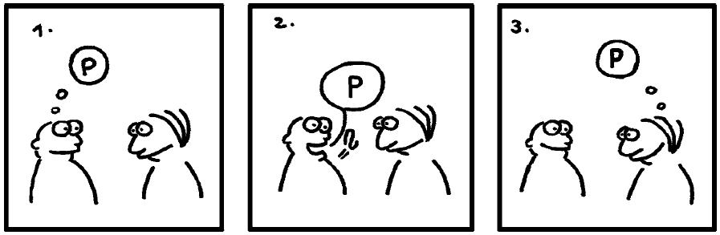

# Self-Locating Beliefs
**First published Fri Sep 30, 2022**

*Egan, Andy, Titelbaum, Michael G.*

Self-locating beliefs are beliefs about one’s position or situation in the world, as opposed to beliefs about how the world is in itself. Section 1 of this entry introduces self-locating beliefs. Section 2 presents several distinct arguments that self-locating beliefs constitute a theoretically distinctive category. These arguments are driven by central examples from the literature; we categorize the examples by the arguments to which they contribute. (Some examples serve multiple strands of argument at once.) Section 3 examines positive proposals for modeling self-locating belief, focusing on the two most prominent proposals, due to Lewis and Perry. Section 4 discusses another, quite distinct phenomenon that motivates some discussions of self-locating belief: immunity to error through misidentification. Section 5 takes up issues arising in the philosophy of language—in particular in theories of communication. Section 6 discusses issues arising in decision theory and formal epistemology. We close with a brief taxonomy of objections to the claim that self-locating beliefs constitute a distinctive category.

## 1. The Phenomenon

Our subject is traditionally introduced by means of example. We follow tradition:

> I once followed a trail of sugar on a supermarket floor, pushing my cart down the aisle on one side of a tall counter and back down the aisle on the other, seeking the shopper with the torn sack to tell him he was making a mess. With each trip around the counter, the trail became thicker. But I seemed unable to catch up. Finally it dawned on me. I was the shopper I was trying to catch.
>
> I believed at the outset that the shopper with a torn sack was making a mess. And I was right. But I didn’t believe that I was making a mess. That seems to be something I came to believe. And when I came to believe that, I stopped following the trail around the counter, and rearranged the torn sack in my cart. My change in beliefs seems to explain my change in behavior….
>
> At first characterizing the change seems easy. My beliefs changed, didn’t they, in that I came to have a new one, namely, *that I am making a mess?* But things are not so simple. (Perry 1979: 3)[^perry-1979]

This case displays a structure common to many canonical examples of self-locating belief, which we can use to point toward our subject. As a first pass: the example describes an agent who is in, or comes to be in, a particular doxastic state, where that doxastic state is difficult or impossible to characterize without using indexicals. (That is, without using expressions that vary in their denotations in different contexts of use, such as “I”, “now”, “here”, etc.) Hence the title of Perry’s paper, “The Problem of the Essential Indexical” (1979).

The doxastic change that Perry underwent when he realized what was happening, the one that explains his change of behavior, can be aptly described (by him, at least), as *coming to believe that I am making a mess*. It is not aptly described as *coming to believe that the shopper with the torn sugar sack is making a mess*. Perry already believed that. Nor (Perry argues) is it aptly described as coming to believe that the *F* is making a mess, for any non-indexical *F*. For one thing, for any such *F* (the unique bearded man in a blue shirt at Safeway, the author of “Frege on Demonstratives”, etc.), we can construct a version of the case in which Perry already believed that the *F* was making a mess, but still persisted in trying to chase the *F* around the supermarket to tell him that he was making a mess. For another thing, it could easily be that everyone else in the supermarket believed that the *F* was making a mess, and none of them displayed the embarrassed cart-rearranging behavior that Perry displayed after he realized what was happening. So none of those beliefs looks like it explains Perry’s change in behavior. (At least, not by marking off a doxastic state that tends to give rise—against a typical background of desires and other beliefs—to that sort of behavior.)

Nor is Perry’s doxastic change aptly described as *coming to believe that John Perry is making a mess*. For one thing, we can build a version of the case in which Perry already believed that too, but, not realizing that he was John Perry, still tried to chase John Perry around the supermarket to tell him he was making a mess. For another, everybody else in the supermarket could have believed that John Perry was making a mess, without any of them engaging in that distinctive sort of embarrassed cart-rearranging. So that belief also doesn’t look like it explains Perry’s change in behavior. (At least, not by marking off a doxastic state that tends to give rise—against a typical background of desires and other beliefs—to that sort of behavior.)

So descriptions of doxastic states that don’t make use of indexical terms—states of believing, e.g., *that John Perry is making a mess*, or *that the unique bearded philosopher in Safeway is making a mess*—don’t seem to capture the doxastic change that occurs when Perry realizes what’s been happening. The sorts of descriptions that do capture that change all seem ineliminably indexical—Perry can describe the change as coming to believe *that I was making a mess*, and we can describe it as, for example, Perry’s coming to believe *that he himself was making a mess*.

Perry’s example (among others we’ll soon see) has convinced many philosophers that there is a distinctive category of doxastic states that resist characterization in non-indexical terms. Once one is convinced of this, some questions naturally arise: What’s the best way to think of these doxastic states? And what marks them off as different from states that *are* happily characterized in non-indexical terms?

Before we move on to more detailed discussion, another classic example from Perry that helps motivate calling these distinctive doxastic states *self-locating beliefs*:

> An amnesiac, Rudolf Lingens, is lost in the Stanford library. He reads a number of things in the library, including a biography of himself, and a detailed account of the library in which he is lost. He believes any Fregean thought you think might help him. He still will not know who he is and where he is, no matter how much knowledge he piles up, until that moment when he is ready to say,
>
> *This* place is aisle five, floor six, of Main Library, Stanford.
>
> *I* am Rudolf Lingens. (Perry 1977: 21–22)[^perry-1977]

Here it’s easy to see why the terminology of *self-location* is appealing—Lingens’ problem doesn’t seem to be ignorance about what the world is like. It’s ignorance about his own location within the world. (Another metaphor one finds in the literature: his problem isn’t that he doesn’t know how to draw the map of the world; it’s that he doesn’t know where to place the “you are here” arrow on that map.) In many respects, this is a helpful and clarifying way to think about the purported special category of belief that resists characterization in non-indexical terms: it’s belief about one’s particular location within the world.

Yet this way of thinking is misleading in at least one respect: the relevant category of belief is not restricted to beliefs about one’s geographical or temporal location. If the talk of “self-location” is not to be misleading, we have to understand “self-location” quite broadly—in the messy shopper case, Perry’s problem may be a failure to properly self-locate, but it’s not a failure to properly *spatiotemporally* self-locate. When Perry realizes what’s going on, he locates himself among the (widely spatiotemporally dispersed) messy shoppers of the world. Perry’s new belief state is one of self-location in the sense that it locates him in a space of possible individuals, or in a quality space the components of which aren’t restricted to things having to do with spatiotemporal position.

David Lewis calls the same phenomenon “belief *de se*”—about the self. This avoids misunderstanding the phenomenon as having primarily to do with spatiotemporal location, at the expense of introducing some novel and potentially disconcerting technical terminology, and perhaps obscuring the respects in which talk about self-location is genuinely helpful for getting a grip on the phenomenon.

## 2. Arguments and Examples

This section describes some paradigmatic examples motivating a distinctive category of self-locating belief, and disentangles the argumentative threads those examples support. The self-locating belief literature is heavily driven by a cluster of evocative examples. The distinctive category of self-locating belief, and the various proposals for how to theorize about it, are often motivated by the felicitous treatment they offer of these examples. But it’s not always clear exactly what argumentative work the examples are doing, and which examples are driving which arguments. This section charts the argumentative landscape by working through a dialectic that’s a bit artificial, but we think useful for seeing how the pieces fit together.

### 2.1 A dialectic-structuring device

In 1979, David Lewis and John Perry each offered arguments for a distinctive category of self-locating belief (Lewis 1979; Perry 1979)[^lewis-1979][^perry-1979]. To understand the argumentative landscape, it’s useful to think of both Lewis and Perry as first arguing that a particular theory of belief is inadequate, and then offering different remedies for its inadequacies. We’ll call that initial theory of belief the “Simple Picture”, then characterize rival theories in terms of how they supplement the Simple Picture to remedy the problems Lewis and Perry identified.

On the Simple Picture, belief is a binary relation between subjects and possible-worlds propositions (or something like them—more on this in a moment), and the interesting and theoretically important doxastic states of believers are states of believing *P* for possible-worlds propositions *P*. (So, in particular, all the states required to fully account for what’s happening with people doxastically, to explain people’s doxastic similarities and differences, and to give explanations of people’s behavior in terms of their doxastic states, will be states of believing *P* for propositions *P*, with propositions understood as sets of possible worlds.)

That’s a pretty good characterization of the view that Lewis wanted to demonstrate was inadequate, but we need to generalize a bit to bring Lewis and Perry under the same umbrella. Although possible-worlds propositions were Lewis’s specific concern, the Simple Picture needn’t work with possible worlds propositions in particular—it can operate with any type of proposition in a broader category we’ll call *traditional* propositions. Traditional propositions determine a possible-worlds truth condition. So they take truth-values relative to worlds. And importantly for our purposes, they don’t take truth-values relative to anything more fine-grained than worlds. So we’ll never get two worldmates standing in the belief relation to the same traditional proposition, one thereby believing truly and the other thereby believing falsely. On the Simple Picture, objects of belief represent ways for the world to be—they impose representational demands on the world, and are answerable to the world for their truth or falsity. Possible worlds propositions are, obviously, like this. So too are standard Russellian structured propositions, constructed out of objects and properties. (The Russellian proposition constructed in the usual way from Aristotle and *wisdom* is true in all and only the worlds in which Aristotle is wise.)

We can summarize the Simple Picture as follows:

> The Simple Picture:
>
> 1. Belief is a binary relation between believers and objects of belief.
> 2. The objects of belief are traditional propositions.

In 1979, John Perry and David Lewis produced examples purporting to show that this simple way of theorizing about belief was inadequate, because the family of doxastic states at its disposal—states of believing that *P* for traditional propositions P—couldn’t explain some bits of behavior that it’s important to be able to explain in doxastic terms, couldn’t capture certain sorts of ignorance and doxastic change, and/or couldn’t properly categorize believers so as to capture important doxastic similarities and differences between them.

Thinking about the dialectical situation this way helps frame the relevant arguments and examples in terms of problems they raise for the Simple Picture. We can then differentiate the various theories of self-locating belief by how they supplement the Simple Picture to remedy those problems.

To guard against historical misunderstanding, we note that not everybody endorsed the Simple Picture in the beginning of 1979, and there were already examples and arguments in the literature making trouble for the Simple Picture, on similar sorts of grounds, before Perry’s and Lewis’s 1979 papers (see for example Castañeda 1966, 1967; Frege 1956; Wittgenstein 1953; Anscombe 1975)[^anscombe-1975][^castañeda-1966][^castañeda-1967][^frege-1956][^wittgenstein-1953]. But thinking in terms of problems for, and modifications of, the Simple Picture is helpful for understanding the argumentative landscape.

### 2.2 Arguments from ignorance

We return to Perry’s example of the messy shopper.

Perry explains his change in behavior by saying “I came to believe that I was making a mess”. As Perry frames the problem, no substitution for “I” in the reported belief (“that I was making a mess”) will preserve the explanatory power of the belief attribution. Descriptive substitutions won’t work, nor will “I came to believe John Perry was making a mess”. What’s reported isn’t a belief in any of the familiar, tractable, Simple-Picture-friendly categories: it’s not a descriptive belief about the *F*, and it’s not a *de re* belief about a particular individual. So we need something additional to capture the doxastic state Perry reports himself as coming to be in when he says “I came to believe that I was making a mess”.

There are two central argumentative threads at work here:

1. An argument from *ignorance*: In the early parts of the story, Perry manifests a sort of ignorance, which drives his behavior. But it’s not (Perry argues) ignorance of any ordinary descriptive or *de re* proposition. It’s a kind of ignorance that could survive coming to have all the relevant descriptive beliefs, and all the relevant *de re* beliefs. Perry’s ignorance is a distinctively first-personal, self-locating kind of ignorance. That is: The doxastic state that Perry’s missing—the one whose absence constitutes his ignorance—isn’t of the kind that appears in the Simple Picture. It’s not a state of believing *P* for any traditional proposition *P*. So in order to characterize Perry’s ignorance, we need more resources than the Simple Picture gives us.
2. An argument from *difference*: When Perry has his *a-ha* moment, he undergoes an important doxastic change—one that disposes him to very different sorts of behavior. So there’s an important doxastic difference between pre-*a-ha* and post-*a-ha* Perry. But it’s not (Perry argues) a difference in which states of ordinary descriptive or *de re* belief Perry was in at the two times. It’s a difference in belief states of a distinctively first-personal, self-locating kind. That is: the change that Perry undergoes isn’t one that we can characterize in the Simple Picture. There’s no (relevant) difference in which traditional propositions Perry believed before and after his *a-ha* moment. So in order to characterize the doxastic difference between pre- and post-*a-ha* Perry, we need more resources than the Simple Picture gives us.

We’ll pick up these threads in turn, and look at other prominent examples pushing similar lines of argument. In this section, we take up arguments from ignorance. Arguments from difference will be discussed in section 2.3.

Arguments from ignorance get a lot of attention in debates about self-locating belief. They have the same general form as the knowledge argument against materialism in the philosophy of mind (Jackson 1982, 1986)[^jackson-1982][^jackson-1986]: we build a case in which a subject is stipulated to have all of the *K*-type knowledge there is to have, elicit the intuition that they still display a particular sort of ignorance, and conclude that not all knowledge is of type *K*. It’s easy to see the messy shopper case contributing to this sort of argument: We build a version of the messy shopper case in which Perry, before his epiphany, is already in all the relevant states of *de re* belief, and all the relevant states of descriptive belief, but still has something to learn. We conclude that there are some states of belief of a distinctively self-locating (“essentially indexical”) kind, that aren’t states of *de re* or descriptive belief. Perry already believes all of the relevant traditional propositions, so there must be states of belief that aren’t states of believing *P* for some traditional proposition *P*.

While the messy shopper example contains both of the argumentative threads we identified above, another famous example offers a relatively pure argument from ignorance. This is Lewis’ (1979) example of the two gods. (Note that in what follows, Lewis uses “propositional attitude” to mean an attitude toward a possible-worlds proposition, and “proposition” so that it applies only to possible-worlds propositions.)

> Lewis’s two gods
>
> Consider the case of the two gods. They inhabit a certain possible world, and they know exactly which world it is. Therefore they know every proposition that is true at their world. Insofar as knowledge is a propositional attitude, they are omniscient. Still I can imagine them to suffer ignorance: neither one knows which of the two he is. They are not exactly alike. One lives on top of the tallest mountain and throws down manna; the other lives on top of the coldest mountain and throws down thunderbolts. Neither one knows whether he lives on the tallest mountain or on the coldest mountain; nor whether he throws manna or thunderbolts. Surely their predicament is possible. (The trouble might perhaps be that they have an equally perfect view of every part of their world, and hence cannot identify the perspectives from which they view it.) But if it is possible to lack knowledge and not lack any propositional knowledge, then the lacked knowledge must not be propositional. If the gods came to know which was which, they would know more than they do. But they wouldn’t know more propositions. There are no more to know. (Lewis 1979: 520–521)[^lewis-1979]

The load-bearing phenomenon here is a kind of ignorance that survives knowledge of all true traditional propositions. By stipulation, the gods know all the true traditional propositions, and thus are in the state of believing *P* for all traditional propositions *P*. Yet each is still ignorant of something. Thus there must be some kind of knowledge whose doxastic component is not being in a state of believing a traditional proposition.

Here is the general form of the argument, expressed abstractly enough that Lewis and Perry could both endorse it:

1. An adequate account of belief will include, for each of the two gods, a state that they are not in, such that their failure to be in it is a kind of ignorance.
2. There aren’t any states of believing *P*, for traditional propositions *P*, that the two gods aren’t in, such that their not being in them is a kind of ignorance. (They believe all the ones that are true in their world, and not believing the false ones isn’t a kind of ignorance.)
3. So, the Simple Picture of belief isn’t adequate. To characterize the gods’ ignorance, we’ll need to refer to some doxastic states that aren’t just states of believing *P* for traditional propositions *P*.

Lewis and Perry offer different diagnoses of what’s gone wrong with the Simple Picture, and recommend different remedies. But they agree on the Simple Picture’s inability to account for these sorts of cases.

There are a number of other arguments from ignorance in the literature—for example, the case of Rudolph Lingens in the Stanford library (Perry 1977)[^perry-1977], which we discussed briefly in section 1, and the case of the lost hiker in the Desolation Wilderness (Perry 1979)[^perry-1979]. They are worth noting because they are in some respects less odd and science-fictional than the case of the two gods, but we will not take them up in detail because their load-bearing structural features are the same.

### 2.3 Arguments from difference

Another major thread of argument for a theoretically distinctive category of self-locating belief maintains that there are important doxastic similarities and differences between agents that are difficult to characterize without that distinctive category. Introducing such a category provides the resources to characterize those similarities and differences in a theoretically helpful way. We will focus on difference-based arguments in this subsection, then take up similarities in the next.

In the messy shopper example, there’s an important doxastic difference between Perry before his *a-ha* moment and Perry after his *a-ha* moment. But that difference isn’t (Perry argues) a difference in which descriptive or *de re* propositions Perry believes. So we need some extra theoretical resources, beyond states of believing *P* for traditional propositions *P*, to characterize the doxastic change Perry undergoes in his *a-ha* moment.

It’s no accident that the messy shopper example has both an ignorance thread and a difference thread. Typically, where there’s an argument from ignorance, there’s an argument from difference—the pre- and post-discovery stages in a case of *resolved* ignorance will be importantly doxastically different. And even when the ignorance isn’t resolved, there will be in the background a relevant doxastic difference between the subject in the case as described and the subject as they would be if the ignorance *were* resolved.

Yet where there’s an argument from difference, there need not be an argument from ignorance. We can illustrate this with another famous example from Perry of two hikers, one of whom is attacked by a bear (Perry 1977: 23)[^perry-1977]. Let’s call the hikers John and David, and let’s suppose that it’s John who is attacked while David looks on.

John and David both believe *that John is being attacked by a bear*. But they display, Perry notes, very different behavior: John curls up into a ball; David runs for help. It’s very plausible to attribute this difference in behavior to a doxastic difference between them. (A difference that makes it appropriate, for example, to say that John, but not David, believes that *he himself* is being attacked by a bear.) But the doxastic difference isn’t a difference in traditional propositions believed—certainly it isn’t a difference in possible-worlds propositions believed, or in descriptive or *de re* structured propositions believed. John and David are on exactly the same page about the relevant aspects of the world—it’s a world in which John is being attacked by a bear, and David isn’t. They are on exactly the same page about which relevant descriptive and *de re* structured propositions are true—it’s true that the prominent advocate of self-locating belief from Stanford is being attacked by a bear, while the prominent advocate of self-locating belief from Princeton is not, that John is being attacked and David is not, etc.

Here then is the general form of a difference argument centered around some case, which we’ll call ‘CASE’:

1. There is an important doxastic difference between *A* and *B* in CASE.
2. In CASE, *A* and *B* are alike with respect to all of the potentially relevant states of believing *P* for traditional propositions *P*.
3. So, there are some important doxastic states that are not states of believing *P* for traditional propositions *P*, such that differences in those kinds of states can explain the doxastic difference between *A* and *B* in CASE.

While ignorance arguments often need to become quite odd and science-fictional, difference arguments don’t. Here is why: The most obvious strategy for responding to both sorts of arguments is to identify some piece of Simple Picture-friendly information that would resolve the ignorance, or mark the doxastic difference. In ignorance cases, this strategy can initially look very promising. If Lingens thinks of himself as the unique bearded man in a plaid shirt reading a biography of Rudolph Lingens, then learning the Simple Picture-friendly information that the bearded man in a plaid shirt reading a biography of Rudolph Lingens is in the Stanford library will resolve his ignorance. So to keep Simple Picture-friendly information from resolving Lingens’ ignorance, we need to make sure Lingens doesn’t think that he’s the unique bearded man in a plaid shirt reading a biography of Rudolph Lingens. He needs to think that—or at least, leave open the possibility that—there’s another bearded man in a plaid shirt reading a biography of Lingens somewhere. More generally, there needs to be *no* unique Simple Picture-friendly description of himself available to Lingens, because any such description would allow some Simple Picture-friendly information to resolve his ignorance. Similarly for *de re* belief—the subjects of ignorance cases mustn’t be in a position to uniquely identify themselves *de re*.

That’s why ignorance argument cases wind up involving things like mirror-image universes with qualitatively indistinguishable “sides”, pairs of amnesiacs undergoing identical courses of subjective experience, pairs of gods with unusual perspectives on the world, and so on.

Those are peculiar, highly science-fictional cases. In more ordinary cases, believers have access to a description that they take to apply uniquely to themselves, even if it’s quite complex and difficult to state concisely. To preserve the case, and make sure that *no* Simple Picture-friendly information can help, the case needs to get very weird. And it’s natural to worry about whether intuitions about such cases are good bases for theory choice.

Of course advocates for a special category of self-locating-belief will say that this response misses the point. The *de re* proposition about Lingens, or the descriptive proposition about the unique bearded, plaid-shirt-wearing biography reader, can only help resolve Lingens’ ignorance if we assume Lingens’ self-locating belief *that he himself is Lingens*, or that he himself is the unique *F*. And there is something to this. But now the dialectical ground has shifted. Rather than offering an example about which we have clear—and clearly Simple Picture-unfriendly—intuitions, the advocate for a special category of self-locating belief simply insists on their theory. The force of the argument is diminished.

For advocates of self-locating belief, difference arguments have the advantage of working with cases that aren’t so strange and science-fictional. Cases in which two subjects have all the same Simple Picture-friendly beliefs, yet respond very differently to their environments, needn’t be especially peculiar—their only peculiarity is in the unlikely degree of shared belief. And cases in which subjects have all the same *relevant* Simple Picture-friendly beliefs, so that differences in subjects’ Simple Picture-friendly beliefs don’t explain the differences in how they respond to their environments, are not peculiar at all. They are actual, and common. (Other examples from the literature include Perry’s case of the lost hiker [1979: 4] and Kaplan’s burning pants case [1989: 537], which also features prominently in Chierchia 1989: 2–3.)[^chierchia-1989]

It’s worth pausing on Perry’s case of a professor waiting for a faculty meeting to start, as this case extends the issue about self-location to *temporal* self-location:

> a professor, who desires to attend the department meeting on time, and believes correctly that it begins at noon, sits motionless in his office at that time. Suddenly he begins to move. What explains his action? A change in belief. He believed all along that the department meeting starts at noon; he came to believe, as he would have put it, that it starts now. (Perry 1979: 4)[^perry-1979]

This is a temporal difference case: there’s an important doxastic difference between the professor when he’s sitting motionless in his office, thinking to himself “the meeting begins at noon”, and the professor when he starts to move, thinking to himself, “the meeting begins now”. But the difference isn’t in traditional propositions believed—the professor believes, both before and after he begins to move, that the meeting begins at noon, at the time when the clock strikes twelve times, etc. Characterizing the difference requires resources beyond those of the Simple Picture.

### 2.4 Arguments from sameness

There is also a tradition—a bit less frequent in the literature—of cases involving cognitive *similarity* that are purportedly best captured by a distinctive category of self-locating belief. (Though see Perry 2019’s discussion of what he calls “Type A” cases.)[^perry-2019] A prominent example:

> Hume and Heimson
>
> Let us imagine David Hume, alone in his study, on a particular afternoon in 1775, thinking to himself, “I wrote the *Treatise*”. Can anyone else apprehend the thought he apprehended by thinking this? First note that what he thinks is true. So no one could apprehend the same thought, unless they apprehended a true thought. Now suppose Heimson is a bit crazy and thinks himself to be David Hume. Alone in his study, he says to himself, “I wrote the *Treatise*”. However much his inner life may, at that moment, resemble Hume’s on that afternoon in 1775, the fact remains: Hume was right, Heimson is wrong. Heimson cannot think the very thought to himself that Hume thought to himself, by using the very same sentence. (Perry 1977: 17)[^perry-1977]

Let us step back from some of the particular commitments in Perry’s presentation of the case to extract an argument that both Perry and Lewis could endorse: There’s something theoretically and explanatorily important that Hume and Heimson have in common. But it’s not a state of believing *P* for any traditional proposition *P*. (If it was, either both would be correct in their belief or neither would.) To capture this doxastic similarity, we need resources beyond those provided by the Simple Picture. We need states of distinctively self-locating belief.

The Hume/Heimson case is a bit odd, since Heimson’s belief is a bit odd. But more mundane examples are ubiquitous. One occurs a bit later in Perry 1977: there is something doxastically in common to all of the (well-informed) residents of Kennebunkport—they’re all in a doxastic state that leads them to sincerely assert “I am in Kennebunkport”, and to engage in Kennebunkport-appropriate behavior. Similarly, there’s something doxastically in common to everyone disposed to sincerely assert, “that’s Gilmore Lake before me” (Perry 1979)[^perry-1979] or “my pants are on fire” (Kaplan 1989)[^kaplan-1989].

These doxastic similarities are not a matter of all the group members’ being in a common state of the type, believing *P* for some traditional proposition *P*. (There’s no traditional proposition that all and only those disposed to sincerely assert, e.g., “my pants are on fire” believe, believing which generates—given otherwise typical beliefs and desires—corresponding behavioral dispositions.)

Notice also that these problems are not just problems about belief. It’s awkward for the Simple Picture of belief that Hume and Heimson seem to have a common belief, but Hume’s belief is correct while Heimson’s is incorrect. Whatever’s in common to Hume and Heimson, it’s not standing in the belief relation to a common traditional proposition. Since Hume and Heimson are worldmates, any traditional proposition that one of them would be correct to believe, the other would be as well. It’s similarly awkward for a Simple Picture about desire that Hume and Heimson could equally well both *want* to be Hume (or to have written the *Treatise*), and if they did, Hume’s desire would be satisfied and Heimson’s would not. This means, because Hume and Heimson are worldmates, that their conative similarity can’t be a matter of both standing in the desire relation to a common traditional proposition. And once we’ve seen this trick, it’s easy to generate parallel examples for other propositional attitudes, and it’s easy to generate examples in which the attitudes in question aren’t as odd as Heimson’s.

Moreover, once we’ve seen the trick of generating non-doxastic similarity cases, it’s straightforward to generate non-doxastic difference cases as well. *A* wants to lead and *B* wants to follow. That’s a difference in preference, that gives rise to systematic differences in behavior. But it’s not a difference in traditional propositions desired. Very clearly, it’s not a difference in the possible worlds *A* and *B* favor—both favor the worlds in which *A* leads and *B* follows. And it’s not clear how the extra structure of traditional propositions that aren’t sets of worlds (e.g., Russellian propositions) could help draw the distinction. (Lewis discusses a similar case in “Dispositional Theories of Value”, 1989: 119.)

This points to another advantage of sameness and difference arguments—over ignorance arguments—as the primary argumentative basis for recognizing self-locating belief: sameness and difference arguments are easily generalized to other propositional attitudes, while ignorance arguments are belief-specific.

## 3. Theoretical Responses

It’s useful to think of Lewis and Perry as both rejecting the Simple Picture and as responding to its inadequacies by introducing different sorts of complications.

Perry rejects the Simple Picture’s reliance on a simple, binary belief relation. According to Perry, we need theoretical resources that keep track, not just of which propositions subjects believe, but of the mechanisms by which they come to believe them.

Lewis rejects the Simple Picture’s reliance on traditional propositions as the objects of belief. According to Lewis, we need objects of belief that carve up a space of possibilities whose points aren’t worlds, but positions within worlds—that is, worlds together with a position specified within them.

We’ll discuss Lewis’ proposal first, then Perry’s in section 3.2.

### 3.1 Centered worlds

On Lewis’s view, what’s distinctive about self-locating beliefs is their *content*. Instead of taking the objects of belief to be possible worlds propositions, we take them to be properties. Equivalently, we can take them to be sets of centered worlds. A centered world is a set-theoretic object that models a position or a location within a world; it’s easiest to think of a centered world as a $\langle \textrm{world}, \textrm{time}, \textrm{individual}\rangle$ triple. (Absent clever science-fictional examples, specifying a world and then a time and an individual within that world suffices to specify the intended sort of position or location. See Liao (2012) for troublemaking clever science-fictional examples, and for discussion.) Treating objects of belief as sets of centered worlds is equivalent to treating them as properties because for each property $F$, there’s a set of centered worlds that includes a given $\langle w,t,i\rangle$ triple iff $i$ has $F$ at $t$ in $w$, and for each set of centered worlds, there’s a property that’s shared by all and only those individuals in those worlds at those times. (Note that this requires a plenitudinous ontology of properties, to which Lewis is already independently committed. Those who subscribe to enough Lewisian metaphysics can also, equivalently, treat the objects of belief as sets of worldbound time-slices.) We will call a set of centered worlds a *centered-worlds proposition* or a *centered proposition*, and a belief with a centered-worlds proposition as its content a *centered belief*.

Lewis (1979) argues that properties/centered-worlds propositions can do all of the attitude-characterizing work of traditional possible-worlds propositions, and more besides. For each possible-worlds proposition *P*, there’s a corresponding property (centered-worlds proposition)—the property of inhabiting a *P*-world, a.k.a. the set of triples $\langle w,t,i\rangle$ such that $w$ is a *P*-world. But there are also more properties and centered-worlds propositions—ones that sometimes distinguish between worldmates, such that one individual in a world has the property and another doesn’t, or such that an individual in a world has the property at some times but not others. Let’s call the first kind of property or centered proposition *boring* and the second kind *interesting*. Where a possible-worlds proposition would do as an object of belief, the corresponding boring property or centered proposition will do as well (see Nolan 2006 for dissent, and Turner 2010 and Feit 2010 for defense)[^feit-2010][^nolan-2006][^turner-2010]. So every doxastic state that we could represent using belief relations to possible-worlds propositions—every one that appeared in the Simple Picture—we can also represent using belief relations to boring properties or boring centered propositions. But having properties or centered propositions as objects of belief gives us additional resources we can use to represent doxastic states that resisted characterization using the Simple Picture.

For example: What’s missing in ignorance cases is an interesting centered belief—it’s a state of believing *P* for an interesting centered proposition *P*. In the messy shopper example, Perry’s realization puts him in the belief relation to the property *being the messy shopper* (or to the corresponding centered-worlds proposition). In the case of the two gods, the gods are belief-related to all the right boring world-occupancy properties, but they’re not belief-related to all the right interesting properties. The manna-throwing god on the tallest mountain, for example, isn’t belief-related to *being on the tallest mountain* or *throwing manna*.

What’s different in difference cases is interesting centered beliefs—it’s a difference in states of believing *P* for interesting centered propositions *P*. In the case of John and David and the bear, John and David are both belief-related to *inhabiting a world in which John is being attacked by a bear while David looks on*, but only John is belief-related to *being attacked by a bear*, while only David is belief-related to *being an unattacked witness to a bear attack*. This case highlights how “self-locating” belief isn’t just about geographical self-location. On Lewis’s framework self-locating beliefs relate individuals to properties of the form, *being such-and-such*, as opposed to properties of the form, *inhabiting a world in which so-and-so person is such-and-such*. For example, *having written the Treatise*, rather than *inhabiting a world in which Hume wrote the Treatise*. (Annoying complication: we need to qualify and restrict to values of *such-and-such* where it’s a condition that’s not necessarily satisfied by all individuals in a world at all times if it’s satisfied by any individual in that world at any time.)

What’s the same in sameness cases is interesting centered beliefs—it’s a similarity in states of believing *P* for interesting centered propositions *P*. In the burning pants case, all of the people who sincerely exclaim “my pants are on fire!” (and are disposed towards the associated non-verbal behaviors) are belief-related to *having burning pants*. Hume and Heimson are both belief-related to *being Hume*, and to *having written the Treatise*.

This will generalize to the non-doxastic attitudes as well—if we take the objects of propositional attitudes generally to be properties or centered-worlds propositions, we can handle the cases of similarities and differences in desire (etc.) that resisted characterization in terms of attitudes toward possible-worlds propositions in the same way as we handle the recalcitrant similarities and differences in belief.

### 3.2 Belief states

Perry recommends that instead of complicating our picture of the objects of belief, we complicate our picture of the belief relation. On Perry’s view, a proper doxastic theory focuses not just on the propositions to which we stand in the belief relation, but also on the mechanisms by which we come to be belief-related to those propositions.

Perry’s solution emphasizes that once we’re externalists about belief content, determination of what we believe is a two-part affair: Which propositions we’re belief-related to depends partially on what we’re like intrinsically, and partially on how we’re situated in our environment.

Some of our states—in particular, states of our internal mechanisms of mental representation—determine not what we believe, but instead a function from environments to things believed. Perry calls these *belief-states*. Belief-states are individuated by something like Kaplanian characters (Kaplan 1989)[^kaplan-1989]—functions from environments (contexts) to propositions a believer would be belief-related to if they were in that state in that environment.

While this is deliberately *not* built into the theory, it’s natural (and sometimes heuristically helpful) to think of belief-states in terms of tokenings of language-of-thought sentences with context-sensitive elements. (More generally, it’s natural to think of them as particular patterns of deployment of one’s internal representational apparatus.)

According to Perry, what’s distinctive about distinctively self-locating beliefs is a particular sort of belief-state—a belief-state that belief-relates agents to different propositions in different contexts. Instead of focusing our theoretical attention exclusively on which propositions subjects believe, we focus also on which belief-states they’re in. And it’s at the level of belief-states that we find the tools for accommodating cases that make trouble for the Simple Picture.

To explain how Perry’s view addresses difficulties for the Simple Picture, we need a way of talking about belief-states. Perry uses English sentences to talk about belief-states, by indexing belief-states to English sentences with the same character—English sentences displaying the same pattern of dependence of content on context as the belief-states. So the belief-state corresponding to “I am the messy shopper” is the belief-state such that, for any subject *x* who is in that state, *x* is thereby belief-related to the proposition that *x* is the messy shopper.

On this view, what’s missing in ignorance cases isn’t a belief, but a belief-state. When Perry realizes what’s happening in the supermarket, he doesn’t (at least, he needn’t) come to believe any new propositions, but he does come to be in a new belief-state. He comes to be in the “I am the messy shopper” state, and thereby believes the proposition *that Perry is the messy shopper*. (He may have already had a belief with that content, but if so it will have been in virtue of being in a different belief-state.) It’s a change in belief-state, not just a change (if any) in propositions believed, that’s responsible for Perry’s changed behavior.

Another example to illustrate the idea: Gennaro looks in a mirror, thinking he’s looking through a window, and sees flames creeping up the pants leg of the person he sees in the glass. At first he says, “that guy’s pants are on fire”, and is in the “that guy’s pants are on fire” belief-state. He thereby comes to believe the traditional proposition *that Gennaro’s pants are on fire.* Then he realizes what’s happening, and comes to be in the “my pants are on fire” belief-state. There’s no change in which propositions he believes—he’s still belief-related to the traditional proposition *that Gennaro’s pants are on fire*. But because he’s now belief-related to that proposition by way of the “my pants are on fire” belief-state, his behavior changes.

The difference in difference cases isn’t a difference in propositions believed, but in belief-states. John and David are both belief-related to the proposition *that David is witnessing John’s being attacked by a bear*. But the belief-states that support their being belief-related to that proposition are different. David is in (for example) the “I am witnessing that guy’s being attacked by a bear” belief-state, while John is in the “that guy is witnessing my being attacked by a bear” belief-state. This difference in belief-states generates the differences in their behavior.

What’s the same in sameness cases is a belief-state, not a proposition believed. When Gennaro and Hector both exclaim, “my pants are on fire”, and engage in similar associated behavior, it’s because they are both in the “my pants are on fire” belief-state. Being in that belief-state gets them belief-related to different propositions. It relates Gennaro to the proposition *that Gennaro’s pants are on fire*, while it relates Hector to the proposition *that Hector’s pants are on fire*. So the similarity is to be found at the level of belief-states, not at the level of propositions believed.

### 3.3 Other options

There are other theoretical options in the literature. See for example those offered in Recanati (2007), Higginbotham (1995, 2010), Chisholm (1981), and Stalnaker (2008). But the Lewis/Perry contrast, where Lewis responds by complicating the objects of belief, and Perry responds by complicating the relations between believers and objects of belief, provides a useful classificatory scheme. Like Lewis, Recanati and Chisholm propose a more complicated account of content than that of the Simple Picture, though their proposed alternatives differ. Higginbotham’s token reflexive account is, we think, usefully grouped with Perry’s view as accounting for self-locating phenomena with the mechanisms by which believers are related to the objects of belief; though again, the theoretically load-bearing features of the relations are different. Stalnaker’s (2008) account also likely belongs with Perry’s. Rather than going into detail about other accounts of self-locating belief, we refer the interested reader to the works cited above.

## 4. Another Motivation: Immunity to Error Through Misidentification

Lewis and Perry overlap extensively on their motivations for their views: Both are focused on cases of ignorance, doxastic difference, and doxastic similarity that aren’t happily captured in terms of states of believing *P* for traditional propositions *P*. But not all theorists of self-locating belief are motivated in the same way.

Another source of motivation, common in other threads of the self-location literature, but not prominent in the Lewis/Perry dialectic, is the phenomenon of immunity to error through misidentification.

There are a number of influential discussions of this phenomenon—for some prominent and helpful examples, see Wittgenstein (1953), Shoemaker (1968), Anscombe (1975), Evans (1982), Pryor (1999), Recanati (2007), Coliva (2009), García-Carpintero (2018), and the papers in Prosser and Recanati (2012). For more thorough discussion than we will offer here, see the supplement the scope of immunity to error through misidentification to the entry on Self-Consciousness. For a not-so-thorough introduction of the phenomenon, and how it can serve to motivate an account of self-locating belief, see below.

Here is a framing of the phenomenon that follows Wittgenstein’s (1953): There are two importantly different kinds of uses of “I”—uses of “I” as subject and uses of “I” as object. There’s a certain distinctive sort of error that’s possible in the second case but not in the first. Consider uses of “I” as object, as when I find myself, for one reason or another, in a tangle of bodies, mistakenly take another person’s arm that I see to be mine, and judge, based on the arm’s visual appearance, “I have a broken arm”. (Perhaps I am participating in a game of Twister gone horribly wrong.) In this case, my judgment is wrong, and in particular it’s wrong because, though I’ve correctly perceived that the arm I’m looking at is broken, I’ve misidentified whose arm it is. In uses of “I” as subject, such as when I feel a pain and judge, “I am in pain”, my judgment can’t be wrong in the same way. Maybe I can be wrong about whether that sensation is a pain, but I can’t be wrong about whose sensation it is. Judgments employing “I” as subject are characterized as immune to a particular type of error: they are immune to errors through misidentification.

Subsequent literature has made much more precise the notion of error through misidentification, and has offered various hypotheses about exactly which beliefs (if any) are immune to such error. One recurring thread, though, is that if there’s immunity to error through misidentification, it’s intimately bound up with thoughts about oneself. If there are beliefs immune to error through misidentification, then a particular class of thoughts about ourselves are among them.

François Recanati (2007 and elsewhere) offers one prominent account, building on Evans (1982) and Lewis (1979). Recanati distinguishes between judgments whose contents do and do not contain an “identification component”. Here’s one way to capture the thought: When François has a *de re thought* about François —where the content of the judgment is, e.g., *that François has a broken arm*—that’s a thought with an identification component; the person represented as having a broken arm is explicitly represented, in the content of the judgment, as François. When François has a distinctively self-locating thought, the content of the judgment is something “identification free”—something corresponding to, for example, the property *being in pain*. In the latter case, there’s no danger of error due to misidentification, because there’s no identification-element in the judgment that can be the locus of misidentification. (See Recanati 1993 and 2007 for Recanati’s full story.)[^recanati-1993][^recanati-2007]

So the idea that some judgments are immune to misidentification-based error provides another potential motivation for the introduction of a distinctive category of self-directed belief: thinking about oneself as oneself.

Pursuing a different line, Anscombe (1975) suggests that the meanings of an individual’s “I”-thoughts essentially tie them to that individual’s actions, movements, and intentions. Yet it’s not entirely clear how this picture would mesh with the other accounts and phenomena discussed in this section; Anscombe’s framing of the issues is different from the one above, and she is explicit that she’s not talking about traditional IEM phenomena such as “I have a headache”.

## 5. Self-Location in Language

So far we’ve discussed issues almost entirely within the philosophy of mind. This is no accident—the central motivating phenomena for an account of self-locating belief are phenomena in the philosophy of mind, and the theoretical proposals for accommodating those phenomena are proposals in the philosophy of mind (or at least, are most centrally proposals in the philosophy of mind). Debates about whether to postulate a distinctive category of self-locating belief, and about the best theory of that distinctive category, are debates about the theoretical resources needed to properly characterize subjects’ doxastic states. The arguments we’ve considered all maintain that there are mental phenomena—ignorance, cognitive similarity or difference, immunity to error—that require special theoretical treatment featuring a particular category of mental states, the distinctively self-locating beliefs.

Though its first home is in the philosophy of mind, self-locating belief has also received much attention in linguistics and the philosophy of language. This is unsurprising, because interesting phenomena in the philosophy of mind about *belief* are likely to cast shadows into linguistics and the philosophy of language about belief *reports*, and the semantics thereof. (Similarly for our accounts of other sorts of attitudes, and our accounts of the linguistic devices we use to report them.) There is an extensive literature here, too large and much of it too technical for us to summarize. For some points of entry, see Anand and Nevins (2004), Anand (2007), Castañeda (1966, 1967), Chierchia (1989), Maier (2009), and Feit (2008).

More specifically, the parts of philosophy of language concerned with communication—in particular, with the individual or collective mental states and attitudes that give rise to, and are produced by or updated in response to, various speech acts—must be sensitive to what we say about the objects and the structure of those attitudes when we’re doing philosophy of mind. If our philosophy of mind includes a distinctive category of self-locating belief, that’s liable to raise downstream questions in the philosophy of language, about (for example) how self-locating beliefs are (or are not) implicated in the production of various speech acts, how interlocutors update their self-locating beliefs (or don’t) in response to various speech acts, and about the place of self-locating beliefs in speakers’ communicative intentions or in the conversational common ground.

The first thing to note here is that there pretty clearly *are* some self-locating communicative phenomena. (Or at least, it’s pretty clear that if there are self-locating beliefs, then there are some self-locating communicative phenomena.)

If you grant the existence of self-locating beliefs, then it’s clear that people can systematically and predictably give voice to their self-locating beliefs by using the right sentences of natural language. For example, when Muhammad Ali says “I am the greatest”, he’s giving voice to a particular self-locating belief—what Lewis will characterize as a self-attribution of *being the greatest*, and what Perry will characterize as being in the “I am the greatest” belief-state. Similarly when I call the friend I’m supposed to be meeting at the bar and say, “I’ll be there in 15 minutes”.

It’s also pretty clear that people can systematically and predictably produce self-locating beliefs in their interlocutors by using the right sentences of natural language. For example, consider standard uses of “it’s your turn”. This utterance produces in one’s interlocutor the state Lewis would characterize as self-attributing *having the next turn*, and which Perry would characterize as being in the “it’s my turn” belief-state. Similarly for “you are Rudolph Lingens”, “that’s Gilmore Lake”, or “you’re muted”.

The central philosophical issue about self-locating communication is that, while there pretty clearly *is* some self-locating communication, a model of communication that seems obvious and natural when we’re dealing with non-self-locating belief doesn’t straightforwardly generalize to the self-locating case. We’ll start by looking at some examples of self-locating communication, then present the model of communication that’s so appealing when we’re not working with self-locating belief. Then we’ll discuss why that model doesn’t generalize, and finally lay out a selection of responses presently on offer in the literature.

### 5.1 The package-delivery model of communication

Most of the literature around self-locating communication presupposes a Lewisian account on which what’s distinctive about self-locating beliefs is their distinctively self-locating content. In what follows, we’ll try to remain neutral between Lewisian, content-based accounts and Perry-style vehicle/mechanism/mode-of-presentation based accounts. To do this, we’ll need to introduce a bit of stipulatively defined technical vocabulary.

We will talk, for example, about John’s self-locating *doxastic state* when he’s disposed to sincerely say, “I am the messy shopper”—this is the state that marks him off as doxastically similar to others who are also disposed to say “I am the messy shopper” (and to search their own grocery carts for sources of mess), and as doxastically different from his pre-cottoning-on self. We’ll use “doxastic state” in a way that’s deliberately neutral between standing in the belief relation to a distinctively self-locating content, as Lewis would have it, or instead being in a particular Perry-style belief-state, such that different subjects, when in that belief-state, are thereby belief-related to different traditional propositions. We want to use “doxastic state” to talk about the cognitive states that Lewis and Perry both target with their theories, without taking a stand on who’s offering the right theoretical account of those states.

We’ll follow Perry in using English sentences to identify particular such doxastic states. So, for example, the “my pants are on fire” doxastic state is the cognitive state underwriting dispositions to sincerely assert “my pants are on fire”, to seek out fire extinguishers and turn them on one’s lower parts, etc., which according to Perry is a matter of being in a belief-state whose character mirrors that of the English sentence, and according to Lewis is a matter of standing in the belief relation to the property one needs to instantiate in order to speak truly with the sentence, given the sentence’s actual character (or standing in the belief relation to the corresponding centered-worlds proposition).

We can also extend the distinction between *boring* and *interesting* centered contents from section 3.1 to doxastic states—this will be useful in what follows. A *boring* doxastic state is one that might as well be a state of believing a traditional proposition. For Lewis, it’ll be a state of believing a boring centered proposition or its corresponding world-occupancy property. For Perry, it’ll be a matter of being in a belief-state with constant character—one that always relates its bearers to the same traditional proposition. We identify these doxastic states using context-insensitive English sentences (for example, the “John is in Palo Alto” belief-state). Interesting (or interestingly self-locating) doxastic states are ones that aren’t boring. We identify these states using context-sensitive English sentences, such as “I am in Palo Alto”. For Lewis, these states belief-relate an agent to an interesting centered proposition, or its corresponding interesting property. For Perry, these are belief-states that don’t always relate their bearers to the same traditional proposition.

So much for terminological stipulations. On to a model of communication that looks attractive when applied to non-self-locating belief, but which doesn’t straightforwardly generalize.

From a very high altitude, linguistic communication (or at least, the large part of it that’s concerned with the transmission of information) does this: I’m in some doxastic state, and I want to get you into some appropriately matching doxastic state. Somehow or other, I use a linguistic signal to get you to adopt a doxastic state that matches mine.

When we’re not dealing with self-location, it’s extremely natural to model communication by reading the “appropriate match” in this story as identity. On this model, assertion works as follows: I’m in some doxastic state that, for one reason or another, I’d like you to be in as well. So I encode my doxastic state linguistically somehow, and send the linguistic signal over to you. Then (if all goes well) you respond to the signal I sent by getting yourself into the same doxastic state that I encoded. This is a tractable, simple picture of communication, according to which linguistic communication (or at least this part of it) is a matter of transmitting doxastic states from speaker to hearer. Moss (2012) calls this the “package delivery” model, Egan (2007) calls it the “belief transfer” model, and Weber (2013) calls it the “FedEx” model. (Or rather, this is a generalization of the model described by Egan, Moss, and Weber, theoretically zoomed out to be neutral between Lewis and Perry. Egan, Moss, and Weber all presuppose a Lewisian picture in their papers.) The model is nicely visualized by the following cartoon from Weber (2013: 208):

© 2013 Springer Nature, reproduced with permission.

Weber also helpfully breaks up the model into two principles: the mind-to-speech principle, according to which what’s linguistically expressed is the same as what’s in the (sincere) speaker’s mind, and the speech-to-mind principle, according to which what winds up in the (credulous) addressee’s mind is the same as what’s linguistically expressed. We are, in what follows, going to focus exclusively on the relation between *doxastic states* of sincere speakers and credulous addressees. We will suppress, as much as possible, discussion of the precise relations between speaker/addressee doxastic states and the linguistic communication mechanisms that serve to coordinate them.

So, in particular, we will suppress questions about the relation between the compositional semantic values of natural language sentences in context and the doxastic states of sincere speakers and credulous addressees. We’ll do this not because we find the issues unimportant or uninteresting—quite the contrary! Rather, we want to avoid swimming into deep waters about exactly what the relevant communication-supporting relations are, what they have to do with semantics, etc., and also to keep the discussion at a level of abstraction compatible with as many particular theories of the phenomena as possible. (See Stanley 1997, 2002; Yalcin 2007; Ninan 2010a, 2012a; and Rabern 2012, 2017 for some exploration of those deep waters, and see for example Egan, Hawthorne, & Weatherson 2005; Egan 2007, 2010, 2012; Stalnaker 2008, 2011; Feit 2008; Torre 2010; Ninan 2010b, Stojanovic 2012; Moss 2012; Kindermann 2012, 2016, 2019; Weber 2013, 2015; Kölbel 2013; and Recanati 2016 for less cagey and more committal discussions of these issues around self-locating communication.)

### 5.2 Failures of the package-delivery model

Let’s consider where and why the package-delivery model breaks down for self-locating communication. First we’ll examine cases in which there is clearly some self-locating communication happening, but the self-locating communication isn’t of the type contemplated by the package-delivery model. Then we’ll identify the general phenomenon behind the package-delivery model’s failure to happily account for these cases.

When Muhammad Ali says “I am the greatest”, he’s definitely giving voice to his self-locating doxastic state (which Lewis would characterize as self-attributing *being the greatest*), but that doxastic state is not, and is not intended to be, transferred to his interlocutors. Ali wants his interlocutors to get in to the “Muhammad Ali is the greatest” doxastic state, not the “I am the greatest” doxastic state. And it’s the former, not the latter, that addressees who take Ali at his word will in fact get themselves into.

Similarly, when Bob seeks to resolve Lingens’ uncertainty by saying to him, “you are Rudolph Lingens”, his communicative aim is to get Lingens into the “I am Rudolph Lingens” doxastic state. But Bob, being no fool, is not himself in the self-locating doxastic state that he’s aiming to produce in his interlocutor.

In each of these cases, the communication that takes place is difficult to straightforwardly characterize on a belief transfer/package-delivery model. The doxastic state that the cooperative, credulous addressee gets into is not the same as the self-locating state that motivates the sincere speaker’s utterance, and which the speaker demonstrates or gives voice to by way of the utterance.

This shouldn’t come as a surprise, and it doesn’t result from a quirk or shortcoming of one particular human language, or of actual human languages as compared to other possible types of language. There is an in-principle problem with package-delivery communication of interestingly self-locating doxastic states. Precisely because they’re interestingly self-locating, such doxastic states aren’t the sort of thing that can uniformly be transmitted from speaker to addressee without leading addressees into error. This is easiest to see in an extreme case: It’s great for David Hume to be in the “I am David Hume” doxastic state. It’s not so great for anybody else to be in that state, and it’s not great for Hume to put his interlocutors in that state by communicating it package-delivery style.

A somewhat less extreme example: Suppose I’m in the “my pants are on fire” doxastic state. I want to communicate my plight to you so that you’ll give me a bucket of water, or a fire extinguisher. I don’t want to get you into the “my pants are on fire” state—that won’t enlist your help in my pants-extinguishing project, and it will give you inaccurate beliefs, since your pants (we may suppose) are *not* on fire. So communicating my self-locating belief via belief transfer will not achieve my communicative goals.

I want to get you into some *other* doxastic state. Getting you into the “the pants of the guy addressing me are on fire” state would likely do the trick, as would getting you into the “Andy’s pants are on fire” state. The communicative effect of saying “my pants are on fire” is not what would be predicted by a view on which that sentence’s conventional communicative role is to ensure that both speaker and addressee are in the “my pants are on fire” doxastic state.

The situation is similar for very many indexical sentences—their production is clearly motivated (in standard cases) by a particular self-locating doxastic state, but their communicative role is emphatically *not* to bring it about that that doxastic state is shared by both speaker and addressee. The communicative role of (uses of) typical indexical sentences is not to deliver a self-locating doxastic package from speaker to addressee.

### 5.3 Alternative models of communication

The literature offers many responses to the failure of self-locating doxastic states to play nicely with a package-delivery model of communication. We won’t attempt to survey them in detail here. Instead, we’ll present a taxonomy of response-types. The responses fall into three main categories: *recentering*, *decentering*, and *restriction*. (There is a fourth option—*multicentering*—which we will discuss only briefly, because its distinctive claims and contributions are in its account of the linguistic mediation between speakers’ and addressees’ attitudes. As far as what it says about speakers’ and addressees’ attitudes themselves, it’s a version of a recentering account. More about this below.)

This literature typically frames its questions and proposals in a Lewisian framework. But it’s worth emphasizing that the issue of communicating self-locating beliefs doesn’t arise only for the Lewisian. So we will continue to characterize candidate responses in Lewis/Perry neutral terms. For points of entry into the literature, see Heim 2004 (Other Internet Resources); Egan 2007; Feit 2008; Moss 2012; Kindermann 2016; Stojanovic 2012; Kölbel 2013; the papers in García-Carpintero and Torre 2016; Torre 2010; and Ninan 2010b.

The first move we’ll discuss is *recentering* (the first use of that term we can locate is in Weber 2013)[^weber-2013]. The idea is that successful communication doesn’t require transmission of a single doxastic state from speaker to addressee. The doxastic state that motivates sincere assertion needn’t be the same as the doxastic state adopted as a result of credulous uptake. What’s expressed is what the speaker believes, but what the hearer comes to believe as a result of accepting the assertion is something else. In credulous, trusting uptake, the addressee doesn’t (more carefully—needn’t) come to adopt the doxastic state expressed by the speaker’s sincere assertion, but instead *recenters*, adopting a doxastic state that stands in a particular relation to the doxastic state of the speaker, reflecting the addressee’s beliefs about how they and the speaker are related to one another.

So, for example, when Andy says to Mike, “my pants are on fire”, Andy believes (for example) the interesting *de se* proposition corresponding to the property, *having burning pants*. Mike, when he accepts Andy’s assertion, doesn’t come to believe what Andy believes. Mike instead comes to believe a “re-centered” relative of what Andy believes—the interesting *de se* proposition corresponding to the property of (for example), *being addressed by someone with burning pants*. Andy says what he says because he is in the “my pants are on fire” doxastic state, and wants to make it the case that Mike is in an appropriately matching state. The appropriately matching state that Mike, as a credulous addressee, comes to be in is not the very same state Andy is in, but something else—for example, the “the guy who just addressed me’s pants are on fire” doxastic state.

How exactly does linguistic communication produce these properly aligned doxastic states? Multiple proposals are available; we’ll pause for a moment to discuss multicentering accounts. In *multicentering* models, self-locating communication is characterized by means of *multicentered* contents—sets of n-tuples, each of which contains a world, a time, and a *series* of individuals. We can characterize the content of Andy’s communication to Mike with a set of triples $\langle w,t,\langle i_1,i_2\rangle \rangle$ such that, in $w$ at $t$, $i_1$ is addressing $i_2$, and $i_1$’s pants are on fire. If Andy had instead said, “you are better at basketball than me”, we could model the content with the set of $\langle w,t,\langle i_1,i_2\rangle \rangle$s such that, at $t$ in $w$, $i_2$ is better at basketball than $i_1$. The intuitive idea is that we characterize communicated content (and conversational common ground) using sets of set-theoretic objects whose role is to represent, not a single individual, but an entire conversational group. They do this by containing, for each participant in the conversation, an element representing that particular conversational participant. These objects characterize the state of the whole conversation, and the effects that utterances have on the state of the conversation. They don’t directly characterize the cognitive attitudes of particular parties to the conversation—a set of multicentered worlds is not a good candidate to be an object of belief for an individual (though see Ninan 2012b for a different application of the multicentering apparatus to represent *de re* attitudes)[^ninan-2012b]. Instead there is a translation from the single set of multicentered worlds characterizing the state of the conversation to the various different sets of singly-centered worlds characterizing the doxastic states of particular parties to the conversation. (When the conversation is properly characterized by a set of $\langle w,t,\langle i_1,i_2\rangle \rangle$s such that, in $w$ at $t$, $i_2$ is better at basketball than $i_1$, and we’re using the first individual position to represent Andy and the second to represent Mike, that will mean that Andy self-attributes *being the worse basketball player in a two-person conversation*, and Mike self-attributes *being the better basketball player in a two-person conversation*.)

What’s important for our purposes here is that multicentering accounts describe, in an elegant and compact way, the interlocking pattern of distinct but systematically related doxastic states of the particular parties to the conversation. Each party to the conversation has their own private doxastic states, which are properly characterized in terms of singly-centered propositions. And in cases of successful communication, the sincere speaker and credulous addressee wind up, not in the same doxastic state, but in doxastic states systematically related to each other, in ways that the multicentering account is designed to represent. So for our present, limited purposes—where we are concerned just with the relations between the doxastic states of speakers and addressees in successful communication, and are averting our eyes from the details of linguistic mechanisms that underwrite that communication and take us from the one to the other, and also from tools that characterize the overall state of a conversation rather than just the doxastic states of participants—a multicentering account becomes a way of implementing a *recentering* account. (There is a lot more to say about this. See for example Stalnaker 2008, 2014; Torre 2010; Ninan 2010b, 2012a, 2013; and Kindermann 2012, 2016.)[^kindermann-2012][^kindermann-2016][^ninan-2010b][^ninan-2012a][^ninan-2013][^stalnaker-2008][^stalnaker-2014][^torre-2010]

On *decentering* models, we retain the package-delivery model of communication, but disallow interestingly self-locating doxastic states as deliverable objects. The doxastic states linguistically communicated are all *boring* doxastic states. This allows us to retain the package-delivery model of communication.

Yet the decenterer acknowledges that there are systematic relations between interestingly self-locating doxastic states and boring doxastic states, for both speakers and hearers. The decenterer uses these connections to explain self-locating communicative effects. On one way of implementing a decentering model, when Andy says to Mike, “my pants are on fire”, Andy expresses the “Andy’s pants are on fire” doxastic state. (Other implementations will differ with respect to just which boring doxastic state is expressed.) And that’s the doxastic state that Mike winds up in as well. But being in the boring “Andy’s pants are on fire” doxastic state is differently connected to interesting doxastic states for Andy than for Mike. For Andy, given his total package of self-locating beliefs, being in the “Andy’s pants are on fire” state goes hand in hand with being in the “my pants are on fire” state. For Mike, given his total package of self-locating beliefs, being in the “Andy’s pants are on fire” state goes hand in hand not with the “my pants are on fire” state, but with the “the guy I’m talking to’s pants are on fire” state.

So while what travels (what’s expressed, what’s communicated) is the boring state, being in that boring state goes along with being in a particular interestingly self-locating state for the speaker, and with a different interestingly self-locating state for the addressee. Moss (2012), working in a Lewisian framework, puts it this way: a *de se* belief is, always, for any particular believer, going to be “equivalent given certainties” to some *de dicto* belief of theirs. (In the present framework, *de se* beliefs play the role of interestingly self-locating doxastic states, and *de dicto* beliefs the role of boring doxastic states.) What travels in communication is the *de dicto* belief, which is liable to be equivalent given certainties to one *de se* belief for speaker, and another for addressee. Note that this requires that there’s always, for every believer and every *de se* belief, a *de dicto* proxy belief available that’s equivalent to that *de se* belief for that speaker, given what the speaker is certain of. All decenterers must take on something like this substantive commitment to get their program off the ground (see Stalnaker 2008 and Moss 2012 for details)[^moss-2012][^stalnaker-2008]. Stalnaker (2008) concedes that this approach requires countenancing haecceties (see entry on haecceitism), which not everyone will be comfortable with. (See also Weber 2015; Pagin 2016; and Torre 2018 for criticism of the commitment to the availability of non-self-locating proxies.)[^pagin-2016][^torre-2018][^weber-2015]

The general decentering strategy is to take self-locating attitudes out of the story about communication, and put them in the story about relations between what’s communicated and the interlocutors’ private belief-states. Everybody allows, and needs to allow, that speakers and hearers have their own proprietary doxastic states. And everybody allows, and needs to allow, that which doxastic commitments a speaker displays in asserting what they believe, and which other doxastic commitments a hearer incurs by accepting what’s asserted, are going to be highly interpersonally variable. (If you and I are acquainted with different members of this term’s introduction to philosophy class, which *de re* beliefs we’re committed to when we both accept *that every member of the class passed the exam* is going to be different.) The decenterer solves the problem of self-locating beliefs’ making trouble for the package-delivery model by making self-locating beliefs ineligible for (direct) communication, then explaining self-locating communicative effects via uncentered communication’s knock-on effects for interlocutors’ private self-locating beliefs.

We’ll call the third response-type *restriction*. Restriction approaches preserve the package-delivery model, but don’t uniformly disallow interestingly self-locating doxastic states as objects of communication. Restrictionists take the fact that assertions of “my pants are on fire” don’t lead to credulous addressees getting into the “my pants are on fire” doxastic state to be a reason to think that the English sentence doesn’t conventionally communicate the self-locating doxastic state. But they don’t go on to impose a blanket ban on self-locating doxastic states as objects of communication, and they allow that other sentences might conventionally encode other self-locating doxastic states as objects of package-delivery-model communication. So while the “I am Mike Titelbaum” and “I am the greatest” doxastic states are more-or-less uniformly disastrous as objects of package-delivery communication, package-delivery communication of the “we are in Amsterdam”, “it’s getting hot in here”, and “that’s Gilmore Lake” states, for example, would quite frequently be unproblematic, and even quite useful.

Restriction models aim to rule out, not self-locating doxastic states generally, but only the troublemaking ones, as objects of communication. They retain the package-delivery model, but say that some of a speakers’ doxastic states are bad candidates for linguistic communication.

Restrictionists take on two central commitments: First, we shouldn’t expect to find natural language devices for communicating self-locating doxastic states that are systematically troublemaking (such as the “I am David Hume” state). Second, we should expect to see a distinctive sort of conversational defectiveness in assertions of self-locating contents that are locally troublemaking (Egan 2007, 2010)[^egan-2007][^egan-2010].

For example: Doxastic states such as the “I am the speaker” state or the “I am fifty years old” state are extremely likely to be troublemaking if asserted on a package-delivery model, because it’s extremely likely that not all the participants in a conversation will believe truly by being in them. The fact that the speaker has the property one must have in order to believe truly by being in those doxastic states is not strongly correlated with the speaker’s addressees having it, and so it’s very likely that if these states were communicated by package delivery, a package would get delivered that the recipient ought not to accept.

However, doxastic states such as the “we are in Amsterdam”, “it’s getting hot in here”, or “that’s Gilmore Lake” states are less likely to be troublemaking. That’s because participants in a conversation are frequently (though not so frequently as at earlier points in human technological history) geographically very close to each other, experiencing similar environmental conditions, and attending to the same geographical features.

So package-delivery transmissions of the “I am the speaker”, “I am fifty years old”, etc. doxastic states should be problematic, and we shouldn’t expect to see them very often, we shouldn’t expect to see natural language constructions that are in the business of expressing them, and we should expect them to be marked as defective on any occasions where they do take place. Package-delivery transmissions of the “we are in Amsterdam” and “it’s getting hot in here” doxastic states, on the other hand, shouldn’t be (or shouldn’t systematically be) problematic. And so we should (says the restrictionist) be open to the possibility of natural language constructions conventionally expressing them, and we should expect any such constructions to display a distinctive sort of defectiveness in the (not-super-frequent) situations when the speaker and their audience are different in the relevant respect. (Other kinds of self-locating doxastic states that have been suggested as objects of package-delivery communication by recenterers include the “that tastes good to me” state and the “I don’t have evidence that rules out rain” state. See Egan 2007 and 2010—though he doesn’t quite describe things in these terms.)

Concluding this section on self-location in language: Self-locating beliefs introduce complications in accounts of belief reporting. (Similarly for other attitudes and reports thereof.) Also, some self-locating communicative phenomena need to be accounted for in our philosophy of language. Those won’t be accounted for straightforwardly by a package-delivery/belief-transfer model. We’ll need some extra resources to do that, and it’s controversial which resources are best suited for the job. Above, we’ve introduced the issue and some of the main proposals for resolving it. Readers interested in exploring these topics further might start with the papers contained in García-Carpintero and Torre (2016), as well as the others papers cited above.

## 6. Self-Location in Decision Theory and Formal Epistemology

Among the many things that happen in his 1979 paper, Lewis makes the following comment in passing:

> It is interesting to ask what happens to decision theory if we take all attitudes as *de se*. Answer: very little. We replace the space of worlds by the space of centered worlds, or by the space of all inhabitants of worlds. All else is just as before. Whatever the points of the space of possibilities may be, we have probability distributions over the space and assignments of utility values to the points. For any rational agent at any time there is a pair of a probability distribution and a utility assignment. The probabilities change under the impact of his perception; the probabilities and utilities jointly govern his action. (1979: 534)

Yet incorporating self-locating attitudes into decision theory takes a little more work than the “very little” Lewis supposed (as Lewis himself acknowledged in a footnote to his 1996 (n. 6, pp. 309–10)). The trouble comes when we ask how self-locating doxastic states change over time. Formal decision theories have updating rules to manage these transitions. We will focus on how self-locating states interact with Bayesian updating rules (see entry on Bayesian epistemology); similar problems arise on other updating formalisms of which we are aware.

Start with a Lewisian approach to self-locating states. Decision theory works with numerical degrees of belief—or “credences”—rather than full beliefs. Following Lewis, we may distribute credences over a space of centered worlds (or properties) rather than uncentered possible worlds. On this approach, when John learns that he is the messy shopper, his credence in the centered proposition associated with “I am the messy shopper” increases dramatically. The Bayesian updating rule called “Conditionalization” handles this transition easily. For instance, we can model John as conditionalizing on that centered proposition, sending it from a middling or low degree of confidence in his mind to certainty.

The trouble comes when we go in the other direction. Conditionalization famously sends propositions to certainty then keeps them there ever-after. Suppose that around 11:30 am, Perry’s professor is certain of the proposition associated with “It is not now noon”. On Lewis’s approach, the professor loses confidence in that proposition as time passes. But Conditionalization cannot model drops from certainty to lower degrees of confidence. (Similarly, Conditionalization cannot model increases from no credence to a positive value, so when the time comes to recognize that it’s noon and go to his meeting, the professor won’t be able to do that either.)

Conditionalization was designed to model an idealized process in which agents accumulate information to hone in on non-self-locating hypotheses whose truth-values remain constant (e.g., *the atomic number of lead is 82*). The model founders when propositions change their truth-values as the accumulation occurs. Conditionalization wasn’t designed to hit moving targets. Neither, for that matter, was Jeffrey’s (1965) “probability kinematics”; Namjoong Kim (2009) shows that Jeffrey’s update rule fails just as badly as Conditionalization when applied to credences in Lewisian centered propositions. (Of course, decision theory involves not only credence but also utility assignments, and the latter may be self-locating just as easily as the former. Decision theories usually assume that utility distributions remain constant, and so typically have not bothered to offer utility updating schemes. But if we introduce utilities in self-locating propositions—I’d get higher utility from addressing that problem *tomorrow* than *today*—then such updating schemes may become needed!)

Perhaps the culprit is taking self-locating attitudes to be directed at such moving targets; perhaps self-locating credences are not attitudes adopted towards Lewisian propositions. Since around 2008—spurred in large part by Elga’s (2000) introduction of the “Sleeping Beauty Problem” to the philosophical literature—a number of self-locating update schemes have been proposed. Most work with formal models built on Lewisian contents, though some authors have employed other structures: Chalmers (2011) primary intensions; Braun (2016) Russellian propositions with guises; Stalnaker (2008) more complex centered-worlds constructions. Nevertheless, as of this writing a general consensus has emerged that no matter what theoretical account one gives of doxastic states, the Bayesian updating rules of Conditionalization and Jeffrey Conditionalization will have to be amended or supplemented in some way.

To understand the rival amendments proposed, return to our section 5 discussion of communication, and imagine that the individuals coordinating doxastic states are an earlier and later edition of the same agent. In linguistic communication we usually think of a speaker’s utterance as directly producing a single doxastic state in the addressee, then indirectly producing knock-on addressee states which follow from that one. Communication from an earlier to a later self doesn’t have this bottleneck structure; the present me directly inherited a whole slew of doxastic states from myself a moment ago. Still, in formal updating it’s useful to start by aligning just one of the later agent’s states with a state of the earlier agent, then to work out the rest of the later agent’s states from that one.

For instance, Kim (2009) adopts a recentering approach, on which an agent’s Thursday credence *that it rained yesterday* is coordinated with her Wednesday credence *that it rains today*. Other credences of the later self (e.g., credence *that it rains on Wednesday*) may be worked out from that one. (Further recentering approaches are offered by Meacham 2010; Schulz 2010; and Schwarz 2012.)[^meacham-2010][^schulz-2010][^schwarz-2012] Halpern (2005) and Meacham (2008), on the other hand, adopt decentering approaches on which the crucial updating step coordinates credences in uncentered propositions (*that it rains on Wednesday*). Stalnaker (2008) and Moss (2012) offer decentered variants in which the crucial uncentered propositions are *de re* (*it rains on* that *day*). Titelbaum (2013a) develops a restriction model, focused on the transfer of “epistemically context-insensitive” doxastic states—states that both the earlier and later selves are certain do not change truth-values between the two times. (The category of “epistemically context-sensitive” may also include states beyond the explicitly self-locating. For instance, an epistemologist who’s a contextualist about knowledge attributions may anticipate that the truth-value of “Bob knows he has hands” will change across contexts.) Titelbaum articulates conditions under which epistemically context-insensitive states can be trusted to convey all the relevant information from earlier to later self, and discusses how to update when these conditions aren’t met.

For a survey of the strengths and blindspots of all these updating approaches, see Titelbaum (2016). To get a sense how one might argue for some of the approaches over others, see Briggs (2010) and Kierland & Monton (2005). For applications of self-locating update to other philosophical topics of interest (indifference principles, quantum mechanics, the multiverse, etc.), see Titelbaum (2013b).

## 7. Objections

The positive accounts concerning self-locating belief we’ve described above (Lewis’ and Perry’s, the accounts of communication, the accounts of updating, etc.) each face their own specific objections and challenges. Here, however, we take up objections to the main argumentative thread pursued in this piece: that cases of ignorance, similarity, and difference require us to recognize a distinctive category of self-locating belief.

We have assessed this as a thesis in the philosophy of mind. Yet it’s easy for this thesis to become conflated with various theses in the philosophy of language, and thus for arguments against the need for special linguistic constructions to express self-locating attitudes to be mistaken for arguments that such attitudes don’t exist to begin with. (Here it doesn’t help that many of Perry’s key examples appear in the course of his argument for an “essential indexical”.)

Millikan (1990), for instance, argues that self-locating attitudes (doxastic or otherwise) could exist without the presence of indexicals in either communicative language or the language of thought (if there be such). She imagines creatures, each of whom has a special name for themselves—a name employed in all and only their self-locating thoughts and expressions. For instance, John might employ the name “JP” whenever he thinks or speaks a self-locating thought about himself, and never otherwise; while David might use “DL”, etc. We can imagine that these creatures’ language entirely lacks expressions whose characters shift across contexts (in the sense of Kaplan 1989)[^kaplan-1989].

If Millikan is right that such creatures could exist, then it seems the cases of ignorance, similarity, and difference we’ve identified could perhaps occur without necessitating any indexicals, used either among the actors in the examples or among the theorists describing the cases. Notice, however, that this is not an argument against the existence of self-locating attitudes; it is simply an argument that self-locating attitudes could exist without the attendant presence of indexicals.

Similarly, a number of authors have argued that the cases that seem to call for self-locating beliefs are “just Frege cases” (Millikan 1990: 730; Devitt 2013; Magidor 2015; and especially Cappelen & Dever 2013)[^cappelen-2013][^devitt-2013][^magidor-2015][^millikan-1990]. Cappelen and Dever offer the following parallel case to Perry’s messy shopper:

> Pushing my cart down the aisle I was looking for CK to tell him he was making a mess. I kept passing by Superman, but couldn’t find CK. Finally, I realized, Superman was CK. I believed at the outset that CK was making a mess. And I was right. But I didn’t believe that Superman was making a mess. That seems to be something that I came to believe. And when I came to believe that, I stopped looking around and I told Superman to clean up after himself. My change in beliefs seems to explain my change in behavior. (Cappelen & Dever 2013: 33)[^cappelen-2013]

The objection seems to be that the motivating cases for self-locating belief don’t do anything new; they don’t highlight any phenomena we shouldn’t already have been aware of from decades of study of Frege’s puzzle. We know from that puzzle that our theory of content needs to accommodate multiple ways of referring to the same object, and that cases of ignorance, similarity, and difference can arise from such multiplicity. While there are plenty of debates about which theory of propositions handles this puzzle best, your preferred mechanism for solving that puzzle should equally well handle the motivating cases above—or so the objection goes.

This line might succeed as an objection against the claim that cases of self-location require us to modify our theory of propositions (as, for instance, Lewis suggests). Perhaps if we had a theory of propositions that successfully handled Frege puzzles, it would apply *mutatis mutandis* to these cases as well. (Though see Shaw 2019 for a denial of this concession.)[^shaw-2019] But that is no argument against the existence of a distinctive category of self-locating beliefs.

To see why, let’s focus on one theory of propositions that purports to address Frege cases (a similar point could be made on any other such theory). Imagine that propositions are Russellian, but are believed under guises. So I might believe *de re* of someone that their pants are on fire, and also see on a Zoom call that someone’s pants are on fire. If the person about whom I have the *de re* belief is also the unfortunate Zooming individual, then I believe the same proposition under two guises—one *de re* and one descriptive (with the relevant description being something like *the guy on Zoom*).

Put in terms of guise theory, the cases of ignorance, similarity, and difference seem to show that there exists a distinctive category of attitudes whose propositional contents are not believed under *de re* or descriptive guises. When Perry realizes that he is the one making a mess, he does not come to believe the proposition that Perry is making a mess under the guise *that John Perry is making a mess*, nor does he come to believe that proposition under the *de re* guise *that that guy is making a mess*. To account for Perry’s new doxastic state, we need to recognize a distinctive type of belief that is not a state of believing a proposition under a descriptive or *de re* guise. We can concede that self-locating beliefs are still beliefs in propositions under guises, understood as guise theory wants to understand them in its proposed response to Frege puzzles. But that does not keep them from being a distinctive category of beliefs.

Cappelen and Dever do, however, offer a distinct line of attack that bears directly on the existence of self-locating doxastic states. (Their attack builds upon suggestions in Magidor 2015.)[^magidor-2015] Many of our cases of ignorance, similarity, and difference cite as evidence for the presence of significant self-locating beliefs an action performed by an agent. That Perry has resolved his ignorance about the identity of the messy shopper is indicated by his rearranging a sack; the difference between my taking my own pants to be on fire and my friend’s taking my pants to be aflame is indicated by my dropping to the ground and rolling around; etc. In each case, it is eventually argued that these actions cannot be entirely explained by descriptive or *de re* cognitive states, and thus that we need to attribute self-locating beliefs to the agents in question in order explain their actions. More generally, there is a consistent suggestion across the self-location literature that self-locating cognitive states play a central, and crucial, role in action explanation.

Cappelen and Dever deny that self-locating doxastic states play any role in action explanation, hoping to thwart some of the main motivating cases for asserting that such doxastic states exist. They begin by asking us to imagine a god whose doxastic states are all of the type envisioned by the Simple Picture—binary relations between the believer and objects of belief that are traditional propositions. This god

> can bring about states of the world just by intending them or maybe just by thinking them. The god thinks, “The door is closed”, and straightaway the door is closed. (2013: 37)

It seems this god could perform all sorts of actions—intentionally bring about all sorts of states of affairs—without having any self-locating representations at all.

Yet the actions of non-omnipotents are a bit more difficult to explain. Why, when my friend and I both realize my pants are aflame, do I but not he drop to the ground and roll? Cappelen and Dever deny that this is because I possess some special self-representing cognitive state that my friend lacks. They trace the difference in action not to a difference in belief or desire, but instead to a difference in ability. Both my friend and I believe that Mike’s pants are aflame, and both of us desire that Mike drop to the ground and roll around. But Mike has the ability to make that happen, while Andy lacks that ability (at least directly—Andy can do things like shout at Mike in an effort to induce dropping and rolling); so Mike does it and Andy doesn’t. Cappelen and Dever suggest that one can explain all the differences in action here without invoking self-locating self-representations at any point.

One might be dubious that such an explanatory strategy can be successfully executed all the way through—can we really tell the *whole* story of an action without invoking self-locating representation at any stage? Will this work across all examples of human action, and all action descriptions we might be inclined to use? (See Torre 2018 and Ninan 2016 for doubts on each front.)[^ninan-2016][^torre-2018] There’s also a tricky question here about argumentative burdens, and what’s required to discharge them. Suppose it’s granted that there *could* be agents—like Cappelen and Dever’s god—who performed intentional actions without possessing any self-locating doxastic attitudes. One might still maintain that real-life humans employ self-locating representations in their practical deliberations, and perhaps that we are wired up so as to be incapable of intentionally acting without invoking self-locating attitudes. (*Indexicals* might not be essential for *all* agents, but *self-locating attitudes* might be essential for *us*.)

Is this an empirical question about human agential psychology? (And are there interesting, related questions about animals and infants?) Or could we argue for self-locating attitudes on the grounds that including them in our theory of mind makes that theory simpler, more unified, and more fruitful? When we look not just at immediate action generation, but across the whole spectrum of an agent’s practical deliberation—her hopes, plans, goals, and aspirations—there certainly seems to be a disproportionate focus on how events affect one particular individual, and what that individual is capable of. The various motivational stories we’ve cited suggest that that individual’s experiences and abilities factor into her cognitive architecture in ways that others’ experiences and abilities don’t (or don’t nearly as frequently), and in ways that explain her actions without explaining the actions of others (or explaining them in the same way). Perhaps theories of mind are possible that account for all these patterns of similarity and difference without postulating self-locating beliefs. But it may also be that theories of self-locating belief are the best explanations of these phenomena currently on offer.

## References（引用注释）

> 原文参考文献已转为脚注引用：文内“作者-年份”引用组后附 [^key] 标记，完整条目见本文末脚注定义。

## Academic Tools

> |   | [How to cite this entry](https://plato.stanford.edu/cgi-bin/encyclopedia/archinfo.cgi?entry=self-locating-beliefs). |
> | --- | --- |
> |   | [Preview the PDF version of this entry](https://leibniz.stanford.edu/friends/preview/self-locating-beliefs/) at the [Friends of the SEP Society](https://leibniz.stanford.edu/friends/). |
> |   | [Look up topics and thinkers related to this entry](https://www.inphoproject.org/entity?sep=self-locating-beliefs&redirect=True) at the Internet Philosophy Ontology Project (InPhO). |
> |   | [Enhanced bibliography for this entry](https://philpapers.org/sep/self-locating-beliefs/) at [PhilPapers](https://philpapers.org/), with links to its database. |

## Other Internet Resources

- Heim, Irene, 2004, “[Lecture Notes on Indexicality](https://web.mit.edu/24.954/www/files/ind_notes.html)”.

## Related Entries

belief, formal representations of | epistemology: Bayesian | haecceitism | indexicals | Lewis, David | self-consciousness

[^anand-2007]: Anand, Pranav, 2007, “Dream Report Pronouns, Local Binding, and Attitudes ‘De Se’”, in *Proceedings of SALT 17*, 1–18. doi:10.3765/salt.v17i0.2959

[^anand-2004]: Anand, Pranav and Andrew Nevins, 2004, “Shifty Operators in Changing Contexts”, in *Proceedings of SALT 14*, Robert B. Young (ed.), 20–37. doi:10.3765/salt.v14i0.2913

[^anscombe-1975]: Anscombe, G. E. M., 1975, “The First Person”, in *Mind and Language*, Samuel D. Guttenplan (ed.), Oxford: Oxford University Press, 45–65.

[^braun-2016]: Braun, David, 2016, “The Objects of Belief and Credence”, *Mind*, 125(498): 469–497. doi:10.1093/mind/fzv137

[^briggs-2010]: Briggs, R.A., 2010, “Putting a Value on Beauty”, in *Oxford Studies in Epistemology, Volume 3*, Tamar Szabó Gendler and John Hawthorne (eds), Oxford: Oxford University Press, 3–34.

[^cappelen-2013]: Cappelen, Herman and Josh Dever, 2013, *The Inessential Indexical: On the Philosophical Insignificance of Perspective and the First Person*, Oxford: Oxford University Press. doi:10.1093/acprof:oso/9780199686742.001.0001

[^castañeda-1966]: Castañeda, Hector-Neri, 1966, “‘He’: A Study in the Logic of Self-Consciousness”, *Ratio*, 8(2): 130–157.

[^castañeda-1967]: –––, 1967, “Indicators and Quasi-Indicators”, *American Philosophical Quarterly*, 4(2): 85–100.

[^chalmers-2011]: Chalmers, David J., 2011, “Frege’s Puzzle and the Objects of Credence”, *Mind*, 120(479): 587–635. doi:10.1093/mind/fzr046

[^chierchia-1989]: Chierchia, Gennaro, 1989, “Anaphora and Attitudes ‘De Se’”, in *Semantics and Contextual Expression*, Renate Bartsch, Johan van Benthem, and P. van Emde Boas (eds), Dordrecht/Providence, RI: Foris Publications, 1–31. [[Chierchia 1989 available online](https://scholar.harvard.edu/chierchia/publications/anaphora-and-attitudes-de-se)]

[^chisholm-1981]: Chisholm, Roderick M., 1981, *The First Person, an Essay on Reference and Intentionality*, Minneapolis, MN: University of Minnesota Press.

[^coliva-2009]: Coliva, Annalisa, 2009, “Self-Knowledge and Commitments”, *Synthese*, 171(3): 365–375. doi:10.1007/s11229-008-9322-x

[^devitt-2013]: Devitt, Michael, 2013, “The Myth of the Problematic *De Se*”, in *Attitudes ‘De Se’: Linguistics, Epistemology, Metaphysics*, Neil Feit and Alessandro Capone (eds), Stanford, CA: CSLI Publications, chap. 5.

[^egan-2007]: Egan, Andy, 2007, “Epistemic Modals, Relativism and Assertion”, *Philosophical Studies*, 133(1): 1–22. doi:10.1007/s11098-006-9003-x

[^egan-2010]: –––, 2010, “Disputing about Taste”, in *Disagreement*, Richard Feldman and Ted A. Warfield (eds.), Oxford/New York: Oxford University Press, 247–286. doi:10.1093/acprof:oso/9780199226078.003.0011

[^egan-2012]: –––, 2012, “Relativist Dispositional Theories of Value”, *The Southern Journal of Philosophy*, 50(4): 557–582. doi:10.1111/j.2041-6962.2012.00136.x

[^egan-2005]: Egan, Andy, John Hawthorne, and Brian Weatherson, 2005, “Epistemic Modals in Context”, in *Contextualism in Philosophy*, Gerhard Preyer and Georg Peter (eds.), Oxford: Oxford University Press, 131–170.

[^elga-2000]: Elga, Adam, 2000, “Self-Locating Belief and the Sleeping Beauty Problem”, *Analysis*, 60(2): 143–147. doi:10.1093/analys/60.2.143

[^evans-1982]: Evans, Gareth, 1982, *The Varieties of Reference*, John McDowell (ed.), Oxford: Clarendon Press.

[^feit-2008]: Feit, Neil, 2008, *Belief about the Self: A Defense of the Property Theory of Content*, Oxford/New York: Oxford University Press.

[^feit-2010]: –––, 2010, “Selfless Desires and the Property Theory of Content”, *Australasian Journal of Philosophy*, 88(3): 489–503. doi:10.1080/00048400903193361

[^frege-1956]: Frege, Gottlob, 1956, “The Thought: A Logical Inquiry”, *Mind*, 65(1): 289–311. doi:10.1093/mind/65.1.289

[^garcía-carpintero-2018]: García-Carpintero, Manuel, 2018, “*De Se* Thoughts and Immunity to Error through Misidentification”, *Synthese*, 195(8): 3311–3333. doi:10.1007/s11229-015-0817-y

[^garcía-carpintero-2016]: García-Carpintero, Manuel and Stephan Torre (eds.), 2016, *About Oneself: De Se Thought and Communication*, Oxford: Oxford University Press. doi:10.1093/acprof:oso/9780198713265.001.0001

[^halpern-2005]: Halpern, Joseph, 2005, “Sleeping Beauty Reconsidered: Conditioning and Reflection in Asynchronous Systems”, in *Oxford Studies in Epistemology, Volume 1*, Tamar Szabó Gendler and John Hawthorne (eds), Oxford: Clarendon Press, 111–142.

[^higginbotham-1995]: Higginbotham, James, 1995, “Tensed Thoughts”, *Mind & Language*, 10(3): 226–249. doi:10.1111/j.1468-0017.1995.tb00012.x

[^higginbotham-2010]: –––, 2010, “On Words and Thoughts about Oneself”, in *Context-Dependence, Perspective and Relativity*, François Recanati, Isidora Stojanovic, and Neftalí Villanueva (eds.), (Mouton Series in Pragmatics), Berlin/New York: De Gruyter Mouton, 253–282. doi:10.1515/9783110227772.4.253

[^jackson-1982]: Jackson, Frank, 1982, “Epiphenomenal Qualia”, *The Philosophical Quarterly*, 32(127): 127–136. doi:10.2307/2960077

[^jackson-1986]: –––, 1986, “What Mary Didn’t Know”, *The Journal of Philosophy*, 83(5): 291–295. doi:10.2307/2026143

[^jeffrey-1965]: Jeffrey, Richard C., 1965, *The Logic of Decision*, New York: McGraw-Hill.

[^kaplan-1989]: Kaplan, David, 1989, “Demonstratives. An Essay on the Semantics, Logic, Metaphysics, and Epistemology of Demonstratives and Other Indexicals”, in *Themes from Kaplan*, Joseph Almog, John Perry, and Howard Wettstein (eds.), New York: Oxford University Press, 481–563.

[^kierland-2005]: Kierland, Brian and Bradley Monton, 2005, “Minimizing Inaccuracy for Self-Locating Beliefs”, *Philosophy and Phenomenological Research*, 70(2): 384–395. doi:10.1111/j.1933-1592.2005.tb00533.x

[^kim-2009]: Kim, Namjoong, 2009, “Sleeping Beauty and Shifted Jeffrey Conditionalization”, *Synthese*, 168(2): 295–312. doi:10.1007/s11229-008-9443-2

[^kindermann-2012]: Kindermann, Dirk, 2012, “Perspective in Context: Relative Truth, Knowledge, and the First Person”, PhD Thesis, University of St Andrews. [[Kindermann 2012 available online](http://hdl.handle.net/10023/3164)]

[^kindermann-2016]: –––, 2016, “Varieties of Centering and De Se Communication”, in García-Carpintero and Torre 2016: 307–340. doi:10.1093/acprof:oso/9780198713265.003.0012

[^kindermann-2019]: –––, 2019, “Coordinating Perspectives: De Se and Taste Attitudes in Communication”, *Inquiry*, 62(8): 912–955. doi:10.1080/0020174X.2019.1612773

[^kölbel-2013]: Kölbel, Max, 2013, “The Conversational Role of Centered Contents”, *Inquiry*, 56(2–3): 97–121. doi:10.1080/0020174X.2013.784456

[^lewis-1979]: Lewis, David, 1979, “Attitudes *De Dicto* and *De Se*”, *The Philosophical Review*, 88(4): 513–543. doi:10.2307/2184843

[^lewis-1989]: –––, 1989, “Dispositional Theories of Value”, *Aristotelian Society Supplementary Volume*, 63: 113–137. doi:10.1093/aristoteliansupp/63.1.89

[^lewis-1996]: –––, 1996, “Desire as Belief II”, *Mind*, 105(418): 303–313. doi:10.1093/mind/105.418.303

[^liao-2012]: Liao, Shen-yi, 2012, “What Are Centered Worlds?”, *The Philosophical Quarterly*, 62(247): 294–316. doi:10.1111/j.1467-9213.2011.00042.x

[^magidor-2015]: Magidor, Ofra, 2015, “The Myth of the De Se”, *Philosophical Perspectives*, 29(1): 249–283. doi:10.1111/phpe.12065

[^maier-2009]: Maier, Emar, 2009, “Presupposing Acquaintance: A Unified Semantics for *De Dicto*, *De Re* and *De Se* Belief Reports”, *Linguistics and Philosophy*, 32(5): 429–474. doi:10.1007/s10988-010-9065-2

[^meacham-2008]: Meacham, Christopher J. G., 2008, “Sleeping Beauty and the Dynamics of De Se Beliefs”, *Philosophical Studies*, 138(2): 245–269. doi:10.1007/s11098-006-9036-1

[^meacham-2010]: –––, 2010, “Unravelling the Tangled Web: Continuity, Internalism, Non-Uniqueness and Self-Locating Beliefs”, in *Oxford Studies in Epistemology, Volume 3*, Tamar Szabó Gendler and John Hawthorne (eds), Oxford: Oxford University Press, 86–125.

[^millikan-1990]: Millikan, Ruth Garrett, 1990, “The Myth of the Essential Indexical”, *Noûs*, 24(5): 723–734. doi:10.2307/2215811

[^moss-2012]: Moss, Sarah, 2012, “Updating as Communication”, *Philosophy and Phenomenological Research*, 85(2): 225–248. doi:10.1111/j.1933-1592.2011.00572.x

[^ninan-2010a]: Ninan, Dilip, 2010a, “Semantics and the Objects of Assertion”, *Linguistics and Philosophy*, 33(5): 355–380. doi:10.1007/s10988-011-9084-7

[^ninan-2010b]: –––, 2010b, “*De Se* Attitudes: Ascription and Communication”, *Philosophy Compass*, 5(7): 551–567. doi:10.1111/j.1747-9991.2010.00290.x

[^ninan-2012a]: –––, 2012a, “Propositions, Semantic Values, and Rigidity”, *Philosophical Studies*, 158(3): 401–413. doi:10.1007/s11098-010-9677-y

[^ninan-2012b]: –––, 2012b, “Counterfactual Attitudes and Multi-Centered Worlds”, *Semantics and Pragmatics*, 5: article 5. doi:10.3765/sp.5.5

[^ninan-2013]: –––, 2013, “Self-Location and Other-Location”, *Philosophy and Phenomenological Research*, 87(2): 301–331. doi:10.1111/phpr.12051

[^ninan-2016]: –––, 2016, “What Is the Problem of De Se Attitudes?”, in García-Carpintero and Torre 2016: 86–120. doi:10.1093/acprof:oso/9780198713265.003.0004

[^nolan-2006]: Nolan, Daniel, 2006, “Selfless Desires”, *Philosophy and Phenomenological Research*, 73(3): 665–679. doi:10.1111/j.1933-1592.2006.tb00553.x

[^pagin-2016]: Pagin, Peter, 2016, “De Se Communication: Centered or Uncentered?”, in García-Carpintero and Torre 2016: 272–306. doi:10.1093/acprof:oso/9780198713265.003.0011

[^perry-1977]: Perry, John, 1977, “Frege on Demonstratives”, *The Philosophical Review*, 86(4): 474–497. Reprinted in Perry 1993: 3–25. doi:10.2307/2184564

[^perry-1979]: –––, 1979, “The Problem of the Essential Indexical”, *Noûs*, 13(1): 3–21. doi:10.2307/2214792

[^perry-1993]: –––, 1993, *The Problem of the Essential Indexical and Other Essays*, New York: Oxford University Press.

[^perry-2019]: –––, 2019, *Revisiting the Essential Indexical*, (CSLI Lecture Notes, 226), Stanford, CA: CSLI Publications.

[^prosser-2012]: Prosser, Simon and François Recanati (eds.), 2012, *Immunity to Error through Misidentification: New Essays*, Cambridge: Cambridge University Press. doi:10.1017/CBO9781139043274

[^pryor-1999]: Pryor, James, 1999, “Immunity to Error through Misidentification”, *Philosophical Topics*, 26(1/2): 271–304. doi:10.5840/philtopics1999261/246

[^rabern-2012]: Rabern, Brian, 2012, “Against the Identification of Assertoric Content with Compositional Value”, *Synthese*, 189(1): 75–96. doi:10.1007/s11229-012-0096-9

[^rabern-2017]: –––, 2017, “A Bridge from Semantic Value to Content”:, *Philosophical Topics*, 45(2): 181–207. doi:10.5840/philtopics201745219

[^recanati-1993]: Recanati, François, 1993, *Direct Reference: From Language to Thought*, Oxford/Cambridge, MA: Blackwell.

[^recanati-2007]: –––, 2007, *Perspectival Thought: A Plea for (Moderate) Relativism*, Oxford/New York: Oxford University Press. doi:10.1093/acprof:oso/9780199230532.001.0001

[^recanati-2016]: –––, 2016, “Indexical Thought: The Communication Problem”, in García-Carpintero and Torre 2016: 141–178. doi:10.1093/acprof:oso/9780198713265.003.0006

[^schulz-2010]: Schulz, Moritz, 2010, “The Dynamics of Indexical Belief”, *Erkenntnis*, 72(3): 337–351. doi:10.1007/s10670-010-9209-3

[^schwarz-2012]: Schwarz, Wolfgang, 2012, “Changing Minds in a Changing World”, *Philosophical Studies*, 159(2): 219–239. doi:10.1007/s11098-011-9699-0

[^shaw-2019]: Shaw, James R., 2019, “De Se Exceptionalism and Frege Puzzles”, *Ergo, an Open Access Journal of Philosophy*, 6(37): 1057–1086. doi:10.3998/ergo.12405314.0006.037

[^shoemaker-1968]: Shoemaker, Sydney S., 1968, “Self-Reference and Self-Awareness”, *The Journal of Philosophy*, 65(19): 555–567. doi:10.2307/2024121

[^stalnaker-1978]: Stalnaker, Robert C., 1978, “Assertion”, in *Syntax and Semantics 9: Pragmatics*, Peter Cole (ed.), New York: Academic Press, 315–332.

[^stalnaker-1981]: –––, 1981, “Indexical Belief”, *Synthese*, 49(1): 129–151. doi:10.1007/BF01063917

[^stalnaker-2008]: –––, 2008, *Our Knowledge of the Internal World*, Oxford: Clarendon Press. doi:10.1093/acprof:oso/9780199545995.001.0001

[^stalnaker-2011]: –––, 2011, “The Essential Contextual”, in *Assertion: New Philosophical Essays*, Jessica Brown and Herman Cappelen (eds.), Oxford: Oxford University Press, 137–151.

[^stalnaker-2014]: –––, 2014, *Context*, Oxford: Oxford University Press. doi:10.1093/acprof:oso/9780199645169.001.0001

[^stanley-1997]: Stanley, Jason, 1997, “Rigidity and Content”, in *Language, Thought and Logic: Essays in Honour of Michael Dummett*, Richard Heck (ed.), Oxford: Oxford University Press, 131–156.

[^stanley-2002]: –––, 2002, “Modality And What Is Said”, *Noûs*, 36(s16): 321–344. doi:10.1111/1468-0068.36.s16.12

[^stojanovic-2012]: Stojanovic, Isidora, 2012, “The Problem of De Se Assertion”, *Erkenntnis*, 76(1): 49–58. doi:10.1007/s10670-011-9350-7

[^titelbaum-2013a]: Titelbaum, Michael G., 2013a, *Quitting Certainties: A Bayesian Framework Modeling Degrees of Belief*, Oxford: Oxford University Press. doi:10.1093/acprof:oso/9780199658305.001.0001

[^titelbaum-2013b]: –––, 2013b, “Ten Reasons to Care About the Sleeping Beauty Problem”, *Philosophy Compass*, 8(11): 1003–1017. doi:10.1111/phc3.12080

[^titelbaum-2016]: –––, 2016, “Self-Locating Credences”, in *The Oxford Handbook of Probability and Philosophy*, Alan Hájek and Christopher Hitchcock (eds), Oxford: Oxford University Press, 666–680.

[^torre-2010]: Torre, Stephan, 2010, “Centered Assertion”, *Philosophical Studies*, 150(1): 97–114. doi:10.1007/s11098-009-9399-1

[^torre-2018]: –––, 2018, “In Defense of *De Se* Content”, *Philosophy and Phenomenological Research*, 97(1): 172–189. doi:10.1111/phpr.12364

[^turner-2010]: Turner, Jason, 2010, “Fitting Attitudes *De Dicto* and *De Se*”, *Noûs*, 44(1): 1–9. doi:10.1111/j.1468-0068.2009.00728.x

[^weber-2013]: Weber, Clas, 2013, “Centered Communication”, *Philosophical Studies*, 166(S1): 205–223. doi:10.1007/s11098-012-0066-6

[^weber-2015]: –––, 2015, “Indexical Beliefs and Communication: Against Stalnaker on Self-Location”, *Philosophy and Phenomenological Research*, 90(3): 640–663. doi:10.1111/phpr.12107

[^wittgenstein-1953]: Wittgenstein, Ludwig, 1953, *Philosophical Investigations*, G. E. M. Anscombe (trans.), Oxford: Blackwell.

[^yalcin-2007]: Yalcin, Seth, 2007, “Epistemic Modals”, *Mind*, 116(464): 983–1026. doi:10.1093/mind/fzm983
