# Sign Language Semantics
**First published Mon Sep 9, 2024**

*Schlenker, Philippe, Lamberton, Jonathan, Kuhn, Jeremy*

Sign languages (in the plural: there are many) arise naturally as soon as groups of deaf people have to communicate with each other. Sign languages became institutionally established starting in the late eighteenth century, when schools using sign languages were founded in France, and spread across different countries, gradually leading to a golden age of Deaf culture (we capitalize *Deaf* when talking about members of a cultural group, and use *deaf* for the audiological status). This came to a partial halt in 1880, when the Milan Congress declared that oral education was superior to sign language education (Lane 1984)[^lane-1984]—a view that is amply refuted by research (Napoli et al. 2015)[^napoli-2015]. While sign languages continued to be used in Deaf education in some countries (e.g., the United States), it was only in the 1970s that a Deaf Awakening gave renewed prominence to sign languages in the western world (see Lane 1984 for a broader history)[^lane-1984].

Besides their essential role in Deaf culture and education, sign languages have a key role to play for linguistics in general and for semantics in particular. Despite earlier misconceptions that denied them the status of full-fledged languages, their grammar, their expressive possibilities, and their brain implementation are overall strikingly similar to those of spoken languages (Sandler & Lillo-Martin 2006; MacSweeney et al. 2008)[^macsweeney-2008][^sandler-2006]. In other words, human language exists in two modalities, signed and spoken, and any general theory must account for both, a view that is accepted in all areas of linguistics.

Cross-linguistic semantics is thus naturally concerned with sign languages. In addition, sign languages (or ‘sign’ for short) raise several foundational questions. These include cases of ‘Logical Visibility’, cases of iconicity, and the potential universal accessibility of certain properties of the sign modality.

Historically, a number of notable early works in sign language semantics have taken a similar argumentative form, proposing that certain key components of Logical Forms that are covert in speech sometimes have an overt reflex in sign (‘Logical Visibility’). Such arguments have been formulated for diverse phenomena such as variables, context shift, and telicity. Their semantic import is clear: if a logical element is indeed overtly realized, it has ramifications for the inventory of the logical vocabulary of human language, and indirectly for the types of entities that must be postulated in semantic models (‘natural language ontology’, Moltmann 2017)[^moltmann-2017]. Moreover, when a given element has an overt reflex, one can directly manipulate it in order to investigate its interaction with other parts of the grammar.

Arguments based on Logical Visibility are certainly not unique to sign language (e.g., see for instance Matthewson 2001 and Cable 2011 (see Other Internet Resources) for the importance of semantic fieldwork for spoken languages), nor do they entail that sign languages as a class will make visible the same set of logical elements. Nevertheless, a notable finding from cross-linguistic work on sign languages is that a number of the logical elements implicated in these discussions do indeed appear with a similar morphological expression across a large number of historically unrelated sign languages. Such observations invite deeper speculation about what it is about the signed modality that makes certain logical elements likely to appear in a given form.

A second thread of semantically-relevant research relates to the observation that sign languages make rich use of iconicity (Liddell 2003; Taub 2001; Cuxac & Sallandre 2007)[^cuxac-2007][^liddell-2003][^taub-2001], the property by which a symbol resembles its denotation by preserving some its structural properties. Sign language iconicity raises three foundational questions. First, some of the same semantic elements that are implicated in arguments for Logical Visibility turn out to be employed and manipulated in the expression of concrete or abstract iconic relations (e.g., pictorial uses of individual-denoting expressions; scalar structure; mereological structure), thus suggesting that logical and iconic notions are intertwined at the core of sign language. Second, sign languages have designated conventional words (‘classifier predicates’) whose position or movement must be interpreted iconically; this calls for an integration of techniques from pictorial semantics into natural language semantics (Schlenker 2018a; Schlenker & Lamberton forthcoming)[^schlenker-2018a]. Finally, this high degree of iconicity raises questions about the comparison between speech and sign, with the possibility that, along iconic dimensions, the latter is expressively richer (Goldin-Meadow & Brentari 2017; Schlenker 2018a)[^goldin-meadow-2017][^schlenker-2018a].

Possibly due in part to the above factors, sign languages—even when historically unrelated—behave as a coherent language family, with several semantic properties in common that are not generally shared with spoken languages (Sandler & Lillo-Martin 2006)[^sandler-2006]. Furthermore, some of these properties occasionally seem to be ‘known’ by individuals that do not have access to sign language; these include hearing non-signers and also deaf homesigners (i.e., deaf individuals that are not in contact with a Deaf community and thus have to invent signs to communicate with their hearing environment). Explaining this convergence is a key theoretical challenge.

Besides semantics proper, sign raises important questions for the analysis of information structure, notably topic and focus. These are often realized by way of facial articulators, including raised eyebrows, which have sometimes been taken to play the same role as some intonational properties of speech (e.g., Dachkovsky & Sandler 2009)[^dachkovsky-2009]. For reasons of space, we leave these issues aside in what follows.

## 1. Logical Visibility I: Loci

In several cases of foundational interest, sign languages don’t just have the same types of Logical Forms as spoken languages; they may make overt key parts of the logical vocabulary that are usually covert in spoken language. These have been called instances of ‘Logical Visibility’ (Schlenker 2018a; following the literature, we use the term ‘logical’ loosely, to refer to primitive distinctions that play a key role in a semantic analysis)[^schlenker-2018a].

**(1)**

**Hypothesis: Logical Visibility** Sign languages can make overt parts of the logical/grammatical vocabulary which (i) have been posited in the analysis of the Logical Form of spoken language sentences, but (ii) are not morphologically realized in spoken languages.

Claims of Logical Visibility have been made for logical variables associated with syntactic indices (Lillo-Martin & Klima 1990; Schlenker 2018a)[^lillo-martin-1990][^schlenker-2018a], for context shift operators (Quer 2005, 2013; Schlenker 2018a)[^quer-2005][^quer-2013][^schlenker-2018a], and for verbal morphemes relevant to telicity (Wilbur 2003, 2008; Wilbur & Malaia 2008)[^wilbur-2003][^wilbur-2008][^wilbur-2008-2]. In each case, the claim of Logical Visibility has been debated, and many questions remain open.

In this section, we discuss cases in which logical variables of different types have been argued to sometimes be overt in sign—a claim that has consequences of foundational interest for semantics; we will discuss further potential cases of Logical Visibility in the next section.

In English and other languages, sentences such as (2a) and (3a) can be read in three ways (see (2b)–(3b)), depending on whether the embedded pronoun is understood to depend on the subject, on the object, or to refer to some third person.

**(2)**

a. Sarkozy_{*i*} told Obama_{*k*} that he_{*i/k/m*} would be re-elected.

**b.**

Sarkozy $\lambda i$ Obama $\lambda k\, t_i$ told $t_k$ that he_{*i/k/m*} would be re-elected.

**(3)**

a. [A representative]_{*i*} told [a senator]_{*k*} that he_{*i/k/m*} would be re-elected.

**b.**

[a representative]_{*i*} $\lambda i$ [a senator]_{*k*} $\lambda k\, t_i$ told $t_k$ that he_{*i/k/m*} would be re-elected

A claim of Logical Visibility relative to variables has been made in sign because one can introduce a separate position in signing space, or ‘locus’ (plural ‘loci’), for each of the antecedents (e.g., Sarkozy on the left and Obama on the right for (2)), and one can then point towards these loci (towards the left or towards the right) to realize the pronoun: loci thus mirror the role of variables in these examples.

### 1.1 Loci as visible variables?

Sign languages routinely use loci to represent objects or individuals one is talking about. Pronouns can be realized by pointing towards these positions. The signer and addressee are represented in a fixed position that corresponds to their real one, and similarly for third persons that are present in the discourse situation: one points at them to refer to them. But in addition, arbitrary positions can be created for third persons that are not present in the discourse. The maximum number of loci that can be simultaneously used seems to be determined by considerations of performance (e.g., memory) rather than by rigid grammatical conditions (there are constructed examples with up to 7 loci in the literature).

**(4)**

Loci corresponding to the signer (1), the addressee (2), and different third persons (3a and 3b) (from Pfau, Salzmann, & Steinbach 2018: Figure 1)[^pfau-2018] 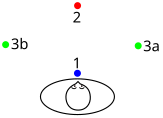

We focus on the description of loci in American Sign Language (ASL) and French Sign Language (LSF, for ‘*Langue des Signes Française*’), but these properties appear in a similar form across the large majority of sign languages. Singular pronouns are signed by directing the index finger towards a point in space; plural pronouns can be signed with a variety of strategies, including using the index finger to trace a semi-circle around an area of space, and are typically used to refer to groups of at least three entities. Other pronouns specify a precise number of participants with an incorporated numeral (e.g., dual, trial), and move between two or more points in space. In addition, some verbs, called ‘agreement verbs’, behave as if they contain a pronominal form in their realization, pertaining to the subject and/or to the object. For instance, *TELL* in ASL targets different positions depending on whether the object is second person (5a) or third person (5b).

**(5)**

An object agreement verb in ASL 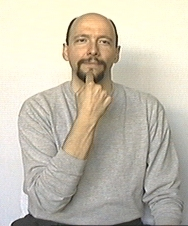 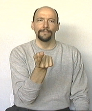 (a) I tell you. 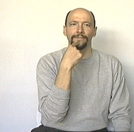 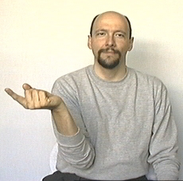 (b) I tell him/her *Credits:* © Dr. Bill Vicars: [TELL in ASL (description with short video clip, no audio)](https://www.lifeprint.com/asl101/pages-signs/t/tell.htm)

Loci often make it possible to disambiguate pronominal reference. For instance, the ambiguity of the example in (2) can be removed in LSF, where the sentence comes in two versions. In both, Sarkozy is assigned a locus on the signer’s left (by way of the index of the left hand held upright, ‘👆_{left}’ below), and Obama a locus on the right (using the index of the right hand held upright, ‘👆_{right}’ below). The verb *tell* in *he (Sarkozy) tells him (Obama)* is realized as a single sign linking the Sarkozy locus on the left to the Obama locus on the right (unlike the ASL version, which just displays object agreement, the LSF version displays both subject and object agreement: ‘_{left}TELL_{right}’ indicates that the sign moves from the Sarkozy locus on the left to the Obama locus on the right). If *he* refers to Sarkozy, the signer points towards the Sarkozy locus on the left (‘👉_{left}’); if *he* refers to Obama, the signer points towards the Obama locus on the right (‘👉_{right}’).

**(6)**

SARKOZY 👆_{left} OBAMA 👆_{right} _{left}TELL_{right} ‘Sarkozy told Obama… a. 👉_{left} WILL WIN ELECTION. that he, Sarkozy, would win the election.’

**b.**

👉_{right} WILL WIN ELECTION. that he, Obama, would win the election.’

In sign language linguistics, signs are transcribed in capital letters, as was the case above, and loci are encoded by way of letters (*a*, *b*, *c*, …), starting from the signer’s dominant side (right for a right-handed signer, left for a left-handed signer). The upward fingers used to establish positions for Sarkozy and Obama are called ‘classifiers’ and are glossed here as *CL* (with the conventions of Section 4.2. the gloss would be *PERSON-cl*; classifiers are just one way to establish the position of antecedents, and they are not essential here). Pronouns involving pointing with the index finger are glossed as *IX*. With these conventions, the sentence in (6) can be represented as in (7). (Examples are followed by the name of the language, as well as the reference of the relevant video when present in the original source; thus ‘LSF 4, 235’ indicates that the sentence is from LSF, and can be found in the video referenced as 4, 235.)

**(7)**

SARKOZY CL_{*b*} OBAMA CL_{*a*} *b*-TELL-*a* {IX-*b* / IX-*a*} WILL WIN ELECTION. ‘Sarkozy told Obama that he, {Sarkozy/Obama}, would win the election.’ (LSF 4, 235)

The ambiguity of quantified sentences such as (3) can also be removed in sign, as illustrated in an LSF sentence in (8).

**(8)**

DEPUTY_{*b*} SENATOR_{*a*} CL_{*b*}-CL_{*a*} IX-*b* *a*-TELL-*b* {IX-*a* / IX-*b*} WIN ELECTION ‘An MP_{*b*} told a senator_{*a*} that he_{*a*} / he_{*b*} (= the deputy) would win the election.’ (LSF 4, 233)

In light of these data, the claim of Logical Visibility is that sign language loci (when used—for they need not be) are an overt realization of logical variables.

One potential objection is that pointing in sign might be very different from pronouns in speech: after all, one points when speaking, but pointing gestures are not pronouns. However this objection has little plausibility in view of formal constraints that are shared between pointing signs and spoken language pronouns. For example, pronouns in speech are known to follow grammatical constraints that determine which terms can be used in which environments (e.g., the non-reflexive pronoun *her* when the antecedent is ‘far enough’ vs. the reflexive pronoun *herself* when the antecedent is ‘close enough’). Pointing signs obey similar rules, and enter into an established typology of cross-linguistic variation. For instance, the ASL reflexive displays the same kinds of constraints as the Mandarin reflexive pronoun in terms of what counts as ‘close enough’ (see Wilbur 1996; Koulidobrova 2009; Kuhn 2021)[^koulidobrova-2009][^kuhn-2021][^wilbur-1996].

It is thus generally agreed that pronouns in sign are part of the same abstract system as pronouns in speech. It is also apparent that loci play a similar function to logical variables, disambiguating antecedents and tracking reference. This being said, the claim that loci are a direct morphological spell-out of logical variables requires a more systematic evaluation of the extent to which sign language loci have the formal properties of logical variables. As a concrete counterpoint, one observes that gender features in English *also* play a similar function, disambiguating antecedents and tracking reference. For instance, *Joe Biden told Kamala Harris that he would be elected* has a rather unambiguous reading (*he* = *Biden),* while *Joe Biden told Kamala Harris that she would be elected* has a different one (*she* = *Harris*). Such parallels have led some linguists to propose that loci should best be viewed as grammatical features akin to gender features (Neidle et al. 2000; Kuhn 2016)[^kuhn-2016][^neidle-2000].

As it turns out, sign language loci seem to share some properties with logical variables, and some properties with grammatical features. On the one hand, the flexibility with which loci can be used seems closer to the nature of logical variables than to grammatical features. First, gender features are normally drawn from a finite inventory, whereas there seems to be no upper bound to the number of loci used except for reasons of performance. Second, gender features have a fixed form, whereas loci can be created ‘on the fly’ in various parts of signing space. On the other hand, loci may sometimes be disregarded in ways that resemble gender features. A large part of the debate has focused on sign language versions of sentences such as: *Only Ann did her homework*. This has a salient (‘bound variable’) reading that entails that Bill didn’t do **his** homework. In order to derive this reading, linguists have proposed that the gender features of the pronoun *her* must be disregarded, possibly because they are the result of grammatical agreement. Loci can be disregarded in the very same kind of context, suggesting that they are features, not logical variables (Kuhn 2016)[^kuhn-2016]. In light of this theoretical tension, a possible synthesis is that loci are a visible realization of logical variables, but mediated by a featural level (Schlenker 2018a)[^schlenker-2018a]. The debate continues to be relatively open.

While there has been much theoretical interest in cases in which reference is disambiguated by loci, this is usually an option, not an obligation. In ASL, for instance, it is often possible to realize pronouns by pointing towards a neutral locus that need not be introduced explicitly by nominal antecedents, and in fact several antecedents can be associated with this default locus. This gives rise to instances of referential ambiguity that are similar to those found in English in (2)–(3) above (see Frederiksen & Mayberry 2022; for an account that treats loci as corresponding to entire regions of signing space, and also allows for sign language pronouns without locus specification, see Steinbach & Onea 2016)[^frederiksen-2022][^steinbach-2016].

### 1.2 Time and world-denoting loci

Regardless of implementation, the flexible nature of sign language loci allows one to revisit foundational questions about anaphora and reference.

In the analysis of temporal and modal constructions in speech, there are two broad directions. One goes back to quantified tense logic and modal logic, and takes temporal and modal expressions of natural language to be fundamentally different from individual-denoting expressions: the latter involve the full power of variables and quantifiers, whereas no variables exist in the temporal and modal domain, although operators manipulate implicit parameters. The opposite view is that natural language has in essence the same logical vocabulary across the individual, the temporal and the modal domains, with variables (which may take different forms across different domains) and quantifiers that may bind them (see for instance von Stechow 2004)[^stechow-2004]. This second tradition was forcefully articulated by Partee (1973) for tense and Stone (1997) for mood. Partee’s and Stone’s argument was in essence that tense and mood have virtually all the uses that pronouns do. This suggests, theory-neutrally, that pronouns, tenses and moods have a common semantic core. With the additional assumption that pronouns should be associated with variables, this suggests that tenses and moods should be associated with variables as well, perhaps with time- and world-denoting variables, or with a more general category of situation-denoting variables.

As an example, pronouns can have a deictic reading on which they refer to salient entities in the context; if a person sitting alone with their head in their hands utters: *She left me*, one will understand that *she* refers to the person’s former partner. Partee argued that tense has deictic uses too. For instance, if an elderly author looks at a picture selected by their publisher for a forthcoming book, and says: *I wasn’t young*, one will understand that the author wasn’t young *when the picture was taken*. Stone similarly argued that mood can have deictic readings, as in the case of someone who, while looking at a high-end stereo in a store, says: *My neighbors would kill me*. The interpretation is that the speaker’s neighbors would (metaphorically) kill them “if the speaker bought the stereo and played it a ‘satisfying’ volume”, in Stone’s words. A wide variety of other uses of pronouns can similarly be replicated with tense and mood, such as cross-sentential binding with indefinite antecedents. (In the individual domain: *A woman will go to Mars. She [=the woman who goes to Mars] will be famous*. In the temporal domain: *I sometimes go to China. I eat Peking duck [=in the situations in which I visit China]*.)

While strong, these arguments are indirect because the *form* of tense and mood looks nothing like pronouns. In several sign languages, including at least ASL (Schlenker 2018a)[^schlenker-2018a] and Chinese Sign Language (Lin et al. 2021)[^lin-2021], loci provide a more direct argument because in carefully constructed examples, pointing to loci can be used not just to refer to individuals, but also to temporal and modal situations, with a meaning akin to that of the word *then* in English. It follows that the logical system underlying the ASL pronominal system (e.g., as variables) extends to temporal and modal situations.

A temporal example appears in (9). In the first sentence, *SOMETIMES WIN* is signed in a locus *a*. In the second sentence, the pointing sign *IX-a* refers back to the situations in which I win. The resulting meaning is that I am happy *in those situations in which I win*, not in general; this corresponds to the reading obtained with the word *then* in English: ‘then I am happy’. (Here and below, ‘re’ glosses raised eyebrows, with a line above the words over which eyebrow raising occurs.)

**(9)**

*Context:* Every week I play in a lottery. IX-1 [SOMETIMES WIN]_{*a*}. IX-*a*ʳᵉ IX-1 HAPPY. ‘Sometimes I win. Then I am happy.’ (ASL 7, 202)

Formally, *SOMETIMES* can be seen as an existential quantifier over temporal situations, so the first sentence is semantically existential: *there are situations in which I win*. The pointing sign thus displays cross-sentential anaphora, depending on a temporal existential quantifier that appears in a preceding sentence. A further point made by Chinese Sign Language (but not by the ASL example above) is that loci may be ordered on a temporal line, with the result that not just the loci but also their ordering can be made visible (Lin et al. 2021)[^lin-2021].

A related argument can be made about anaphoric reference to modal situations: in (10), the second sentence just asserts that there are possible situations in which I am infected, associating the locus *a* with situations of infection. The second sentence makes reference to them: in those situations (not in general), I have a problem. Here too, the reading obtained corresponds to a use of the word *then* in English.

**(10)**

FLU SPREAD. IX-1 POSSIBLE INFECTED_{*a*}. IX-*a*ʳᵉ IX-1 PROBLEM. ‘There was a flu outbreak. I might get infected. Then I have a problem.’ (ASL 7, 186)

In sum, temporal and modal loci make two points. First, theory-neutrally, the pointing sign can have both the use of English pronouns and of temporal and modal readings of the word *then*, suggesting that a single system of reference underlies individual, temporal and modal reference. Second, on the assumption that loci are the overt realization of some logical variables, sign languages provide a morphological argument for the existence of temporal and modal variables alongside individual variables.

### 1.3 Degree-denoting loci

In spoken language semantics, there is a related debate about the existence of degree-denoting variables. The English sentences *Ann is tall* and *Ann is taller than Bill* (as well as other gradable constructions) can be analyzed in terms of reference to degrees, for instance as in (11).

**(11)**

a. Ann is tall. *the maximal degree to which Ann is tall ≥ the threshold for ‘tall’*

**b.**

Ann is taller than Bill. *the maximal degree to which Ann is tall ≥ the maximal degree to which Bill is tall*

To say that one *can* analyze the meaning in terms of reference to degrees doesn’t entail that one must (for discussion, see Klein 1980)[^klein-1980]. And even if one posits quantification over degrees, a further question is whether natural language has counterparts of pronouns that refer to degrees—if so, one would have an argument that natural language is committed to degrees. Importantly, this debate is logically independent from that about the existence of time- and world-denoting pronominals, as one may consistently believe that there are pronominals in one domain but not in the other. The question must be asked anew, and here too sign language brings important insights.

Degree-denoting pronouns exist in some constructions of Italian Sign Language (LIS; Aristodemo 2017)[^aristodemo-2017]. In (12), the movement of the sign *TALL* ends at a particular location on the vertical axis (which we call α, to avoid confusion with the Latin characters used for individual loci in the horizontal plane), which intuitively represents Gianni’s degree of height. In the second sentence, the pronoun points towards this degree-denoting locus, and the rest of the sentence characterizes this degree of height.

**(12)**

GIANNI TALL$_{\alpha}$. IX-$\alpha$ 1 METER 70 ‘Gianni is tall. His height is 1.70 meters.’ (Aristodemo 2017: example 2.23)[^aristodemo-2017]

More complicated examples can be constructed in which *Ann is taller than Bill* makes available two degree-denoting loci, one corresponding to Ann’s height and the other to Bill’s.

In sum, some constructions of LIS provide evidence for the existence of degree-denoting pronouns in sign language, which in turn suggests that natural language is sometimes committed to the existence of degrees. And if one grants that loci are the realization of variables, one obtains the further conclusion that natural language has at least some degree-denoting variables. (It is a separate question whether all languages *avail* themselves of degree variables; see Beck et al. 2009 for the hypothesis that this is a parameter of semantic variation.)[^beck-2009]

Finally, we observe that, unlike the examples of individual-denoting pronouns seen so far, the placement of degree pronouns along a particular axis is semantically interpreted, reflecting the total ordering of their denotations: not only are degrees visibly realized, but so is their ordering (see also Section 1.3 regarding the ordering on temporal loci on timelines in Chinese Sign Language, and Section 3.4 for a discussion of a structural iconicity).

In sum, loci have been argued to be the overt realization of individual, time, world, and degree variables. If one grants this point, it follows that sign language is ontologically committed to these object types. But the debate is still ongoing, with alternatives that take loci to be similar to features rather than to variables. Let us add that the loci-as-variable analysis has offered a new argument in favor of dynamic semantics, where a variable can depend on a quantifier without being in its syntactic scope; see the [supplement on Dynamic Loci](sign-language-semantics.dynamic-loci.md).

## 2. Logical Visibility II: Beyond Loci

There are further cases in which sign language arguably makes visible some components of Logical Forms that are not always overt in spoken language.

### 2.1 Telicity

Semanticists traditionally classify event descriptions as *telic* if they apply to events that have a natural endpoint determined by that description, and they call them *atelic* otherwise. *Ann arrived* and *Mary understood* have such a natural endpoint, e.g., the point at which Ann reached her destination, and that at which Mary saw the light, so to speak: *arrive* and *understand* are telic. By contrast, *Ann waited* and *Mary thought* lack such natural endpoints: *wait* and *think* are atelic. As a standard test (e.g., Rothstein 2004)[^rothstein-2004], a temporal modifier of the form *in X time* modifies telic VPs while *for X time* modifies atelic VPs (e.g., *Ann arrived in five minutes* vs. *Ann waited for five minutes*, *Mary understood in a second* vs. *Mary thought for a second*).

Telicity is a property of predicates (i.e., verbs complete with arguments and modifiers), not of verbs themselves. Whether a predicate is telic or atelic may thus result from a variety of different factors; these include adverbial modifiers that explicitly identify an endpoint—*run 10 kilometers (in an hour)* is telic, but *run back and forth (for an hour)* is atelic—and properties of the nominal arguments—*eat an apple (in two minutes)* is telic whereas *eat lentil soup (for two minutes)* is atelic. But telicity also depends on properties of the lexical semantics of the verb itself, as illustrated by the intransitive verbs above, as well as transitive examples like *found a solution (in an hour)* versus *look for a solution (for an hour)*. In work on spoken language, some theorists have posited that these lexical factors can be explained by a morphological decomposition of the verb, and that inherently telic verbs like *arrive* or *find* include a morpheme that specifies the endstate resulting from a process (Pustejovsky 1991; Ramchand 2008)[^pustejovsky-1991][^ramchand-2008]. This morpheme has been called various things in the literature, including ‘EndState’ (Wilbur 2003)[^wilbur-2003] and ‘Res’ (Ramchand 2008)[^ramchand-2008].

In influential work, Wilbur (2003, 2008; Wilbur & Malaia 2008)[^wilbur-2008][^wilbur-2008-2] has argued that the lexical factors related to telicity are often realized overtly in the phonology of several sign languages: inherently telic verbs tend to be realized with sharp sign boundaries; inherently atelic verbs are realized without them (Wilbur 2003, 2008; Wilbur & Malaia 2008)[^wilbur-2003][^wilbur-2008][^wilbur-2008-2]. For instance, the ASL sign *ARRIVE* involves a sharp deceleration, as one hand makes contact with the other, as shown in (13).

**(13)**

ARRIVE in ASL (telic)  [Short video clip of ARRIVE (ASL), no audio ](https://www.signingsavvy.com/sign/ARRIVE/12/1) *Picture credits:* Valli, Clayton: 2005, *The Gallaudet Dictionary of American Sign Language*, Gallaudet University Press.

In contrast, *WAIT* is realized with a trilled movement of the fingers and optional circular movement of the hands, without a sharp boundary:

**(14)**

WAIT in ASL (atelic) 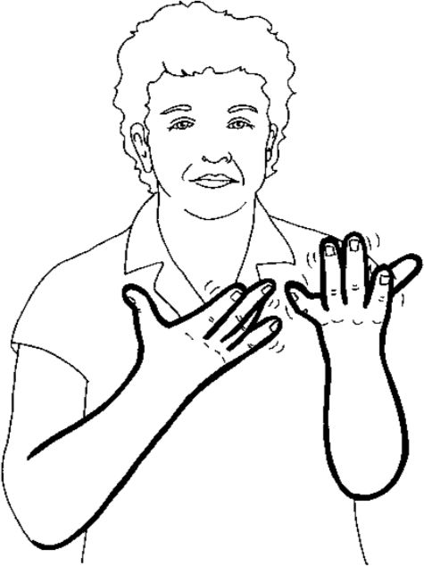 [Short video clip of WAIT (ASL), no audio](https://www.signingsavvy.com/sign/wait/463/4) *Picture credits:* Valli, Clayton: 2005, *The Gallaudet Dictionary of American Sign Language*, Gallaudet University Press.

Similarly, in LSF *UNDERSTAND*, which is telic, is realized with three fingers forming a tripod that ends up closing on the forehead; the closure is realized quickly, and thus displays a sharp boundary. By contrast, *REFLECT,* which is atelic, is realized by the repeated movement of the curved index finger towards the temple, without sharp boundaries.

**(15)**

a. UNDERSTAND (LSF) 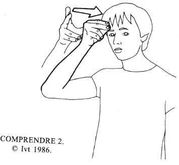 [Short video clip of UNDERSTAND (LSF), no audio](https://www.elix-lsf.fr/spip.php?page=signes&id_article=146439&lang=fr)

**b.**

REFLECT (LSF) 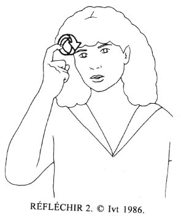 [Short video clip of REFLECT (LSF), no audio](https://www.elix-lsf.fr/spip.php?page=signes&id_article=206984&lang=fr)

Wilbur (2008) posits that in ASL and other sign languages, this phonological cue, the “rapid deceleration of the movement to a complete stop”, is an overt manifestation of the morpheme EndState, yielding inherently telic lexical predicates. If Wilbur’s analysis is correct, this is another possible instance of visibility of an abstract component of Logical Forms that is not usually overt in spoken languages. An alternative is that an abstract version of iconicity is responsible for this observation (Kuhn 2015)[^kuhn-2015], as we will see in Section 3.2.

It is also possible that the analysis of this phonological cue varies across languages. Of note, both ASL and LSF have exceptions to the generalization (Davidson et al. 2019)[^davidson-2019], for example ASL *SLEEP* is atelic but ends with deceleration and contact between the fingers; LSF *RESIDE* is similarly atelic but ends with deceleration and contact. In contrast, in Croatian Sign Language (HZJ), endmarking appears to be a regular morphological process, allowing a verb stem to alternate between an end-marked and non-endmarked form (Milković 2011)[^milković-2011].

### 2.2 Context shift

In the classic analysis of indexicals developed by Kaplan (1989), the value of an indexical (words like *I*, *here*, and *now*) is determined by a context parameter that crucially doesn’t interact with time and world operators (in other words, the context parameter is not shiftable). The empirical force of this idea can be illustrated by the distinction between *I*, an indexical, and *the person speaking*, which is indexical-free. *The speaker is always late* may, on one reading, refer to different speakers in different situations because *speaker* can be evaluated relative to a time quantified by *always*. Similarly, *The speaker must be late* can be uttered even if one has no idea who the speaker is supposed to be; this is because *speaker* can be evaluated relative to a world quantified by *must*. By contrast, *I am always late* and *I must be late* disallow such a dependency because *I* is dependent on the context parameter alone, not on time and world quantification. This analysis raises a question: are there any operators that can manipulate the context of evaluation of indexicals? While such operators can be defined for a formal language, Kaplan famously argued that they do not exist in natural language and called them, for this reason, ‘monsters’.

Against this claim, an operator of ‘context shift’ (a Kaplanian monster) has been argued to exist in several spoken languages (including Amharic and Zazaki). The key observation was that some indexicals can be shifted in the scope of some attitude verbs, and in the absence of quotation (e.g., Anand & Nevins 2004; Anand 2006; Deal 2020)[^anand-2004][^anand-2006][^deal-2020]. Schematically, in such languages, *Ann says that I am a hero* can mean that Ann says that she herself is a hero, with *I* interpreted from Ann’s perspective. Several researchers have argued that context shift can be overt in sign language, and realized by an operation called ‘Role Shift’, whereby the signer rotates her body to adopt the perspective of another character (Quer 2005, 2013; Schlenker 2018a)[^quer-2005][^quer-2013][^schlenker-2018a].

A simple example involves the sentence WIFE SAY **IX-2 FINE**, where the boldfaced words are signed from the rotated position, illustrated below. As a result, the rest of the sentence is interpreted from the wife’s perspective, with the consequence that the second person pronoun *IX-2* refers to whoever the wife is talking to, and not the addressee of the signer.

**(16)**

An example of Role Shift in ASL (*Credits:* Lillo-Martin 2012)[^lillo-martin-2012] 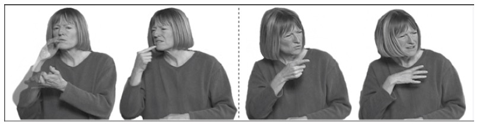 WIFE SAY **IX-2 FINE**

Role Shift exists in several languages, and in some cases (notably in Catalan and German sign languages [Quer 2005; Herrmann & Steinbach 2012])[^herrmann-2012][^quer-2005], it has been argued not to involve mere quotation. On the context-shifting analysis of Role Shift (e.g., Quer 2005, 2013)[^quer-2005][^quer-2013], the point at which the signer rotates her body corresponds to the insertion of a context-shifting operator C, yielding the representation: WIFE SAY C [**IX-2 FINE**]. The boldfaced words are signed in rotated position and are taken to be interpreted in the scope of C.

Interestingly, Role Shift differs from context-shifting operations described in speech in that it can be used outside of attitude reports (to distinguish the two cases, researchers use the term ‘Attitude Role Shift’ for the case we discussed before, and ‘Action Role Shift’ for the non-attitudinal case). For example, if one is talking about an angry man who has been established at locus *a*, one can use an English-strategy and say *IX-a WALK-AWAY* to mean that he walked away. But an alternative possibility is to apply Role Shift after the initial pointing sign, and say the following (with the operator *C* realized by the signer’s rotation):

**(17)**

IX-*a* C [**1-WALK-AWAY**].

Here *1-WALK-AWAY* is a first person version of ‘walk away’, but the overall meaning is just that the angry person associated with locus *a* walked away. By performing a body shift and adopting that person’s position to sign *1-WALK-AWAY*, the signer arguably makes the description more vivid.

Importantly, in ASL and LSF, Role Shift interacts with iconicity. Attitude Role Shift has, at a minimum, a strong quotational component. For instance, angry facial expressions under Role Shift must be attributed to the attitude holder, not to the signer (Schlenker 2018a)[^schlenker-2018a]. This observation extends to ASL and LSF Action Role Shift: disgusted facial expressions under Action Role Shift are attributed to the agent rather than to the signer.

As in other cases of purported Logical Visibility, the claim that Role Shift is the visible reflex of an operation that is covert in speech has been challenged. In the analysis of Davidson (2015, following Supalla 1982)[^supalla-1982], Role Shift falls under the category of classifier predicates, specific constructions of sign language that are interpreted in a highly iconic fashion (we discuss them in Section 4). What is special about Role Shift is that the classifier is not signed with a hand (as other classifiers are), but with the signer’s own body. The iconic nature of this classifier means that properties of role-shifted expressions that can be iconically assigned to the described situation must be. For Attitude Role Shift, the analysis essentially derives a quotational reading via a demonstration—for our example above, something like: *My wife said this, “You are fine”*. Cases of Attitude Role Shift that have been argued not to involve standard quotation ( in Catalan and German sign language) require refinements of the analysis. For Action Role Shift, the operation has the effect of demonstrating those parts of signs that are not conventional, yielding in essence: *He walked away like this,* where *this* refers to all iconically interpretable components of the role-shifted construction (including the signer’s angry expression, if applicable).

Debates about Role Shift have two possible implications. On one view, Role Shift provides overt evidence for context shift, and extends the typology of Kaplanian monsters beyond spoken languages and beyond attitude operators (due to the existence of Action Role Shift alongside Attitude Role Shift). On the alternative view developed by Davidson, Role Shift suggests that some instances of quotation should be tightly connected to a broader analysis of iconicity owing to the similarity between Attitude Role Shift an Action Shift.

In sum, it has been argued that telicity and context shift can be overtly marked in sign language, hence instances of Logical Visibility beyond loci, but alternative accounts exist as well. Let us add that there are cases of Logical *non*-visibility, in which logical elements that are often overt in speech can be covert in sign. See the [supplement on Coordination](sign-language-semantics.coordination.md) for the case of an ASL construction ambiguous between conjunction and disjunction.

## 3. Iconicity I: Optional Iconic Modulations

On a standard (Saussurean) view, language is made of discrete conventional elements, with iconic effects at the margins. Sign languages cast doubt on this view because iconicity interacts in complex and diverse ways with grammar.

By iconicity, we mean a rule-governed way in which an expression denotes something by virtue of its resemblance to it, as is for instance the case of a photograph of a cat, or of a vocal imitation of a cat call. By contrast, the conventional word *cat* does not refer by resembling cats. There are also mixed cases in which an expression has both a conventional and an iconic component.

In this section and the next, we survey constructions that display optional or obligatory iconicity in sign, and call for the development of a formal semantics with iconicity. As we will see, some purported cases of Logical Visibility might be better analyzed as more or less abstract versions of iconicity, with the result that several phenomena discussed above can be analyzed from at least two theoretical perspectives.

### 3.1 Iconic modulations

As in spoken language, it is possible to modulate some conventional words in an iconic fashion. In English, *the talk was looong* suggests that the talk wasn’t just long but *very* long. Similarly, the conventional verb *GROW* in ASL can be realized more quickly to evoke a faster growth, and with broader endpoints to suggest a larger growth, as is illustrated below (Schlenker 2018b)[^schlenker-2018b]. There are multiple potential levels of speed and endpoint breadth, which suggests that a rule is genuinely at work in this case.

**(18)**

Different iconic modulations of the sign *GROW* in ASL (*Picture credits:* M. Bonnet) **Slow movement** **Fast movement** Narrow endpoints 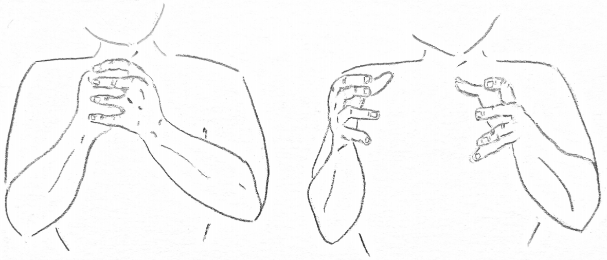 small amount, slowly small amount, quickly Medium endpoints 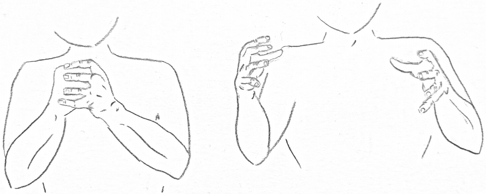 medium amount, slowly medium amount, quickly Broad endpoints 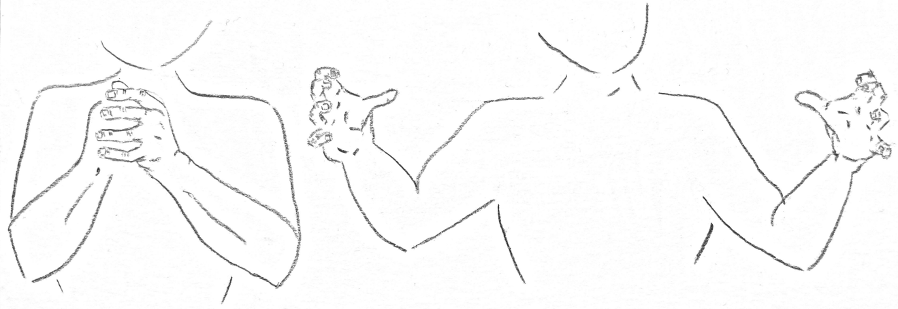 large amount, slowly large amount, quickly

In English, iconic modulations can arguably be at-issue and thus interpreted in the scope of grammatical operators. An example is the following sentence: *If the talk is loooong*, *I’ll leave before the end*. This means that if the talk is very long, I’ll leave before the end (but if it’s only moderately long, maybe not); here, the iconic contribution is interpreted in the scope of the *if-*clause, just like normal at-issue contributions. The iconic modulation of *GROW* has similarly been argued to be at-issue (Schlenker 2018b)[^schlenker-2018b]. (See Section 5.2 for further discussion on the at-issue vs. non-at-issue semantic contributions.)

While conceptually similar to iconic modulations in English, the sign language versions are arguably richer and more pervasive than their spoken language counterparts.

### 3.2 Event structure

Iconic modulation interacts with the marking of telicity noticed by Wilbur (Section 2.1). *GROW*, discussed in the preceding sub-section, is an (atelic) degree achievement; the iconic modifications above indicate the final degree reached and the time it took to reach that degree. Similarly, for telic verbs, the speed and manner in which the phonological movement reaches its endpoint can indicate the speed and manner in which the result state is reached. For example, if LSF *UNDERSTAND* is realized slowly and then quickly, the resulting meaning is that there was a difficult beginning, and then an easier conclusion. Atelic verbs that don’t involve degrees can also be iconically modulated; for instance, if LSF *REFLECT* is signed slowly and then quickly, the resulting meaning is that the person’s reflection intensified. Here too, the iconic contribution has been argued to be at-issue (Schlenker 2018b)[^schlenker-2018b].

There are also cases in which the event structure is not just specified but radically altered by a modulation, as in the case of incompletive forms (also called unrealized inceptive, Liddell 1984; Wilbur 2008)[^liddell-1984][^wilbur-2008][^wilbur-2008-2]. ASL *DIE*, a telic verb, is expressed by turning the dominant hand palm-down to palm-up as shown below (the non-dominant hand turns palm-up to palm-down). If the hands only turn partially, the sign is roughly interpreted as ‘almost die’.

**(19)**

Normal vs. incompletive form of *DIE* in ASL (*Credits:* J. Kuhn)  a. DIE in ASL  b. ALMOST-DIE in ASL

Similarly to the fact that multiple levels of speed and size can be indicated by the verb *GROW* in (18), the incompletive form of verbs can be modulated to indicate arbitrarily many degrees of completion, depending on how far the hand travels; these examples thus seem to necessitate an iconic rule (Kuhn 2015)[^kuhn-2015]. On the other hand, while the examples with *GROW* can be analyzed by simple predicate modification (‘The group grew and it happened like this: slowly’), examples of incompletive modification require a deeper integration in the semantics, similar to the semantic analysis of the adverb *almost* or the progressive aspect in English. (Notably, it’s nonsense to say: ‘My grandmother died and it happened like this: incompletely.’)

The key theoretical question lies in the integration between iconic and conventional elements in such cases. If one posits a decompositional analysis involving a morpheme representing the endstate (*EndState* or *Res*, see Section 2.1), one must certainly add to it an iconic component (with a non-trivial challenge for incompletive forms, where the iconic component does not just specify but radically alters the lexical meaning). Alternatively, one may posit that a structural form of iconicity is all one needs, without morphemic decomposition. An iconic analysis along these lines has been proposed (Kuhn 2015: Section 6.5)[^kuhn-2015], although a full account has yet to be developed.

### 3.3 Plurals and pluractionals

The logical notion of plurality is expressed overtly in some way in many of the world’s languages: pluralizing operations may apply to nouns or verbs to indicate a plurality of objects or events (for nouns: ‘plurals’; for verbs: ‘pluractionals’). Historically, arguments of Logical Visibility have not been made for plurals in sign languages, since—while overt plural marking certainly exists in sign language—plural morphemes also appear overtly in spoken languages (e.g., English singular *horse* vs. plural *horses*).

Nevertheless, mirroring areas of language in which arguments of Logical Visibility *do* apply, plural formation in sign language shows a number of unique and revealing properties. First, the morphological expression of this logical concept is similar for both nouns and verbs across a large number of unrelated sign languages: for both plural nouns (Pfau & Steinbach 2006)[^pfau-2006] and pluractional verbs (Kuhn & Aristodemo 2017)[^aristodemo-2017][^kuhn-2017], plurality is expressed by repetition. We note that repetition-based plurals and pluractionals also exist in speech (Sapir 1921: 79)[^sapir-1921].

Second, in sign language, these repeated plural forms have been shown to feed iconic processes. Modifications of the way in which the sign is repeated may indicate the number of objects or events, or may indicate the arrangement of these pluralities in space or time. Relatedly, so-called ‘punctuated’ repetitions (with clear breaks between the iterations) refer to precise plural quantities (e.g., three objects or events for three iterations), while ‘unpunctuated’ repetitions (without clear breaks between the iterations) refer to plural quantities with vague thresholds, and often ‘at least’ readings (Pfau & Steinbach 2006; Schlenker & Lamberton 2022)[^pfau-2006][^schlenker-2022].

In the nominal domain, the number of repetitions may provide an indication of the number of objects, and the arrangement of the repetitions in signing space can provide a pictorial representation of the arrangement of the denotations in real space (Schlenker & Lamberton 2022)[^schlenker-2022]. For instance, the word *TROPHY* can be iterated three times on a straight line to refer to a group of trophies that are horizontally arranged; or the three iterations can be arranged as a triangle to refer to trophies arranged in a triangular fashion. A larger number of iterations serves to refer to larger groups. Here too, the iconic contribution can be at-issue and thus be interpreted in the scope of logical operators such as *if*-clauses.

**(20)**

a. *TROPHY* in ASL, repetition on a line: 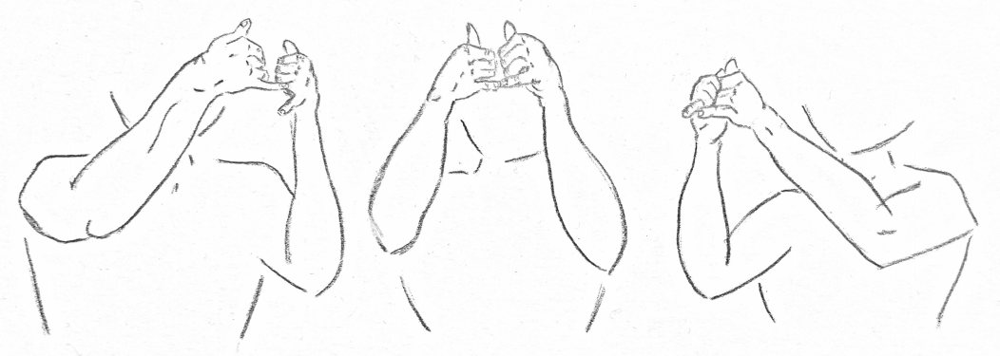

**b.**

*TROPHY* in ASL, repetition as a triangle: 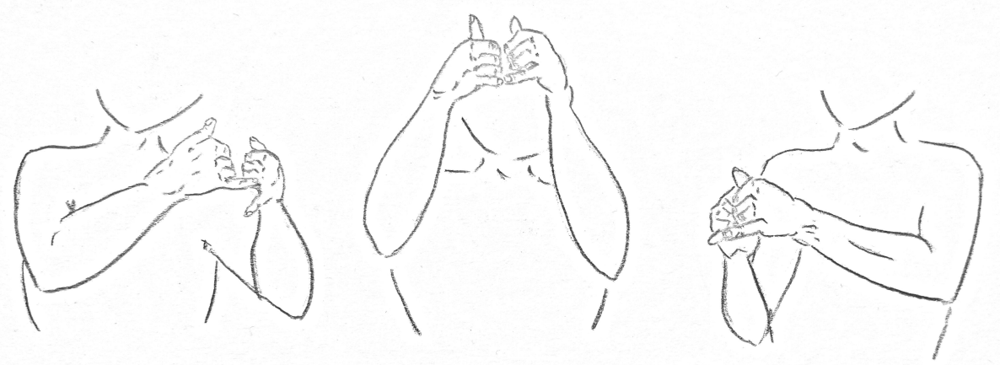

Punctuated (= easy to count) repetitions yield meanings with precise thresholds (often with an ‘exactly’ reading, e.g., ‘exactly three trophies’ for three punctuated iterations); unpunctuated repetitions yield vague thresholds and often ‘at least’ readings (e.g., ‘several trophies’ for three unpunctuated iterations). While one may take the distinction to be conventional, it might have an iconic source. In essence, unpunctuated iterations result in a kind of pictorial vagueness on which the threshold is hard to discern; deriving the full range of ‘exactly’ and ‘at least’ readings is non-trivial, however (Schlenker & Lamberton 2022)[^schlenker-2022].

In the verbal domain, pluractionals (referring to pluralities of events) can be created by repeating a verb, for instance in LSF and ASL. A complete analysis seems to require both conventionalized grammatical components and iconic components. The form of reduplication—as identical reduplication or as alternating two-handed reduplication—appears to conventionally communicate the distribution of events with respect to either time or to participants. But a productive iconic rule also appears to be involved, as the number and speed of the repetitions gives an idea of the number and speed of the denoted events (Kuhn & Aristodemo 2017)[^aristodemo-2017][^kuhn-2017]; again, the iconic contribution can be at-issue.

Iconic plurals and pluractionals alike are now treated by way of mixed lexical entries that include a grammatical/logical component and an iconic component. For instance, if *N* is a (singular) noun denoting a set of entities *S*, then the iconic plural *N*-rep denotes the set of entities *x* such that:

1. *x* is the sum of atomic elements in *S* (i.e., $x \in *S$), and
2. the form of *N*-rep iconically represents *x*.

Condition (i) is the standard definition of a plural; condition (ii) is the iconic part, which is itself in need of an elucidation using general tools of pictorial semantics (see Section 4).

### 3.4 Iconic loci

Loci, which have been hypothesized to be (sometimes) the overt realization of variables, can lead a dual life as iconic representations. Singular loci may (but need not) be simplified pictures of their denotations: if so, a person-denoting locus is a structured area *I*, and pronouns are directed towards a point *i* that corresponds to the upper part of the body. In ASL, when the person is tall, one can thus point upwards (there are also metaphorical cases in which one points upwards because the person is powerful or important). When a person is understood to be in a rotated position, the direction of the pronoun correspondingly changes, as seen in (21) for a person standing upright or hanging upside down (Schlenker 2018a; see also Liddell 2003)[^liddell-2003][^schlenker-2018a].

**(21)**

An iconic locus schematically representing an upright person (left) or upside down person (right) 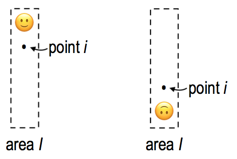

Iconic mappings involving loci may also preserve abstract structural relations that have been posited to exist for various kinds of ontological objects, including mereological relations, total orderings, and domains of quantification.

First, two plural loci—indexed over areas of space—may (but need not) express mereological relations diagrammatically, with a locus *a* embedded in a locus *b* if the denotation of *a* is a mereological part of the denotation of *b* (Schlenker 2018a)[^schlenker-2018a]. For example, in (22), the ASL expression *POSS-1 STUDENT* (‘my students’) introduces a large locus (glossed as *ab* to make it clear that it contains subloci *a* and *b*—but initially just a large locus). *MOST* introduces a sublocus *a* within this large locus because the plurality denoted by *a* is a proper part of that denoted by *ab*. And critically, diagrammatic reasoning also makes available a third discourse referent: when a plural pronoun points towards *b*—the complement of the sublocus *a* within the large locus *ab*—the sentence is acceptable, and *b* is understood to refer to the students who did *not* come to class.

**(22)**

POSS-1 STUDENT IX-arc-*ab* MOST IX-arc-*a* *a*-COME CLASS. IX-arc-*b* *b*-STAY HOME. ‘Most of my students came to class. They stayed home.’ (ASL, 8, 196)

**(23)**

In English, the plural pronoun *they* clearly lacks such a reading when one says, *Most of my students came to class. They stayed home*, which sounds contradictory. (One can communicate the target interpretation by saying, *The others stayed home*, but *the others* is not a pronoun.) Likewise, in ASL, if the same discourse is uttered using default, non-localized plural pronouns, the pattern of inferences is exactly identical to the English translation.

A second case of preservation of abstract orders pertains to degree-denoting and sometimes time-denoting loci. In LIS, degree-denoting loci are represented iconically, with the total ordering mapped to an axis in space, as described in Section 1.3. Time-denoting loci may but need not give rise to preservation of ordering on an axis, depending on whether normal signing space is used (as in the ASL examples (9) above), or a specific timeline, as mentioned in Section 1.2 in relation to Chinese Sign Language. As in the case of diagrammatic plural pronouns, the spatial ordering of degree- and time-denoting loci generates an iconic inference—beyond the meaning of the words themselves—about the relative degree of a property or temporal order of events.

A third case involves the partial ordering of domain restrictions of nominal quantifiers: greater height in signing space may be mapped to a larger domain of quantification, as is the case in ASL (Davidson 2015)[^davidson-2015] and at least indefinite pronouns in Catalan Sign Language (Barberà 2015)[^barberà-2015].

## 4. Iconicity II: Classifier Predicates

### 4.1 The demonstrative analysis of classifier predicates

A special construction type, classifier predicates (‘classifiers’ for short), has raised difficult conceptual questions because they involve a combination of conventional and iconic meaning. Classifier predicates are lexical expressions that refer to classes of animate or inanimate entities that share some physical characteristics—e.g., objects with a flat surface, cylindrical objects, upright individuals, sitting individuals, etc. Their form is conventional; for instance, the ASL ‘three’ handshape, depicted below, represents a vehicle. But their position, orientation and movement in signing space is interpreted iconically and gradiently (Emmorey & Herzig 2003)[^emmorey-2003], as illustrated in the translation of the example below.

**(24)**

CAR CL-vehicle-DRIVE-BY. (ASL, Valli and Lucas 2000) 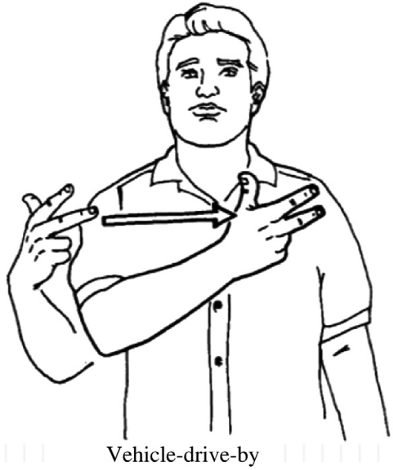 ‘A car drove by [with a movement resembling that of the hand]

These constructions have on several occasions been compared to gestures in spoken language, especially to gestures that fully replace some words, as in: *This airplane is about to FLY-take-off*, with the verb replaced with a a hand gesture representing an airplane taking off. But there is an essential difference: classifier predicates are stable parts of the lexicon, gestures are not.

Early semantic analyses, notably by Zucchi 2011 and Davidson 2015, took classifier predicates to have a self-referential demonstrative component, with the result that the moving vehicle classifier in (24) means in essence ‘move like this’, where ‘this’ makes reference to the very form of the classifier movement. As mentioned in Section 2.2, this analysis has been extended to Role Shift by Davidson (Davidson 2015)[^davidson-2015], who took the classifier to be in this case the signer’s rotated body.

### 4.2 The pictorial analysis of classifier predicates

The demonstrative analysis of classifier predicates as stated has two general drawbacks. First, it establishes a natural class containing classifiers and demonstratives (like English *this*), but the two phenomena possibly display different behaviors. Notably, while demonstratives behave roughly like free variables that can pick up their referent from any of a number of contextual sources, the iconic component of classifiers can only refer to the position/movement and configuration of the hand (any demonstrative variable is thus immediately saturated). Second, the demonstrative analysis currently relegates the iconic component to a black box. Without any interpretive principles on what it means for an event to be ‘like’ the demonstrated representation, one cannot provide any truth conditions for the sentence as a whole.

Any complete analysis must thus develop an explicit semantics for the iconic component. This is more generally necessary to derive explicit truth conditions from other iconic constructions in sign language, such as the repetition-based plurals discussed in Section 3.3. above: in the metalanguage, the condition *[a certain expression] iconically represents [a certain object]* was in need of explication.

A recent model has been offered by formal pictorial semantics, developed by Greenberg and Abusch (e.g., Greenberg 2013, 2021; Abusch 2020)[^abusch-2020][^greenberg-2013][^greenberg-2021]. The basic idea is that a picture obtained by a given projection rule (for instance, perspective projection) is true of precisely those situations that can project onto the picture. Greenberg has further extended this analysis with the notion of an object projecting onto a picture part (in addition to a situation projecting onto a whole picture). This notion proves useful for sign language applications because they usually involve partial iconic representations, with one iconic element representing a single object or event in a larger situation. To illustrate, below, the picture in (25a) is true of the situation in (25b), and the left-most shape in the picture in (25a) denotes the top cube in the situation in (25b).

**(25)**

Illustration of a projection rule relating (parts of) a picture to (objects in) a world. (*Credits:* Gabriel Greenberg) 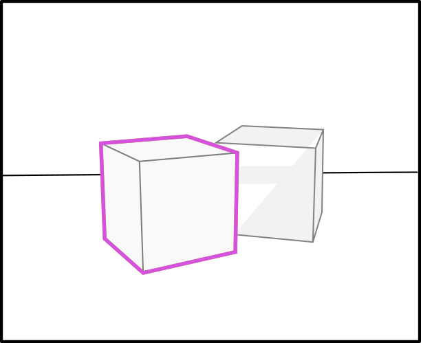 (a) Picture  (b) Situation

The full account makes reference to a notion of viewpoint relative to which perspective projection is assessed, and a picture plane, both represented in (25b). This makes it possible to say that the top cube (top-cube) projects onto the left-hand shape (left-shape) relative to the viewpoint (call it π), at the time *t* and in the world *w* in which the projection is assessed. In brief:

$$ \textrm{proj}(\textrm{top-cube}, \pi, t, w) = \textrm{left-shape}. $$

Classifier predicates (as well as other iconic constructions, such as repetition-based plurals) may be analyzed with a version of pictorial semantics to explicate the truth-conditional contribution of iconic elements.

To illustrate, consider a pair of minimally different words in ASL that can be translated as ‘airplane’: one is a normal noun, glossed as *PLANE*, and the other is a classifier predicate, glossed below as *PLANE-cl*. Both forms involve the handshape in (26), but the normal noun includes a tiny repetition (different from that of plurals) which is characteristic of some nominals in ASL. As we will see, the position of the classifier version is interpreted iconically (‘an airplane in position such and such’), whereas the nominal version need not be.

**(26)**

Handshape for both (i) ASL *PLANE* (= nominal version) and (ii) ASL *PLANE-cl* (= classifier predicate version). (*Credits:* J. Kuhn) 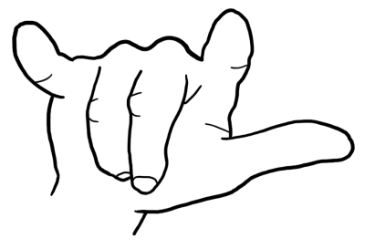

Semantically, the difference between the two forms is that only the classifier generates obligatory iconic inferences about the plane’s configuration and movement. This has clear semantic consequences when several classifier predicates occur in the same sentence. In (27b), two tokens of *PLANE-cl* appear in positions *a* and *b*, and as the video makes clear, the two classifiers are signed close to each other and in parallel. As a result, the sentence only makes an assertion about cases in which two airplanes take off next to each other or side by side. In contrast, with a normal noun in (27a), the assertion is that there is danger whenever two airplanes take off at the same time, irrespective of how close the two airplanes are, or how they are oriented relative to each other.

**(27)**

HERE ANYTIME __ SAME-TIME TAKE-OFF, DANGEROUS. ‘Here, whenever ___ take off at the same time, there is danger.’ a. ⁷PLANE_{*a*} PLANE_{*b*} ‘two planes’

**b.**

⁷PLANE-cl_{*a*} PLANE-cl_{*b*} ‘two planes side by side/next to each other’

To capture these differences, one can posit the following lexical entries for the normal noun and for its classifier predicate version. Importantly, the interpretation of *PLANE-cl* in (28b) is defined for a particular token of the sign (not a type), produced with a phonetic realization Φ.

**(28)**

For a context *c*, time of evaluation *t* and world of evaluation *w*: a. PLANE, normal noun [[PLANE]] ^{*c,t,w*} = $\lambda x_{e}$ . plane'_{*t,w*}(*x*)

**b.**

PLANE-cl$_{\Phi}$, classifier predicate [token with phonetic realization $\Phi$] [[PLANE-cl$_{\Phi}$]]^{*c,t,w*} = $\lambda x_{e}$ . plane'_{*t,w*}(x) and $\boldsymbol{\textbf{proj}(x, \pi_{c}, t, w) = \Phi}$

Evaluation is relative to a context c that provides the viewpoint, $\pi_{c}$. In the lexical entry for the normal noun in (28a), plane'_{*t,w*} is a (metalanguage) predicate of individuals that applies to anything that is an airplane at *t* in *w*. The classifier predicate has the lexical entry in (28b). It has the same conventional component as the normal noun, but adds to it an (iconic) projective condition: for a token of the predicate *PLANE-cl* to be true of an object *x*, *x* should project onto this very token.

### 4.3 Comparison and refinements

With this pictorial semantics in hand, we can make a more explicit comparison to the demonstrative analysis of classifiers. As described above, a demonstrative analysis takes classifiers to include a component of meaning akin to ‘move like this’. For Zucchi, this is spelled out via a lexical entry very close to the one in (28), but in which the second clause (in terms of projection above) is instead a similarity function, asserting that the position of the denoted object *x* is ‘similar’ to that of the airplane classifier; the proposal, however, leaves it entirely open what it means to be ‘similar’. Of course, one may supplement the analysis with a separate explication in which similarity is defined in terms of projection, but this move presupposes rather than replaces an explicit pictorial account. In other words, the demonstrative analysis relegates the iconic component to a black box, whose content can be specified by the pictorial analysis. But once a pictorial analysis is posited, it become unclear why one should make a detour through the demonstrative component, rather than posit pictorial lexical entries in the first place.

A number of further refinements need to be made to any analysis of classifiers. First, to have a fully explicit iconic semantics, one must contend with several differences between classifiers and pictures.

1. Classifier predicates have a conventional shape; only their position, orientation and movement is interpreted iconically (sometimes modifications of the conventional handshape can be interpreted iconically as well). This requires projection rules with a partly conventional component (of the type: a certain symbol appears in a certain position of the picture if an object of the right types projects onto that position).
2. Many classifier predicates are dynamic (in the sense of involving movement) rather than static; this requires the development of a semantics for visual animations.
3. Sign language classifiers are not two-dimensional pictures, but rather 3D representations. One can think of them as puppets whose shape needn’t be interpreted literally, but whose position, orientation and movement can be iconically precise. This requires formal means that go beyond pictorial semantics.

The interaction between iconic representations and the sentences they appear in also requires further refinements. A first refinement pertains to the semantics. For simplicity, we assumed above that the viewpoint relative to which the iconic component of classifier predicates is evaluated is fixed by the context. Notably, though, in some cases, viewpoint choice can be dependent on a quantifier. In the example below, the meaning obtained is that in all classes, during the break, *for some salient viewpoint π associated with the class*, there is a student who leaves with the movement depicted relative to π; a recent proposal (Schlenker and Lamberton forthcoming) has viewpoint variables in the object language, and they may be left free or bound by default existential quantifiers, as illustrated in (30). (While there is a strong intuition that Role Shift manipulates viewpoints as well, a formal account has yet to be developed.)

**(29)**

*Context:* This school has 4 classrooms, one for each of 4 teachers (each teacher always teaches in the same classroom). CLASS BREAK ALL ALWAYS HAVE STUDENT PERSON-walk-back_right-cl. ‘In all classes, during the break, there is always a student that leaves toward the the back, to the right.’ (ASL, 35, 2254b; [short video clip of the sentence, no audio](https://youtu.be/h7EnRK6poAE))

**(30)**

always $\exists\pi$ there-is student person-walk-cl^{π}

A second refinement pertains to the syntax. Across sign languages, classifier constructions have been shown to sometimes override the basic word order of the language; for instance, ASL normally has the default word order SVO (Subject Verb Object), but classifier predicates usually prefer preverbal objects instead. One possible explanation is that the non-standard syntax of classifiers arises at least in part from their iconic semantics; we revisit this point in Section 5.3.

## 5. Sign with Iconicity versus Speech with Gestures

### 5.1 Reintegrating gestures in the sign/speech comparison

The iconic contributions discussed above are to some extent different from those found in speech. Iconic modulations exist in speech (e.g., *looong* means ‘very long’) but are probably less diverse than those found in sign. Repetition-based plurals and pluractionals exist in speech (Rubino 2013)[^rubino-2013], and it has been argued for pluractional ideophones in some languages, that the number of repetitions can reflect the number of denoted events (Henderson 2016)[^henderson-2016]. But sign language repetitions can iconically convey a particularly rich amount of information, including through their punctuated or unpunctuated nature, and sometimes their arrangement in space (Schlenker & Lamberton 2022)[^schlenker-2022]. As for iconic pronouns and classifier predicates, they simply have no clear counterparts in speech. From this perspective, speech appears to be ‘iconically deficient’ relative to sign.

But Goldin-Meadow and Brentari (2017) have argued that a typological comparison between sign language and spoken language makes little sense if it does not take gestures into account: sign with iconicity should be compared to speech with gestures rather than to speech alone, since gestures are the main exponent of iconic enrichments in spoken language. This raises a question: From a semantic perspective, does speech with gesture have the same expressive effect and the same grammatical integration as sign with iconicity?

### 5.2 Typology of iconic contributions in speech and in sign

This question has motivated a systematic study of iconic enrichments across sign and speech, and has led to the discovery of fine-grained differences (Schlenker 2018b)[^schlenker-2018b]. The key issue pertains to the place of different iconic contributions in the typology of inferences, which includes at-issue contributions and non-at-issue ones, notably presuppositions and supplements (the latter are the semantic contributions of appositive relative clauses).

While detailed work is still limited, several iconic constructions in sign language have been argued to make at-issue contributions (sometimes alongside non-at-issue ones). This is the case of iconic modulations of verbs, as for *GROW* in (18), of repetition-based plurals and pluractionals, and of classifier predicates.

By contrast, gestures that accompany spoken words have been argued in several studies (starting with the pioneering one by Ebert & Ebert 2014 – see Other Internet Resources) to make primarily non-at-issue contributions. Recent typologies (e.g., Schlenker 2018b; Barnes & Ebert 2023)[^barnes-2023][^schlenker-2018b] distinguish between co-speech gestures, which co-occur with the spoken words they modify (a slapping gesture co-occurs with *punish* in (31a); post-speech gestures, which follow the words they modify (the gesture follows *punish* in (31b); and pro-speech gestures, which fully replace some words (the slapping gestures has the function of a verb in (31c).

**(31)**

a. Co-speech: His enemy, Asterix will 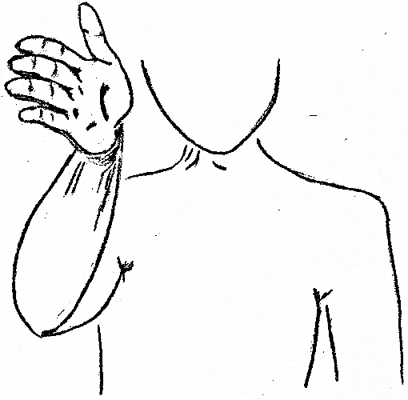 _punish.

**b.**

Post-speech: His enemy, Asterix will punish—  .

**c.**

Pro-speech His enemy, Asterix will  .

When different tests are applied, such as embedding under negation, these three types display different semantic behaviors. Co-speech gestures have been argued to trigger conditionalized presuppositions, as in (32a). Post-speech gestures have been argued to display the behavior of appositive relative clauses, and in particular to be deviant in some negative environments, as illustrated in (32b)–(32b′); in addition, post-speech gestures, just like appositive relative clauses, usually make non-at-issue contributions.

**(32)**

a. Co-speech: His enemy, Asterix won’t  _punish. $\Rightarrow$ if Asterix were to punish his enemy, slapping would be involved

**b.**

Post-speech: #His enemy, Asterix won’t punish—  .

**b′.**

#His enemy, Asterix won’t punish, which will involve slapping him.

**c.**

Pro-speech His enemy, Asterix won’t  . $\Rightarrow$ Asterix won’t slap his enemy

Only pro-speech gestures, as in (32c), make at-issue contributions by default (possibly in addition to other contributions). In this respect, they ‘match’ the behavior of iconic modulations, iconic plurals and pluractionals, and classifier predicates. But unlike these, pro-speech gestures are not words and are correspondingly expressively limited. For instance, abstract psychological verbs *UNDERSTAND* (=(15a)) and especially *REFLECT* (=(15b)) can be modulated in rich iconic ways in LSF—e.g., if the hand movement of *REFLECT* starts slow and ends fast, this conveys that the reflection intensified (Schlenker 2018a)[^schlenker-2018a]. But there are no clear pro-speech gestures with the same abstract meanings, and thus one cannot hope to emulate with pro-speech gestures the contributions of *UNDERSTAND* and *REFLECT*, including when they are enriched by iconic modulations.

In sum, while the reintegration of gestures into the study of speech opens new avenues of comparison between sign with iconicity and speech with gestures, one shouldn’t jump to the conclusion that these enriched objects display precisely the same semantic behavior.

### 5.3 Classifier predicates and pro-speech gestures

Unlike gestures in general and pro-speech gestures in particular, classifier predicates have a conventional form (only the position, orientation, and movement are iconically interpreted, accompanied in limited cases by aspects of the handshape). But there are still striking similarities between pro-speech gestures and classifier predicates.

First, on a semantic level, the iconic semantics sketched for classifier predicates in Section 4.2 seems useful for pro-speech gestures as well, sometimes down to the details—for instance, it has been argued that the dependency between viewpoints and quantifiers illustrated in (30) has a counterpart with pro-speech gestures (Schlenker & Lamberton forthcoming).

Second, on a syntactic level, classifier predicates often display a different word order from other constructions, something that has been found across languages (Pavlič 2016)[^pavlič-2016]. In ASL, the basic word order is SVO, but preverbal objects are usually preferred if the verb is a classifier predicate, for instance one that represents a crocodile moving and eating up a ball (as is standard in syntax, the ‘basic’ or underlying word order may be modified on independent grounds by further operations, for instance ones that involve topics and focus; we are not talking about such modifications of the word order here).

It has been proposed that the non-standard word order is directly related to the iconic properties of classifier predicates. The idea is that these create a visual animation of an action, and preferably take their argument in the order in which their denotations are visible (Schlenker, Bonnet et al. 2024; see also Napoli, Spence, and Müller 2017)[^napoli-2017][^schlenker-2024]. One would typically see a ball and a crocodile before seeing the eating, hence the preference for preverbal objects (note that the subject is preverbal anyway in ASL). A key argument for this idea is that when one considers a minimally different sentence involving a crocodile spitting out a ball it had previously ingested, SVO order is regained, in accordance with the fact that an observer would see the object after the action in this case.

Strikingly, these findings carry over to pro-speech gestures. Goldin-Meadow et al. (2008) famously noted that when speakers of languages with diverse word orders are asked to use pantomime to describe an event with an agent and a patient, they tend to go with SOV order, including if this goes against the basic word order of their language (as is the case in English). Similarly, pre-verbal objects are preferred in sequences of pro-speech gestures in French (despite the fact that the basic word order of the language is SVO); this is for instance the case for a sequence of pro-speech gestures that means that a crocodile ate up a ball. Remarkably, with spit-out-type gestural predicates, an SVO order is regained, just as is the case with ASL classifier predicates (Schlenker, Bonnet, et al. 2024, following in part by Christensen, Fusaroli, & Tylén 2016; Napoli, Mellon, et al. 2017; Schouwstra & de Swart 2014)[^christensen-2016][^napoli-2017][^schlenker-2024][^schouwstra-2014]. This suggests that iconicity, an obvious commonality between the two constructions, might indeed be responsible for the non-standard word order.

## 6. Universal Properties of the Signed Modality

### 6.1 Sign language typology and sign language emergence

Properties discussed above include: (i) the use of loci to realize anaphora, (ii) the overt marking of telicity and (possibly) context shift, (iii) the presence of rich iconic modulations interacting with event structure, plurals and pluractionals, and anaphora, (iv) the existence of classifier predicates, which have both a conventional and an iconic dimension. Although the examples above involve a relatively small number of languages, it turns out that these properties exist in several and probably many sign languages. Historically unrelated sign languages are thus routinely treated as a ‘language family’ because they share numerous properties that are not shared by spoken languages (Sandler & Lillo-Martin 2006)[^sandler-2006]. Of course, this still allows for considerable variation across sign languages, for instance with respect to word order (e.g., ASL is SVO, LIS is SOV).

Cases of convergence also exist in language emergence. Homesigners are deaf individuals who are not in contact with an established sign language and thus develop their own gesture systems to communicate with their families. While homesigners do not invent a sign language, they sometimes discover on their own certain properties of mature sign languages. Loci and repetition-based plurals are cases in point (Coppola & So 2006; Coppola et al. 2013)[^coppola-2006][^coppola-2013]. Strikingly, Coppola and colleagues (2013) showed in a production experiment that a group of homesigners from Nicaragua used both punctuated and unpunctuated repetitions, with the kinds of semantic distinctions found in mature sign language. Coppola et al. further

> examined a child homesigner and his hearing mother, and found that the child’s number gestures displayed all of the properties found in the adult homesigners’ gestures, but his mother’s gestures did not. (Coppola, Spaepen, & Goldin-Meadow 2013: abstract)[^coppola-2013]

This provided clear evidence that this homesigner had invented this strategy of plural-marking.

In sum, there is striking typological convergence among historically unrelated sign languages, and homesigners can in some cases discover grammatical devices found in mature sign languages.

### 6.2 Sign language grammar and gestural grammar

It is arguably possible to have non-signers discover on the fly certain non-trivial properties of sign languages (Strickland et al. 2015; Schlenker 2020)[^schlenker-2020][^strickland-2015]. One procedure involves hybrids of words and gestures. We saw a version of this in Section 5.3, when we discussed similarities between pro-speech gestures and classifier predicates. The result was that along several dimensions, notably word order preferences and associated meanings, pro-speech gestures resemble ASL classifier predicates (they also differ from them in not having lexical forms).

More generally, hybrid sequences of words and gestures suggest that non-signers sometimes have access to a gestural grammar somewhat reminiscent of sign languages. (It goes without saying that there is no claim whatsoever that non-signers know the sophisticated grammars of sign languages, any more than a naive monolingual English speaker knows the grammar of Mandarin or Hebrew.) In one experimental study (summarized in Schlenker 2020)[^schlenker-2020], gestures with a verbal meaning, such as ‘send kisses’, targeted different positions, corresponding to the addressee or some third person, as illustrated below.

**(33)**

A gesture for ‘send kisses to’ oriented towards the addressee or some third person position 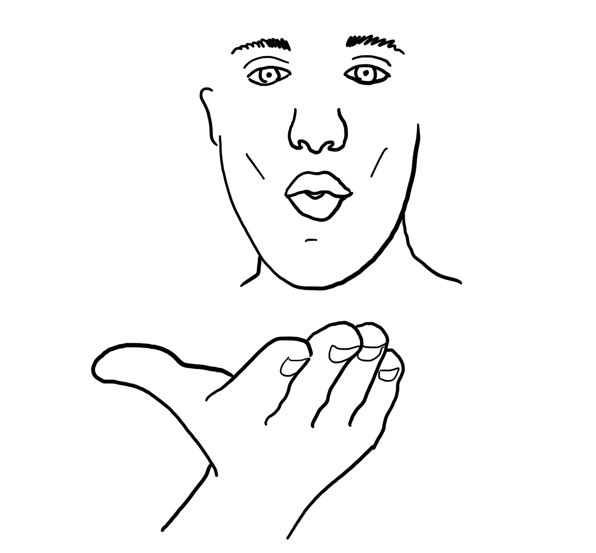 a. send kisses to you 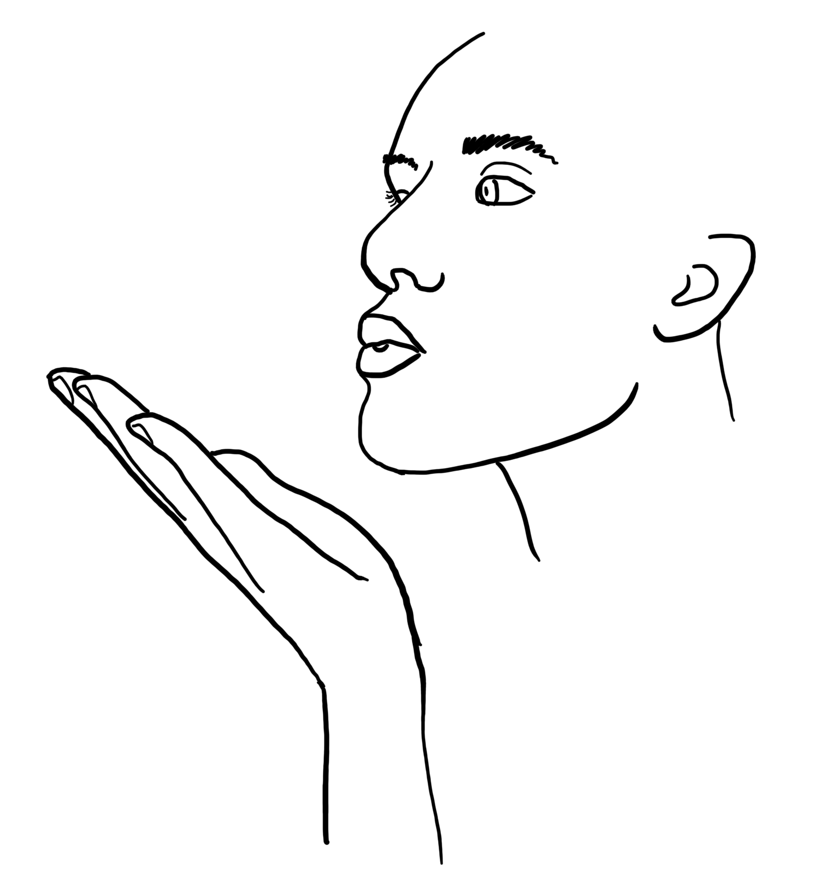 b. send kisses to him/her *Credits*: J. Kuhn

The conditions in which these two forms can be used turn out to be reminiscent of the behavior of the agreement verb *TELL* in ASL: in (5), the verb could target the addressee position to mean *I tell you*, or some position to the side to mean *I tell him/her*. The study showed that non-signers immediately perceived a distinction between the second person object form and the third person object form of the gestural verb, despite the fact that English, unlike ASL, has no object agreement markers. In other words, non-signers seemed to treat the directionality of the gestural verb as a kind of agreement marker. More fine-grained properties of the ASL object agreement construction were tested with gestures, again with positive results.

More broadly, it has been argued that aspects of gestural grammar resemble the grammar of ASL in designated cases involving loci, repetition-based plurals and pluractionals, Role Shift, and telicity marking (e.g., Schlenker 2020 and references therein)[^schlenker-2020]. These findings have yet to be confirmed with experimental means, but if they are correct, the question is why.

### 6.3 Why convergence?

We have seen three cases of convergence in the visual modality: typological convergence among unrelated sign languages, homesigners’ ability to discover designated aspects of sign language grammar, and possibly the existence of a gestural grammar somewhat reminiscent of sign language in designated cases. None of these cases should be exaggerated. While typologically they belong to a language family, sign languages are very diverse, varying on all levels of linguistic structure. As for homesigners, the gestural systems they develop compensate for the *lack* of access to a sign language; indeed, homesigners bear consequences of lack of access to a native language (see for instance Morford & Hänel-Faulhaber 2011; Gagne & Coppola 2017)[^gagne-2017][^morford-2011]. Finally, non-signers cannot guess anything about sign languages apart from a few designated properties.

Still, these cases of convergence should be explained. There are at least three conceivable directions, which might have different areas of applicability. Chomsky famously argued that there exists an innate Universal Grammar (UG) that underlies all human languages (see for instance Chomsky 1965, Pinker 1994)[^chomsky-1965][^pinker-1994]. One possibility is that UG doesn’t just specify abstracts features and rules (as is usually assumed), but also certain form-to-meaning mappings in the visual modality, for instance the fact that pronouns are realized by way of pointing. A second possibility is that the iconic component of sign language—possibly in more abstract forms than is usually assumed—is responsible for some of the convergence. An example was discussed in Section 5.3 in relation to the word order differences between classifier predicates and normal signs, and between gesture sequences and normal words. A third possibility is that, for reasons that have yet to be determined, the visual modality sometimes makes it possible to realize in a more uniform fashion some deeper cognitive properties of linguistic expressions.

## 7. Future Issues

On a practical level, future research will have to find the optimal balance between fine-grained studies and robust methods of data collection (e.g., what are the best methods to collect fine-grained data from a small number of consultants? how can large-scale experiments be set up for sign language semantics?). A second issue pertains to the involvement of native signers and Deaf researchers, who should obviously play a central role in this entire research.

On a theoretical level, the traditional view of human language as a discrete system with iconicity at the margins is hard to maintain in view of the analysis of sign with iconicity (and possibly also of speech with gestures). Rather, human language is a hybrid system with a discrete/logical component and an iconic component. But there are multiple open issues. First, cases of Logical Visibility will no doubt give rise to further debates. Second, a formal iconic semantics appropriate for sign language has yet to be fully developed. Third, the interaction between the discrete/logical component and the iconic component must be investigated in greater detail. Fourth, the formal semantics of sign language should be extended with an equally formal pragmatics to investigate, among others, information structure, and the rich typology of inferences that has been unearthed for spoken languages (including implicatures, presuppositions, supplements, expressives, etc.). Importantly, this formal pragmatics will have to explore both the discrete/logical and the iconic component of sign language. Fifth, consequences of the iconic component for the syntax will have to be further explored, especially in view of the hypothesis that classifier predicates display a non-standard syntax because they have an iconic semantics. Last, but not least, the philosophy of language should take sign languages into account. For the moment, it almost never does so.

## References（引用注释）

> 原文参考文献已转为脚注引用：文内“作者-年份”引用组后附 [^key] 标记，完整条目见本文末脚注定义。

## Academic Tools

> |   | [How to cite this entry](https://plato.stanford.edu/cgi-bin/encyclopedia/archinfo.cgi?entry=sign-language-semantics). |
> | --- | --- |
> |   | [Preview the PDF version of this entry](https://leibniz.stanford.edu/friends/preview/sign-language-semantics/) at the [Friends of the SEP Society](https://leibniz.stanford.edu/friends/). |
> |   | [Look up topics and thinkers related to this entry](https://www.inphoproject.org/entity?sep=sign-language-semantics&redirect=True) at the Internet Philosophy Ontology Project (InPhO). |
> |   | [Enhanced bibliography for this entry](https://philpapers.org/sep/sign-language-semantics/) at [PhilPapers](https://philpapers.org/), with links to its database. |

## Other Internet Resources

- Cable, Seth, 2011, “[Understudied and Endangered Languages at the Semantics/Syntax Interface](http://ling50.mit.edu/wp-content/uploads/Cable-handout.pdf)” (slides), presented at 50 Years of Linguistics at MIT: A Scientific Reunion, 10 December 2011.
- Ebert, Cornelia and Christian Ebert, 2014, “[Gestures, Demonstratives, and the Attributive/Referential Distinction](https://www.semanticsarchive.net/Archive/GJjYzkwN/EbertEbert-SPE-2014-slides.pdf)”, slides of talk at Semantics and Philosophy in Europe 7, ZAS, Berlin.

## Related Entries

anaphora | innateness: and language | logical form | ontology, natural language | plural quantification | presupposition | quotation | semantics: dynamic | tense and aspect

### Acknowledgments

**Author contributions:** Schlenker and Kuhn wrote the article. Lamberton commented and provided some of the ASL data.

**Acknowledgments:** We are very grateful to Editor Ed Zalta and to two anonymous reviewers for very constructive comments and suggestions. Many thanks to Lucie Ravaux for help with the formatting and with the bibliography.

**Funding:** Schlenker, Lamberton, Kuhn: This research received funding from the European Research Council (ERC) under the European Union’s Horizon 2020 research and innovation programme (grant agreement No 788077, Orisem, PI: Schlenker).

Schlenker, Kuhn: Research was conducted at the DEC, Ecole Normale Supérieure - PSL Research University. The DEC is supported by grant FrontCog ANR-17-EURE-0017.

[^abusch-2020]: Abusch, Dorit, 2020, “Possible‐Worlds Semantics for Pictures”, in *The Wiley Blackwell Companion to Semantics*, Daniel Gutzmann, Lisa Matthewson, Cécile Meier, Hotze Rullmann, and Thomas Zimmermann (eds.), Hoboken, NJ: Wiley. doi:10.1002/9781118788516.sem003

[^anand-2004]: Anand, Pranav and Andrew Nevins, 2004, “Shifty Operators in Changing Contexts”, in *Proceedings of Semantics and Linguistic Theory (SALT 14)*, Robert B. Young (ed.), *Semantics and Linguistic Theory* (Linguistics Society of America), pp. 20–37. doi:10.3765/salt.v14i0.2913

[^anand-2006]: Anand, Pranav, 2006, “De de Se”, Ph.D. Thesis, Massachusetts Institute of Technology, Cambridge, MA. [[Anand 2006 available online](https://dspace.mit.edu/handle/1721.1/37418)]

[^aristodemo-2017]: Aristodemo, Valentina, 2017, *Gradable Constructions in Italian Sign Language*, Ph.D. Thesis, Ecole des Hautes Etudes en Sciences Sociales, Paris.

[^barberà-2015]: Barberà Altimira, Gemma, 2015, *The Meaning of Space in Sign Language: Reference, Specificity and Structure in Catalan Sign Language Discourse* (Sign Languages and Deaf Communities 4), Boston: De Gruyter Mouton/Ishara Press. doi:10.1515/9781614518815

[^barnes-2023]: Barnes, Kathryn and Cornelia Ebert, 2023, “The Information Status of Iconic Enrichments: Modelling Gradient at-Issueness”, *Theoretical Linguistics*, 49(3–4): 167–223. doi:10.1515/tl-2023-2009

[^beck-2009]: Beck, Sigrid, Sveta Krasikova, Daniel Fleischer, Remus Gergel, Stefan Hofstetter, Christiane Savelsberg, John Vanderelst, and Elisabeth Villalta, 2009, “Crosslinguistic Variation in Comparison Constructions”, *Linguistic Variation Yearbook*, 9: 1–66. doi:10.1075/livy.9.01bec

[^bellugi-1972]: Bellugi, Ursula and Susan Fischer, 1972, “A Comparison of Sign Language and Spoken Language”, *Cognition*, 1(2–3): 173–200. doi:10.1016/0010-0277(72)90018-2

[^chomsky-1965]: Chomsky, Noam, 1965, *Aspects of the Theory of Syntax*, Cambridge, MA: MIT Press

[^christensen-2016]: Christensen, Peer, Riccardo Fusaroli, and Kristian Tylén, 2016, “Environmental Constraints Shaping Constituent Order in Emerging Communication Systems: Structural Iconicity, Interactive Alignment and Conventionalization”, *Cognition*, 146: 67–80. doi:10.1016/j.cognition.2015.09.004

[^cogill-koez-2000]: Cogill-Koez, Dorothea, 2000, “Signed Language Classifier Predicates: Linguistic Structures or Schematic Visual Representation?”, *Sign Language & Linguistics*, 3(2): 153–207. doi:10.1075/sll.3.2.03cog

[^coppola-2006]: Coppola, Marie and Wing Chee So, 2006, “The Seeds of Spatial Grammar: Spatial Modulation and Coreference in Homesigning and Hearing Adults”, in *Proceedings of the 30th Boston University Conference on Language Development*, David Bamman, Tatiana Magnitskaia, and Colleen Zaller (eds.), Boston: Cascadilla Press, 1: 119–130.

[^coppola-2013]: Coppola, Marie, Elizabet Spaepen, and Susan Goldin-Meadow, 2013, “Communicating about Quantity without a Language Model: Number Devices in Homesign Grammar”, *Cognitive Psychology*, 67(1–2): 1–25. doi:10.1016/j.cogpsych.2013.05.003

[^corina-2012]: Corina, David and Nicole Spotswood, 2012, “Neurolinguistics”, in Pfau, Steinbach, and Woll 2012: 739–762 (ch. 31). doi:10.1515/9783110261325.739

[^cresswell-1990]: Cresswell, M. J., 1990, *Entities and Indices* (Studies in Linguistics and Philosophy 41), Dordrecht/Boston: Kluwer Academic Publishers.

[^cuxac-2007]: Cuxac, Christian and Marie-Anne Sallandre, 2007, “Iconicity and Arbitrariness in French Sign Language: Highly Iconic Structures, Degenerated Iconicity and Diagrammatic Iconicity”, in *Verbal and Signed Languages: Comparing Structures, Constructs and Methodologies* (Empirical Approaches to Language Typology 36), Elena Pizzuto, Paola Pietrandrea, and Raffaele Simone (eds.), Berlin/New York: Mouton de Gruyter, 13–33.

[^dachkovsky-2009]: Dachkovsky, Svetlana and Wendy Sandler, 2009, “Visual Intonation in the Prosody of a Sign Language”, *Language and Speech*, 52(2–3): 287–314. doi:10.1177/0023830909103175

[^davidson-2013]: Davidson, Kathryn, 2013, “‘And’ or ‘or’: General Use Coordination in ASL”, *Semantics and Pragmatics*, 6: article 4 (44 pages). doi:10.3765/sp.6.4

[^davidson-2015]: –––, 2015, “Quotation, Demonstration, and Iconicity”, *Linguistics and Philosophy*, 38(6): 477–520. doi:10.1007/s10988-015-9180-1

[^davidson-2022]: Davidson, Kathryn and Deanna Gagne, 2022, “‘More Is up’ for Domain Restriction in ASL”, *Semantics and Pragmatics*, 15: article 1 (52 pages). doi:10.3765/sp.15.1

[^davidson-2019]: Davidson, Kathryn, Annemarie Kocab, Andrea D. Sims, and Laura Wagner, 2019, “The Relationship between Verbal Form and Event Structure in Sign Languages”, *Glossa: A Journal of General Linguistics*, 4(1): 123. doi:10.5334/gjgl.924

[^deal-2020]: Deal, Amy Rose, 2020, *A Theory of Indexical Shift: Meaning, Grammar, and Crosslinguistic Variation* (Linguistic Inquiry Monographs 82), Cambridge, MA: The MIT Press. doi:10.7551/mitpress/12374.001.0001

[^elbourne-2005]: Elbourne, Paul D., 2005, *Situations and Individuals* (Current Studies in Linguistics 41), Cambridge, MA: MIT Press.

[^emmorey-2002]: Emmorey, Karen, 2002, *Language, Cognition, and the Brain: Insights from Sign Language Research*, Mahwah, NJ: Lawrence Erlbaum Associates.

[^emmorey-2014]: –––, 2014, “Iconicity as Structure Mapping”, *Philosophical Transactions of the Royal Society B: Biological Sciences*, 369(1651): 20130301. doi:10.1098/rstb.2013.0301

[^emmorey-2003]: Emmorey, Karen and Melissa Herzig, 2003, “Categorical versus Gradient Properties of Classifier Constructions in ASL”, in *Perspectives on Classifer Constructions in Sign Language*, Karen Emmorey (ed.), Mahwah, NJ: Lawrence Erlbaum Associates, 222–246.

[^evans-1980]: Evans, Gareth, 1980, “Pronouns”, *Linguistic Inquiry*, 11(2): 337–362.

[^frederiksen-2022]: Frederiksen, Anne Therese and Rachel I. Mayberry, 2022, “Pronoun Production and Comprehension in American Sign Language: The Interaction of Space, Grammar, and Semantics”, *Language, Cognition and Neuroscience*, 37(1): 80–102. doi:10.1080/23273798.2021.1968013

[^gagne-2017]: Gagne, Deanna L. and Marie Coppola, 2017, “Visible Social Interactions Do Not Support the Development of False Belief Understanding in the Absence of Linguistic Input: Evidence from Deaf Adult Homesigners”, *Frontiers in Psychology*, 8: article 837. doi:10.3389/fpsyg.2017.00837

[^geach-1962]: Geach, Peter T., 1962, *Reference and Generality: An Examination of Some Medieval and Modern Theories* (Contemporary Philosophy), Ithaca, NY: Cornell University Press.

[^goldin-meadow-2017]: Goldin-Meadow, Susan and Diane Brentari, 2017, “Gesture, Sign, and Language: The Coming of Age of Sign Language and Gesture Studies”, *Behavioral and Brain Sciences*, 40: e46. doi:10.1017/S0140525X15001247

[^goldin-meadow-2008]: Goldin-Meadow, Susan, Wing Chee So, Aslı Özyürek, and Carolyn Mylander, 2008, “The Natural Order of Events: How Speakers of Different Languages Represent Events Nonverbally”, *Proceedings of the National Academy of Sciences*, 105(27): 9163–9168. doi:10.1073/pnas.0710060105

[^greenberg-2013]: Greenberg, Gabriel, 2013, “Beyond Resemblance”, *The Philosophical Review*, 122(2): 215–287. doi:10.1215/00318108-1963716

[^greenberg-2021]: –––, 2021, “Semantics of Pictorial Space”, *Review of Philosophy and Psychology*, 12(4): 847–887. doi:10.1007/s13164-020-00513-6

[^heim-1982]: Heim, Irene, 1982, *The Semantics of Definite and Indefinite Noun Phrases*, Ph.D. Thesis, University of Massachusetts, Amherst, Amherst, MA.

[^heim-1990]: –––, 1990, “E-Type Pronouns and Donkey Anaphora”, *Linguistics and Philosophy*, 13(2): 137–177. doi:10.1007/BF00630732

[^henderson-2016]: Henderson, Robert, 2016, “A Demonstration-Based Account of (Pluractional) Ideophones”, in *Proceedings of Semantics and Linguistic Theory (SALT 26)*, Mary Morony, Carol-Rose Little, Jacob Collard, and Dan Burgdorf (eds.), 664–683. doi:10.3765/salt.v26i0.3786

[^herrmann-2012]: Herrmann, Annika and Markus Steinbach, 2012, “Quotation in Sign Languages: A Visible Context Shift”, in *Converging Evidence in Language and Communication Research* (Converging Evidence in Language and Communication Research 15), Isabelle Buchstaller and Ingrid Van Alphen (eds.), Amsterdam: John Benjamins Publishing Company, 203–228. doi:10.1075/celcr.15.12her

[^jacobson-1999]: Jacobson, Pauline, 1999, “Towards a Variable Free Semantics”, *Linguistics and Philosophy*, 22(2): 117–185. doi:10.1023/A:1005464228727

[^jacobson-2012]: –––, 2012, “Direct Compositionality and ‘Uninterpretability’: The Case of (Sometimes) ‘Uninterpretable’ Features on Pronouns”, *Journal of Semantics*, 29(3): 305–343. doi:10.1093/jos/ffs005

[^kamp-1981]: Kamp, Hans, 1981 [1984], “A Theory of Truth and Semantic Representation”, in *Formal Methods in the Study of Language* (Mathematical Centre Tracts 135), Jeroen A. G. Groenendijk, Theo M. V. Janssen, and Martin J. B. Stokhof (eds.), Amsterdam: Mathematisch Centrum. Reprinted in *Truth, Interpretation and Information: Selected Papers from the Third Amsterdam Colloquium*, Jeroen Groenendijk, Theo M. V. Janssen, and Martin Stokhof (eds.), Berlin/Boston: De Gruyter, 1–42. doi:10.1515/9783110867602.1

[^kaplan-1989]: Kaplan, David, 1989, “Demonstratives. An Essay on the Semantics, Logic, Metaphysics, and Epistemology of Demonstratives and Other Indexicals”, in *Themes from Kaplan*, Joseph Almog, John Perry, and Howard Wettstein (eds.), New York: Oxford University Press, 481–563.

[^klein-1980]: Klein, Ewan, 1980, “A Semantics for Positive and Comparative Adjectives”, *Linguistics and Philosophy*, 4(1): 1–45. doi:10.1007/BF00351812

[^koulidobrova-2009]: Koulidobrova, Elena, 2009, “SELF: Intensifier and ‘long distance’ effects in ASL”, *21st European Summer School in Logic, Language, and Information*. Bordeaux, Association for Logic Language and Information (FoLLI). [[Koulidobrova 2009 available online](https://esslli2009.labri.fr/documents/04%20Koulidobrova%20ESSLLI%202009.pdf)]

[^kuhn-2015]: Kuhn, Jeremy, 2015, *Cross-Categorial Singular and Plural Reference in Sign Language*, Ph.D. Thesis, New York University.

[^kuhn-2016]: –––, 2016, “ASL Loci: Variables or Features?”, *Journal of Semantics*, 33(3): 449–491. doi:10.1093/jos/ffv005

[^kuhn-2021]: –––, 2021, “Discourse Anaphora: Theoretical Perspectives”, in *The Routledge Handbook of Theoretical and Experimental Sign Language Research*, Josep Quer, Roland Pfau, and Annika Herrmann (eds.), Abingdon/New York: Routledge, 458–479.

[^kuhn-2017]: Kuhn, Jeremy and Valentina Aristodemo, 2017, “Pluractionality, Iconicity, and Scope in French Sign Language”, *Semantics and Pragmatics*, 10: article 6 (49 pages): doi:10.3765/sp.10.6

[^lane-1984]: Lane, Harlan, 1984, *When the Mind Hears: A History of the Deaf*, New York: Random House.

[^liddell-1984]: Liddell, Scott K., 1984, “Unrealized-Inceptive Aspect in American Sign Language: Feature Insertion in Syllabic Frames”, in *Papers from the Twentieth Regional Meeting of the Chicago Linguistic Society*, Chicago: Chicago Linguistic Society, 257–270.

[^liddell-2003]: –––, 2003, *Grammar, Gesture, and Meaning in American Sign Language*, Cambridge/New York: Cambridge University Press. doi:10.1017/CBO9780511615054

[^lillo-martin-2012]: Lillo-Martin, Diane, 2012, “Utterance Reports and Constructed Action”, in Pfau, Steinbach, and Woll 2012: 365–387 (ch. 17). doi:10.1515/9783110261325.365

[^lillo-martin-1990]: Lillo-Martin, Diane and Edward S. Klima, 1990, “Pointing out Differences: ASL Pronouns in Syntactic Theory”, in *Theoretical Issues in Sign Language Research: Volume 1, Linguistics*, Susan D. Fischer and Patricia Siple (eds.), Chicago, IL: The University of Chicago Press, 191–210.

[^lin-2021]: Lin, Hao, Jeremy Kuhn, Huan Sheng, and Philippe Schlenker, 2021, “Timelines and Temporal Pointing in Chinese Sign Language”, *Glossa: A Journal of General Linguistics*, 6(1): article 133. doi:10.16995/glossa.5836

[^macsweeney-2008]: MacSweeney, Mairéad, Cheryl M. Capek, Ruth Campbell, and Bencie Woll, 2008, “The Signing Brain: The Neurobiology of Sign Language”, *Trends in Cognitive Sciences*, 12(11): 432–440. doi:10.1016/j.tics.2008.07.010

[^malaia-2013]: Malaia, Evie, Ronnie B. Wilbur, and Marina Milković, 2013, “Kinematic Parameters of Signed Verbs”, *Journal of Speech, Language, and Hearing Research*, 56(5): 1677–1688. doi:10.1044/1092-4388(2013/12-0257)

[^matthewson-2001]: Matthewson, Lisa, 2001, “Quantification and the Nature of Crosslinguistic Variation”, *Natural Language Semantics*, 9(2): 145–189. doi:10.1023/A:1012492911285

[^meir-2010]: Meir, Irit, Wendy Sandler, Carol Padden, and Mark Aronoff, 2010, “Emerging Sign Languages”, in *The Oxford Handbook of Deaf Studies, Language, and Education*, Marc Marschark and Patricia Elizabeth Spencer (eds.), Oxford/New York: Oxford University Press, 2: 267–280. doi:10.1093/oxfordhb/9780195390032.013.0018

[^milković-2011]: Milković, Marina, 2011, *Verb classes in Croatian Sign Language (HZJ): Syntactic and semantic properties*, PhD thesis, University of Zagreb, Croatia.

[^moltmann-2017]: Moltmann, Friederike, 2017, “Natural Language Ontology”, in *Oxford Research Encyclopedia of Linguistics*, Mark Aronoff (ed.), Oxford: Oxford University Press. doi:10.1093/acrefore/9780199384655.013.330

[^morford-2011]: Morford, Jill P. and Barbara Hänel‐Faulhaber, 2011, “Homesigners as Late Learners: Connecting the Dots from Delayed Acquisition in Childhood to Sign Language Processing in Adulthood”, *Language and Linguistics Compass*, 5(8): 525–537. doi:10.1111/j.1749-818X.2011.00296.x

[^napoli-2015]: Napoli, Donna Jo, Nancy K. Mellon, John K. Niparko, Christian Rathmann, Gaurav Mathur, Tom Humphries, Theresa Handley, Sasha Scambler, and John D. Lantos, 2015, “Should All Deaf Children Learn Sign Language?”, *Pediatrics*, 136(1): 170–176. doi:10.1542/peds.2014-1632

[^napoli-2017]: Napoli, Donna Jo, Rachel Sutton Spence, and Ronice Müller de Quadros, 2017, “Influence of Predicate Sense on Word Order in Sign Languages: Intensional and Extensional Verbs”, *Language*, 93(3): 641–670. doi:10.1353/lan.2017.0039

[^neidle-2000]: Neidle, Carol Jan, Judy Kegl, Dawn MacLaughlin, Benjamin Bahan, and Robert G. Lee (eds.), 2000, *The Syntax of American Sign Language: Functional Categories and Hierarchical Structure* (Language, Speech, and Communication), Cambridge, MA: MIT Press.

[^ohori-2004]: Ohori, Toshio, 2004, “Coordination in Mentalese”, in *Coordinating Constructions* (Typological Studies in Language 58), Martin Haspelmath (ed.), Amsterdam: John Benjamins Publishing Company, 41–66. doi:10.1075/tsl.58.04oho

[^padden-1986]: Padden, Carol A., 1986, “Verbs and Role-Shifting in American Sign Language”, *Proceedings of the Fourth National Symposium on Sign Language Research and Teaching*, Silver Spring, MD: National Association of the Deaf.

[^partee-1973]: Partee, Barbara Hall, 1973, “Some Structural Analogies between Tenses and Pronouns in English”, *The Journal of Philosophy*, 70(18): 601–609. doi:10.2307/2025024

[^pavlič-2016]: Pavlič, Matic, 2016, “The Word Order Parameter in Slovenian Sign Language : Transitive, Ditransitive, Classifier and Locative Constructions”, Doctoral Thesis, Università Ca’ Foscari Venezia.

[^pfau-2006]: Pfau, Roland and Markus Steinbach, 2006, “Pluralization in Sign and in Speech: A Cross-Modal Typological Study”, *Linguistic Typology*, 10(2): 135–182. doi:10.1515/LINGTY.2006.006

[^pfau-2018]: Pfau, Roland, Martin Salzmann, and Markus Steinbach, 2018, “The Syntax of Sign Language Agreement: Common Ingredients, but Unusual Recipe”, *Glossa: A Journal of General Linguistics*, 3(1): article 107 (46 pages). doi:10.5334/gjgl.511

[^pfau-2012]: Pfau, Roland, Markus Steinbach, and Bencie Woll (eds.), 2012, *Sign Language: An International Handbook* (Handbücher zur Sprach- und Kommunikationswissenschaft/Handbooks of Linguistics and Communication Science 37), Berlin/Boston: De Gruyter Mouton. doi:10.1515/9783110261325

[^pinker-1994]: Pinker, Steven, 1994, *The Language Instinct: How the Mind Creates Language*, New York: William Morrow.

[^postal-1966]: Postal, Paul, 1966, “On so-called ‘pronouns’ in English”, in *Report on the Seventeenth Annual Round Table Meeting on Linguistics and Language Studies*, Washington, DC: Georgetown University Press, pp. 177–206

[^pustejovsky-1991]: Pustejovsky, James, 1991, “The Syntax of Event Structure”, *Cognition*, 41(1–3): 47–81. doi:10.1016/0010-0277(91)90032-Y

[^quer-2005]: Quer, Josep, 2005, “Context Shift and Indexical Variables in Sign Languages”, in *Proceedings of Semantics and Linguistic Theory (SALT 15)*, 152–168. doi:10.3765/salt.v15i0.2923

[^quer-2013]: –––, 2013, “Attitude Ascriptions in Sign Languages and Role Shift”, in *Proceedings of the 13ᵗʰ Meeting of the Texas Linguistics Society*, Leah C. Geer (ed.), Austin: Texas Linguistics Forum, pp. 12–28. [[Quer 2013 available online](https://tls.ling.utexas.edu/2012/proceedings/TLS13-02-Quer.pdf)]

[^quine-1960]: Quine, Willard V., 1960, “Variables Explained Away”, *Proceedings of the American Philosophical Society*, 104(3): 343–347.

[^ramchand-2008]: Ramchand, Gillian, 2008, *Verb Meaning and the Lexicon: A First-Phase Syntax* (Cambridge Studies in Linguistics 116), Cambridge/New York: Cambridge University Press. doi:10.1017/CBO9780511486319

[^rothstein-2004]: Rothstein, Susan, 2004, *Structuring Events: A Study in the Semantics of Lexical Aspect* (Explorations in Semantics), Oxford/Malden, MA: Blackwell. doi:10.1002/9780470759127

[^rubino-2013]: Rubino, Carl, 2013, “Reduplication”, in *The Wolrd Atlas of Language Structures Online* (v2020.3) [Data set], Matthew S. Dryer and Martin Haspelmath (eds.), Leipzip: Max Planck Institute for Evolutionary Anthropology. [[Rubino data set available online](https://wals.info/chapter/27)] doi:10.5281/zenodo.7385533

[^sandler-2006]: Sandler, Wendy and Diane C. Lillo-Martin, 2006, *Sign Language and Linguistic Universals*, Cambridge/New York: Cambridge University Press. doi:10.1017/CBO9781139163910

[^sapir-1921]: Sapir, Edward, 1921, *Language: An Introduction to the Study of Speech*, New York: Harcourt, Brace and Company.

[^schlenker-2018a]: Schlenker, Philippe, 2018a, “Visible Meaning: Sign Language and the Foundations of Semantics”, *Theoretical Linguistics*, 44(3–4): 123–208. doi:10.1515/tl-2018-0012

[^schlenker-2018b]: –––, 2018b, “Iconic Pragmatics”, *Natural Language & Linguistic Theory*, 36(3): 877–936. doi:10.1007/s11049-017-9392-x

[^schlenker-2020]: –––, 2020, “Gestural Grammar”, *Natural Language & Linguistic Theory*, 38(3): 887–936. doi:10.1007/s11049-019-09460-z

[^schlenker-2024]: Schlenker, Philippe, Marion Bonnet, Jonathan Lamberton, Jason Lamberton, Emmanuel Chemla, Mirko Santoro, and Carlo Geraci, 2024, “Iconic Syntax: Sign Language Classifier Predicates and Gesture Sequences”, *Linguistics and Philosophy*, 47(1): 77–147. doi:10.1007/s10988-023-09388-z

[^schlenker-2022]: Schlenker, Philippe and Jonathan Lamberton, 2022, “Meaningful Blurs: The Sources of Repetition-Based Plurals in ASL”, *Linguistics and Philosophy*, 45(2): 201–264. doi:10.1007/s10988-020-09312-9

[^schlenker-nd]: –––, forthcoming, “Iconological Semantics”, *Linguistics & Philosophy*, accepted with minor revisions. [[Schlenker & Lamberton available online (lingbuzz/007048)](https://lingbuzz.net/lingbuzz/007048)]

[^schouwstra-2014]: Schouwstra, Marieke and Henriëtte De Swart, 2014, “The Semantic Origins of Word Order”, *Cognition*, 131(3): 431–436. doi:10.1016/j.cognition.2014.03.004

[^stechow-2004]: von Stechow, Arnim, 2004, “Binding by Verbs: Tense, Person, and Mood under Attitudes”, in *The Syntax and Semantics of the Left Periphery* (Interface Explorations [IE] 9), Horst Lohnstein and Susanne Trissler (eds.), Berlin/New York: De Gruyter, 431–488. doi:10.1515/9783110912111.431

[^steinbach-2016]: Steinbach, Markus and Edgar Onea, 2016, “A DRT Analysis of Discourse Referents and Anaphora Resolution in Sign Language”, *Journal of Semantics*, 33(3): 409–448. doi:10.1093/jos/ffv002

[^stone-1997]: Stone, Matthew, 1997, “The Anaphoric Parallel Between Modality and Tense”. *Technical Report MS-CIS-97-09*, University of Pennsylvania, Department of Computer and Information Science. [[Stone 1997 available online](https://repository.upenn.edu/handle/20.500.14332/7078)]

[^strickland-2015]: Strickland, Brent, Carlo Geraci, Emmanuel Chemla, Philippe Schlenker, Meltem Kelepir, and Roland Pfau, 2015, “Event Representations Constrain the Structure of Language: Sign Language as a Window into Universally Accessible Linguistic Biases”, *Proceedings of the National Academy of Sciences*, 112(19): 5968–5973. doi:10.1073/pnas.1423080112

[^supalla-1982]: Supalla, Ted, 1982, *Structure and acquisition of verbs of motion and location in American Sign Language*. Ph.D. Thesis, University of California, San Diego.

[^taub-2001]: Taub, Sarah F., 2001, *Language from the Body: Iconicity and Metaphor in American Sign Language*, Cambridge/New York: Cambridge University Press. doi:10.1017/CBO9780511509629

[^wilbur-1996]: Wilbur, Ronnie B., 1996, “Focus and Specificity in ASL Structures Containing SELF”, Linguistic Society of America Annual Meeting, San Diego, January 1996.

[^wilbur-2003]: –––, 2003, “Representations of Telicity in ASL”, in *Proceedings from the Annual Meeting of the Chicago Linguistic Society*, 39(1): 354–368.

[^wilbur-2008]: –––, 2008, “Complex Predicates Involving Events, Time and Aspect: Is This Why Sign Languages Look So Similar?”, in *Signs of the time: Selected papers from TISLR 8 (2004)*, Josep Quer (ed.), Hamburg: Signum, pp. 217–250.

[^wilbur-2008-2]: Wilbur, Ronnie B. and Evie Malaia, 2008, “Event Visibility Hypothesis: Motion Capture Evidence for Overt Marking of Telicity in ASL”, Linguistics Society of America Annual Meeting, Chicago, January 2008.

[^zucchi-2011]: Zucchi, Sandro, 2011, “Event Descriptions and Classifier Predicates in Sign Languages”, Presentation given at FEAST in Venice, 21 June 2011.

[^zucchi-2012]: –––, 2012, “Formal Semantics of Sign Languages”, *Language and Linguistics Compass*, 6(11): 719–734. doi:10.1002/lnc3.348

[^zucchi-2017]: –––, 2017, “Event Categorization in Sign Languages”, in *Handbook of Categorization in Cognitive Science*, second edition, Henri Cohen and Claire Lefebvre (eds.), Amsterdam: Elsevier, 377–396. doi:10.1016/B978-0-08-101107-2.00016-6
