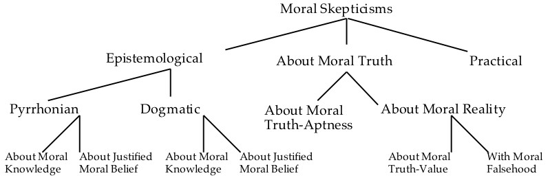

# Moral Skepticism
**First published Fri Jun 14, 2002; substantive revision Thu Aug 1, 2024**

*Sinnott-Armstrong, Walter*

“Moral Skepticism” names a diverse collection of views that deny or raise doubts about common beliefs in various roles of reason in morality. Different versions of moral skepticism deny or doubt moral knowledge, justified moral belief, moral truth, moral facts or properties, and reasons to be moral.

Despite this diversity among the views that get labeled “moral skepticism”, many people have very strong feelings about moral skepticism in general. One large group finds moral skepticism obvious, because they do not see how anyone could have real knowledge of the moral status of anything or how moral facts could fit into a physical world. Others see moral skepticism as so absurd that any moral theory can be refuted merely by showing that it leads to moral skepticism. Don’t you know, they ask, that slavery is morally wrong? Or terrorism? Or child abuse? Skeptics who deny that we have reason to believe or obey these moral judgments are seen as misguided and dangerous. The stridency and ease of these charges suggests mutual misunderstanding, so we need to be more charitable and more precise.

## 1. Varieties of Moral Skepticism

Moral skeptics differ in many ways (cf. Machuca 2017)[^machuca-2017], but they share a common core that makes them all moral skeptics. What makes moral skepticism *moral* is that it concerns morality rather than other topics. Moral skeptics might go on to be skeptics about the external world or about other minds or about induction or about all beliefs or about all norms or normative beliefs, but these other skepticisms are not entailed by moral skepticism alone.

What makes moral skeptics *skeptics* is that they raise doubts about common beliefs. Moral skeptics then differ in the kinds of common beliefs that they doubt. They might, for example, doubt categorical or absolute moral beliefs without doubting weaker kinds of moral beliefs. Moral skeptics also differ in the kinds of doubts that they raise. Since general skepticism is an epistemological view about the limits of knowledge or justified belief, the most central version of moral skepticism is the one that raises doubts about moral knowledge or justified moral belief.

There are two main traditions in epistemological skepticism. One tradition makes the claim that nobody ever knows or can know anything. This claim is sometimes named *Cartesian* skepticism (although Descartes argued against it) or *Academic* skepticism (despite other interpretations of skeptics in the ancient Academy). For lack of a better description, we can call it *dogmatic* skepticism, because such skeptics dogmatically assert a universal claim. In contrast, no such claim is made by *Pyrrhonian* skeptics. They also don’t deny any claim like this. They have so much doubt that they refrain from taking any position one way or the other on whether anyone does or does not or can or cannot know anything.

Moral skepticism comes in two corresponding varieties. *Pyrrhonian skeptics about moral knowledge* refuse to assert or endorse the claim that some people sometimes know that some substantive moral belief is true. They doubt that moral knowledge is possible. Still, they do not go on to make the opposite claim that moral knowledge is impossible. They doubt that, too. Their doubts are so extreme that they do not make any claim one way or the other about the actuality or possibility of moral knowledge. Parallel views can be adopted regarding justified moral belief. *Pyrrhonian skeptics about justified moral belief* suspend or withhold belief about the actuality or possibility of any justified moral belief.

In contrast, dogmatic moral skeptics make definite claims about the epistemic status of moral beliefs:

*Dogmatic skepticism about moral knowledge* is the claim that nobody ever knows that any substantive moral belief is true (cf. Butchvarov 1989, 2)[^butchvarov-1989].

Some moral skeptics add this related claim:

*Dogmatic skepticism about justified moral belief* is the claim that nobody is ever justified in holding any substantive moral belief.

(The relevant way of being justified is specified in Sinnott-Armstrong 2006, chap. 4.)[^sinnott-armstrong-2006] These two claims and Pyrrhonian moral skepticism all fall under the general heading of *epistemological moral skepticism*.

The relation between these two claims depends on the nature of knowledge. If knowledge implies justified belief, as is traditionally supposed, then skepticism about justified moral belief implies skepticism about moral knowledge. However, even if knowledge does require justified belief, it does not require *only* justified belief, so skepticism about moral knowledge does not imply skepticism about justified moral belief.

One reason is that knowledge implies truth, but justified belief does not. Thus, if moral beliefs cannot be true, they can never be known to be true, but they still might be justified in some way that is independent of truth. As a result, skepticism about moral knowledge is implied, but skepticism about justified moral belief is not implied, by yet another form of moral skepticism:

*Skepticism about moral truth* is the claim that no substantive moral belief is true.

This claim is usually based on one of three more specific claims:

*Skepticism about moral truth-aptness* is the claim that no substantive moral belief is the kind of thing that could be either true or false.

*Skepticism about moral truth-value* is the claim that no substantive moral belief is either true or false (although some moral beliefs are the kind of thing that could be true or false).

*Skepticism with moral falsehood* is the claim that every substantive moral belief is false.

These last three kinds of moral skepticism are not epistemological, for they are not directly about knowledge or justification. Instead, they are directly about truth, so they are usually based on views of moral language or metaphysics.

Some philosophers of language argue that sentences like “Cheating is morally wrong” are neither true nor false, because they resemble pure expressions of emotion (such as “Boo Knicks”) or prescriptions for action (such as “Go Celtics”). Such expressions and prescriptions are kinds of thing that cannot be either true or false. Thus, if these analogies hold in all relevant respects, then substantive moral beliefs are also not the right kind of thing to be either true or false. They are not apt for evaluation in terms of truth. For this reason, such linguistic theories are often taken to imply skepticism about moral truth-aptness. Views of this general sort are defended by Ayer (1952), Stevenson (1944), Hare (1981), Gibbard (1990; cf. 2003), and Blackburn (1993), although recent versions often allow some minimal kind of moral truth while denying that moral beliefs can be true or false in the same robust way as factual beliefs. For more detailed discussions of these views, see the entry on moral cognitivism vs. non-cognitivism.

Such views are often described as *non-cognitivism*. That label is misleading, because etymology suggests that cognitivism is about cognition, which is knowledge. Since knowledge implies truth, skepticism about moral truth-aptness has implications for moral knowledge, but it is about truth-aptness and not directly about moral knowledge.

Whatever you call it, skepticism about moral truth-aptness runs into several problems. If moral assertions have no truth-value, then it is hard to see how they can fit into truth-functional contexts, such as negation, disjunction, and conditionals (Sinnott-Armstrong 2000). Such contexts are also unassertive, so they do not express the same emotions or prescriptions as when moral claims are asserted. Indeed, no particular emotion or prescription seems to be expressed when someone says, “Eating meat is not morally wrong” (cf. Schroeder 2010)[^schroeder-2010], since a person who asserts this sincerely might be completely indifferent to whether anyone eats meat and need not get angry at vegetarians who critize meat eaters. Expressivists and prescriptivists respond to such objections, but their responses remain controversial (cf. Sinnott-Armstrong 2006, chap. 2)[^sinnott-armstrong-2006].

Many moral theorists conclude that moral assertions express not only emotions or prescriptions but also *beliefs*. In particular, they express beliefs that certain acts, institutions, or people have certain moral properties (such as moral rightness or wrongness) or beliefs in moral facts (such as the fact that a certain act is morally right or wrong). This non-skeptical linguistic analysis still does not show that such moral claims can be true, since assertions can express beliefs that are false or neither true nor false. Indeed, all substantive moral assertions and beliefs are false (or neither true nor false) if they claim (or semantically presuppose) that moral facts or properties exist, but no moral facts or properties really do exist, as claimed by this metaphysical thesis:

*Skepticism about moral reality* is the claim that no moral facts or properties exist.

Skepticism about moral reality is, thus, a reason for skepticism with moral falsehood, as developed by Mackie (1977), or skepticism about moral truth-value, as developed by Joyce (2001). Opponents of such *error theories* often object that some moral beliefs must be true because some moral beliefs deny the truth of other moral beliefs. However, error theorists can allow a negative moral belief to be true, but only if it merely denies the truth of the corresponding positive moral belief and does not make any other positive moral claim. For example, error theorists can endorse “Eating meat is *not* morally wrong” if they mean only that “Eating meat *is* morally wrong” is not true, and they do not go on to claim anything positive like “Eating meat ought to be permitted” or “Vegetarians should not criticize or interfere with meat eaters.” If such denials of moral beliefs are not substantive moral beliefs (as denials of astrological beliefs are not astrology), then error theorists can maintain that all substantive moral beliefs are false or neither true nor false. For more detailed discussions of these views, see the entry on moral anti-realism.

Error theorists and skeptics about moral truth-aptness disagree about the content of moral assertions, but they still agree that no substantive moral claim or belief is true, so they are both skeptics about moral truth. None of these skeptical theses is implied by either skepticism about moral knowledge or skepticism about justified moral belief. Some moral claims might be true, even if we cannot know or have justified beliefs about which ones are true. However, a converse implication seems to hold: If knowledge implies truth, and if moral claims are never true, then there is no knowledge of what is moral or immoral (assuming that skeptics deny the same kind of truth that knowledge requires). Nonetheless, since the implication holds in only one direction, skepticism about moral truth is still distinct from all kinds of epistemological moral skepticism.

Yet another non-epistemological form of moral skepticism answers the question “Why be moral?” This question is used to raise many different issues. Almost everyone admits that there is *sometimes* some kind of reason to be moral. However, many philosophers deny various universal claims, including the claims that there is *always* some reason to be moral, that there is always a distinctively *moral* reason to be moral, and/or that there is always *enough* reason to make it irrational not to be moral or at least not irrational to be moral. These claims and their denials depend on specific views about which facts provide reasons (are all reasons about desires or self-interest?), which reasons are moral in nature (are all moral reasons impartial?), and which reasons override which other reasons (are moral reasons ever overridden?). These distinct denials can be seen as separate forms of *practical moral skepticism*, which are discussed in more detail in the following supplementary document:

[Supplement on Practical Moral Skepticism](skepticism-moral.supplement.md)

Practical moral skepticism resembles epistemological moral skepticism in that both kinds of skepticism deny a role to reasons in morality. However, epistemological moral skepticism is about reasons for *belief*, whereas practical moral skepticism is about reasons for *action*. Moreover, practical moral skeptics usually deny that there is *always* enough reason for moral action, whereas epistemological moral skeptics usually deny that there is *ever* an adequate reason for moral belief. Consequently, practical moral skepticism does not imply epistemological moral skepticism. Some moral theorists (such as Kant on some interpretations) do assume that a reason to believe that an act is immoral cannot be adequate unless it also provides a reason not to do that act. However, even if the two kinds of reasons are related in this way, they are still distinct, so practical moral skepticism must not be confused with epistemological moral skepticism.

Overall, then, we need to distinguish the following kinds of epistemological moral skepticism:

*Dogmatic skepticism about moral knowledge* = nobody ever knows that any substantive moral belief is true.

*Dogmatic skepticism about justified moral belief* = nobody is ever justified in holding any substantive moral belief.

*Pyrrhonian skepticism about moral knowledge* withholds assent from both dogmatic skepticism about moral knowledge and its denial.

*Pyrrhonian skepticism about justified moral belief* withholds assent from both dogmatic skepticism about justified moral belief and its denial.

We also need to distinguish these epistemological moral skepticisms from several non-epistemological kinds of moral skepticism:

*Skepticism* *about moral truth* = no substantive moral belief is true.

*Skepticism* *about moral truth-aptness* = no substantive moral belief is the kind of thing that could be either true or false.

*Skepticism about moral truth-value* = no substantive moral belief is either true or false (although some moral beliefs are the kind of thing that could be true or false).

*Skepticism with moral falsehood* = every substantive moral belief is false.

*Skepticism about moral reality* = no moral properties or facts exist.

*Practical moral skepticism* = there is not always any or enough or distinctively moral reason to be moral.

These kinds of moral skepticism can be diagrammed as follows:

*Figure 1.*

Skepticism about justified moral belief will be the primary topic for the rest of this entry, and I will refer to it henceforth simply as moral skepticism.

## 2. A Presumption Against Moral Skepticism?

Opponents often accuse moral skepticism of leading to immorality. However, skeptics about justified moral belief can act well and be nice people. They need not be any less motivated to be moral, nor need they have (or believe in) any less reason to be moral than non-skeptics have (or believe in). Moral skeptics can hold substantive moral beliefs just as strongly as non-skeptics. Their substantive moral beliefs can be common and plausible ones. Moral skeptics can even believe that their moral beliefs are true by virtue of corresponding to an independent moral reality. All that moral skeptics need to deny or doubt in order to be moral skeptics is that their (or anyone’s) moral beliefs are justified. This meta-ethical position about the epistemic status of moral beliefs need not trickle down and infect anyone’s substantive moral beliefs or actions.

Critics still argue that moral skepticism conflicts with common sense. Most people think that they are justified in holding many moral beliefs, such as that it is morally wrong to beat your opponent senseless with a baseball bat just because she beat you in a baseball game. People also claim moral knowledge, such as when a neighbor says, “I know that it is wrong for him to spank his daughter so hard, but I don’t know what I should do about it.” Moral skepticism conflicts with these common ways of talking and thinking, so moral skeptics seem to owe us some argument for their controversial claim.

Dogmatic moral skepticism is, moreover, a universal and abstruse claim. It is the claim that all moral beliefs have a certain epistemic status. Normally one should not make such a strong claim without some reason. One should not, for example, claim that all biological beliefs are unjustified unless one has some reason for this claim. Analogously, it seems that one should not claim that all moral beliefs are unjustified unless one has some positive argument. Thus, its form, like its conflict with common sense, seems to create a presumption against moral skepticism.

Moral skeptics, in response, sometimes try to shift the burden of proof to their opponents. Anyone who makes the positive moral claim that sodomy is morally wrong seems to need some reason for that claim, just as someone who claims that there is life on Mars seems to need evidence for that claim. If the presumption is always against those who make positive moral claims, then it is opponents of moral skepticism who must carry the burden of proof. Or, at least, moral skeptics can deny that the burden of proof is on moral skeptics. Then moral skeptics may criticize any moral belief or theory without needing to offer any positive argument for moral skepticism, and their opponents need to take moral skepticism seriously enough to argue against it (cf. Copp 1991)[^copp-1991].

This controversy about burden of proof might be resolved by distinguishing dogmatic moral skepticism from Pyrrhonian moral skepticism. Dogmatic skeptics about justified moral belief make a universal claim that conflicts with common sense, so they seem to have the burden of arguing for their claim. In contrast, Pyrrhonian moral skeptics neither make nor deny any claim about the epistemic status of any moral belief. They simply raise doubts about whether moral beliefs are ever justified. This difference suggests that Pyrrhonian moral skeptics do not take on any or as much burden of proof as do dogmatic skeptics about justified moral belief.

## 3. Arguments for Moral Skepticism

Whether or not they need to, moral skeptics do offer a variety of arguments for their position. Here I will focus on arguments for dogmatic skepticism about justified moral belief, but essentially the same arguments could be formulated to support dogmatic skepticism about moral knowledge. I will return later to Pyrrhonian moral skepticism in section 4. Also, although here I will sometimes formulate these arguments in terms of moral truth for simplicity, they could be restated in ways more congenial to skeptics about moral truth-aptness.

### 3.1 Moral Disagreements

The simplest and most common argument for moral skepticism is based on observed facts: Smart and well-meaning people disagree about the moral permissibility of abortion, affirmative action, capital punishment, active euthanasia, nuclear deterrence, welfare reform, civil rights, and so on. Many observers generalize to the conclusion that no moral claim is or would be accepted by everyone.

However, all of these disagreements together still do not exclude the possibility of agreement on other moral beliefs. Maybe nobody denies that it is morally wrong to torture babies just to get sexual pleasure. Moreover, even if no moral belief is immune to disagreement, the fact that some people disagree with me does not prove that I am unjustified in holding my moral belief. I might be able to show them that I am right, or they might agree with me under ideal circumstances, where they are better informed, more thoughtful, less partial, and so on. Moral disagreements that are resolvable do not support moral skepticism, so any argument for moral skepticism from moral disagreement must show that moral disagreements are unresolvable on every issue. That will require a separate argument. (For further discussions, see the entry on moral disagreement, as well as Bergmann & Kain 2014, Besong 2014, Enoch 2009, Huemer 2007, Kagan 2023, and Vavova 2014.)[^bergmann-2014][^besong-2014][^enoch-2009][^huemer-2007][^kagan-2023][^vavova-2014]

### 3.2 Moral Explanations

Another way to argue for moral skepticism is to cite a requirement on justified belief. On one view, we cannot be justified in believing any claim unless the truth of that claim is necessary for the best explanation of some independent fact. Some philosophers then argue that moral truths are never necessary for the best explanation of any non-moral fact (cf. Harman 1977)[^harman-1977]. It follows that we cannot be justified in believing any moral claim (cf. Hill 2016)[^hill-2016].

This argument can be countered in at least three main ways. First, one could deny that justified belief must always involve inference to the best explanation. It is not clear, for example, that beliefs about mathematics or colors are or must be grounded in this way, although such beliefs still seem justified. (Compare Harman 1977 on mathematics and color.)[^harman-1977] If these beliefs are justified without any inference to the best explanation, then it is not clear why moral beliefs need that particular kind of justification.

A related reply is that, even if moral facts are not necessary for explanation, moral facts, truths, or beliefs still might be needed for deliberation (Enoch 2011, McPherson & Plunkett 2015)[^enoch-2011][^mcpherson-2015]. If we need to be able to deliberate about what to do, and if we cannot deliberate without believing in moral facts or truths, then our beliefs about moral facts or truths are supposed to be justified in some sense, according to this position.

A third common response is that sometimes a moral truth is necessary for the best explanation of a non-moral fact (cf. Sturgeon 1985)[^sturgeon-1985]. Hitler’s vices are sometimes cited to explain his atrocities. Slavery’s injustice has been said to explain its demise. And the fact that everyone agrees that it is morally wrong to torture babies just to get sexual pleasure might be best explained by the fact that this common belief is true. Moral skeptics usually reply that such explanations can be replaced by non-moral descriptions of Hitler, slavery, and torture. If such replacements are always available, then moral truths are not necessary for the best explanation of anything. However, it is not clear whether or not non-moral explanations really do work as well as moral explanations in all cases.

A special case of this argument, called an evolutionary debunking argument, has led to vigorous debate recently (cf. Kahane 2011, May 2018)[^kahane-2011][^may-2018]. Some moral skeptics (or at least skeptics about moral realism) argue that moral beliefs can be explained by evolutionary biology perhaps with help from psychology, sociology, or culture without appeal to any moral fact or truth. Such truth-independent explanations are then supposed to show that moral beliefs are either not true, not really (mind independently) true, or not justified (cf. Joyce 2006, Street 2006, Braddock 2017, Bhogal 2023)[^bhogal-2023][^braddock-2017][^joyce-2006][^street-2006]. As with other arguments from the explanatory impotence of moral facts, critics can reply either by arguing that moral facts do some explanatory work (e.g. Copp 2008 with reply by Street 2008)[^copp-2008][^street-2008] or by arguing that moral beliefs can be justified even if moral facts do not do any explanatory work (cf. Bergmann & Kain 2014)[^bergmann-2014].

### 3.3 A Regress

The next argument develops a skeptical regress. This form of argument, which derives from Sextus Empiricus (*Outlines of Scepticism*), is sometimes used to support the more general skeptical claim that no belief about any topic is justified. Nonetheless, it might seem to have special force within morality if supposedly foundational moral beliefs are especially problematic in some way.

The argument’s goal is to rule out one-by-one all of the ways in which a person might be justified in believing something. It starts with a definition:

A person *S* is *inferentially* justified in believing a claim that *p* if and only if what makes *S* justified is (at least in part) *S*’s ability to infer *p* from some belief of *S*.

Notice that what matters for this way of being justified is not whether the person *actually* bases the moral belief on an occurrent inference but only whether the person is *able* to infer that moral belief. This ability is usually understood to be present when the person has other beliefs that fit into a structure that the person could use to infer the moral belief.

There are, then, only two ways to be justified:

(1) If any person *S* is justified in believing any moral claim that *p*, then *S* must be justified either inferentially or non-inferentially.

The moral skeptic denies both possibilities in turn. First:

(2) No person *S* is ever non-inferentially justified in believing any moral claim that *p*.

Moral intuitionists and reliabilists as well as some moral contextualists deny premise (2). Moral intuitionists claim that some moral beliefs do not need to be justified by any inference because they are self-evident or we can directly perceive their truth (see the entry on intuitionism in ethics, as well as Audi 2015, Huemer 2007, Tropman 2017)[^audi-2015][^huemer-2007][^tropman-2017]. Moral reliabilists claim that some moral beliefs do not need to be justified by any inference because they are produced by some reliable non-inferential process (cf. Shafer-Landau 2005)[^shafer-landau-2005]. Moral contextualists claim that some moral beliefs do not need to be justified by any inference because the context does not call for any argument (cf. Wellman 1971, Timmons 1999)[^timmons-1999][^wellman-1971]. In response, moral skeptics argue that too many beliefs would be justified if people did not need to be able to provide any reason or inference to support their moral beliefs. If Thelma knows that Louise believes that eating meat is morally wrong, and Louise knows that Thelma believes that eating meat is *not* morally wrong, then they cannot both be non-inferentially justified in holding on to their disputed beliefs. Conflicting beliefs can sometimes both be justified, but it seems less plausible to hold that such conflicting moral beliefs are all justified without any ability to support the belief with any inference when each believer knows that other people disagree. If such conflicting beliefs are not justified in the absence of a reason, and if such conflicts are widespread enough to undermine all non-inferential justification, then premise (2) is true.

Another way to argue for premise (2) invokes science. Psychologists have found that many moral judgments are subject to a variety of distorting influences, including framing effects and certain misleading emotions (e.g. McDonald et al. 2022. Biologists then suggest that moral judgments evolved in ways that seem independent of their truth. Such indications of unreliability are supposed to show that moral judgments are not justified without inference (Sinnott-Armstrong 2006, Chapter 9, pp. 184–219; but see replies by Beaulieu 2009, van Roojen 2013, and May 2018)[^beaulieu-2009][^may-2018][^sinnott-armstrong-2006]. That would support premise (2).

Premises (1) and (2) together imply an intermediate conclusion:

(3) If any person *S* is justified in believing any moral claim that *p*, then *S* must be justified inferentially.

This means that, to be justified, *S* must be able to infer *p* from some other beliefs held by *S*. Of course, *S* does not have to draw any actual inference, but *S* still needs to hold some other beliefs that could be used to justify that belief.

But which other beliefs? There are three main possibilities:

(4) If any person *S* is inferentially justified in believing any moral claim that *p*, then S must be justified by an inference with either (a) no normative premises or (b) some normative premises but no moral premises or (c) some moral premises.

To the first possibility, moral skeptics respond with a variation on the maxim that you can’t get “ought” from “is”:

(5) No person *S* is ever justified in believing any moral claim that *p* by an inference with no normative premises.

Naturalists in moral epistemology deny (5) when they try to derive a conclusion that an act is morally wrong from purely non-normative features of the act. (See the entry on moral naturalism.) However, moral skeptics retort that such derivations always depend on a suppressed premise that all acts with those features are morally wrong. Such a suppressed premise seems moral and, hence, normative. If so, the naturalist’s inference does not really work without any normative premises. (On deriving a normative “ought” from a descriptive “is”, see Maguire 2015, Pigden 2015, and Sparks 2018.)[^maguire-2015][^pigden-2015][^sparks-2018] Naturalists still might invoke inferences to the best moral explanation, but then moral skeptics can deny that any moral hypothesis provides the best explanation independently of prior moral assumptions (see above).

The next possibility is to justify a moral conclusion with an inference whose premises are not moral but are normative in another way. This approach, which is adopted by some contractarians and ideal observer theorists among others, can be called *normativism*. Normativists usually start with premises about rationality and impartiality that are each supposed to be normative but morally neutral. If rational impartial people under relevant circumstances would agree to certain moral standards, this is supposed to show that the corresponding moral beliefs are true or justified.

One problem for this general approach is that different theories of rationality, impartiality, and relevant circumstances are all questionable and lead to contrary moral beliefs. This suggests that such theories are not morally neutral, so these derivations do not avoid moral premises. Other arguments from non-moral norms to moral conclusions run into similar problems. Moral skeptics conclude that:

(6) No person *S* is ever justified in believing any moral claim that *p* by an inference with some normative premises but no moral premises.

Premises (4)–(6) imply another intermediate conclusion:

(7) If any person *S* is justified in believing any moral claim that *p*, then *S* must be justified by an inference with some moral premise.

In short, moral beliefs must be justified by moral beliefs.

This creates a problem. Although the justifying beliefs must include some moral beliefs, not just any moral beliefs will do:

(8) No person *S* is ever justified in believing a moral claim that *p* by an inference with a moral premise unless *S* is also justified in believing that moral premise itself.

Premise (8) is denied by some contextualists, who claim that, even if a moral belief is not justified, if it is shared within a certain social context, then it may be used to justify other moral beliefs (cf. Wellman 1971, Timmons 1999)[^timmons-1999][^wellman-1971]. However, moral skeptics reply that social contexts are often corrupt, and no social context by itself can show that a moral belief is true, reliable, or, hence, justified in the relevant way.

But then how can moral premises be justified? Given (7)–(8), the moral premises must be justified by inferring them from still other moral beliefs which must also be justified by inferring them from still other moral beliefs, and so on. To justify a moral belief thus requires a chain (or branching tree) of justifying beliefs or premises, which must have one of two forms:

(9) If any person *S* is justified in believing any moral claim that *p*, then *S* must be justified by a chain of inferences that either goes on infinitely or circles back to include *p* itself as an essential premise.

The first of these two alternatives is almost never defended, since most accept:

(10) No person *S* is ever justified in believing any moral claim that *p* by a chain of inferences that goes on infinitely.

Moral skeptics also deny the other possibility:

(11) No person *S* is ever justified in believing any moral claim that *p* by a chain of inferences that includes *p* as an essential premise.

Any argument that includes its conclusion as a premise will be valid. However, anyone who doubts the conclusion will have just as much reason to doubt the premise. So, according to skeptics, nothing is gained when a premise just restates the belief to be justified.

Premise (11) is opposed by moral coherentists (e.g. Brink 1989, Sayre-McCord 1996, Sinnott-Armstrong 2006, Chapter 10, pp. 220–251)[^brink-1989][^sayre-mccord-1996][^sinnott-armstrong-2006]. Recent coherentists emphasize that they do not infer a belief from itself in a linear way. Instead, a moral belief is supposed to be justified because it coheres in some way with a body of beliefs that is coherent in some way. Still, moral skeptics deny that coherence is enough to make a moral belief justified. One reason is that the internal coherence of a set of beliefs is not evidence of any relation to anything outside the beliefs. Another reason is that every belief — no matter how ridiculous — can cohere with some body of beliefs that is internally coherent. Because so many incompatible systems seem coherent, moral skeptics deny that coherence alone is sufficient to make beliefs justified.

Now the moral skeptic can draw a final conclusion. (9)–(11) imply:

(12) No person is ever justified in believing any moral claim.

This is dogmatic skepticism about justified moral beliefs.

Many opponents find this conclusion implausible, but the regress argument is valid. Hence, its conclusion cannot be avoided without denying one of its premises. Different opponents of moral skepticism deny different premises, as indicated. However, it remains to be seen whether any of these responses to the regress argument is defensible in the end.

### 3.4 Skeptical Hypotheses

The final kind of argument derives from René Descartes (1641). I do not seem justified in believing that what I see is a lake if I cannot rule out the possibility that it is a bay or a bayou. Generalizing, if there is any contrary hypothesis that I cannot rule out, then I am not justified in believing that what I see is a lake. This common standard is supposed to be required for justified belief. When this principle is applied thoroughly, it leads to skepticism. All a skeptic needs to show is that, for each belief, there is some contrary hypothesis that the believer cannot rule out. It need not be the same hypothesis for every belief, but skeptics usually buy wholesale instead of retail, so they seek a single hypothesis that is contrary to all (or many common) beliefs and which cannot be ruled out in any way.

The famous Cartesian hypothesis is of a demon who deceives me in all of my beliefs about the external world, while also ensuring that my beliefs are completely coherent. This possibility cannot be ruled out by any experiences or beliefs, because of how the deceiving demon is defined. This hypothesis is also contrary to my beliefs about the lake. So my beliefs about the lake are not justified, according to the above principle. And there is nothing special about my beliefs about the lake. Everything I believe about the external world is incompatible with the deceiving demon hypothesis. Skeptics conclude that no such belief is justified.

Notice that the deceiving demon hypothesis plays two separate roles. First, it is incompatible with common beliefs about the world, since it implies that there is no lake that I see. Second, it explains why we would hold our common beliefs even if the hypothesis were true—namely, because the demon would deceive us into believing that I see a lake in the hypothesized world. Some skeptics might hold that an irrefutable contrary hypothesis is enough for a skeptical argument to show that the believer is not justified. For example, the hypothesis that our common beliefs are all wrong is contrary to those beliefs, but it does not explain why we hold them. However, an unexplanatory hypothesis like this strikes many as having less force in skeptical arguments than an explanatory hypothesis like the deceiving demon. For this reason, most skeptics try to construct their skeptical hypotheses to include some explanation of why people would hold the same common beliefs as they do, even if they were wrong and the skeptical hypothesis were true.

This kind of skeptical argument is often dismissed on the grounds that there is no reason to believe in a deceiving demon or that nobody really doubts whether there is an external world. In contrast, this form of argument is not subject to such objections when it is applied to morality, because some people really do adopt and even argue for a parallel skeptical hypothesis in morality:

Moral Nihilism = Nothing is morally wrong.

Moral nihilism here is not about what is semantically or metaphysically possible. It is just a substantive, negative, existential claim that there does not exist anything that is morally wrong. Since smart and knowledgable people do take moral nihilism seriously and even argue for it (Mackie 1977, Joyce 2001)[^joyce-2001][^mackie-1977], moral nihilism cannot be dismissed as readily as Descartes’s deceiving demon.

Moral nihilism by itself is enough to be contrary to common moral beliefs, but it is not explanatory. To make their argument more forceful, therefore, moral skeptics usually add some explanation of why people hold moral beliefs that are false (just as the story of Descartes’s deceiving demon is supposed to explain why we hold false perceptual beliefs). The most popular explanations of our moral beliefs refer to evolutionary and social advantages of holding certain moral beliefs, especially when these moral beliefs are shared throughout society. Shared moral beliefs can facilitate social coordination and cooperation even when they are false (much as a shared non-moral belief that my neighbors will in fact catch and punish me if I ever steal from them will reduce theft and increase trust, even if this belief is false and I actually could get away with stealing).

When bare moral nihilism is supplemented with an explanation of why people would hold common moral beliefs even if they were false, this conjunctive skeptical hypothesis can be called *explanatory moral nihilism*. Moral skeptics can then argue that explanatory moral nihilism forestalls any refutation. Since moral nihilists question all of our beliefs in moral wrongness, they leave us with no starting points on which to base arguments against them without begging the question at issue. Moreover, their explanations of our moral beliefs predict that we would hold exactly these moral beliefs, so the truth of its predictions can hardly refute explanatory moral nihilism. If this trick works, then it fits right into a skeptical hypothesis argument.

This argument is clearest when it is applied to an example. If nothing is morally wrong, as moral nihilists claim, then it is not morally wrong to torture babies just for fun. So, according to the general standard above, one must be able to rule out moral nihilism in order to be justified in believing that torturing babies just for fun is morally wrong. But one cannot rule out moral nihilism if one would hold the same moral beliefs even if they were false, as claimed by the explanation embedded in explanatory moral nihilism. Moral skeptics conclude that even this apparently obvious moral belief is not justified. More precisely:

(1) I am not justified in believing the denial of explanatory moral nihilism.

(2) I am justified in believing that [(*p*) “It is morally wrong to torture babies just for fun” entails (*q*) the denial of explanatory moral nihilism].

(3) If I am justified in believing that *p*, and I am justified in believing that *p* entails *q*, then I am justified in believing that *q*.

(4) Therefore, I am not justified in believing that it is morally wrong to torture babies just for fun.

This moral belief about torturing babies is not especially problematic in any way. It seems as obvious as any moral belief. Thus, the argument can be generalized to cover any moral belief. Moral skeptics conclude that no moral belief is justified.

There are two main responses to such skeptical hypothesis arguments (cf. May 2013)[^may-2013]. First, some anti-skeptics deny (1) and claim that skeptical hypotheses can be ruled out somehow. They might argue that explanatory moral nihilism is internally inconsistent or meaningless. If so, it can be ruled out by logic and semantics alone. However, moral nihilism does seem consistent and meaningful, according to all plausible theories of moral language, including expressivism, realism, and constructivism (Sinnott-Armstrong 2006, chap. 3)[^sinnott-armstrong-2006]. So is the explanation that is part of explanatory moral nihilism. Explanatory moral nihilism is also not subject to the kind of argument that Putnam (1981) deploys against more general skeptical scenarios. Anti-skeptics still might argue that explanatory moral nihilism is incompatible with some non-moral facts or observations or their best explanations. If so, it can be ruled out by arguments with only non-moral premises. However, all such attempts to cross the dreaded is-ought gap are questionable (Sinnott-Armstrong 2006, chaps. 7–8; cf. Pigden 2015, Sparks 2018)[^pigden-2015][^sinnott-armstrong-2006][^sparks-2018]. A third way to rule out explanatory moral nihilism would be based on common moral beliefs that are incompatible with it. However, just as it would beg the question to use common beliefs about the external world to rule out a deceiving demon hypothesis, so it would also beg the question to argue against explanatory moral nihilism on the basis of common moral beliefs — no matter how obvious those beliefs might seem to us, and no matter how well these common beliefs cohere together (Sinnott-Armstrong 2006, chaps. 9–10)[^sinnott-armstrong-2006]. Moral skeptics conclude that there is no way to rule out explanatory moral nihilism, just as premise (1) claims.

Another recent response is to deny premise (3). This is a principle of *closure*. Since a belief entails the denial of every contrary hypothesis, this closure principle in effect says that I cannot be justified in believing *p* unless I am justified in denying every hypothesis contrary to *p* — that is, unless I can rule out *all* contrary hypotheses. This principle has been denied by relevant alternative theorists, who claim instead that only relevant hypotheses need to be ruled out. On this theory, if skeptical hypotheses are not relevant, then a belief that it is morally wrong to torture babies just for fun can be justified, even if the believer cannot rule out explanatory moral nihilism. For more detail on closure in moral contexts, see Lutz 2021.

For this response to have force, however, opponents of moral skepticism need to say why explanatory moral nihilism is irrelevant. It seems relevant, for the simple reason that it is directly contrary to the moral belief that is supposed to be justified. Moreover, smart people believe and give reasons to believe in explanatory moral nihilism (e.g. Mackie 1977, Joyce 2001)[^joyce-2001][^mackie-1977]. Some people are led to moral nihilism by the absence of any defensible theory of morality. If consequentialism is absurd or incoherent, as some critics argue, and if deontological restrictions and permissions are mysterious and unfounded, as their opponents argue, then some people might believe moral nihilism for reasons similar to those that led scientists to reject phlogiston. Another basis for explanatory moral nihilism cites science. If all of our moral beliefs can be explained by sociobiology and/or other sciences without assuming that any moral belief is true, then some might accept explanatory moral nihilism for reasons similar to those that lead many people to reject witches or elves. The point is not that such reasons for explanatory moral nihilism are adequate. The point here is only that there is enough prima facie reason to believe explanatory moral nihilism that it cannot be dismissed as irrelevant on this basis. If explanatory moral nihilism is relevant, and if closure holds for all or at least relevant alternatives, and if explanatory moral nihilism cannot be ruled out in any way, then moral skepticism seems to follow.

### 3.5 Relations Among the Arguments

These arguments for moral skepticism differ in many ways, but they seem mutually supportive. One crucial premise in the skeptical hypothesis argument claims that nothing can rule out explanatory moral nihilism. The best way to support that premise is to criticize each method for ruling out explanatory moral nihilism. That is just one instance of what the regress argument does more generally. The argument from moral explanations excludes yet another way to rule out explanatory moral nihilism. So, if these other arguments work, they support a crucial premise in the skeptical hypothesis argument.

Conversely, one crucial premise in the regress argument claims that no moral belief can be justified non-inferentially. Another crucial premise, (8), claims that an inference cannot justify its conclusion unless its premises are justified. These premises claim, in effect, that a moral belief needs a certain kind of justification. One way to establish this need is to point to a contrary possibility that is not yet ruled out. That is what the skeptical hypothesis argument does. Another way to confirm this need is to show that the moral belief is controversial. That is what the argument from moral disagreement does. Thus, if these other arguments work, they support a crucial premise in the regress argument.

To skeptics, this mutual support might seem desirable. Anti-skeptics, however, might object that this mutual support makes the arguments jointly circular. In the end, the force of the arguments depends on the defensibility of non-skeptical views in moral epistemology. If moral intuitionism, coherentism, naturalism, or normativism works to justify some moral beliefs and/or to rule out explanatory moral nihilism, then this will undermine the crucial premises in the arguments for moral skepticism. But that remains to be seen.

## 4. Pyrrhonian Moral Skepticism

Although the arguments for moral skepticism are hard to refute, most people reject their conclusion. This makes it natural to seek some compromise. Various compromises have been proposed, but here I will focus on one that extends the Pyrrhonian tradition (Sinnott-Armstrong 2006, chap. 6; cf. DePaul 2009)[^depaul-2009][^sinnott-armstrong-2006].

This neo-Pyrrhonian position can be explained in terms of contrast classes, which are also important for non-moral epistemology. Suppose a father sees an animal in a zoo and believes it to be a zebra. If the father has adequate evidence that the animal is not a lion or a horse, then the father can be justified in believing that it is a zebra out of the contrast class {lion, horse, zebra}. Nonetheless, the father still might not have any evidence that the animal is not a mule painted to look just like a zebra, especially if there are such painted mules in nearby cages. Then the father is not justified in believing that the animal is a zebra out of the contrast class {lion, horse, zebra, painted mule}.

A similar situation arises with moral beliefs. A father might be justified in believing that he should tell his children the truth rather than lying to them, even if the father is not justified in believing that he should tell his children the truth as opposed to keeping quiet or deceiving them withoout lying.

More generally, we can distinguish two contrast classes:

The *extreme contrast class* for a moral belief that *p* includes every moral claim that is contrary to *p*, including moral nihilism.

The *modest contrast class* for a moral belief includes all and only those contrary moral beliefs that most people would take seriously in an ordinary discussion.

Most people do not take moral nihilism seriously in ordinary discussions, so the modest contrast class does not include moral nihilism. Thus, anyone who can rule out all other members of the modest contrast class but cannot rule out moral nihilism is justified in believing the moral claim out of the modest contrast class but not out of the extreme contrast class.

Critics will ask, “If someone is justified out of the modest contrast class but not out of the extreme contrast class, is this believer just plain justified (period or without qualification)?” That, of course, depends on what it means to say that a believer is just plain justified (without qualification). On one plausible account, to say that a believer is just plain justified (without qualification) is to say that the believer is justified out of the *relevant* contrast class. But which contrast class is relevant when?

Contextualists say that the modest contrast class is the relevant one in everyday contexts, such as hospital ethics committees, where it would be seen as a distraction to discuss moral nihilism. Nonetheless, the extreme contrast class is said to be the relevant one in philosophical contexts, such as philosophy classes where moral nihilism is taken seriously. This allows contextualists to hold that a doctor in a hospital ethics committee is justified in believing a moral claim that a philosophy student with the same evidence would not be justified in believing. However, problems arise when contexts cross. Consider a philosophy student who says that the doctor on the ethics committee is not justified in believing the moral claim. Is the student’s contrast class (with moral nihilism) or the doctor’s contrast class (without moral nihilism) really relevant to the student’s judgment about the doctor’s belief? When epistemic assessments cross contexts in such ways, it is hard to see any basis for claiming that either context or either contrast class really is the relevant one for assessing whether the believer really is just plain justified (without qualification).

Such paradoxes lead some moral skeptics to deny that any contrast class is ever really relevant. This denial implies that it is never either true or false that a believer is justified (without qualification), if such claims presuppose that some contrast class is really relevant. Alternatively, Pyrrhonian moral skeptics might suspend belief about whether any contrast class is ever really relevant or not. Such Pyrrhonian moral skeptics refuse to take any position on whether any believer is or is not just plain justified (without qualification), although they can still talk about whether someone is justified in believing a moral claim out of a specified contrast class. Pyrrhonian moral skeptics can then (i) accept skepticism about extremely justified moral belief but (ii) deny skepticism about modestly justified moral belief and (iii) refuse to either assert or deny (dogmatic) skepticism about any moral belief being just plain justified (without qualification).

Whether or not this view is finally defensible, the point here is just that such a Pyrrhonian compromise is available and attractive to those who want to avoid dogmatic moral skepticism but see no way to refute it. There are also other possible compromises that combine different strands in and kinds of moral skepticism. That is what makes it so fascinating to study this important group of views.

## References（引用注释）

> 原文参考文献已转为脚注引用：文内“作者-年份”引用组后附 [^key] 标记，完整条目见本文末脚注定义。

## Academic Tools

> |   | [How to cite this entry](https://plato.stanford.edu/cgi-bin/encyclopedia/archinfo.cgi?entry=skepticism-moral). |
> | --- | --- |
> |   | [Preview the PDF version of this entry](https://leibniz.stanford.edu/friends/preview/skepticism-moral/) at the [Friends of the SEP Society](https://leibniz.stanford.edu/friends/). |
> |   | [Look up topics and thinkers related to this entry](https://www.inphoproject.org/entity?sep=skepticism-moral&redirect=True) at the Internet Philosophy Ontology Project (InPhO). |
> |   | [Enhanced bibliography for this entry](https://philpapers.org/sep/skepticism-moral/) at [PhilPapers](https://philpapers.org/), with links to its database. |

## Other Internet Resources

[Please contact the author with suggestions.]

## Related Entries

cognitivism vs. non-cognitivism, moral | Descartes, René: epistemology | knowledge: analysis of | moral epistemology | moral non-naturalism | moral realism | moral relativism | skepticism: ancient

[^audi-2015]: Audi, Robert, 2015, *Moral Perception*, Princeton: Princeton University Press.

[^ayer-1952]: Ayer, A. J., 1952, *Language, Truth, and Logic*, New York: Dover. (First edition originally published in 1935.)

[^bambrough-1979]: Bambrough, Renford, 1979, *Moral Skepticism and Moral Knowledge*, London: Routledge.

[^beaulieu-2009]: Beaulieu, Gerard, 2009, “Sinnott-Armstrong’s Moral Skepticism: A Murdochian Response”, *Dialogue*, 48(3): 673–678.

[^bergmann-2014]: Bergmann, Michael, and Kain, Patrick (eds.), 2014, *Challenges to Moral and Religious Belief: Disagreement and Evolution*, New York: Oxford University Press.

[^besong-2014]: Besong, Brian, 2014, “Moral Intuition and Disagreement”, *Synthese*, 191(12): 2767–2789.

[^bhogal-2023]: Bhogal, Harjit, 2023, “Explanationism vs Modalism in Debunking (and Theory Choice)”, *Mind*, 132(528): 1005–1027.

[^blackburn-1993]: Blackburn, Simon, 1993, *Essays in Quasi-Realism*, New York: Oxford University Press.

[^braddock-2017]: Braddock, Matthew, 2017, “Debunking Arguments from Insensitivity”, *International Journal for the Study of Skepticism*, 7(2): 91–113.

[^brink-1989]: Brink, David, 1989, *Moral Realism and the Foundations of Ethics*, Cambridge: Cambridge University Press.

[^butchvarov-1989]: Butchvarov, Panayot, 1989, *Skepticism in Ethics*, Bloomington and Indianapolis; Indiana University Press.

[^copp-1991]: Copp, David, 1991, “Moral Skepticism”, *Philosophical Studies*, 62: 203–233.

[^copp-2008]: –––, 2008, “Darwinian Skepticism about Moral Realism”, *Philosophical Issues*, 18: 186–206.

[^depaul-2009]: DePaul, Michael, 2009, “Pyrrhonian Moral Skepticism and the Problem of the Criterion”, *Philosophical Issues*, 19(1): 38–56.

[^descartes-1641]: Descartes, René, 1641, *Meditations on First Philosophy*, translated by D. C. Cress, Indianapolis: Hackett, 1979.

[^enoch-2009]: Enoch, David, 2009, “How is Moral Disagreement a Problem for Realism?”, *The Journal of Ethics*, 13(1): 15–50.

[^enoch-2011]: –––, 2011, *Taking Morality Seriously: A Defense of Robust Realism*, New York: Oxford University Press.

[^gibbard-1990]: Gibbard Allan, 1990, *Wise Choices, Apt Feeling*, Cambridge: Harvard University Press.

[^gibbard-2003]: –––, 2003, *Thinking How to Live*, Cambridge: Harvard University Press.

[^hare-1981]: Hare, R. M., 1981, *Moral Thinking*, Oxford: Clarendon Press.

[^harman-1977]: Harman, Gilbert, 1977, *The Nature of Morality*, New York: Oxford University Press.

[^hill-2016]: Hill, Scott, 2016, “From Isolation to Skepticism”, *Erkenntnis*, 81:649–668.

[^huemer-2007]: Huemer, Michael, 2007, *Ethical Intuitionism*, London: Palgrave Macmillan.

[^joyce-2001]: Joyce, Richard, 2001, *The Myth of Morality*, Cambridge: Cambridge University Press.

[^joyce-2006]: –––, 2006, *The Evolution of Morality*, Cambridge: MIT Press.

[^kagan-2023]: Kagan, Shelly, 2023, *Answering Moral Skepticism*, New York: Oxford Unievrsity Press.

[^kahane-2011]: Kahane, Guy, 2011, “Evolutionary Debunking Arguments”, *Nous*, 45:103–125.

[^lutz-2021]: Lutz, Matt, 2021, “The Moral Closure Argument”, *Journal of Ethics and Social Philosophy*, 19(1): 80–110.

[^machuca-2017]: Machuca, Diego E. (ed.), 2017, *Moral Skepticism: New Essays*, New York: Routledge.

[^mackie-1977]: Mackie, J. L., 1977, *Ethics: Inventing Right and Wrong*, New York: Penguin.

[^maguire-2015]: Maguire, Barry, 2015, “Grounding the Autonomy of Ethics”, in *Oxford Studies in Metaethics* (Volume 10), Russ Shafer-Landau (ed.), Oxford: Oxford University Press

[^may-2013]: May, Joshua, 2013, “Skeptical Hypotheses and Moral Skepticism”, *Canadian Journal of Philosophy*, 43(3): 341–359.

[^may-2018]: –––, 2018, *Regard for Reason in the Moral Mind*, New York: Oxford University Press.

[^mcdonald-2021]: McDonald, Kelsey, Graves, Rose, Yin, Siyuan, Weese, Tara, & Sinnott-Armstrong, Walter, 2021, “Valence framing effects on moral judgments: A meta-analysis”, *Cognition*, 212: 104703.

[^mcpherson-2015]: McPherson, Tristram, and Plunkett, David, 2015, “Deliberative Indispensability and Epistemic Justification”, *Oxford Studies in Metaethics* (Volume 10), Russ Shafer-Landau (ed.), Oxford: Oxford University Press.

[^pigden-2015]: Pigden, Charles, 2015, “Hume on Is and Ought: Logic, Promises, and the Duke of Wellington”, *The Oxford Handbook of David Hume*, Paul Russell (ed.), Oxford: Oxford University Press.

[^putnam-1981]: Putnam, Hilary, 1981, *Reason, Truth, and History*, Cambridge: Cambridge University Press.

[^russell-1988]: Russell, Bruce, 1988, “Two Forms of Ethical Skepticism”, in L. Pojman (ed.), *Ethical Theory*, Belmont, Cal.: Wadsworth.

[^sayre-mccord-1996]: Sayre-McCord, Geoffrey, 1996, “Coherentist Epistemology and Moral Theory”, in *Moral Knowledge? New Readings in Moral Epistemology*, W. Sinnott-Armstrong and M. Timmons, (eds.), New York: Oxford University Press.

[^schroeder-2010]: Schroeder, Mark, 2010, *Being For: Evaluating the Semantic Program of Expressivism*, New York: Oxford University Press.

[^sextus-2000]: Sextus Empiricus, *Outlines of Scepticism*, translated by Julia Annas and Jonathan Barnes, Cambridge: Cambridge University Press, 2000.

[^shafer-landau-2005]: Shafer-Landau, Russ, 2005, *Moral Realism: A Defense*, New York: Oxford University Press.

[^sidgwick-1874]: Sidgwick, Henry, 1874/1966, *Methods of Ethics*, New York: Dover. (First edition originally published in 1874.)

[^singer-1973]: Singer, Marcus, 1973, “Moral Skepticism”, in *Skepticism and Moral Principles*, C. Carter (ed.), Evanston, Ill.: New University Press.

[^sinnott-armstrong-2006]: Sinnott-Armstrong, Walter, 2006, *Moral Skepticisms*, New York: Oxford University Press.

[^sinnott-armstrong-2010]: –––, 2010, “Expressivism and Embedding”, *Philosophy and Phenomenological Research*, 61: 677–693.

[^sparks-2018]: Sparks, Jacob, 2018, “Is, Ought, and the Regress Argument”, *Australasian Journal of Philosophy*, 97(3): 528–543.

[^stevenson-1944]: Stevenson, Charles, 1944, *Ethics and Language*, New Haven: Yale University Press.

[^street-2006]: Street, Sharon, 2006, “A Darwinian Dilemma for Realist Theories of Value”, *Philosophical Studies*, 127: 109–166.

[^street-2008]: –––, 2008, “Reply to Copp: Naturalism, Normativity, and the Varieties of Realism Worth Worrying About”, *Philosophical Issues*, 18: 207–228.

[^sturgeon-1985]: Sturgeon, Nicholas, 1985, “Moral Explanations”, in *Morality, Reason, and Truth*, D. Copp and D. Zimmerman (eds.), Totowa, N.J.: Rowman and Allanheld.

[^timmons-1999]: Timmons, Mark, 1999, *Morality Without Foundations: A Defense of Ethical Contextualism*, New York: Oxford University Press.

[^tropman-2017]: Tropman, Elizabeth, 2017, “Intuitionism in Moral Epistemology”, in *The Routledge Handbook of Metaethics*, T. McPherson & D. Plunkett (eds.), London: Routledge, pp. 472–483 .

[^van-2013]: Van Roojen, Mark, 2013, “Moral Intuitionism, Experiments, and Skeptical Arguments”, in *Intuitions*, Booth and Rowbottom (eds.), Oxford: Oxford University Press.

[^vavova-2014]: Vavova, Katia, 2014, “Moral Disagreement and Moral Skepticism”, *Philosophical Perspectives*, 28(1): 302–333.

[^wellman-1971]: Wellman, Carl, 1971, *Challenge and Response: Justification in Ethics*, Carbondale: Southern Illinois University Press.

[^williams-1985]: Williams, Bernard, 1985, *Ethics and the Limits of Philosophy*, Cambridge, MA: Harvard University Press.
