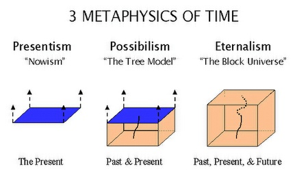
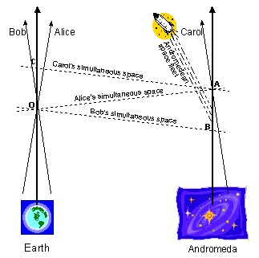
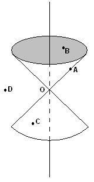

# Being and Becoming in Modern Physics
**First published Wed Jul 11, 2001; substantive revision Wed Oct 6, 2021**

*Savitt, Steven*

What is time, and is it real? If it is, does time flow or lapse or pass? Are the future or the past as real as the present? These metaphysical questions have been debated for more than two millennia, with no resolution in sight. Modern physics provides us, however, with tools that enable us to sharpen these old questions and generate new arguments. Does the special theory of relativity, for example, show that there is no temporal passage or that the future is as real as the present? The focus of this entry will be on these new insights into those old questions.

## 1. Introduction

Around 500 B. C. Heraclitus wrote the following:

> Everything flows and nothing abides; everything gives way and nothing stays fixed.
>
> You cannot step twice into the same river, for other waters and yet others, go flowing on.
>
> Time is a child, moving counters in a game; the royal power is a child’s.[^note-1]

Transience is basic, and the present is primary. Those things which exist now do not abide. They slip into the past and non-existence, devoured by time, as all experience attests.

A generation or so later we have a classic statement of the opposing view by Parmenides:

> There remains, then, but one word by which to express the [true] road: Is. And on this road there are many signs that What Is has no beginning and never will be destroyed: it is whole, still, and without end. It neither was nor will be, it simply is—now, altogether, one, continuous…

Permanence is basic. No things come to be or, slipping into the past, cease to be. Past, present, and future are distinctions not marked in the static Is. Time and becoming are at best secondary, at worst illusory, as our understanding of the world confirms.

Turn now to modern times and to a paragraph in Rudolf Carnap’s intellectual autobiography (Carnap 1963, pp. 37–38)[^carnap-1963]:

> Once Einstein said that the problem of the Now worried him seriously. He explained that the experience of the Now means something special for man, something essentially different from the past and the future, but that this important difference does not and cannot occur within physics. That this experience cannot be grasped by science seemed to him a matter of painful but inevitable resignation. I remarked that all that occurs objectively can be described in science; on the one hand the temporal sequence of events is described in physics; and, on the other hand, the peculiarities of man’s experiences with respect to time, including his different attitude towards past, present, and future, can be described and (in principle) explained in psychology. But Einstein thought that these scientific descriptions cannot possibly satisfy our human needs; that there is something essential about the Now which is just outside the realm of science. We both agreed that this was not a question of a defect for which science could be blamed, as Bergson thought. I did not wish to press the point, because I wanted primarily to understand his personal attitude to the problem rather than to clarify the theoretical situation. But I definitely had the impression that Einstein’s thinking on this point involved a lack of distinction between experience and knowledge. Since science in principle can say all that can be said, there is no unanswerable question left. But though there is no theoretical question left, there is still the common human emotional experience, which is sometimes disturbing for special psychological reasons.

This difference as expressed here between Einstein and Carnap (that is, between the Heraclitean and Parmenidean attitude towards time and change) is the subject of this article, which will use modern physics—especially modern spacetime theories—as a set of lenses through which it is hoped the riddles of time will come into sharper focus. There are many ways, however, to approach these questions. Early in the twentieth century, Anglo-American philosophy turned to consideration of language as a way to clarify philosophical disputes. Philosophers of time debated the relations between and the relative primacy of tensed language (concerning the notions of present, past, and future) and tenseless language (concerning the relations of simultaneity and temporal precedence). Our considerations of physics will generally, though not completely, skirt linguistic disputes. The reader interested in following these debates can find a useful introduction in the entry on time, a classic presentation in Gale (1968)[^gale-1968], a review and discussion in Tooley (1999)[^tooley-1999], and Dyke (2007 chapter 3, 2013).

Other philosophers have been influenced by analogies between time and modality. The reader interested in this way of thinking about time should consult the article on temporal logic. The present article will focus on time in physics and the relations between time and space. Other philosophical approaches focus on the primacy of experience in our understanding of time. The reader interested in these approaches may wish to consult the entry on temporal consciousness.

## 2. Newtonian Spacetime

Modern physical theories are often formulated in a language that permits one to express a variety of different views with respect to time and its relation to space. One can, for example, formulate the basic ideas of classical (that is, Newtonian) physics, the special theory of relativity, and the general theory of relativity in this language. For a brief introduction to manifolds and the spacetime view, see the section on modern spacetime theories in the entry on the hole argument in this Encyclopedia. For more detail with minimal technical demands the reader should see the first four chapters of Geroch (1978)[^geroch-1978] or the more demanding chapter 2 of Friedman (1983)[^friedman-1983].

For our purposes, the defining feature of a manifold that is a Newtonian spacetime is that the temporal interval between any two points or events in the spacetime, $p$ and $q$, is a well-defined quantity. This quantity is well-defined in that it does not depend upon point of view, reference frame, coordinate system or “observer”. This quantity, then, is *absolute* in the sense of being frame- or observer-independent. (In the special theory of relativity the temporal interval between two distinct spacetime points fails to be absolute in this sense.)

If the temporal interval between two events is 0, then we say that the two events are *simultaneous*. This relation of (absolute) simultaneity is an equivalence relation (That is, it is reflexive, symmetric, and transitive.) that slices (partitions or foliates) the spacetime or manifold into mutually exclusive and exhaustive planes of simultaneity. These planes of simultaneity can then be completely ordered by the relation ‘is earlier than’ or its converse ‘is later than’.

### 2.1 Presentism, Possibilism, Eternalism

The geometrical structure of Newtonian spacetime reflects the way we ordinarily think about time and is the proper backdrop for introducing the three major rival metaphysical views of time, as illustrated below:

\*Figure 1\*. Three Metaphysics of Time

The first view, represented on the left, is the ontologically austere view called *presentism*, the view that only the present exists. The past has been but is no longer, while the future will come to be but is not yet. Note that it is the convention of these diagrams that one spatial dimension is suppressed. The present is actually a three dimensional global slice of the spacetime. Moreover, the illustration necessarily represents the spatial extent of the present as finite and may suggest that time also has a beginning and/or end. These views are, however, merely artifacts of the representation and not integral to presentism, possibilism, or eternalism. The diagram illustrating presentism also has four arrows pointing towards the top of the page (conventionally taken to represent the future direction) attached to the plane representing the present. These arrows are meant to indicate something that is integral to presentism, the idea that the present (and hence the existent) constantly shifts or changes. These arrows represent, then, the dynamic aspect of time called *temporal becoming* or *passage.* It is widely thought that the deepest problems in the metaphysics of time concern the understanding of passage or temporal becoming and its relation to existence.

In contrast to the radical Heraclitean view of presentism, the Parmenidean eternalist picture on the far right lacks these arrows and indicates that there is nothing more special about the temporal present (the *now*) than the spatial present (the *here*). Future and past events at a place, on this view, are no more or less real than distant events at a time. The *now* like the *here* is a function of one’s perspective, one’s position in the spacetime, and these positions are indicated by the line in the spacetime representing the history of spacetime locations of a particular object or person. Such a line is often called a *world line.*

The middle view, possibilism, is indeed an intermediate view. It is a passage view, but it is less ontologically sparse than presentism. While on this view the future is still merely possible rather than actual (hence its name), the past has become and is fully actual. If one thinks of the future as a branching structure of alternative possibilities (as the result, perhaps, of free human choices or indeterministic quantum measurements), then one can think of the past and present as the trunk of that tree, growing as possibilities become actual in the present. This view is also known as *the growing block* view.

Possibilism seems to capture much of the way we think about time and being. While the sparse symmetry of presentism is attractive, there are many deep asymmetries concerning past and future that it fails to reflect. I can easily ascertain, for instance, yesterday’s closing number for the Dow Jones Industrial Average, but by no efforts, however great, can I now ascertain tomorrow’s close. And it seems as if my future actions (or certain sorts of quantum measurements) can actualize some future possibilities as opposed to others, whereas past actions (or the results of past quantum measurements) seem no longer to admit of past alternatives. Even if one allows for the possibility of retrocausation, that is, for the possibility of an effect preceding its cause in time, it is generally held that a present cause can not change or alter the past. It would merely make the past what it was. (See the entry on backwards causation for further consideration of this topic.)

Eternalism too, *prima facie*, would seem to have trouble accounting for the asymmetries built into possibilism, while also apparently bearing the burden of an implausible denial of passage. But the first topic to which we shall turn is an argument, prominent in twentieth century philosophy of time, that passage or becoming is a self-contradictory idea. If the argument is correct, then neither presentism nor possibilism can be correct metaphysical views of time and being.

### 2.2 McTaggart’s Argument

At the beginning of the 20th century, J. M. E. McTaggart (1908)[^mctaggart-1908] presented an argument which purported to prove that time is unreal. According to McTaggart (1927, pp. 9–10):

> Positions in time, as time appears to us prima facie, are distinguished in two ways. Each position is Earlier than some and Later than some of the other positions… . In the second place, each position is either Past, Present, or Future. The distinctions of the former class are permanent, while those of the latter are not. If $M$ is ever earlier than $N$, it is always earlier, But an event, which is now present, was future, and will be past.

The first structure of “positions in time,” McTaggart called *the B-series.* I will assume that McTaggart intended the B-series to coincide with the Newtonian spacetime structure described above. McTaggart noted that there was something static or “permanent” about the B-series. If, for example, event $e_1$ is earlier than event $e_2$ at some time or other, then one may truly assert at all times that $e_1$ is earlier than $e_2$ .

The dynamic element of time must be represented, in McTaggart’s view, by the series of properties of pastness, presentness, and futurity, which (in contrast to the static B-series) are constantly changing. A given event becomes less future, becomes present, and then becomes increasingly past. This latter ever-shifting series McTaggart called *the A-series.*

While there are many obscurities in McTaggart’s writing, it seems clear that his argument that time is unreal runs along the following lines:

**(1)**

there can be no time unless it has a dynamic element (that is, on his view, unless there is an A-series),

**(2)**

there can be no A-series, because the supposition that there is an A-series leads to contradiction.

The contradiction alleged by McTaggart is that:

**(A₁)**

every event must have many, if not all, the A-properties (or A-determinations, as they are sometimes called) whereas,

**(A₂)**

since the A-properties are mutually exclusive, no event can have more than one of them.

Near the end of a career in which he spent much time and effort in thinking about McTaggart’s argument, C. D. Broad (1959, p. 765) wrote:

> I felt from the first, and still feel, that the difficulty which arises is (a) embarrassing enough prima facie to demand the serious attention of anyone who philosophises about time, and (b) almost certainly due to some purely linguistic source (common, and perhaps peculiar, to the Indo-European verb-system), which it ought to be possible to indicate and make harmless.

Broad’s claim (a) was vindicated by the fact that McTaggart’s argument has received serious attention from most subsequent philosophers who pondered the metaphysics of time. Much of this debate concerns the relative relations of the two series. Is the A-series fundamental and the B-series derived from it, or vice versa; or does, perhaps, one series supervene upon the other? In the formal mode, the questions become whether the B-series may somehow be reduced to, may be defined in terms of, the A-series (or vice versa). These debates concern mainly language rather than physics and will not be considered here.[^note-2]

What emerges from the McTaggart literature is, first of all, a tendency to identify the existence of passage or temporal becoming with the existence of the A-series (that is, to think of becoming as events changing their properties of pastness, presentness or nowness, and futurity) and hence the tendency for debates about the existence of passage to focus on the merits or incoherence of the A-series rather than examining alternative accounts of becoming. (But Cf. Fitzgerald, 1985)[^fitzgerald-1985]

There is a contrary tendency amongst those philosophers who take modern physics seriously to be sceptical of entities like constantly shifting temporal properties of events, since such properties play no role in modern physical theory. One view, defended by Paul Horwich (1987, Chapter 2) and Huw Mellor (1981, 1998)[^mellor-1981][^mellor-1998], is that even though McTaggart showed that the A-series is impossible, the B-series (that is, static classical spacetime structure) suffices for time.

Before we expand on this theme, though, first a few words about Broad’s (b), his suspicion that there is some peculiarity of our language(s) that creates or at least reinforces the credibility of McTaggart’s anti-passage argument. Broad suspected that there was a subtle ambiguity in the copula ‘is’ between tensed and tenseless uses, between the uses in, for instance:

It is raining

and

Seven is prime,

the former sentence containing a tensed and the latter sentence a non-tensed or tenseless copula. It has been further suggested (Sellars 1962)[^sellars-1962] that one might understand a non-tensed copula (indicated by ‘be’ rather than ‘is’) after the following fashion

$S$ be $F$ at $t$ iff $(S$ was $F$ at $t$ or $S$ is $F$ at $t$ or $S$ will be $F$ at $t)$,

where the verbs to the right of the ‘iff’ (a logician’s abbreviation for ‘if and only if’) are usual tensed verbs.

Alternatively, one might think of a tenseless copula as the usual copula stripped of temporal information (Quine, 1960, p. 170, Mellor 1981, 1998, Chapter 7)[^mellor-1981][^mellor-1998][^quine-1960], just as the usual copula carries no spatial information. If we indicate this tenseless copula by writing ‘BE’ instead of ‘is,’ we can say that ‘It BE windy in Chicago’ carries information about the place but not the time of the wind, just as ‘It BE windy at t’ tells us about its time but not its place.

These distinctions will prove helpful in the subsequent discussion of becoming in modern physics. For the moment, one might note that Broad could argue that McTaggart’s (A₁) seems plausible if the copula is understood in some tenseless fashion, whereas (A₂) is plausible if the copula is tensed. If, however, the copula is not univocal in (A₁) and (A₂), then there is no contradiction involved in accepting both (Savitt, 2001)[^savitt-2001].

The claim that the copula is ambiguous (or more precisely, polysemous) has also been thought to have some implications for the metaphysical dispute between presentism and the two non-presentist views sketched above. A number of authors (Meyer (2005)[^meyer-2005], Savitt (2006)[^savitt-2006], Dorato (2006)[^dorato-2006], Lombard (2010)[^lombard-2010], and Arthur (2019, section 2.3). See Dolev (2007)[^dolev-2007] for a different anti-ontological argument.) have argued that in order for there to be a genuine difference between these allegedly distinct metaphysical views, in addition to the suggestive pictures displayed above there must be some univocal statement or proposition concerning temporal ontology that one side asserts and the other side denies. When the polysemy of the copula (or of the verb ‘to exist’) is taken into account, it has proven very difficult to find a clear example of such a statement or proposition. What many philosophers take to be a profound dispute in the metaphysics of time may well turn out to be a mere verbal tangle. (Putnam (2008)[^putnam-2008], by the way, has recently joined these critics: “[T]he question whether the past and future are ‘real’ is a pseudo-question.”)

According to one author (Sider, 2006)[^sider-2006], there seems to be disagreement concerning the following assertion: dinosaurs exist. Presentists are understood to deny this claim, while eternalists are supposed to affirm it. If those who endorse the claim understand the verb ‘exist’ to be tenseless and those who deny it take ‘exist’ to be a present tense verb, then both sides seem to endorse correct claims. There is in this instance, however, no univocal statement that is being disputed, since ‘exist’ is understood differently by the two sides. This observation has led many to try to state a version of presentism that is neither trivial nor obviously false and to locate precisely the point at which it differs from non-presentist views. (See Crisp (2004a,b), Ludlow (2005), Wüthrich (2012)[^wüthrich-2012], Golosz (2013)[^golosz-2013]. Tallant (2013)[^tallant-2013] reviews several such efforts negatively and adds one of his own.)

The few authors that have approached this debate from a linguistic perspective differ on the behaviour of the verb ‘exist’. Ludlow (2005) considers both a tensed and a tenseless verb; Stoneham (2009)[^stoneham-2009] is sceptical with regard to tenseless predication; and Moltmann (2013)[^moltmann-2013] considers ‘exist’ only as a present tense verb. It is worth noting that he claims that ‘exist’ functions quite differently from ‘there are’ in that the latter can be used to quantify over past, merely possible, and intensional entities whereas the former can not. If his claim is correct, then a common test sentence for the difference between eternalists and presentists introduced in Sider (2006)[^sider-2006]--There exist dinosaurs--seems almost purpose-built to breed confusion.

### 2.3 How (and How Not) To Think About Passage

If McTaggart’s argument that passage is conceptually absurd or self-contradictory fails, philosophers mindful of modern physics are still left with Einstein’s concern that passage and the now, while deeply embedded in human experience, seem to find no place in physics. One may agree with Carnap above that “all that occurs objectively can be described in science” and then argue that passage reflects something perspectival or subjective and so is rightly omitted by physics.

The most popular version of this view holds that *now* is a token-reflexive or indexical term, like *here* (Smart 1963, chapter VII; Mellor 1981, 1998)[^mellor-1981][^mellor-1998][^smart-1963]. Physics is not felt to be incomplete because it fails to treat *hereness.* Why should its indifference to *nowness* be of any greater concern?

Early proponents of this view often claimed that ‘$S$ is now $F$’ meant ‘$S$’s being $F$ is simultaneous with this utterance,’ a quite implausible claim. A more sophisticated version of the view is that the truth-conditions of sentences like ‘$S$ is now $F$’ can be given solely in terms of the (tenseless) facts that exist or events that occur at the time of the utterance or inscription of the given sentence. One can treat *past* and *future* in a similar fashion. (Dyke, 2013)[^dyke-2013]

Smart claimed that excessive attention to the tensed notions of *now, past,* and *future* serve to project a “sort of anthropocentric idea on the universe at large.”(1963, 132) But even if the tensed temporal locutions are anthropocentric and do locate *us* in the universe, it may still be asked whether these temporal locations are in a static structure, “a four-dimensional continuum of spacetime entities,” (132) or in an unfolding or dynamic universe. Smart dismisses this latter view because, in his view, it involves the obscure or mistaken idea that events “become” or “come into existence.” Becoming and passage are mistakes, in his view, and harmful ones at that. Smart writes: “Our notion of time as flowing, the transitory aspect of time as Broad has called it, is an illusion which prevents us seeing the world as it really is” (132).

It will be useful to untangle a couple of ideas that are confounded in these quotes from Smart, with the help of some arguments of (mostly) Broad’s (1938, section 1.22 of Chapter 35). First is the idea that time “flows” or, more generally, that passage is somehow to be thought of as like motion. Perhaps time itself somehow moves. Or perhaps, as Broad wrote in a famous passage (1923, 59):

> We are naturally tempted to regard the history of the world as existing eternally in a certain order of events. Along this, and in a fixed direction, we imagine the characteristic of presentness moving, somewhat like the spot of light from a policeman’s bull’s-eye traversing the fronts of the houses in a street. What is illuminated is the present, what has been illuminated is the past, and what has not yet been illuminated is the future.

This picture of passage has come to be called *the moving spotlight* view, or just *the moving NOW*.[^note-3]

Motion is one sort of change, change of spatial position with respect to time. The motion of time, then, must be change of time with respect to … What? If the answer, by analogy with motion, is “time”, one might be rightly puzzled as to how time (or anything else, for that matter) can change *with respect to itself.* Furthermore, if it is just time again, then the ratio of these two quantities expressing the supposed rate of change is a pure or dimensionless number if the dimensions of the quantities in this ratio cancel. (See Price 1996, p. 13.)[^price-1996] A pure number is not a rate of change, although it may represent various rates of change (for instance, 30 meters/second or 30 miles/hour). As Price remarks, “We might just as well say that the ratio of the circumference of a circle to its diameter flows at *π* seconds per second!”

Tim Maudlin (2007)[^maudlin-2007] has replied to Price that the rate of one second per second is a perfectly fine rate. Consider, he says, a fair exchange rate (based, say, on purchasing power parity) for currencies. The fair exchange rate for the British pound might, at some time, be 1.52 US dollars per pound. Similarly, Maudlin observes that the fair exchange rate for the US dollar with respect to itself must be 1 US dollar per US dollar. “If you think that this answer is meaningless,” Maudlin writes, “imagine your reaction to an offer of exchange at any other rate” (2007, 112).

Price (2011)[^price-2011] has replied to Maudlin by abandoning the claim that the units in “one second per second” cancel, leaving a pure number. He now insists, rather, that a ratio of a quantity to itself can not be a rate at all. Maudlin’s example only seems to evade this point by supposing a ratio of *dollars offered* to *dollars returned*. That ratio differs, as he sees it, in an essential way from the ratio of one second to one second or, for that matter, from the ratio of one mile to one mile, which are both ratios of quantities to themselves. Neither in his view can be a rate, and the former ratio is no more characteristic of time than the latter ratio is of space. (See also Markosian (1993)[^markosian-1993], Olson (2009)[^olson-2009], Raven (2010)[^raven-2010], Skow (2012)[^skow-2012], and Arthur (2019, 134–35)[^arthur-2019].)

If (in order to avoid the apparent collapse of a ratio or rate into a pure number) the time in the denominator of the ratio expressing the rate of time’s motion is held to be a different temporal dimension from the one in the numerator, then for it to be a genuine time there will have to be passage in it, requiring yet a third temporal dimension. One can see that we are at the beginning of an infinite regress, unless the third temporal dimension is identified with the first (as in Schlesinger 1980, Chapter II)[^schlesinger-1980], leaving us still in the uncomfortable position of having two temporal dimensions. It seems at best heroic, at worst hopeless, to try to understand passage as a kind of motion.

Broad thought that trying to explain or represent passage in terms of qualitative change was “doomed to failure.” A thing or substance, $S$, can change in terms of a quality or property if property $P_1$ and property $P_2$ are determinates under a given determinable and $S$ is $P_1$ at $t_1$ but $P_2$ at $t_2$. The passage of time, then, is to be thought of as an event’s having (say) the property of presentness and then immediately losing that property but gaining (and losing in turn) a long and possibly endless series of properties of the increasing degrees of pastness.

In order for a thing to change from having $P_1$ at $t_1$ to having $P_2$ at $t_2$ it must evidently persist at least from $t_1$ to $t_2$, but the events usually supposed in discussions of passage are instantaneous events, which have no duration at all. They can not undergo qualitative change. It is sometimes argued that the properties that make up the A-series (and so change of which represents passage) are special properties, which even instantaneous events can gain and lose, but this is special pleading. As noted above, physics has so far no need of such special properties and such special change and so is unlikely to be sympathetic to this special pleading.

Finally, Broad notes that (assuming one wishes to think of passage as like qualitative change) the acquisition and loss of (say) presentness by an event would itself be an event, a second-order event, in the history of a first-order event. Since the first-order events are, by hypothesis, durationless, it is tempting to suppose that this history takes place in a second temporal dimension. We find ourselves again launched on what looks to be an infinite regress of temporal dimensions.

These are strong arguments against two perennially tempting ways to construe temporal becoming—as like motion or qualitative change. They are strong arguments against the existence of temporal becoming if there is no other way to understand it. Broad thought, however, that he had a third way. Having pointed out the superficial grammatical similarity between ‘$E$ became louder’ and ‘$E$ became present’, Broad said that our understanding of these two kinds of assertions need not be dictated by it. He wrote (1938, p. 280–1):

> Again, any subject of which we can significantly say that it “became louder” must be a more or less prolonged noise-process, which divides into an earlier phase of less loudness adjoined to a later phase of greater loudness. But a literally *instantaneous* event-particle can significantly be said to “become present”; and, indeed, in the strict sense of “present” *only* instantaneous event-particles can be said to “become present”. To “become present” is, in fact, just to “become”, in an absolute sense; i.e., to “come to pass” in the Biblical phraseology, or, most simply, to “happen”. Sentences like “This water became hot” or “This noise became louder” record facts of *qualitative change.* Sentences like “This event became present” record facts of *absolute becoming.*

The terminology may be pretentious, but the idea is simple. Absolute becoming is just the happening of events. The *raison d’être,* the very being or existence of events, is in their happening (at some place and time). If one is willing to embrace this category of entity at all, then one has the tools for a minimalist understanding of passage. Given the geometric richness of Newtonian spacetime, we can say that some events occur at the same time and so form a class of simultaneous events. These classes can be ordered by their times, so we can say that some events occur before or after others. The passage of time is then just the successive happening of (simultaneity sets of) events.[^note-4] It may be this picture of passage that the great logician Kurt Gödel had in mind when he wrote (1949, p. 558): “The existence of an objective lapse of time … means (or, at least, is equivalent to the fact) that reality consists of an infinity of layers of ‘now’ which come into existence successively.”

There is an ambiguity in this last quote, however, that we must note. Did Gödel think that the layers of now come into existence (as what is to be becomes what is now) and then immediately cease to exist (as what is now becomes what once was), which is the presentist metaphysics of time? Or did he think that the layers of now come into existence and forever stay in existence, as the possibilist picture maintains? If one’s basic ontology consists of the sort of events characterized above and often invoked in discussions of time, (idealized) instantaneous happenings, then the presentist picture seems inevitable.

The metaphysics of time is, however, one of the cross-roads of philosophy where issues intersect. If one thinks of a basic ontology consisting not of events but of substances or continuants, then one is apt to wonder what it is that makes sentences marking episodes in the histories of such substances—sentences like ‘$S$ is *Φ* at $t$’—true. One frequent suggestion is that the “truth-makers” of such sentences are facts, the fact that at $t$, $S$ *is* *Φ*. Then one might further note that in the current year, 2021, we can say:

1. It is a fact that Mount St. Helens erupted in Washington in 1980.
2. It is a fact that Justin Trudeau is now Prime Minister of Canada.
3. It is a fact that there will be a total eclipse of the sun in the United States in 2045.

These facts, when compared to evanescent events, seem to have great stability, the first one lasting (since it *is* a fact …) at least from 1980 till the present. The third one is, however, a special sort of fact, clearly not dependent on human will or choice and almost certainly not dependent upon any quantum measurements either. Future facts that do depend upon human choice or quantum measurement, should they be facts now, would seem to constrain human choice or quantum measurement in ways that many philosophers find undesirable. It is easy to convince oneself, then, that future facts of those two sorts can not really be part of the existing. Perhaps, then, facts like fact 3 above can be argued away as well. The result of this (lightly sketched) train of thought is, of course, the possibilist picture of time.

It seems unlikely that a simple argument will decide between these two metaphysical pictures of time, presentism and possiblism. Showing that McTaggart’s argument is flawed, because it relies on an ambiguity in the copula ‘is’, and that there is a way to construe passage that side-steps the traditional objections, moreover, does not show that eternalism is false but only that it is optional. In Newtonian spacetime it may appear implausible, but it may fare better when we turn to Minkowski spacetime.

## 3. The Special Theory of Relativity

The Special Theory of Relativity (Einstein, 1905)[^einstein-1905] was presented as a geometric theory of spacetime in Minkowski (1908)[^minkowski-1908].[^note-5] For our purposes, the key change from Newtonian spacetime to Minkowski spacetime is that in the latter it is no longer the case that the temporal interval between any two points or events in the spacetime, $p$ and $q$, is a well-defined quantity. In fact, the temporal interval between two points in the spacetime (and hence the simultaneity of two points in the spacetime) is not defined at all until a coordinate system or frame of reference (with some arbitrarily chosen spacetime point as origin of the frame) is chosen. A peculiar feature of special relativity (as opposed Newtonian physics) is that each inertial frame defined by an “observer” passing through the chosen origin and moving with some constant non-zero velocity that is less than the speed of light (the only coordinate systems or frames of reference that will be considered in our discussion of the special theory) picks out a *distinct* set of points as simultaneous with the origin. This feature of special relativity is called *the relativity of simultaneity.*

The relativity of simultaneity is a consequence of two startling assumptions. First, each of these “observers”, no matter at what (subluminal) speed or in which direction they or the source of the light are moving (as long as neither the speed nor the directions change), must come to the same result (conventionally indicated as $c)$ when they measure the speed of light. We will not attempt to justify the assumption of the constancy of the speed of light here, though many standard texts present the empirical and theoretical background that led to it. Nor is it obvious that this assumption leads to the relativity of simultaneity, though one of the joys of even elementary presentations of the subject is that this *prima facie* astonishing connection can be convincingly demonstrated to persistent non-specialists.

The second assumption typically made in presentations of the special theory is *the Principle of Relativity:* All inertial frames are completely equivalent for the formulation of the laws of physics.[^note-6]

A glance back at Figure 1 reminds us that presentism and possibilism suppose that one plane of simultaneity is uniquely metaphysically important. In the former view, it represents all that exists. In the latter view, it is the locus of becoming, the dividing line between the merely possible future and the actual past-plus-present. The special theory of relativity tells us that there is an infinity of planes of simultaneity passing through any given spacetime point and that no physical test can distinguish one from amongst the lot. What was supposedly metaphysically distinguished is physically indistinguishable. Assuming that we humans are complex physical systems, then we have no way to distinguish *the* present from amongst the multitude of putative presents.

An enthusiast could make much of this fact. For instance, the mathematician (and science fiction writer) Rudy Rucker wrote (1984, p. 149):

> As it turns out, it is actually *impossible* to find any objective and universally acceptable definition of “all of space, taken at this instant.” This follows … from Einstein’s special theory of relativity. The idea of the block universe is, thus, more than an attractive metaphysical theory. It is a well-established scientific fact.

On the other hand, the distinguished philosopher and logician Arthur Prior thought that the above conclusion showed that special relativity is an incomplete view of reality (Prior, 1970)[^prior-1970]:[^note-7]

> One possible reaction to this situation, which to my mind is perfectly respectable though it isn’t very fashionable, is to insist that all that physics has shown to be true or likely is that in some cases we can never *know,* we can never *physically find out,* whether something is actually happening or merely has happened or will happen.

We shall look at more nuanced reactions to the relativity of simultaneity below, but first it will be useful to introduce an argument that plays somewhat the same role in Minkowski spacetime as McTaggart’s argument did in Newtonian spacetime. Versions of the argument are endorsed in papers by the physicist Wim Rietdijk (1966, 1976)[^rietdijk-1966][^rietdijk-1976] and the philosopher Hilary Putnam (1967)[^putnam-1967], but the presentation here will be based on an example found in Roger Penrose’s book, *The Emperor’s New Mind.*

Imagine that the Andromeda galaxy, which is about two million light years or $2\times 10^{19}$ kilometers from Earth, is at rest with respect to Earth. On Earth two friends walk past each other, Alice walking along the Earth-Andromeda line towards Andromeda, Bob walking along that line but away from Andromeda. Each is walking at a comfortable pace, say 4 km/hour. One can calculate that their planes (or spaces) of simultaneity at the instant at which they pass each other on Earth (Call the event of their meeting $\mathbf{O})$ intersect the history or *world line* of Andromeda about 5 ¾ days apart. (Call these two events $\mathbf{A}$ and $\mathbf{B}$, respectively. We are idealizing Andromeda as a point, for the purpose of this example.) Imagine, finally, that during this 5 ¾ day period between $\mathbf{B}$ and $\mathbf{A}$ a momentous thing happens. The Andromedeans launch a space fleet aimed at invading Earth.

\*Figure 2\*. The Andromedean Invasion

The launch of the invading fleet is prior to $\mathbf{A}$ and so *in some sense* in Alice’s past. But since the launch is after $\mathbf{B}$, it is in that same sense in Bob’s future. Penrose comments:

> Two people pass each other on the street; and according to one of the two people, an Andromedean space fleet has already set off on its journey, while to the other, the decision as to whether or not the journey will actually take place has not yet been made. How can there still be some uncertainty as to the outcome of that decision? If to *either* person the decision has already been made, then surely there *cannot* be any uncertainty. The launching of the space fleet is an inevitability. (p. 303)

This is an odd situation indeed. An event in Bob’s future seems in some way to become fixed or inevitable by being in Alice’s past. But that is not the end of the oddness here. Imagine that at point $\mathbf{A}$ (where Alice’s plane of simultaneity intersects the world line of Andromeda) there is an Andromedean, Carol, who is walking directly towards Earth at about 4 km/hour. Then Carol’s plane of simultaneity intersects Earth at some point $\mathbf{C}$ which is about 11 ½ days after $\mathbf{O}$, the meeting of Alice and Bob. *If* all events (like $\mathbf{A})$ in Alice’s past or present at $\mathbf{O}$ have happened, are fixed, or are real, then the principle of relativity (the second assumption of the special theory introduced above) suggests that we must also extend the same courtesy to Carol; and so simultaneous with the fixed and real event $\mathbf{A}$ (Carol’s walking towards Earth at exactly the point at which Alice’s plane of simultaneity intersects the history of Andromeda) is the event $\mathbf{C}$ (and so fixed and real), the intersection of Carol’s plane of simultaneity with Earth, which is in the future of *both* Alice and Bob. It is easy to see that, by adjusting the speeds of Alice and Carol, any event to the future of $\mathbf{O}$ can be shown to be fixed or real or inevitable. But $\mathbf{O}$ itself was just an arbitrarily chosen point in the spacetime. “It begins to seem that if anything is definite at all,” we might echo Penrose, “then the entire space-time must indeed be definite! There can be no ‘uncertain’ future.” (p. 304)

Roberto Torretti (1983, p. 249) calls the resulting view of the definiteness or fixity of all events in the spacetime *chronogeometrical determinism.* A slightly better name might be *chronogeometrical fatalism,* as we will see below. In order to see more clearly, however, what has gone wrong in the argument above, it will be useful first to look more closely at the problems attendant upon trying to import our commonsense or classical intuitions about time into the understanding of Minkowski spacetime and then to describe briefly the structures peculiar to that spacetime itself. To begin with the first task, one of the most notable attempts to bring our time into Minkowski spacetime is to be found in Sellars (1962)[^sellars-1962], a determined attempt by one of the most profound systematic metaphysicians of the latter half of the 20ᵗʰ century.

### 3.1 Relativizing the Present

Wilfrid Sellars believed that the various invariant or observer-*independent* elements of Minkowski spacetime (like the light cone structure to be described below) that are typically given primary consideration in treatments of relativity from a spacetime perspective are abstractions from and secondary to the ‘perspectival’ pictures or *perspectives*, the myriad of inertial systems or reference frames. When it comes to time, however, he believed that there is something even more fundamental than these perspectives:

> …we must distinguish between a moment, t, and the event of the moment’s being present with respect to a given perspective and, above all, between the event of the moment’s being present with respect to a given perspective and the event of the moment’s being *present*. The latter, of course, is the essential feature of a temporal picture of the world. (577)

While there is in Sellars’ paper a lengthy and illuminating series of reflections on the relation between events, facts, and substances, there is no guidance offered on the relation between a moment’s being present with respect to a given perspective and a moment’s simply being present, a concept which is ill-defined from a relativistic point of view. If this latter is indeed an essential feature of a temporal picture of the world, then it would seem that special relativity does not provide us with a temporal picture of the world. If on the other hand the world *is* fundamentally temporal in the way that Sellars insists it must be, then (at least as far a special relativity as a representation of that world is concerned), Sellars’ famous scientific realism is compromised because what he deems for metaphysical reasons to be an ‘essential feature’ of a temporal picture of the world does not appear in a fundamental theory of spacetime.

There are some useful lessons to learn from the failure of this attempt to import pre-relativistic temporal categories (like simply being present as opposed to present with respect to an inertial frame) into Minkowski spacetime. First, Sellars is careful to distinguish between events as things that happen or occur or take place and the ‘events’ (the use of single quotes is Sellars’) that are basic in relativity. The latter are just spacetime points. They do not take place or occur, and they are not the relata in causal relations, whereas events are. (But cf. Tooley (1997, Chapter 9))

Sellars also presents a distinction between what he calls (p. 586) *categorial existence statements* and what, for lack of a better term, I will call *non-categorial existence statements.* The former invoke frameworks, like the framework of substances or the framework of ‘events’, the frameworks that Sellars takes great pains to compare in his essay. He is inclined towards a view he attributes to Carnap (1950)[^carnap-1950] that to say that, for instance, ‘Things exist’ is to make the categorial, metalinguistic claim that there are thing words in our language L now. This use of ‘exist,’ claims Sellars, has no (future or past) tensed contrast.

Non-categorial existence statements, on the other hand, assert the existence of individuals or less general kinds in a fully tensed fashion. Sellars would construe them in the following way (p. 592):

> $a$ be existent $\{$ before *now*, *now*, after *now* $\} \equiv$
> $\exists x(x$ be $\{$ before *now*, *now*, after *now* $\}$ *and* $x$ be $\Phi_1 ,\ldots ,\Phi_n$ *and*
> ‘$\Phi_1$’, …, ‘$\Phi_n$’ be our criteria *now* for [being] ‘$a$’)

Leaving aside Sellars’ idiosyncratic way of construing existence statements, if a distinction between categorial and non-categorial existence claims can be made, then it would be perfectly coherent to indicate that one is adopting or working in the framework of ‘events’ by asserting that ‘events exist’ (tenselessly, in the categorial sense) without being committed to the “tenseless existence” of particular events which may be past, present, or future (in the non-categorial sense).

It has sometimes been thought that commitment to a spacetime framework, as is often explicit in treatments of special (and general) relativity, is tantamount to commitment to eternalism or the ‘block universe’, since to say that spacetime points exist seems inconsistent with saying that some spacetime points are future and so do not exist yet or are past and so exist no longer. *If* some distinction of the type just sketched can be made between categorial and non-categorial existence statements, then eternalism is not a straightforward consequence of adopting the spacetime viewpoint.[^note-8] One can consistently affirm the category of events without also affirming that particular events exist (occur, happen) now or at any other specified time. (See §3.4 of Arthur (2019)[^arthur-2019] for more detail.)

Granting Sellars all the distinctions that he wishes, however, does not give him the tools to avoid the central problem sketched above. Since the problem is, in one form or another, the problem that any view that tries to define a notion of temporal becoming in Minkowski spacetime must address, it is worth examining it a bit more closely. Sellars wrote (p. 591):

> … in the case of an ‘event’ framework, a primary temporal picture is a picture with a *now.* And even if one observer’s *now* is another observer’s *then,* or one observer’s simultaneous cross sections of the world are another observer’s sets of differently dated ‘events’,… each of their *now*-pictures is a primary picture, and the purely topological picture (which includes the measurements performed by $S$ and $S'$ as topological facts) which is common to them is not *the primary picture* of the world construed as a system of ‘events,’ but merely a topological abstraction common to the various primary pictures; and the topologically formulated location of individual events in the topological picture is merely the topologically invariant features of the criteria which identify these ‘events’ in a primary picture.

In this quote Sellars is using the term ‘topological’ where one would now normally use the term ‘geometric’, and he is forcefully reiterating his view that the spacetime manifold of ‘events’ is merely an abstraction from the infinity of distinct *primary* now-pictures of individual observers.

The first question one will surely want to ask about this view is: how can an infinity of distinct “now-pictures” *each* be primary? No answer is forthcoming. The second, and more troubling question, is: how can this infinity of distinct “now-pictures” be related to the traditional metaphysical views under discussion? What, in short, is the connection (if any) between the temporal notions implicit in each of the pictures and existence of the past, present, and future? The striking fact about Sellars’ schema above for ‘a be existent *now*’ is that it is *not* relativized to a reference frame, inertial system or “perspective” and so is not meaningful relativistically. The definition gives us no guidance as to how to parcel out existence to elements in the infinity of inertial frames that are admissible at a spacetime point.

If the definition or schema above were relativized to inertial frames $F, F'$, etc., so as to connect existence to relativistically acceptable “primary now-pictures”, its interpretation would be either unhelpful or mysterious. Consider the following modification of Sellars’ schema above:

$a$ be existent *now* in $F \equiv$ $ \exists x(x$ be *now* in $F$ *and* $x$ be $\Phi_1 ,\ldots \Phi_n$ *and* ‘$\Phi_1$’,…,‘$\Phi_n$’ be our criteria *now* for ‘$a$’)

Suppose it is not the case that $a$ be existent *now* in some other frame $F'$. It seems as if this difference must result from $a$’s being simultaneous with some spacetime point $\mathbf{O}$, say, in $F$ while not being simultaneous with the same point $\mathbf{O}$ in $F'$. But on this reading Sellars’ schema is just a round-about way to indicate that simultaneity is relative—the point of departure for our metaphysical questions rather than the answer to any.

The schema looks as if it is meant to do something more, to connect temporal notions to existence. But if so, how is existence relative to a frame to be understood? Classical presentism, for instance, wishes to identify existence with present existence or existence *now.* Since the present is relativized to frames in special relativity, may not existence be relativized to frames as well? This is a difficult notion to understand or accept. Kurt Gödel (1949, p. 558) said flatly, “The concept of existence … cannot be relativized without destroying its meaning completely.” Is the concept of existence, then, like the concept of truth, which, when relativized (as true-for-me, true-for-you), comes to something more like belief than truth? Or is it like simultaneity, about which thoughtful persons a century or so ago might have made pronouncements much like Gödel’s? This difficult and fundamental question has by no means been resolved.

Were this question resolved in favor of the relativization of existence, what would be the import of a relativized version of presentism? It would have to hold that what existed changed radically with one’s state of motion. Certain events (say on Mars or a planet orbiting a distant star) may be existent for you now, sitting at your computer screen or reading a printout, but other events will replace those as existent should you decide to walk one way or another. This seems (once again) less like an interesting metaphysical insight than a restatement of the relativity of simultaneity. Possibilism is not better off in this regard, for it relies on a metaphysically distinguished present to separate the real from the potential. (See the symposium “The Prospects for the Present in Spacetime Theories” in Howard (2000)[^howard-2000] for further arguments and references.)

To sum up, then, Sellars’ attempt to tie existence to temporal notions, when properly relativized, is either a bland re-statement of what special relativity tells us already about simultaneity or an opaque statement about relativized existence. This dilemma confronts any attempt to import pre-relativistic temporal notions into Minkowski spacetime, such as that in §5.7 of Dolev (2007)[^dolev-2007], though Dolev explicitly eschews ontologizing temporal relations. Let us, then, turn to efforts to understand Minkowski spacetime in a different way, efforts that will help clarify the puzzling argument about the Andromedean invasion presented above.

### 3.2 Chronogeometrical Fatalism Again

We have said much about the relativity of simultaneity but little about the invariance of the speed of light. We now rectify that situation.

Imagine that at some point $\mathbf{O}$ of the spacetime an idealized point-sized flashbulb flashes for (literally) an instant. It follows from the invariance of the speed of light in all directions that Alice, passing through $\mathbf{O}$ as above, will find herself at the center of an expanding sphere of photons. The radius of the sphere expands with speed $c$. (It follows that Bob, also passing through $\mathbf{O}$ but moving with some constant velocity with respect to Alice, must find himself also at the center of such a sphere, even though he and Alice are moving away from each other. Such is relativistic life!) If we try to diagram this situation, it is helpful to suppress one spatial dimension, as we have in all the figures above, and so the two-dimensional cut through the expanding sphere looks like an expanding circle, which becomes a cone when that growth is plotted vertically up the diagram (and so is called *the light cone.*) More precisely, this figure is just half the light cone. If two photons (restricting ourselves to two dimensions now) converged on point $\mathbf{O}$ from opposite directions, the lines indicating their histories would mark the other half, the past lobe, of the light cone.[^note-9]

Light cones exist at each point of the spacetime and are invariant structures. Since the speed of light is an invariant quantity, all “observers” agree as to which points of the spacetime are illuminated by the popping of the flashbulb at $\mathbf{O}$. Furthermore, as special relativity is standardly understood, the speed of light is a limiting speed. No material particle can be accelerated from a speed less than $c$ to a speed equal to or greater than $c$. Electromagnetic radiation (including light) always propagates in a vacuum at speed $c$. (To see why $c$ is held to be limiting speed, see Mermin (1968, Chapter 15) and Nahin (1999, pp. 342–353 and Tech Note 7.) Given these suppositions, the light cone structure divides all spacetime into three distinct sorts of regions relative to each spacetime point $\mathbf{O}$. (See chapters 5 and 6 of Geroch (1978)[^geroch-1978] for a thorough discussion.)

\*Figure 3\*. The Light Cone

First, there are the points from which a photon (travelling at speed $c$, of course) may reach $\mathbf{O}$ or which (like $\mathbf{A})$ may be reached by a photon from $\mathbf{O}$. We say that these points are *lightlike separated* from $\mathbf{O}$.

Second, there are the points inside (rather than on) the future or past light cone of $\mathbf{O}$. We say that these points are *timelike separated* from $\mathbf{O}$. If $\mathbf{B}$ is a point in the spacetime timelike separated from $\mathbf{O}$ and future to it (that is, inside $\mathbf{O}$’s future light cone), then a material particle travelling at some relativistically acceptable speed (that is, less than $c)$ can travel from $\mathbf{O}$ to $\mathbf{B}$. Similarly, a material particle at a point like $\mathbf{C}$ inside the past light cone of $\mathbf{O}$, can travel at some speed less than $c$ from $\mathbf{C}$ to $\mathbf{O}$.

Finally, there are the points of the spacetime that are neither in nor on the light cone of $\mathbf{O}$. We say that such points are *spacelike separated* from $\mathbf{O}$. If $\mathbf{D}$ is spacelike separated from $\mathbf{O}$, then neither a light signal nor a material body can travel from $\mathbf{O}$ to $\mathbf{D}$ or *vice versa*, because such travel would require superluminal speed. If one makes the natural assumption that information and causal influence are propagated by electromagnetic signals and material particles, then if $\mathbf{D}$ is spacelike separated from $\mathbf{O}$, events or occurrences at $\mathbf{O}$ can have no causal influence at all on events at $\mathbf{D}$, and *vice versa*.

We have reached this last conclusion by means of quite straightforward reasoning from the invariance of the speed of light. But consider the following observation of Torretti (1983, p. 247):

> Before Einstein … nobody appears to have seriously disputed that any two events might be causally related to each other, regardless of their spatial and temporal distance. The denial of this seemingly modest statement is perhaps the deepest innovation in natural philosophy brought about by Relativity. It has completely upset our traditional views of time, space, and causality …

As one illustration of how our traditional views of time and causality are upset by restricting the propagation of causal influence to the light cone structure, let us revisit the reasoning of the example of the Andromedean invasion that we used to illustrate and motivate chronogeometrical fatalism. We may be able to see now that this reasoning is not so compelling as it first seemed, and we may be able to see why some philosophers have proposed that we look at becoming in Minkowski spacetime in a way quite different from the traditional way.

To make the exposition easier, let us add to the story of the Andromedean invasion a fourth “observer”, Ted, who is at rest with respect to Earth (and so also Andromeda) at the spot where Alice and Bob meet. Ted too defines an inertial frame, and there is a point at Andromeda (We can call it $\mathbf{D})$ that (in Ted’s frame) is simultaneous with the meeting of Alice and Bob and Ted. To make our exposition easier still, let us suppose that Alice and Bob and Ted set their clocks to read 0 at the instant at which they all meet.[^note-10] Let us focus on $\mathbf{D}$.

Ted (at the meeting of Alice and Bob) assigns to $\mathbf{D}$ the time 0, since it is simultaneous (in his frame) with his time 0. Alice assigns $\mathbf{D}$ (roughly) the time $-3$ days, whereas Bob assigns it time (roughly) $+3$ days. $\mathbf{D}$ is, of course, spacelike separated from $\mathbf{O}$, and we have been at pains to explain that from a special relativistic standpoint this spacelike separation precludes the (physical) possibility that there is any causal influence upon $\mathbf{D}$ of the events at $\mathbf{O}$, or *vice versa*. Once the labelling of spacetime points like $\mathbf{D}$ with coordinates is complete, what further content is there, what further could be meant, by adding that for Alice and Ted $\mathbf{D}$ is real or fixed? Or that for Alice it is past whereas for Bob it is future? If there is indeed no further content, then what possible implications with regard to ‘reality’ or ‘fixity’ or ‘determinateness’ or ‘tense’ can be drawn from the fact that Bob labels this point with a positive number, Alice labels it with a negative number, and Ted labels it with 0?[^note-11]

Any good text in special relativity will sooner or later prove that for *any* pair of spacelike separated points (but let us continue to call them $\mathbf{O}$ and $\mathbf{D})$ there is precisely one admissible inertial frame (with $\mathbf{O}$ as origin) in which $\mathbf{O}$ and $\mathbf{D}$ are simultaneous, an infinity of admissible inertial frames in which $\mathbf{D}$ is assigned a positive number (that is, in which $\mathbf{O}$ occurs before $\mathbf{D})$, and an infinity of other admissible inertial frames in which $\mathbf{D}$ is assigned a negative number (that is, in which $\mathbf{D}$ occurs before $\mathbf{O})$. What metaphysical significance could be gleaned from the fact that some “observers” (the usual anthropomorphized way to refer to admissible inertial frames) at $\mathbf{O}$ must assign positive times, some negative times, and one time 0 to the distant event $\mathbf{D}$, which, again, can not be influenced by and can not itself influence the events at $\mathbf{O}$, according to special relativity at least?

Inability to provide any positive answer to this question can motivate a different approach to conceptualizing becoming in Minkowski spacetime, an approach presented by the philosopher Howard Stein (1968, 1991)[^stein-1968][^stein-1991]. The basic idea of this approach is to begin from or to define concepts in terms of the geometric structure intrinsic to the spacetime rather than in terms of coordinates. In the present case, this approach leads one to try to define ‘becoming’ in terms of spacetime points and light cones. Pre-relativistically, ‘has become’ is defined relative to a plane of simultaneity. We have seen the limitations of the notion of a plane of simultaneity in special relativity in our discussion of the relativity of simultaneity. Stein begins, then, by proposing that one define the relation of ‘having become’ or ‘already definite’ with respect to spacetime points. A two-place relation schematically written as $Rxy$ will be intended to capture the idea that point $y$ has already become or is definite with respect to point $x$.

There are two other formal features that this relation $R$ should possess. It should be *transitive*—that is, if $z$ has already become with respect to $y$ and $y$ has already become with respect to $x$, then it seems reasonable to require that $z$ has already become with respect to $x$. It should also be *reflexive*—that is, is seems reasonable to require that $x$ has become with respect to $x$ itself. (We can indicate these conditions briefly as (1) $Rzy$ and $Rxz$ entail $Rxy$, for all $x, y, z$ and (2) $Rxx$, for all $x$.)

Finally, Stein proposes that the relation $R$ not hold between every two points in the spacetime. That is, he proposes that given some choice of spacetime point $x$, there is at least one distinct point $y$ that has not become, that is not already definite, with respect to $x$. But is there a relation that has all these intuitively desirable characteristics? The answer is *yes*. The relation is that between a point $x$ and each point in or on its past light cone.[^note-12] If one can accept that the relation $Rxy$ represents in special relativity the notion of becoming (or, having become), then the existence of the relation specified and found by Stein is a formal refutation of the Rietdijk-Putnam-Penrose argument for chronogeometric fatalism.

That chronogeometric fatalism (or, the block universe) is refuted is, of course, controversial. Is the relation that Stein *calls* becoming, or having become, a genuine notion of becoming in Minkowski spacetime? Stein points out that if its true for his relation R that there is even one point or event x such that there is another point or event y such that both Rxy and Ryx are true, then R must be the universal relation.[^note-13] That is, it would follow that Rxy for all x and y. If, then, one thinks of the present as a set of events that have become for each other but that not all events have become, then it follows that “in Einstein-Minkowski space-time an event’s present is constituted by itself alone.” (Stein, 1968, p. 15)[^stein-1968]

Is this an acceptable view? Callender (2000, S592) remarks that requiring that an event‘s present must contain at least one event distinct from it, which he calls the *non-uniqueness condition,* “seems the thinnest requirement one might put on becoming.” He would then not accept Stein’s relation $R$ as representing a genuine relation of becoming since it fails to meet this condition, but then he also must accept the conclusion of the Rietdijk-Putnam-Penrose argument, since the only alternative to $R$ is the universal relation. If one wishes to evade chronogeometric fatalism, as far as the special theory of relativity is concerned, then it seems there is no alternative to accepting Stein’s relation $R$ as representing a genuine relation of becoming and to considering that an event’s present is constituted by itself alone. It is a truism that the relativistic revolution in physics has profound implications for our concepts of space and time. This last dilemma supports that truism.

There may seem to be another obstacle to accepting Stein’s relation $R$ as representing a genuine relation of becoming. $R$ is supposed to represent becoming, but the light cone structure of Minkowski spacetime, in terms of which it is defined, is inert. This reaction was voiced, for instance, by Palle Yourgrau, who wrote that “Stein’s mistake is to adduce a *structural* property as what ‘justifies the use of our notion of *”becoming“* in relativistic spacetime.”’ (1999, p. 77) If Yourgrau has put his finger on a “mistake”, then it is a “mistake” at the very heart of Stein’s effort. There are, however, a few remarks to be made on this score.

First, there have been attempts to articulate positions like Stein’s that try to account for passage in terms of geometric structure and that seem to incorporate more dynamic elements, exploiting the fact that persistent objects or substances (including “observers”) are represented by timelike world lines, rather than by points. The mathematician G. J. Whitrow (1980, p. 348) wrote:

> At a given instant $E$ on the world line of an observer $A$ (who need not be regarded as anything more than a recording instrument), all the events from which $A$ can have received signals lie within the backwards-directed light cone with its vertex at $E\ldots$ . Signals from events [outside the light cone at $E$] can only reach $A$ after the event $E$, and when they do reach $A$ they will then lie within $A$’s backward-directed light cone at that instant. The passage of time corresponds to the continual advance of this light cone.

The physicist-philosopher Abner Shimony, in responding to the claim that special relativity shows that becoming is subjective or “mind-dependent,” wrote (1993, p. 284):

> Something fleeting does indeed traverse the world line, but that something is not subjective; it is the transient *now,* which as a matter of objective fact is momentarily present and thereafter is past.

In the felicitous phrase of Park (1971)[^park-1971], we have here two different sorts of *animated Minkowski diagrams.* Each seems to involve a kind of motion, of the light cone or of the transient *now* advancing along a world line. Our initial restrictions on accounts of transience inspired by Broad’s arguments above, however, should make us wary of invoking motion to account for passage. Park, moreover, sees no benefit to adding the animation.

> I want now to make the vital point that the animated diagram may be more intuitive, or more picturesque, or make better cinema than the atemporal one, but that it contains no more specific, verifiable information. All of the science of dynamics, that is, all we know about how complex systems (including ourselves) behave and interact, is already represented on the atemporal Minkowski diagram.

The non-animated Minkowski diagram may be “static”, but, as Park points out, the static diagram *represents* the evolution in (proper) time of systems along their world lines. The diagram, if Park is correct, need not itself be animated to represent dynamical phenomena. If Park is correct, then what Yourgrau called a “mistake” is in fact a virtue of Stein’s account, a feature and not a bug. Stein makes no attempt to animate his geometric *picture* but leaves whatever transience there may be to reside in that which it depicts.

### 3.3 Localizing Time

Katherine Brading claimed that with proper attention to the history of physics one can find a satisfying version of presentism that does not require a global present. If one grounds the unity of objects in dynamical laws, as she, invoking DiSalle (2006)[^disalle-2006], claims that Newton did, then she says the present can be viewed as “a spatiotemporal region of whatever size is necessary to sustain the dynamical system in question.” (2013, 1109) Presents construed this way will typically be larger than a single point but will not necessarily exhaust all of Minkowski spacetime or fall afoul of the relativity of simultaneity.

But this is a characterization of a relativistic present, not relativistic presentism. Presumably every dynamical system that has existed, does exist or will exist had, has or will have a region of whatever size is necessary to sustain it. Furthermore, it is unclear under what conditions two dynamical systems share a present. Even if they are intuitively spatially close, what sustains one may, or may not, sustain the other. While Brading’s suggestion might be developed into a way to define a relativistic present, it may not help to define presentism in a relativistic context, as she intended.

Let us now turn to two variants of Stein’s approach—two closely related ways to understand the present and temporal becoming in terms of structure intrinsic to Minkowski spacetime. One might see these two views as attempts to capture Shimony’s transience without animating the Minkowski diagram.

Two sources of the view are Arthur (2006, and, especially, 2019, chapter 5) and Dieks (2006)[^dieks-2006]. The latter paper begins by presenting a series of arguments that hyperplanes of simultaneity or global *nows* are not the proper relativistic successors to the common sense *now*.

In §1 Dieks presents the following argument:

**(P₁)**

The experiences of observers are of such short duration and occupy such a small amount of space that they can, without loss, be idealized as point-like.

**(P₂)**

Amongst these experiences are those that convince observers that time flows or passes.

**(P₃)**

Given the upper limit of speed of propagation of causal signals, no event that is spacelike separated from a given event can influence it causally. Therefore,

**(C)**

The human experiences that suggest at any given event $e$ in the history of an observer that time flows or passes are invariant under different choices of global hypersurface containing $e$.

Even if it has no relevance to human experience, can we nevertheless choose *our* hyperplane of simultaneity (the one orthogonal to our world line) as *the* hyperplane of simultaneity that marks the passage of time? No, Dieks argues in §2 of his paper, for two reasons.

First, there are too many. Were we inertial observers, then there would be a hyperplane of simultaneity orthogonal to our world line (and uniquely definable from our world line using the Minkowski metric). But every inertial world line defines such a hyperplane. Choosing a particular one, according to Dieks, “is tantamount to augmenting the structure of Minkowski spacetime” (Dieks, p. 5).

But, second, there really aren’t any. We are not inertial observers. We are (very nearly) rotating observers, and, as Dieks points out, “local Einstein synchrony $(\varepsilon =1/2)$ in a rotating system does not extend to a consistent global definition of simultaneity” (Dieks, p. 6).

Partisans of a global now in Minkowski spacetime face, according to Dieks, a dilemma. “If we are not going to refer to the actual material worldlines in the universe, but only to the spacetime structure itself, we have insufficient resources to fix a unique set of global nows. If we do attempt to rely on the actual material worldlines, however, we will not succeed in defining global nows at all” (Dieks, p. 7).

Although we are jumping ahead of our story, it is worth remarking here that the situation does not improve in the general theory of relativity, as Dieks notes in §3. It has been proposed that the mean motion of matter could be used to define a preferred frame that, in turn, could be foliated (or sliced) into spacelike hypersurfaces that define a preferred global time. But this procedure would work only at a large scale, wherein there would be an arbitrary element in both determining the scale and the averaging procedure. Should one retreat to the use of actual world lines, the rotation problem reasserts itself.

Time, in the special theory of relativity, appears in two guises—coordinate time, which has held center stage thus far, and proper time. The histories of material objects, always moving with speeds less than that of light, are represented in Minkowski spacetime by timelike world lines (curves in Minkowski spacetime such that the tangent vector at each point is timelike). Timelike world lines can be parameterized by a quantity, *proper time,* which is measured by ideal clocks following such world lines.

Proper time is *path-dependent*. If two distinct timelike worldlines connect point a to point b, they will in general indicate different proper times between these points. On the other hand, proper time is not frame-dependent. It is an invariant quantity (given a worldline and the specified points on it). (See pages 73–80 of Geroch (1978)[^geroch-1978] for an illuminating discussion of the path-dependence of proper time.)

The potential philosophical importance of proper time was first pointed out, like so much else, in a footnote by Stein:

Proper time is not a quantity attached to space-time points or to pairs of space-time points; it is in this respect a notion utterly different from the quantity “time” or “time interval” of pre-relativistic theory ... The fundamental physical role of proper time comes from the principle (here stated roughly) that whenever a process takes place along a well-defined line of space-time (“world-line”), the time rates in the dynamical principles that govern that process are to be understood in terms of the proper time along that line (and *not* in terms of a “time coordinate”...) (Stein, 1968, fn 6)[^stein-1968]

This idea was adopted by Richard Arthur (1982, 107)[^arthur-1982]: “It is … proper time which is understood to measure *the* rate of becoming for the possible process following this timelike line (or *worldline*).” Arthur (2019)[^arthur-2019] is an extended development of this view. The idea was also adopted by Dennis Dieks (1988, 456)[^dieks-1988]: “Only time *along worldlines* (proper time) has an immediate and absolute significance as an ordering parameter of physical processes.”

In the absence (or, rather, the superabundance) of global hypersurfaces, which are defined in terms of coordinate time, becoming in Minkowski spacetime may be thought of locally, as the advance of proper time along a timelike worldline or, even more basically, as the successive happening of events along such a world line. The passage of time or temporal becoming (along a given timelike world line, of course) will be directly indicated by a clock, albeit an ideal clock.

What about the present? Dieks proposes that the present should be thought of as corresponding to a point (a now-point) and the present for that point is just that point itself (as did Robb (1914, 1921, 1936)[^robb-1914][^robb-1921][^robb-1936] and Stein (1968)[^stein-1968]).

One could also allow a present that corresponds to some small length of time that humans typically think of as the present—an interval that may range from about .5 seconds to 3 or perhaps 4 seconds. This is the time it takes to read a sentence or hear a musical phrase and is sometimes referred to as *the specious present*. If we let *T* indicate the length of a specious present and we try to follow Stein’s injunction to define notions in terms of intrinsic structure, then Arthur (2006)[^arthur-2006] and Savitt (2009)[^savitt-2009] have suggested that the present for a stretch of worldline or process of length *T* would be the region of spacetime comprised of the intersection of the future light cone of the point at the beginning of that process and the past light cone of the point at the end of it (assuming the process is or occupies a closed interval). This region is often called a *causal diamond*. (See Winnie (1977)[^winnie-1977] for more on causal diamonds.)

Taken literally, Robb-Stein-Dieks point presents cannot be shared, which some find an unattractive feature of that view. Causal diamonds, on the other hand, are surprisingly large. For a specious present of length three seconds, the corresponding causal diamond includes the moon (that is, a contemporaneous bit of the moon’s history). As the length of a specious present shrinks to zero as a limit, the corresponding causal diamond shrinks to a point, regaining the Robb-Stein-Dieks view as a limiting case.

Dorato and Wittman (2015) take as their starting point “the indisputable fact that we *share* the ‘now; despite the fact we don’t share a ‘here’” (2015, 200), but they propose a different structure as a relativistic present at a point, a sphere around that point of at least 40 ms length. (According to them, 40 ms is *the temporal order threshhold*. That is, one cannot reliably determine the temporal order of event occurring less than 40 ms apart in time in one’s immediate vicinity. In their view, this sets a minimum bound on the length of the perceived or psychological present.) They add that “… passage physically correspond[s] to a succession of spheres…” (202)

Rovelli (2019, 1330)[^rovelli-2019] contrasts “finite bubble presents” with “diamond presents”:

Each one of these definitions matches our common sense use of “present” and “simultaneous” in the everyday contexts. They show that the common usage of “present” and “simultaneous” is not in contradiction with relativity, provided that it is used within the appropriate approximation and within the appropriate context. None of them deserves to be charged with ontological weight. (1330–31)

It is also possible to have less geometrically well-defined shapes as relativistic presents, as with Brading’s presents above and Callender’s “*now* patches.” (2017, 2016)

In pre-relativistic spacetime (and common sense) it is tempting to identify the passing of time with a succession of presents, as did Kurt Gödel in the quote from him in § 2.3 above. So, if one thinks of presents in Minkowski spacetime as spheres or causal diamonds, one might try to identify passage as a succession of such diamonds or spheres along each timelike path, as in Dorato and Wittman (2015) or Savitt (2009, 2020)[^savitt-2009][^savitt-2020]. It is not easy, however, to order a succession of such regions of spacetime when their size is variable. Perhaps, then, one should not succumb to this temptation. The lesson to learn is that temporal concepts that coincide in common sense may more clearly be seen to be distinct when re-considered in more mathematically sophisticated spacetime settings.

## References（引用注释）

> 原文参考文献已转为脚注引用：文内“作者-年份”引用组后附 [^key] 标记，完整条目见本文末脚注定义。

## Academic Tools

> |   | [How to cite this entry](https://plato.stanford.edu/cgi-bin/encyclopedia/archinfo.cgi?entry=spacetime-bebecome). |
> | --- | --- |
> |   | [Preview the PDF version of this entry](https://leibniz.stanford.edu/friends/preview/spacetime-bebecome/) at the [Friends of the SEP Society](https://leibniz.stanford.edu/friends/). |
> |   | [Look up topics and thinkers related to this entry](https://www.inphoproject.org/entity?sep=spacetime-bebecome&redirect=True) at the Internet Philosophy Ontology Project (InPhO). |
> |   | [Enhanced bibliography for this entry](https://philpapers.org/sep/spacetime-bebecome/) at [PhilPapers](https://philpapers.org/), with links to its database. |

## Other Internet Resources

[Please contact the author with suggestions.]

## Related Entries

Broad, Charlie Dunbar | causation: backward | consciousness: temporal | events | facts | McTaggart, John M. E. | Sellars, Wilfrid | space and time: the hole argument | time

## Notes（原文脚注）

[^note-1]: As translated in Wheelwright (1960)[^wheelwright-1960]. The quote by Parmenides in what follows is also from this volume.

[^note-2]: Many recent papers on these issues are collected in Oaklander and Smith (1994). Gale (1967)[^gale-1967] has some good older papers and a useful bibliography.

[^note-3]: For an extended discussion of these metaphysical issues from the standpoint of an A-theorist, see Zimmerman (2011)[^zimmerman-2011]. For arguments by a B-theorist, see Pooley (2013)[^pooley-2013]. For skepticism regarding the debate as a whole, see Callender (2017, Chapter 13). The reader may gather, from these three essays and the references therein, that despite the apparent intuitive clarity of Figure 1, it has proven surprisingly difficult to formulate in a rigorous way the three distinct positions supposedly depicted or their various variants.

[^note-4]: For a revival and defense of this idea, see Savitt (2002)[^savitt-2002]. See also Maudlin (2007)[^maudlin-2007] and Norton (2010)[^norton-2010].

[^note-5]: There are many excellent non-technical introductions to the special theory. John Norton’s "Einstein for Everyone" is available on his web site at the University of Pittsburgh. Other fine currently available books are Mermin (1968)[^mermin-1968], Mermin (2005)[^mermin-2005] and Born (1962)[^born-1962]. A more demanding introduction mathematically is Taylor and Wheeler (1963). An excellent philosophical discussion is Chapter IV of Friedman (1983)[^friedman-1983].

[^note-6]: All the concepts needed for the present discussion are outlined briefly in the opening paragraphs of section 4 of Shimony (1993)[^shimony-1993], but there is no substitute for working through in detail at least one presentation of the special theory at whatever level of mathematical sophistication one is equipped to handle.

While most popular presentations of special relativity explicitly employ only these two assumptions, Friedman (1983)[^friedman-1983] points out that another assumption of a more technical nature, the flatness of Minkowski spacetime, is needed in order to derive all the characteristic results of the theory. We will ignore this refinement here.

[^note-7]: One should note, however, that the two assumptions explicitly made are assumptions concerning *invariance*—the invariance of the speed of light and the laws of physics. That certain other quantities classically thought to be invariant turn out not to be so in special relativity has sometimes obscured the fact that there is a fundamental invariant special relativisic four-dimensional quantity called *the spacetime interval* that will enter our considerations in due course.

Hans Reichenbach indicated the same view in 1925. See Grünbaum (1973, p. 318).

[^note-8]: Whether this suggested distinction overlaps or is independent of the distinction between tensed and tenseless uses of ‘is’ invoked above in the section on Newtonian Spacetime is an open question. Questions about the viability of this distinction are connected to deep questions in ontology and philosophy of language on which Carnap, Quine, and Sellars differed.

[^note-9]: Minkowski spacetime is a *time orientable* manifold. If one chooses one of the two lobes of the light cone at a point $\mathbf{O}$ to be, say, future, that choice can be extended smoothly throughout the whole of the spacetime. We say nothing as to how this choice is to be made in this entry, but we assume that it has been, somehow, made.

[^note-10]: The three are free to choose D$\mathbf{O}$ as the origin of each of their coordinate systems and to assign it spatial coordinate $(0,0,0)$ and temporal coordinate 0. But what position and time values are assigned by each of them to other spacetime points now follows rigorously from the rules, the Lorentz transformations, of special relativity.

[^note-11]: It is the fact the Rietdijk-Putnam-Penrose argument for the fixity of the future does not rely on features of natural laws or causation that leads me to call the thesis chronogeometric *fatalism* rather than chronogeometric *determinism.* Determinist and fatalist arguments have the same conclusion, that the future is somehow fixed and not within our control, but the former do so from causal or nomological considerations while the later do not.

[^note-12]: Briefly, $Rxy$ iff $(y \lt x$ or $y \ll x)$. Clifton and Hogarth (1995) point out the relation between $x$ and each point in (but not on) its past light cone also satisfies all the criteria of adequacy specified in the text.

[^note-13]: This result is implicit in the proofs offered by Stein and by Clifton and Hogarth. It is made explicitly in Callender (2000).

[^arthur-1982]: Arthur, R. 1982. “Exacting a Philosophy of Becoming from Modern Physics,” *Pacific Philosophical Quarterly*, 63: 101–110.

[^arthur-2006]: –––, 2006. “Minkowski Spacetime and the Dimensions of the Present,” in *The Ontology of Spacetime* (Volume 1), D. Dieks (ed.), Amsterdam: Elsevier.

[^arthur-2019]: –––, 2019. *The Reality of Time Flow: Local Becoming in Modern Physics*, Cham: Springer.

[^born-1962]: Born, M., 1962. *Einstein’s Theory of Relativity*, New York City: Dover Publications. (This is a revised and translated version of the original German text of 1920.)

[^brading-2013]: Brading, K. 2013. “Presentism as an Empirical Hypothesis,” *Philosophy of Science*, 80: 1101–1111.

[^broad-1923]: Broad, C. D., 1923. *Scientific Thought*, London and New York: Harcourt, Brace & Company, Inc.

[^broad-1938]: –––, 1938. *Examination of McTaggart’s Philosophy* (Volume II, Part I), Cambridge: Cambridge University Press.

[^broad-1959]: –––, 1959. “A Reply to My Critics” in *The Philosophy of C. D. Broad*, P. A. Schilpp (ed.), New York City: Tudor Publishing, pp. 711–830.

[^butterfield-1999]: Butterfield, J. (ed.), 1999. *The Arguments of Time*, Oxford: Oxford University Press.

[^butterfield-2017]: –––, 2017. *What Makes Time Special?*, Oxford: Oxford University Press.

[^butterfield-2000]: –––, 2000. “Shedding Light on Time,” in D. Howard (ed.) 2000, pp. S587–S599.

[^callender-2011]: Callender, C. (ed.), 2011. *The Oxford Handbook of Philosophy of Time*, Oxford: Oxford University Press.

[^carnap-1950]: Carnap, R., 1950. “Empiricism, Semantics, and Ontology,” *Revue Internationale de Philosophy*, 4: 20–40.

[^carnap-1963]: –––, 1963. “Carnap’s Intellectual Biography” in *The Philosophy of Rudolf Carnap*, P. A. Schilpp (ed.), La Salle, IL: Open Court, pp. 3–84.

[^clifton-1995]: Clifton, R. and Hogarth, M., 1995. “The Definability of Objective Becoming in Minkowski Spacetime,” *Synthese*, 103: 355–387.

[^crisp-2004a]: Crisp, T., 2004a. “On Presentism and Triviality,” in *Oxford Studies in Metaphysics*, D. Zimmerman (ed.), Oxford: Oxford University Press, pp. 14–20.

[^crisp-2004b]: –––, 2004b. “Reply to Ludlow,” in *Oxford Studies in Metaphysics*, D. Zimmerman, (ed.), Oxford: Oxford University Press, pp. 37–46.

[^dieks-1988]: Dieks, D. 1988. “Special Relativity and the Flow of Time,” *Philosophy of Science*, 55: 456–60.

[^dieks-2006]: –––, 2006. “Becoming, Relativity and Locality” in *The Ontology of Spacetime* (Volume 1), D. Dieks (ed.), Amsterdam: Elsevier.

[^disalle-2006]: DiSalle, R. 2006., *Understanding Space-Time*, Cambridge: Cambridge University Press.

[^dolev-2007]: Dolev, Y., 2007. *Time and Realism: Metaphysical and Antimetaphysical Perspectives*, Cambridge, MA: The MIT Press.

[^dorato-2006]: Dorato, M., 2006. “The Irrelevance of the Presentist/Eternalist Debate for the Ontology of Minkowski Spacetime” in *The Ontology of Spacetime* (Volume 1), D. Dieks (ed.), Amsterdam and Oxford; Elsevier, pp. 93–109.

[^dorato-2011]: –––, 2011. “The Alexandroff Present and Minkowski Spacetime: Why it Cannot Do What it has been Asked to do” in *Explanation, Prediction and Confirmation: The Philosophy of Science in a European Perspective* (Volume 2), D. Dieks, et al. (eds.), Dordrecht, Heidelberg, London, New York: Springer, pp. 379–394.

[^dorato-2015]: Dorato, M. and M. Wittman. 2015. “The Now and the Passage of Time: from Physics to Psychology,” *Kronoscope*, 15: 191–213.

[^dyke-2007]: Dyke, H., 2007., *Metaphysics and the Representational Fallacy*, New York and London: Routledge.

[^dyke-2013]: –––, 2013. “Time and Tense” in *A Companion to the Philosophy of Time*, H. Dyke and A. Bardon (eds.), Chichester: Wiley-Blackwell, pp. 328–344.

[^einstein-1905]: Einstein, A., 1905. “On the Electrodynamics of Moving Bodies,” as reprinted and translated in *The Principle of Relativity*, New York City: Dover Publications, 1952, pp. 35–65.

[^fitzgerald-1985]: Fitzgerald, P., 1985. “Four Kinds of Temporal Becoming,” *Philosophical Topics*, 13: 145–177.

[^friedman-1983]: Friedman, M., 1983. *Foundations of Space-Time Theories: Relativistic Physics and Philosophy of Science*, Princeton: Princeton University Press.

[^gale-1967]: Gale, R., 1967. *The Philosophy of Time: a Collection of Essays*, Garden City, NY: Doubleday and Company.

[^gale-1968]: –––, 1968. *The Language of Time*, London: Routledge & Kegan Paul, and New York: Humanities Press.

[^geroch-1978]: Geroch, R., 1978. *General Relativity from A to B*, Chicago: The University of Chicago Press.

[^gödel-1949]: Gödel, K., 1949. “A Remark about the Relationship Between Relativity and Idealistic Philosophy,” in *Albert-Einstein: Philosopher-Scientist*, P. Schilpp (ed.), La Salle, IL: Open Court, pp. 557–62.

[^golosz-2013]: Golosz, J., 2013. “Presentism, Eternalism, and the Triviality Problem,” *Logic and Logical Philosophy*, 22: 45–61.

[^grünbaum-1971]: Grünbaum, A., 1971. “The Meaning of Time,” in *Basic Issues in the Philosophy of Time*, E. Freeman and W. Sellars (eds.), La Salle, IL: Open Court, pp. 195–228.

[^grünbaum-1973]: –––, 1973. *Philosophical Problems of Space and Time*, second, enlarged edition, Dordrecht and Boston: D. Reidel Publishing Company.

[^horwich-1987]: Horwich, P., 1987. *Asymmetries in Time: Problems in the Philosophy of Science*, Cambridge, MA: The MIT Press.

[^howard-2000]: Howard, D. (ed.), 2000. *PSA 1998: Proceedings of the 1998 Biennial Meeting of the Philosophy of Science Association*, Part II: Symposia papers. *Philosophy of Science*, Supplement to Volume 67, Number 3.

[^lombard-2010]: Lombard, L., 2010. “Time for a Change: A Polemic against the Presentism-Eternalism Debate.” in *Time and Identity*, J. Campbell, M. O’Rourke, and H. Silverstein (eds.), Cambridge, MA: The MIT Press, pp. 49–78.

[^ludlow-2004]: Ludlow, P., 2004. “Presentism, Triviality, and the Varieties of Tensism,” in *Oxford Studies in Metaphysics*, D. Zimmerman, (ed.), Oxford: Oxford University Press, pp. 21–36.

[^markosian-1993]: Markosian, N., 1993. “How Fast Does Time Pass?” *Philosophy and Phenomenological Research*, 53: 829–844.

[^maudlin-2007]: Maudlin, T., 2007. *The Metaphysics Within Physics*, Oxford: Oxford University Press.

[^mctaggart-1908]: McTaggart, J. M. E., 1908. “The Unreality of Time,” *Mind*, New Series, 68: 457–484.

[^mctaggart-1927]: –––, 1927. *The Nature of Existence*, Vol. II. Cambridge: Cambridge University Press.

[^mellor-1981]: Mellor, D. H., 1981. *Real Time*, Cambridge: Cambridge University Press.

[^mellor-1998]: –––, 1998. *Real Time II* London and New York: Routledge.

[^mermin-1968]: Mermin, N. D., 1968. *Space and Time in Special Relativity*, Prospect Heights, IL: Waveland Press, Inc.

[^mermin-2005]: –––, 2005. *It’s About Time: Understanding Einstein’s Relativity*, Princeton, NJ: Princeton University Press.

[^meyer-2005]: Meyer, U., 2005. “The Presentist’s Dilemma,” *Philosophical Studies*, 122: 213–224.

[^moltmann-2013]: Moltmann, F., 2013. “The Semantics of Existence,” *Linguistics and Philosophy*, 36: 31–63.

[^minkowski-1908]: Minkowski, H., 1908. “Space and Time,” as reprinted and translated in *The Principle of Relativity*, New York City: Dover Publications, 1952, pp. 73–91.

[^nahin-1999]: Nahin, P., 1999. *Time Machines: Time Travel in Physics, Metaphysics, and Science Fiction*, 2nd edition, New York, Berlin, and Heidelberg: Springer-Verlag.

[^norton-2010]: Norton, J., 2010, “Time Really Passes.” *Humana Mente: Journal of Philosophical Studies*, 13: 23–34.

[^oaklander-1994]: Oaklander, N. and Smith, Q. (eds.), 1994. *The New Theory of Time*, New Haven and London: Yale University Press.

[^olson-2009]: Olson, E., 2009. “The Rate of Time’s Passage,” *Analysis*, 69: 3–9.

[^park-1971]: Park, D. 1971. “The Myth of the Passage of Time,” *Studium Generale*, 24: 19–30; reprinted in *The Study of Time*, J.T. Fraser, F. C. Haber, and G. H. Müller (eds.), Berlin, Heidelberg, and New York: Springer-Verlag, 1972.

[^penrose-1989]: Penrose, R., 1989. *The Emperor’s New Mind: Concerning Computers, Minds, and Laws of Physics*, New York and Oxford: Oxford University Press.

[^pooley-2013]: Pooley, O., 2013. “Relativity, the Open Future, and the Passage of Time,” *Proceedings of the Aristotelian Society*, 113(3): 321–363.

[^price-1996]: Price, H., 1996. *Time’s Arrow & Archimedes’ Point: New Directions for the Physics of Time*, New York and Oxford: Oxford University Press.

[^price-2011]: –––, 2011. “The Flow of Time,” in *The Oxford Handbook of Philosophy of Time*, C. Callender (ed.), Oxford: Oxford University Press.

[^prior-1970]: Prior, A., 1970. “The Notion of the Present,” *Studium Generale*, 23: 245–48. Reprinted in *The Study of Time*, J.T. Fraser, F. C. Haber, and G. H. Müller (eds.) Berlin, Heidelberg, and New York: Springer-Verlag, 1972.

[^putnam-1967]: Putnam, H., 1967. “Time and Physical Geometry,” *Journal of Philosophy*, 64: 240–247. Reprinted in Putnam’s *Collected Papers* (Volume I), Cambridge: Cambridge University Press, 1975.

[^putnam-2008]: –––, 2008. “Reply to Mauro Dorato,” *European Journal of Analytic Philosophy*, 4: 71–73.

[^quine-1960]: Quine, W. V. O., 1960. *Word and Object*, Cambridge, MA: The MIT Press.

[^raven-2010]: Raven, M., 2010. “Can Time Pass at the Rate of 1 Second per Second?” *Australasian Journal of Philosophy*, 88: 1–7.

[^rietdijk-1966]: Rietdijk, C.W., 1966. “A Rigorous Proof of Determinism Derived from the Special Theory of Relativity,” *Philosophy of Science*, 33: 341–4.

[^rietdijk-1976]: Rietdijk, C.W., 1976. “Special Relativity and Determinism,” *Philosophy of Science*, 43: 598–609.

[^robb-1914]: Robb, A., 1914. *A Theory of Time and Space*, Cambridge: Cambridge University Press.

[^robb-1921]: –––, 1921. *The Absolute Relations of Time and Space*, Cambridge: Cambridge University Press.

[^robb-1936]: –––, 1936. *Geometry of Time And Space,* Cambridge: Cambridge University Press.

[^rovelli-2019]: Rovelli, C., 2019. “Neither Presentism nor Eternalism,” *Foundations of Physics*, 49: 1325–1335.

[^rucker-1984]: Rucker, R., 1984. *The Fourth Dimension*, Boston: Houghton Mifflin Co.

[^savitt-2001]: Savitt, S., 2001. “A Limited Defense of Passage,” *American Philosophical Quarterly*, 38: 261–270.

[^savitt-2002]: –––, 2002. “On Absolute Becoming and the Myth of Passage” in *Time, Reality, & Experience*, C. Callender (ed.), Cambridge: Cambridge University Press, pp. 153–167.

[^savitt-2006]: –––, 2006. “Presentism and Eternalism in Perspective,” in *The Ontology of Spacetime* (Volume 1), D. Dieks (ed.), Amsterdam and Oxford; Elsevier, pp. 111–127. [[2004 preprint available online](http://philsci-archive.pitt.edu/1788/1/PEP.pdf), at the PhilSci Archive]

[^savitt-2009]: –––, 2009. “The Transient nows,” in *Quantum Reality, Relativistic Causality, and Closing the Epistemic Circle*, W. Myrvold and J. Christian (eds.), Amsterdam: Springer, pp. 339–352.

[^savitt-2020]: –––, 2020. “In Search of Passing Time” in *Spacetime 1909–2019*, R. J. Slagter and Z. Keresztes (eds.), Montreal: Minkowski Institute Press.

[^schlesinger-1980]: Schlesinger, G. N., 1980. *Aspects of Time*, Indianapolis: Hackett Publishing Company.

[^sellars-1962]: Sellars, W., 1962. “Time and World Order,” in *Minnesota Studies in the Philosophy of Science* (Volume III), H. Feigl and G. Maxwell (eds.), Minneapolis: University of Minnesota Press, pp. 527–616.

[^shimony-1993]: Shimony, A., 1993. “The Transient *now*,” in *Search for a Naturalistic World View* (Volume II), Cambridge: Cambridge University Press.

[^sider-2006]: Sider, T., 2006. “Quantifiers and Temporal Ontology,” *Mind*, 115: 75–92.

[^skow-2012]: Skow, B., 2012. “One Second per Second,” *Philosophy and Phenomenological Research*, 85: 377–389.

[^smart-1963]: Smart, J. J. C., 1963. *Philosophy and Scientific Realism*, New York: The Humanities Press.

[^stein-1968]: Stein, H., 1968. “On Einstein-Minkowski Space-Time,” *The Journal of Philosophy*, 65: 5–23.

[^stein-1991]: –––, 1991. “On Relativity Theory and Openness of the Future,” *Philosophy of Science*, 58: 147–167.

[^stoneham-2009]: Stoneham, T., 2009. “Time and Truth: the Presentism-Eternalism Debate,” *Philosophy*, 84: 201–218.

[^tallant-2013]: Tallant, J., 2013. “Defining Existence Presentism,” *Erkenntnis*, 79(S3): 479–501.

[^taylor-1963]: Taylor, E. F. and J. A. Wheeler., 1963. *Spacetime Physics*, San Francisco and London: W. H. Freeman and Company.

[^tooley-1997]: Tooley, M., 1997. *Time, Tense, and Causation*, Oxford: Oxford University Press.

[^tooley-1999]: –––, 1999. “The Metaphysics of Time” in *The Arguments of Time*, J. Butterfield (ed.), Oxford: Oxford University Press, pp. 21–42.

[^torretti-1983]: Torretti, R., 1983. *Relativity and Geometry*, Oxford, New York, Toronto, Sydney, Paris, Frankfurt: Pergamon Press.

[^wheelwright-1960]: Wheelwright, Philip., 1960. *The Presocratics*, Indianapolis: Bobbs- Merrill.

[^whitrow-1961]: Whitrow, G., 1961. *The Natural Philosophy of Time*, Oxford: Oxford University Press; 2nd edition, 1980.

[^winnie-1977]: Winnie, J. A., 1977. “The Causal Theory of Space-time,” in *Foundations of Space-Time Theories* (Minnesota Studies in the Philosophy of Science: Volume VIII), J. Earman, C. Glymour, and J. Stachel (eds.), pp. 134–205.

[^wüthrich-2012]: Wüthrich, C., 2012. “Demarcating Presentism,” in *EPSA Philosophy of Science Amsterdam 2009*, H. de Regt, S. Okasha, and S. Hartmann (eds.), Berlin: Springer, pp. 441–450.

[^yourgrau-1999]: Yourgrau, P., 1999. *Gödel Meets Einstein: Time Travel in the Gödel Universe*, Chicago and La Salle, IL: Open Court; this is a revised and expanded edition of *The Disappearance of Time: Kurt Gödel and the Idealistic Tradition in Philosophy*, Cambridge: Cambridge University Press, 1991.

[^zimmerman-2011]: Zimmerman, D., (2011). “Presentism and the Space-Time Manifold,” Chapter 7 in C. Callender (ed.), *The Oxford Handbook of Philosophy of Time*, Oxford: Oxford University Press.
