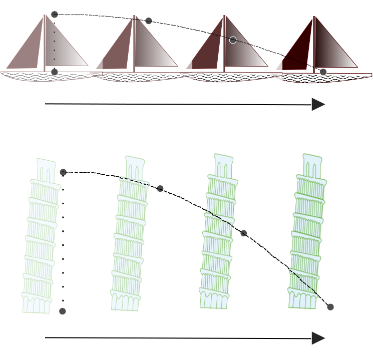
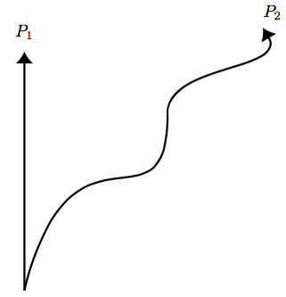
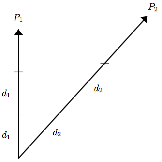
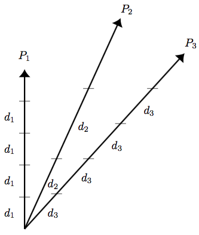
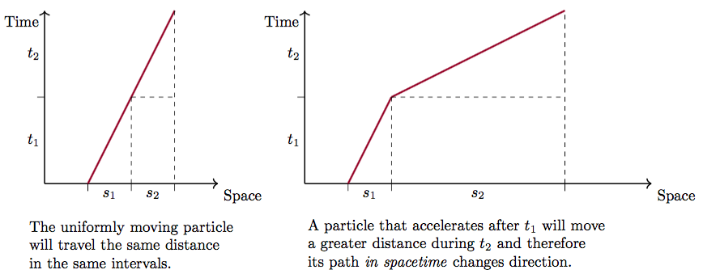
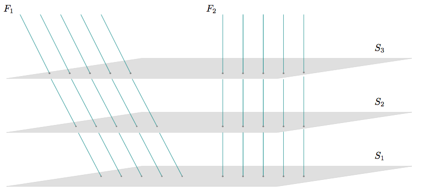
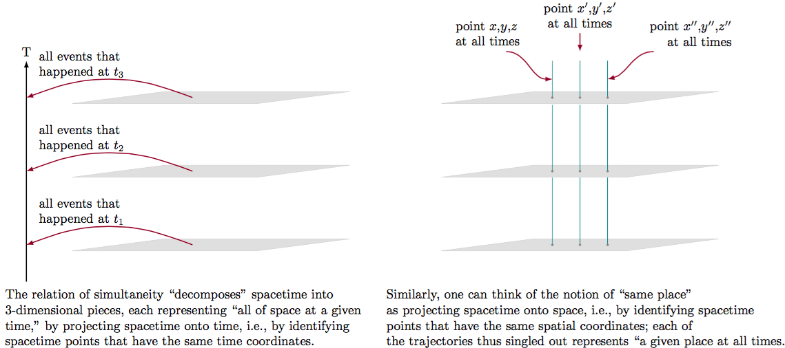
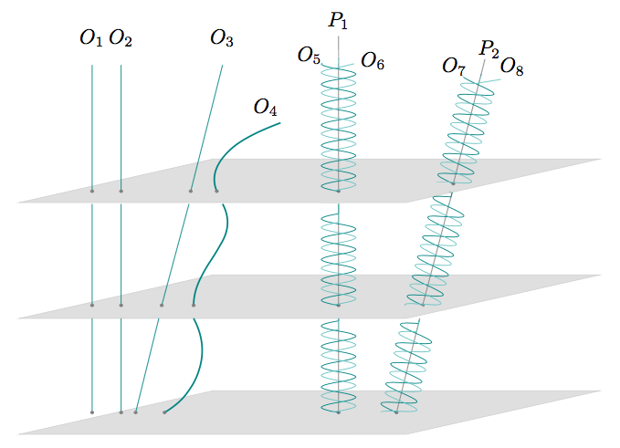
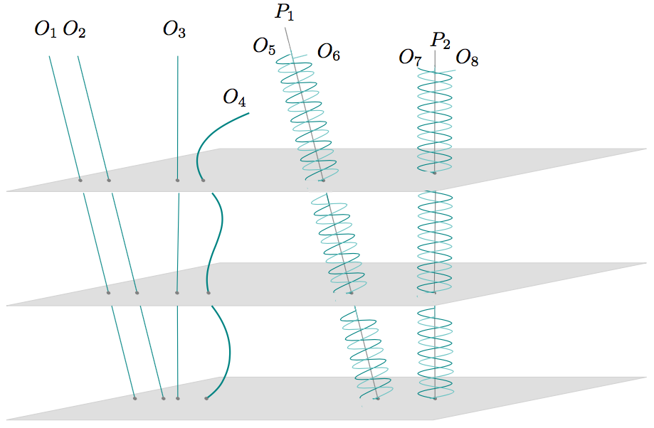
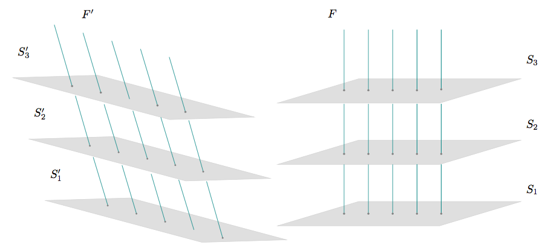

# Space and Time: Inertial Frames
**First published Sat Mar 30, 2002; substantive revision Wed Apr 15, 2020**

*DiSalle, Robert*

A “frame of reference” is a standard relative to which motion and rest may be measured; any set of points or objects that are at rest relative to one another enables us, in principle, to describe the relative motions of bodies. A frame of reference is therefore a purely kinematical device, for the geometrical description of motion without regard to the masses or forces involved. A dynamical account of motion leads to the idea of an “inertial frame,” or a reference frame relative to which motions have distinguished dynamical properties. For that reason an inertial frame has to be understood as a spatial reference frame together with some means of measuring time, so that uniform motions can be distinguished from accelerated motions. The laws of Newtonian dynamics provide a simple definition: an inertial frame is a reference-frame with a time-scale, relative to which the motion of a body not subject to forces is always rectilinear and uniform, accelerations are always proportional to and in the direction of applied forces, and applied forces are always met with equal and opposite reactions. It follows that, in an inertial frame, the center of mass of a closed system of interacting bodies is always at rest or in uniform motion. It also follows that any other frame of reference moving uniformly relative to an inertial frame is also an inertial frame. For example, in Newtonian celestial mechanics, taking the “fixed stars” as a frame of reference, we can, in principle, determine an (approximately) inertial frame whose center is the center of mass of the solar system; relative to this frame, every acceleration of every planet can be accounted for (approximately) as a gravitational interaction with some other planet in accord with Newton’s laws of motion.

This appears to be a simple and straightforward concept. By inquiring more narrowly into its origins and meaning, however, we begin to understand why it has been an ongoing subject of philosophical concern. It originated in a profound philosophical consideration of the principles of relativity and invariance in the context of Newtonian mechanics. Further reflections on it, in different theoretical contexts, had extraordinary consequences for 20ᵗʰ-century theories of space and time.

## 1. Relativity and reference frames in classical mechanics

### 1.1 The origins of Galilean relativity

The term “reference frame” was coined in the 19ᵗʰ century, but it has a long prehistory, beginning, perhaps, with the emergence of the Copernican theory. The significant point was not the replacement of the earth by the sun as the center of all motion in the universe, but the recognition of both the earth and the sun as merely possible points of view from which the motions of the celestial bodies may be described. This implied that the basic task of Ptolemaic astronomy—to represent the planetary motions by combinations of circular motions—could take any point to be fixed, without sacrificing predictive power. Therefore, as Copernicus suggested in the opening arguments of *On the Revolutions of the Heavenly Spheres*, the choice of any particular point required some justification on grounds other than mere successful astronomical prediction. The most persuasive grounds, seemingly, were physical: we don’t perceive the physical effects that we would expect the earth’s motion to produce. Copernicus himself noted, however, in reply, that we can indeed undergo motions that are physically imperceptible, as on a smoothly moving ship (1543, p.6). At least in some circumstances, we can easily treat our moving point of view as if it were at rest.

As the basic programme of Ptolemy and Copernicus gave way to that of early classical mechanics as developed by Galileo, this equivalence of points of view was made more precise and explicit. Galileo was unable to present a decisive argument for the motion of the earth around the sun. He demonstrated, however, that the Copernican view does not contradict our experience of a seemingly stable earth. He accomplished this through a principle that, in the precise form that it takes in Newtonian mechanics, has become known as the “principle of Galilean relativity”: mechanical experiments will have the same results in a system in uniform motion that they have in a system at rest. Arguments against the motion of the earth had typically appealed to experimental evidence—e.g., that a stone dropped from a tower falls to the base of the tower, instead of being left behind as the earth rotates during its fall. But Galileo argued persuasively that such experiments would happen just as they do whether the earth were moving or not, provided that the motion is sufficiently uniform. (See Figure 1.) Galileo’s account of this was not precisely the principle that we call “Galilean relativity”; he seems to have thought that a system in uniform circular motion, such as a frame at rest on the rotating earth, would be indistinguishable from a frame truly at rest. The principle was named in his honor because he had grasped the underlying idea of dynamical equivalence: he understood the composition of motion, and understood how individual motions of bodies within a system—such as the fall of a stone from a tower—are composed with the motion of the system as a whole. This principle of composition, combined with the idea that bodies maintain their uniform motion, formed the basis for the idea of dynamically indistinguishable frames of reference.

*Figure 1: Galileo’s Argument* If the earth is rotating sufficiently uniformly, a stone dropped from the tower will fall straight to the base, just as a stone dropped from the mast of a uniformly moving ship will fall to the foot of the mast. In both cases the stone’s vertical motion will be smoothly composed with its horizontal motion. Hence a sufficiently uniform motion will be indistinguishable from rest.

### 1.2 Philosophical controversy over absolute and relative motion

Leibniz, later, articulated a more general “equipollence of hypotheses”: in any system of interacting bodies, any hypothesis that any particular body is at rest is equivalent to any other. Therefore neither Copernicus’ nor Ptolemy’s view can be true—though one may be judged simpler than the other—because both are merely possible hypothetical interpretations of the same relative motions. This principle clearly defines (what we would call) a set of reference frames. They differ in their arbitrary choices of a resting point or origin, but agree on the relative positions of bodies at any moment and their changing relative distances through time.

For Leibniz and many others, this general equivalence was a matter of philosophical principle, founded in the metaphysical conviction that space itself is nothing more than an abstraction from the geometrical relations among bodies. In some form or other it was a widely shared tenet of the 17ᵗʰ-century “mechanical philosophy”. Yet it was flatly incompatible with physics as Leibniz himself, and the other “mechanists,” actually conceived it. For the basic program of mechanical explanation depended essentially on the concept of a privileged state of motion, as expressed in the common assumption that was the forerunner of the “principle of inertia”: bodies maintain a state of rectilinear motion until acted upon by an external cause. Thus their fundamental conception of force, as the power of a body to change the state of another, likewise depended on this notion of a privileged state. This dependence was clearly exhibited in the vortex theory of planetary motion, which presupposed that any planet would move in a straight line unless impeded. Its actual orbit was therefore explained by the balance between the planet’s inherent centrifugal tendency (its tendency to follow the tangent to the orbit) and the pressure of the surrounding medium.

For this reason, the notion of a dispute between “relativists” or “relationists” and “absolutists” or “substantivalists”, in the 17ᵗʰ century, is a drastic oversimplification. Newton, in his controversial Scholium on space, time, and motion, was not merely asserting that motion is absolute in the face of the mechanists’ relativist view. He was arguing that a conception of absolute motion was already implicit in the views of his opponents—that it was implicit in their conception, which he largely shared, of physical cause and effect. The general equivalence of reference-frames was implicitly denied by a physics that characterized forces as powers to change the states of motion of bodies.

This development placed the subject of reference frames in a new theoretical context. Having set aside the reference frame of common sense—the frame in which the earth is at rest in the center, with the heavens revolving around it—the mechanical physics of this time naturally tied this subject with novel theoretical conceptions of motion, and its physical causes and effects. Copernicus argued for a heliocentric system, not from a physical theory of motion, but from the comparative simplicity and reasonableness that it introduced into astronomy; he worked within the established theory of the causes of celestial motions, namely, the revolutions of the heavenly spheres. After Copernicus, however—more precisely, after the model of revolving spheres was largely abandoned—determining the right frame of reference was connected with discovering the true physical causes of the planets’ motions. Philosophers such as Kepler, Descartes, Huygens, Leibniz, and Newton held vastly differing views of physical causation, motion. and the relativity of motion. They agreed, however, that the heliocentric picture was uniquely suited for giving a causal account of planetary motions, as the effects of physical actions originating in the sun. To Kepler and Descartes, for example, the rotation of the sun on its axis, in the same sense in which the planets revolved, identified it as the cause of those revolutions.

The link between the causal account of motion and the more general conceptual account of “true” motion was never obvious or straightforward. Descartes’s heliocentric causal account, in which the planets moved in vortices arising from the sun’s rotation, was disconnected from his abstract account of motion “according to the truth of the matter,” or “in the proper sense” (Descartes 1642, part II section XXV). Since there are innumerable objects to which one might refer the motion of any given body, the reference may appear to be a matter of arbitrary choice. The unambiguous reference for the motion of any body, he argued, is provided by the bodies immediately touching it. Newton, in response, argued that Descartes’s philosophical account of motion is flatly incompatible with his causal account. To Newton, it was incoherent to appeal to a causal account of motion when explaining the centrifugal tendency of a body in its orbit around the sun, while identifying its “proper” motion only by its relations to the bodies immediately contiguous to it (Newton 1684a, Stein 1967, Rynasiewicz 2014)[^newton-1684a][^rynasiewicz-2014][^stein-1967]. Hence Newton’s argument that the only unambiguous standard of motion is a body’s change of position with respect to space itself. To space understood in this sense, as the universal frame of reference with respect to which the displacements of bodies constitute their true motions, Newton gave the name “absolute space” (1687b, p. 5ff).

Evidently Newton was aware that “absolute space” was not a reference frame in any practical sense. He emphasized that “the parts of space cannot be seen,” and that no observable bodies can be known to be at rest. Hence there is no way to determine motion with respect to space by direct observation; it must be known by its “properties, causes, and effects” (1687b, p. 7–8). The question arises, then, what properties, causes, or effects indicate a body’s change of position in absolute space? It is conceivable, for example, that there might be some physical correlate for velocity, in the sense that a body might have some observable physical state that depends on its velocity. It follows, in that case, that a body would be in a distinct physical state when it is at rest in space. If a body could be known to be in that state, therefore, it would (in principle) provide a physical marker for a truly resting frame of reference. On Leibniz’s conception of force, for instance, a given force is required to generate or to maintain a given velocity. For objects “passively” resist motion, but maintain their states of motion only by “active” force—so that, on dynamical grounds, “every body truly does have a certain amount of motion, or, if you will, force” (Leibniz 1694, p. 184; see also 1716, p. 404). It would follow from this that there must be, in principle, a distinguished frame of reference in which the velocities of bodies correspond to their true velocities, i.e. to the amounts of moving force that they truly possess. It would also follow that, with respect to any frame that is in motion relative to this one, bodies will not have their true velocities. In short, such a conception of force, if it could be applied physically, would give a precise physical application of Newton’s conception of absolute space, by providing a physical correlate for change of absolute place.

### 1.3 Galilean relativity in Newtonian physics

The difficulty with Newton’s view of absolute space comes, not from the epistemological arguments of relationalism, but from Newton’s own conception of force. If force is defined and measured solely by the power to accelerate a body, then obviously the effects of forces—in short, the causal interactions within a system of bodies—will be independent of the velocity of the system in which they are measured. So the existence of a set of equivalent “inertial frames” is imposed from the start by Newton’s laws. Suppose that we determine for the bodies in a given frame of reference—say, the rest frame of the fixed stars—that all observable accelerations are proportional to forces impressed by bodies within the system, by equal and opposite actions and reactions among those bodies. Then we know that these physical interactions will be the same in any frame of reference that is in uniform rectilinear motion relative to the first one. Therefore no Newtonian experiment will be able to determine the velocity of a body, or system of bodies, relative to absolute space. In other words, there is no way to distinguish absolute space itself from any frame of reference that is in uniform motion relative to it. Newton thought that a coherent account of force and motion requires a background space consisting of “places” that “from infinity to infinity maintain given positions with respect to one another” (1687b, p. 8–9). But the laws of motion enable us to determine an infinity of such spaces, all in uniform rectilinear motion relative to each other. The laws furnish no way of singling out any one as “immovable space.”

Oddly enough, no one in the 17ᵗʰ century, or even before the late 19ᵗʰ century, expressed this equivalence of reference-frames any more clearly than Newton himself. However, the credit for articulating this equivalence precisely for the first time, belongs to Christiaan Huygens, who introduced it as one of the Hypotheses of his first work on the rules of impact (1656). “Hypothesis I” was the first clear statement of the principle of inertia: “Any body, once in motion, if nothing opposes it, continues to move always with the same velocity and along the same straight line” (1656, pp. 30–31). The first precise statement of the relativity principle followed as Hypothesis III:

> The motion of bodies, and their speeds equal or unequal, are to be understood respectively, in relation to other bodies which are considered as at rest, even though perhaps both the former and the latter are subject to another motion that is common to them. In consequence, when two bodies collide with one another, even if both together undergo another equable motion, they will move each other no differently, with respect to a body that is carried by the same common motion, than if this extraneous motion were absent from all of them. (1656, p. 32).

Huygens illustrated this principle by the example of an impact that takes place on a uniformly moving boat, asserting its equivalence to the same impact taking place at rest. Thus he made precise the argument of Galileo, in light of his more precise understanding of the principle of inertia and the dynamical difference between inertial and circular motion.

Newton’s first statement of the same principle appears in one of the series of papers that culminated in the *Principia*, “De motu sphæricorum corporum in fluidis” (1684b). Like Huygens, Newton presents the relativity principle as a fundamental principle, “Law 3”:

> The motions of bodies included in a given space are the same among themselves whether that space is at rest or moves uniformly in a straight line without circular motion. (1684b, p. 40r)

Newton’s first statement of the Galilean relativity principle evidently recapitulates Huygens’ version, which was probably known to Newton. The same may be said of “Law 4” in this manuscript, the principle of conservation of the center of gravity:

> By the mutual actions between bodies their common centre of gravity does not change its state of motion or rest. (ibid., p. 40r)

But, uniquely, Newton immediately went on to consider the deeper theoretical significance of these principles: they radically reconceptualize the problem of “true motion” in the planetary system. First, they implied that the entire system must be seen as included in a space that may, itself, be either at rest or in uniform motion. Second, they implied that the only truly fixed point in such a system is the center of gravity of the relevant bodies. This, too, may therefore be in uniform motion or at rest:

> Moreover the whole space of the planetary heavens either rests (as is commonly believed) or moves uniformly in a straight line, and hence the communal centre of gravity of the planets (by Law 4) either rests or moves along with it. In both cases (by Law 3) the relative motions of the planets are the same, and their common centre of gravity rests in relation to the whole space, and so can certainly be taken for the still centre of the whole planetary system. (ibid., p. 47r)

Newton now realized, in short, that the dispute between the heliocentric and geocentric views of the universe had been mistakenly framed. The proper question about “the system of the world” was not “which body is at rest in the center?” but “where is the center of gravity of the system, and which body is closest to it?” For in a system of orbiting bodies, only their common center of gravity will be unaccelerated, and by “Law 3”, the motions of the bodies in the system will be the same, whether its center of gravity is at rest or in uniform rectilinear motion. By explicitly asserting the dynamical equivalence of “whole spaces” that may moving uniformly or at rest, Newton made it clear that the solution to the problem of “the system of the world” is the same with respect to any such moving space as it is with respect to immobile space. Thus he came as close to articulating the concept of the inertial frame as anyone before the late 19th century.

In the successive drafts of his *Principia*, Newton gradually clarified its conceptual structure, and in particular the frame-independent character of its concepts of motion, force, and interaction. He arrived at the new axiomatic structure whose only laws are the familiar “Newton’s Laws of Motion”; the principle of the conservation of the center of gravity, and the relativity principle, were no longer presupposed, but derived from the Laws as Corollaries IV and V:

> Corollary IV: The common center of gravity of bodies does not change its state, whether of motion or rest, by the actions of those bodies among themselves; therefore the common centre of gravity of all bodies (external impediments excluded) rests or moves uniformly in a straight line (1687b, p. 17).

> Corollary V: When bodies are enclosed in a given space, their motions among themselves are the same whether the space is at rest, or whether it is moving uniformly straight forward without circular motion (1687b, p. 19).

These principles illuminate the relationship between the theory of absolute space, as articulated in Newton’s Scholium to the Definitions, and the overarching scientific problem of the *Principia*. According to Newton, “the aim for which I composed” the book was to show “how to gather the true motions from their causes, effects, and apparent differences, and conversely, from the motions, true or apparent, to gather their causes and effects” (1687b, p. 11); the more specific aim of Book III was “to exhibit the constitution of the system of the world” (1687b, p. 401).

On the one hand, Corollary V, like “Law 3” in De Motu, precisely restricts what Newton’s procedure can determine about the structure of the system of the world. It cannot determine anything about the velocity of the system as a whole; it can only determine the position of the center of gravity of the bodies that comprise it, and the configuration of those bodies with respect to that center. In this sense it can, in principle, decide between a Keplerian and a Tychonic interpretation of the motions of these bodies. The system is indeed approximately Keplerian: the sun has by far the greatest mass and is therefore little disturbed from the center of gravity by its interactions with the planets. The sun therefore remains very close to the common focus of the nearly Keplerian ellipses in which the planets orbit the sun. But by Corollary V, the actions of the bodies among themselves would not reveal whether their center was moving uniformly or at rest. On the other hand, Newton recognized that motion with respect to absolute space is unknowable. This restriction, therefore, meant that the solution to the system of the world is secure in spite of our ignorance. The nearly-Keplerian structure of the system is known completely independently of the system’s state of motion in absolute space.

The Galilean relativity principle thus contained, in Newton’s conception, a broader insight: that different states of uniform motion, or different uniformly-moving frames of reference, determine only different points of view on the same physically objective quantities, namely force, mass, and acceleration. We can see this insight expressed more explicitly in the evolution of Newton’s concept of inertia. The term had been introduced by Kepler, and played a central role in his physical conception of planetary motion. Rejecting the Aristotelian idea that the planets are carried by rotating crystalline spheres, Kepler held that the planets have a natural tendency to rest in space—what he called their natural inertia—and argued that they must be moved by active powers that overcome their natural inertia. Newton, well before working on *Principia*, had based his conception of inertia on the idea of Galileo and Huygens, that bodies tend to persist in uniform motion: Inertia, on this new conception, was a resistance to change in motion. Even so, Newton’s early understanding of inertia was essentially pre-relativistic, because it implied a conceptual distinction between a body’s power to resist external forces, and the power of a moving body to change the motion of another. The manuscript *De gravitatione et aequipondio fluidorum* (1684a), for example, was evidently written before Newton fully recognized the importance of the relativity principle; here Newton’s Definitions distinguish “conatus,” “impetus,” and “inertia” as conceptually separate properties:

> Definition 6: Conatus (endeavor) is impeded force, or force in so far as it is resisted.

> Definition 7: Impetus is force in so far as it is impressed on another.

> Definition 8: Inertia is the internal force of a body, so that its state may not be easily changed by an external force (1684a).

Leibniz (among others), as we saw, made a corresponding distinction: moving force, the power of a body to change the motion of another, was determined by velocity. Leibniz therefore distinguished this force as an active power, fundamentally different from the passive power of a resting body to resist any change of position. Newton, in contrast, as he developed the *Principia*, and recognized the existence of a class of indistinguishable relative spaces, gradually came to understand the “force of inertia” as what we would call a Galilei-invariant quantity. Impetus and resistance were therefore recognized as appearances of that invariant quantity in different frames of reference:

> A body truly exerts this force only in a change of its state brought about by another force impressed upon it, and the exercise of this force is, under different aspects, both resistance and impetus: resistance in so far as the body, to maintain its state, opposes the impressed force; impetus insofar as the same body, yielding only with difficulty to the force of a resisting obstacle, strives to change the state of that obstacle. Resistance is commonly attributed to resting bodies and impetus to moving bodies; but motion and rest, as commonly understood, are only relatively distinguished from each other; and bodies commonly seen as resting are not always truly at rest (1687b, p. 2).

There are two noteworthy points about this explication of inertia. First, it shows that Newton recognized properties that were commonly regarded as distinct (e.g. in the Leibnizian distinction between passive and active) as merely frame-dependent representations of the same fundamental property. That is, they represent the same invariant quantity seen from different points of view. The principle that a body exerts this force “only in a change of its state” decisively separates Newton’s new view from the older notion of a specific power that is required to maintain a body in motion. This change has been noted by modern commentators (see Herivel 1965, p. 26; see also DiSalle 2013, p. 453; Disalle 2017, in Other Internet Resources)[^disalle-2013][^herivel-1965]. But it was already noted in Newton’s own time by George Berkeley, who emphasized the contrast between Newton’s conception and that of Leibniz:

> Leibniz confuses impetus with motion. According to Newton, impetus is in truth the same as the force of inertia… (Berkeley 1721 [1992], p. 79)[^berkeley-1721]

> …it is established by experience that it is a primary law of nature that a body persists “in a state of motion or of rest as long as nothing happens from elsewhere to change that state,” and therefore it is inferred that the force of inertia is under different aspects either resistance or impetus, in this sense a body can indeed be said to be by nature indifferent to motion and rest. (Berkeley, 1721 [1992], p. 96)[^berkeley-1721]

Berkeley thus made clear that the older understanding of inertia, unlike that expressed in the *Principia*, did not respect the principle of relativity. Second, Newton’s explication implicitly invokes all three laws of motion (cf. Stein 2002)[^stein-2002]. Newton’s first law alone came to be identified as “the principle of inertia.” Newton himself, however, understood that inertia has three inseparable aspects: the tendency to persist in motion, the resistance to change in motion, and the power to react against an impressed force. All are essential to the explication of inertial mass as a measurable theoretical quantity. To many later commentators, Newton’s use of the phrase “force of inertia” suggested a conceptual confusion. On the contrary, it was Newton’s way of drawing attention to the precise role of inertial mass as an invariant quantity in physical interactions, underlying the various ways in which its manifestations had been previously conceived.

### 1.4 The lingering problem of absolute space

Newton understood the Galilean principle of relativity with a degree of depth and clarity that eluded most of his “relativist” contemporaries and critics. It may seem bizarre, therefore, that the notion of inertial frame did not emerge until more than a century and a half after his death. He had identified a distinguished class of dynamically equivalent “relative spaces,” in any of which true forces and masses, accelerations and rotations, would have the same objectively measured values. Yet these spaces, though dynamically equivalent and empirically indistinguishable, were yet not equivalent in principle. Evidently, Newton conceived them as moving with various velocities in absolute space, though those velocities could not be known. Why should not he, or someone, have recognized the equivalence of these spaces, and the dispensability of a distinguished resting space—“absolute” space—immediately?

This is not the place for an adequate answer to this question, if indeed one is possible. For much of the 20ᵗʰ century, the accepted answer was that of Ernst Mach: Newton lived in an age “deficient in epistemological critique.” He was therefore unable to draw the conclusion that these *dynamically* indistinguishable spaces must be equivalent in *every* meaningful sense, so that no one of them deserves even in principle to be designated as “absolute space.” Yet even those whom the 20ᵗʰ century credited with more sophisticated epistemological views, such as Leibniz, evidently had difficulties understanding force and inertia in a Galilei-invariant way, despite a philosophical commitment to relativity. We may plausibly suppose that it was difficult to abandon the intuitive association of force or motion with velocity in space. It must also have been difficult, in the mathematical context of Newton’s time, to conceive of an equivalence-class structure as the fundamental spatio-temporal framework. It required a level of abstraction that became possible only with the extraordinary development of mathematics, especially of a more abstract view of geometry, that took place in the 19ᵗʰ century. Newton’s arguments established, for the assumptions of classical dynamics, the need for a dynamical space-time structure beyond the kinematical structure required to represent changes of relative position over time. But absolute space, with its superfluous elements, was the only such structure imagined for the next two centuries. It was accepted as the only realistic alternative to theories with no dynamical structure at all. There was as yet no notion of a structure that expressed *all and only* what was required by the dynamical laws. Euler, for example, in a penetrating critique of Leibnizian relationalism (1748), argued that the laws of motion require a notion of sameness of direction in space, and of uniform motion with respect to time. The truth of the laws of motion—which, for Euler, were more securely established than any principle of metaphysics—could not, therefore, be reconciled with any account of space and time as merely ideal. But he did not see the possibility of separating true acceleration and rotation from true velocity with respect to absolute space.

In the 17ᵗʰ century, only Huygens came close to expressing such a view; he held that not velocity, but velocity-difference, was the fundamental dynamical quantity. He therefore understood, for example, that the “absoluteness” of rotation had nothing to do with velocity relative to absolute space. Instead, it arose from the difference of velocity among different parts of a rotating body. If a disk is translated through space without rotation, then its parts move in parallel lines, but if it is rotating, then they move in different directions, even though they are at rest relative to one another on account of the bonds holding them together. The differences, evidently, would be the same irrespective of the velocity of the body as a whole in absolute space. Unfortunately, Huygens expressed this view only in manuscripts that remained unpublished for two centuries. (Cf. Stein, 1977, pp. 9–10 and Appendix III.)[^stein-1977] Huygens also reflected on the possibility of replacing absolute space with (what we would call) empirical frames of reference, again in unpublished notes that have only been brought to light in recent work by Stan (2016)[^stan-2016]. But the complete concept of the inertial frame emerged only in the late 19ᵗʰ century, when it did not seem to be of any great immediate importance (see below). Indeed, even after the concept of inertial frame had been widely discussed, the notion persisted that true rotation could only be understood as rotation with respect to absolute space. Poincaré, for example, convinced of the essential “relativity of space” as well as the relativity of motion, considered the concept of absolute space to be something of a philosophical embarrassment. But it was not clear to him how the dynamical phenomena of rotation could be understood without it (cf. DiSalle 2014)[^disalle-2014]. So the failure of Newton and Huygens to formulate the concept of inertial frame, two centuries earlier, seems less remarkable than the progress that each of them made in understanding the relativity of motion. As we will see, articulating this concept involved synthesizing (in effect) insights of Newton, Huygens, and Euler.

### 1.5 19th-century analyses of the law of inertia

The development of this concept began with a renewed critical analysis of the notion of absolute space, for reasons not anticipated by Newton’s contemporary critics. Its starting point was a critical question about the law of inertia: relative to what is the motion of a free particle uniform and rectilinear? If the answer is “absolute space,” then the law would appear to be something other than an empirical claim, for no one can observe the trajectory of a particle relative to absolute space. Two quite different answers to the question were offered in 1870, in the form of revised statements of the law of inertia. Carl Neumann proposed that when we state the law, we must suppose that there is a body somewhere in the universe—the “body Alpha”—with respect to which the motion of a free particle is rectilinear, and that there is a time-scale somewhere relative to which it is uniform (Neumann 1870)[^neumann-1870]. Ernst Mach (1883)[^mach-1883] claimed that the law of inertia, and Newton’s laws generally, implicitly appeal to the fixed stars as a spatial reference-frame, and to the rotation of the earth as a time-scale. At any rate, he maintained, such is the basis for any genuine empirical content that the laws can claim. The notion of absolute space, it followed, was only an unwarranted abstraction from the practice of measuring motions relative to the fixed stars.

Mach’s proposal had the advantage of a clear empirical motivation; Neumann’s “body Alpha” seemed no less mysterious than absolute space, and almost sounds comical to the modern reader. But Neumann’s discussion of a time-scale was somewhat more fruitful, and employed the principle that Euler had already expressed (1748): the law of inertia defines a time-scale, by which equal intervals of time are those in which a free particle travels equal distances. He also noted, however, that this definition is quite arbitrary. For, in the absence of a prior definition of equal times, any motion whatever can be stipulated to be uniform. It is no help to appeal to the requirement of freedom from external forces, since the free particles presumably are known to us only by their uniform motion. We have a genuine empirical claim only when we state of *at least two* free particles that their motions are *mutually* proportional. Equal intervals of time can then be defined as those in which two free particles travel mutually proportional distances.

### 1.6 The emergence of the concept of inertial frame

Neumann’s definition of a time-scale directly inspired Ludwig Lange’s conception of “inertial system” (Lange 1885)[^lange-1885]. An inertial coordinate system ought to be one in which free particles move in straight lines. But any trajectory may be stipulated to be rectilinear, and a coordinate system can always be constructed in which it is rectilinear. And so, as in the case of the time-scale, we cannot adequately define an inertial system by the motion of one particle. Indeed, for any two particles moving anyhow, a coordinate system may be found in which both their trajectories are rectilinear. So far the claim that either particle, or some third particle, is moving in a straight line may be said to be a matter of convention. We must define an inertial system as one in which at least three free particles move in straight lines. Then we can state the law of inertia as the claim that, relative to an inertial system so defined, the motion of any fourth particle, or arbitrarily many particles, will be rectilinear. The notions of inertial system and Neumann’s time-scale, which Lange called an “inertial time-scale,” may be combined as follows: relative to a coordinate system in which three free particles move in straight lines *and* travel mutually-proportional distances, the motion of any fourth free particle will be rectilinear and uniform. The questionable Newtonian concepts of absolute rotation and acceleration, Lange proposed, could now be replaced by the concepts of “inertial rotation” and “inertial acceleration,” i.e. rotation and acceleration relative to an inertial system and inertial time-scale. See Figures 2 and 3.

|  |  |
| --- | --- |
| (a) | (b) |

*Figure 2: Neumann’s Time-Scale* By Newton’s first law, a particle not subject to forces travels equal distances in equal times. But which particles are free of forces? This might appear to be a matter of convention. (a) Either $P_1$ or $P_2$ can be arbitrarily stipulated to be at the origin of a system of coordinates, and to serve as the measure of equal times (b) But one can say of two particles with different velocities: in intervals of time in which one moves a given distance $d_1$, the other moves a proportional distance $d_2 = kd_1$ (where *k* is a constant; i.e., $d_1/d_2 = k$). Or one can compare a particle to a freely rotating planet: in intervals of time through which the planet rotates through equal angles, the particle moves equal distances.

*Figure 3: Lange’s Definition of ‘inertial system’ (1885)* An inertial system is a coordinate system with respect to which three free particles, projected from a single point and moving in non-coplanar directions, move in straight lines and travel mutually-proportional distances. The law of inertia then states that relative to any inertial system, any fourth free particle will move uniformly.

At about the same time, apparently unaware of the work of Mach, Neumann, and Lange, James Thomson—older brother of William Thomson, Lord Kelvin—expressed the content of the law of inertia, and the appropriate frame of reference and time-scale (“dial-traveller”), in a somewhat simpler manner:

> For any set of bodies acted on each by any force, a REFERENCE FRAME and a REFERENCE DIAL-TRAVELLER are kinematically possible, such that relatively to them conjointly, the motion of the mass-centre of each body, undergoes change simultaneously with any infinitely short element of the dial-traveller progress, or with any element during which the force on the body does not alter in direction nor in magnitude, which change is proportional to the intensity of the force acting on that body, and to the simultaneous progress of the dial-traveller, and is made in the direction of the force. (Thomson 1884, p. 387)[^thomson-1884]

Thomson did not reject the term “absolute rotation”. Instead, he held that it is properly defined as rotation relative to a frame that satisfies his definition of a reference frame. A body that is rotating with respect to a reference frame (and dial-traveller) is rotating with respect to any other frame in uniform motion relative to the first. The definition does not express, as Lange’s does, the degree of arbitrariness involved in the construction of an inertial system by means of free particles. By dispensing with the idealization of free particles, Thomson’s definition aims to characterize an inertial frame for an actual system of interacting bodies. However, it does not quite fulfill its aim. Like Lange’s definition, it leaves out a crucial condition for an inertial system as we understand it: all forces must belong to action-reaction pairs. Otherwise we could have, as on a rotating sphere, merely apparent (centrifugal) forces that are, by definition, proportional to mass and acceleration, and so the rotating sphere would satisfy Thomson’s definition. Therefore the definition needs to be completed by the stipulation that to every action there is an equal and opposite reaction. (This completion was actually proposed by R.F. Muirhead in 1887.)[^muirhead-1887]

But, so completed, Thomson’s definition makes the essential point about the relation between Newton’s laws of motion and the inertial frames: that the laws assert the existence of at least one inertial frame. If one inertial frame is posited, in which accelerations properly correspond to Newtonian forces, then any other inertial frame is in uniform motion with respect to the first; the forces, masses, and accelerations measured in one will have the same measures in any other. Any one may be arbitrarily designated as an all-encompassing “immobile space” in which all others are moving uniformly. Thus the original question, “relative to what frame of reference do the laws of motion hold?” is revealed to be wrongly posed. For the laws of motion essentially *determine* a class of reference frames, and (in principle) a procedure for constructing them. For the same reason, a skeptical question that is still commonly asked about the laws of motion—why is it that the laws are true only relative to a certain choice of reference frame?—is also wrongly posed. If Newton’s laws are true, then we can construct an inertial frame; their truth doesn’t depend on our ability to construct such a frame in advance. Mach expressed the situation particularly clearly:

> It is very much the same whether we refer the laws of motion to absolute space, or express them abstractly, without express indication of the system of reference. The latter course is unproblematic and practical, for in treating particular cases the student of mechanics looks for a suitable system of reference. But owing to the fact that the first way, whenever there was any actual issue at stake, was nearly always interpreted as having the same meaning as the latter, Newton’s error was much less dangerous than it would otherwise have been. (1933, p. 269.)

Mach’s remark roughly corresponds to Newton’s actual procedure. Even though, for Newton, absolute space was the implicit reference-frame for stating the laws of motion, the frame for their application was the standard one for most of the history of astronomy: the fixed stars. This seemingly arbitrary starting-point did not undermine Newton’s procedure as an account of the “true motions.” For the framework of the fixed stars, initially taken for granted, turns out to be justified in the course of Newton’s dynamical analysis. If all the accelerations relative to the fixed stars can be analyzed into action-reaction pairs involving bodies within the system—leaving no “leftover” accelerations that need to be traced to some yet-unknown influence—then we can conclude that the stars are a suitable (sufficiently inertial) frame of reference after all. Newton could appeal to a particular case to test this general point: the orbits of the outer planets were stable with respect to the fixed stars, their perihelia showing no measurable precession (unlike the perihelion of Mercury, for a famous example). Newton argued, then, that a relative space in which these apsides are stable is a sufficient approximation to a space at rest or in uniform motion (cf. Book III, Proposition XIV, 1687b, p. 420).

Mach took particular notice of Newton’s use of the relativity principle in determining an appropriate reference-frame:

> In order to have a generally valid system of reference, Newton introduced Corollary V of the *Principia*. He thought of… a coordinate system for which the law of inertia holds, fixed in space without rotation relative to the fixed stars. He could also allow an arbitrary origin and uniform translation of this system… without losing its usefulness… One can see that the reduction to absolute space was in no way necessary, since the reference frame is just as relatively determined as in any other case. (1933, p. 227.)

For Mach, this was an important acknowledgement of Newton’s insight into the relativity of motion. Starting from Corollary V, the concept of the inertial frame solved the problem of absolute rotation and acceleration, as a problem internal to the system of Newton’s laws. Absolute space could be dispensed with, without undermining Newton’s dynamical distinctions among states of motion. Of course, this point did not dismiss Mach’s skeptical questions regarding the laws themselves. Instead, it posed them in a more precise form: Are Newton’s laws truly general laws of nature, that determine a class of privileged frames? Or do they only describe motions relative to a particular material frame, the fixed stars? Empirical evidence was insufficient to decide. Eventually Mach’s question helped to motivate Einstein’s search for new laws in which privileged frames would not play an essential role. First, however, by comparing Newtonian mechanics with Maxwell’s electrodynamics, Einstein placed the notion of inertial frame on an entirely new footing (see below, Section 2.2 *et seq.*).

### 1.7 “Quasi-inertial” frames: Newton’s Corollary VI

A striking aspect of Newton’s treatment of indistinguishable frames of reference was his discovery of approximately indistinguishable frames: spaces that are accelerating, yet can be treated, for practical purposes, as if they were at rest or in uniform motion. Newton made this notion precise in Corollary VI to the laws of motion:

> If bodies are moved in any way among themselves, and are urged by equal accelerative forces along parallel lines, they will all continue to move among themselves in the same way as if they were not acted on by those forces. (1687b, p. 20.)

As Corollaries IV and V implied, for a given system of interacting bodies, their center of gravity is unmoved by the actions of the bodies among themselves, and will remain at rest or in uniform motion as long as the bodies are not disturbed by any external forces. This, as we noted, was as close as Newton could come to the notion of an inertial frame. Corollary VI shows that, in very special ideal circumstances—accelerative forces that act equally on all bodies within a system, and accelerate them all in parallel directions—an accelerating system of bodies will behave, internally, as if there were no external forces acting on it at all. Yet Newton’s discovery was not limited to the point made explicitly in Corollary VI. Rather, it was threefold. The second point was that there was in fact a force acting equally and in parallel lines, at least to a high approximation, on important systems of celestial bodies. The system of Jupiter and its satellites, for example, is obviously accelerating, as its center of gravity completes an approximately elliptical orbit around the Sun bound by accelerative forces toward the Sun’s center. But because the accelerations of all the bodies are nearly equal and parallel, their motions among themselves are nearly the same as if no such forces acted, and the system may be treated as the sort of system described in Corollary V. Evidently the accelerations are unequal, since Jupiter and the satellites are at varying distances from the sun, and they cannot be parallel since they are all directed at the center of the sun. But these differences of distance and direction are so small, in comparison with the distance of the entire system from the sun, that they may be neglected. And the same applies to the centripetal acceleration of Saturn’s system.

Newton applied this same reasoning to the entire solar system: even if the entire system were accelerating toward some unknown gravitational source, he could treat the solar system itself as if it were an isolated system. He argued, from the analysis of accelerations within the system, that outside forces must be acting more or less equally and in parallel directions on all parts of the system.

> It may be imagined that the sun and planets are impelled by some other force equally and in the direction of parallel lines; but such a force (by Cor. VI of the Laws of Motion) would not change the situation of the planets among themselves, nor would produce any sensible effect; but we are concerned with the causes of sensible effects. Let us, therefore, neglect every such force as precarious, and of no bearing on the phenomena of the heavens…. (1687a, article 13.)

Newton raised this point in order to show that the possibility of such a force acting on the whole solar system would not affect his calculations of the forces acting within the system. In the calculation relevant to this passage, Newton was using Corollary VI to defend the inference that the force responsible for Jupiter’s orbit is directed to the Sun rather than to the Earth: neglecting any such imaginary force, “then all the remaining force by which… Jupiter is urged will tend (by prop. 3, corol. 1) toward the center of the sun” (ibid). This calculation formed an important step in the argument for a heliocentric system. Such a use of Corollary VI parallels, therefore, his use of Corollary V (and its earlier form, “Law 3”) to show that the “frame of the system of the world” could be determined without regard to the system’s uniform motion in absolute space.

Indeed, the analogy between the two kinds of case helps to explain Newton’s changing the relativity principle from a law to a Corollary, for this coincides historically with his first use of Corollary VI. The two Corollaries identify two classes of frames of reference that may be treated as equivalent, because they involve, respectively, theoretically and practically indistinguishable states of motion. The frames corresponding to Corollary VI may be called “quasi-inertial,” because “approximately inertial” might be misleading: a closed orbit around the Sun—like that of Jupiter’s system—is not a good approximation to an inertial motion, and the system can hardly be considered isolated. But over sufficiently limited segments of its orbit, its motion is sufficiently close to being inertial. Moreover—and most important—the accelerative forces toward the sun are close enough to being equal and parallel that the forces acting within the system can be effectively isolated from the forces from without. Hence, while “quasi-inertial” is a useful term for the reference-frame corresponding to such a group of bodies, a useful description for the group itself is George Smith’s “quasi-insular system” (Smith 2019)[^smith-2019]. A system of masses bound in orbit around a larger mass is by no means isolated, yet in the right conditions it may be treated as if it were. The modern term, “local inertial frame,” is not inappropriate (cf. Schutz 1990, p. 124)[^schutz-1990]. But it typically designates the local coordinate frame of a given inertial observer, rather than the sort of “whole space” that Newton had in mind, as encompassing a celestial system as large as that of Jupiter, or the solar system as a whole. Moreover, it is typically used in a context in which a global inertial frame, with respect to which any such Newtonian system has a definite acceleration, would not be assumed to exist.

This last point leads to the third point of Newton’s discovery: that the “quasi-inertial” system is part of a mathematical framework for approximative reasoning, to determine the precise degree of isolation that a group of interacting bodies may be said to possess. Proposition III of the *Principia* established Newton’s method for treating a body orbiting a second body which is, itself, subject to a centripetal force:

> Proposition III, Theorem III: Every body, that, by a radius drawn to the centre of another body, in any way moved, describes areas about that centre proportional to the times, is urged by a force compounded out of the centripetal force tending to that other body, and of all the accelerative force by which that other body is impelled.(1687b, p. 39).

In other words, if an orbiting body obeys Kepler’s area law, then any accelerative force acting on the central body is simply added to the centripetal force that maintains the orbiting body in its orbit.

This principle of composition formed the mathematical basis for Newton’s treatment of quasi-inertial frames. When a system of lesser bodies is, as a whole, revolving around a greater body, we have a geometrical framework to describe how closely the motions of the lesser system approximate the conditions of Corollary VI:

> Book I, Proposition LXV, Case 2: Suppose that the accelerative attractions towards the greater body to be among themselves reciprocally as the squares of the distances; and then, by increasing the distance of the great body till the differences of the straight lines drawn from that to the others in respect of their length, and the inclinations of those lines to each other, are less than any given, then the motions of the parts of the system, will continue with no errors except such as are less than any given. And because, by the small distance of those parts from each other, the whole system is attracted as if it were only one body, it will therefore be moved by this attraction as if it were one body….(1687b, p. 172.)

Thus the situation described by Corollary VI, in Newton’s analysis, emerges as a limiting case of an orbiting system under an inverse-square force. As the size of the orbit is arbitrarily increased, the accelerations toward the center become indistinguishable from equal and parallel accelerations. Evidently, Newton’s proposition provides, characteristically, a general method for treating a variety of possible configurations. But it enabled Newton to address the specific physical fact of the variation in the Sun’s gravity, and its consequences for the superposition upon it of lesser gravitating systems. At the distance of Jupiter or Saturn, a revolving system can be a very nearly regular Keplerian system. As the distance to the Sun decreases, however, differences in magnitude and direction of the accelerations become significant, and at the distance of the Earth-Moon system the motions become nearly intractable. The decisive factor is the proportion between the size of the orbiting system and its distance from the center of attraction.

The actual existence of quasi-inertial frames, corresponding to the abstract cases of Proposition LXV, was a crucial part of Newton’s argument for universal gravitation—more precisely, that the force holding the planets and their satellites in their respective orbits is, in fact, the same force as gravity. One crucial ground for the identification was the fact that the interplanetary force shares the most striking feature of terrestrial gravity, namely, that it imparts the same acceleration to all terrestrial bodies. This principle was discovered by Galileo, of course, but Newton tested it more severely, and with a greater variety of test bodies. He constructed pendulums of identical wooden boxes suspended from strings of equal length, which he filled with different materials; he found that these differences made no difference to the speed of falling over many oscillations of the pendulums. By this means he showed that Galileo’s principle holds to a much higher degree of accuracy than Galileo was able to show, and inferred that a body’s weight toward the earth is generally proportional to its mass. (1687b, Book III, Proposition VI). But Newton extended this principle beyond terrestrial gravity, to the accelerative forces acting on the planets and their satellites. Proposition IV, Corollary VI, from Book I, showed that an orbiting body that obeys Kepler’s third law is urged toward the center by an inverse-square force. Newton could then show that the centripetal forces acting on Jupiter’s moons depend only on the inverse-square of the distance towards Jupiter’s center:

> since the satellites of Jupiter perform their revolutions in times that observe the sesquiplicate proportion of their distances from Jupiter’s center, their accelerative gravities towards Jupiter will be inversely as the squares of their distances from Jupiter’s centre; that is, equal, at equal distances…. And by the same argument, if the circumsolar planets were let fall at equal distances from the Sun, they would, in their descent towards the Sun, describe equal spaces in equal times. But forces that equally accelerate unequal bodies must be as those bodies; that is to say, the weights of the planets towards the Sun must be as their quantities of matter. (Ibid.)

In each of these cases, that is, Newton found that the centripetal acceleration behaves like gravitational acceleration, and so the bodies’ forces toward their respective centers are, essentially, their weights toward those centers. Moreover, the orbits of Jupiter’s moons provided a completely novel test of Galileo’s principle, on an extremely large scales of mass and distance. For he showed that Jupiter and its moons—within the limits of observational accuracy—undergo the same accelerations toward the sun (cf. 1687b, Book I, Proposition 65; Book III, Proposition VI). Any non-negligible difference in these accelerations would produce corresponding irregularities in the satellites’ orbits.

The proportionality of weight to mass was understood in its broader foundational significance, as the equivalence of gravitational and inertial mass, through Einstein’s “principle of equivalence” (cf. Einstein 1916; see also Norton 1985)[^einstein-1916][^norton-1985]. In Einstein’s reasoning, the identity of inertia and gravitation helped to undermine the special status of inertial motion, and suggested the extension of the relativity principle from inertial frames to frames in any state of motion whatever. If an inertial frame, K, cannot be distinguished from another frame K′ that is uniformly accelerated with respect to K, then K′ may equally be treated as a “privileged” or “stationary” frame: “they have equal title as systems of reference for the description of physical phenomena” (Einstein 1916, p. 114)[^einstein-1916]. This circumstance undermines a defining characteristic of inertial frames: that with respect to a given inertial frame, every other inertial frame is in uniform rectilinear motion. Corollary VI points the way, after all, toward an extended relativity principle.

> The assumption of the complete physical equivalence of the systems of co-ordinates, K and K′, we call the “principle of equivalence;” this principle is evidently intimately connected with the theorem of the equality between the inert and the gravitational mass, and signifies an extension of the principle of relativity to co-ordinate systems which are in non-uniform motion relatively to each other. In fact, through this conception we arrive at the unity of the nature of inertia and gravitation. (Einstein 1922)[^einstein-1922][^einstein-1922-2].

This reasoning, in turn, suggested the connection between the gravitational field and the curvature of space-time. (See Einstein 1916; see also Related Entries: Einstein, Albert: philosophy of science | general relativity: early philosophical interpretations of)[^einstein-1916].

Even independently of Einstein’s theory, however, one might see in hindsight that Newton’s application of Corollary VI, and his identification of what we’ve been calling quasi-inertial frames, already undermined the idea of an inertial frame. As we saw, Newton could treat a quasi-inertial system like that of Jupiter and its moons, not as essentially different from the system of the Earth and the Moon, but as a limiting case of such a system: as the whole system becomes sufficiently far from the central body, the differences among the accelerations of its parts toward their common center become negligibly small. In other words, Newton could treat such systems, and the mathematical description of the differences among them, as revealing the structure and workings of the sun’s gravity, rather than as questioning the fundamental distinction between uniform and accelerated motion. In that sense, he was not proposing the “complete physical equivalence” of uniformly accelerating systems with uniformly moving systems (inertial frames). But even Newton recognized, as we also saw, that the solar system as a whole might have an unknown and practically unknowable acceleration. In effect, he explained why his analysis of accelerations of the bodies in the system, among themselves, required no knowledge of any absolute accelerations. In the 19th century, Maxwell, without questioning the underlying framework of absolute space and time, pointed out that Corollary VI implied a kind of relativity of acceleration (1878, pp. 51–52). Viewing the foregoing in hindsight, more recent literature has suggested that the physics of the Principia did not really require the notion of inertial frame at all, and therefore that a weaker geometry than Newtonian spacetime would be a sufficient background structure for Newton’s dynamical reasoning (cf. Saunders, 2013)[^saunders-2013]. It is further suggested, following Cartan (1923, 1924)[^cartan-1923][^cartan-1924], that the space-time structure and the gravitational field be unified in a curved space-time (cf. section 9, below), as a Newtonian version of general relativity (cf. Malament 2012, chapter 4; see also Knox, 2014 and Weatherall 2018)[^knox-2014][^malament-2012][^weatherall-2018]. The relevant conceptual resources and mathematical techniques for such approaches, evidently, developed only in the aftermath of general relativity. We return to this theme in 2.5.

## 2. Inertial frames in the 20ᵗʰ century: special and general relativity

### 2.1 Inertial frames in Newtonian spacetime

By the early years of the 20ᵗʰ century, the notion of inertial system seems to have been widely accepted as the basis for Newtonian mechanics, even if the specific works of Lange and Thomson were little noticed. In writing “On the electrodynamics of moving bodies” in 1905, Einstein took it to be obvious to his readers that classical mechanics does not require a single privileged frame of reference, but an equivalence-class of frames, all in uniform motion relative to each other, and in any of which “the equations of mechanics hold good.” Two inertial frames with coordinates $(x, y, z, t)$ and $(x', y', z', t')$ are related by the *Galilean transformations*,

$$\begin{align*} x' &= x - vt \\ y' &= y \\ z' &= z \\ t' &= t \end{align*}$$

(assuming that the x-axis is defined to be the direction of their relative motion). These transformations clearly preserve the invariant quantities of Newtonian mechanics, i.e. acceleration, force, and mass (and therefore time, length, and simultaneity). As far as Newtonian mechanics was concerned, then, the problem of absolute motion was completely solved; all that remained was to express the equivalence of inertial frames in a simpler geometrical structure.

The lack of a privileged spatial frame, combined with the obvious existence of privileged states of motion—paths defined as rectilinear in space and uniform with respect to time—suggests that the geometrical situation ought to be regarded from a four-dimensional *spatio-temporal* point of view. The structure defined by the class of inertial frames can be captured in the statement that *space-time* is a four-dimensional affine space, whose straight lines (geodesics) *are the trajectories of particles in uniform rectilinear motion*. See Figure 4.

*Figure 4:* Inertial Trajectories as Straight Lines of Space-time

That is, space-time is a structure whose automorphisms—the Galilean transformations that relate one inertial frame to another—are affine transformations: they take straight lines into straight lines, and parallel lines into parallel lines. The former condition implies that an inertial motion in one frame will be an inertial motion in any other frame, and likewise for an accelerating or rotational motion. The latter implies that uniformly-moving particles or observers who are relatively at rest in one frame will also be relatively at rest in another. An inertial frame can be characterized as a family of parallel straight lines “filling” space-time, representing the possible trajectories of a family of free particles that are relatively at rest. See Figure 5. Therefore, to assert that an inertial frame exists is to impose a global structure on space-time; it is equivalent to the assertion that space-time is an affine space that is flat.

*Figure 5:* Each of these families of straight lines, $F_1$ and $F_2$, represents the trajectories of a family of free particles that are relatively at rest, and therefore each defines an inertial frame. Relative to each other, the frames defined by $F_1$ and $F_2$ are in uniform motion. Each of the surfaces *S* is a “hypersurface of absolute simultaneity” representing all of space at a given moment; evidently (given the Galilean transformations) two inertial frames will agree on which events in space-time are simultaneous.

The form of the Galilean transformations shows that, in addition to being affine transformations, they also preserve metrical relations on time and space. Distinct inertial frames will agree on simultaneity, and on (ratios of) time-intervals; they will also agree on the spatial distance between points at a given moment of time. Therefore, in the four-dimensional picture, the decomposition of space-time into hypersurfaces of absolute simultaneity is independent of the choice of inertial frame. Another way of putting this is that Newtonian space-time is endowed with a *projection* of space onto time, i.e. a function that identifies space-time points that have the same time-coordinate. Similarly, absolute space arises from a projection of space-time onto space, i.e. a function that identifies space-time points that have the same spatial coordinates. See Figure 6.

*Figure 6*

But Galilean relativity implies that this latter projection is arbitrary. While it assumes that we can identify the same time at different spatial locations, Newtonian mechanics provides no physical way of identifying the same spatial point at different times. Thus the equivalence of inertial frames can be thought of as the arbitrariness of the projection of space-time onto space. Any such projection is, essentially, the arbitrary choice of some particular inertial frame as a rest-frame. In the relativized version of Newton’s theory, then, the class of inertial frames replaces absolute space, while absolute time remains. The structure of Newtonian space-time (also known as Galilean space-time, or neo-Newtonian space-time) expresses this fact in a direct and obvious way. (See Stein 1967 and Ehlers 1973 for further explanation.)[^ehlers-1973][^stein-1967]

|  |  |
| --- | --- |
| (a) | (b) |

*Figure 7:* (a) Here is a space-time diagram of motions relative to the inertial frame in which $O_1$, $O_2$, and $P_1$ are at rest. This can be seen as arising from the projection of each of their inertial trajectories onto a single point of space. $O_3$ is in uniform motion. $O_4$ is accelerating any old way. $O_5$ and $O_6$ are revolving around their common center of gravity $P_1$, which (as noted above) is at rest. $O_7$ and $O_8$ are revolving around their center of gravity $P_2$, which is in uniform motion. (b) Here is the same situation viewed from an inertial frame in which $O_3$ and $P_2$ are at rest. Now $O_1,$ $O_2,$ and $P_1$ are in uniform motion. $O_4$ is accelerating any old way. $O_5$ and $O_6$ are revolving around their common center of gravity $P_1$, which is in uniform motion. $O_7$ and $O_8$ are revolving around their center of gravity $P_2$, which (as noted above) is at rest.

### 2.2 The conflict between Galilean relativity and modern electrodynamics

By the time that this representation of the Newtonian space-time structure was developed, however, the Newtonian conception of inertial frame had been essentially overthrown. First, 19ᵗʰ-century electrodynamics raised again the question of a privileged frame of reference: the conception of light as an electromagnetic wave in the ether implied that the rest-frame of the ether itself should play a distinguished role in electrodynamical phenomena. On the one hand, physicists such as Maxwell and Lorentz were careful to point out that velocity relative to the ether was not equivalent to absolute velocity, because the state of motion of the ether itself was necessarily unknown. In other words, this conception of light did not necessarily violate the classical principle of relativity. On the other hand, the existence of such a preferred frame made the equivalence of inertial frames correspondingly less interesting, even if it was true in principle. This is why the appearance of the idea of inertial frame in the 1880s, as suggested earlier, was not of pressing physical interest to the majority of physicists, and seemed to be a mere philosophical sidelight. The attempts to measure the effects of motion relative to the ether commanded considerably more attention.

Second, the abandonment of the ether—following the failure of attempts to measure velocity relative to the ether and, more generally, the apparent independence of all electrodynamical phenomena of motion relative to the ether—did not vindicate the Newtonian inertial frame. Rather, it required a dramatically revised conception. Special relativity might be said to have applied the relativity principle of Newtonian mechanics to Maxwell’s electrodynamics, by eliminating the privileged status of the rest-frame of the ether and admitting that the velocity of light is independent of the motion of the source. As Einstein expressed it, “the same laws of electrodynamics and optics will be valid for all frames of reference for which the equations of mechanics hold good.” (1905, p. 38.) But as Einstein also pointed out, the invariance of the velocity of light and the principle of relativity, at least in its Galilean form, are incompatible. It simply makes no sense, according to Galilean relativity, that any velocity should appear to be the same in inertial frames that are in relative motion.

### 2.3 Special relativity and Lorentz invariance

Einstein solved this difficulty through his analysis of simultaneity: frames in relative motion can agree on the velocity of light only if they disagree on simultaneity. Only the relativity of simultaneity makes possible the invariance of the velocity of light. This means that the transformations between inertial frames that preserve the velocity of light will not preserve simultaneity. These are the *Lorentz transformations*:

$$ x' = \frac{x-vt}{\sqrt{1-v^2/c^2}} \quad y'=y \quad z'=z \quad t'=\frac{t-vx/c^2}{\sqrt{1-v^2/c^2}} $$

Evidently these transformations preserve the velocity of light, but they do not preserve length and time. So the invariant quantities of Newtonian mechanics, which presuppose invariant measures of length and time, must now depend on the choice of inertial frame. In other words, acceleration is an invariant quantity only when it is zero, for the magnitude of a non-zero acceleration will differ for observers in relative motion. Therefore the notions of force, mass, and acceleration no longer provides an appropriate definition of an inertial frame, except in the ideal case of a frame in which no forces are acting. Einstein’s definition instead appeals to the invariant quantities of electrodynamics: an inertial frame is one in which light travels equal distances in equal times in arbitrary directions. What seems impossible, from the point of view of Galilean relativity, is that a frame that moves uniformly relative to one frame that satisfies Einstein’s definition should also satisfy the definition. But that seeming impossibility rests, again, on the assumption that two inertial frames will have a common measure of simultaneity. Einstein showed that light-signals provide an empirically and theoretically reasonable definition of simultaneity, in light of the empirical soundness of Maxwell’s equations and the apparent invariance of the velocity of light. In the absence of an empirically reasonable alternative compatible with Galilean invariance, there is no sound criterion of simultaneity that will give the same results in different inertial frames. Of course, it would remain true that in a given inertial frame, the motions of free particles would satisfy the requirements of Lange’s definition, and particles that move uniformly in one such frame would also move uniformly in any other. But such a definition is not a substitute for Einstein’s definition, since it must itself presuppose a definition of simultaneity. Otherwise, its appeal to the measurement and comparison of times and distances is without a sound empirical basis. Einstein’s definition places such measurements on an empirical basis. Their results, however, will depend on the choice of an inertial frame, and will vary systematically according to the relative velocities of different inertial frames.

The space-time structure of special relativity thus differs essentially from Newtonian space-time, and is called “Minkowski space-time” since Minkowski (1908)[^minkowski-1908] first formulated Einstein’s theory in its four-dimensional form. It is an affine space, like Newtonian space-time. In both cases, the trajectories of free particles are straight lines of the affine structure, and a set of parallel inertial trajectories (geodesics) corresponds to an inertial frame. As we just saw, however, Newtonian space-time presupposes the invariant division of space-time into three-dimensional hypersurfaces of absolute simultaneity, and an objective measure of distance between points at a given moment of absolute time. Minkowski space-time is a four-dimensional vector space with an invariant four-dimensional metrical structure, imposed by the invariance of the speed of light. Instead of an invariant spatial interval between simultaneous events, there is an invariant spatio-temporal interval between any two points in space-time. Since there is no invariant relation of simultaneity, the sets of simultaneous events for any inertial frame are the hyperplanes orthogonal to the trajectories that determine that frame. In other words, the choice between two inertial frames determines a choice between two distinct divisions of space-time into space and time. See Figure 8:

*Figure 8:* The inertial frames $F$ and $F'$ are in relative motion, and therefore, as the Lorentz transformations indicate, they disagree on simultaneity. $F$ and $F'$ thus determine distinct decompositions of space-time into instantaneous spaces, $S$ and $S'$, respectively

### 2.4 Simultaneity and reference-frames

The details of Einstein’s argument and the structure of Minkowski space-time can be found elsewhere (see, e.g., Einstein 1951 and Geroch 1978)[^einstein-1951][^geroch-1978]. Here only one more point is worth making. It could be argued that Einstein’s and Lorentz’s view are completely equivalent. That is, we could assume that there is indeed a privileged frame of reference, and that the apparent invariance of the velocity of light is explained by the effects on bodies of their motion through the ether (the Lorentz contraction and time dilation). This purported distinction between empirically indistinguishable frames has often been criticized on straightforward methodological grounds, but it could be (and surely has been) argued that it is more intuitively plausible than the relativity of simultaneity. After all, knowing that (as Einstein showed) the Lorentz contraction can be derived from the invariance of the velocity of light does not, by itself, entitle us to say which of the two is the more convincing starting-point.

This is why it is so important that Einstein’s 1905 paper begins with a critical analysis of the entire notion of a frame of reference. It is tacitly assumed by Lorentz’s theory, and classical electrodynamics generally, that we have a reference-frame in which we can measure the velocity of light, and that there is a distinguished frame—at rest with respect to the ether—in which its true velocity would be measured. But how is such a reference-frame determined? The distances between points in space can only be determined if it is possible to determine which events are simultaneous. In practice this is always done by light-signalling, if only in the informal sense that we identify simultaneous events when we see them at the same time. But if the spatial frame of reference is determined by light-signals, and is then to be used to measure the speed of light, we would appear to be going in a circle. For this reason, Poincaré concluded that determining the speed of light is partly a matter of convention (1898). Before Einstein, however, it was tacitly assumed that, while light-signalling is useful and practical, it is not essential to the definition of simultaneity. There would be, therefore, a fact of the matter about which events are simultaneous that is independent of this method of signalling. This assumption was actually made explicit by James Thomson. He recognized—as few did before Poincaré and Einstein—that the measurement of distance involves

> the difficulty as to imperfection of our means of ascertaining or specifying, or clearly idealizing, simultaneity at distant places. For this we do commonly use signals by sound, by light, by electricity, by connecting wires or bars, and by various other means. The time required in the transmission of the signal involves an imperfection in human powers of ascertaining simultaneity of occurrences at distant places. It seems, however, probably not to involve any difficulty of idealizing or imagining the existence of simultaneity. Probably it may not be felt to involve any difficulty comparable to that of attempting to form a distinct notion of identity of place at successive times in unmarked space. (1884, p. 380).

In other words, Thomson assumed that it was not a difficulty in principle, like the difficulty of determining rest in absolute space. But Einstein showed that it was precisely the same kind of difficulty: determinations of simultaneity involve reference to an arbitrary choice of reference-frame, just as much as determinations of velocity. Einstein’s conclusion is, of course, entirely contingent on the empirical facts of electrodynamics. It could have been avoided if there were in nature a useful signal of some kind whose transmission would provide a criterion of absolute simultaneity, so that the same events would be determined to be simultaneous in all inertial frames. Or, experiments such as those of Michelson and Morley might have succeeded in exhibiting the dependence of the velocity of light on the state of motion of the source. Then synchronization by light-signals could still have been regarded as a mere practical substitute for a notion of absolute simultaneity that stood on independent grounds, empirically as well as conceptually. But as Einstein saw, because of the apparent independence of the velocity of light of the motion of the source, even “idealizing or imagining the existence of simultaneity” involves light-signalling more essentially than anyone could have realized. Unless some other criterion of simultaneity is provided, therefore, the establishment of a spatial frame of reference involves light-signalling in an essential way. In the absence of such a criterion the speed of light cannot be, as Lorentz supposed, empirically measured against the background of an inertial frame. By appealing to the speed of light in defining simultaneity, Einstein gave an empirically sound construction both for spatio-temporal measurement and for a dynamically distinct class of reference-frames. (Cf. DiSalle 2006, ch. 4.)[^disalle-2006]

### 2.5 From special relativity and Lorentz invariance to general relativity and general covariance

It may seem surprising that, after this insightful analysis of the concept of inertial frame and its role in electrodynamics, Einstein should have turned almost immediately to call that concept into question. But he became convinced, largely by his reading of Mach, that the central role of inertial frames was an “epistemological defect” that special relativity shared with Newtonian mechanics. Only relative motions are observable, yet both of these theories purport to identify a privileged state of motion and use it to explain observable effects (such as centrifugal forces). Coordinate systems are not observable, yet both of these theories assign a fundamental physical role to certain kinds of coordinate system, namely, the inertial systems. In either theory, inertial coordinates are distinguished from all others, and the laws of physics are said to hold only relative to inertial coordinate systems. In an epistemologically sophisticated theory, both of these problems would be solved at once: the new theory would only refer to what is observable, which is relative motion; it would admit arbitrary coordinate systems, instead of confining itself to a special class of system. Why, after all, should any genuine physical phenomenon depend on the choice of coordinate system?

Another way of expressing Einstein’s view is to say that, in Newtonian mechanics and special relativity, rotation is “absolute” because the transformations between inertial frames (Galilean or Lorentzian) preserve rotational states. Thus the “absoluteness” of rotation arises precisely from singling out one type of frame, by one type of transformation, instead of allowing arbitrary transformations and arbitrary frames. Einstein held that this epistemological insight had a natural mathematical representation in the principle of *general covariance*, or the principle that the laws of nature are to be invariant under *arbitrary* coordinate transformations. More precisely, what this means is that coordinate transformations are no longer required (as in the affine spaces of Newtonian mechanics and special relativity) to take straight lines to straight lines, and to preserve further metrical structures appropriate to each theory, but only to preserve the smoothness of curves (i.e. their differentiability). The general theory of relativity was intended to be a generally covariant theory of space-time, and its general covariance was intended to express the general relativity of motion (Cf. Einstein 1916, section 3)[^einstein-1916]. The extent to which the theory realized Einstein’s original aims remains a topic of philosophical debate. (Cf. Related Entries: “space and time: the hole argument,” “Einstein’s philosophy of science”.)

The central role of inertial frames in Newtonian and Minkowski space-time theories, in sum, rested on their shared assumption of the uniformity of space-time. In Newtonian mechanics and special relativity, the formal relations between inertial coordinate systems—the Galilean and Lorentz transformations, respectively—correspond to symmetry transformations of uniform space-time, that is, a space-time with non-trivial global symmetries. In Einstein’s context, a coordinate transformation from the coordinates of one “stationary system” to those of another would generally not reflect a global symmetry of space-time, just to the extent that the two were relatively accelerating.

At the same time, we can say that the concept of inertial frame retains at least one aspect of the relevance that it had for Newton. As we saw, Newton was aware that he could not determine (to put it in our language) an actual inertial frame from his analysis of the solar system; Corollary VI implied that all local phenomena were compatible with an acceleration of the entire system, by nearly equal and nearly parallel accelerative forces acting on the sun, the planets, and their satellites. By the very same reasoning, however, he established that such a uniformly accelerating frame was sufficient for a successful analysis of the relevant causes acting within the system—those causes that determine the system’s configuration. From this analysis he could determine the configuration of the system, that is, determine that our system is approximately Keplerian, with small deviations from Keplerian motion accounted for by perturbative actions of the members of the system on each other. In other words, though a true inertial frame cannot be determined, a sufficient approximation to an inertial frame provides a sufficient basis for this causal account.

In empirical testing and measurement in general relativity, the treatment of individual gravitating systems follows an analogous pattern. For the analysis of interactions within a local system, an asymptotically flat solution to Einstein’s equation plays a role analogous to the Newtonian system that approximates the conditions of Corollary VI. In general relativity, there can be non-negligible post-Newtonian effects, such as spatial curvature, and the non-linear superposition of gravitational fields. When they appear, empirical consequences such as anomalous precessions and light-bending provide tests of general relativity and other relativistic gravitation theories. (See Will 2018, ch. 4, especially 4.1–4.3)[^will-2018]. Abstractly, we might wish to treat such a system as isolated within a region of space-time that “flattens out” at infinity. Practically, it suffices to consider a region in which, at a sufficient remove from a system of mutually gravitating masses, curvature becomes negligible in comparison with the curvature induced by those masses locally. In other words, analogously to the Newtonian case, it is not necessary that such a system be isolated from external influences. It suffices that external influences make a negligible difference to the actions of the masses among themselves, and to the resulting configuration of the system. In short, instead of providing an exact account of the global symmetries of space-time, the idea of an inertial frame still provides a crucial practical tool for the empirical study of actual physical interactions.

## References（引用注释）

> 原文参考文献已转为脚注引用：文内“作者-年份”引用组后附 [^key] 标记，完整条目见本文末脚注定义。

## Academic Tools

> |   | [How to cite this entry](https://plato.stanford.edu/cgi-bin/encyclopedia/archinfo.cgi?entry=spacetime-iframes). |
> | --- | --- |
> |   | [Preview the PDF version of this entry](https://leibniz.stanford.edu/friends/preview/spacetime-iframes/) at the [Friends of the SEP Society](https://leibniz.stanford.edu/friends/). |
> |   | [Look up topics and thinkers related to this entry](https://www.inphoproject.org/entity?sep=spacetime-iframes&redirect=True) at the Internet Philosophy Ontology Project (InPhO). |
> |   | [Enhanced bibliography for this entry](https://philpapers.org/sep/spacetime-iframes/) at [PhilPapers](https://philpapers.org/), with links to its database. |

## Other Internet Resources

- DiSalle, R., 2017, “[Absolute space and Newton's theory of relativity](https://www.youtube.com/watch?v=ND6E-Qr-l3A)”, presentation at The Philosophy of Howard Stein (Conference at U. Chicago, June 9-11, 2017).

## Related Entries

Einstein, Albert: philosophy of science | general relativity: early philosophical interpretations of | geometry: in the 19th century | space and time: conventionality of simultaneity | space and time: the hole argument

### Acknowledgments

I am deeply grateful to Sona Ghosh for her invaluable assistance with philosophical, mathematical, and technical matters. I would also like to thank an anonymous referee for the SEP for very helpful comments on previous versions.

[^unless-nd]: Unless otherwise noted, translations are by the author of the entry.

[^berkeley-1721]: Berkeley, G., 1721 [1992], *De Motu*, in *De Motu* and *The Analyst*, D. Jesseph (ed. & trans.), The New Synthese Historical Library, vol. 41, Berlin: Springer.

[^cartan-1923]: Cartan, E., 1923, “Sur les variétés de connexion affine, et la théorie de la relativité généralisée” (première partie), *Annales scientifiques de l’École Normale Supérieure*, 40: 325–412.

[^cartan-1924]: –––, 1924, “Sur les variétés de connexion affine, et la théorie de la relativité généralisée” (suite), *Annales scientifiques de l’École Normale Supérieure*, 41: 1–25.

[^copernicus-nd]: Copernicus, N., 1543, *De revolutionibus orbium coelestium*, Nuremberg: Johannes Petreius.

[^disalle-1991]: DiSalle, R., 1991, “Conventionalism and the origins of the inertial frame concept”, in *PSA 1990: Proceedings of the 1990 Biennial Meeting of the Philosophy of Science Association*, East Lansing: The Philosophy of Science Association.

[^disalle-2006]: –––, 2006, *Understanding Space-Time: The Philosophical Development of Physics from Newton to Einstein*, Cambridge: Cambridge University Press.

[^disalle-2013]: –––, 2013, “The transcendental method from Newton to Kant”, *Studies in History and Philosophy of Science* (Part A), 44: 448–456.

[^disalle-2014]: –––, 2014, “Poincaré on the construction of space-time”, in M. DePaz and R. DiSalle (eds.), *Poincaré, Philosopher of Science: Problems and Perspectives* (Western Ontario Series in Philosophy of Science, v. 79), Dordrecht, New York: Springer, pp. 167–184.

[^earman-1989]: Earman, J., 1989, *World Enough and Spacetime: Absolute and Relational Theories of Motion*, Cambridge, MA: MIT Press.

[^ehlers-1973]: Ehlers, J., 1973, “The nature and structure of space-time”, in *The Physicist’s Conception of Nature*, Jagdish Mehra (ed.), Dordrecht: Reidel, pp. 71–95.

[^einstein-1905]: Einstein, A., 1905, “On the electrodynamics of moving bodies”, in Einstein, *et al*. 1952, pp. 35–65.

[^einstein-1911]: –––, 1911, “On the influence of gravitation on the propagation of light”, in Einstein, *et al*. 1952, pp. 97–108.

[^einstein-1916]: –––, 1916, “The foundation of the general theory of relativity”, in Einstein, *et al*. 1952, pp. 109–164.

[^einstein-1920]: –––, 1920, “Grundgedanken und Methoden der Relativitätstheorie in ihrer Entwickelung dargestellt”, in M. Jansen, R. Shulmann, J. Illy, C. Lehner, D. Buchwald (eds.), *The Collected Papers of Albert Einstein* (Volume 7), Princeton: Princeton University Press, 2002, pp. 212–249.

[^einstein-1922]: –––, 1922, *The Meaning of Relativity. Four lectures delivered at Princeton University*, R. Adams (trans), Princeton: Princeton University Press [[available online](https://en.wikisource.org/wiki/The_Meaning_of_Relativity/Lecture_3)].

[^einstein-1922-2]: –––, 1922, *Vier Vorlesungen über Relativitätstheorie gehalten im Mai 1921 an der Universität Princeton*, Braunschweig: Vieweg & Sohn. [[available online](https://einsteinpapers.press.princeton.edu/vol7-doc/585)].

[^einstein-1949]: –––, 1949, “Autobiographical notes”, in P.A. Schilpp (ed.), *Albert Einstein, Philosopher-Scientist*, Chicago: Open Court.

[^einstein-1951]: –––, 1951, *Relativity: The Special and the General Theory*, R. Lawson (trans.), New York: Crown Publishers.

[^einstein-1952]: Einstein, A., H. A. Lorentz, H. Minkowski, and H. Weyl, 1952, *The Principle of Relativity*, W. Perrett and G.B. Jeffery (trans.), New York: Dover Books.

[^euler-1748]: Euler, L., 1748, “Réflexions sur l’espace et le temps”, *Histoire de l’Academie Royale des sciences et belles lettres*, 4: 324–33.

[^friedman-1983]: Friedman, M., 1983, *Foundations of Space-Time Theories*, Princeton: Princeton University Press.

[^geroch-1978]: Geroch, R., 1978, *General Relativity from A to B*, Chicago: University of Chicago Press.

[^herivel-1965]: Herivel, J., 1965, *The Background to Newton’s* Principia, Oxford: Oxford University Press.

[^huygens-1656]: Huygens, C., 1656, “De motu corporum ex percussione”, in *Oeuvres complètes de Christian Huygens* (Volume XVI), The Hague: Martinus Nijhoff, 1929, pp. 30–91.

[^knox-2014]: Knox, E., 2014, “Newtonian spacetime structure in light of the equivalence principle”, *British Journal for the Philosophy of Science*, 65: 863–880.

[^lange-1885]: Lange, L., 1885, “Ueber das Beharrungsgesetz”, *Berichte der Königlichen Sachsischen Gesellschaft der Wissenschaften zu Leipzig, Mathematisch-physische Classe*, 37: 333–51.

[^leibniz-1970]: Leibniz, G., *Philosophical Papers and Letters*, Leroy Loemker (ed.), Dordrecht: Reidel, 1970.

[^mach-1872]: Mach, E., 1872, *Die Geschichte und die Wurzel des Satzes von der Erhaltung der Arbeit*, Prague: J.G. Calve’sche K.-K. Univ-Buchhandlung.

[^mach-1883]: –––, 1883, *Die Mechanik in ihrer Entwickelung, historisch-kritisch dargestellt*, 2nd edition, Leipzig: Brockhaus.

[^mach-1933]: –––, 1933, *Die Mechanik in ihrer Entwickelung, historisch-kritisch dargestellt*, 9th edition, Leipzig: Brockhaus.

[^malament-2012]: Malament, D., 2012, *Topics in the Foundations of General Relativity and Newtonian Gravitation Theory*, Chicago: University of Chicago Press.

[^maxwell-1878]: Maxwell, J.C., 1878, *Matter and Motion*, New York: Van Nostrand.

[^minkowski-1908]: Minkowski, H., 1908, “Space and time”, in Einstein, *et al*. 1952, pp. 75–91.

[^misner-1973]: Misner, C., K. Thorne, and J.A. Wheeler, 1973, *Gravitation*, San Francisco: Freeman

[^muirhead-1887]: Muirhead, R.F., 1887, “The laws of motion”, *Philosophical Magazine* (5th series), 23: 473–89.

[^neumann-1870]: Neumann, C., 1870, *Ueber die Principien der Galilei-Newton’schen Theorie*, Leipzig: B. G. Teubner.

[^newton-1684a]: Newton, I., 1684a, *De gravitatio et aequipondio fluidorum*, MS Add. 4003, Cambridge University Library, Cambridge [[available online](http://www.newtonproject.ox.ac.uk/)].

[^newton-1684b]: –––, 1684b, “De motu sphæricorum corporum in fluidis”, MS Add. 3965.7, ff. 55–62\*, Cambridge University Library, Cambridge [[available online](http://www.newtonproject.ox.ac.uk/)].

[^newton-1687a]: –––, 1687a, *De motu Corporum Liber Secundus*, MS Add. 4003, Cambridge University Library, Cambridge [[available online](http://www.newtonproject.ox.ac.uk/)].

[^newton-1687b]: –––, 1687b, *Philosophiae naturalis principia mathematica*, London: The Royal Society.

[^norton-1985]: Norton, J., 1985, “What was Einstein’s principle of equivalence?”, *Studies in History and Philosophy of Science Part A*, 16(3): 203–246.

[^poincaré-1898]: Poincaré, H., 1898, “La mesure du temps”, *Revue de métaphysique et de morale*, 6: 1–13.

[^saunders-2013]: Saunders, S., 2013, “Rethinking Newton’s *Principia*”, *Philosophy of Science*, 80: 22–48.

[^rynasiewicz-2014]: Rynasiewicz, R., 2014, “Newton’s Views on Space, Time, and Motion”, in Edward N. Zalta (ed.), *The Stanford Encyclopedia of Philosophy* (Summer 2014 Edition), URL = <[https://plato.stanford.edu/archives/sum2014/entries/newton-stm/](https://plato.stanford.edu/archives/sum2014/entries/newton-stm/)>.

[^schutz-1990]: Schutz, B.F., 1990, *A First Course in General Relativity*, New York: Cambridge University Press.

[^seeliger-1906]: Seeliger, H., 1906, “Über die sogenannte absolute Bewegung”, *Sitzungs-Berichte der Bayerische Akademie der Wissenschaft*, 36: 85–137.

[^smith-2019]: Smith, G.E., 2019, “Newton’s numerator: A year of gestation”, *Studies in History and Philosophy of Modern Physics*, 68: 163–177.

[^stan-2016]: Stan, M., 2016, “Huygens on Inertial Structure and Relativity”, *Philosophy of Science*, 83: 277–298.

[^stein-1967]: Stein, H., 1967, “Newtonian space-time”, *Texas Quarterly*, 10: 174–200.

[^stein-1977]: Stein, H., 1977, “Some philosophical prehistory of general relativity”, in *Foundations of Space-Time Theories* (Minnesota Studies in the Philosophy of Science, Volume 8), John Earman, Clark Glymour, and John Stachel (eds.), Minneapolis: University of Minnesota Press, pp. 3–49.

[^stein-2002]: Stein, H., 2002, “Newton’s Metaphysics”, in *The Cambridge Companion to Newton*, R. Iliffe & G. Smith (eds.), pp. 321–381, Cambridge: Cambridge University Press.

[^thomson-1884]: Thomson, J., 1884, “On the law of inertia; the principle of chronometry; and the principle of absolute clinural rest, and of absolute rotation”, *Proceedings of the Royal Society of Edinburgh*, 12: 568–78.

[^torretti-1983]: Torretti, R., 1983, *Relativity and Geometry*, Oxford: Pergamon Press.

[^weatherall-2018]: Weatherall, J., 2018, “A Brief Comment on Maxwell(/Newton)[-Huygens] Spacetime.” *Studies in History and Philosophy of Modern Physics*, 63: 34–38.

[^will-2018]: Will, C.M., 2018, *Theory and Experiment in Gravitational Physics*, revised edition, Cambridge: Cambridge University Press.
