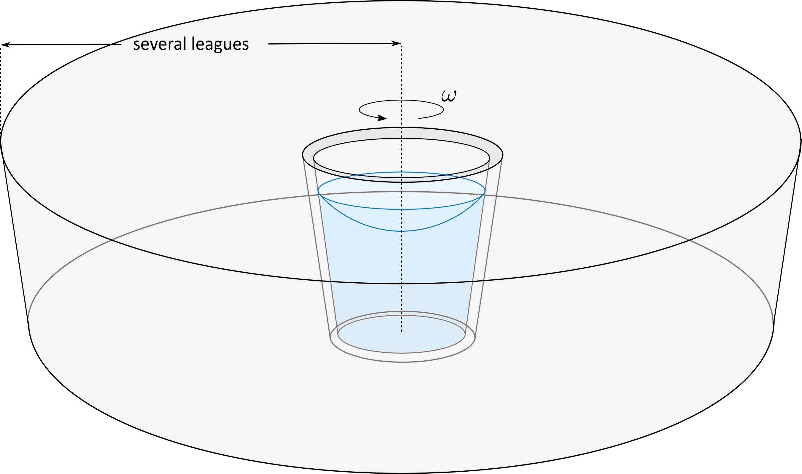

# Absolute and Relational Space and Motion: Post-Newtonian Theories
**First published Fri Aug 11, 2006; substantive revision Mon Jul 19, 2021**

*Huggett, Nick, Hoefer, Carl, Read, James*

What is the nature of motion in physical theories and theorising, and is there any significance to the distinction between ‘absolute’ and ‘relative’ motion? In the companion article, on absolute and relational space and motion: classical theories, we discussed how such questions were addressed in the history of physics from Aristotle through to Newton and Leibniz. In this article, we explore the ways in which the selfsame issues have been taken up by contemporary authors, beginning with Mach, moving on to Einstein, and concluding with a discussion of two highly relevant modern research programmes: shape dynamics and the so-called ‘dynamical approach’ to spacetime. Readers interested in following up either the historical or the current debates about the natures of space, time and motion will find ample links and references scattered through the discussion and in the Other Internet Resources section below.

The reader should note at the outset that this article presupposes familiarity with some of the basic concepts of relativity theory; in addition, section 3 presupposes familiarity with some relativity standard machinery from theoretical physics (e.g., Lagrangian mechanics). It would not be appropriate, in this philosophical article, to explain all of the background details here from the ground up. In lieu of doing so, we have (a) provided extensive references to literature in which the relevant concepts are explained further, (b) highlighted more technical subsections of this article which can be skipped on first reading, and (c) provided throughout non-technical summaries of the relevant conceptual points.

## 1. Mach

Between the time of Newton and Leibniz and the 20th century, Newton’s mechanics and gravitation theory reigned essentially unchallenged, and with that long period of dominance, Newton’s absolute space came to be widely accepted. At least, no natural philosopher or physicist offered a serious challenge to Newton’s absolute space, in the sense of offering a rival theory that dispenses with it. But like the action at a distance in Newtonian gravity, absolute space continued to provoke philosophical unease. Seeking a replacement for the unobservable Newtonian space, Neumann (1870) and Lange (1885) developed more concrete definitions of the reference frames in which Newton’s laws hold.[^note-1] In these and a few other works, the concept of the *set of inertial frames* (those in which material bodies obey Newton’s three laws of motion) was first clearly expressed, though it was implicit in both remarks and procedures found in Newton’s *Principia*. (See the entries on space and time: inertial frames and Newton’s views on space, time, and motion) The most sustained, comprehensive, and influential attack on absolute space was made by Ernst Mach in his *Science of Mechanics* (1883).

In a lengthy discussion of Newton’s *Scholium* on absolute space, Mach accuses Newton of violating his own methodological precepts by going well beyond what the observational facts teach us concerning motion and acceleration. Mach at least partly misinterpreted Newton’s aims in the *Scholium*, and inaugurated a reading of Newton’s bucket argument (and by extension the globes argument) that has largely persisted in the literature since. (See absolute and relational space and motion: classical theories, section 4, for discussion of Newton’s bucket argument.) Mach viewed the argument as directed against a ‘strict’ or ‘general-relativity’ form of relationism, and as an attempt to establish the existence of absolute space. (Strict relationism denies that there is any such thing as an absolute motion; all motion is merely relative, i.e., is nothing more than changes of location relative to some arbitrarily chosen reference frame.) Mach points out the obvious gap in the argument when so construed: the experiment only establishes that acceleration (rotation) of the water *with respect to the Earth, or the frame of the fixed stars*, produces the tendency to recede from the center; it does not prove that a strict relationist theory cannot account for the bucket phenomena, much less the existence of absolute space.

The reader of the entry on absolute and relational space and motion: classical theories will recall that Newton’s actual aim was simply to show that Descartes’ two kinds of motion are not adequate to account for rotational phenomena. Newton’s bucket argument showed that the effects of rotational motion could not be accounted for by means of the motion of the water relative to its immediate surroundings (the bucket walls); Newton’s thought experiment with two globes connected by a cord was meant to show that one can determine whether they are rotating about their common center (and if so, in which direction) without needing any reference to anything external. By pushing on opposite faces of the two globes and checking for an increase or decrease in the tension in the cord, one can determine in which sense the spheres are in rotation, if they are rotating at all.

Although Mach does not mention the globes thought experiment specifically, it is easy to read an implicit response to it in the things he does say: nobody is competent to say what would happen, or what would be possible, in a universe devoid of matter other than two globes. In other words, Mach would question Newton’s starting premise that the cord connecting the two globes in an otherwise empty universe might be under tension, and indeed under a wide range of different quantities of tension. So, for Mach, neither the bucket nor the globes can establish the existence of absolute space.

### 1.1 Two Interpretations of Mach on Inertia

Both in Mach’s interpretations of Newton’s arguments and in his replies, one can already see two anti-absolute space viewpoints emerge, though Mach himself never fully kept them apart. The first strain, which we may call ‘Mach-lite’, criticizes Newton’s postulation of absolute space as a metaphysical leap that is neither justified by actual experiments, nor methodologically sound. The remedy offered by Mach-lite is simple: we should retain Newton’s mechanics and use it just as we already do, but eliminate the unnecessary posit of absolute space. In its place we need only substitute the reference frame of the fixed stars, as is the practice in astronomy in any case. If we find the incorporation of a reference to contingent circumstances (the existence of a single reference frame in which the stars are more or less stationary) in the fundamental laws of nature problematic (which Mach need not, given his official positivist account of scientific laws), then Mach suggests that we replace the 1st law with an empirically equivalent mathematical rival, such as this one:

> Mach’s Equation (1960, 287)
> $$ \frac{d^2 (\frac{\Sigma mr}{\Sigma m})}{dt^2} = 0 $$

In this equation the sums are to be taken over all massive bodies in the universe. Since the top sum is weighted by distance, distant masses count much more than near ones. In a world with a (reasonably) static distribution of heavy distant bodies, such as we appear to live in, the equation entails that the velocity of a free body will be constant (to an extremely good approximation) in precisely those frames that we already consider to be ‘inertial’ frames. The upshot of this equation is that the frame of the fixed stars plays the role of absolute space in the statement of the 1st law. This proposal does not, by itself, offer an alternative to Newtonian mechanics, and as Mach himself pointed out, the law is not well-behaved in an infinite universe filled with stars; but the same can perhaps be said of Newton’s law of gravitation (see Malament 1995, and Norton 1993)[^malament-1995][^norton-1993]. But Mach did not offer this equation as a proposed law valid in any circumstances; he avers, “it is impossible to say whether the new expression would still represent the true condition of things if the stars were to perform rapid movements among one another.” (p. 289)

It is not clear whether Mach offered this revised first law as a first step toward a theory that would replace Newton’s mechanics, deriving inertial effects from only relative motions, as Leibniz desired. But many other remarks made by Mach in his chapter criticizing absolute space point in this direction, and they have given birth to the Mach-heavy view, later to be christened “Mach’s Principle” by Albert Einstein.[^note-2] The Mach-heavy viewpoint calls for a new mechanics that invokes only relative distances and (perhaps) their 1st and 2nd time derivatives, and thus is ‘generally relativistic’ in the sense sometimes read into Leibniz’s remarks about motion (see absolute and relational space and motion: classical theories, section 6). Mach wished to eliminate absolute time from physics too, so he would have wanted a proper relationist reduction of these derivatives also. The Barbour-Bertotti theories, discussed below, provide this.

Mach-heavy apparently involves the prediction of novel effects due to ‘merely’ relative accelerations. Mach hints at such effects in his criticism of Newton’s bucket:

> Newton’s experiment with the rotating vessel of water simply informs us that the relative rotation of the water with respect to the sides of the vessel produces no noticeable centrifugal forces, but that such forces are produced by its relative rotation with respect to the mass of the earth and the other celestial bodies. No one is competent to say how the experiment would turn out if the sides of the vessel [were] increased until they were ultimately several leagues thick. (1883, 284)

The suggestion here seems to be that the relative rotation in stage (i) of the experiment might immediately generate an outward force (before any rotation is communicated to the water), if the sides of the bucket were massive enough. (Note that this response could not have been made by Leibniz – even if he had wanted to defend Machian relationism – because it involves action at a distance between the water and the parts of the bucket, something he regarded as a metaphysical absurdity.)

Mach’s thick-sided bucket

More generally, Mach-heavy involves the view that all inertial effects should be derived from the motions of the body in question relative to all other massive bodies in the universe. The water in Newton’s bucket feels an outward pull due (mainly) to the relative rotation of all the fixed stars around it. Mach-heavy is a speculation that an effect something like electromagnetic induction should be built into gravity theory. (Such an effect does exist according to the General Theory of Relativity, and is called ‘gravitomagnetic induction’. The Gravity Probe B mission was designed to measure a gravitomagnetic induction effect on orbiting gyroscopes due to the Earth’s rotation.) Its specific form must fall off with distance much more slowly than $1/r^2$, if the theory is to be empirically similar to Newtonian physics; but it will certainly predict experimentally testable novel behaviors. A theory that satisfies all the goals of Mach-heavy would appear to be ideal for the vindication of strict relationism and the elimination of absolute quantities of motion from mechanics.

### 1.2 Implementing Mach-heavy

Direct assault on the problem of satisfying Mach-heavy in a classical framework proved unsuccessful for a long time, despite the efforts of others besides Mach – for example, Friedländer (1896), Föpl (1904), and Reissner (1914, 1915). (Between the late 19th century and the 1970s, there was of course one extremely important attempt to satisfy Mach-heavy: the work of Einstein that led to the General Theory of Relativity. Since Einstein’s efforts took place in a non-classical (Lorentz/Einstein/Minkowski) spacetime setting, we discuss them in the next section.) One very influential approach to implementing Mach-heavy was promulgated in the work of Barbour and Bertotti (1977); this has since developed into the research programme of ‘shape dynamics’, and will be discussed in more detail in section 3 below.

### 1.3 Mach-lite versus Mach-heavy

Mach-lite, like the relational interpretations of Newtonian physics reviewed in the entry on absolute and relational space and motion: classical theories, section 5, offers us a way of understanding Newtonian physics without accepting absolute position, velocity or acceleration. But it does so in a way that lacks theoretical clarity and elegance, since it does not delimit a clear set of cosmological models. We know that Mach-lite makes the same predictions as Newtonian physics for worlds in which there is a static frame associated with the stars and galaxies; but if asked about how things will behave in a world with no frame of fixed stars, or in which the stars are far from ‘fixed’, it shrugs and refuses to answer. (Recall that Mach-lite simply says: “Newton’s laws hold in the frame of reference of the fixed stars.”) This is perfectly acceptable according to Mach’s philosophy of science, since the job of mechanics is simply to summarize observable facts in an economical way. But it is unsatisfying to those with stronger realist intuitions about laws of nature.

If there is, in fact, a distinguishable privileged frame of reference in which the laws of mechanics take on a specially simple form, without that frame being determined in any way by relation to the matter distribution, a realist will find it hard to resist the temptation to view motions described in that frame as the ‘true’ or ‘absolute’ motions. If there is a family of such frames, disagreeing about velocity but all agreeing about acceleration, then the realist will feel a temptation to think of at least acceleration as ‘true’ or ‘absolute’. If such a realist believes motion to be by nature a relation rather than a property (and not all philosophers accept this; see the entry on absolute and relational space and motion: classical theories, section 1) then they will feel obliged to accord some sort of existence or reality to the structure – e.g., the structure of Galilean spacetime – in relation to which these motions are defined. For philosophers with such realist inclinations, the ideal relational account of motion would therefore be some version of Mach-heavy.

## 2. Einstein

Einstein’s Special Theory of Relativity (STR) is notionally based on a principle of relativity of motion; but that principle is ‘special’ – meaning, restricted. The relativity principle built into STR is in fact nothing other than the Galilean principle of relativity, which is built into Newtonian physics.[^note-3] In other words, while there is no privileged standard of velocity, there is nevertheless a determinate fact of the matter about whether a body has accelerated or non-accelerated (i.e., inertial) motion. In this regard, the spacetime of STR is exactly like Galilean spacetime (discussed in the entry on absolute and relational space and motion: classical theories, section 5). In terms of the question of whether all motion can be considered purely relative, one could argue that there is nothing new brought to the table by the introduction of Einstein’s STR – at least, as far as mechanics is concerned. (See the entry on space and time: inertial frames for a more detailed discussion.)

### 2.1 Relations Determine State of Motion?

In this subsection we will discuss an interesting sense in which, in STR, the letter (if not the spirit) of classical relationism can be considered vindicated: the spatio-temporal relations between material things are, on their own, sufficient to fully determine the state of motion of a body. The discussion here presupposes acquaintance with STR and its basic mathematics, and will be hard to follow for readers lacking that background; such readers should feel free to skip this subsection, which is not necessary for following the material in the rest of section 2.

As Dorling (1978) first pointed out, there is a sense in which the standard absolutist arguments against ‘strict’ relationism using rotating objects (buckets or globes) fail in the context of STR. Maudlin (1993) used the same considerations to show that there is a way of recasting relationism in STR that appears to be successful. STR incorporates certain novelties concerning the nature of time and space, and how they mesh together; perhaps the best-known examples are the phenomena of ‘length contraction’, ‘time dilation’, and the ‘relativity of simultaneity.’[^note-4] In STR both spatial distances and time intervals between events – when measured in the standard ways – are frame-relative (observers in different states of motion, i.e. at rest in different reference frames, will ‘disagree’ about their sizes). The standard classical relationist starting point – the configuration of relative distances between the existing bodies *at a moment of time* – does not exist, at least not as an objective, observer- or frame-independent set of facts. Because of this, when considering what spatial or temporal *relations* a relationist should postulate as fundamental, it is arguably most natural to restrict oneself to the frame-invariant spatiotemporal ‘distance’ between events in spacetime. This is given by the *interval* between two points: $[\Delta x^2 + \Delta y^2 + \Delta z^2 - \Delta t^2]$ – the four-dimensional analog of the Pythagorean theorem, for spacetime distances. If one regards the spacetime interval relations between point-masses-at-times as one’s basis, on which spacetime is built up as an ideal entity (analogously to how Leibniz thought of 3-d space as an ideal entity abstracted from spatial distance relations), then with only mild caveats relationism works: the spacetime interval relations suffice to uniquely fix how the material systems can be embedded (up to isomorphism) in the ‘Minkowski’ spacetime of STR. The modern variants of Newton’s bucket and globes arguments no longer stymie the relationist because (for example) the spacetime interval relations among bits of matter in Newton’s bucket at rest are quite different from the spacetime interval relations found among those same bits of matter after the bucket is rotating. For example, the spacetime *interval* relation between a bit of water near the side of the bucket, at one time, and itself (say) a second later is *smaller* than the interval relation between a center-bucket bit of water and itself one second later (times referred to inertial-frame clocks). The upshot is that, unlike the situation in classical physics, a non-rotating body cannot have all the same spatiotemporal relations among its parts as a similar body in rotation. We cannot put a body or system into a state of rotation (or other acceleration) without thereby changing the spacetime interval relations between the various bits of matter at different moments of time, compared to what they would have been if the body had remained non-accelerated or non-rotated. The facts about rotation and acceleration, thus, supervene on spacetime interval relations.[^note-5]

It is worth pausing to consider to what extent this victory for (some form of) relationism satisfies the classical ‘strict’ relationism traditionally ascribed to Mach and Leibniz. The spatiotemporal relations that save the day against the bucket and globes are, so to speak, mixed spatial and temporal distances. They are thus quite different from the spatial-distances-at-a-time presupposed by classical relationists; moreover they do not correspond to relative velocities (-at-a-time) either. Their oddity is forcefully captured by noticing that if we choose appropriate bits of matter at ‘times’ eight minutes apart, I-now am at *zero* distance from the surface of the sun (of eight minutes ‘past’, since it took 8 minutes for light from the sun to reach me-now). So we are by no means dealing here with an innocuous, ‘natural’ translation of classical relationist quantities into the STR setting. On the other hand, in light of the relativity of simultaneity (see [^note-5]), it can be argued that the absolute simultaneity presupposed by classical relationists and absolutists alike was, in fact, something that relationists should always have regarded with misgivings. From this perspective, instantaneous relational configurations – precisely what one starts with in the theories of Barbour and Bertotti discussed below – would be the things that should be treated with suspicion.

If we now return to our questions about motions – about the nature of velocities and accelerations – we find, as noted above, that matters in the interval-relational interpretation of STR are much the same as in Newtonian mechanics in Galilean spacetime. There are no well-defined absolute velocities, but there are indeed well-defined absolute accelerations and rotations. In fact, the difference between an accelerating body (e.g., a rocket) and an inertially moving body is codified directly in the cross-temporal interval relations of the body with *itself*. So we are very far from being able to conclude that all motion is relative motion of a body with respect to *other* bodies. It is true that the absolute motions are in 1–1 correlation with patterns of spacetime interval relations, but it is not at all correct to say that they are, for that reason, eliminable in favor of merely relative motions. Rather we should simply say that no absolute acceleration can fail to have an effect on the material body or bodies accelerated. But this was already true in classical physics if matter is modeled realistically: the cord connecting the globes does not merely tense, but also stretches; and so does the bucket, even if imperceptibly, i.e., the spatial relations change.

Maudlin does not claim this version of relationism to be victorious over an absolutist or substantivalist conception of Minkowski spacetime, when it comes time to make judgments about the theory’s ontology. There may be more to vindicating relationism than merely establishing a 1–1 correlation between absolute motions and patterns of spatiotemporal relations.

### 2.2 The Relationist Roots of STR and GTR

The simple comparison made above between STR and Newtonian physics in Galilean spacetime is somewhat deceptive. For one thing, Galilean space*time* is a mathematical innovation posterior to Einstein’s 1905 theory; before then, Galilean spacetime had not been conceived, and full acceptance of Newtonian mechanics implied accepting absolute velocities and, arguably, absolute positions, just as laid down in the *Scholium*. So Einstein’s elimination of absolute velocity was a genuine conceptual advance. Moreover, the *Scholium* was not the only reason for supposing that there existed a privileged reference frame of ‘rest’: the working assumption of almost all physicists in the latter half of the 19th century was that, in order to understand the wave theory of light, one had to postulate an aetherial medium filling all space, wave-like disturbances in which constituted electromagnetic radiation. It was assumed that the aether rest frame would be an inertial reference frame; and physicists felt some temptation to equate its frame with the absolute rest frame, though this was not necessary. Regardless of this equation of the aether with absolute space, it was assumed by all 19th century physicists that the equations of electrodynamic theory would have to look different in a reference frame moving with respect to the aether than they did in the aether’s rest frame (where they presumably take their canonical form, i.e., Maxwell’s equations and the Lorentz force law). So while theoreticians labored to find plausible transformation rules for the electrodynamics of moving bodies, experimentalists tried to detect the Earth’s motion in the aether. Experiment and theory played collaborative roles, with experimental results ruling out certain theoretical moves and suggesting new ones, while theoretical advances called for new experimental tests for their confirmation or – as it happened – disconfirmation.

As is well known, attempts to detect the Earth’s velocity in the aether were unsuccessful. On the theory side, attempts to formulate the transformation laws for electrodynamics in moving frames – in such a way as to be compatible with experimental results – were complicated and inelegant.[^note-6] A simplified way of seeing how Einstein swept away a host of problems at a stroke is this: he proposed that the Galilean principle of relativity holds for Maxwell’s theory, not just for mechanics. The canonical (‘rest-frame’) form of Maxwell’s equations should be their form in *any* inertial reference frame. Since the Maxwell equations dictate the velocity *c* of electromagnetic radiation (light), this entails that any inertial observer, no matter how fast she is moving, will measure the velocity of a light ray as *c* – no matter what the relative velocity of its emitter may be. Einstein worked out logically the consequences of this application of the special relativity principle, and discovered that space and time must be rather different from how Newton described them. STR undermined Newton’s absolute time just as decisively as it undermined his absolute space.

### 2.3 From Special Relativity to General Relativity

Einstein’s STR was the first clear and empirically successful physical theory to overtly eliminate the concepts of absolute rest and absolute velocity while recovering *most of* the successes of classical mechanics and 19th century electrodynamics. It therefore deserves to be considered the first highly successful theory to explicitly relativize motion, albeit only partially. But STR only recovered most of the successes of classical physics: crucially, it left out gravity. And there was certainly reason to be concerned that Newtonian gravity and STR would prove incompatible: classical gravity acted instantaneously at a distance, while STR eliminated the privileged absolute simultaneity that this instantaneous action presupposes.

Several ways of modifying Newtonian gravity to make it compatible with the spacetime structure of STR suggested themselves to physicists in the years 1905–1912, and a number of interesting Lorentz-covariant theories were proposed (i.e., theories compatible with the spacetime of STR, which is called ‘Minkowski spacetime’ because Hermann Minkowski first revealed the spacetime structure that Einstein’s postulates in STR entail). Einstein rejected these proposed theories one and all, for violating either empirical facts or theoretical desiderata. But Einstein’s chief reason for not pursuing the reconciliation of gravitation with STR’s spacetime appears to have been his desire, beginning in 1907, to replace STR with a theory in which not only velocity could be considered merely relative, but also acceleration. That is to say, Einstein wanted if possible to completely eliminate all absolute quantities of motion from physics, thus realizing a theory that satisfies at least one kind of ‘strict’ relationism. (Regarding Einstein’s rejection of Lorentz-covariant gravity theories, see Norton 1992; regarding Einstein’s quest to fully relativize motion, see Hoefer 1994.)[^hoefer-1994][^norton-1992]

Einstein began to see this complete relativization as possible in 1907, thanks to his discovery of the Equivalence Principle (cf. Lehmkuhl *forthcoming*). Imagine we are far out in space, in a rocket ship accelerating at a constant rate $g = 9.81 m/s^2.$ Things will feel just like they do on the surface of the Earth; we will feel a clear up-down direction, bodies will fall to the floor when released, etc. Indeed, due to the well-known empirical fact that gravity affects all bodies by imparting a force proportional to their matter (and energy) content, independent of their internal constitution, we know that any experiment performed on this rocket will give the same results that the same experiment would give if performed on the Earth. Now, Newtonian theory teaches us to consider the apparent downward, gravity-like forces in the rocket ship as ‘pseudo-forces’ or ‘inertial forces’, and insists that they are to be explained by the fact that the ship is accelerating in absolute space. But Einstein asked whether there is any way for the person in the rocket to regard him/herself as being ‘at rest’ rather than in absolute (accelerated) motion? And the answer he gave is: Yes. The rocket traveler may regard him/herself as being ‘at rest’ in a homogeneous and uniform gravitational field. Such a field would entail an accelerative force “downward” on every body that is equal in magnitude and direction everywhere in space. This is unlike the Earth’s gravitational field, which varies depending on distance from the Earth’s center and points in different directions at different locations. Positing the existence of such a field will explain all the observational facts just as well as the supposition that he/she is accelerating relative to absolute space (or, absolutely accelerating in Minkowski spacetime). But is it not clear that the latter is the truth, while the former is a fiction? By no means; if there *were* a uniform gravitational field filling all space, then it would affect all the other bodies in the world – the Earth, the stars, etc, – imparting to them a downward acceleration away from the rocket; and that is exactly what the traveler observes.

In 1907 Einstein published his first gravitation theory (Einstein 1907)[^einstein-1907], treating the gravitational field as a scalar field that also represented the (now variable and frame-dependent) speed of light. Einstein viewed the theory as only a first step on the road to eliminating absolute motion. In the 1907 theory, the theory’s equations take the same form in any inertial *or uniformly accelerating* frame of reference. One might say that this theory reduces the class of absolute motions, leaving only rotation and other non-uniform accelerations as absolute. But, Einstein reasoned, if uniform acceleration can be regarded as equivalent to being at rest in a constant gravitational field, why should it not be possible also to regard inertial effects from these other, non-uniform motions as similarly equivalent to “being at rest in a (variable) gravitational field”? Thus Einstein set himself the goal of expanding the principle of equivalence to embrace all forms of ‘accelerated’ motion.

Einstein thought that the key to achieving this aim lay in further expanding the range of reference frames in which the laws of physics take their canonical form, to include frames adapted to any arbitrary motions. More specifically, since the class of all continuous and differentiable coordinate systems includes as a proper subclass the coordinate systems adapted to any such frame of reference, if he could achieve a theory of gravitation, electromagnetism and mechanics that was *generally covariant* – its equations taking the same form in any coordinate system from this general class – then the complete relativity of motion would be achieved. If there are no special frames of reference in which the laws take on a simpler canonical form, there is no physical reason to consider any particular state or states of motion as privileged, nor deviations from those as representing ‘absolute motion’. (Here we are just laying out Einstein’s train of thought; later we will see reasons to question the last step.) And in 1915, Einstein achieved his aim in the General Theory of Relativity (GTR).

### 2.4 General Relativity and Relativity of Motion

There is one key element left out of this success story, however, and it is crucial to understanding why most physicists reject Einstein’s claim to have eliminated absolute states of motion in GTR. Going back to our accelerating rocket, we accepted Einstein’s claim that we could regard the ship as hovering at rest in a universe-filling gravitational field. But a gravitational field, we usually suppose, is generated by matter. How is this universe-filling field linked to generating matter? The answer may be supplied by Mach-heavy. Regarding the ‘accelerating’ rocket which we decide to regard as ‘at rest’ in a gravitational field, the Machian says: all those stars and galaxies, etc., jointly accelerating downward (relative to the rocket), ‘produce’ that gravitational field. The mathematical specifics of how this field is generated will have to be different from Newton’s law of gravity, of course; but it should give essentially the same results when applied to low-mass, slow-moving problems such as the orbits of the planets, so as to capture the empirical successes of Newtonian gravity. Einstein thought, in 1916 at least, that the field equations of GTR are precisely this mathematical replacement for Newton’s law of gravity, and that they fully satisfied the desiderata of Mach-heavy relationism. But it was not so. (See the entry on early philosophical interpretations of general relativity.)

In GTR, spacetime is locally very much like STR’s flat Minkowski spacetime. There is no absolute velocity locally, but there are clear local standards of accelerated vs non-accelerated motion, i.e., local inertial frames. In these ‘freely falling’ frames bodies obey the usual rules for non-gravitational physics familiar from STR, albeit only approximately (this is sometimes called the ‘strong equivalence principle’, and is discussed further in section 4 below). But overall spacetime is curved, and local inertial frames may tip, bend and twist as we move from one region to another. The structure of curved spacetime is encoded in the metric field tensor **g_{ab}**, with the curvature encoding gravity at the same time: gravitational forces are so to speak ‘built into’ the metric field, geometrized away. Since the spacetime structure encodes gravity and inertia, and in a Mach-heavy theory these phenomena should be completely determined by the relational distribution of matter (and relative motions), Einstein wished to see the metric as entirely determined by the distribution of matter and energy. But what the GTR field equations entail is, in general, only a partial-determination relation.

We cannot go into the mathematical details necessary for a full discussion of the successes and failures of Mach-heavy in the GTR context. But one can see why the Machian interpretation Einstein hoped he could give to the curved spacetimes of his theory fails to be plausible, by considering a few simple ‘worlds’ permitted by GTR. In the first place, for our hovering rocket ship, if we are to attribute the gravity field it feels to matter, there has got to *be* all this other matter in the universe. But if we regard the rocket as a mere ‘test body’ (not itself substantially affecting the gravity present or absent in the universe), then we can note that according to GTR, if we remove all the stars, galaxies, planets etc. from the world, the gravitational field does not disappear. On the contrary, it stays basically the same locally, and globally, in the simplest solution of the field equations, it takes the form of empty Minkowski spacetime – precisely the quasi-absolute structure Einstein was hoping to eliminate. Solutions of the GTR field equations for arbitrary realistic configurations of matter (e.g., a rocket ship ejecting a stream of particles to push itself forward) are hard to come by, and in fact a realistic two-body exact solution has yet to be discovered. But numerical methods can be applied for many purposes, and physicists do not doubt that something like our accelerating rocket – in otherwise empty space – is possible according to the theory.[^note-7] We see clearly, then, that GTR fails to satisfy Einstein’s own understanding of Mach’s Principle, according to which, in the absence of matter, space itself should not be able to exist.

A second example: GTR allows us to model a single *rotating* object in an otherwise empty universe (e.g., a neutron star). Relationism of the Machian variety says that such rotation is impossible, since it can only be understood as rotation relative to some sort of absolute space. In the case of GTR, this is indeed the natural way to understand such a model: the rotation is best understood as rotation relative to a ‘background’ spacetime that is identical to the Minkowski spacetime of STR, only ‘curved’ by the presence of matter in the region of the star.

On the other hand, there is one charge of failure-to-relativize-motion sometimes leveled at GTR that is unfair. It is sometimes asserted that the simple fact that the metric field (or the connection it determines) distinguishes, at every location, motions that are ‘absolutely’ accelerated and/or ‘absolutely rotating’ from those that are not, by itself entails that GTR fails to embody a folk-Leibniz style general relativity of motion (e.g. Earman (1989), ch. 5). We think this is incorrect, and leads to unfairly harsh judgments about confusion on Einstein’s part. The local inertial structure encoded in the metric would not be ‘absolute’ in any meaningful sense, if that structure were in some clear sense fully determined by the relationally specified matter-energy distribution. Einstein was not *simply confused* when he named his gravity theory. (Just what is to be understood by “the relationally specified matter-energy distribution” is a further, thorny issue, which we cannot enter into here.)

GTR does not fulfill all the goals of Mach-heavy, at least as understood by Einstein, and he recognized this fact by 1918 (Einstein 1918)[^einstein-1918]. And yet … GTR comes tantalizingly close to achieving those goals, in certain striking ways (cf. Hoefer 2014)[^hoefer-2014]. For one thing, GTR does predict Mach-heavy effects, known as ‘frame-dragging’: if we could model Mach’s thick-walled bucket in GTR, it seems clear that it would pull the water slightly outward, and give it a slight tendency to begin rotating in the same sense as the bucket (even if the big bucket’s walls were not actually touching the water). While GTR does permit us to model a lone rotating object, if we model the object as a shell of mass (instead of a solid sphere) and let the size of the shell increase (to model the ‘sphere of the fixed stars’ we see around us), then as Brill & Cohen (1966) showed, the frame-dragging becomes complete inside the shell. In other words: our original Minkowski background structure effectively disappears, and inertia becomes wholly determined by the shell of matter, just as Mach posited was the case. This complete determination of inertia by the global matter distribution appears to be a feature of other models, including the Friedman-Lemâitre-Robertson-Walker Big Bang models that best match observations of our universe.

Finally, it is important to recognize that GTR is generally covariant in a very special sense: unlike all other prior theories (and unlike many subsequent quantum theories), it postulates no fixed ‘prior’ or ‘background’ spacetime structure. As mathematicians and physicists realized early on, other theories, e.g., Newtonian mechanics and STR, can be put into a generally covariant form. But when this is done, there are inevitably mathematical objects postulated as part of the formalism, whose role is to represent absolute elements of spacetime structure (see Friedman 1983, Pooley 2017)[^friedman-1983][^pooley-2017]. What is unique about GTR is that it was the first, and is still the only ‘core’ physical theory, to have no such absolute elements in its covariant equations. (Whether these claims are exactly correct is a matter of ongoing debate, relating to the question of the ‘background independence’ of GTR: for discussion, see e.g. Belot (2011), Pitts (2006), Read (2016), and Pooley (2017).) The spacetime structure in GTR, represented by the metric field, is at least partly ‘shaped’ by the distribution of matter and energy. And in certain models of the theory, such as the Big Bang cosmological models, some authors have claimed that the local standards of inertial motion – the local ‘gravitational field’ of Einstein’s equivalence principle – are entirely fixed by the matter distribution throughout space and time, just as Mach-heavy requires (see, for example, Wheeler and Cuifollini 1995)[^wheeler-1995].

Absolutists and relationists are thus left in a frustrating and perplexing quandary by GTR. Considering its anti-Machian models, we are inclined to say that motions such as rotation and acceleration remain absolute, or nearly-totally-absolute, according to the theory. On the other hand, considering its most Mach-friendly models, which include all the models taken to be good candidates for representing the actual universe, we may be inclined to say: motion *in our world* is entirely relative; the inertial effects normally used to argue for absolute motion are all understandable as effects of rotations and accelerations relative to the cosmic matter, just as Mach hoped. But even if we agree that motions in our world are in fact all relative in this sense, this does not automatically settle the traditional relationist/absolutist debate, much less the relationist/substantivalist debate. Many philosophers (including, we suspect, Nerlich 1994 and Earman 1989)[^earman-1989][^nerlich-1994][^nerlich-1994-2] would be happy to acknowledge the Mach-friendly status of our spacetime, and argue nevertheless that we should understand that spacetime as a real thing, more like a substance than a mere ideal construct of the mind as Leibniz insisted. By contrast, other philosophers (e.g., Rynasiewicz 1995)[^rynasiewicz-1995] argue that due to the conceptual and mathematical novelties introduced in GTR, the traditional absolute vs. relational motion debate simply fails to make sense any more (on this question, see also Hoefer 1998)[^hoefer-1998].

## 3. Shape Dynamics

We turn now to a modern-day attempt to implement Mach-heavy known as ‘shape dynamics’. (In fact, shape dynamics is just one theory within this tradition, as we will see below.) This approach was initiated – albeit not under that name – by Barbour and Bertotti (1977, 1982). In tackling the problem of implementing Mach-heavy, rather than formulating a revised law of gravity/inertia using relative quantities, Barbour and Bertotti used the framework of Lagrangian mechanics, replacing elements of the mathematics referring to absolute quantities of motion with new terms invoking only relative distances, velocities, etc. In this section, we presuppose a basic familiarity with the Lagrangian framework. For a non-technical introduction to shape dynamics, see Barbour (1999); for an up-to-date review of recent work in the field, see Mercati (2018).

In this section, we survey the results and motivations of the shape dynamics research program, focussing first on the above-mentioned theory of Barbour and Bertotti (which recovers a subsection of the solution space of Newtonian particle theory), before turning to the Machian alternative to general relativity developed by Barbour and collaborators: it is this latter theory which is shape dynamics ‘proper’. Readers uninterested in the technical details of this work can skip to section 3.5, in which its conceptual upshots are discussed.

### 3.1. Configuration Space

For a given physical system, define its ‘configuration space’ to be the space of possible instantaneous states of that system. (For example, the space of possible distributions of N particles in Euclidean space, according to a Cartesian coordinate system laid down on that space.) As the system evolves, the point in configuration space representing the system’s instantaneous state traces out a continuous curve. On this picture, metaphysically possible worlds are represented by (rising) curves in the product space formed from configuration space and a one-dimensional space representing time. Nomologically possible worlds are represented by those curves that are allowed by the dynamics. For example, in the Lagrangian formalism, the nomologically possible worlds are represented by those curves which extremize the action: a particular functional of such curves.

Consider now, for the sake of concreteness, two Newtonian worlds which differ by either a static or a kinematic Leibniz shift: that is, constant translations or velocity boosts of the material content of the universe (see the companion entry on absolute and relational space and motion: classical theories, for further discussion of such shifts). These two worlds will be represented by distinct curves in configuration space. However, given a configuration space, one can construct a ‘reduced’ configuration space, in which certain such histories are mathematically identified, or ‘quotiented’, such that they are mapped to the same unique history in reduced configuration space. Specifically, proponents of this approach define two such reduced configuration spaces:

1. ‘Relative configuration space’, which is configuration space quotiented by rigid translations and rotations. (I.e., curves in configuration space which represent worlds which differ by rigid translations or rotations are mathematically identified.)
2. ‘Shape space’, which its configuration space quotiented by rigid translations, rotations, and dilatations. (I.e., curves in configuration space which represent worlds which differ by rigid translations, rotations, or dilatations are mathematically identified.)

(Two points here. First, recall that a ‘dilatation’ is a scale transformation. Second, in what follows we will refer to the group which consists of the union of translations, rotations and dilatations as the ‘similarity group’.) If these Machian theorists are able to formulate a dynamics on shape space (i.e., a dynamics which identifies the curves in shape space which represent nomologically possible worlds), then that dynamics will, in light of the above reduction, not bring with it a meaningful notion of absolute position, or absolute velocity, or absolute scales. Barbour and collaborators take such a dynamics to realize Mach-heavy: the undetectable spacetime structure associated with such quantities has been expunged. Below, we will see how this can be done in the concrete contexts of Newtonian particle dynamics and general relativity.

### 3.2. Emergent Temporality

The Machian ambitions of Barbour and collaborators do not end there, for these authors also seek to excise primitive temporal structure. Initially, one might distinguish histories that correspond to a single curve in configuration space being traced out at different rates with respect to the primitive temporal parameter. Those working in this tradition, however, view each curve in configuration space as corresponding to exactly one possible history. They therefore elect to dispose of the auxiliary one-dimensional space representing a primitive absolute time which was introduced above. Instead, they seek to construct an ‘emergent’ notion of temporality from dynamics defined on configuration space alone. By way of a procedure known as ‘Jacobi’s principle’, the Machian relationist selects a unique temporal parameter which maximally simplifies this dynamics defined on configuration space. For the details of Jacobi’s principle, see Pooley (2013).

### 3.3. Best Matching

It is all well and good speaking of a dynamics defined on relative configuration space, or shape space. However, it remains incumbent on our Machian theorists to construct explicit dynamics appropriate for these spaces: i.e., dynamics which do not recognise solutions related by the action of the similarity group (viz., translations, rotations, and dilatations) as being distinct. Given a dynamics on configuration space, one can indeed achieve this task. The procedure which implements this is known as ‘best matching’, and was developed in the seminal work of Barbour and Bertotti (1982), in which a version of Newtonian particle mechanics with dynamics formulated on relative configuration space was first constructed. The extension to shape space was undertaken in (Barbour 2003).

Informally, the goal of best matching is to use the similarity group to minimize the intrinsic difference between successive points along a history in configuration space. To take a simple example drawn from Barbour (1999), consider the history of a particular triangle: the triangle may, along that history, rotate, dilate, alter its internal angles, and so on. However, at each point best matching allows one to act on the triangle with similarity transformations; thereby, triangles which at successive points along a history differ merely by a translation, rotation or dilatation will be regarded as being identical after best matching. In this way, a ‘best matched’ history is selected, in which the intrinsic differences between successive states of the system under consideration (in the above example, the triangle) are minimised. While a metric on configuration space will in general assign a different length to histories differing by the action of the similarity group, the length of the best matched history, constructed via the above procedure, will induce a unique length of paths, and therefore metric, on shape space.

A little more formally, the best matching procedure works as follows. Consider a class of paths in configuration space, all corresponding to the same path in shape space (i.e., consider a class of paths in configuration space related by the action of the similarity group). As mentioned above, a given metric on configuration space will in general assign to each path in that space a different length; as a result, the length of the associated path in shape space will be underdetermined. However, starting from any given point p in configuration space, one can use the action of the similarity group on configuration space to define a unique curve, by shifting the points of any curve through p along the corresponding orbits of the similarity group (think of these ‘orbits’ as contour lines in configuration space, relating points which differ only by the action of the similarity group) so as to extremize the length assigned to the curve (relative to the metric under consideration). It is this extremized length which is assigned to the unique curve in shape space. With each curve in shape space assigned a unique length, one can then, as usual, specify a principle which selects some such curves as representing nomologically possible worlds, based upon their lengths. (Recall again, for example, that in Lagrangian mechanics it is those curves which extremize an action which are regarded as being dynamically possible.)

### 3.4. Relativistic Best Matching

The best matching prescription can be applied not only to Newtonian particle theories, but also to other spacetime theories, including GTR. (There is no reason why best matching cannot be applied to Newtonian field theories, or to special relativistic particle dynamics, but these steps are usually skipped by Machian relationists following in the tradition of Barbour and Bertotti, who proceed at this stage straight to GTR.)

To see how best matching works in the case of GTR, first note that a certain subclass of solutions of that theory (namely, those which are globally hyperbolic) can be formulated in terms of the ‘3+1 formalism’, according to which the state of the universe at a particular time is represented by a determinate 3-manifold with associated Riemannian metric; dynamical equations then determine how such 3-geometries evolve in time. (For a summary of the 3+1 formalism, see e.g. Gourgoulhon (2012).) The Machian relationists working in the shape dynamics research program take this 3+1 approach to GTR as their starting point. They thus assume that instantaneous spaces which are the points in configuration space have the determinate topology of some closed 3-manifold without boundary. Configuration space is the space of Riemannian 3-metrics on that 3-manifold. The natural analogue of relative configuration space is, then, this space of Riemannian 3-metrics quotiented by diffeomorphisms, which are the generalisations of Leibniz shifts appropriate to GTR (see the entry on the hole argument). The analogue of shape space in this case is the space of Riemannian 3-metrics, but quotiented in addition by local dilatations (by ‘local’, we mean here a transformation which can vary from point to point).

Having constructed shape space in the relativistic case, one may then best match in order to construct one’s relational theory implementing Mach-heavy (the metric on configuration space is defined from the 3+1 dynamics of GTR): conceptually, the approach here is the same as that presented in the previous section. Moreover, one can again apply Jacobi’s principle, in order to eliminate a commitment to primitive temporal structure. In this case, the resulting theory is known as ‘shape dynamics’, which involves a commitment only to primitive conformal structure (i.e., facts about angles between objects) on the 3-geometries: all other absolute quantities, the claim goes, have been excised. One way to understand the relationship between GTR and shape dynamics is that one trades the relativity of simultaneity but absoluteness of scales in the former theory, for absolute simultaneity but the relativity of scales in the latter.

### 3.5. Conceptual Matters

There are important differences between the relationship between ‘standard’ Newtonian particle mechanics and its best-matched alternative on the one hand, and the relationship between GTR and shape dynamics on the other. In the former case, the class of solutions of the best-matched theory is a proper subset of the solutions of Newtonian mechanics: for example, it includes only the sector of the solution space of Newtonian mechanics which ascribes zero angular momentum to the entire universe. Sometimes, this is marketed as an advantage of the latter theory: the best-matched theory predicts what was, in the Newtonian case, an unexplained coincidence. (For discussion, see Pooley & Brown 2002.)[^pooley-2002] In the latter case, by contrast, it has been discovered that one can ‘glue’ solutions of shape dynamics to construct new solutions, which are not associated with any particular solution of GTR (in the sense that they are not the best matched equivalents of any solution of GTR): see (Mercati 2018)[^mercati-2018]. Thus, the solution spaces of GTR and shape dynamics overlap, but the latter is not a proper subset of the former. Given this, it is no longer clear that shape dynamics can be presented as a ‘more predictive’ alternative to GTR.

A second conceptual point to make regarding the Machian relationism of Barbour and collaborators pertains to its motivations. Barbour claims, as we have already seen above, that only spatial angles – and not spatial scales, or a temporal timescale, or absolute velocities or positions – are directly empirically observable. Thus, the thought goes that an empiricist of good standing should favour (say) shape dynamics over GTR, for the former theory, unlike the latter, renders only such ‘directly observable’ quantities meaningful; it does not commit to any absolute quantities which are not ‘directly observable’. There are, however, two central points at which this reasoning could be questioned. First: one could repudiate Barbour’s empiricist motivations. Second: one could deny that only angles are directly observable, or, indeed, that this structure is directly observable at all (see Pooley 2013, p. 47)[^pooley-2013][^pooley-2013-2]. As Pooley points out, these are not the strongest grounds on which to motivate Barbour’s project. Rather, a better motivation is this: best-matched theories have the merit of ontological parsimony, as compared with the theories such as Newtonian particle mechanics or general relativity, to which the best-matching procedure is applied. A second motivation has to do with the potential of this research programme to present new avenues for exploration in the quest for a quantum theory of gravity.

Our third and final point is this. Although it is possible to couple shape dynamics to matter (see e.g. (Gomes 2012)[^gomes-2012]), in this theory, just as in GTR as discussed in the previous section, one also has vacuum solutions, with primitive conformal structure on the 3-geometries. Given the existence of these vacuum solutions, as with GTR, it is far from clear that the theory makes good on the ambitions of Mach and the early Einstein to construct a theory in which all spatiotemporal notions are reduced to facts about matter. That said, it is worth noting that, unlike in GTR, in shape dynamics one *cannot* have a solution consisting of a single rotating body: the overall angular momentum of the universe must vanish.

## 4. The Dynamical Approach

Since 2000, a new ‘dynamical’ approach to spacetime structure has emerged in the works of Robert DiSalle (2006) and especially Oliver Pooley and Harvey Brown (2001, 2006). This approach is to be situated against an opposing, supposedly orthodox ‘geometrical’ approach to spacetime structure, as encapsulated in the works of e.g. Janssen (2009) and Maudlin (2012). (This is not to say that either the dynamical view or the opposing geometrical view is a unified edifice, as we will see below.) The dynamical-geometrical debate has many facets, but one can take the central bone of contention to pertain to the arrow of explanation: is it the case that the geometrical structures of spacetime explain why material bodies behave as they do (as the geometrical view would have it), or is it rather the case that the geometrical structure of spacetime is explained by facts about the behaviour of material bodies (as the dynamical view would have it)? Although this debate connects with historical debates between substantivalists and relationists, it should be regarded as a distinct dispute, for reasons to which we will come.

While it is important to keep in mind the above disagreement regarding the arrow of explanation when one is considering the dynamical-geometrical debate, it will be helpful in this article to hone in on two more specific claims of the dynamical approach, as presented by Brown (2005), consistent with the above claim that it is facts about the dynamics of material bodies which explain facts about spatiotemporal structure, rather than vice versa. These two claims are the following (Read 2020a)[^read-2020a]:

1. Fixed background space-time structures, such as the Minkowski space-time of STR, or Newton’s absolute space, are to be ontologically reduced to the symmetries of the dynamical equations governing matter fields.
2. No piece of space-time structure, whether fixed or dynamical (in the latter case, as in GTR) is necessarily surveyed by physical bodies; rather, in order to ascertain whether this is so, one must attend carefully to the details of the dynamics governing the particular matter fields which constitute physical bodies.

On the first of these two points: proponents of the dynamical approach maintain that the spacetime structure of our world is what it is *because of the dynamical laws of nature and their symmetries*. That is, the dynamical laws are (at least, relative to spacetime) fundamental, and spacetime structure is derivative; in this sense, the view is (at least in some cases) a modern-day form of relationism (Pooley 2013, §6.3.2)[^pooley-2013][^pooley-2013-2] – albeit of a very different kind from the relationist approaches considered up to this point. (Note, though, that this relationism is a *corollary* of the above explanatory contention of the dynamical approach; moreover, it is one which is applicable only to theories which fixed spacetime structure such as Newtonian mechanics or STR – and therefore *not* to theories with dynamical spacetime structure, such as GTR. For this reason, as already indicated above, proponents of the dynamical view are not to be identified naïvely with relationists.)

On the second of these two points: the idea – what Butterfield (2007) calls ‘Brown’s moral’ – is that one cannot simply posit a piece of geometrical structure in one’s theory, e.g. a Minkowski metric field in STR, and know *ab initio* that material bodies (in particular rods and clocks) will read off intervals of that structure; rather, whether this is the case or not will depend upon the constitution of, and dynamics governing, those material bodies. We will see below specific theories in which any such assumption seems to fail. Note that this second point is again consistent with the explanatory contention taken above to be characteristic of the dynamical approach: a given piece of structure inherits its operational significance as spacetime by dint of the behaviour of material bodies.

Before addressing the second of these two points, we should consider the first in greater detail. The claim that fixed spatiotemporal structure is to be ontologically reduced to facts about material bodies invites many questions, chief among which is perhaps the following: to what could this ontological reduction possibly amount? In the following section, we will see one particular metaphysical programme which promises to make good on this claim.

### 4.1 The Dynamical Approach and Regularity Relationism

There is arguably a tight relationship between the geometrical symmetries of a spacetime and the symmetries of a theory that describes the physics of matter (in a broad sense, including fields) in it. (Theories such as GTR, in which space-time has its own dynamics are more complicated, and will be discussed later; for further discussion of symmetries in physics, see the entry on symmetry and symmetry breaking.) Each symmetry is a set of transformations, with a rule of composition: formally a ‘group’. For instance, the group of rotations in the plane has a distinct element for every angle in the range 0–360 degrees; the composition of two rotations is the single rotation through the sum of their angles. Spacetime symmetries are those transformations which leave invariant a piece of spacetime structure (e.g., the symmetries of Minkowski spacetime are translations, spatial rotations and Lorentz boosts: together, the so-called Poincaré transformations); dynamical symmetries are those transformations which leave invariant a set of dynamical equations (e.g., the symmetries of Maxwell’s equations of electromagnetism are again the Poincaré transformations). There are good reasons to hold that the symmetry groups of theory and spacetime must agree. First, since the theory describes matter, and hence (arguably) what is measurable, any theoretical symmetries not reflected in the postulated spacetime structure indicate unmeasurable geometry: for instance, if an absolute present were postulated in relativistic physics. While in the other direction, if there were extra spacetime symmetries beyond those found in the dynamics, then *per impossible* one could measure nonexistent geometric quantities: for instance, a theory that depends on absolute velocities cannot be formulated in Galilean spacetime (see the entry on absolute and relational space and motion: classical theories for further discussion of these Newtonian spacetime structures). Famously, Earman (1989, ch. 3) declares that the matching of space-time and dynamical symmetries is, thus, an ‘adequacy condition’ on a physical theory.

Given this ‘adequacy condition’, a given geometry for spacetime formally constrains the allowable theories to those with the just the right symmetries: not too many, and not too few. It was an assumption of many substantivalists (the views of whom are discussed below) that this constraint was not merely formal, but ontological: that the geometry is more fundamental than the laws, or that geometry offers a ‘real’ explanation of the form of the laws – such authors would, by the above categorization, qualify as proponents of a geometrical view. However, that the symmetries should agree does not specify any direction of dependence, and it could be reversed, so that the geometric symmetries are ontologically determined by those of the laws of the theory: hence the geometry itself is an expression of the (symmetry properties of the) dynamics of matter – transparently, this is consistent with the first of the two specific commitments of the dynamical view discussed above. In the words of Brown and Pooley (2006) (making these points about STR): “… space-time’s Minkowskian structure cannot be taken to explain the Lorentz covariance of the dynamical laws. From our perspective … the direction of explanation goes the other way around. It is the Lorentz covariance of the laws that underwrites the fact that the geometry of space-time is Minkowskian.”

Of the opposing geometrical approach to spacetime, Brown and Pooley (2006, p. 84) question the *mechanism* by which autonomous spacetime structure is supposed to explain or constrain the behaviour of material bodies. Although we will keep our attention focussed on the dynamical view in this subsection, rather than upon its opponents (see the following subsection for more on the explanatory capacities of spacetime), one might, however, ask at this point: does the dynamical view really do better in this regard? How is it that dynamical symmetries are supposed to explain, or account for, spacetime structure? In the context of theories with fixed spacetime structure, this question is answered by proponents of the dynamical view via an *ontological reduction* of spatiotemporal structure to symmetries of dynamical equations governing matter fields, as indicated in (1) above. (In fact, this ‘reduction’ is better described as a form of *elimination*, as we will see.) But this, in turn, invites yet more questions: how, metaphysically, is this ontological reduction operating? Can one in fact state dynamical laws, or understand them as “holding” or “governing”, without *presupposing* facts about spacetime structure?

Take, for example, Newton’s laws of motion. The 1st law asserts that bodies not acted upon by an external force will move with constant velocity; similarly for the 2nd law and acceleration. These laws seem to presuppose that these are meaningful terms, but in spacetime terms their meaning is given by geometric structures: for instance, constant velocity in Galilean spacetime means having a straight spacetime trajectory. And the problem is not restricted to Newtonian physics; the same point can be made regarding theories that presuppose the Minkowski background spacetime structure, e.g., the quantum field theories of the Standard Model.

It is increasingly well-appreciated that one suitable metaphysical program to which the dynamical approach can appeal here is Huggett’s (2006) regularity relationism: see (Huggett 2009; Pooley 2013; Stevens 2020)[^huggett-2009][^pooley-2013][^stevens-2020][^pooley-2013-2]. The idea is to consider the dynamical laws as regularities that systematize and describe the patterns of events concerning an underlying ontology/ideology that involves or presupposes only very limited spatiotemporal features. To illustrate how this approach might go, consider Pooley’s (2013, §6.3) proposal that the dynamical approach to STR might postulate only R⁴ topological spatiotemporal structure, which could be (for example) attributed to a massive scalar field. Suppose we are given a full 4D field description of such a field, in terms of some arbitrary coordinate system. This would describe a simple ‘Humean mosaic’, to use David Lewis’ term for one’s basic spatiotemporal and material commitments (see article David Lewis for further discussion). Now, smooth coordinate changes applied to such a description will generate distinct mathematical representations of that Humean mosaic, given using distinct coordinatizations of the field-stuff. It might happen that, among all such representations, there is a subclass of coordinate systems which are such that (i) when the scalar field is described using a member of the class, it turns out that its values at spacetime points satisfy some simple/elegant mathematical equation; and moreover, (ii) the members of the class are related by a nicely-specifiable symmetry group. If this is so, then the simple/elegant equation can be taken as expressing a dynamical law for the world of this mosaic (understood as a statement: “There are frames in which …”), and the symmetry group of the law can be seen as capturing the *derivative*, not intrinsic, spacetime structure of the world. If the symmetry group is the Poincaré group, for example, then the field behaves ‘as if’ it were embedded in a spacetime with Minkowski geometry. But all this means is that the dynamics is representationally equivalent to a theory with an autonomous Minkowski geometry. From the point of view of the dynamical approach, such a theory is merely an interesting, and perhaps useful, representation of the real facts: and it’s a mistake to take every feature of a representation to correspond to something in reality (Brown & Read 2020, §5).

Even granting that this regularity relationist understanding of the dynamical approach goes through, three outstanding issues for the dynamical approach deserve to be mentioned. First: given that the proponent of the view seeks to excise metrical (more generally: geometrical) spacetime structure, one might ask: why stop there? Is there not something unnatural about excising fixed metric structure, while taking topological structure to be primitive? Such a concern was raised by Norton (2008), to which two responses have been offered in the literature: (I) In direct response to Norton, Pooley points out that “the project was to reduce chronogeometric facts to symmetries, not to recover the entire spatiotemporal nature of the world from no spatiotemporal assumptions whatsoever” (2013, p. 57). (II) Menon (2019) has argued that the machinery of ‘algebraic fields’ can be deployed in order to reduce topological structure to facts about matter, thereby, if successful, meeting Norton’s challenge head-on. Second: how is one to extend the dynamical approach, understood as a form of Huggett’s regularity relationism, to theories of dynamical space-time such as GTR? Here, the lack of spacetime symmetries in the theory has posed problems for the successful implementation of any such account (Stevens 2014)[^stevens-2014], although arguably initial progress in this regard has been made by Vassallo and Esfeld (2016). Third: to which symmetries of the laws is the dynamical approach supposed to be sensitive? In the philosophy of physics, it is common to draw a distinction between ‘internal’ and ‘external’ symmetries: examples of the former include U(1) gauge transformations in electromagnetism; examples of the latter are coordinate transformations, such as Galilean boosts in Newtonian mechanics. But there are many questions here, such as: (i) how, precisely, is the distinction between internal and external symmetries to be drawn? (ii) why should the proponent of the dynamical approach stop at external symmetries? For discussion of these questions, see (Dewar 2020)[^dewar-2020].

### 4.2 Space-time and Explanation on the Dynamical Approach

We have already seen how the dynamical approach, *qua* programme of ontological reduction, is supposed to play out in the context of theories with fixed spacetime structure, including both Newtonian theories and STR. We have also witnessed Brown and Pooley’s concerns about the ability of a substantival spacetime to explain facts about the behavior of matter. These concerns are motivated by apparent problem cases, in which the symmetries of a substantival spacetime seem to come apart from those of the dynamical laws governing matter. Such cases include: (i) Newtonian mechanics set in Newtonian spacetime (Read 2020a)[^read-2020a]; (ii) the Jacobson-Mattingly theory (Jacobson & Mattingly 2001)[^jacobson-2001], in which dynamical symmetries are a subset of spacetime symmetries, as a result of the presence of an additional (dynamical) symmetry-breaking vector field (Read, Brown & Lehmkuhl 2018)[^read-2018].

It is not obvious that these critiques are fair to proponents of a geometrical view. One might take their position not to be that a certain piece of geometrical structure (e.g., the Minkowski metric of STR) invariably constrains matter, whenever it is present in a theory, to manifest its symmetries (a claim which seems to be false, in light of the above cases). Instead, one might take their claim to be conditional: *if* one has matter which couples to this piece of geometrical structure in such-and-such a way, *then* that geometrical structure can explain why the laws have the such-and-such symmetries. In (Read, 2020a)[^read-2020a], the (arguably) straw man version of a geometrical view critiqued by Brown and Pooley is dubbed the ‘unqualified geometrical approach’, in contrast with this more nuanced and defensible version of the view, which is dubbed the ‘qualified geometrical approach’. (Brown might still reject the qualified geometrical approach on the grounds that it makes explanatory appeal to objects which violate the ‘action-reaction principle’, which states that every entity physical should both act on, and react to, other physical entities (Brown 2005, p. 140)[^brown-2005]. If so, that this is the real reason for the rejection deserves to be flagged; moreover, it remains open whether the objection succeeds against the non-substantivalist versions of the geometrical view which are discussed below.)

Focussing on the qualified geometrical approach, there are also questions regarding the particular sense in which spacetime structure can be said to be explanatory of dynamical symmetries. One notion of explanation discussed in this literature is that of a ‘constructive explanation’.This is derivative on Einstein’s distinction between ‘principle theories’ and ‘constructive theories’ (Einstein 1919)[^einstein-1919]: for detailed discussion, see (Brown 2005, §5.2)[^brown-2005]. In brief, a constructive explanation is one in which phenomenological effects are explained by reference to real (but possibly unobservable) physical bodies. (For further discussion of how to understand constructive theories and explanations, see (Frisch 2011)[^frisch-2011].) With the idea of a constructive explanation in mind, one can say this: if a proponent of a geometrical view hypostatizes spacetime, then they can give constructive explanations of certain physical effects by appeal to that spacetime structure; otherwise, they cannot. That said, even if one does not hypostatise spacetime, and so concedes that spacetime cannot offer constructive explanations of the behaviour of matter, it is not obvious that spacetime cannot still facilitate *other* kinds of explanation. For discussions of these issues, see (Acuña 2016; Dorato & Felline 2010; Frisch 2011; Read 2020b)[^acuña-2016][^dorato-2010][^frisch-2011][^read-2020b].

### 4.3 The Dynamical Approach and General Relativity

As we have already seen in section 2, spacetime in GTR is dynamical. This leads Brown to maintain that there is no substantial conceptual distinction between the metric field of GTR and matter fields: “Gravity is different from the other interactions, but this doesn’t mean that it is *categorically* distinct from, say, the electromagnetic field” (Brown 2005, p. 159)[^brown-2005]. In this sense, Brown is a relationist about GTR, and counts authors such as (Rovelli, 1997)[^rovelli-1997] as allies. However, much caution is needed concerning this use of the term ‘relationism’. In particular, in the context of GTR – and in significant contrast with his approach to theories such as STR – Brown makes no claim that the metric field should be ontologically reduced to properties of (the laws governing) matter fields; rather, in light of its dynamical status, the metric field of GTR “cries out for reification” (Brown, personal communication). Indeed, even if Brown did not maintain this, we have already registered above that there are technical problems with attempting to apply the dynamical approach, understood as a version of regularity relationism, to theories such as GTR.

In light of these issues, when considering GTR, Brown (2005, ch. 9) focuses entirely on thesis (2), presented in the introduction to this section: no piece of geometrical structure has its ‘chronogeometric significance’ of necessity – that is, no piece of geometrical structure is necessarily surveyed by physical bodies; rather, in order to ascertain whether such is the case, one must pay detailed attention to the dynamics of the matter fields constituting those physical bodies. This, indeed, should already be evident in light of the examples discussed in the previous subsection, such as the Jacobson-Mattingly theory, in which matter does not ‘advert’ to the designated piece of spacetime structure.

This thesis (2) should be uncontroversial. There are, however, concerns that the thesis is *so* uncontroversial that any distinction between the dynamical approach and its opponents in the context of theories such as GTR (and, in particular, without the regularity relationist approach to ontological reduction applied in the case of theories with fixed spacetime structure) has been effaced (Pooley 2013; Read 2020a)[^pooley-2013][^read-2020a][^pooley-2013-2]. Even setting this aside, there are also disagreements regarding how exactly a piece of structure in a given theory *is* to acquire its ‘chronogeometric significance’ – that is, for the intervals which it determines to be accessible operationally to physical bodies and measuring devices. Brown’s preferred answer to this question (Brown 2005, ch. 9)[^brown-2005] makes appeal to the ‘strong equivalence principle’. There are a great many subtleties and technical difficulties which need to be overcome in order to attain a clear understanding of this principle (Read, Brown & Lehmkuhl 2018; Weatherall 2020)[^read-2018][^weatherall-2020], but, roughly speaking, it states that, in local regions in GTR, matter fields can be understood to obey Lorentz covariant dynamical equations, just as in STR (we have already seen something of this in section 2 above). Absent further details, *pace* Brown, it is not clear why this is sufficient to secure the ‘chronogeometric significance’ of the metric field in GTR. Even setting this aside, there are questions regarding whether the strong equivalence principle is *necessary* for chronogeometric significance. For example, an alternative approach might make appeal to the results of (Ehlers, Pirani & Schild, 1972)[^ehlers-1972], in which the authors demonstrate that the trajectories of massive and massless bodies are sufficient to reconstruct the metric field in GTR (cf. (Malament 2012, §2.1)[^malament-2012]). These issues are raised in (Read 2020a)[^read-2020a], but much work remains to be done in uncovering the full range of ways in which a given piece of structure might come to have chronogeometric significance.

## 5. Conclusion

This entry, and its companion on classical theories, have been concerned with tracing the history and philosophy of ‘absolute’ and ‘relative’ theories of space and motion. Along the way we have been at pains to introduce some clear terminology for various different concepts (e.g., ‘true’ motion, ‘substantivalism’, ‘absolute space’), but what we have not really done is say what *the* difference between absolute and relative space and motion is: just what is at stake? Rynasiewicz (2000) argued that there simply are no constant issues running through the history from antiquity through general relativity theory; that there is no stable meaning for either ‘absolute motion’ or ‘relative motion’ (or ‘substantival space’ vs ‘relational space’). While we agree to a certain extent, we think that nevertheless there are a series of issues that have motivated thinkers again and again. Rynasiewicz is probably right that the issues cannot be expressed in formally precise terms, but that does not mean that there are no looser philosophical affinities that shed useful light on the history and on current theorizing.

Our discussion has revealed several different issues, of which we will highlight three as components of the ‘absolute-relative debate’. (i) There is the question of whether all motions and all possible descriptions of motions are equal, or whether some are ‘real’ – what we have called, in Seventeenth Century parlance, ‘true’. There is a natural temptation for those who hold that there is ‘nothing but the relative positions and motions between bodies’ to add ‘and all such motions are equal’, thus denying the existence of true motion. However, arguably – perhaps surprisingly – no one we have discussed has unreservedly held this view (at least not consistently): Descartes considered motion ‘properly speaking’ to be privileged, Leibniz introduced ‘active force’ to ground motion (arguably in his mechanics as well as metaphysically), and Mach’s view seems to be that the distribution of matter in the universe determines a preferred standard of inertial motion. In general relativity there is a well-defined distinction between inertial and accelerated motion, given by the spacetime metric, but Einstein initially hoped that the metric itself would be determined in turn by relative locations and motions of the matter distribution in spacetime.

That is, relationists can allow ‘true’ motions if they offer an analysis of them in terms of the relations between bodies. Given this logical point, we are led to the second question: (ii) is true motion definable in terms of relations or not? (And if one hopes to give an affirmative answer, what kinds of relations are acceptable to use in the reductive definition?) It seems reasonable to call this the issue of whether *motion* is absolute or relative. Descartes and Mach were relationists about motion in this sense, while Newton was an absolutist. In the case of Einstein and GTR we linked relational motion to the satisfaction of Mach’s Principle, just as Einstein did in the early years of the theory. Despite some promising features displayed by GTR, and certain of its models, we saw that Mach’s Principle is certainly not fully satisfied in GTR as a whole. We also noted that in the absence of absolute simultaneity, it becomes an open question what relations are to be permitted in the definition (or supervience base) – spacetime interval relations? Instantaneous spatial distances and velocities on a 3-d hypersurface? The shape dynamics program comes at this question from a new perspective, starting with momentary slices of space (with or without matter contents) which are given a strongly relational – as opposed to absolute – interpretation. However, we argued that it ultimately remains unclear whether this approach vindicates Mach’s Principle.

The final issue we have discussed in this article is that of (iii) whether spacetime structures are substantial entities in their own right, metaphysically speaking not grounded on facts about dynamical laws, or whether instead it is best to think of the reality of spacetime structures as dependent upon, and explained by, facts about the world’s dynamical laws, as advocates of the dynamical approach maintain. The debate here is not the same as that between classical relationism and substantivalism, although there are clear affinities between the dynamical approach and classical relationism. We explored how this issue takes quite different forms in the context of special relativistic (Lorentz covariant) physical theories and in the context of general relativistic theories.

## References（引用注释）

> 原文参考文献已转为脚注引用：文内“作者-年份”引用组后附 [^key] 标记，完整条目见本文末脚注定义。

### Works cited in text

### Notable Philosophical Discussions of the Absolute-Relative Debates

## Academic Tools

> |   | [How to cite this entry](https://plato.stanford.edu/cgi-bin/encyclopedia/archinfo.cgi?entry=spacetime-theories). |
> | --- | --- |
> |   | [Preview the PDF version of this entry](https://leibniz.stanford.edu/friends/preview/spacetime-theories/) at the [Friends of the SEP Society](https://leibniz.stanford.edu/friends/). |
> |   | [Look up topics and thinkers related to this entry](https://www.inphoproject.org/entity?sep=spacetime-theories&redirect=True) at the Internet Philosophy Ontology Project (InPhO). |
> |   | [Enhanced bibliography for this entry](https://philpapers.org/sep/spacetime-theories/) at [PhilPapers](https://philpapers.org/), with links to its database. |

## Other Internet Resources

- [St. Andrews School of Mathematics and Statistics Index of Biographies](https://mathshistory.st-andrews.ac.uk/Biographies/)
- [The Pittsburgh Phil-Sci Archive](http://philsci-archive.pitt.edu/) of pre-publication articles in philosophy of science
- [Ned Wright’s Special Relativity tutorial](http://www.astro.ucla.edu/~wright/relatvty.htm)
- [Andrew Hamilton’s Special Relativity pages](http://jila.colorado.edu/~ajsh/sr/sr.html)
- [The Collected Papers of Albert Einstein (online, Princeton University Press)](http://einsteinpapers.press.princeton.edu)

## Related Entries

general relativity: early philosophical interpretations of | Mach, Ernst | Newton, Isaac: views on space, time, and motion | space and time: absolute and relational space and motion, classical theories | space and time: the hole argument

### Acknowledgments

Carl Hoefer’s research for this entry was supported by his employer, ICREA (Pg. Lluís Companys 23, 08010 Barcelona, Spain), and by Spanish MICINN grant FFI2016-76799-P.

## Notes（原文脚注）

[^note-1]: A reference frame can be loosely thought of as a way of coordinatizing space and time – that is, assigning spatial coordinates to every point of space, and a time coordinate to every distinct moment of time – which is done starting from some *reference body*. For example, we might start from the Northeast corner of the Eiffel tower at a certain moment, designate it as the location (0,0,0,0), and then choose three orthogonal axes (e.g., two perpendicular lines fixed to and emerging horizontally from the corner of the Eiffel tower, and a vertical line for the 3rd axis) and a unit of distance (e.g., the kilometer) to assign spatial coordinates to other places in relation to the tower, and assign our chosen moment the time coordinate *t = 0*, assigning times to earlier or later moments by some time unit (e.g., hours). The reader is invited to ignore the curvature of the Earth’s surface and its rotation, and pretend that Paris is a large asteroid floating in space far from any other body, and that the spatial axes just mentioned are really Euclidean straight lines, so that the coordinate frame just introduced is like the Cartesian coordinates used in high school geometry and algebra. Then the coordinate frame we just specified would be an *inertial frame*, meaning that if any body (e.g., a rocket ship floating by with its engines turned off) is not subject to any external forces, then according to Newton’s 1st law it will move uniformly (constant speed and direction) and in a straight line in this coordinate frame. If we had taken the rocket as our reference body instead of the Eiffel tower we would have generated a distinct frame, also inertial, one moving at some constant velocity *v* relative to the other one. By contrast, if we had fixed our coordinates in a similar fashion but to a *rotating* body, the coordinate frame that resulted would be non-inertial, and a body not subject to external forces would not move in a straight line, nor with constant coordinate speed, in that frame. (For more extensive and rigorous discussion of these concepts, see the entries on space and time: inertial frames and Newton’s views on space, time, and motion).

[^note-2]: Norton (1995) offers an extensive discussion of the two interpretations possible for Mach’s discussion of inertia, arguing that on balance it seems most likely that Mach advocated only a reformulation of Newtonian mechanics — i.e., what we are calling “Mach-lite”.

[^note-3]: Many authors have differentiated the Galilean relativity principle from the Special Principle of Relativity, on the grounds that the meaning of “frame of reference” changes with the introduction of the latter theory. The Special Principle is thus sometimes equated with the assertion of the Lorentz covariance of physical laws. But Brown (2005) convincingly argues that the Special Principle properly speaking — the principle introduced by Einstein and used in the *derivation* of the Lorentz transformations — is in fact exactly the same as Galileo’s.

[^note-4]: Special relativity applies the Galilean relativity principle to electromagnetic theory. Since the speed of light is determined by basic equations of that theory, if the relativity principle is to hold, we can conclude that the speed of light must be *the same* for observers in any inertial frame, regardless of the velocity of the light’s source. This is profoundly counter-intuitive, once one explores what it means. Three of the immediate consequences of the constancy of light’s velocity are the *relativity of simultaneity, length contraction* (apparent shortening, in the direction of motion, of rapidly moving objects), and *time dilation* (apparent slowing down of fast-moving clocks). We can explain an instance of the first phenomenon here, using an example first crafted by Einstein. Suppose a fast-moving train is passing a signal light on the ground. Just as the center of the car you are in passes the lamp, it emits a flash of red light. Since you know the speed of light is a fixed constant *c* in inertial frames, and you are in an inertial frame, you conclude that the flash of light arrives simultaneously at the back and the front of your train car. The two arrival events, for you, are simultaneous. But now consider how an observer standing next to the signal lamp on the ground views events. The light travels at the same speed *c* toward the back of the train and toward the front. But the train is moving, fast, forward. So the light will reach the rear of your car first, and then the forward-going light rays, having to catch up to the rapidly advancing front, will arrive some time later. That is: for the observer on the ground, the two events (light arrives at back of car; light arrives at front) are definitely *not simultaneous*. And if the Special Principle of relativity is to be taken seriously, we must admit that neither observer’s perspective is “correct”; judgment that two events in different locations are “simultaneous” is simply *relative* – relative to state of motion, or reference frame. (The other two surprising effects just mentioned can be deduced from similarly simple thought-experiments, but we will not do so here.) For a complete introduction to special relativity, the reader may wish to look at one of the following reliable web-based resources:

- [Einstein for Everyone by J.D. Norton](http://www.pitt.edu/~jdnorton/teaching/HPS_0410/chapters/index.html)
- [Special Relativity](http://jila.colorado.edu/~ajsh/sr/sr.html) (Andrew Hamilton)
- [Relativity Tutorial](http://www.astro.ucla.edu/~wright/relatvty.htm) (Ned Wright)

[^note-5]: The example just mentioned, involving the spatiotemporal interval relation between a bit of the water and itself a second later, may be seen as depending on the time dilation effect in STR (or as illustrating it), but that is not essential to the overall phenomenon Maudlin is pointing out in his (1993) paper. The essential point is that once we have enough inter-particle interval distance relations — and if we have a solid chunk of matter existing over a finite time interval, automatically we have enough such relations — the embedding of all the relations into Minkowski spacetime is unique up to rigid translations, rotations and velocity boosts. The latter are things which a relationist considers to be unreal, mere artifacts of choosing a coordinate system, so in effect knowing the material relations tells you everything there is to know about the motions of bodies. By contrast, as Newton’s bucket and globes arguments showed, the classical spatial distance relations (plus absolute time intervals if you like — those were shared between absolutists and relationists) did not suffice to determine whether a body is in (absolute) rotation or not, yet this distinction is clearly physically and dynamically important.

[^note-6]: This is perhaps an unfair description of the later theories of Lorentz, which were exceedingly clever and in which most of the famous “effects” of STR (e.g., length contraction and time dilation) were predicted. See Brown 2005 for a sympathetic philosophical exposition of such precursors to STR.

[^note-7]: “Something like” must be understood in a fairly loose sense; GTR by itself cannot model the chemical reactions that drive a rocket, for example, nor the solid material body of the rocket itself. What seems clear from studies of both existence theorems and numerical methods is that a large number of as-yet unexplored solutions exist that display “absolute accelerations” (especially rotations) of a kind that Mach’s Principle was intended to rule out. See [Living Reviews in Relativity](http://relativity.livingreviews.org/) for review articles covering these issues.

[^acuña-2016]: Acuña, P. 2016, “Minkowski space-time and Lorentz Invariance: The Cart and the Horse or Two Sides of a Single Coin?”, *Studies in History and Philosophy of Modern Physics*, 55: 1–12.

[^barbour-2012]: Barbour, J., 2012, *Shape Dynamics. An Introduction*, in F. Finster, *et al*., *Quantum Field Theory and Gravity: Conceptual and Mathematical Advances in the Search for a Unified Framework*, Basel: Springer. doi:10.1007/978-3-0348-0043-3_13

[^barbour-1977]: –––, 1977, “Gravity and Inertia in a Machian Framework,” *Nuovo Cimento*, 38B: 1–27.

[^barbour-1982]: ––– and Bertotti, B., 1982, “Mach’s Principle and the Structure of Dynamical Theories,” *Proceedings of the Royal Society* (London), 382: 295–306.

[^belot-2011]: Belot, G., 2011, “Background-Independence”, *General Relativity and Gravitation*, 43: 2865–2884.

[^brill-1966]: Brill, D. R. and Cohen, J., 1966, “Rotating Masses and their effects on inertial frames,” *Physical Review*, 143: 1011–1015.

[^brown-2005]: Brown, H. R., 2005, *Physical Relativity: Space-Time Structure from a Dynamical Perspective*, Oxford: Oxford University Press.

[^brown-2001]: Brown, H. R. and Pooley, O., 2001, “The Origins of the space-time Metric: Bell’s Lorentzian Pedagogy and its Significance in General Relativity”, in C. Callender and N. Huggett (eds.), Physics Meets Philosophy at the Plank Scale, Cambridge: Cambridge University Press.

[^brown-2006]: –––, 2006, “Minkowski space-time: A glorious non-entity”, in Dennis Dieks (ed.), *The Ontology of Spacetime*, Amsterdam: Elsevier, 67–89.

[^brown-2021]: Brown, H. R. and Read, J., 2021, “The Dynamical Approach to space-time Theories”, in E. Knox and A. Wilson (eds.), *The Routledge Companion to Philosophy of Physics*, London: Routledge.

[^butterfield-2007]: Butterfield, J., 2007, “Reconsidering Relativistic Causality”, *International Studies in the Philosophy of Science*, 21(3): 295–328.

[^dewar-2020]: Dewar, N., 2020, “General-Relativistic Covariance”, *Foundations of Physics*, 50: 294–318.

[^disalle-2006]: Disalle, R., 2006, *Understanding Space-time: The Philosophical Development of Physics from Newton to Einstein*, Cambridge: Cambridge University Press.

[^dorato-2010]: Dorato, M. and Felline, L., 2010, “Structural Explanations in Minkowski space-time: Which Account of Models?”, in V. Petkov (ed.), *Space, Time, and space-time: Physical and Philosophical Implications of Minkowski’s Unification of Space and Time*, Berlin: Springer.

[^dorling-1978]: Dorling, J., 1978, “Did Einstein need General Relativity to solve the Problem of Space? Or had the Problem already been solved by Special Relativity?,” *British Journal for the Philosophy of Science*, 29: 311–323.

[^earman-1970]: Earman, J., 1970, “Who’s Afraid of Absolute Space?,” *Australasian Journal of Philosophy*, 48: 287–319.

[^earman-1989]: –––, 1989, *World Enough and Spacetime: Absolute and Relational Theories of Motion*, Cambridge, MA: MIT Press.

[^ehlers-1972]: Ehlers, J., Pirani, F. A. E., and Schild, A., 1972, “The Geometry of Free Fall and Light Propagation”, in L. O’Reifeartaigh (ed.), *General Relativity: Papers in Honour of J. L. Synge*, Oxford: Clarendon Press, pp. 63–84.

[^einstein-1907]: Einstein, A., 1907, “Über das Relativitätsprinzip und die aus demselben gezogenen Folgerungen,” *Jahrbuch der Radioaktivität und Electronik*, 4: 411–462.

[^einstein-1918]: –––, 1918, “Prinzipielles zur allgemeinen Relativitätstheorie,” *Annalen der Physik*, 51: 639–642.

[^einstein-1919]: –––, 1919, “Time, Space, and Gravitation”, in *The Times*, 28th November 1919; reprinted as Document 26, in J. Stachel, et al. (eds.), *The Collected Papers of Albert Einstein* (Volume 7), Princeton, NJ: Princeton University Press, 1987–2006.

[^einstein-1952]: Einstein, A., Lorentz, H. A., Minkowski, H. and Weyl, H., 1952, *The Principle of Relativity*, W. Perrett and G.B. Jeffery, (trans.), New York: Dover Books.

[^föppl-1904]: Föppl, A., 1904, “Über absolute und relative Bewegung,” *Sitzungsberichte der Mathematisch-Naturwissenschaftlichen Klasse der Bayerischen Akademie der Wissenschaften zu München*, 34: 383–395.

[^friedländer-1896]: Friedländer, B. and J., 1896, *Absolute oder relative Bewegung*, Berlin: Leonhard Simion.

[^friedman-1983]: Friedman, M., 1983, *Foundations of Space-Time Theories: Relativistic Physics and Philosophy of Science*, Princeton: Princeton University Press.

[^frisch-2011]: Frisch, M., 2011, “Principle or constructive relativity”, *Studies in History and Philosophy of Science* (Part B), 42(3): 176–183.

[^gomes-2012]: Gomes, H., 2012, “The Coupling of Shape Dynamics to Matter”, *Journal of Physics: Conference Series*, 360: 012058.

[^gourgoulhon-2012]: Gourgoulhon, E., 2012, *3+1 Formalism in General Relativity: Bases of Numerical Relativity*, Berlin/Heidelberg: Springer Press.

[^hoefer-1994]: Hoefer, C., 1994, “Einstein’s Struggle for a Machian Gravitation Theory,” *Studies in History and Philosophy of Science*, 25: 287–336.

[^hoefer-2014]: –––, 2014, “Mach’s principle as action-at-a-distance in GR:The causality question”, *Studies in History and Philosophy of Modern Physics*, 48: 128–136.

[^huggett-2006]: Huggett, N., 2006, “The Regularity Account of Relational Spacetime,” *Mind*, 115: 41–74.

[^huggett-2009]: –––, 2009, “Essay Review: Physical Relativity and Understanding Space‐Time,” (joint review of Harvey R. Brown, *Physical Relativity: Space‐Time Structure from a Dynamical Perspective*, Oxford: Oxford University Press, and and Robert DiSalle, *Understanding Space‐Time: The Philosophical Developments of Physics from Newton to Einstein*, Cambridge: Cambridge University Press), *Philosophy of Science*, 76(3): 404–422.

[^jacobson-2001]: Jacobson, T. and Mattingly, D., 2001, “Gravity with a Dynamical Preferred Frame”, *Physical Review D*, 64: 024028.

[^janssen-2009]: Janssen, M., 2009, “Drawing the Line Between Kinematics and Dynamics in Special Relativity”, *Studies in History and Philosophy of Modern Physics*, 40: 26–52.

[^lange-1885]: Lange, L., 1885, “Ueber das Beharrungsgesetz,” *Berichte der Königlichen Sachsischen Gesellschaft der Wissenschaften zu Leipzig, Mathematisch-physische Classe*, 37: 333–51.

[^lehmkuhl-2021]: Lehmkuhl, D., 2021,“The Equivalence Principle” in E. Knox and A. Wilson (eds.), *The Routledge Companion to Philosophy of Physics*, London: Routledge.

[^mach-1883]: Mach, E., 1883, *Die Mechanik in ihrer Entwickelung, historisch-kritisch dargestellt*, 2nd edition, Leipzig: Brockhaus; English translation, *The Science of Mechanics*, La Salle, Illinois: Open Court Press, 1960, 6th edition.

[^malament-1995]: Malament, D., 1995, “Is Newtonian Cosmology Really Inconsistent?,” *Philosophy of Science*, 62(4): 489–510.

[^malament-2012]: –––, 2012, *Topics in the Foundations of General Relativity and Newtonian Gravitation Theory*, Chicago, IL: University of Chicago Press.

[^maudlin-1993]: Maudlin, T., 1993, “Buckets of Water and Waves of Space: Why Space-Time is Probably a Substance,” *Philosophy of Science*, 60: 183–203.

[^maudlin-2012]: –––, 2012, *Philosophy of Physics: Space and Time*, Princeton, NJ: Princeton University Press.

[^menon-2019]: Menon, T., 2019, “Algebraic Fields and the Dynamical Approach to Physical Geometry”, *Philosophy of Science* 86: 1273–83.

[^mercati-2018]: Mercati, Flavio, 2018, *Shape Dynamics: Relativity and Relationalism*, Oxford: Oxford University Press.

[^minkowski-1908]: Minkowski, H., 1908. “Space and time,” in Einstein, *et al*., 1952, pp. 75–91.

[^nerlich-1994]: Nerlich, Graham, 1994, *The Shape of Space*, 2nd edition, Cambridge: Cambridge University Press.

[^neumann-1870]: Neumann, C., 1870, *Ueber die Principien der Galilei-Newton’schen Theorie*, Leipzig: B. G. Teubner.

[^newton-2004]: Newton, I., 2004, *Newton: Philosophical Writings*, A. Janiak (ed.), Cambridge: Cambridge University Press.

[^newton-1999]: Newton, I. and I. B. Cohen, 1999, *The Principia: Mathematical Principles of Natural Philosophy*, I. B. Cohen and A. M. Whitman (trans.), Berkeley: University of California Press.

[^norton-1992]: Norton, J., 1992, “Einstein, Nordström and the Early Demise of Scalar, Lorentz-Covariant Theories of Gravitation,” *Archive for History of Exact Sciences*, 45: 17–94.

[^norton-1993]: –––, 1993, “A Paradox in Newtonian Cosmology,” in M. Forbes , D. Hull and K. Okruhlik (eds.), *PSA 1992: Proceedings of the 1992 Biennial Meeting of the Philosophy of Science Association* (Volume 2), East Lansing, MI: Philosophy of Science Association, pp. 412–20.

[^norton-2008]: –––, 2008, “Why constructive relativity fails”, *British Journal for Philosophy of Science*, 59(4): 821–834.

[^pitts-2006]: Pitts, J. B., 2006, “Absolute Objects and Counterexamples: Jones-Geroch Dust, Torretti Constant Curvature, Tetrad-Spinor, and Scalar Density”, *Studies in History and Philosophy of Modern Physics*, 37(2): 347–371.

[^pooley-2002]: Pooley, O., 2002, *The Reality of Spacetime*, D. Phil thesis, Oxford: Oxford University.

[^pooley-2013]: –––, 2013, “Substantivalist and Relationalist Approaches to Spacetime”, in Robert Batterman (ed.), *The Oxford Handbook of Philosophy of Physics*, Oxford: Oxford University Press.

[^pooley-2017]: –––, 2017, “Background Independence, Diffeomorphism Invariance, and the Meaning of Coordinates,” In Dennis Lehmkuhl (ed.), *Towards a Theory of Spacetime Theories*. Birkhäuser.

[^read-2016]: Read, J., 2016, “Background Independence in Classical and Quantum Gravity”, B.Phil. thesis, University of Oxford.

[^read-2020a]: –––, 2020a, “Explanation, Geometry, and Conspiracy in Relativity Theory”, in C. Beisbart, T. Sauer and C. Wüthrich (eds.), *Thinking About Space and Time: 100 Years of Applying and Interpreting General Relativity, Einstein Studies series, vol. 15*, Basel: Birkhäuser.

[^read-2020b]: –––, 2020b, “Geometrical Constructivism and Modal Relationalism: Further Aspects of the Dynamical/Geometrical Debate”, *International Studies in the Philosophy of Science*, 33(1): 23–41.

[^read-2018]: Read, J., Brown, H. R., and Lehmkuhl, D., 2018, “Two Miracles of General Relativity”, *Studies in History and Philosophy of Modern Physics*, 64: 14–25.

[^read-2019]: Read, J., and Menon, T., 2019, “The limitations of inertial frame spacetime functionalism”, *Synthese*, first online 29 June 2019. doi:10.1007/s11229-019-02299-2

[^rovelli-1997]: Rovelli, C., 1997, “Halfway Through the Woods: Contemporary Research on Space and Time”, in J. Earman and J. D. Norton, (eds.), *The Cosmos of Science*, Pittsburgh, PA: University of Pittsburgh Press, pp. 180–223.

[^roberts-2003]: Roberts, J. T., 2003, “Leibniz on Force and Absolute Motion,” *Philosophy of Science*, 70: 553–573.

[^rynasiewicz-1995]: Rynasiewicz, R., 1995, “By their Properties, Causes, and Effects: Newton’s Scholium on Time, Space, Place, and Motion – I. The Text,” *Studies in History and Philosophy of Science*, 26: 133–153.

[^rynasiewicz-2000]: –––, 2000, “On the Distinction between Absolute and Relative Motion,” *Philosophy of Science*, 67: 70–93.

[^sklar-1974]: Sklar, L., 1974, *Space, Time and Spacetime*, Berkeley: University of California Press.

[^stevens-2014]: Stevens, S., 2014, *The Dynamical Approach to Relativity as a Form of Regularity Relationalism*, D.Phil. thesis, University of Oxford.

[^stevens-2020]: –––, 2020, “Regularity Relationalism and the Constructivist Project”, *British Journal for the Philosophy of Science*, 71: 353–72.

[^vassallo-2016]: Vassallo, A. and M. Esfeld, 2016, “Leibnizian relationism for general relativistic physics,” *Studies in History and Philosophy of Science Part B: Studies in History and Philosophy of Modern Physics*, 55: 101–107.

[^weatherall-2020]: Weatherall, J. O., 2020, “Two dogmas of dynamicism,” *Synthese*, first online 16 November 2020. doi:10.1007/s11229-020-02880-0

[^wheeler-1995]: Wheeler, J.A. and Ciufolini, I., 1995, *Gravitation and Inertia*, Princeton, N.J.: Princeton U. Press.

[^barbour-1982-2]: Barbour, J. B., 1982, “Relational Concepts of Space and Time,” *British Journal for the Philosophy of Science*, 33: 251–274.

[^belot-2000]: Belot, G., 2000, “Geometry and Motion,” *British Journal for the Philosophy of Science*, 51: 561–595.

[^butterfield-1984]: Butterfield, J., 1984, “Relationism and Possible Worlds,” *British Journal for the Philosophy of Science*, 35: 101–112.

[^callender-2002]: Callender, C., 2002, “Philosophy of Space-Time Physics,” in *The Blackwell Guide to the Philosophy of Science*, P. Machamer (ed.), Cambridge: Blackwell, pp. 173–198.

[^carrier-1992]: Carrier, M., 1992, “Kant’s Relational Theory of Absolute Space,” *Kant Studien*, 83: 399–416.

[^dasgupta-2015]: Dasgupta, S., 2015, “Substantivalism vs Relationalism About Space in Classical Physics”, *Philosophy Compass*, 10: 601–624.

[^dieks-2001]: Dieks, D., 2001, “Space-Time Relationism in Newtonian and Relativistic Physics,” *International Studies in the Philosophy of Science*, 15: 5–17.

[^disalle-1995]: Disalle, R., 1995, “Spacetime Theory as Physical Geometry,” *Erkenntnis*, 42: 317–337.

[^disalle-2006-2]: –––, 2006, *Understanding Space-time: The Philosophical Development of Physics from Newton to Einstein*, Cambridge: Cambridge University Press.

[^earman-1970-2]: Earman, J., 1970, “Who’s Afraid of Absolute Space?,” *Australasian Journal of Philosophy*, 48: 287–319.

[^earman-1986]: –––, 1986, “Why Space is Not a Substance (at Least Not to First Degree),” *Pacific Philosophical Quarterly*, 67: 225–244.

[^earman-1987]: Earman, J. and J. Norton, 1987, “What Price Spacetime Substantivalism: The Hole Story,” *British Journal for the Philosophy of Science*, 38: 515–525.

[^hoefer-2000]: Hoefer, C., 2000, “Kant’s Hands and Earman’s Pions: Chirality Arguments for Substantival Space,” *International Studies in the Philosophy of Science*, 14: 237–256.

[^hoefer-1998]: –––, 1998, “Absolute Versus Relational Spacetime: For Better Or Worse, the Debate Goes on,” *British Journal for the Philosophy of Science*, 49: 451–467.

[^hoefer-1996]: –––, 1996, “The Metaphysics of Space-Time Substantialism,” *Journal of Philosophy*, 93: 5–27.

[^huggett-2000]: Huggett, N., 2000, “Reflections on Parity Nonconservation,” *Philosophy of Science*, 67: 219–241.

[^le-2004]: Le Poidevin, R., 2004, “Space, Supervenience and Substantivalism,” *Analysis*, 64: 191–198.

[^malament-1985]: Malament, D., 1985, “Discussion: A Modest Remark about Reichenbach, Rotation, and General Relativity,” *Philosophy of Science*, 52: 615–620.

[^maudlin-1990]: Maudlin, T., 1990, “Substances and Space-Time: What Aristotle would have Said to Einstein,” *Studies in History and Philosophy of Science*, 21(4): 531–561.

[^maudlin-1993-2]: –––, 1993, “Buckets of Water and Waves of Space: Why Space-Time is Probably a Substance,” *Philosophy of Science*, 60: 183–203.

[^maudlin-2012-2]: –––, 2012, *Philosophy of Physics: Space and Time*, Princeton, NJ: Princeton University Press.

[^mundy-1983]: Mundy, B., 1983, “Relational Theories of Euclidean Space and Minkowski Space-Time,” *Philosophy of Science*, 50: 205–226.

[^mundy-1992]: –––, 1992, “Space-Time and Isomorphism,” *Proceedings of the Biennial Meetings of the Philosophy of Science Association*, 1: 515–527.

[^nerlich-1973]: Nerlich, G., 1973, “Hands, Knees, and Absolute Space,” *Journal of Philosophy*, 70: 337–351.

[^nerlich-1994-2]: –––, 1994, *What Spacetime Explains: Metaphysical Essays on Space and Time*, New York: Cambridge University Press.

[^nerlich-1996]: –––, 1996, “What Spacetime Explains,” *Philosophical Quarterly*, 46: 127–131.

[^nerlich-2003]: –––, 2003, “Space-Time Substantivalism,” in *The Oxford Handbook of Metaphysics*, M. J. Loux (ed.), Oxford: Oxford Univ Press, 281–314.

[^norton-1995]: Norton, J., 1995, “Mach’s Principle before Einstein,” in J. Barbour and H. Pfister (eds.), *Mach’s Principle: From Newton’s Bucket to Quantum Gravity: Einstein Studies* (Volume 6), Boston: Birkhäuser, pp. 9–57.

[^norton-1996]: –––, 1996, “Absolute Versus Relational Space-Time: An Outmoded Debate?,” *Journal of Philosophy*, 93: 279–306.

[^pooley-2013-2]: Pooley, O., 2013, “Substantivalist and Relationalist Approaches to Spacetime”, in Robert Batterman (ed.), *The Oxford Handbook of Philosophy of Physics*, Oxford: Oxford University Press.

[^stein-1967]: Stein, H., 1967, “Newtonian Space-Time,” *Texas Quarterly*, 10: 174–200.

[^stein-1977]: –––, 1977, “Some Philosophical Prehistory of General Relativity,” in *Minnesota Studies in the Philosophy of Science 8: Foundations of Space-Time Theories*, J. Earman, C. Glymour and J. Stachel (eds.), Minneapolis: University of Minnesota Press.

[^teller-1991]: Teller, P., 1991, “Substance, Relations, and Arguments about the Nature of Space-Time,” *Philosophical Review*, 100(3): 363–397.

[^torretti-2000]: Torretti, R., 2000, “Spacetime Models for the World,” *Studies in History and Philosophy of Modern Physics* (Part B), 31(2): 171–186.
