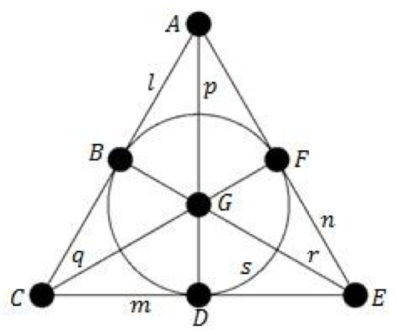
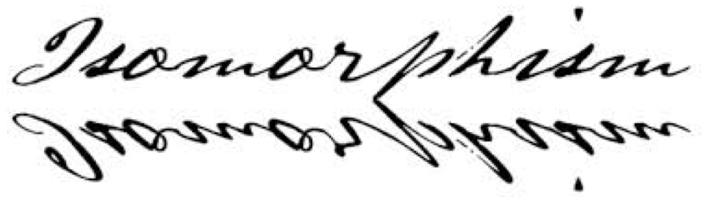
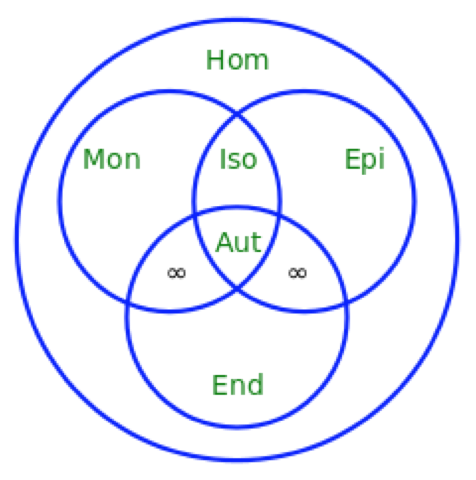

# The Structure of Scientific Theories
**First published Thu Mar 5, 2015; substantive revision Tue Dec 29, 2020**

*Winther, Rasmus Grønfeldt*

Scientific inquiry has led to immense explanatory and technological successes, partly as a result of the pervasiveness of scientific theories. Relativity theory, evolutionary theory, and plate tectonics were, and continue to be, wildly successful families of theories within physics, biology, and geology. Other powerful theory clusters inhabit comparatively recent disciplines such as cognitive science, climate science, molecular biology, microeconomics, and Geographic Information Science (GIS). Effective scientific theories magnify understanding, help supply legitimate explanations, and assist in formulating predictions. Moving from their knowledge-producing representational functions to their interventional roles (Hacking 1983)[^hacking-1983], theories are integral to building technologies used within consumer, industrial, and scientific milieus.

This entry explores the structure of scientific theories from the perspective of the Syntactic, Semantic, and Pragmatic Views. Each of these answers questions such as the following in unique ways. What is the best characterization of the composition and function of scientific theory? How is theory linked with world? Which philosophical tools can and should be employed in describing and reconstructing scientific theory? Is an understanding of practice and application necessary for a comprehension of the core structure of a scientific theory? Finally, and most generally, how are these three views ultimately related?

## 1. Introduction

In philosophy, three families of perspectives on scientific theory are operative: the *Syntactic View*, the *Semantic View*, and the *Pragmatic View.* Savage distills these philosophical perspectives thus:

> The *syntactic* view that a theory is an axiomatized collection of sentences has been challenged by the *semantic* view that a theory is a collection of nonlinguistic models, and both are challenged by the view that a theory is an amorphous entity consisting perhaps of sentences and models, but just as importantly of exemplars, problems, standards, skills, practices and tendencies. (Savage 1990, vii–viii)[^savage-1990]

Mormann (2007)[^mormann-2007] characterizes the Syntactic and Semantic Views in similar terms, and is among the first to use the term “Pragmatic View” to capture the third view (137). The three views are baptized via a trichotomy from linguistics deriving from the work of Charles Morris, following Charles S. Peirce. In a classic exposition, the logical positivist Carnap writes:

> If in an investigation explicit reference is made to the speaker, or, to put it in more general terms, to the user of a language, then we assign it to the field of *pragmatics*. (Whether in this case reference to designata is made or not makes no difference for this classification.) If we abstract from the user of the language and analyze only the expressions and their designata, we are in the field of *semantics*. And if, finally, we abstract from the designata also and analyze only the relations between the expressions, we are in (logical) *syntax*. The whole science of language, consisting of the three parts mentioned, is called *semiotic*. (1942, 9; see also Carnap 1939, 3–5, 16)[^carnap-1939]

To summarize, syntax concerns grammar and abstract structures; semantics investigates meaning and representation; and pragmatics explores use. Importantly, while no view is oblivious to the syntax, semantics, or pragmatics of theory, the baptism of each is a product of how one of the three aspects of language is perceived to be dominant: theory as syntactic logical reconstruction (Syntactic View); theory as semantically meaningful mathematical modeling (Semantic View); or theory structure as complex and as closely tied to theory pragmatics, i.e., function and context (Pragmatic View). Each of these philosophical perspectives on scientific theory will be reviewed in this entry. Their relations will be briefly considered in the Conclusion.

### 1.1 Syntactic, Semantic, and Pragmatic Views: The Basics

It will be helpful to pare each perspective down to its essence. Each endorses a substantive thesis about the structure of scientific theories.

For the Syntactic View, the structure of a scientific theory is its reconstruction in terms of sentences cast in a metamathematical language. Metamathematics is the axiomatic machinery for building clear foundations of mathematics, and includes predicate logic, set theory, and model theory (e.g., Zach 2009; Hacking 2014)[^hacking-2014][^zach-2009]. A central question of the Syntactic View is: in which logical language should we recast scientific theory?

Some defenders of the Semantic View keep important aspects of this reconstructive agenda, moving the metamathematical apparatus from predicate logic to set theory. Other advocates of the Semantic View insist that the structure of scientific theory is solely mathematical. They argue that we should remain at the mathematical level, rather than move up (or down) a level, into foundations of mathematics. A central question for the Semantic View is: which mathematical models are actually used in science?

Finally, for the Pragmatic View, scientific theory is internally and externally complex. Mathematical components, while often present, are neither necessary nor sufficient for characterizing the core structure of scientific theories. Theory also consists of a rich variety of nonformal components (e.g., analogies and natural kinds). Thus, the Pragmatic View argues, a proper analysis of the grammar (syntax) and meaning (semantics) of theory must pay heed to scientific theory complexity, as well as to the multifarious assumptions, purposes, values, and practices informing theory. A central question the Pragmatic View poses is: which theory components and which modes of theorizing are present in scientific theories found across a variety of disciplines?

In adopting a *descriptive* perspective on the structure of scientific theories, each view also deploys, at least implicitly, a *prescriptive* characterization of our central topic. In other words, postulating that scientific theory is $X$ (e.g., $X$ = a set-theoretic structure, as per Suppes 1960, 1962, 1967, 1968, 2002)[^suppes-1960][^suppes-1962][^suppes-1967][^suppes-1968][^suppes-2002] also implies that what is not $X$ (or could not be recast as $X$) is not (or could not possibly be) a scientific theory, and would not help us in providing scientific understanding, explanation, prediction, and intervention. For the Syntactic View, what is not (or cannot be) reconstructed axiomatically is not theoretical, while for the Semantic View, what is not (or cannot be) modeled mathematically is not theoretical. In contrast, in part due to its pluralism about what a scientific theory actually (and possibly) is, and because it interprets theory structure as distributed in practices, the Pragmatic View resists the definitional and normative terms set by the other two views. As a result, the Pragmatic View ultimately reforms the very concepts of “theory” and “theory structure.”

This encyclopedia entry will be organized as follows. After presenting this piece’s two sustained examples, immediately below, the three views are reviewed in as many substantive sections. Each section starts with a brief overview before characterizing that perspective’s account of theory structure. Newtonian mechanics is used as a running example within each section. The interpretation of theory structure—viz., how theory “hooks up” with phenomena, experiment, and the world—is also reviewed in each section. In the final section of this entry, we turn to population genetics and an analysis of the Hardy-Weinberg Principle (HWP) to compare and contrast each view. The Conclusion suggests, and remains non-committal about, three kinds of relations among the views: *identity*, *combat*, and *complementarity*. Theory is not a single, static entity that we are seeing from three different perspectives, as we might represent the Earth using three distinct mathematical map projections. Rather, theory itself changes as a consequence of perspective adopted.

### 1.2 Two Examples: Newtonian Mechanics and Population Genetics

Two examples will be used to illustrate differences between the three views: Newtonian mechanics and population genetics. While relativity theory is *the* preferred theory of the Syntactic View, Newtonian mechanics is more straightforward. Somewhat permissively construed, the theory of Newtonian mechanics employs the basic conceptual machinery of inertial reference frames, centers of mass, Newton’s laws of motion, etc., to describe the dynamics and kinematics of, among other phenomena, point masses acting vis-à-vis gravitational forces (e.g. the solar system) or with respect to forces involved in collisions (e.g., pool balls on a pool table; a closed container filled with gas). Newtonian mechanics is explored in each section.

Population genetics investigates the genetic composition of populations of natural and domesticated species, including the dynamics and causes of changes in gene frequencies in such populations (for overviews, see Lloyd 1994 [1988]; Gould 2002; Pigliucci and Müller 2010; Okasha 2012)[^gould-2002][^lloyd-1994][^okasha-2012][^pigliucci-2010]. Population genetics emerged as a discipline with the early 20ᵗʰ century work of R.A. Fisher, Sewall Wright, and J.B.S. Haldane, who synthesized Darwinian evolutionary theory and Mendelian genetics. One important part of population genetic theory is the Hardy-Weinberg Principle. HWP is a null model mathematically stating that gene frequencies remain unchanged across generations when there is no selection, migration, random genetic drift, or other evolutionary forces acting in a given population. HWP peppers early chapters of many introductory textbooks (e.g., Crow and Kimura 1970; Hartl and Clark 1989; Bergstrom and Dugatkin 2012)[^bergstrom-2012][^crow-1970][^hartl-1989]. We return to HWP in Section 5 and here merely state questions each view might ask about population genetics.

The Syntactic View focuses on questions regarding the highest axiomatic level of population genetics (e.g., Williams 1970, 1973; Van Valen 1976; Lewis 1980; Tuomi 1981, 1992)[^lewis-1980][^tuomi-1981][^tuomi-1992][^van-1976][^williams-1970][^williams-1973]. Examples of such queries are:

1. What would be the most convenient metamathematical axiomatization of evolutionary processes (e.g., natural selection, drift, migration, speciation, competition)? In which formal language(s) would and could such axiomatizations be articulated (e.g., first-order predicate logic, set theory, and category theory)?
2. Which single grammars could contain a variety of deep evolutionary principles and concepts, such as HWP, “heritability,” and “competitive exclusion”?
3. Which formal and methodological tools would permit a smooth flow from the metamathematical axiomatization to the mathematical theory of population genetics?

Investigations of the axiomatized rational reconstruction of theory shed light on the power and promises, and weaknesses and incompleteness, of the highest-level theoretical edifice of population genetics.

Secondly, the Semantic View primarily examines questions regarding the mathematical structure of population genetics (Lewontin 1974, Beatty 1981; López Beltrán 1987; Thompson 1989, 2007; Lloyd 1994 [1988])[^beatty-1981][^lewontin-1974][^lloyd-1994][^lópez-1987][^thompson-1989][^thompson-2007]. Very generally, this exploration involves the following questions:

1. What is the form and content of the directly presented class of mathematical models of evolutionary theory (e.g., HWP)? How could and should we organize the cluster of mathematical models (sensu Levins 1966)[^levins-1966] of population genetics?
2. Which additional models (e.g., diagrammatic, narrative, scale) might be used to enrich our understanding of evolutionary theory?
3. What are the relations among theoretical mathematical models, data models, and experimental models? How does theory explain and shape data? How do the data constrain and confirm theory?

The main subject of investigation is mathematical structure, rather than metamathematics or even alternative model types or modeling methods.

Finally, the Pragmatic View asks about the internal complexity of population genetic theory, as well as about the development and context of population genetics. In so doing, it inquires into how purposes and values have influenced the theoretical structure of evolutionary theory, selecting and shaping current population genetics from a wide variety of possible alternative theoretical articulations. The following questions about the structure of population genetic theory might be here addressed:

1. What role did R.A. Fisher’s interest in animal husbandry, and his tenure at Rothamsted Experimental Station, play in shaping his influential methodologies of Analysis of Variance (ANOVA) and experimental design involving randomization, blocking, and factorial designs?
2. How did the development of computers and computational practices, statistical techniques, and the molecularization of genetics, shape theory and theorizing in population genetics, especially from the 1980s to today?
3. How might normative context surrounding the concept of “race” impact the way concepts such as “heritability” and “lineage,” or principles such as HWP, are deployed in population genetics?

As when studying an organism, the structure of theory cannot be understood independently of its history and function.

## 2. The Syntactic View

According to the Syntactic View, which emerged mainly out of work of the Vienna Circle and Logical Empiricism (see Coffa 1991; Friedman 1999; Creath 2014; Uebel 2014)[^coffa-1991][^creath-2014][^friedman-1999][^uebel-2014], philosophy most generally practiced is, and should be, the study of the logic of natural science, or *Wissenschaftslogik* (Carnap 1937, 1966; Hempel 1966)[^carnap-1937][^carnap-1966][^hempel-1966]. Robust and clear logical languages allow us to axiomatically reconstruct theories, which—by the Syntacticists’ definition—are *sets of sentences in a given logical domain language* (e.g., Campbell 1920, 122; Hempel 1958, 46; cf. Carnap 1967 [1928], §156, “Theses about the Constructional System”)[^campbell-1920][^carnap-1967][^hempel-1958]. Domain languages include “the language of physics, the language of anthropology” (Carnap 1966, 58)[^carnap-1966].

This view has been variously baptized as the Received View (Putnam 1962; Hempel 1970)[^hempel-1970][^putnam-1962], the Syntactic Approach (van Fraassen 1970, 1989)[^fraassen-1970][^fraassen-1989], the Syntactic View (Wessels 1976)[^wessels-1976], the Standard Conception (Hempel 1970)[^hempel-1970], the Orthodox View (Feigl 1970)[^feigl-1970], the Statement View (Moulines 1976, 2002; Stegmüller 1976)[^moulines-1976][^moulines-2002][^stegmüller-1976], the Axiomatic Approach (van Fraassen 1989)[^fraassen-1989], and the Once Received View (Craver 2002)[^craver-2002]. For historical reasons, and because of the linguistic trichotomy discussed above, the “Syntactic View” shall be the name of choice in this entry.

### 2.1 Theory Structure per the Syntactic View

Some conceptual taxonomy is required in order to understand the logical framework of the structure of scientific theories for the Syntactic View. We shall distinguish *terms*, *sentences*, and *languages* (see Table 1).

#### 2.1.1 Terms

Building upwards from the bottom, let us start with the three kinds of terms or vocabularies contained in a scientific language: theoretical, logical, and observational. Examples of theoretical terms are “molecule,” “atom,” “proton,” and “protein,” and perhaps even macro-level objects and properties such as “proletariat” and “aggregate demand.” Theoretical terms or concepts can be classificatory (e.g., “cat” or “proton”), comparative (e.g., “warmer”), or quantitative (e.g., “temperature”) (Hempel 1952; Carnap 1966, Chapter 5)[^carnap-1966][^hempel-1952]. Moreover, theoretical terms are “theoretical constructs” introduced “jointly” as a “theoretical system” (Hempel 1952, 32)[^hempel-1952]. Logical terms include quantifiers (e.g., $\forall, \exists$) and connectives (e.g., $\wedge, \rightarrow$). Predicates such as “hard,” “blue,” and “hot,” and relations such as “to the left of” and “smoother than,” are observational terms.

#### 2.1.2 Sentences

Terms can be strung together into three kinds of sentences: theoretical, correspondence, and observational. $T_S$ is the set of theoretical sentences that are the axioms, theorems, and laws of the theory. Theoretical sentences include the laws of Newtonian mechanics and of the Kinetic Theory of Gases, all suitably axiomatized (e.g., Carnap 1966; Hempel 1966)[^carnap-1966][^hempel-1966]. Primitive theoretical sentences (e.g., axioms) can be distinguished from derivative theoretical sentences (e.g., theorems; see Reichenbach 1969 [1924]; Hempel 1958; Feigl 1970)[^feigl-1970][^hempel-1958][^reichenbach-1969]. $C_S$ is the set of correspondence sentences tying theoretical sentences to observable phenomena or “to a ‘piece of reality’” (Reichenbach 1969 [1924], 8; cf. Einstein 1934, 1936 [1936], 351)[^einstein-1934][^einstein-1936][^reichenbach-1969]. To simplify, they provide the theoretical syntax with an interpretation and an application, i.e., a semantics. Suitably axiomatized version of the following sentences provide semantics to Boyle’s law, $PV = nRT$: “$V$ in Boyle’s law is equivalent to the measurable volume $xyz$ of a physical container such as a glass cube that is $x$, $y$, and $z$ centimeters in length, width, and height, and in which the gas measured is contained” and “$T$ in Boyle’s law is equivalent to the temperature indicated on a reliable thermometer or other relevant measuring device properly calibrated, attached to the physical system, and read.” Carnap (1987 [1932], 466) presents two examples of observational sentences, $O_S$: “Here (in a laboratory on the surface of the earth) is a pendulum of such and such a kind,” and “the length of the pendulum is 245.3 cm.” Importantly, theoretical sentences can only contain theoretical and logical terms; correspondence sentences involve all three kinds of terms; and observational sentences comprise only logical and observational terms.

#### 2.1.3 Languages

The total domain language of science consists of two languages: the theoretical language, $L_T$, and the observational language, $L_O$ (e.g., Hempel 1966, Chapter 6; Carnap 1966, Chapter 23; the index entry for “Language,” of Feigl, Scriven, and Maxwell 1958, 548 has three subheadings: “observation,” “theoretical,” and “ordinary”)[^carnap-1966][^feigl-1958][^hempel-1966]. The theoretical language includes theoretical vocabulary, while the observational language involves observational terms. Both languages contain logical terms. Finally, the theoretical language includes, and is constrained by, the logical calculus, *Calc*, of the axiomatic system adopted (e.g., Hempel 1958, 46; Suppe 1977, 50-53)[^hempel-1958][^suppe-1977]. This calculus specifies sentence grammaticality as well as appropriate deductive and non-ampliative inference rules (e.g., modus ponens) pertinent to, especially, theoretical sentences. *Calc* can itself be written in theoretical sentences.

#### 2.1.4 Theory Structure, in General

Table 1 summarizes the Syntactic View’s account of theory structure:

*Table 1*

|   | *Theory* | *Observation* |   |
| --- | --- | --- | --- |
| Sentence Type | $T_S$ | $C_S$ | $O_S$ |
| Term (or vocabulary) | Theoretical & logical | Theoretical, logical & observational | Observational & logical |
| Language | $L_T$ | $L_T$ & $L_O$ | $L_O$ |

The salient divide is between theory and observation. Building on Table 1, there are three different levels of scientific knowledge, according to the Syntactic View:

$\{T_S\} =$ The uninterpreted syntactic system of the scientific theory. $\{T_S, C_S\} =$ The scientific theory structure of a particular domain (e.g., physics, anthropology). $\{T_S,C_S,O_S\} =$ All of the science of a particular domain.

Scientific theory is thus taken to be a syntactically formulated set of theoretical sentences (axioms, theorems, and laws) together with their interpretation via correspondence sentences. As we have seen, theoretical sentences and correspondence sentences are cleanly distinct, even if both are included in the structure of a scientific theory.

Open questions remain. Is the observation language a sub-language of the theoretical language, or are they both parts of a fuller language including all the vocabulary? Can the theoretical vocabulary or language be eliminated in favor of a purely observational vocabulary or language? Are there other ways of carving up kinds of languages? First, a “dialectical opposition” between “logic and experience,” “form and content,” “constitutive principles and empirical laws,” and “‘from above’… [and] ‘from below’” pervades the work of the syntacticists (Friedman 1999, 34, 63)[^friedman-1999]. Whether syntacticists believe that a synthesis or unification of this general opposition between the theoretical (i.e., logic, form) and the observational (i.e., experience, content) is desirable remains a topic of ongoing discussion. Regarding the second question, Hempel 1958 deflates what he calls “the theoretician’s dilemma”—i.e., the putative reduction without remainder of theoretical concepts and sentences to observational concepts and sentences. Finally, other language divisions are possible, as Carnap 1937 argues (see Friedman 1999, Chapter 7)[^friedman-1999]. Returning to the main thread of this section, the distinction toolkit of theoretical and observational terms, sentences, and languages (Table 1) permit the syntacticists to render theoretical structure sharply, thereby aiming at the reconstructive “logic of science” (*Wissenschafstlogik*) that they so desire.

### 2.2 A Running Example: Newtonian Mechanics

Reichenbach 1969 [1924] stands as a canonical attempt by a central developer of the Syntactic View of axiomatizing a physical theory, viz., relativity theory (cf. Friedman 1983, 1999; see also Reichenbach 1965 [1920])[^friedman-1983][^friedman-1999][^reichenbach-1965]. For the purposes of this encyclopedia entry, it is preferable to turn to another syntactic axiomatization effort. In axiomatizing Newtonian mechanics, the mid-20ᵗʰ century mathematical logician Hans Hermes spent significant energy defining the concept of mass (Hermes 1938, 1959; Jammer 1961)[^hermes-1938][^hermes-1959][^jammer-1961]. More precisely, he defines the theoretical concept of “mass ratio” of two particles colliding inelastically in an inertial reference frame $S$. Here is his full definition of mass ratio (1959, 287):

$$ \text{Mass } \alpha xx_0 \equiv_{df} \exists S,t,y,y_o,v,v_0 (G_{xy} \wedge G_{x_0y_0} \wedge CSt_{yy_0} \wedge Vel_{Svty} \wedge Vel_{Sv_0ty_0} \wedge \alpha|v| = |v_0|) \vee (G_{xx_0} \wedge \alpha = 1) $$

One paraphrase of this definition is, “‘the mass of $x$ is α times that of $x_0$’ is equivalent to ‘there exists a system $S$, an instant $t$, momentary mass points $y$ and $y_0$, and initial velocities $v$ and $v_0$, such that $y$ and $y_0$ are genidentical, respectively, with $x$ and $x_0$; the joined mass points move with a velocity of 0 with respect to frame $S$ immediately upon colliding at time $t$; and $y$ and $y_0$ have determinate velocities $v$ and $v_0$ before the collision in the ratio α, which could also be 1 if $x$ and $x_0$ are themselves genidentical.’” Hermes employs the notion of “genidentical” to describe the relation between two temporal sections of a *given* particle’s world line (Jammer 1961, 113)[^jammer-1961]. Set aside the worry that two distinct particles cannot be genidentical per Hermes’ definition, though they can have identical properties. In short, this definition is syntactically complete and is written in first-order predicate logic, as are the other axioms and definitions in Hermes (1938, 1959)[^hermes-1938][^hermes-1959]. Correspondence rules connecting a postulated mass $x$ with an actual mass were not articulated by Hermes.

### 2.3 Interpreting Theory Structure per the Syntactic View

The link between theory structure and the world, under the Syntactic View, is contained in the theory itself: $C_S$, the set of correspondence rules. The term “correspondence rules” (Margenau 1950; Nagel 1961, 97–105; Carnap 1966, Chapter 24)[^carnap-1966][^margenau-1950][^nagel-1961] has a variety of near-synonyms:

1. Dictionary (Campbell 1920)[^campbell-1920]
2. Operational rules (Bridgman 1927)[^bridgman-1927]
3. Coordinative definitions (Reichenbach 1969 [1924], 1938)[^reichenbach-1969]
4. Reduction sentences (Carnap 1936/1937; Hempel 1952)[^carnap-1936][^carnap-1937][^hempel-1952]
5. Correspondence postulates (Carnap 1963)[^carnap-1963]
6. Bridge principles (Hempel 1966; Kitcher 1984)[^hempel-1966][^kitcher-1984]
7. Reduction functions (Schaffner 1969, 1976)[^schaffner-1969][^schaffner-1976]
8. Bridge laws (Sarkar 1998)[^sarkar-1998]

Important differences among these terms cannot be mapped out here. However, in order to better understand correspondence rules, two of their functions will be considered: (i) theory *interpretation* (Carnap, Hempel) and (ii) theory *reduction* (Nagel, Schaffner). The dominant perspective on correspondence rules is that they interpret theoretical terms. Unlike “mathematical theories,” the axiomatic system of physics “cannot have… a splendid isolation from the world” (Carnap 1966, 237)[^carnap-1966]. Instead, scientific theories require observational interpretation through correspondence rules. Even so, surplus meaning always remains in the theoretical structure (Hempel 1958, 87; Carnap 1966)[^carnap-1966][^hempel-1958]. Second, correspondence rules are seen as necessary for inter-theoretic reduction (van Riel and Van Gulick 2014)[^riel-2014]. For instance, they connect observation terms such as “temperature” in phenomenological thermodynamics (the reduced theory) to theoretical concepts such as “mean kinetic energy” in statistical mechanics (the reducing theory). Correspondence rules unleash the reducing theory’s epistemic power. Notably, Nagel (1961, Chapter 11; 1979) and Schaffner (1969, 1976, 1993)[^schaffner-1969][^schaffner-1976][^schaffner-1993] allow for multiple kinds of correspondence rules, between terms of either vocabulary, in the reducing and the reduced theory (cf. Callender 1999; Winther 2009; Dizadji-Bahmani, Frigg, and Hartmann 2010)[^callender-1999][^dizadji-bahmani-2010][^winther-2009]. Correspondence rules are a core part of the structure of scientific theories and serve as glue between theory and observation.

Finally, while they are not part of the theory structure, and although we saw some examples above, observation sentences are worth briefly reviewing. Correspondence rules attach to the content of observational sentences. Observational sentences were analyzed as (i) *protocol sentences* or *Protokollsätze* (e.g., Schlick 1934; Carnap 1987 [1932], 1937, cf. 1963; Neurath 1983 [1932])[^schlick-1934], and as (ii) *experimental laws* (e.g., Campbell 1920; Nagel 1961; Carnap 1966; cf. Duhem 1954 [1906])[^campbell-1920][^carnap-1966][^nagel-1961]. Although constrained by *Calc*, the grammar of these sentences is determined primarily by the order of nature, as it were. In general, syntacticists do not consider methods of data acquisition, experiment, and measurement to be philosophically interesting. In contrast, the confirmation relation between (collected) data and theory, especially as developed in inductive logic (e.g., Reichenbach 1938, 1978; Carnap 1962 [1950], 1952)[^carnap-1962][^reichenbach-1938][^reichenbach-1978], as well as questions about the conventionality, grammaticality, foundationalism, atomism, and content of sense-data and synthetic statements, are considered philosophically important (e.g., Carnap 1987 [1932], 1937, 1966; Neurath 1983 [1932]; Reichenbach 1951; Schlick 1925 [1918], 1934; for contemporary commentary, see, e.g., Creath 1987, 2014; Rutte 1991; Friedman 1999)[^creath-1987][^creath-2014][^friedman-1999][^rutte-1991][^schlick-1925].

### 2.4 Taking Stock: Syntactic View

To summarize, the Syntactic View holds that there are three kinds of terms or vocabularies: logical, theoretical, and observational; three kinds of sentences: $T_S$, $C_S$, and $O_S$; and two languages: $L_T$ and $L_O$. Moreover, the structure of scientific theories could be analyzed using the logical tools of metamathematics. The goal is to reconstruct the logic of science, viz. to articulate an axiomatic system.

Interestingly, this perspective has able and active defenders today, who discuss constitutive and axiomatized principles of the historical “relativized a priori” (Friedman 2001, cf. 2013)[^friedman-2001][^friedman-2013], argue that “the semantic view, if plausible, is syntactic” (Halvorson 2013)[^halvorson-2013], and explore “logicism” for, and in, the philosophy of science (Demopulous 2003, 2013; van Benthem 2012)[^benthem-2012]. Furthermore, for purposes of the syntactic reconstruction of scientific theories, some continue espousing—or perhaps plea for the resurrection of—predicate logic (e.g., Lutz 2012, 2014)[^lutz-2012][^lutz-2014], while other contemporary syntacticists (e.g., Halvorson 2012, 2013, 2019)[^halvorson-2012][^halvorson-2013][^halvorson-2019] endorse more recently developed metamathematical *and* mathematical equipment, such as category theory, which “turns out to be a kind of universal mathematical language like set theory” (Awodey 2006, 2; see Eilenberg and MacLane 1945)[^awodey-2006][^eilenberg-1945]. Importantly, Halvorson (2019)[^halvorson-2019] urges that interlocutors adopt “structured” rather than “flat” views of theories. For the case of the syntactic view this would mean that rather than accept the usual formulation that a theory is a *set* of sentences, “… [we] might say that a theory consists of both sentences and inferential relations between those sentences” (Halvorson 2019, 277–8)[^halvorson-2019]. Classical syntacticists such as Rudolf Carnap (Friedman 1999, 2011; Carus 2007; Blatti and Lapointe 2016; Koellner ms. in Other Internet Resources)[^blatti-2016][^carus-2007][^friedman-1999][^friedman-2011] and Joseph Henry Woodger (Nicholson and Gawne 2014)[^nicholson-2014] have recently received increasing attention.

## 3. The Semantic View

An overarching theme of the Semantic View is that analyzing theory structure requires employing mathematical tools rather than predicate logic. After all, defining scientific concepts within a specific formal language makes any axiomatizing effort dependent on the choice, nature, and idiosyncrasies of that narrowly-defined language. For instance, Suppes understands first-order predicate logic, with its “linguistic” rather than “set-theoretical” entities, as “utterly impractical” for the formalization of “theories with more complicated structures like probability theory” (Suppes 1957, 232, 248–9; cf. Suppes 2002)[^suppes-1957][^suppes-2002]. Van Fraassen, another influential defender of the Semantic View, believes that the logical apparatus of the Syntactic View “had moved us *mille milles de toute habitation scientifique*, isolated in our own abstract dreams” (van Fraassen 1989, 225)[^fraassen-1989]. Indeed, what would the appropriate logical language for specific mathematical structures be, especially when such structures could be reconstructed in a variety of formal languages? Why should we imprison mathematics and mathematical scientific theory in syntactically defined language(s) when we could, instead, directly investigate the mathematical objects, relations, and functions of scientific theory?

Consistent with the combat strategy (discussed in the Conclusion), here is a list of grievances against the Syntactic View discussed at length in the work of some semanticists.

1. *First-Order Predicate Logic Objection*. Theoretical structure is intrinsically and invariably tied to the specific choice of a language, $L_T$, expressed in first-order predicate logic. This places heavy explanatory and representational responsibility on relatively inflexible and limited languages.
2. *Theory Individuation Objection*. Since theories are individuated by their linguistic formulations, every change in high-level syntactic formulations will bring forth a distinct theory. This produces a reductio: if $T_1 = p \rightarrow q$ and $T_2 = \neg p \vee q$ then $T_1$ and $T_2$, though logically equivalent, have different syntactic formulations and would be distinct theories.
3. *Theoretical/Observational Languages Objection*. Drawing the theoretical/observational distinction in terms of language is inappropriate, as observability pertains to entities rather than to concepts.
4. *Unintended Models Objection*. There is no clear way of distinguishing between intended and unintended models for syntactically characterized theories (e.g., the Löwenheim-Skolem theorem, Bays 2014)[^bays-2014].
5. *Confused Correspondence Rules Objection*. Correspondence rules are a confused medley of direct meaning relationships between terms and world, means of inter-theoretic reduction, causal relationship claims, and manners of theoretical concept testing.
6. *Trivially True yet Non-Useful Objection*. Presenting scientific theory in a limited axiomatic system, while clearly syntactically correct, is neither useful nor honest, since scientific theories are mathematical structures.
7. *Practice and History Ignored Objection*. Syntactic approaches do not pay sufficient attention to the actual practice and history of scientific theorizing and experimenting.

What, then, does the Semantic View propose to put in the Syntactic View’s place?

### 3.1 Theory Structure per the Semantic View

Even a minimal description of the Semantic View must acknowledge two distinct strategies of characterizing and comprehending theory structure: the *state-space* and the *set-/model-theoretic* approaches.

#### 3.1.1 The State-Space Approach

The state-space approach emphasizes the mathematical models of actual science, and draws a clear line between mathematics and metamathematics. The structure of a scientific theory is identified with the “class,” “family” or “cluster” of mathematical models constituting it, rather than with any metamathematical axioms “yoked to a particular syntax” (van Fraassen 1989, 366)[^fraassen-1989]. Under this analysis, “the correct tool for philosophy of science is mathematics, not metamathematics”—this is Suppes’ slogan, per van Fraassen (1989, 221; 1980, 65). In particular, a state space or phase space is an $N$-dimensional space, where each of the relevant variables of a theory correspond to a single dimension and each point in that space represents a possible *state* of a real system. An actual, real system can take on, and change, states according to different kinds of laws, viz., *laws of succession* determining possible trajectories through that space (e.g., Newtonian kinematic laws); *laws of co-existence* specifying the permitted regions of the total space (e.g., Boyle’s law); and *laws of interaction* combining multiple laws of succession or co-existence, or both (e.g., population genetic models combining laws of succession for selection and genetic drift, Wright 1969; Lloyd 1994 [1988]; Rice 2004; Clatterbuck, Sober, and Lewontin 2013)[^clatterbuck-2013][^lloyd-1994][^rice-2004][^wright-1969]. Different models of a given theory will share some dimensions of their state space while differing in others. Such models will also partially overlap in laws (for further discussion of state spaces, laws, and models pertinent to the Semantic View, see Suppe 1977, 224–8; Lloyd 1994, Chapter 2; Nolte 2010; Weisberg 2013, 26–9)[^lloyd-1994][^nolte-2010][^suppe-1977][^weisberg-2013].

Historically, the state-space approach emerged from work by Evert Beth, John von Neumann, and Hermann Weyl, and has important parallels with Przełęcki (1969)[^przełęcki-1969] and Dalla Chiara Scabia and Toraldo di Francia (1973) (on the history of the approach see: Suppe 1977; van Fraassen 1980, 65–67; Lorenzano 2013; advocates of the approach include: Beatty 1981; Giere 1988, 2004; Giere, Bickle, and Mauldin 2006; Lloyd 1983, 1994 [1988], 2013 In Press; Suppe 1977, 1989; Thompson, 1989, 2007; van Fraassen 1980, 1989, 2008; for alternative early analyses of models see, e.g., Braithwaite 1962; Hesse 1966, 1967). Interestingly, van Fraassen (1967, 1970)[^fraassen-1967][^fraassen-1970] provides a potential reconstruction of state spaces via an analysis of “semi-interpreted languages.” Weisberg (2013)[^weisberg-2013], building on many insights from Giere’s work, presents a broad view of modeling that includes mathematical structures that are “trajectories in state spaces” (29), but also permits concrete objects and computational structures such as algorithms to be deemed models. Lorenzano (2013)[^lorenzano-2013] calls Giere’s (and, by extension, Weisberg’s and even Godfrey-Smith’s 2006)[^godfrey-smith-2006] approach “model-based,” separating it out from the state-space approach. A more fine-grained classification of the state-space approach is desirable, particularly if we wish to understand important lessons stemming from the Pragmatic View of Theories, as we shall see below.

As an example of a state-space analysis of modeling, consider a capsule traveling in outer space. An empirically and dynamically adequate mathematical model of the capsule’s behavior would capture the *position* of the capsule (i.e., three dimensions of the formal state space), as well as the *velocity* and *acceleration* vectors for each of the three standard spatial dimensions (i.e., six more dimensions in the formal state space). If the mass were unknown or permitted to vary, we would have to add one more dimension. Possible and actual trajectories of our capsule, with known mass, within this abstract 9-dimensional state space could be inferred via Newtonian dynamical laws of motion (example in Lewontin 1974, 6–8; consult Suppe 1989, 4)[^lewontin-1974][^suppe-1989]. Importantly, under the state-space approach, the interesting philosophical work of characterizing theory structure (e.g., as classes of models), theory meaning (e.g., data models mapped to theoretical models), and theory function (e.g., explaining and predicting) happens at the level of mathematical models.

#### 3.1.2 The Set-/Model-Theoretic Approach

Lurking in the background of the state-space conception is the fact that mathematics actually includes set theory and model theory—i.e., mathematical logic. Indeed, according to some interlocutors, “metamathematics is part of mathematics” (Halvorson 2012, 204)[^halvorson-2012]. Historically, a set-/model-theoretic approach emerged from Tarski’s work and was extensively articulated by Suppes and his associates (van Fraassen 1980, 67)[^fraassen-1980]. Set theory is a general language for formalizing mathematical structures as collections—i.e., sets—of abstract objects (which can themselves be relations or functions; see Krivine 2013 [1971])[^krivine-2013]. Model theory investigates the relations between, on the one hand, the formal axioms, theorems, and laws of a particular theory and, on the other hand, the mathematical structures—the models—that provide an interpretation of that theory, or put differently, that make the theory’s axioms, theorems, and laws true (Hodges 1997, Chapter 2; Jones 2005)[^hodges-1997][^jones-2005]. Interestingly, model theory often uses set theory (e.g., Marker 2002)[^marker-2002]; set theory can, in turn, be extended to link axiomatic theories and semantic models via “set-theoretical predicates” (e.g., Suppes 1957, 2002)[^suppes-1957][^suppes-2002]. Finally, there are certain hybrids of these two branches of mathematical logic, including “partial structures” (e.g., da Costa and French 1990, 2003; Bueno 1997; French 2017; French and Ladyman 1999, 2003; Vickers 2009; Bueno, French, and Ladyman 2012)[^bueno-1997][^bueno-2012][^costa-1990][^costa-2003][^french-2017][^french-1999][^french-2003][^vickers-2009]. Lorenzano (2013)[^lorenzano-2013] provides a more complex taxonomy of the intellectual landscape of the Semantic View, including a discussion of Structuralism, a kind of set-/model-theoretic perspective. Structuralism involves theses about “theory-nets,” theory-relative theoretical vs. non-theoretical terms, a diversity of intra- and inter-theoretic laws with different degrees of generality, a typology of inter-theoretic relations, and a rich account of correspondence rules in scientific practice (see Moulines 2002; Pereda 2013; Schmidt 2014; Ladyman 2014)[^ladyman-2014][^moulines-2002][^pereda-2013][^schmidt-2014]. On the whole, the set-/model-theoretic approach of the Semantic View insists on the inseparability of metamathematics and mathematics. In preferring to characterize a theory axiomatically in terms of its intension rather than its extension, it shares the Syntactic View’s aims of reconstructive axiomatization (e.g., Sneed 1979; Stegmüller 1979; Frigg and Votsis 2011; Halvorson 2013, 2019; Lutz 2012, 2014, 2017)[^frigg-2011][^halvorson-2013][^halvorson-2019][^lutz-2012][^lutz-2014][^lutz-2017][^sneed-1979][^stegmüller-1979].

An example will help motivate the relation between theory and model. Two qualifications are required: (i) we return to a more standard set-/model-theoretic illustration below, viz., McKinsey, Sugar, and Suppes’ (1953) axiomatization of particle mechanics, and (ii) this motivational example is not from the heartland of model theory (see Hodges 2013)[^hodges-2013]. Following van Fraassen’s intuitive case of “seven-point geometry” (1980, 41–44; 1989, 218–220), also known as “the Fano plane” we see how a particular geometric figure, the *model*, interprets and makes true a set of axioms and theorems, the *theory*. In topology and geometry there is rich background theory regarding how to close Euclidean planes and spaces to make finite geometries by, for instance, eliminating parallel lines. Consider the axioms of a projective plane:

1. For any two points, exactly one line lies on both.
2. For any two lines, exactly one point lies on both.
3. There exists a set of four points such that no line has more than two of them.

A figure of a geometric model that makes this theory true is:

*Figure 1.*

This is the smallest geometrical model satisfying the three axioms of the projective plane theory. Indeed, this example fits van Fraassen’s succinct characterization of the theory-model relation:

> A model is called a model of a theory exactly if the theory is entirely true if considered with respect to this model alone. (Figuratively: the theory would be true if this model was the whole world.) (1989, 218)

That is, if the entire universe consisted solely of these seven points and seven lines, the projective plane theory would be true. Of course, our universe is bigger. Because Euclidean geometry includes parallel lines, the Fano plane is not a model of Euclidean geometry. Even so, by drawing the plane, we have shown it to be *isomorphic* to parts of the Euclidean plane. In other words, the Fano plane has been *embedded* in a Euclidean plane. Below we return to the concepts of embedding and isomorphism, but this example shall suffice for now to indicate how a geometric model can provide a semantics for the axioms of a theory.

In short, for the Semantic View the structure of a scientific theory is its class of mathematical models. According to some advocates of this view, the family of models can itself be axiomatized, with those very models (or other models) serving as axiom truth-makers.

### 3.2 A Running Example: Newtonian Mechanics

Returning to our running example, consider Suppes’ 1957 model-theoretic articulation of particle mechanics, which builds on his 1953 article with J.C.C. McKinsey and A.C. Sugar. Under this analysis, there is a domain of set-theoretic objects of the form $\{ P, T, s, m, f, g \}$, where $P$ and $T$ are themselves sets, $s$ and $g$ are binary functions, $m$ is a unary and $f$ a ternary function. $P$ is the set of particles; $T$ is a set of real numbers measuring elapsed times; $s(p, t)$ is the position of particle $p$ at time $t$; $m(p)$ is the mass of particle $p$; $f(p, q, t)$ is the force particle $q$ exerts on $p$ at time $t$; and $g(p, t)$ is the total resultant force (by all other particles) on $p$ at time $t$. Suppes and his collaborators defined seven axioms—three kinematical and four dynamical—characterizing Newtonian particle mechanics (see also Simon 1954, 1970)[^simon-1954][^simon-1970]. Such axioms include Newton’s third law reconstructed in set-theoretic formulation thus (Suppes 1957, 294)[^suppes-1957]:

$$\tag{Axiom P5} \text{For } p,q \text{ in } P \text{ and } t \text{ in }T: f(p,q,t) = -f(q,p,t) $$

Importantly, the set-theoretic objects are found in more than one of the axioms of the theory, and Newton’s calculus is reconstructed in a novel, set-theoretic form. Set-theoretic predicates such as “is a binary relation” and “is a function” are also involved in axiomatizing particle mechanics (Suppes 1957, 249)[^suppes-1957]. Once these axioms are made explicit, their models can be specified and these can, in turn, be applied to actual systems, thereby providing a semantics for the axioms (e.g., as described in Section 3.3.1 below). A particular system satisfying these seven axioms is a particle mechanics system. (For an example of Newtonian mechanics from the state-space approach, recall the space capsule of Section 3.1.1.)

### 3.3 Interpreting Theory Structure per the Semantic View

How is the theory structure, described in Section 3.1, applied to empirical phenomena? How do we connect theory and data via observation and experimental and measuring techniques? The Semantic View distinguishes theory individuation from both theory-phenomena and theory-world relations. Three types of analysis of theory interpretation are worth investigating: (i) *a hierarchy of models* (e.g., Suppes; Suppe), (ii) *similarity* (e.g., Giere; Weisberg), and (iii) *isomorphism* (e.g., van Fraassen; French and Ladyman).

#### 3.3.1 A Hierarchy of Models

One way of analyzing theory structure interpretation is through a series of models falling under the highest-level axiomatizations. This series has been called “a hierarchy of models,” though it need not be considered a nested hierarchy. These models include models of theory, models of experiment, and models of data (Suppes 1962, 2002)[^suppes-1962][^suppes-2002]. Here is a summary of important parts of the hierarchy (Suppes 1962, Table 1, 259; cf. Giere 2010, Figure 1, 270)[^giere-2010][^suppes-1962]:

1. *Axioms of Theory*. Axioms define set-theoretic predicates, and constitute the core structure of scientific theories, as reviewed in Section 3.1.2.
2. *Models of Theory.* “Representation Theorems,” permit us “to discover if an interesting subset of models for the theory may be found such that any model for the theory is isomorphic to some member of this subset” (Suppes 1957, 263)[^suppes-1957]. Representation theorem methodology can be extended (i) down the hierarchy, both to models of experiment and models of data, and (ii) from isomorphism to homomorphism (Suppes 2002, p. 57 ff.; Suppe 2000; Cartwright 2008)[^cartwright-2008][^suppe-2000][^suppes-2002].
3. *Models of Experiment*. Criteria of experimental design motivate choices for how to set up and analyze experiments. There are complex mappings between models of experiment thus specified, and (i) models of theory, (ii) theories of measurement, and (iii) models of data.
4. *Models of Data*. In building models of data, phenomena are organized with respect to statistical goodness-of-fit tests and parameter estimation, in the context of models of theory. Choices about which parameters to represent must be made.

The temptation to place *phenomena* at the bottom of the hierarchy must be resisted because phenomena permeate all levels. Indeed, the “class of phenomena” pertinent to a scientific theory is its “intended scope” (Suppe 1977, 223; Weisberg 2013, 40)[^suppe-1977][^weisberg-2013]. Furthermore, this temptation raises fundamental questions about scientific representation: “there is the more profound issue of the relationship between the lower most representation in the hierarchy—the data model perhaps—and reality itself, but of course this is hardly something that the semantic approach alone can be expected to address” (French and Ladyman 1999, 113; cf. van Fraassen 2008, 257–258, “The ‘link’ to reality”)[^french-1999][^fraassen-2008]. Borrowing from David Chalmers, the “hard problem” of philosophy of science remains connecting abstract structures to concrete phenomena, data, and world.

#### 3.3.2 Similarity

The similarity analysis of theory interpretation combines semantic and pragmatic dimensions (Giere 1988, 2004, 2010; Giere, Bickle, and Mauldin 2006; Weisberg 2013)[^giere-1988][^giere-2004][^giere-2010][^giere-2006][^weisberg-2013]. According to Giere, interpretation is mediated by theoretical hypotheses positing representational relations between a model and relevant parts of the world. Such relations may be stated as follows:

$$ S \text{ uses } X \text{ to represent } W \text{ for purposes } P. $$

Here $S$ is a scientist, research group or community, $W$ is a part of the world, and $X$ is, broadly speaking, any one of a variety of models (Giere 2004, 743, 747, 2010)[^giere-2004][^giere-2010]. Model-world similarity judgments are conventional and intentional:

> Note that I am not saying that the model itself represents an aspect of the world because it is similar to that aspect. …Anything is similar to anything else in countless respects, but not anything represents anything else. It is not the model that is doing the representing; it is the scientist using the model who is doing the representing. (2004, 747)

Relatedly, Weisberg (2013)[^weisberg-2013] draws upon Tversky (1977)[^tversky-1977] to develop a similarity metric for model interpretation (equation 8.10, 148). This metric combines (i) model-target semantics (90–97), and (ii) the pragmatics of “context, conceptualization of the target, and the theoretical goals of the scientist” (149). Giere and Weisberg thus endorse an abundance of adequate mapping relations between a given model and the world. From this diversity, scientists and scientific communities must select particularly useful similarity relationships for contextual modeling purposes. Because of semantic pluralism and irreducible intentionality, this similarity analysis of theory interpretation cannot be accommodated within a hierarchy of models approach, interpreted as a neat model nesting based on pre-given semantic relations among models at different levels.

#### 3.3.3 Isomorphism

The term “isomorphism” is a composite of the Greek words for “equal” and “shape” or “form.” Indeed, in mathematics, isomorphism is a perfect one-to-one, bijective mapping between two structures or sets. Figure (2) literally and figuratively captures the term:

*Figure 2.*

Especially in set theory, category theory, algebra, and topology, there are various kinds of “-morphisms,” viz., of mapping relations between two structures or models. Figure (3) indicates five different kinds of homomorphism, arranged in a Venn diagram.

*Figure 3.*

Although philosophers have focused on isomorphism, other morphisms such as monomorphism (i.e., an injective homomorphism where some elements in the co-domain remain unmapped from the domain) might also be interesting to investigate, especially for embedding data (i.e., the domain) into rich theoretical structures (i.e., the co-domain). To complete the visualization above, an epimorphism is a surjective homomorphism, and an endomorphism is a mapping from a structure to itself, although it need not be a symmetrical—i.e., invertible—mapping, which would be an automorph.

Perhaps the most avid supporter of isomorphism and embedding as the way to understand theory interpretation is van Fraassen. In a nutshell, if we distinguish (i) theoretical models, (ii) “empirical substructures” (van Fraassen 1980, 64, 1989, 227; alternatively: “surface models” 2008, 168)[^fraassen-1980][^fraassen-1989], and (iii) “observable phenomena” (1989, 227, 2008, 168), then, van Fraassen argues, theory interpretation is a relation of isomorphism between observable phenomena and empirical substructures, which are *themselves* isomorphic with one or more theoretical models. Moreover, if a relation of isomorphism holds between $X$ and a richer $Y$, we say that we have embedded $X$ in $Y$. For instance, with respect to the seven-point geometry above (Figure 1), van Fraassen contends that isomorphism gives embeddability, and that the relation of isomorphism “is important because it is also the exact relation a phenomenon bears to some model or theory, if that theory is empirically adequate” (1989, 219–20; this kind of statement seems to be simultaneously descriptive and prescriptive about scientific representation, see Section 1.1 above). In *The Scientific Image* he is even clearer about fleshing out the empirical adequacy of a theory (with its theoretical models) in terms of isomorphism between “appearances” (i.e., “the structures which can be described in experimental and measurement reports,” 1980, 64, italics removed) and empirical substructures. Speaking metaphorically,

> the phenomena are, from a theoretical point of view, small, arbitrary, and chaotic—even nasty, brutish, and short…—but can be understood as embeddable in beautifully simple but much larger mathematical models. (2008, 247; see also van Fraassen 1981, 666 and 1989, 230)[^fraassen-1981][^fraassen-1989]

Interestingly, and as a defender of an identity strategy (see Conclusion), Friedman also appeals to embedding and subsumption relations between theory and phenomena in his analyses of theory interpretation (Friedman 1981, 1983)[^friedman-1981][^friedman-1983]. Bueno, da Costa, French, and Ladyman also employ embedding and (partial) isomorphism in the empirical interpretation of partial structures (Bueno 1997; Bueno, French, and Ladyman 2012; da Costa and French 1990, 2003; French 2017; French and Ladyman 1997, 1999, 2003; Ladyman 2004)[^bueno-1997][^bueno-2012][^costa-1990][^costa-2003][^french-2017][^french-1997][^french-1999][^french-2003]. Suárez discusses complexities in van Fraassen’s analyses of scientific representation and theory interpretation (Suárez 1999, 2011)[^suárez-1999][^suárez-2011]. On the one hand, representation is structural identity between the theoretical and the empirical. On the other hand, “There is no representation except in the sense that some things are used, made, or taken, to represent some things as thus or so” (van Fraassen 2008, 23, italics removed)[^fraassen-2008]. The reader interested in learning how van Fraassen simultaneously endorses acontextually structural and contextually pragmatic aspects of representation and interpretation should refer to van Fraassen’s (2008)[^fraassen-2008] investigations of maps and “the essential indexical.” [To complement the structure vs. function distinction, see van Fraassen 2008, 309–311 for a structure (“structural relations”) vs. history (“the intellectual processes that lead to those models”) distinction; cf. Ladyman et al. 2011] In all of this, embedding via isomorphism is a clear contender for theory interpretation under the Semantic View.

### 3.4 Taking Stock: Semantic View

In short, committing to either a state-space or a set-/model-theoretic view on theory structure does not imply any particular perspective on theory interpretation (e.g., hierarchy of models, similarity, embedding). Instead, commitments to the former are logically and actually separable from positions on the latter (e.g., Suppes and Suppe endorse different accounts of theory structure, but share an understanding of theory interpretation in terms of a hierarchy of models). The Semantic View is alive and well as a family of analyses of theory structure, and continues to be developed in interesting ways both in its state-space and set-/model-theoretic approaches.

## 4. The Pragmatic View

The Pragmatic View recognizes that a number of assumptions about scientific theory seem to be shared by the Syntactic and Semantic Views. Both perspectives agree, very roughly, that theory is (1) explicit, (2) mathematical, (3) abstract, (4) systematic, (5) readily individualizable, (6) distinct from data and experiment, and (7) highly explanatory and predictive (see Flyvbjerg 2001, 38–39; cf. Dreyfus 1986)[^dreyfus-1986][^flyvbjerg-2001]. The Pragmatic View imagines the structure of scientific theories rather differently, arguing for a variety of theses:

1. *Limitations*. Idealized theory structure might be too weak to ground the predictive and explanatory work syntacticists and semanticists expect of it (e.g., Cartwright 1983, 1999a, b, 2019; Morgan and Morrison 1999; Suárez and Cartwright 2008)[^cartwright-1983][^cartwright-1999a][^cartwright-2008][^cartwright-2019][^morgan-1999][^suárez-2008].
2. *Pluralism*. Theory structure is plural and complex both in the sense of internal variegation and of existing in many types. In other words, there is an *internal pluralism* of theory (and model) components (e.g., mathematical concepts, metaphors, analogies, ontological assumptions, values, natural kinds and classifications, distinctions, and policy views, e.g., Kuhn 1970; Boumans 1999)[^boumans-1999][^kuhn-1970], as well as a broad *external pluralism* of different types of theory (and models) operative in science (e.g., mechanistic, historical, and mathematical models, e.g., Hacking 2009, Longino 2013)[^hacking-2009][^longino-2013]. Indeed, it may be better to speak of the structures of scientific theories, in the double-plural.
3. *Nonformal aspects.* The internal pluralism of theory structure (thesis #2) includes many nonformal aspects deserving attention. That is, many components of theory structure, such as metaphors, analogies, values, and policy views have a non-mathematical and “informal” nature, and they lie implicit or hidden (e.g., Bailer-Jones 2002; Craver 2002; Contessa 2006; Morgan 2012)[^bailer-jones-2002][^contessa-2006][^craver-2002][^morgan-2012]. Interestingly, the common understanding of “formal,” which identifies formalization with mathematization, may itself be a conceptual straightjacket; the term could be broadened to include “diagram abstraction” and “principle extraction” (e.g., Griesemer 2013, who explicitly endorses what he also calls a “Pragmatic View of Theories”)[^griesemer-2013].
4. *Function.* Characterizations of the nature and dynamics of theory structure should pay attention to the user as well as to purposes and values (e.g., Apostel 1960; Minsky 1965; Morrison 2007; Winther 2012a)[^apostel-1960][^minsky-1965][^morrison-2007][^winther-2012a].
5. *Practice*. Theory structure is continuous with practice and “the experimental life,” making it difficult to neatly dichotomize theory and practice (e.g., Hacking 1983, 2009; Shapin and Schaffer 1985; Galison 1987, 1988, 1997; Suárez and Cartwright 2008, Cartwright 2019)[^cartwright-2008][^cartwright-2019][^galison-1987][^galison-1988][^galison-1997][^hacking-1983][^hacking-2009][^shapin-1985][^suárez-2008][^suárez-2019].

These are core commitments of the Pragmatic View.

It is important to note at the outset that the Pragmatic View takes its name from the linguistic trichotomy discussed above, in the Introduction. This perspective need not imply commitment to, or association with, American Pragmatism (e.g. the work of Charles S. Peirce, William James, or John Dewey; cf. Hookway 2013; Richardson 2002)[^hookway-2013][^richardson-2002]. For instance, Hacking (2007a)[^hacking-2007a] distinguishes his pragmatic attitudes from the school of Pragmatism. He maps out alternative historical routes of influence, in general and on him, vis-à-vis fallibilism (via Imre Lakatos, Karl Popper; Hacking 2007a, §1)[^hacking-2007a], historically conditioned truthfulness (via Bernard Williams; Hacking 2007a, §3)[^hacking-2007a], and realism as intervening (via Francis Everitt, Melissa Franklin; Hacking 2007a, §4)[^hacking-2007a]. To borrow a term from phylogenetics, the Pragmatic View is “polyphyletic.” The components of its analytical framework have multiple, independent origins, some of which circumnavigate American Pragmatism.

With this qualification and the five theses above in mind, let us now turn to the Pragmatic View’s analysis of theory structure and theory interpretation.

### 4.1 Theory Structure per the Pragmatic View

We should distinguish two strands of the Pragmatic View: the *Pragmatic View of Models* and a proper *Pragmatic View of Theories*.

#### 4.1.1 The Pragmatic View of Models

Nancy Cartwright’s *How the Laws of Physics Lie* crystallized the Pragmatic View of Models. Under Cartwright’s analysis, models are the appropriate level of investigation for philosophers trying to understand science. She argues for significant limitations of theory (thesis #1), claiming that laws of nature are rarely true, and are epistemically weak. Theory as a collection of laws cannot, therefore, support the many kinds of inferences and explanations that we have come to expect it to license. Cartwright urges us to turn to models and modeling, which are central to scientific practice. Moreover, models “lie”—figuratively and literally—between theory and the world (cf. Derman 2011)[^derman-2011]. That is, “to explain a phenomenon is to find a model that fits it into the basic framework of the theory and that thus allows us to derive analogues for the messy and complicated phenomenological laws which are true of it.” A plurality of models exist, and models “serve a variety of purposes” (Cartwright 1983, 152; cf. Suppes 1978)[^cartwright-1983][^suppes-1978]. Cartwright is interested in the practices and purposes of scientific models, and asks us to focus on models rather than theories.

Cartwright’s insights into model pluralism and model practices stand as a significant contribution of “The Stanford School” (cf. Cat 2014)[^cat-2014], and were further developed by the “models as mediators” group, with participants at LSE, University of Amsterdam, and University of Toronto (Morgan and Morrison 1999; Chang 2011; cf. Martínez 2003)[^chang-2011][^martínez-2003][^morgan-1999]. This group insisted on the internal pluralism of model components (thesis #2). According to Morgan and Morrison, building a model involves “fitting together… bits which come from disparate sources,” including “stories” (Morgan and Morrison 1999, 15)[^morgan-1999]. Boumans (1999)[^boumans-1999] writes:

> model building is like baking a cake without a recipe. The ingredients are theoretical ideas, policy views, mathematisations of the cycle, metaphors and empirical facts. (67)
>
> Mathematical moulding is shaping the ingredients in such a mathematical form that integration is possible… (90)

In an instructive diagram, Boumans suggests that a variety of factors besides theory and data feed into a model: metaphors, analogies, policy views, stylised facts, mathematical techniques, and mathematical concepts (93). The full range of components involved in a model will likely vary according to discipline, and with respect to explanations and interventions sought (e.g., analogies but not policy views will be important in theoretical physics). In short, model building involves a complex variety of internal nonformal aspects, some of which are implicit (theses #2 and #3).

As one example of a nonformal component of model construction and model structure, consider metaphors and analogies (e.g., Bailer-Jones 2002)[^bailer-jones-2002]. Geary (2011)[^geary-2011] states the “simplest equation” of metaphor thus: “$X = Y$” (8, following Aristotle: “Metaphor consists in giving the thing a name that belongs to something else… ,” *Poetics*, 1457b). The line between metaphor and analogy in science is blurry. Some interlocutors synonymize them (e.g., Hoffman 1980; Brown 2003)[^brown-2003][^hoffman-1980], others reduce one to the other (analogy is a form of metaphor, Geary 2011; metaphor is a kind of analogy, Gentner 1982, 2003)[^geary-2011][^gentner-1982][^gentner-2003], and yet others bracket one to focus on the other (e.g., Oppenheimer 1956 sets aside metaphor)[^oppenheimer-1956]. One way to distinguish them is to reserve “analogy” for concrete comparisons, with clearly identifiable and demarcated source and target domains, and with specific histories, and use “metaphor” for much broader and indeterminate comparisons, with diffuse trajectories across discourses. Analogies include the “lines of force” of electricity and magnetism (Maxwell and Faraday), the atom as a planetary system (Rutherford and Bohr), the benzene ring as a snake biting its own tail (Kekulé), Darwin’s “natural selection” and “entangled bank,” and behavioral “drives” (Tinbergen) (e.g., Hesse 1966, 1967; Bartha 2010)[^bartha-2010][^hesse-1966][^hesse-1967]. Examples of metaphor are genetic information, superorganism, and networks (e.g., Keller 1995)[^keller-1995]. More could be said about other informal model components, but this discussion of metaphors and analogies shall suffice to hint at how models do not merely lie between theory and world. Models express a rich internal pluralism (see also de Chadarevian and Hopwood 2004; Morgan 2012)[^chadarevian-2004][^morgan-2012].

Model complexity can also be seen in the external plurality of models (thesis #2). Not all models are mathematical, or even ideally recast as mathematical. Non-formalized (i.e., non–state-space, non-set-/model-theoretic) models such as physical, diagrammatic, material, historical, “remnant,” and fictional models are ubiquitous across the sciences (e.g., Frigg and Hartmann 2012; for the biological sciences, see Hull 1975; Beatty 1980; Griesemer 1990, 1991 a, b, 2013; Downes 1992; Richards 1992; Winther 2006a; Leonelli 2008; Weisberg 2013)[^downes-1992][^frigg-2012][^griesemer-1990][^griesemer-2013][^hull-1975][^leonelli-2008][^richards-1992][^weisberg-2013][^winther-2006a]. Moreover, computer simulations differ in important respects from more standard analytical mathematical models (e.g., Smith 1996; Winsberg 2010; Weisberg 2013)[^smith-1996][^weisberg-2013][^winsberg-2010]. According to some (e.g., Griesemer 2013; Downes 1992; Godfrey-Smith 2006; Thomson-Jones 2012)[^downes-1992][^godfrey-smith-2006][^griesemer-2013][^thomson-jones-2012], this diversity belies claims by semanticists that models can always be cast “into set theoretic terms” (Lloyd 2013 In Press)[^lloyd-2013], are “always a mathematical structure” (van Fraassen 1970, 327)[^fraassen-1970], or that “formalisation of a theory is an abstract representation of the theory expressed in a formal deductive framework… in first-order predicate logic with identity, in set theory, in matrix algebra and indeed, any branch of mathematics...” (Thompson 2007, 485–6)[^thompson-2007]. Even so, internal pluralism has been interpreted as supporting a “deflationary semantic view,” which is minimally committed to the perspective that “model construction is an important part of scientific theorizing” (Downes 1992, 151)[^downes-1992]. Given the formal and mathematical framework of the Semantic View (see above), however, the broad plurality of kinds of models seems to properly belong under a Pragmatic View of Models.

#### 4.1.2 The Pragmatic View of Theories

Interestingly, while critiquing the Syntactic and Semantic Views on most matters, the Pragmatic View of Models construed theory, the process of theorizing, and the structure of scientific theories, according to terms set by the two earlier views. For instance, Cartwright tends to conceive of theory as explicit, mathematical, abstract, and so forth (see the first paragraph of Section 4). She always resisted “the traditional syntactic/semantic view of theory” for its “vending machine” view, in which a theory is a deductive and automated machine that upon receiving empirical input “gurgitates” and then “drops out the sought-for representation” (1999a, 184–5). Rather than reform Syntactic and Semantic accounts of theory and theory structure, however, she invites us, as we just saw, to think of science as modeling, “with theory as one small component” (Cartwright, Shomar, and Suárez 1995, 138; Suárez and Cartwright 2008)[^cartwright-2008][^cartwright-1995][^suárez-2008]. Many have followed her. Kitcher’s predilection is also to accept the terms of the Syntactic and Semantic Views. For instance, he defines theories as “axiomatic deductive systems” (1993, 93). In a strategy complementary to Cartwright’s modeling turn, Kitcher encourages us to focus on practice, including practices of modeling and even practices of theorizing. In *The Advancement of Science*, practice is analyzed as a 7-tuple, with the following highly abbreviated components: (i) a language; (ii) questions; (iii) statements (pictures, diagrams); (iv) explanatory patterns; (v) standard examples; (vi) paradigms of experimentation and observation, plus instruments and tools; and (vii) methodology (Kitcher 1993, 74)[^kitcher-1993]. Scientific practice is also center stage for those singing the praises of “the experimental life” (e.g., Hacking 1983; Shapin and Schaffer 1985; Galison 1987)[^galison-1987][^hacking-1983][^shapin-1985], and those highlighting the cognitive grounds of science (e.g., Giere 1988; Martínez 2014)[^giere-1988][^martínez-2014] and science’s social and normative context (e.g., Kitcher 1993, 2001; Longino 1995, 2002; Ziman 2000; cf. Simon 1957)[^kitcher-1993][^kitcher-2001][^longino-1995][^longino-2002][^simon-1957][^ziman-2000]. Indeed, the modeling and practice turns in the philosophy of science were reasonable reactions to the power of axiomatic reconstructive and mathematical modeling analyses of the structure of scientific theories.

Yet, a Pragmatic View of *Theories* is also afoot, one resisting orthodox characterizations of theory often embraced, at least early on, by Pragmatic View philosophers such as Cartwright, Hacking, Kitcher, and Longino. For instance, Craver (2002)[^craver-2002] accepts both the Syntactic and Semantic Views, which he humorously and not inaccurately calls “the Once Received View” and the “Model Model View.” But he also observes:

> While these analyses have advanced our understanding of some formal aspects of theories and their uses, they have neglected or obscured those aspects dependent upon *nonformal* patterns in theories. Progress can be made in understanding scientific theories by attending to their diverse nonformal patterns and by identifying the axes along which such patterns might differ from one another. (55)

Craver then turns to mechanistic theory as a third theory type (and a third philosophical analysis of theory structure) that highlights nonformal patterns:

> Different types of mechanisms can be distinguished on the basis of recurrent patterns in their organization. Mechanisms may be organized in series, in parallel, or in cycles. They may contain branches and joins, and they often include feedback and feedforward subcomponents. (71)

Consistent with theses #2 and #3 of the Pragmatic View, we must recognize the internal pluralism of theories as including nonformal components. Some of these are used to represent organizational and compositional relations of complex systems (Craver 2007; Wimsatt 2007; Winther 2011; Walsh 2015)[^craver-2007][^walsh-2015][^wimsatt-2007][^winther-2011]. While mechanistic analyses such as Craver’s may not wish to follow every aspect of the Pragmatic View of Theories, there are important and deep resonances between the two.

In a review of da Costa and French (2003)[^french-2003], Contessa (2006)[^contessa-2006] writes:

> Philosophers of science are increasingly realizing that the differences between the syntactic and the semantic view are less significant than semanticists would have it and that, ultimately, neither is a suitable framework within which to think about scientific theories and models. The crucial divide in philosophy of science, I think, is not the one between advocates of the syntactic view and advocates of the semantic view, but the one between those who think that philosophy of science needs a formal framework or other and those who think otherwise. (376)

Again, we are invited to develop a non-formal framework of science and presumably also of scientific theory. (Halvorson 2012, 203 takes Contessa 2006 to task for advocating “informal philosophy of science.”)[^contessa-2006][^halvorson-2012] Moreover, in asking “what should the content of a given theory be taken to be on a given occasion?”, Vickers (2009)[^vickers-2009] answers:

> It seems clear that, in addition to theories being vague objects in the way that ‘heaps’ of sand are, there will be fundamentally different ways to put together theoretical assumptions depending on the particular investigation one is undertaking. For example, sometimes it will be more appropriate to focus on the assumptions which were *used* by scientists, rather than the ones that were *believed* to be true. (247, footnote suppressed)

A Pragmatic View of Theories helps make explicit nonformal internal components of theory structure.

Key early defenders of the modeling and practice turns have also recently begun to envision theory in a way distinct from the terms set by the Syntactic and Semantic Views. Suárez and Cartwright (2008)[^cartwright-2008] extend and distribute theory by arguing that “What we know ‘theoretically’ is recorded in a vast number of places in a vast number of different ways—not just in words and formulae but in machines, techniques, experiments and applications as well” (79). And while her influence lies primarily in the modeling turn, even in characterizing the “vending machine” view, Cartwright calls for a “reasonable philosophical account of theories” that is “much more textured, and… much more laborious” than that adopted by the Syntactic and Semantic Views (1999a, 185). The theory-data and theory-world axes need to be rethought. In her 2019 book on “artful modeling”, Cartwright emphasizes the importance of know-how and creativity in scientific practice, and “praise[s] engineers and cooks and inventors, as well as experimental physicists like Millikan and Melissa Franklin” (Cartwright 2019, 76)[^cartwright-2019]. Kitcher wishes to transform talk of theories into discussion of “significance graphs” (2001, 78 ff.). These are network diagrams illustrating which (and how) questions are considered significant in the context of particular scientific communities and norms (cf. Brown 2010)[^brown-2010]. Consistently with a Pragmatic View of Theories, Morrison (2007)[^morrison-2007] reconsiders and reforms canonical conceptualizations of “theory.” Finally, Longino (2013)[^longino-2013] proposes an archaeology of assumptions behind and under different research programs and theories of human behavior such as neurobiological, molecular behavioral genetic, and social-environmental approaches (e.g., Oyama 2000)[^oyama-2000]. For instance, two shared or recurring assumptions across programs and theories are:

> (1) that the approach in question has methods of measuring both the behavioral outcome that is the object of investigation and the factors whose association with it are the topic of investigation and (2) that the resulting measurements are exportable beyond the confines of the approach within which they are made. (Longino 2013, 117)[^longino-2013]

A Pragmatic View of Theories expands the notion of theory to include nonformal aspects, which surely must include elements from Boumans’ list above (e.g., metaphors, analogies, policy views), as well as more standard components such as ontological assumptions (e.g., Kuhn 1970; Levins and Lewontin 1985; Winther 2006b)[^kuhn-1970][^levins-1985][^winther-2006b], natural kinds (e.g., Hacking 2007b)[^hacking-2007b], and conditions of application or scope (e.g., Longino 2013)[^longino-2013].

In addition to exploring internal theory diversity and in parallel with plurality of modeling, a Pragmatic View of Theories could also explore pluralism of modes of theorizing, and of philosophically analyzing theoretical structure (thesis #2). Craver (2002)[^craver-2002] provides a start in this direction in that he accepts three kinds of scientific theory and of philosophical analysis of scientific theory. A more synoptic view of the broader pragmatic context in which theories are embedded can be found in the literature on different “styles” of scientific reasoning and theorizing (e.g., Crombie 1994, 1996; Vicedo 1995; Pickstone 2000; Davidson 2001; Hacking 2002, 2009; Winther 2012b; Elwick 2007; Mancosu 2010)[^crombie-1994][^crombie-1996][^davidson-2001][^elwick-2007][^hacking-2002][^hacking-2009][^mancosu-2010][^pickstone-2000][^vicedo-1995][^winther-2012b]. While there is no univocal or dominant classification of styles, two lessons are important. First, a rough consensus exists that theoretical investigations of especially historical, mechanistic, and mathematical structures and relations will involve different styles. Second, each style integrates theoretical products and theorizing processes in unique ways, thus inviting an irreducible pragmatic methodological pluralism in our philosophical analysis of the structure of scientific theories. For instance, the structure of theories of mechanisms in molecular biology or neuroscience involves flow charts, and is distinct from the structure of theories of historical processes and patterns as found in systematics and phylogenetics, which involves phylogenetic trees. As Crombie suggests, we need a “comparative historical anthropology of thinking.” (1996, 71; see Hacking 2009)[^hacking-2009] Mathematical theory hardly remains regnant. It gives way to a pluralism of theory forms and theory processes. Indeed, even mathematical theorizing is a pluralistic motley, as Hacking (2014)[^hacking-2014] argues. Although a “deflationary” Semantic View could account for pluralism of theory forms, the Pragmatic View of Theories, drawing on styles, is required to do justice to the immense variety of theorizing processes, and of philosophical accounts of theory and theory structure.

Finally, outstanding work remains in sorting out the philosophical utility of a variety of proposed units in addition to styles, such as Kuhn’s (1970)[^kuhn-1970] paradigms, Lakatos’ (1980) research programmes, Laudan’s (1977)[^laudan-1977] research traditions, and Holton’s (1988)[^holton-1988] themata. A rational comparative historical anthropology of both theorizing and philosophical analyses of theorizing remains mostly unmapped (cf. Matheson and Dallmann 2014)[^matheson-2014]. Such a comparative meta-philosophical analysis should also address Davidson’s (1974)[^davidson-1974] worries about “conceptual schemes” and Popper’s (1996 [1976]) critique of “the myth of the framework” (see Hacking 2002; Godfrey-Smith 2003)[^godfrey-smith-2003][^hacking-2002].

### 4.2 A Running Example: Newtonian Mechanics

Cartwright has done much to develop a Pragmatic View. Start by considering Newton’s second law:

$$\tag{1} F = ma $$

Here $F$ is the resultant force on a mass $m$, and $a$ is the net acceleration of $m$; both $F$ and $a$ are vectors. This law is considered a “general” (Cartwright 1999a, 187)[^cartwright-1999a] law expressed with “abstract quantities” (Cartwright 1999b, 249)[^cartwright-1999b]. Newton’s second law can be complemented with other laws, such as (i) Hooke’s law for an ideal spring:

$$\tag{2} F = -kx $$

Here $k$ is the force constant of the spring, and $x$ the distance along the x-axis from the equilibrium position, and (ii) Coulomb’s law modeling the force between two charged particles:

$$\tag{3} F = K \frac{qq'}{r^2} $$

Here $K$ is Coulomb’s electrical constant, $q$ and $q'$ are the charges of the two objects, and $r$ the distance between the two objects. The picture Cartwright draws for us is that Newton’s, Hooke’s, and Coulomb’s laws are abstract, leaving out many details. They can be used to derive mathematical models of concrete systems. For instance, by combining (1) and (2), the law of gravitation (a “fundamental” law, Cartwright 1983, 58–59)[^cartwright-1983], other source laws, and various simplifying assumptions, we might create a model for the orbit of Mars, treating the Sun and Mars as a 2-body system, ignoring the other planets, asteroids, and Mars’ moons. Indeed, the Solar System is a powerful “nomological machine” (Cartwright 1999a, 50–53)[^cartwright-1999a], which “is a fixed (enough) arrangement of components, or factors, with stable (enough) capacities that in the right sort of stable (enough) environment will, with repeated operation, give rise to the kind of regular behaviour that we represent in our scientific laws” (Cartwright 1999a, 50)[^cartwright-1999a]. Importantly, most natural systems are complex and irregular, and cannot be neatly characterized as nomological machines. For these cases, abstract laws “run out” (Cartwright 1983)[^cartwright-1983] and are rarely smoothly “deidealised” (Suárez 1999)[^suárez-1999]. In general, abstract laws predict and explain only within a given domain of application, and only under ideal conditions. More concrete laws or models are not directly deduced from them (e.g., Suárez 1999, Suárez and Cartwright 2008)[^cartwright-2008][^suárez-1999][^suárez-2008], and they can rarely be combined to form effective “super-laws” (Cartwright 1983, 70–73)[^cartwright-1983]. In short, the move from (1) and (2) or from (1) and (3) to appropriate phenomenological models, is not fully specified by either abstract law pairing. Indeed, Cartwright developed her notion of “capacities” to discuss how “the principles of physics” “are far better rendered as claims about capacities, capacities that can be assembled and reassembled in different nomological machines, unending in their variety, to give rise to different laws” (1999a, 52). Articulating concrete models requires integrating a mix of mathematical and nonformal components. Laws (1), (2), and (3) remain only one component, among many, of the models useful for, e.g., exploring the behavior of the Solar System, balls on a pool table, or the behavior of charges in electrical fields.

Shifting examples but not philosophical research program, Suárez and Cartwright (2008)[^cartwright-2008] explains how analogies such as superconductors as diamagnets (as opposed to ferromagnets) were an integral part of the mathematical model of superconductivity developed by Fritz and Heinz London in the 1930s (63; cf. London and London 1935)[^london-1935]. Suárez and Cartwright gladly accept that this model “is uncontroversially grounded in classic electromagnetic theory” (64). However, contra Semantic View Structuralists such as Bueno, da Costa, French, and Ladyman, they view nonformal aspects as essential to practices of scientific modeling and theorizing: “The analogy [of diamagnets] helps us to understand how the Londons work with their model… which assumptions they add and which not… a formal reconstruction of the model on its own cannot help us to understand that” (69). In short, the running example of Newtonian mechanics, in conjunction with a glimpse into the use of analogies in mathematical modeling, illustrates the Pragmatic View’s account of theory syntax: theory is constituted by a plurality of formal and informal components.

### 4.3 Interpreting Theory Structure per the Pragmatic View

As we have explored throughout this section, models and theories have informal internal components, and there are distinct modes of modeling and theorizing. Because of the Pragmatic View’s attention to practice, function, and application, distinguishing *structure* from *interpretation* is more difficult here than under the Syntactic and Semantic Views. Any synchronic analysis of the structure of models and theories must respect intentional diachronic processes of interpreting and using, as we shall now see.

Regarding the import of function in models and theories (thesis #4), already the Belgian philosopher of science Apostel defined modeling thus: “Let then $R(S,P,M,T)$ indicate the main variables of the modelling relationship. The subject $S$ takes, in view of the purpose $P$, the entity $M$ as a model for the prototype $T$” (1960, 128, see also Apostel 1970)[^apostel-1970]. Purposes took center-stage in his article title: “Towards the Formal Study of Models in the Non-Formal Sciences.” MIT Artificial Intelligence trailblazer Minsky also provided a pragmatic analysis:

> We use the term “model” in the following sense: *To an observer $B$, an object $A^*$ is a model of an object $A$ to the extent that $B$ can use $A^*$ to answer questions that interest him about $A$.* The model relation is inherently ternary. Any attempt to suppress the role of the intentions of the investigator $B$ leads to circular definitions or to ambiguities about “essential features” and the like. (1965, 45)

This account is thoroughly intentionalist and anti-essentialist. That is, mapping relations between model and world are left open and overdetermined. Specifying the relevant relations depends on contextual factors such as questions asked, and the kinds of similarities and isomorphisms deemed to be of interest. The appropriate relations are selected from an infinite (or, at least, near-infinite) variety of possible relations (e.g., Rosenblueth and Wiener 1945; Lowry 1965)[^lowry-1965][^rosenblueth-1945].

Regarding practice (thesis #5), in addition to ample work on the experimental life mentioned above, consider a small example. A full understanding of the content and structure of the London brothers’ model of superconductivity requires attention to informal aspects such as analogies. Even London and London (1935)[^london-1935] state in the summary of their paper that “the current [”in a supraconductor“] is characterized as a kind of diamagnetic volume current” (88). They too saw the diamagnetic analogy as central to their theoretical practices. Criteria and practices of theory confirmation also differ from the ones typical of the Syntactic and Semantic Views. While predictive and explanatory power as well as empirical adequacy remain important, the Pragmatic View also insists on a variety of other justificatory criteria, including pragmatic virtues (sensu Kuhn 1977; Longino 1995)[^kuhn-1977][^longino-1995] such as fruitfulness and utility. In a nutshell, the Pragmatic View argues that scientific theory structure is deeply shaped and constrained by functions and practices, and that theory can be interpreted and applied validly according to many different criteria.

### 4.4 Taking Stock: Pragmatic View

The analytical framework of the Pragmatic View remains under construction. The emphasis is on internal diversity, and on the external pluralism of models and theories, of modeling and theorizing, and of philosophical analyses of scientific theories. The Pragmatic View acknowledges that scientists use and need different kinds of theories for a variety of purposes. There is no one-size-fits-all structure of scientific theories. Notably, although the Pragmatic View does not necessarily endorse the views of the tradition of American Pragmatism, it has important resonances with the latter school’s emphasis on truth and knowledge as processual, purposive, pluralist, and context-dependent, and on the social and cognitive structure of scientific inquiry.

A further qualification in addition to the one above regarding American Pragmatism is in order. The Pragmatic View has important precursors in the historicist or “world view” perspectives of Feyerabend, Hanson, Kuhn, and Toulmin, which were an influential set of critiques of the Syntactic View utterly distinct from the Semantic View. This philosophical tradition focused on themes such as meaning change and incommensurability of terms across world views (e.g., paradigms), scientific change (e.g., revolutionary: Kuhn 1970; evolutionary: Toulmin 1972)[^kuhn-1970][^toulmin-1972], the interweaving of context of discovery and context of justification, and scientific rationality (Preston 2012; Bird 2013; Swoyer 2014)[^bird-2013][^preston-2012][^swoyer-2014]. The historicists also opposed the idea that theories can secure meaning and empirical support from a theory-neutral and purely observational source, as the Syntactic View had insisted on with its strong distinction between theoretical and observational vocabularies (cf. Galison 1988)[^galison-1988]. Kuhn’s paradigms or, more precisely, “disciplinary matrices” even had an internal anatomy with four components: (i) laws or symbolic generalizations, (ii) ontological assumptions, (iii) values, and (iv) exemplars (Kuhn 1970, postscript; Godfrey-Smith 2003; Hacking 2012)[^godfrey-smith-2003][^hacking-2012][^kuhn-1970]. This work was concerned more with theory change than with theory structure and had fewer conceptual resources from sociology of science and history of science than contemporary Pragmatic View work. Moreover, paradigms never quite caught on the way analyses of models and modeling have. Even so, this work did much to convince later scholars, including many of the Pragmatic View, of certain weaknesses in understanding theories as deductive axiomatic structures.

## 5. Population Genetics

As a final way to contrast the three views, we return to population genetics and, especially, to the Hardy-Weinberg Principle (HWP). Both Woodger (1937, 1959)[^woodger-1937][^woodger-1959] and Williams (1970, 1973)[^williams-1970][^williams-1973] provide detailed axiomatizations of certain parts of biology, especially genetics, developmental biology, and phylogenetics. For instance, Woodger (1937)[^woodger-1937] constructs an axiomatic system based on ten logical predicates or relations, including $\bP$ (*part of*), $\bT$ (*before in time*), $\bU$ (*reproduced by cell division or cell fusion*), $\bm$ (*male gamete*), $\bff$ (*female gamete*), and $\bgenet$ (*genetic property*) (cf. Nicholson and Gawne 2014)[^nicholson-2014]. Woodger (1959)[^woodger-1959] elaborates these logical predicates or relations to produce a careful reconstruction of Mendelian genetics. Here are two axioms in his system (which are rewritten in contemporary notation, since Woodger used Russell and Whitehead’s *Principia Mathematica* notation):

$$ (m \wedge f) = \varnothing $$ $$ \forall x,y,z,u,v (DLZxyz \wedge DLZuvz) \rightarrow (x=u) \wedge (y=z) $$

The first axiom should be read thus: “no gamete is both male and female” (1959, 416). In the second axiom, given that $DLZxyz$ is a primitive relation defined as “$x$ is a zygote which develops in the environment $y$ into the life $z$” (1959, 415), the translation is “every life develops in one and only one environment from one and only one zygote” (416). Woodger claims that “the whole of Mendel’s work can be expressed…” via this axiomatic system. Woodger briefly mentions that if one assumes that the entire system or population is random with respect to gamete fusions, “then the Pearson-Hardy law is derivable” (1959, 427). This was a reference to HWP. In her explorations of various axiomatizations of Darwinian lineages and “subclans,” and the process of the “expansion of the fitter,” Williams (1970, 1973)[^williams-1970][^williams-1973] also carefully defines concepts, and axiomatizes basic biological principles of reproduction, natural selection, fitness, and so forth. However, she does not address HWP. Of interest is the lack of axiomatization of HWP or other mathematical principles of population genetics in Woodger’s and Williams’ work. Were such principles considered secondary or uninteresting by Woodger and Williams? Might Woodger’s and Williams’ respective axiomatic systems simply lack the power and conceptual resources to axiomatically reconstruct a mathematical edifice actually cast in terms of probability theory? Finally, other friends of the Syntactic View, such as the early Michael Ruse, do not provide an axiomatization of HWP (Ruse 1975, 241)[^ruse-1975].

Proponents of the Semantic View claim that their perspective on scientific theory accurately portrays the theoretical structure of population genetics. Thompson (2007)[^thompson-2007] provides both set-theoretical and state-space renditions of Mendelian genetics. The first involves defining a set-theoretic predicate for the system, viz., $\{P, A, f, g\}$, where $P$ and $A$ are sets representing, respectively, the total collection of alleles and loci in the population, while $f$ and $g$ are functions assigning an allele to a specific location in, respectively, the diploid cells of an individual or the haploid gametic cells. Axioms in this set-theoretic formalization include “The sets $P$ and $A$ are finite and non empty” (2007, 498). In contrast, the state-space approach of the Semantic View articulates a phase space with each dimension representing allelic (or genotypic) frequencies (e.g., cover and Chapter 3 of Lloyd 1994 [1988])[^lloyd-1994]. As an example, “for population genetic theory, a central law of succession is the Hardy-Weinberg law” (Thompson 2007, 499)[^thompson-2007]. Mathematically, the diploid version of HWP is written thus:

$$ (p+q)^2_{\text{par}} = (p^2 + 2pq + q^2)_{\text{off}} $$

Here $p$ and $q$ are the frequencies of two distinct alleles at a biallelic locus. The left-hand side represents the allele frequencies in the parental generation and a random mating pattern, while the right-hand side captures genotype frequencies in the offspring generation, as predicted from the parental generation. This is a null theoretical model—actual genotypic and allelic frequencies of the offspring generation often deviate from predicted frequencies (e.g., a lethal homozygote recessive would make the $q^2_{\text{off}}$ term = 0). Indeed, HWP holds strictly only in abstracted and idealized populations with very specific properties (e.g., infinitely large, individuals reproduce randomly) and only when there are *no* evolutionary forces operating in the population (e.g., no selection, mutation, migration, or drift) (e.g., Hartl and Clark 1989; Winther et al. 2015)[^hartl-1989][^winther-2015]. HWP is useful also in the way it interacts with laws of succession for selection, mutation, and so forth (e.g., Okasha 2012)[^okasha-2012]. This powerful population genetic principle is central to Semantic View analyses of the mathematical articulation of the theoretical structure of population genetics (see also Lorenzano 2014, Ginnobili 2016)[^ginnobili-2016][^lorenzano-2014].

Recall that the Pragmatic View highlights the internal and external pluralism—as well as the purposiveness—of model and theory structure. Consider recent uses of population genetic theory to specify the kinds and amounts of population structure existing in *Homo sapiens*. In particular, different measures and mathematical modeling methodologies are employed in investigating human genomic diversity (e.g., Jobling et al. 2004; Barbujani et al. 2013; Kaplan and Winther 2013)[^barbujani-2013][^jobling-2004][^kaplan-2013][^winther-2013]. It is possible to distinguish at least two different research projects, each of which has a unique pragmatic content (e.g., aims, values, and methods). *Diversity partitioning* assesses genetic variation within and among pre-determined groups using Analysis of Variance (also crucial to estimating heritability, Downes 2014)[^downes-2014]. *Clustering analysis* uses Bayesian modeling techniques to simultaneously produce clusters and assign individuals to these “unsupervised” cluster classifications. The robust result of the first modeling project is that (approximately) 85% of all genetic variance is found within human subpopulations (e.g., Han Chinese or Sami), 10% across subpopulations within a continental region, and only 5% is found across continents (i.e., “African,” “Asian,” and “European” – Lewontin 1972, 1974)[^lewontin-1972][^lewontin-1974]. (Recall also that we are all already identical at, on average, 999 out of 1000 nucleotides.) To calculate diversity partitions at these three nested levels, Lewontin (1972)[^lewontin-1972] used a Shannon information-theoretic measure closely related to Sewall Wright’s $F$-statistic:

$$ F_{ST} = \frac{H_T - \bar{H}_S}{H_T} $$

Here $H_T$ is the total heterozygosity of the population assessed, and $\bar{H}_S$ is the heterozygosity of each subpopulation (group) of the relevant population, averaged across all the subpopulations. $F_{ST}$ is bounded by 0 and 1, and is a measure of population structure, with higher $F_{ST}$ values suggesting more structure, viz., more group differentiation. HWP appears implicitly in both $H_T$ and $\bar{H}_S$, which take heterozygosity ($2pq$) to be equal to the *expected* proportion of heterozygotes under HWP rather than the *actual* frequency of heterozygotes. $H_T$ is computed by using the grand population average of $p$ and $q$, whereas calculating $\bar{H}_S$ involves averaging across the expected heterozygosities of each subpopulation. If random mating occurs—and thus HWP applies—across the entire population without respecting subpopulation borders, then $H_T$ and $\bar{H}_S$ will be equal (i.e., $p$ of the total population and of each individual subpopulation will be the same; likewise for $q$). If, instead, HWP applies only within subpopulations but not across the population as a whole, then $\bar{H}_S$ will be smaller than $H_T$, and $F_{ST}$ will be positive (i.e., there will be “excess homozygosity” across subpopulations, which is known as the “Wahlund Principle” in population genetics). This is one way among many to deploy the population-genetic principle of HWP. Thus, the Lewontin-style diversity partitioning result that only roughly 5% of the total genetic variance is among races is equivalent to saying that $F_{ST}$ across the big three continental populations in Lewontin’s three-level model is 0.05 (e.g., Barbujani et al. 1997)[^barbujani-1997]. The basic philosophical tendency is to associate the diversity partitioning research project’s (approximately) 85%-10%-5% result with an *anti-realist* interpretation of biological race.

In contrast, clustering analysis (e.g., Pritchard et al. 2000; Rosenberg et al. 2002; cf. Edwards 2003)[^edwards-2003][^pritchard-2000][^rosenberg-2002] can be readily performed even with the small amount of among-continent genetic variance in *Homo sapiens*. For instance, when the Bayesian modeling computer program *STRUCTURE* is asked to produce 5 clusters, continental “races” appear—African, Amerindian, Asian, European, and Pacific Islanders. Interestingly, this modeling technique is also intimately linked to HWP: “Our main modeling assumptions are Hardy-Weinberg equilibrium within populations and complete linkage equilibrium between loci within populations” (Pritchard et al. 2000, 946)[^pritchard-2000]. That is, for a cluster to eventually be robust in the modeling runs, it should meet HWP expectations. Clustering analysis has sometimes been interpreted as a justification for a *realist* stance towards biological race (see discussions in Hochman 2013; Winther and Kaplan 2013; Edge and Rosenberg 2015; Spencer 2015)[^edge-2015][^hochman-2013][^kaplan-2013][^spencer-2015][^winther-2013].

This example of the mathematical modeling of human genomic diversity teaches that basic and simple formal components can be used in different ways to develop and apply theory, both inside and outside of science. In contrast to the Syntactic and Semantic Views, the Pragmatic View foregrounds tensions vis-à-vis ontological assumptions and political consequences regarding the existence (or not) of biological race between diversity partitioning (Lewontin 1972)[^lewontin-1972] and clustering analysis (Pritchard et al. 2000)[^pritchard-2000] research packages. These ontological ruptures can be identified despite the fact that both research projects assess population structure by examining departures from HWP (i.e., they measure excess homozygosity), and are completely consistent (e.g., Winther 2014; Ludwig 2015; Edge and Rosenberg 2015)[^edge-2015][^ludwig-2015][^winther-2014].

This exploration of how the three views on the structure of scientific theory address population genetics, and in particular HWP, invites a certain meta-pluralism. That is, the Syntactic View carefully breaks down fundamental concepts and principles in genetics and population genetics, articulating definitions and relations among terms. The Semantic View insightfully decomposes and interweaves the complex mathematical edifice of population genetics. The Pragmatic View sheds light on modeling choices and on distinct interpretations and applications of the same theory or model, both within and without science. The three perspectives are hardly mutually exclusive. (N.B., the two running examples concern theory structure in Newtonian mechanics and population genetics, independently considered. While interesting, debates about “evolutionary forces” are beyond the scope of the current entry; see, e.g., Hitchcock and Velasco 2014.)[^hitchcock-2014]

## 6. Conclusion

The structure of scientific theories is a rich topic. Theorizing and modeling are core activities across the sciences, whether old (e.g., relativity theory, evolutionary theory) or new (e.g., climate modeling, cognitive science, and systems biology). Furthermore, theory remains essential to developing multipurpose tools such as statistical models and procedures (e.g., Bayesian models for data analysis, agent-based models for simulation, network theory for systems analysis). Given the strength and relevance of theory and theorizing to the natural sciences, and even to the social sciences (e.g., microeconomics, physical, if not cultural, anthropology), philosophical attention to the structure of scientific theories could and should increase. This piece has focused on a comparison of three major perspectives: Syntactic View, Semantic View, and Pragmatic View. In order to handle these complex debates effectively, we have sidestepped certain key philosophical questions, including questions about scientific realism; scientific explanation and prediction; theoretical and ontological reductionism; knowledge-production and epistemic inference; the distinction between science and technology; and the relationship between science and society. Each of these topics bears further philosophical investigation in light of the three perspectives here explored.

A table helps summarize general aspects of the three views’ analyses of the structure of scientific theories:

|   | **Syntactic View** | **Semantic View** | **Pragmatic View** |
| --- | --- | --- | --- |
| Theory Structure | Uninterpreted axiomatic system | (i) State-space, (ii) Model-/set-theoretic | Internal and external pluralism |
| Theory Interpretation | Correspondence rules | (i) Hierarchy of models, (ii) Similarity, (iii) Isomorphism | (i) Structure already inflected by practice, function, and application (ii) Pragmatic virtues |
| Is theory interpretation an aspect of theory structure? | Yes | No | Yes, although the distinction is hard to make. |

*Table 2.* General aspects of each view’s analysis of the structure of scientific theories.

The Syntactic, Semantic, and Pragmatic views are often taken to be mutually exclusive and, thus, to be in competition with one another. They indeed make distinct claims about the anatomy of scientific theories. But one can also imagine them to be complementary, focusing on different aspects and questions of the structure of scientific theories and the process of scientific theorizing. For instance, in exploring nonformal and implicit components of theory, the Pragmatic View accepts that scientific theories often include mathematical parts, but tends to be less interested in these components. Moreover, there is overlap in questions—e.g., Syntactic and Semantic Views share an interest in formalizing theory; the Semantic and Pragmatic Views both exhibit concern for scientific practice.

How are these three views ultimately related? A standard philosophical move is to generalize and abstract, understanding a situation from a higher level. One “meta” hypothesis is that a given philosophical analysis of theory structure tends to be associated with a perceived relationship among the three views here discussed. The Syntactic View is inclined to interpret the Semantic View’s formal machinery as continuous with its own generalizing axiomatic strategy, and hence diagnoses many standard Semantic View critiques (Section 3) as missing their mark (the strategy of *identity*; e.g., Friedman 1982; Worrall 1984; Halvorson 2012, 2013, 2019; Lutz 2012, 2017; cf. Chakravartty 2001)[^chakravartty-2001][^friedman-1982][^halvorson-2012][^halvorson-2013][^halvorson-2019][^lutz-2012][^lutz-2017][^worrall-1984]. The Semantic View explicitly contrasts its characterization of theory structure with the “linguistic” or “metamathematical” apparatus of the Syntactic View (the strategy of *combat*; e.g., Suppe 1977; van Fraassen 1980, 1989; Lloyd 1994 [1988])[^lloyd-1994][^suppe-1977][^fraassen-1980][^fraassen-1989]. Finally, the Pragmatic View, which did not exist as a perspective until relatively recently, imagines theory as pluralistic and can thus ground a holistic philosophical investigation. It envisions a meta-pluralism in which reconstructive axiomatization and mathematical modeling remain important, though not necessary for all theories. This third view endorses a panoply of theoretical structures and theorizing styles, negotiating continuity both between theorizing and “the experimental life,” and among philosophical analyses of the structure of scientific theories (the strategy of *complementarity*; e.g., Hacking 1983, 2009; Galison 1988, 1997; Craver 2002; Suárez and Cartwright 2008; Griesemer 2013)[^cartwright-2008][^craver-2002][^galison-1988][^galison-1997][^griesemer-2013][^hacking-1983][^hacking-2009][^suárez-2008]. Interestingly, Suárez and Pero (2019) explicitly concur with the Pragmatic View as described in this article, but believe that “the semantic conception in its bare minimal expression” is compatible with, if not sufficient for, capturing “pragmatic elements and themes involved in a more flexible and open-ended approach to scientific theory” (Suárez and Pero 2019, 348)[^suárez-2019]. By design, the ecumenical meta-pluralism sanctioned by the Pragmatic View does not completely offset identity and combat strategies. Moreover, only “partial acceptance” of the respective views may ultimately be possible. Even so, the complementarity strategy might be worth developing further. Compared to identity and combat meta-perspectives, it provides broader—or at least different—insights into the structure of scientific theories. More generally, exploring the relations among these views is itself a rich topic for future philosophical work, as is investigating their role in, and interpretation of, active scientific fields ripe for further philosophical analysis such as climate change (e.g., Winsberg 2018)[^winsberg-2018], model organisms (e.g., Ankeny and Leonelli 2020)[^ankeny-2020], and cartography and GIS (e.g., Winther 2020)[^winther-2020].

## References（引用注释）

> 原文参考文献已转为脚注引用：文内“作者-年份”引用组后附 [^key] 标记，完整条目见本文末脚注定义。

## Academic Tools

> |   | [How to cite this entry](https://plato.stanford.edu/cgi-bin/encyclopedia/archinfo.cgi?entry=structure-scientific-theories). |
> | --- | --- |
> |   | [Preview the PDF version of this entry](https://leibniz.stanford.edu/friends/preview/structure-scientific-theories/) at the [Friends of the SEP Society](https://leibniz.stanford.edu/friends/). |
> |   | [Look up topics and thinkers related to this entry](https://www.inphoproject.org/entity?sep=structure-scientific-theories&redirect=True) at the Internet Philosophy Ontology Project (InPhO). |
> |   | [Enhanced bibliography for this entry](https://philpapers.org/sep/structure-scientific-theories/) at [PhilPapers](https://philpapers.org/), with links to its database. |

## Other Internet Resources

- Koellner, P., ms., “[Carnap on the Foundations of Logic and Mathematics](http://logic.harvard.edu/koellner/CFLM.pdf),” unpublished.
- [Browse Philpapers on The Nature of Theories](http://philpapers.org/browse/the-nature-of-theories)
- [Browse Philpapers on Theoretical Virtues](http://philpapers.org/browse/theoretical-virtues)
- [Browser Philpapers on Models and Idealization](http://philpapers.org/browse/models-and-idealization)
- [Evolution Resources from the National Academies](http://nationalacademies.org/evolution/index.html)
- [Definitions of Fact, Theory, and Law in Scientific Work](http://ncse.com/evolution/education/definitions-fact-theory-law-scientific-work), National Center for Science Education (NCSE).

## Related Entries

Carnap, Rudolf | cognitive science | confirmation | Darwinism | empiricism: logical | feminist philosophy, interventions: epistemology and philosophy of science | Feyerabend, Paul | genetics: population | incommensurability: of scientific theories | Kuhn, Thomas | models in science | model theory | paradox: Skolem’s | physics: structuralism in | pragmatism | rationality: historicist theories of | reduction, scientific | science: theory and observation in | scientific explanation: 20th century theories | scientific explanation: causal approaches to | scientific realism | scientific representation | simulations in science | statistical physics: philosophy of statistical mechanics | structural realism | style: in mathematics | theoretical terms in science | underdetermination, of scientific theories | Vienna Circle

### Acknowledgments

The following provided helpful feedback or conversation, or both, Jácome Armas, Nancy Cartwright, Mario Casanueva, Carl Craver, Eugene Earnshaw, Doc Edge, Michael Friedman, Sari Friedman, Fermín Fulda, Ryan Giordano, Ian Hacking, Hervé Kieffel, Elisabeth A. Lloyd, Helen Longino, Carlos López Beltrán, Greg Lusk, Sebastian Lutz, Sergio Martínez, Amir Najmi, Thomas Ryckman, Mette Bannergaard Johansen, Mette Smølz Skau, Bas van Fraassen, Denis Walsh, Ole Wæver, and two anonymous reviewers. Alex Dor, Cory Knudson, and Lucas McGranahan offered expert research assistance.

[^ankeny-2020]: Ankeny, R. and S. Leonelli, 2020, *Model Organisms*, Cambridge: Cambridge University Press.

[^apostel-1960]: Apostel, L., 1960, “Towards the Formal Study of Models in the Non-Formal Sciences,” *Synthese*, 12 (23): 125–161.

[^apostel-1970]: –––, 1970, “The Justification of Formalisation,” *Quality and Quantity*, 4 (1): 3–38.

[^awodey-2006]: Awodey, S., 2006, *Category Theory*, Oxford: Oxford University Press.

[^bailer-jones-2002]: Bailer-Jones, D.M., 2002, “Models, Metaphors and Analogies,” in *Blackwell Guide to the Philosophy of Science*, P.K. Machamer and M. Silberstein (eds.), Oxford: Blackwell, pp. 108–127.

[^barbujani-2013]: Barbujani, G., S. Ghirotto, and F. Tassi, 2013, “Nine Things to Remember about Human Genome Diversity,” *Tissue Antigens*, 82 (3): 155–164.

[^barbujani-1997]: Barbujani, G.A., Magagni, E. Minch, and L.L. Cavalli-Sforza, 1997, “An Apportionment of Human DNA Diversity,” *Proceedings of the National Academy of Sciences*, 94 (9): 4516–4519.

[^bartha-2010]: Bartha, P.F.A., 2010, *By Parallel Reasoning: The Construction and Evaluation of Analogical Arguments*, New York: Oxford University Press

[^bays-2014]: Bays, T., 2014, “Skolem’s Paradox”, *The Stanford Encyclopedia of Philosophy* (Spring 2014 Edition), E. N. Zalta (ed.), URL = <[https://plato.stanford.edu/archives/spr2014/entries/paradox-skolem/](https://plato.stanford.edu/archives/spr2014/entries/paradox-skolem/)>.

[^beatty-1981]: Beatty, J., 1981, “What’s Wrong with the Received View of Evolutionary Theory?” *PSA: Proceedings of the Biennial Meeting of the Philosophy of Science Association 1980*, (2): 397–426.

[^bergstrom-2012]: Bergstrom, C. and L. Dugatkin, 2012, *Evolution*, New York: Norton.

[^bird-2013]: Bird, A., 2013, “Thomas Kuhn”, *The Stanford Encyclopedia of Philosophy* (Fall 2013 Edition), E. N. Zalta (ed.), URL = <[https://plato.stanford.edu/archives/fall2013/entries/thomas-kuhn/](https://plato.stanford.edu/archives/fall2013/entries/thomas-kuhn/)>.

[^blatti-2016]: Blatti, S. and S. Lapointe (eds.), 2016, *Ontology After Carnap*, Oxford: Oxford University Press.

[^boumans-1999]: Boumans, M., 1999, “Built-In Justification,” in *Models as Mediators: Perspectives on Natural and Social Science*, M.S. Morgan and M. Morrison (eds.), Cambridge: Cambridge University Press, pp. 66–96.

[^braithwaite-1962]: Braithwaite, R., 1962, “Models in the Empirical Sciences,” in *Logic, Methodology and Philosophy of Science: Proceedings of the 1960 International Congress*, E. Nagel, P. Suppes, and A. Tarski (eds.), Stanford, CA: Stanford University Press, pp. 224–231.

[^bridgman-1927]: Bridgman, P.W., 1927, *The Logic of Modern Physics*, New York: Macmillan.

[^bueno-1997]: Bueno, O., 1997, “Empirical Adequacy: A Partial Structures Approach,” *Studies in History and Philosophy of Science (Part A)*, 28 (4): 585–610.

[^bueno-2012]: Bueno, O., S. French, and J. Ladyman, 2012, “Models and Structures: Phenomenological and Partial,” *Studies in History and Philosophy of Science (Part B)*, 43 (1): 43–46.

[^brown-2003]: Brown, T., 2003, *Making Truth: Metaphor in Science*, Urbana: University of Illinois Press.

[^brown-2010]: Brown, M.J., 2010, “Genuine Problems and the Significance of Science,” *Contemporary Pragmatism*, 7 (2): 131–153.

[^callender-1999]: Callender, C., 1999, “Reducing Thermodynamics to Statistical Mechanics: The Case of Entropy,” *The Journal of Philosophy*, 96 (7): 348–373.

[^campbell-1920]: Campbell, N.R., 1920, *Physics: The Elements*, Cambridge: Cambridge University Press.

[^carnap-1967]: Carnap, R., 1967 [1928], *The Logical Structure of the World*, translated by R.A. George, Berkeley, CA: University of California Press. Original: *Der logische Aufbau der Welt*, Leipzig: Felix Meiner.

[^carnap-1932]: –––, 1932, “Über Protokollsätze”, *Erkenntnis*, 3: 215–228; transl. by R. Creath and R. Nollan, “On Protocol Sentences,” *Noûs*, 21 (4) (1987): 457–470.

[^carnap-1936]: –––, 1936/1937, “Testability and Meaning,” *Philosophy of Science*, 1936, 3 (4): 419–471; 1937, 4 (1): 1–40.

[^carnap-1937]: –––, 1937, *The Logical Syntax of Language*, London: Kegan Paul, Trench, & Trübner.

[^carnap-1939]: –––, 1939, *Foundations of Logic and Mathematics* (International Encyclopedia of Unified Science, Volume 1, Number 3), Chicago: University of Chicago Press.

[^carnap-1942]: –––, 1942, *Introduction to Semantics*, Cambridge, MA: Harvard University Press.

[^carnap-1952]: –––, 1952, *The Continuum of Inductive Methods*, Chicago: University of Chicago Press.

[^carnap-1962]: –––, 1962 [1950], *Logical Foundations of Probability*, Chicago: University of Chicago Press, 2ⁿᵈ edition.

[^carnap-1963]: –––, 1963, “Philosopher Replies,” in *The Philosophy of Rudolf Carnap* (Library of Living Philosophers, Volume 11), P. Schilpp (ed.), La Salle: Open Court, pp. 889–999.

[^carnap-1966]: –––, 1966, *Philosophical Foundations of Science*, New York: Basic Books; repr. as *An Introduction to the Philosophy of Science*, 1972; repr. New York: Dover, 1996.

[^cartwright-1983]: Cartwright, N., 1983, *How the Laws of Physics Lie*, New York: Oxford University Press.

[^cartwright-1989]: –––, 1989, *Nature’s Capacities and Their Measurement*, New York: Oxford University Press.

[^cartwright-1999a]: –––, 1999a, *The Dappled World: A Study of the Boundaries of Science*, Cambridge: Cambridge University Press.

[^cartwright-1999b]: –––, 1999b, “Models and the Limits of Theories: Quantum Hamiltonians and the BCS Model of Superconductivity,” in *Models as Mediators: Perspectives on Natural and Social Science*, M. Morgan and M. Morrison (eds.), (Perspectives on Natural and Social Sciences), Cambridge: Cambridge University Press, pp. 241–281.

[^cartwright-2008]: –––, 2008, “In Praise of the Representation Theorem,” in *Representation, Evidence, and Justification: Themes from Suppes*, W.K. Essler and M. Frauchiger (eds.), Ontos Verlag, pp. 83–90.

[^cartwright-2019]: –––, 2019, *Nature, the Artful Modeler: Lectures on Laws, Science, How Nature Arranges the World and How We Can Arrange It Better*, Chicago, IL: Open Court.

[^cartwright-1995]: Cartwright, N., T. Shomar, and M. Suárez, 1995, “The Tool Box of Science: Tools for the Building of Models with a Superconductivity Example,” in *Theories and Models in Scientific Processes* (Poznan Studies in the Philosophy of the Sciences and the Humanities, Volume 44), W. Herfel, W. Krajewski, I. Niiniluoto, and R. Wojcicki (eds.), Amsterdam: Rodopi, pp. 137–149.

[^carus-2007]: Carus, A.W., 2007, *Carnap and Twentieth-Century Thought: Explication as Enlightenment*, Cambridge: Cambridge University Press.

[^cat-2014]: Cat, J., 2014, “The Unity of Science”, *The Stanford Encyclopedia of Philosophy* (Winter 2014 Edition), E. N. Zalta (ed.), URL = <[https://plato.stanford.edu/archives/win2014/entries/scientific-unity/](https://plato.stanford.edu/archives/win2014/entries/scientific-unity/)>.

[^chakravartty-2001]: Chakravartty, A., 2001, “The Semantic or Model-Theoretic View of Theories and Scientific Realism,” *Synthese*, 127 (3): 325–345.

[^chang-2011]: Chang, H., 2011, “The Philosophical Grammar of Scientific Practice” in *International Studies in the Philosophy of Science*, 25 (3): 205–221.

[^clatterbuck-2013]: Clatterbuck, H., E. Sober, and R. Lewontin, 2013, “Selection Never Dominates Drift (Nor Vice Versa),” *Biology & Philosophy*, 28 (4): 577–592.

[^coffa-1991]: Coffa, A. J., 1991, *The Semantic Tradition From Kant to Carnap: To the Vienna Station*, Cambridge: Cambridge University Press.

[^contessa-2006]: Contessa, G., 2006, “Scientific Models, Partial Structures and the New Received View of Theories,” *Studies in History and Philosophy of Science (Part A)*, 37 (2): 370–377.

[^craver-2002]: Craver, C.F., 2002, “Structures of Scientific Theories,” in *Blackwell Guide to the Philosophy of Science*, P.K. Machamer and M. Silberstein (eds.), Oxford: Blackwell, pp. 55–79.

[^craver-2007]: –––, 2007, *Explaining the Brain: Mechanisms and the Mosaic Unity of Neuroscience*, New York: Oxford University Press.

[^creath-1987]: Creath, R., 1987, “The Initial Reception of Carnap’s Doctrine of Analyticity,” *Noûs*, 21 (4): 477–499.

[^creath-2014]: –––, 2014, “Logical Empiricism”, *The Stanford Encyclopedia of Philosophy* (Spring 2014 Edition), E. N. Zalta (ed.), URL = <[https://plato.stanford.edu/archives/spr2014/entries/logical-empiricism/](https://plato.stanford.edu/archives/spr2014/entries/logical-empiricism/)>.

[^crombie-1994]: Crombie, A.C., 1994, *Styles of Scientific Thinking in the European Tradition* (Volumes 1–3), London: Duckworth.

[^crombie-1996]: –––, 1996, “Commitments and Styles of European Scientific Thinking,” *Theoria*, 11 (25): 65–76.

[^crow-1970]: Crow J. and M. Kimura, 1970, *An Introduction to Population Genetics Theory*, Edina, MN: Burgess International Group Incorporated.

[^costa-1990]: da Costa, N.C.A. and S. French, 1990, “The Model-Theoretic Approach in the Philosophy of Science,” *Philosophy of Science*, 57 (2): 248–65.

[^costa-2003]: –––, 2003. *Science and Partial Truth: A Unitary Approach to Models and Scientific Reasoning*, Oxford: Oxford University Press.

[^dalla-1973]: Dalla Chiara Scabia, M.L. and G. Toraldo di Francia, 1973, “A Logical Analysis of Physical Theories,” *La Rivista del Nuovo Cimento*, 3 (1): 1–20.

[^davidson-2001]: Davidson, A., 2001, *The emergence of sexuality: Historical epistemology and the formation of concepts*, Cambridge, MA: Harvard University Press.

[^davidson-1974]: Davidson, D., 1974, “On the Very Idea of a Conceptual Scheme,” *Proceedings and Addresses of the American Philosophical Association*, 47: 5–20.

[^chadarevian-2004]: de Chadarevian, S. and N. Hopwood, 2004, *Models: The Third Dimension of Science*, Stanford, CA: Stanford University Press.

[^demopoulos-2003]: Demopoulos, W., 2003, “On the Rational Reconstruction of our Theoretical Knowledge,” *The British Journal for the Philosophy of Science*, 54 (3): 371–403.

[^demopoulos-2013]: –––, 2013, *Logicism and Its Philosophical Legacy*, Cambridge: Cambridge University Press.

[^derman-2011]: Derman, E., 2011, *Models Behaving Badly: Why Confusing Illusion with Reality Can Lead to Disaster, on Wall Street and in Life*, New York: Free Press.

[^dizadji-bahmani-2010]: Dizadji-Bahmani, F., R. Frigg, and S. Hartmann, 2010, “Who’s Afraid of Nagelian Reduction?,” *Erkenntnis*, 73 (3): 393–412.

[^downes-1992]: Downes, S., 1992, “The Importance of Models in Theorizing: A Deflationary Semantic View,” *PSA: Proceedings of the Biennial Meeting of the Philosophy of Science Association 1992*, (1): 142–153.

[^downes-2014]: –––, “Heritability,” *The Stanford Encyclopedia of Philosophy* (Spring 2014 Edition), E. N. Zalta (ed.), URL = <[https://plato.stanford.edu/archives/spr2014/entries/heredity/](https://plato.stanford.edu/archives/spr2014/entries/heredity/)>.

[^dreyfus-1986]: Dreyfus, H., 1986, “Why Studies of Human Capacities Modeled on Ideal Natural Science Can Never Achieve their Goal,” in *Rationality, Relativism, and the Human Sciences*, J. Margolis, M. Krausz, and R. Burian (eds.), Dordrecht: Martinus Nijhoff, pp. 3–22.

[^duhem-1906]: Duhem, P., 1906, *La théorie physique: Son objet et sa structure*, Paris: Chevalier et Rivière; transl. by P.W. Wiener, *The Aim and Structure of Physical Theory*, Princeton, NJ: Princeton University Press (1954).

[^edge-2015]: Edge, M.D. and N. Rosenberg, 2015, “Implications of the Apportionment of Human Genetic Diversity for the Apportionment of Human Phenotypic Diversity,” *Studies in History and Philosophy of Biological and Biomedical Sciences*, 52: 32–45.

[^edwards-2003]: Edwards, A.W.F., 2003, “Human Genetic Diversity: Lewontin‘s Fallacy” *BioEssays*, 25 (8): 798–801.

[^eilenberg-1945]: Eilenberg, S. and S. MacLane, 1945, “General Theory of Natural Equivalences,” *Transactions of the American Mathematical Society*, 58 (2): 231–294.

[^einstein-1934]: Einstein, A., 1934, “On the Method of Theoretical Physics,” *Philosophy of Science*, 1 (2): 163–169.

[^einstein-1936]: –––, 1936, “Physik und Realität,” *Journal of The Franklin Institute*, 221 (3): 313–347; transl. by J. Piccard, “Physics and Reality,” *Journal of the Franklin Institute*, 221 (3) (1936): 349–382.

[^elwick-2007]: Elwick, J., 2007, *Styles of Reasoning in British Life Sciences: Shared Assumptions, 1820–1858*, London: Pickering & Chatto.

[^feigl-1970]: Feigl, H., 1970, “The ‘Orthodox’ View of Theories: Remarks in Defense as Well as Critique,” in *Analyses of Theories and Methods of Physics and Psychology* (Minnesota Studies in the Philosophy of Science, Volume 4), M. Radner and S. Winokur (eds.), Minneapolis: University of Minnesota Press, pp. 3–16.

[^feigl-1958]: Feigl, H., M. Scriven, and G. Maxwell (eds.), 1958, *Minnesota Studies in the Philosophy of Science* (Volume 2), Minneapolis: University of Minnesota Press.

[^flyvbjerg-2001]: Flyvbjerg, B., 2001, *Making Social Science Matter: Why Social Inquiry Fails and How it Can Succeed Again*, Cambridge: Cambridge University Press.

[^french-2017]: French, S., 2017, “Identity Conditions, Idealisations and Isomorphisms: a Defence of the Semantic Approach,” first online 19 September 2017, *Synthese*. doi:10.1007/s11229-017-1564-z

[^french-1997]: French, S. and J. Ladyman, 1997, “Superconductivity and Structures: Revisiting the London Account,” *Studies in History and Philosophy of Modern Physics*, 28 (3): 363–393.

[^french-1999]: –––, 1999, “Reinflating the Semantic Approach,” *International Studies in the Philosophy of Science*, 13 (2): 103–121.

[^french-2003]: –––, 2003. “Remodelling Structural Realism: Quantum Physics and the Metaphysics of Structure,” *Synthese*, 136 (1): 31–56.

[^friedman-1981]: Friedman, M., 1981, “Theoretical Explanation,” in *Reduction, Time, and Reality: Studies in the Philosophy of the Natural Sciences*, R. Healey (ed.), New York: Cambridge University Press, pp. 1–16.

[^friedman-1982]: –––, 1982, “*The Scientific Image*, by B. van Fraassen,” *The Journal of Philosophy*, 79 (5): 274–283.

[^friedman-1983]: –––, 1983, *Foundations of Space-Time Theories: Relativistic Physics and Philosophy of Science*, Princeton: Princeton University Press.

[^friedman-1999]: –––, 1999, *Reconsidering Logical Positivism*, New York: Cambridge University Press.

[^friedman-2001]: –––, 2001, *Dynamics of Reason*, Stanford, CA: CSLI Publications.

[^friedman-2011]: –––, 2011, “Carnap on Theoretical Terms: Structuralism without Metaphysics,” *Synthese*, 180 (2): 249–263.

[^friedman-2013]: –––, 2013, *Kant’s Construction of Nature: A Reading of the Metaphysical Foundations of Natural Science*, Cambridge: Cambridge University Press.

[^frigg-2012]: Frigg, R. and S. Hartmann, 2012, “Models in Science”, *The Stanford Encyclopedia of Philosophy* (Fall 2012 Edition), E. N. Zalta (ed.), URL = <[https://plato.stanford.edu/archives/fall2012/entries/models-science/](https://plato.stanford.edu/archives/fall2012/entries/models-science/)>.

[^frigg-2011]: Frigg, R. and I. Votsis, 2011, “Everything You Always Wanted to Know about Structural Realism but Were Afraid to Ask,” *European Journal for Philosophy of Science*, 1 (2): 227–276.

[^galison-1987]: Galison, P., 1987, *How Experiments End*, Chicago: University of Chicago Press.

[^galison-1988]: –––, 1988, “History, Philosophy, and the Central Metaphor,” *Science in Context*, 2 (1): 197–212.

[^galison-1997]: –––, 1997, *Image and Logic: A Material Culture of Microphysics*, Chicago: University of Chicago Press.

[^geary-2011]: Geary, J., 2011, *I Is an Other: The Secret Life of Metaphor and How It Shapes the Way We See The World*, New York: Harper Perennial.

[^gentner-1982]: Gentner, D., 1982, “Are Scientific Analogies Metaphors?” in *Metaphor: Problems and Perspectives*, D. Miall (ed.), Brighton: Harvester Press, pp. 106–132.

[^gentner-2003]: –––, 2003, “Analogical Reasoning, Psychology of,” in *Encyclopedia of Cognitive Science*, L. Nadel (ed.), London: Nature Publishing Group, pp. 106–112.

[^giere-1988]: Giere, R., 1988, *Explaining Science: A Cognitive Approach*, Chicago: University of Chicago Press.

[^giere-2004]: –––, 2004, “How Models Are Used to Represent Reality,” *Philosophy of Science*, 71 (5): 742–752.

[^giere-2010]: –––, 2010, “An Agent-based Conception of Models and Scientific Representation,” *Synthese*, 172 (2): 269–281.

[^giere-2006]: Giere, R., B. Bickle, and R. Mauldin, 2006, *Understanding Scientific Reasoning*, Belmont, CA: Thomson/Wadsworth, 5ᵗʰ edition.

[^ginnobili-2016]: Ginnobili, S., 2016, “Missing Concepts in Natural Selection Theory Reconstructions,” *History and Philosophy of the Life Sciences*, 38 (Article 8). doi:10.1007/s40656-016-0109-y

[^godfrey-smith-2003]: Godfrey-Smith, P., 2003, *Theory and Reality: An Introduction to the Philosophy of Science*, Chicago: University of Chicago Press.

[^godfrey-smith-2006]: –––, 2006, “The Strategy of Model-Based Science,” *Biology and Philosophy*, 21 (5): 725–740.

[^gould-2002]: Gould, S.J., 2002, *The Structure of Evolutionary Theory*, Cambridge, MA: Harvard University Press.

[^griesemer-1990]: Griesemer, J., 1990, “Modeling in the Museum: On the Role of Remnant Models in the Work of Joseph Grinnell,” *Biology and Philosophy*, 5 (1): 3–36.

[^griesemer-1991a]: –––, 1991a, “Material Models in Biology,” *PSA: Proceedings of the Biennial Meeting of the Philosophy of Science Association 1990*, (2): 79–94.

[^griesemer-1991b]: –––, 1991b, “Must Scientific Diagrams Be Eliminable? The Case of Path Analysis,” *Biology and Philosophy*, 6 (2): 155–180.

[^griesemer-2013]: –––, 2013, “Formalization and the Meaning of Theory in the Inexact Biological Sciences,” *Biological Theory*, 7 (4): 298–310.

[^hacking-1983]: Hacking, I., 1983, *Representing and Intervening: Introductory Topics in the Philosophy of Natural Science*, Cambridge: Cambridge University Press.

[^hacking-2002]: –––, 2002, *Historical Ontology*, Cambridge, MA: Harvard University Press.

[^hacking-2007a]: –––, 2007a, “On Not Being a Pragmatist: Eight Reasons and a Cause,” in *New Pragmatists*, C. Misak (ed.), New York: Oxford University Press, pp. 32–49.

[^hacking-2007b]: –––, 2007b, “Natural Kinds: Rosy Dawn, Scholastic Twilight,” *Royal Institute of Philosophy Supplements*, 61: 203–240.

[^hacking-2009]: –––, 2009, *Scientific Reason*, Taipei: National Taiwan University Press.

[^hacking-2012]: –––, 2012, “Introduction,” in T.S. Kuhn, *The Structure of Scientific Revolutions*, 50ᵗʰ Anniversary ed. (4ᵗʰ ed.), Chicago: University of Chicago Press, pp. vii–xxxvii.

[^hacking-2014]: –––, 2014, *Why Is There Philosophy of Mathematics At All?*, Cambridge: Cambridge University Press.

[^halvorson-2012]: Halvorson, H., 2012, “What Scientific Theories Could Not Be,” *Philosophy of Science*, 79 (2): 183–206.

[^halvorson-2013]: –––, 2013, “The Semantic View, if Plausible, is Syntactic,” *Philosophy of Science*, 80 (3): 475–478.

[^halvorson-2019]: –––, 2019, *The Logic in Philosophy of Science*, Cambridge: Cambridge University Press.

[^hartl-1989]: Hartl, D. and A. Clark, 1989, *Principles of Population Genetics*, Sunderland, MA: Sinauer Associates.

[^hempel-1952]: Hempel, C., 1952, *Fundamentals of Concept Formation in Empirical Science*, Chicago: University of Chicago Press.

[^hempel-1958]: –––, 1958, “The Theoretician’s Dilemma,” in *Minnesota Studies in the Philosophy of Science* (Volume 2), H. Feigl, M. Scriven, and G. Maxwell (eds.), Minneapolis: University of Minnesota Press, pp. 37–98.

[^hempel-1966]: –––, 1966, *Philosophy of Natural Science*, Englewood Cliffs, N.J.: Prentice-Hall.

[^hempel-1970]: –––, 1970, “On the ‘Standard Conception’ of Scientific Theories,” in *Minnesota Studies in the Philosophy of Science* (Volume 4), M. Radner and S. Winokur (eds.), Minneapolis: University of Minnesota Press, pp. 142–163.

[^hermes-1938]: Hermes, H. 1938, *Eine Axiomatisierung der allgemeinen Mechanik* (Forschungen zur Logik und zur Grundlegung der exacten Wissenschaften, Heft 3), Leipzig: S. Hirzel.

[^hermes-1959]: –––, 1959, “Zur Axiomatisierung der Mechanik,” in *The Axiomatic Method with Special Reference to Geometry and Physics: Proceedings of an International Symposium Held at the University of California, Berkeley, December 26, 1957–January 4, 1958*, L. Henkin, P. Suppes, and A. Tarski (eds.), Amsterdam: North Holland, pp. 282–290.

[^hesse-1966]: Hesse, M., 1966, *Models and Analogies in Science*, Notre Dame: University of Notre Dame Press.

[^hesse-1967]: –––, 1967, “Models and Analogy in Science,” in *The Encyclopedia of Philosophy* (Volume 5), P. Edwards (ed.), New York: Macmillan, pp. 354–359.

[^hitchcock-2014]: Hitchcock, C. and J.D. Velasco, 2014, “Newtonian and Evolutionary Forces,” *Ergo*, 1 (2): 39–77.

[^hochman-2013]: Hochman, A., 2013, “Against the New Racial Naturalism,” *The Journal of Philosophy* 110 (6): 331–351.

[^hodges-1997]: Hodges, W., 1997, *A Shorter Model Theory*, New York: Cambridge University Press.

[^hodges-2013]: –––, 2013, “Model Theory”, *The Stanford Encyclopedia of Philosophy* (Fall 2013 Edition), E. N. Zalta (ed.), URL = <[https://plato.stanford.edu/archives/fall2013/entries/model-theory/](https://plato.stanford.edu/archives/fall2013/entries/model-theory/)>.

[^hoffman-1980]: Hoffman, R., 1980, “Metaphor in Science,” in *Cognition and Figurative Language*, R. Honeck (ed.), Hillsdale: Lawrence Erlbaum Associates, pp. 393–423.

[^holton-1988]: Holton, G., 1988, *Thematic Origins of Scientific Thought: Kepler to Einstein*, Cambridge, MA: Harvard University Press, 2ⁿᵈ edition.

[^hookway-2013]: Hookway, C., 2013, “Pragmatism”, *The Stanford Encyclopedia of Philosophy* (Winter 2013 Edition), E. N. Zalta (ed.), URL = <[https://plato.stanford.edu/archives/win2013/entries/pragmatism/](https://plato.stanford.edu/archives/win2013/entries/pragmatism/)>.

[^hull-1975]: Hull, D., 1975, “Central Subjects and Historical Narratives,” *History & Theory*, 14 (3): 253–274.

[^jammer-1961]: Jammer, M., 1961, *Concepts of Mass in Classical and Modern Physics*, Cambridge, MA: Harvard University Press; reprinted unabridged by Dover in 1997.

[^jobling-2004]: Jobling, M.A., M. Hurles, C. Tyler-Smith, 2004, *Human Evolutionary Genetics. Origins, Peoples and Diseases*, New York: Garland Science.

[^jones-2005]: Jones, M., 2005, “Idealization and Abstraction: A Framework,” in *Idealization XII: Correcting the Model – Idealization and Abstraction in the Sciences* (Poznan Studies in the Philosophy of the Sciences and the Humanities, Volume 86), M. Jones and N. Cartwright (eds.), Amsterdam: Rodopi, pp. 173–217. (Same individual as Thomson-Jones 2012.)

[^kaplan-2013]: Kaplan, J.M. and R.G. Winther, 2013, “Prisoners of Abstraction? The Theory and Measure of Genetic Variation, and the Very Concept of ‘Race’,” *Biological Theory*, 7 (4): 401–412.

[^keller-1995]: Keller, E.F., 1995, *Reconfiguring Life: Metaphors of Twentieth-Century Biology*, New York: Columbia University Press.

[^kitcher-1984]: Kitcher P., 1984, “1953 and All That. A Tale of Two Sciences,” *Philosophical Review*, 93 (3): 335–373.

[^kitcher-1993]: –––, 1993, *The Advancement of Science: Science Without Legend, Objectivity Without Illusion*, New York: Oxford University Press.

[^kitcher-2001]: –––, 2001, *Science, Truth, and Democracy*, New York: Oxford University Press.

[^krivine-2013]: Krivine, J., 2013 [1971], *Introduction to Axiomatic Set Theory* (Synthese Library, Volume 34), Dordrecht: D. Reidel.

[^kuhn-1970]: Kuhn, T.S., 1970, *The Structure of Scientific Revolutions*, Chicago: University of Chicago Press, 2ⁿᵈ edition.

[^kuhn-1977]: –––, 1977, “Objectivity, Value Judgment, and Theory Choice,” in *The Essential Tension: Selected Studies in Scientific Tradition and Change*, T.S. Kuhn (ed.), Chicago: University of Chicago Press, pp. 320–339.

[^ladyman-2014]: Ladyman, J., 2014, “Structural Realism”, *The Stanford Encyclopedia of Philosophy* (Spring 2014 Edition), E. N. Zalta (ed.), URL = <[https://plato.stanford.edu/archives/spr2014/entries/structural-realism/](https://plato.stanford.edu/archives/spr2014/entries/structural-realism/)>.

[^ladyman-2011]: Ladyman, J., O. Bueno, M. Suárez, and B. van Fraassen, 2011, “Scientific Representation: A Long Journey from Pragmatics to Pragmatics,” *Metascience*, 20 (3): 417–442.

[^lakatos-1980]: Lakatos, I., 1980, *The Methodology of Scientific Research Programmes* (Philosophical Papers: Volume 1), Cambridge: Cambridge University Press.

[^laudan-1977]: Laudan, L., 1977, *Progress and Its Problems: Towards a Theory of Scientific Growth*, Berkeley, CA: University of California Press.

[^leonelli-2008]: Leonelli, S., 2008, “Performing Abstraction: Two Ways of Modelling *Arabidopsis thaliana*,” *Biology and Philosophy*, 23 (4): 509–528.

[^levins-1966]: Levins, R., 1966, “The Strategy of Model Building in Population Biology,” *American Scientist*, 54 (4): 421–431.

[^levins-1985]: Levins, R. and R. Lewontin, 1985, *The Dialectical Biologist*, Cambridge, MA: Harvard University Press.

[^lewis-1980]: Lewis, R.W., 1980, “Evolution: A System of Theories,” *Perspectives in Biology and Medicine*, 23 (4): 551–572.

[^lewontin-1972]: Lewontin, R.C., 1972, “Apportionment of Human Diversity,” *Evolutionary Biology*, 6: 381–398.

[^lewontin-1974]: –––, 1974, *The Genetic Basis of Evolutionary Change*, New York: Columbia University Press.

[^lloyd-1983]: Lloyd, E., 1983, “The Nature of Darwin’s Support for the Theory of Natural Selection,” *Philosophy of Science*, 50 (1): 112–129.

[^lloyd-1994]: –––, 1994 [1988], *The Structure and Confirmation of Evolutionary Theory*, Princeton: Princeton University Press.

[^lloyd-2013]: –––, 2013 In Press, “Structure of Evolutionary Theory,” in *International Encyclopedia of Social and Behavioral Sciences*, W. Durham (ed.), 2ⁿᵈ edition, Amsterdam: Elsevier.

[^london-1935]: London, F. and H. London, 1935, “The Electromagnetic Equations of the Supraconductor,” *Proceedings of the Royal Society of London. Series A, Mathematical and Physical Sciences*, 149 (866): 71–88.

[^longino-1995]: Longino, H.E., 1995, “Gender, Politics, and the Theoretical Virtues,” *Synthese* 104 (3): 383–397.

[^longino-2002]: –––, 2002, *The Fate of Knowledge*, Princeton: Princeton University Press.

[^longino-2013]: –––, 2013, *Studying Human Behavior: How Scientists Investigate Aggression & Sexuality*, Chicago: University of Chicago Press.

[^lópez-1987]: López Beltrán, C., 1987, “La Explicación Evolucionista y el Uso de Modelos,” Masters Thesis, Posgrado en Filosofía de la Ciencia, Universidad Autónoma Metropolitana (Iztapalapa).

[^lorenzano-2013]: Lorenzano, P., 2013, “The Semantic Conception and the Structuralist View of Theories: A Critique of Suppe’s Criticisms,” *Studies in History and Philosophy of Science (Part A)*, 44: 600–607.

[^lorenzano-2014]: –––, 2014, “What is the Status of the Hardy-Weinberg Law within Population Genetics?,” in *European Philosophy of Science: Philosophy of Science in Europe and the Viennese Heritage* (Vienna Circle Institute Yearbook: Volume 17), M.C. Galavotti, E. Nemeth, F.L. Stadler F. (eds.), Cham, Switzerland: Springer, pp. 159–172.

[^lowry-1965]: Lowry, I., 1965, “A Short Course in Model Design,” *Journal of the American Institute of Planners*, 31 (2): 158–166.

[^ludwig-2015]: Ludwig, D., 2015. “Against the New Metaphysics of Race,” *Philosophy of Science* 82: 1–21.

[^lutz-2012]: Lutz, S., 2012, “On a Straw Man in the Philosophy of Science: A Defense of the Received View,” *HOPOS: The Journal of the International Society for the History of Philosophy of Science*, 2 (1): 77–120.

[^lutz-2014]: –––, 2014, “What’s Right with a Syntactic Approach to Theories and Models?” *Erkenntnis*, 79 (8 supplement): 1475–1492.

[^lutz-2017]: –––, 2017, What “Was the Syntax-Semantics Debate in the Philosophy of Science About?,” *Philosophy and Phenomenological Research*, 95 (2): 319–352.

[^mancosu-2010]: Mancosu, P., 2010, “Mathematical Style”, *The Stanford Encyclopedia of Philosophy* (Spring 2010 Edition), E. N. Zalta (ed.), URL = <[https://plato.stanford.edu/archives/spr2010/entries/mathematical-style/](https://plato.stanford.edu/archives/spr2010/entries/mathematical-style/)>.

[^margenau-1950]: Margenau, H., 1950, *The Nature of Physical Reality: A Philosophy of Modern Physics*, New York: McGraw-Hill.

[^marker-2002]: Marker, D., 2002, *Model Theory: An Introduction*, New York: Springer.

[^martínez-2003]: Martínez, S., 2003, *Geografía de las prácticas científicas: Racionalidad, heurística y normatividad*, Mexico City: UNAM Press.

[^martínez-2014]: –––, 2014, “Technological Scaffolds for Culture and Cognition,” in *Developing Scaffolds in Evolution, Culture and Cognition*, L. Caporael, J. Griesemer, and W. Wimsatt (eds.), Cambridge, MA: MIT Press, pp. 249–264.

[^matheson-2014]: Matheson, C. and J. Dallmann, 2014, “Historicist Theories of Scientific Rationality”, *The Stanford Encyclopedia of Philosophy* (Fall 2014 Edition), E. N. Zalta (ed.), URL = <[https://plato.stanford.edu/archives/fall2014/entries/rationality-historicist/](https://plato.stanford.edu/archives/fall2014/entries/rationality-historicist/)>.

[^mckinsey-1953]: McKinsey, J.C.C., A.C. Sugar, and P. Suppes, 1953, “Axiomatic Foundations of Classical Particle Mechanics,” *Journal of Rational Mechanics and Analysis*, 2 (2): 253–272.

[^minsky-1965]: Minsky, M., 1965, “Matter, Mind, and Models,” in *Proceedings of the International Federation for Information Processing Congress* (Volume 1), W. Kalenich (ed.), Washington D.C.: Spartan Books, pp. 45–49.

[^morgan-2012]: Morgan, M., 2012, *The World in the Model: How Economists Work and Think*, New York: Cambridge University Press.

[^morgan-1999]: Morgan, M.S. and M. Morrison (eds.), 1999, *Models as Mediators: Perspectives on Natural and Social Science*, Cambridge: Cambridge University Press.

[^mormann-2007]: Mormann, T., 2007, “The Structure of Scientific Theories in Logical Empiricism,” *The Cambridge Companion to Logical Empiricism*, in A. Richardson and T. Uebel (eds.), Cambridge: Cambridge University Press, pp. 136–162.

[^morrison-2007]: Morrison, M., 2007, “Where Have All the Theories Gone?,” *Philosophy of Science*, 74 (2): 195–228.

[^moulines-1976]: Moulines, C., 1976, “Approximate Application of Empirical Theories: A General Explication,” *Erkenntnis*, 10 (2): 201–227.

[^moulines-2002]: –––, 2002, “Introduction: Structuralism as a Program for Modelling Theoretical Science,” *Synthese*, 130 (1): 1–11.

[^nagel-1961]: Nagel, E., 1961, *The Structure of Science: Problems in the Logic of Scientific Explanation*, New York: Harcourt, Brace & World.

[^nagel-1979]: –––, 1979, “Issues in the Logic of Reductive Explanations,” in *Teleology Revisited and Other Essays in the Philosophy and History of Science*, New York: Columbia University Press, pp. 95–117.

[^neurath-1932]: Neurath, O., 1932, “Protokollsätze”, *Erkenntnis*, 3: 204–214; “Protocol Statements,” in *Philosophical Papers 1913-1946*, R.S. Cohen and M. Neurath (eds.), Dordrecht: Reidel (1983), pp. 91–99.

[^nicholson-2014]: Nicholson, D. and R. Gawne, 2014, “Rethinking Woodger’s Legacy in the Philosophy of Biology,” *Journal of the History of Biology*, 47 (2): 243–292.

[^nolte-2010]: Nolte, D.D., 2010, “The Tangled Tale of Phase Space,” *Physics Today*, April: 33–38.

[^okasha-2012]: Okasha, S., 2012, “Population Genetics”, *The Stanford Encyclopedia of Philosophy* (Fall 2012 Edition), E. N. Zalta (ed.), URL = <[https://plato.stanford.edu/archives/fall2012/entries/population-genetics/](https://plato.stanford.edu/archives/fall2012/entries/population-genetics/)>.

[^oppenheimer-1956]: Oppenheimer, J.R., 1956, “Analogy in Science,” *American Psychologist*, 11 (3): 127–135.

[^oyama-2000]: Oyama, S., 2000, *The Ontogeny of Information: Developmental Systems and Evolution*, 2ⁿᵈ ed., Durham: Duke University Press.

[^pereda-2013]: Pereda, C., 2013, “Ulises Moulines y la concepción estructural de las teorías científicas,” in *La filosofía en México en el siglo XX: Apuntes de un participante*, C. Pereda, Mexico City: CONACULTA (Consejo Nacional para la Cultura y las Artes), pp. 200–212.

[^pickstone-2000]: Pickstone, J.V., 2000, *Ways of Knowing: A New History of Science, Technology and Medicine*, Chicago: University of Chicago Press.

[^pigliucci-2010]: Pigliucci, M. and G.B. Müller, 2010, *Evolution: The Extended Synthesis*, Cambridge, MA: MIT Press.

[^popper-1996]: Popper, K., 1996 [1976], “The Myth of the Framework,” In *The Myth of the Framework: In Defence of Science and Rationality*, M. A. Notturno (ed), Abingdon: Routledge, pp. 33–64.

[^pritchard-2000]: Pritchard J.K., M. Stephens, and P. Donnelly, 2000, “Inference of Population Structure Using Multilocus Genotype Data,” *Genetics*, 155 (2): 945–959.

[^preston-2012]: Preston, J., 2012, “Paul Feyerabend”, *The Stanford Encyclopedia of Philosophy* (Winter 2012 Edition), E. N. Zalta (ed.), URL = <[https://plato.stanford.edu/archives/win2012/entries/feyerabend/](https://plato.stanford.edu/archives/win2012/entries/feyerabend/)>.

[^przełęcki-1969]: Przełęcki, M., 1969, *The Logic of Empirical Theories*, London: Routledge & Kegan Paul.

[^putnam-1962]: Putnam, H., 1962, “What Theories Are Not,” in *Logic, Methodology, and Philosophy of Science: Proceedings of the 1960 International Congress*, E. Nagel, P. Suppes, and A. Tarski (eds.), Stanford, CA: Stanford University Press, pp. 240–251.

[^reichenbach-1938]: Reichenbach, H., 1938, *Experience and Prediction: An Analysis of the Foundations and the Structure of Knowledge*, Chicago: University of Chicago Press.

[^reichenbach-1965]: –––, 1965 [1920], *The Theory of Relativity and A Priori Knowledge*, with an introduction by M. Reichenbach, Berkeley: University of California Press. Original: *Relativitätstheorie und Erkenntnis apriori*, Berlin: Springer.

[^reichenbach-1969]: –––, 1969 [1924], *The Axiomatization of the Theory of Relativity*, with an introduction by W.C. Salmon. Berkeley-Los Angeles: University of California Press. Original: *Axiomatik der relativistischen Raum-Zeit-Lehre*, Braunschweig: F. Vieweg & Sohn.

[^reichenbach-1978]: –––, 1978, *Selected Writings, 1909–1953: With a Selection of Biographical and Autobiographical Sketches* (Volumes 1–2), Dordrecht: Reidel.

[^rice-2004]: Rice, S., 2004, *Evolutionary Theory: Mathematical and Conceptual Foundations*, Sunderland, MA: Sinauer Associates.

[^richards-1992]: Richards, R., 1992, “The Structure of Narrative Explanation in History and Biology,” in *History and Evolution*, M. Nitecki and D. Nitecki (eds.), Albany: State University of New York Press, pp. 19–53.

[^richardson-2002]: Richardson, A., 2002, “Engineering Philosophy of Science: American Pragmatism and Logical Empiricism in the 1930s,” *Philosophy of Science*, 69 (S3): S36–S47.

[^rosenberg-2002]: Rosenberg N.A., J.K. Pritchard, J.L. Weber, H.M. Cann, K.K. Kidd, L.A. Zhivotovsky, and M.A. Feldman, 2002, “Genetic Structure of Human Populations,” *Science*, 298 (5602): 2381–2385.

[^rosenblueth-1945]: Rosenblueth, A. and N. Wiener, 1945, “The Role of Models in Science,” *Philosophy of Science*, 12 (4): 316–321.

[^ruse-1975]: Ruse, M., 1975, “Charles Darwin’s Theory of Evolution: An Analysis,” *Journal of the History of Biology*, 8 (2): 219–241.

[^rutte-1991]: Rutte, H., 1991, “Neurath contra Schlick. On the Discussion of Truth in the Vienna Circle,” in *Rediscovering the Forgotten Vienna Circle: Austrian studies on Otto Neurath and the Vienna Circle*, T. Uebel (ed.), Dordrecht: Kluwer, pp. 169–174.

[^sarkar-1998]: Sarkar, S., 1998, *Genetics and Reductionism*, Cambridge: Cambridge University Press.

[^savage-1990]: Savage, C.W., 1990, “Preface,” in *Scientific Theories. Minnesota Studies in the Philosophy of Science. Volume 14,* C.W. Savage (ed.), Minneapolis: University of Minnesota Press, pp. vii–ix.

[^schaffner-1969]: Schaffner K., 1969, “Correspondence Rules,” *Philosophy of Science*, 36 (3): 280–290.

[^schaffner-1976]: –––, 1976, “Reductionism in Biology: Prospects and Problems,” in *PSA*: *Proceedings of the Biennial Meeting of the Philosophy of Science Association 1974*: 613–632.

[^schaffner-1993]: –––, 1993, *Discovery and Explanation in Biology and Medicine*, Chicago: University of Chicago Press.

[^schlick-1925]: Schlick, M., 1925 [1918], *General Theory of Knowledge*, LaSalle, IL: Open Court.

[^schlick-1934]: –––, 1934, “Über das Fundament der Erkenntnis,” *Erkenntnis*, 4 (1): 79–99.

[^schmidt-2014]: Schmidt, H.-J., 2014, “Structuralism in Physics”, *The Stanford Encyclopedia of Philosophy* (Spring 2014 Edition), E. N. Zalta (ed.), URL = <[https://plato.stanford.edu/archives/spr2014/entries/physics-structuralism/](https://plato.stanford.edu/archives/spr2014/entries/physics-structuralism/)>.

[^shapin-1985]: Shapin, S. and S. Schaffer, 1985, *Leviathan and the Air-Pump: Hobbes, Boyle, and the Experimental Life*, Princeton: Princeton University Press.

[^simon-1954]: Simon, H., 1954, “The Axiomatization of Classical Mechanics,” *Philosophy of Science*, 21 (4): 340–343.

[^simon-1957]: –––, 1957, *Models of Man*, New York: Wiley.

[^simon-1970]: –––, 1970, “The Axiomatization of Physical Theories,” *Philosophy of Science*, 37 (1): 16–26.

[^smith-1996]: Smith, B.C., 1996, *On the Origin of Objects*, Cambridge, MA: MIT Press.

[^sneed-1979]: Sneed, J., 1979, *The Logical Structure of Mathematical Physics*, Dordrecht: D. Reidel, 2ⁿᵈ edition.

[^spencer-2015]: Spencer, Q., 2015, “Philosophy of Race Meets Population Genetics,” *Studies in History and Philosophy of Biological and Biomedical Sciences* 52: 46–55.

[^stegmüller-1976]: Stegmüller, W., 1976, *The Structure and Dynamics of Theories*, New York: Springer.

[^stegmüller-1979]: –––, 1979, “The Structuralist View: Survey, Recent Developments and Answers to Some Criticisms”, in *The Logic and Epistemology of Scientific Change*, I. Niiniluoto and R. Tuomela (eds.), Amsterdam: North Holland.

[^suárez-1999]: Suárez, M., 1999, “The Role of Models in the Application of Scientific Theories; Epistemological Implications,” in *Models as Mediators. Perspectives on Natural and Social Science*, M.S. Morgan and M. Morrison (eds.), Cambridge: Cambridge University Press, pp. 168–196.

[^suárez-2011]: –––, 2011, Comment on van Fraassen *Scientific Representation: Paradoxes of Perspective*, in Ladyman, J., O. Bueno, M. Suárez, and B. van Fraassen, “Scientific Representation: A Long Journey from Pragmatics to Pragmatics,” *Metascience*, 20 (3): 428–433.

[^suárez-2008]: Suárez, M. and N. Cartwright, 2008, “Theories: Tools versus Models,” *Studies in History and Philosophy of Modern Physics*, 39 (1): 62–81.

[^suárez-2019]: Suárez, M. and F. Pero, 2019, “The Representational Semantic Conception,” *Philosophy of Science*, 86 (2): 344–365.

[^suppe-1977]: Suppe, F., 1977, *The Structure of Scientific Theories*, Urbana, IL: University of Illinois Press.

[^suppe-1989]: –––, 1989, *The Semantic Conception of Theories and Scientific Realism*, Chicago: University of Illinois Press.

[^suppe-2000]: –––, 2000, “Understanding Scientific Theories: An Assessment of Developments,” *PSA: Proceedings of the Biennial Meeting of the Philosophy of Science Association 1998*, (2): S102–S115.

[^suppes-1957]: Suppes, P., 1957, *Introduction to Logic*, Princeton: D. Van Nostrand Co.

[^suppes-1960]: –––, 1960, “A Comparison of the Meaning and Uses of Models in Mathematics and the Empirical Sciences,” *Synthese*, 12 (2-3): 287–301.

[^suppes-1962]: –––, 1962, “Models of Data,” in *Logic, Methodology, and Philosophy of Science: Proceedings of the 1960 International Congress*, E. Nagel, P. Suppes, and A. Tarski (eds.), Stanford, CA: Stanford University Press, pp. 252–261.

[^suppes-1967]: –––, 1967, “What is a Scientific Theory?,” In *Philosophy of Science Today*, S. Morgenbesser (ed.), New York: Basic Books, pp. 55–67.

[^suppes-1968]: –––, 1968, “The Desirability of Formalization in Science,” *The Journal of Philosophy*, 65 (20): 651–664.

[^suppes-1978]: –––, 1978, “The Plurality of Science,” *PSA: Proceedings of the Biennial Meeting of the Philosophy of Science Association 1978*, (2): 3–16.

[^suppes-2002]: –––, 2002, *Representation and Invariance of Scientific Structures*, Stanford, CA: CSLI Publications.

[^swoyer-2014]: Swoyer, C., 2014, “Relativism”, *The Stanford Encyclopedia of Philosophy* (Winter 2014 Edition), E. N. Zalta (ed.), URL = <[https://plato.stanford.edu/archives/win2014/entries/relativism/](https://plato.stanford.edu/archives/win2014/entries/relativism/)>.

[^thompson-1989]: Thompson, P., 1989, *The Structure of Biological Theories*, Albany: SUNY Press.

[^thompson-2007]: –––, 2007, “Formalisations of Evolutionary Biology,” in *Philosophy of Biology*, M. Matthen and C. Stephens (eds.), Elsevier, Amsterdam, pp. 485–523

[^thomson-jones-2012]: Thomson-Jones, M., 2012, “Modelling without Mathematics,” *Philosophy of Science*, 79 (5): 761–772. (Same individual as Jones 2005.)

[^toulmin-1972]: Toulmin, S., 1972, *Human Understanding: The Collective Use and Evolution of Concepts*, Princeton: Princeton University Press.

[^tuomi-1981]: Tuomi, J., 1981, “Structure and Dynamics of Darwinian Evolutionary Theory,” *Systematic Zoology*, 30 (1): 22–31.

[^tuomi-1992]: –––, 1992, “Evolutionary Synthesis: A Search for the Strategy,” *Philosophy of Science*, 59 (3): 429–438.

[^tversky-1977]: Tversky, A., 1977, “Features of Similarity,” *Psychological Review*, 84 (4): 327–352.

[^uebel-2014]: Uebel, T., 2014, “Vienna Circle”, *The Stanford Encyclopedia of Philosophy* (Spring 2014 Edition), E. N. Zalta (ed.), URL = <[https://plato.stanford.edu/archives/spr2014/entries/vienna-circle/](https://plato.stanford.edu/archives/spr2014/entries/vienna-circle/)>.

[^benthem-2012]: van Benthem J., 2012, “The Logic of Empirical Theories Revisited,” *Synthese*, 186 (3): 775–792.

[^fraassen-1967]: van Fraassen, B., 1967, “Meaning Relations among Predicates,” *Noûs*, 1 (2): 161–179.

[^fraassen-1970]: –––, 1970, “On the Extension of Beth’s Semantics of Physical Theories,” *Philosophy of Science*, 37 (3): 325–339.

[^fraassen-1980]: –––, 1980, *The Scientific Image*, Oxford: Oxford University Press.

[^fraassen-1981]: –––, 1981, “Theory Construction and Experiment: An Empiricist View,” *PSA: Proceedings of the Biennial Meeting of the Philosophy of Science Association 1980*, (2): 663–678.

[^fraassen-1989]: –––, 1989, *Laws and Symmetry*, New York: Oxford University Press.

[^fraassen-2008]: –––, 2008, *Scientific Representation: Paradoxes of Perspective*, New York: Oxford University Press.

[^riel-2014]: van Riel, R. and R. Van Gulick, 2014, “Scientific Reduction”, *The Stanford Encyclopedia of Philosophy* (Summer 2014 Edition), E. N. Zalta (ed.), URL = <[https://plato.stanford.edu/archives/sum2014/entries/scientific-reduction/](https://plato.stanford.edu/archives/sum2014/entries/scientific-reduction/)>.

[^van-1976]: Van Valen, L., 1976, “Domains, Deduction, the Predictive Method, and Darwin,” *Evolutionary Theory*, 1: 231–245.

[^vicedo-1995]: Vicedo, M., 1995, “Scientific Styles: Toward Some Common Ground in the History, Philosophy, and Sociology of Science,” *Perspectives on Science*, 3: 231–254.

[^vickers-2009]: Vickers, P., 2009, “Can Partial Structures Accommodate Inconsistent Science?” *Principia*, 13 (2): 233–250.

[^walsh-2015]: Walsh, D., 2015, *Organisms, Agency, and Evolution,* Cambridge: Cambridge University Press.

[^weisberg-2013]: Weisberg, M., 2013, *Simulation and Similarity: Using Models to Understand the World*, New York: Oxford University Press.

[^wessels-1976]: Wessels, L., 1976, “Laws and Meaning Postulates in van Fraassen’s View of Theories,” in *PSA: Proceedings of the Biennial Meeting of the Philosophy of Science Association 1974*: 215–234.

[^williams-1970]: Williams, M., 1970, “Deducing the Consequences of Selection: A Mathematical Model,” *Journal of Theoretical Biology*, 48: 343–385.

[^williams-1973]: –––, 1973, “The Logical Status of Natural Selection and other Evolutionary Controversies: Resolution by Axiomatization,” in M. Bunge (ed.), *The Methodological Unity of Science*, Dordrecht: D. Reidel, pp. 84–102.

[^wimsatt-2007]: Wimsatt, W.C., 2007, *Re-Engineering Philosophy for Limited Beings: Piecewise Approximations to Reality*, Cambridge, MA: Harvard University Press.

[^winsberg-2010]: Winsberg, E., 2010, *Science in the Age of Computer Simulation*, Chicago: University of Chicago Press.

[^winsberg-2018]: –––, 2018, *Philosophy and Climate Science*, Cambridge: Cambridge University Press.

[^winther-2006a]: Winther, R.G., 2006a, “Parts and Theories in Compositional Biology,” *Biology and Philosophy*, 21 (4): 471–499.

[^winther-2006b]: –––, 2006b, “Fisherian and Wrightian Perspectives in Evolutionary Genetics and Model-Mediated Imposition of Theoretical Assumptions,” *Journal of Theoretical Biology*, 240 (2): 218–232.

[^winther-2009]: –––, 2009, “Schaffner’s Model of Theory Reduction: Critique and Reconstruction,” *Philosophy of Science*, 76 (2): 119–142.

[^winther-2011]: –––, 2011, “Part-Whole Science,” *Synthese*, 178 (3): 397–427.

[^winther-2012a]: –––, 2012a, “Mathematical Modeling in Biology: Philosophy and Pragmatics,” *Frontiers in Plant Evolution and Development*, 3: 102, doi:10.3389/fpls.2012.00102

[^winther-2012b]: –––, 2012b, “Interweaving Categories: Styles, Paradigms, and Models,” *Studies in History and Philosophy of Science (Part A)*, 43 (4): 628–639.

[^winther-2014]: –––, 2014, “The Genetic Reification of ‘Race’? A Story of Two Mathematical Methods,” *Critical Philosophy of Race*, 2 (2): 204–223.

[^winther-2020]: –––, 2020, *When Maps Become the World*, Chicago, IL: University of Chicago Press.

[^winther-2015]: Winther, R.G., R. Giordano, M.D. Edge, and R. Nielsen, 2015, “The Mind, the Lab, and the Field: Three Kinds of Populations in Scientific Practice,” *Studies in History and Philosophy of Biological and Biomedical Sciences*, 52: 12–21.

[^winther-2013]: Winther, R.G. and J.M. Kaplan, 2013, “Ontologies and Politics of Biogenomic ‘Race’,” *Theoria. A Journal of Social and Political Theory (South Africa)*, 60 (3): 54–80.

[^woodger-1937]: Woodger J.H., 1937, *The Axiomatic Method in Biology*, Cambridge: Cambridge University Press.

[^woodger-1959]: –––, 1959, “Studies in the Foundations of Genetics,” in *The Axiomatic Method with Special Reference to Geometry and Physics: Proceedings of an International Symposium Held at the University of California, Berkeley, December 26, 1957*–*January 4, 1958*, L. Henkin, P. Suppes, and A. Tarski (eds.), Amsterdam: North Holland, pp. 408–428.

[^worrall-1984]: Worrall, J., 1984, “An Unreal Image,” *The British Journal for the Philosophy of Science*, 35 (1): 65–80.

[^wright-1969]: Wright, S., 1969, *Evolution and the Genetics of Populations: A Treatise in Four Volumes* (Volume 2: The Theory of Gene Frequencies), Chicago: University of Chicago Press.

[^zach-2009]: Zach, R., 2009, “Hilbert’s Program”, *The Stanford Encyclopedia of Philosophy* (Spring 2009 Edition), E. N. Zalta (ed.), URL = <[https://plato.stanford.edu/archives/spr2009/entries/hilbert-program/](https://plato.stanford.edu/archives/spr2009/entries/hilbert-program/)>.

[^ziman-2000]: Ziman, J., 2000, *Real Science: What It Is, and What It Means*, Cambridge: Cambridge University Press.
