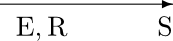
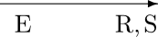
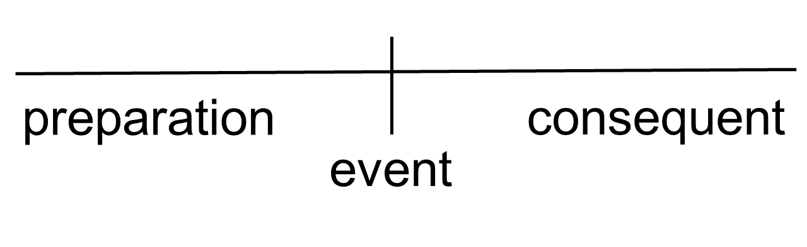

# Tense and Aspect
**First published Tue Jan 7, 2014; substantive revision Fri Feb 9, 2024**

*Hamm, Friedrich, Bott, Oliver*

> *Time flies like an arrow.… Fruit flies like a banana.* —Oettinger (1966)

Many languages have grammatical means to indicate the time when an action or event occurs, or when a state or process holds. This phenomenon is called *tense*. In English, for example, adding the morpheme *-ed* to the verb *walk*, to form *walked*, indicates that the event denoted by the verb occurred before the present time. What is called *aspect*, on the other hand, deals with the internal constituency of actions, events, states, processes or situations. For instance, it may indicate that an action is completed or still ongoing. English typically uses the *-ing* form of verbs to indicate ongoing processes, as in *He is building a house*.

After a short introduction to basic notions of tense and aspect we briefly discuss temporal logic, and then Reichenbach’s famous distinction between speech time, event time and reference time. Event-based semantic theories treat events as ontological primitives, so in the following section we show how time can be constructed from event structures, as exemplified by the Russell-Kamp construction. These sections are followed by a discussion of the most important observations concerning lexical and grammatical aspect, including the famous imperfective paradox. Next we introduce two widely discussed theories of temporality and show how they cope with the imperfective paradox. This section is followed by one that shows how temporal information is expressed in Artificial Intelligence (AI). We use the event calculus from AI to present a solution of the imperfective paradox, by viewing it as an instance of the frame problem. The following section is devoted to gathering psycholinguistic evidence showing that at least some of the philosophical and semantic concepts discussed in this article may be cognitively real. The last section discusses some aspects concerning the interrelationsship between temporal interpretation and the larger discourse structure.

## 1. Introduction

*Tense* roughly means reference to the time at which events take place, or at which processes or states hold. English, for example, clearly distinguishes between past and non-past tense as in (1a) and (1b) and (1c).

**1.**

(a) John promised to pay ten pounds.

**(b)**

I promise to pay you ten pounds.

**(c)**

The student will work on his thesis.

In English, *verb* forms are typically used to signal the time when an action or event occurs or a state holds. Thus in (1a), John’s promise was given before the present time, in (1b) the promising is simultaneous with the present time and (1c) says that the student’s work on his thesis will occur at some time after the present. It should be noted that the verb forms used to express temporal information may also be used to signal information that is not purely temporal. For instance, the present tense form in *John walks* characterizes a certain habit of John. And in the statement *The train departs at five o’clock tomorrow*, the present verb form clearly has a futurate meaning. So English distinguishes between past and non-past but not between future and non-future. Moreover, many linguists exclude future as a pure tense, because the auxiliary *will* may be used to express volition as in *He will go swimming in dangerous water*.[^note-1]

Apart from *absolute* tense—exemplified by (1a)–(1c)—where the reference point from which the location in time is evaluated is the present, there is also *relative* tense where the reference point is not necessarily the present but may be given by context. Thus in a sentence like *The student had worked on his thesis* the student’s work took place at a time before a reference point in the past, in contrast to (1c) where the reference point is the present. Other instances of relative tense in English are the present perfect and the future perfect in (2a) respectively (2b).

**2.**

(a) I have lost my watch.

**(b)**

The student will have finished his thesis next month.

The notion of *aspect* according to Comrie refers to “[the] different ways of viewing the internal temporal constituency of a situation” (1976: 3). It is customary to distinguish between *lexical* and *grammatical* aspect. The following are examples concerning lexical aspect. Since Vendler (1967) linguists distinguish at least four aspectual classes. These are states like *know*, activities like *run*, accomplishments like *cross the street* and achievements exemplified by a verb like *recognize*. Accomplishments describe the internal temporal constituency of a situation in a more detailed way than (say) activities. *Crossing the street*, for example, includes the starting of a crossing activity which goes on for some time and involves a result state that is characterized by being on the other side of the street. No such elaborate descriptions are necessary for activities or achievements. There are grammatical means of distinguishing between these aspectual classes. For example, states and achievements cannot occur with the progressive while activities and accomplishments can; more about this below in Section 5. These differences are customarily considered to be lexical differences and this area is therefore dubbed *lexical* aspect.

A further crucial aspectual difference is that between perfective and imperfective aspect. Comrie characterizes these notions as follows.

> …perfectivity indicates the view of the situation as a single whole, without distinction of the various separate phases that make up that situation, while the imperfective pays essential attention to the internal structure of the situation. (Comrie 1976: 16)[^comrie-1976]

In English this difference is often expressed by *grammatical* means, for instance by past tense versus past progressive. This is an instance of grammatical aspect. Slavic language often have an elaborate grammatical system to signal the difference between imperfectivity (ipv) and perfectivity (pv). Here is an example from Russian.

**3.**

(a) Petr Peter pisal$_{ipv}$/*napisal$_{pv}$ was-writing/*wrote pis’mo, letter, kogda when on he byl was prervan interrupted telefonnym by-telephone zvonkom. call.

**(b)**

Petr Peter *pisal$_{ipv}$/napisal$_{pv}$ *was-writing/wrote pis’mo letter i and otnes brought ego it na to počtu. post-office.

Sentence (3b) presents the writing of a letter as a single whole and it is clear that this activity was finished when the letter was brought to the post office. By contrast, (3a) focuses on an ongoing activity of letter writing in the past which is not completed because of the interruption. In fact it is consistent with the truth of (3a) that the letter was never completely written.

The natural language categories *tense* and *aspect* embody the linguistic encoding of time. From a typological point of view these categories are typical verbal categories.[^note-2] This means that if these categories are morphologically realized in a language then these morphemes attach to the verb. Verbs usually express events, processes, actions or states[^note-3] and the temporal morphemes locate these eventualities in time. Of course this does not mean that languages that lack such morphemes are not able to express temporal relations. They just have to choose other means for this purpose. One famous example of a language not containing temporal morphology is Mandarin Chinese. Often tense and aspect cannot be clearly separated. For example the Quiché prefix $x-$ denotes a completed (aspect) action in the past (tense).[^note-4]

Typologists also observed an asymmetry between past and future. Most languages that possess temporal morphology use these means to differentiate between past and non-past. There are, however, a few languages which use temporal morphology to distinguish between future and non-future.

We will not go into further details concerning the linguistic realization of tense and aspect, but present a brief and necessarily incomplete review of major philosophical and semantic theories of these notions.

## 2. Temporal Logic

Temporal logic was introduced by Arthur Prior (see for instance Prior 1967)[^prior-1967]. Here we will sketch only propositional temporal logic (for a more thorough introduction the reader is advised to consult Gamut 1991: chapters 2 and 3)[^gamut-1991] and the entry on temporal logic. Temporal logic introduces operators $\bG$, $\bH$, $\bF$ and $\bP$, which are similar to the modal operators $\Box$ and $\Diamond$. We summarize the intuitive meaning of these operators in Table 1.

*Table 1.*

| $\bG\phi$ | it is always going to be the case that $\phi$ |
| --- | --- |
| $\bH\phi$ | it always has been the case that $\phi$ |
| $\bF\phi$ | it will at some stage in the future be the case that $\phi$ |
| $\bP\phi$ | it was at some stage in the past that $\phi$ |

By adding the above operators to propositional logic we extend propositional logic to propositional temporal logic. Let $q$ abbreviate the sentence *Sam is working*, then we are able to express the following verb tenses in temporal logic:

**4.**

(a)$q$   Sam is working

**(b)**

$\textbf{F}q$   Sam will work.

**(c)**

$\textbf{P}q$   Sam worked.

**(d)**

$\textbf{PP}q$   Sam had worked.

**(e)**

$\textbf{FP}q$   Sam will have worked.

**(f)**

$\textbf{PF}q$   Sam would work.

A model $\sM$ for propositional temporal logic consists of a nonempty set $T$ of moments of time, an earlier than relation $\prec$ and a valuation function $I$ which for each moment of time and each proposition letter $q$ assigns a truth value $I_{\sM ,t}(q)$. The following definition characterizes $I_{\sM ,t}(\phi)$ for the temporal operators.

**Definition 1.** *Let $\sM$ be a model, then $I_{\sM ,t}(\phi)$ is defined by the following clauses:*

1. $I_{\sM ,t}(\bG\phi) = 1$ *iff for all* $t' \in T$ *such that* $t \prec t' : I_{\sM ,t'}(\phi) = 1$.
2. $I_{\sM ,t}(\bH\phi) = 1$ *iff for all* $t' \in T$ *such that* $t' \prec t : I_{\sM ,t'}(\phi) = 1$.
3. $I_{\sM ,t}(\bF\phi) = 1$ *iff there exists* $t' \in T$ *such that* $t \prec t' : I_{\sM ,t'}(\phi) = 1$.
4. $I_{\sM ,t}(\bP\phi) = 1$ *iff there exists* $t' \in T$ *such that* $t' \prec t : I_{\sM ,t'}(\phi) = 1$.

These clauses are analogous to the clauses which define the modal operators $\Box$ and $\Diamond$—with $\bG$ and $\bH$ corresponding to $\Box$, and $\bF$ and $\bP$ to $\Diamond$—but instead of possible worlds the valuation function takes moments of time as arguments. Therefore principle (5) is valid in any model, since the modal analogue is valid for $\Box$ independently of the accessibility relation.

**5.**

$~\bG(\phi \rightarrow \psi) \rightarrow(\bG\phi \rightarrow \bG\psi)$ (and analogously for $\bH)$.

However, principle (6), which is often considered as valid for $\Box$, is presumably not valid for $\bG$.

**6.**

$~\bG\phi \rightarrow \phi$

Formula (6) is equivalent to $\phi \rightarrow \bF\phi$. The latter formula says that if $\phi$ is the case then $\phi$ will be the case, which is intuitively incorrect. Suppose that $\prec$ is irreflexive; this assumption makes sense since it means that no time point is earlier than itself. But under this assumption, Principle (6) is obviously wrong. For extensions of temporal logic and more examples concerning the correspondence between properties of models and the validity or invalidity of formulas see Gamut 1991: chapter 2.

This concludes our brief remarks about temporal logic. We now turn to an alternative approach due to the philosopher Hans Reichenbach.

## 3. Speech Time, Event Time and Reference Time

The notions *speech time*, *event time*, and *reference time* were introduced by Reichenbach (1947) in order to distinguish simple past and present perfect or, more generally, absolute and relative tense. According to Comrie (1985), who refined Reichenbach’s system (in Chapter 6 of his book on tense) speech time and event time are sufficient for the analysis of *absolute time*; i.e., present, (simple) past and future. But for *relative tense*—of which the present perfect is but one example—reference time is required. Let us explain these notions by applying them to distinguish between past and present perfect.

Consider the following examples from Steedman (1997).

**7.**

(a) I have lost my watch.

**(b)**

Yesterday, I lost my watch.

It has often been observed that the present perfect in English has present relevance. For instance the continuation of (7a) with *but I have found it again* is infelicitous in English; the German translation of this sequence is acceptable, showing that the German perfect is more like a past tense (but see Kamp et al. 2015 for an extensive discussion, in Other Internet Resources). The same continuation is fine for sentence (7b). In this sense the perfect is a relative tense and the past an absolute tense in English. Let $E$ be short for event time and let $S, R$ stand for speech time and reference time respectively.

| Simple Past | Present Perfect |
| --- | --- |
| *I saw John* | *I have seen John* |
|  |  |

For the simple past, both event time and reference time are situated on the time line before speech time. In case of the perfect, R and S are simultaneous and E is earlier than both R and S. Intuitively, reference time represents the perspective from which an eventuality is perceived on the time line. This is not a purely semantic theory of tense like temporal logic, rather it is a pragmatic theory of tense. In particular, reference time (in contrast to event time) has to be mutually known by communication partners. When using the present perfect, reference time is known since it coincides with speech time. However, reference time is not necessarily known when the past tense is used, since it is just required to be earlier than speech time and to coincide with event time. This may explain why sentences in the past sound strange when uttered out of the blue. Steedman (1997) presents the following examples:

**8.**

(a) *Chapman breathed a sigh of relief.

**(b)**

When Nixon was elected, Chapman breathed a sigh of relief.>

The past-tensed sentence (8a) uttered out of the blue is infelicitous, while sentence (8b) is fine, since in this case the *when*-clause introduces the reference time.

This is by no means the complete story of the perfect. For example, Comrie (1976) distinguishes four typical uses of the perfect: the perfect of result, the experiential perfect, the perfect of persistent situation and the perfect of recent past. For an extensive recent discussion the reader is advised to consult Kamp et al. 2015 (in Other Internet Resources).

The following table summarizes the positions of event time, reference time and speech time for other tenses:

*Table 2.*

| E, R, S | Sam is working. |
| --- | --- |
| S — E, R | Sam will work. |
| E, R — S | Sam worked. |
| E — R — S | Sam had worked. |
| S — E — R | Sam will have worked. |
| R — E — S | Sam would work. |

Comrie (1985) and Gamut (1991) point out that this cannot be a complete account for temporal constructions that occur in natural languages. For instance the temporal profile of the sentence *Sam would have worked* cannot be analyzed by using a single reference time. This is one reason for the extended requirements for a formal theory of tense proposed by Comrie (1985: chapter 6). Furthermore, Blackburn and Jørgensen (2016) combine the key insights of Prior and Reichenbach in the framework of hybrid tense logic suggesting that the two approaches are fully compatible with each other.

## 4. From Events to Time

In event semantics following Davidson (1967) events are commonly taken as ontological primitives. This raises the philosophical question how events and times relate to each other. A construction, due to Russell, Wiener and Kamp, shows that the time line can be constructed from events. We will briefly sketch this construction before we move on to lexical and grammatical aspect.

Russell remarked:

> Even if there be a physical world such as the mathematical theory of motion presupposes, impressions on our sense-organs produce sensations which are not merely and strictly instantaneous, and therefore the objects of sense of which we are immediately conscious are not strictly instantaneous. Instants, therefore, are not among the data of experience and must be either inferred or constructed. It is difficult to see how they can be validly inferred; thus we are left with the alternative that they must be constructed. (Russell 1914: lecture IV)[^russell-1914]

Kamp (1979) took up Russell’s ideas and slightly modified them. The construction takes event structures as primitives from which the structure of time, i.e., a total order, can be derived.

An event structure $\langle E, P, O\rangle$ simply consists of a set of events $E$ and the relations $P$ (*precedes*) and $O$ (*overlaps*) and is characterized by axioms A1–7.

$$\begin{align} \tag*{A1.} &\forall x\forall y(P(x, y) \rightarrow \neg P(y, x)) \\ \tag*{A2.} &\forall x\forall y\forall z(P(x, y) \wedge P(y, z) \rightarrow P(x,z)) \\ \tag*{A3.} &\forall x(O(x, x)) \\ \tag*{A4.} &\forall x\forall y(O(x, y) \rightarrow O(y, x)) \\ \tag*{A5.} &\forall x\forall y(P(x, y) \rightarrow \neg O(x, y)) \\ \tag*{A6.} &\forall x\forall y\forall z\forall t(P(x, y) \wedge O(y, z) \wedge P(z, t) \rightarrow P(x, t)) \\ \tag*{A7.} &\forall x\forall y(P(x, y) \vee O(x, y) \vee P(y, x)) \end{align}$$

Given an event structure satisfying these axioms, the set of instants and their strict linear ordering can be constructed according to definition 2. The idea is to identify an instant with the maximal set of pairwise overlapping events. Instants are thus conceived of as abstractions over events that happen (or go on) simultaneously. Events linked by the precedence relation will give rise to distinct instants.

**Definition 2.** *Let $\langle E, P, O\rangle$ be a structure which satisfies axioms A1–7.*

1. An instant of $\langle E, P, O\rangle$ is a maximal subset of pairwise overlapping events, i.e., $i$ is an instant of $\langle E, P, O\rangle$iff
2. $i \subseteq E$
3. For any $a, b \in i : O(a, b)$
4. if $e \in E$ but $e \not\in i$ then there is $d \in i$ such that $\neg O(d, e)$
5. Let $I$ be the set of instants of $\langle E, P, O\rangle$
6. For $i_1, i_2 \in I$ put $i_1 \lt i_2$ iff there are $e_1 \in i_1$ and $e_2 \in i_2$ such that $P(e_1, e_2)$

We will first illustrate the Russell-Kamp construction by way of an example and then show that $\langle I,\lt \rangle$ has the properties specified in Theorem 1: it is a strict linear ordering which gives rise to an interval structure.

**Example 1.** *Let $E = \{a, b, c, d, e\}$ and $P$ be the set of ordered pairs $\{(a, c), (a, d), (a, e), (b, e), (c, e)\}$. Given A7, the relation $O$ consists of the set of pairs $\{(a, b), (b, c), (b, d), (c, d), (d, e)\}$. $E$ contains three maximal subsets of pairwise overlapping events, that is, instants $i_1 = \{a, b\}$, $i_2 = \{b, c, d\}$ and $i_3 = \{d, e\}$. Furthermore, $i_1$, $i_2$ and $i_3$ are linearly ordered as $i_1 \lt i_2 \lt i_3$ because $a \in i_1$, $c \in i_2$ and $P(a, c)$ hence $i_1 \lt i_2$, and $c \in i_2$, $e \in i_3$ and $P(c, e)$ hence $i_2 \lt i_3$, and similarly for $i_1 \lt i_3.$*

A proof of the following theorem can be found in (Kamp 1979: 379)[^kamp-1979].

**Theorem 1.** *If an event structure $\langle E, P, O\rangle)$ satisfies A1–7, then the structure $\langle I,\lt \rangle$ constructed according to definition 2 is a strict linear ordering, i.e., the following three conditions hold:* $$\begin{align} &1.\ \forall i_1, i_2 (i_1 \lt i_2 \rightarrow \neg i_2 \lt i_1) &\text{(asymmetry)} \\ &2.\ \forall i_1, i_2, i_3 (i_1 \lt i_2 \wedge i_2 \lt i_3 \rightarrow i_1 \lt i_3) &\text{(transitivity)} \\ &3.\ \forall i_1, i_2 (i_1 \ne i_2 \rightarrow i_1 \lt i_2 \vee i_2 \lt i_1) &\text{(totality)} \end{align}$$

Once having constructed the set $I$ it is possible to define time intervals and these, in turn, can be used to measure the temporal extent of an event. In Example 1, for example, $a$ *goes on* in the interval [$i_1], b$ in [$i_1, i_2], c$ in [$i_2], d$ in [$i_2, i_3$] and $e$ in [$i_3$]. Corollary 1 guarantees that these intervals can be constructed (Kamp 1979: 379)[^kamp-1979].

**Corollary 1.** *For each $e \in E$, the set $e' =\{i \in I \mid e \in i\}$ is a non-empty interval of $\langle I,\lt \rangle.$*

Proof: If $i_1, i_2 \in e'$ and $i_1 \lt i \lt i_2$, it has to be shown that $e \in i$, too. Suppose it is not. Then there is $d \in i$ such that $\neg O(d, e)$, hence $P(d, e)$ or $P(e, d)$. In the first case $i \lt i_1$ and in the second case $i_2 \lt i$. Both yield a contradiction.$\Box$

We cannot give further details here, but refer the interested reader to Thomason (1986) who discusses how to construct time as a continuum—isomorphic to the real numbers—and uses a different construction originally proposed by Walker (1947). Empirical evidence for events being ontological primitives will be presented in section 8 where we review psychological studies on event perception. We will now move to lexical and grammatical aspect, that is the expression of event types and how a given event is conceptualized, which form basic concepts in linguistic theory.

## 5. Lexical and Grammatical Aspect

Linguists distinguish four or five lexical aspectual classes or *Aktionsarten.* The following four were introduced by the philosopher Zeno Vendler (1967: chapter four) on the basis of earlier work by philosophers such as Kenny, Ryle and Aristotle (see also the entry on events). For a formal definition of *Aktionsart* the reader is referred to van Lambalgen and Hamm (2005: 85 ff).

*Table 3.*

| *States* | *Activities* | *Accomplishments* | *Achievements* |
| --- | --- | --- | --- |
| know | run | cross the street | recognize |
| be beautiful | swim | draw a circle | reach |
| believe | walk | paint a picture | find |

In addition, linguists often assume that verbs like *flash*, *spot* and *blink* form an extra class—the class of semelfactives or points (see Smith 1991)[^smith-1991].

A useful notion for distinguishing *Aktionarten* is the *event nucleus* introduced by Moens and Steedman (1988). The event nucleus is constructed from a preparatory phase, a culminating event and a consequent phase. Activities only refer to the preparatory phase, states only to the consequent phase, achievements to the culminating event and to the consequent phase and finally accomplishments to all three parts of the event nucleus.

Vendler proposed several linguistic tests for distinguishing these verb classes. We will present only the most important ones here; for a much more comprehensive list the reader is referred to Dowty (1979: 60). The first test separates non-statives from statives. Only non-statives occur in the progressive.

**9.**

(a) *Sam is knowing the answer.

**(b)**

Sam is running.

**(c)**

Sam is writing a letter.

Accomplishment verbs prefer $in$-adverbials as temporal modifiers, whereas activity verbs allow only *for*-adverbials.

**10.**

(a) ?Sam wrote a letter for an hour.

**(b)**

Sam wrote a letter in an hour.

**(c)**

Sam swam for an hour

**(d)**

*Sam swam in an hour

Achievement verbs are usually infelicitous with *for*-adverbials but allow the combination with $in$-adverbials.

**11.**

(a) Sam reached the summit in five hours.

**(b)**

Sam reached the summit for five hours.

The last test we mention here concerns the different entailment patterns of activities and accomplishments in the progressive. Activities in the past progressive entail their past reading but accomplishments in the past progressive don’t.

**12.**

(a) Sam was pushing a cart $\Rightarrow$

**(b)**

Sam pushed a cart.

**13.**

(a) Sam was building a house $\not\Rightarrow$

**(b)**

Sam built a house.

This is an instance of the famous imperfective paradox. Of course, taken literally this is not a paradox. Nevertheless the entailment patterns (12) and (13) pose a significant problem for any formal theory of tense and aspect. For instance, the first formal proposal for truth conditions of sentences in the past progressive stated that a sentence S in the past progressive is true if and only if there exists an open interval before the speech time at which the sentence without the progressive is true. According to definition 1.4 this immediately validates pattern (12) but without qualifications this truth definition does not account for pattern (13). Sections 6 and 7 contain extensive discussion of the imperfective paradox.

Vendler thought of the *Aktionarten* as lexical properties of verbs. That this position is dubious was pointed out by many linguists, in particular by Dowty (1979) and Verkuyl (1993). For a simple case, consider the verb *drink*. If we assume that being an activity is a lexical property of this verb, then surely by combining it with the noun *wine* this property is preserved for the complex phrase *drink wine*. However, if we combine the verb *drink* with the noun phrase *a bottle of wine* we turn an activity into an accomplishment. The converse problem arises if we assume that being an accomplishment is a lexical property of *drink*. This phenomenon of aspectual reinterpretation was dubbed *coercion* in Moens and Steedman (1988). In Section 6.1 we will sketch a systematic solution for these types of coercion in mereological semantics (Krifka 1989, 1992)[^krifka-1989].

*Aktionsart* is not even definitely fixed at the VP-level. The verb *arrive* in

**14.**

(a) Chapman arrived.

**(b)**

*Chapman arrived all night.

is an achievement, as demonstrated by the ungrammaticality of (14-b). But if we choose a bare plural as subject it is turned into an activity and sentence (15) is grammatical.

**15.**

Visitors arrived all night.

Therefore a final decision about aspectual class cannot be reached below the sentence level. Steedman’s famous sentence (16)

**16.**

It took me two years to play the “Minute Waltz” in less than sixty seconds for one hour without stopping.

shows that coercion can be iterated and that aspectual class can switch back and forth in this iteration process. We close this section with two further examples of aspectual coercion. In the first one a stative verb is transformed into an activity.

The verb *resemble* is a stative verb and therefore (17a) is unacceptable but (17b) is fine.

**17.**

(a) *She is resembling her mother.

**(b)**

She resembles her mother.

However, if we add *more and more every day* to (17a) thus forming

**18.**

She is resembling her mother more and more every day.

we get an acceptable result. This is due to the phrase *more and more every day* which coerces a state into an activity. Our last example is about temporal modification with *for*-adverbials. As pointed out above accomplishments are usually rather bad with *for*-adverbials. They require $in$-adverbials. But consider sentence (19) from van Lambalgen and Hamm (2005).

**19.**

Pollini played Opus 111 for two weeks.

This sentence seems to be fine. However it is not interpreted as an accomplishment any more but is reinterpreted as an iterated activity. To get this reading, a lot of non-linguistic knowledge is required. First, one has to guess that Opus 111 refers to Beethoven’s last piano sonata and moreover one has to be aware that this piece lasts about 25 minutes. Under these assumptions, sentence (19) says that Pollini played Opus 111 repeatedly within a time span of two weeks. Formal accounts of coercion phenomena are contained in Egg (2005), van Lambalgen and Hamm (2005) and Steedman (1997) among others. The reader is also advised to consult Steedman’s updated manuscript, *The Productions of Time* (see the Other Internet Resources). Processing studies of coercion are reviewed in Bott (2010); see also Section 8.

## 6. Intensionality versus Events

The most influential approach to solving the imperfective paradox is due to Dowty (1979). The basic idea is to treat the progressive as a modal operator $(\Box)$ but restrict its domain to inertia worlds. The notion of an *inertia world* is characterized informally. An inertia world is exactly like the real world up to the time of evaluation; after this it may differ from the real world but is assumed to be as similar to the real world as possible. Given this notion, the following definition introduces truth conditions for sentences in the progressive.

**Definition 3.** PROG$(\phi)$ *is true with respect to interval $I$ and world $w$ if and only if $\forall w' \in IE(w)$ there exists an interval $I' \supseteq I$ such that $\phi$ is true with respect to $I'$ and $w'$. In addition $I$ should not be the final subinterval of $I'$. $IE(w)$ is the set of inertia worlds for $w$.*

Definition 3 does not yet account for the different entailment patterns of activities and accomplishments. Two additional assumptions are required. The first concerns activities; the second, accomplishments.

**20.**

If $\phi$ is an activity that is true with respect to interval $I$, then $\phi$ is true with respect to any sufficiently large subinterval of $I$.

Accomplishments like *Mary draw a circle* are split up into two parts, an activity part *Mary draw* that satisfies principle (20) and a result part which is characterized by the existence of a circle. Both parts are connected by a causality relation *CAUSE*.

**21.**

*CAUSE*[Mary draw, A circle comes into existence]

Thus an accomplishment has a richer internal structure than an activity.

With these additional requirements, the inference patterns for activities and accomplishments follow. Let us first show that *Mary was pushing a cart* implies *Mary pushed a cart*. Assume that the first sentence is true in $w$ with respect to speech time $S$. Then *Mary be pushing a cart* is true in $w$ with respect to an interval $I$ before $S$. According to Definition 3, *Mary push a cart* is then true in every inertia world $w' \in IE(w)$ with respect to an interval $I' \supseteq I$. Because of postulate (20), *Mary push a cart* is true in every $w' \in IE(w)$ with respect to interval $I \ (I$ is a subinterval of $I')$. Now, the definition of inertia worlds implies that *Mary push a cart* is true in $w$ with respect to interval $I$. This means that *Mary pushed a cart* is true in $w$ with respect to speech time $S$.

A completely analogous argument shows that *Mary was drawing a circle* implies *Mary drew*. But postulate (20) only holds for the first part of accomplishments; the result part is only required to hold in every inertia world $w'$ with respect to a larger interval $I'$, normally one after speech time. Since the inertia worlds after $S$ may differ from $w$ and since the subinterval property (20) is not required to hold for the result parts of accomplishments, the stronger conclusion that *Mary drew a circle* does not follow.

Many researchers assume that inertia worlds introduce a notion of *normality* for the semantic analysis of the progressive. The thunderbolt in example (22) from Landman (1992) seems to break the normal development of the real world. Dowty’s analysis seems to be tailored for cases like this one.

**22.**

Mary was crossing the street, when a thunderbolt from heaven struck her down.

However, objections have been raised to the normality interpretation of inertia. The first one is attributed to Frank Vlach in Ogihara (1990). Consider sentence (23)

**23.**

John was crossing the street, when he was hit by a truck.

and a situation in which the truck is only a few centimeters away from John. Moreover the truck’s speed is such that it is impossible for it to stop before hitting John. In this situation, the normal course of events is such that John will never reach the other side of the street. Therefore, given definition 3, sentence (23) should be false under these circumstances. This is intuitively incorrect. A similar objection was raised by Bonomi (1997).

On the other hand, the normality interpretation seems to be at least questionable. Consider the following example from Naumann and Piñón (1997).

**24.**

Rebecca was running across the minefield.

This does presumably not mean that when you are running across a minefield, you normally will eventually get to the other side.

Note that these objections all make use of a particular informal interpretation of the notion *inertia*. Judging the validity of these objections to Dowty’s theory in a precise way therefore requires an explicit theory of this notion with exact empirical predictions.

Dowty analyzes the progressive as an intensional construction. Does the progressive satisfy the standard philosophical tests for intensional constructions, that is, the invalidity of substitution of co-designative proper names and the impossibility of pulling the existential quantifier out of the context created by the intensional construction (see Bealer and Mönnich (1989) for a more detailed discussion)? Let us consider accomplishments, for example sentence (25).

**25.**

Jackson Pollock was painting Ruth Rendel.

Given that Ruth Rendel and Barbara Vine are co-designative proper names, sentence (25) implies that *Jackson Pollock was painting Barbara Vine*. Therefore the first test fails. Co-designative proper names are substitutable *salva veritate* in progressive constructions. The second one, however, applies, since

**26.**

Carlos was building a house.

does not imply that there is a house that Carlos was building. These tests therefore don’t provide a clear answer to the question whether the progressive is an intensional construction. Even if the answer is yes, the progressive is certainly a different type of intensional construction than, for example, propositional attitudes like *believe* or *doubt*.

An extensional alternative was developed by Parsons (1989, 1990). Parsons, like Davidson (1967), assumes that first-order quantification over events is possible. But unlike Davidson, Parsons assumes quantification over eventualities in the sense of Bach (1986), which includes events proper but also states, processes and so on. Like Dowty, Parsons supposes that eventualities are split up into a development phase and a culmination phase. In order to represent this difference in first-order logic two new predicates are introduced, *Cul*$(e, t)$ and *Hold*$(e, t)$. The intuitive meaning of the first is that eventuality $e$ culminates at time $t$. The second one says that $e$ is either an eventuality in its development phase or that $e$ is a state. Given these assumptions a sentence like *Mary drew a circle* is translated into first-order formula (27), $S$ is again short for speech time.

**27.**

$\exists x(Circle(x)\,\wedge$ $\exists e\exists I[I \lt S \wedge Drawing(e)\ \wedge$ $Subject(e, Mary)\ \wedge$ $Object(e, x)\ \wedge$ $Cul(e, I)])$

The semantic effect of the progressive consists in transforming events into states.

If ‘$A$’ is an event verb, then ‘be $A$-ing’ is to be treated semantically as a state verb; otherwise, ‘be $A$-ing’ is to be treated the same as ‘$A$’. (Parsons 1989: 222)[^parsons-1989]

With this assumption the logical representation of *Mary was drawing a circle* is (28).

**28.**

$\exists x(Circle(x)\,\wedge$ $\exists e\exists I[I \lt S \wedge Drawing(e)\ \wedge$ $Subject(e, Mary)\ \wedge$ $Object(e, x)\ \wedge$ $Hold(e, I)])$

Obviously (27) does not follow from (28). But (28) does imply that there is a circle Mary was drawing. Of course this circle may not be complete. This means that Parson’s ontology is bound to include incomplete objects. For a discussion of incomplete objects see for instance Baggio and van Lambalgen (2007).

According to the quotation above, the progressive doesn’t change anything in the case of activities. Therefore *Mary pushed a cart* and *Mary was pushing a cart* are predicted to be equivalent.

Parsons’ theory rests on the difference between the predicates *Cul* and *Hold*. This difference is left to intuition. No axiomatisation of these predicates is given. This is one of the objections made in Zucchi (1999). Zucchi also notes that under certain circumstances it is possible to derive a specific version of the imperfective paradox in Parsons’ theory. A careful discussion of Dowty’ and Parsons’ approaches and a combination of the two systems is contained in Landman (1992).

Another approach to the imperfective paradox and—more generally—non-culminating accomplishments was proposed by Copley and Harley (2015). They abandon event semantics and propose instead a framework using situations and forces as primitives. Forces lead to transitions between situations. Their theory is motivated by the observation that across languages, non-culminating accomplishments are crosslinguistically in fact a very common phenomenon (see also Martin 2019)[^martin-2019]. Interestingly, these non-culminating readings are per default conveyed by less complex expressions than complete events. Often, it is the perfective and not the imperfective that is marked linguistically. Prima facie, this is a problem for analyses such as Dowty’s which assume that the imperfective paradox in accomplishments hinges on an additional operator such as PROG. This is where Copley and Harley’s causal analysis comes into play. Their force-theoretic account does not run into this problem because causally efficacious forces always take effects ceteris paribus, for instance, an effect may not occur due to the occurrence of a counter force preventing the effect. They develop a compositional semantic framework linking forces to the argument structure of the sentence. At the present stage of the theory, however, some of the basic concepts also call for axiomatisation. For instance, it is crucial to gain a proper understanding of what it means for a situation to be a ceteribus paribus successor situation for some initial situation. For this purpose, their semantic framework must be connected to a theory of causality connecting linguistic meaning to cognition and causal reasoning via a conceptual level integrating the two.

We will come back to the imperfective paradox in Section 7 where we combine linguistic theory with event theories from artificial intelligence. This will give us a formalization of *ceteris paribus* from which a new solution to the imperfective paradox will follow.

### 6.1 Nominal Reference and Temporal Constitution

Let us now show that events are also useful for a systematic account of certain types of coercion that were mentioned above in Section 5.

Intuitively there is a close link between the nominal predicates *wine* and *a bottle of wine* and their verbal counterparts (29-a), (29-b).

**29.**

(a) drink wine

**(b)**

drink a bottle of wine

Whenever there are two entities to which *wine* applies, this predicate applies to their collection as well. The predicate *a bottle of wine* does not have this property. Whenever there are two different entities to which *a bottle of wine* applies, this predicate does not apply to their collection. The first predicate is *cumulative* (see Definition 4) the second is *quantized* (see Definition 5). A similar argumentation applies to the difference between the activity *drink wine* and the accomplishment *drink a bottle of wine*. It was observed by many linguists that the combination of a verb like *drink* with a cumulative predicate like *wine* yields an atelic predicate like (29-a), whereas its combination with a quantized predicate yields a telic predicate like in (29-b).

In order to account for these intuitions in a precise way Krifka assumes that the parts of the structure $\mathcal{M} = (\mathfrak{O}, \mathfrak{E}, \mathfrak{T})$ consisting of objects $\mathfrak{O}$, events $\mathfrak{E}$ and times $\mathfrak{T}$ are each structured as complete join semi-lattices without a bottom element (see Grätzer, 1978). This means that we have a two place relation $\sqcup$ (join) and relations $\sqsubseteq$, $\sqsubset$, and $\bigcirc$ (part, proper part and overlap) that impose part-whole relations (mereologies, see the entry mereology) on the sets of objects, events and times. We cannot list all the properties that must hold for these structures to serve as admissible interpretations of natural language but we illustrate these properties by giving two examples.

- $\forall x, y \exists z(x \sqcup y = z)$ (completeness)
- $\forall x, y (x \bigcirc y \leftrightarrow \exists z (z \sqsubseteq x \wedge z \sqsubseteq y))$ (overlap)

Given this algebraic background it is possible to state precise definitions of cumulative and quantized predicates $P$.

**Definition 4.** *Cumulative (CUM) reference:* $\forall P (CUM(P) \leftrightarrow \forall x, y(P(x) \wedge P(y) \rightarrow P(x \sqcup y)))$.

**Definition 5.** *Quantized (QUA) reference:* $\forall P(QUA(P) \leftrightarrow \forall x, y (P(x) \wedge P(y) \rightarrow \neg y \sqsubset x))$.

Definitions 4 and 5 now allow for a formal descripion of the referential difference between *wine* and *a bottle of wine*.

**30.**

(a) $\textit{wine}\subseteq \mathfrak{O}\wedge \textit{CUM}(\textit{wine}) $

**(b)**

$\textit{a bottle of wine} \subseteq\mathfrak{O}\wedge\mathit{QUA}(\textit{a bottle of wine})$

For verbal predicates Krifka assumes that they are event denoting and moreover that thematic relations like *agent*, *theme*, etc are represented as in (31-b). Thematic roles of verbs are crucial since they determine which verbs give raise to the *drink wine* versus *drink a bottle of wine* distinction.[^note-5]

**31.**

(a) Mary runs.

**(b)**

$\textit{run}(e)\wedge\textit{Agent}(e, \textit{Mary})$

It is now straightforward to fix the reference of the verbal predicates in a way that exhibits their simlarity to the respective nominal predicates.

**32.**

(a) $\textit{drink wine}\subseteq \mathfrak{E}\wedge \textit{CUM}(\textit{drink wine})$

**(b)**

$\textit{drink a botle of wine}\subseteq \mathfrak{E}\wedge \textit{QUA}(\textit{drink a bottle of wine})$

Cumulativity of nominal predicates corresponds to atelicity in the verbal domain and a quantized nominal predicate corresponds to a telic verbal predicate.

There is still something missing. How can the impact of the reference of the nominal predicates on the aspectual class be derived formally? We will present only the basic idea of Krifka’s construction here. Let $w$ be the predicate corresponding to *wine* and let $e$ be the event predicate representing *drink wine*. The basic idea is that an object is changed by the influence of such an event in a *gradual* manner. Since we know that $w$ is cumulative this predicate also applies to proper parts of $w$, say $w'$. Then given that *drink wine* can be applied to $e$ it should also be possible to apply it to a proper part of $e$, say $e'$. Quantized predicates show a different behaviour. Since *a bottle of wine* is quantized no proper part of it is *a bottle of wine* and therefore no proper part of $e$ can be described as *drink a bottle of wine*. To account for this intuitive explanation in formal terms it is necessary to specify certain preservation properties for thematic roles since these roles relate the algebraic structure of events and the algebraic structure of objects. This means that notions like *summativity*, *uniqueness of objects* etc. have to be defined for relations between events and objects; i.e. thematic roles.

Here we will illustrate these concepts with only one example, *summativity (SUM)*.

**Definition 6.** $\forall R [SUM(R) \leftrightarrow \forall e, e', x, x'[R(e, x) \wedge R(e', x') \rightarrow R(e\sqcup e', x \sqcup x')]]$

Summativity says that the sum-operation $\sqcup$ on events and objects is preserved under summative relations on events and objects. For instance if we have two distinct events of *drinking a bottle of wine* we get an event of *drinking two bottles of wine*.

With this formal background it is now possible to state exactly when a predicate of events corresponding to a verb-phrase is cumulative, telic etc.. Again we will just state one result. Let $\phi = \{ e\mid \exists x(\alpha(e) \wedge \delta(x) \wedge \theta(e, x))\}$ be such a predicate where $\alpha$ represents a verb—say *draw*—$\delta$ the nominal predicate—*pictures*—and $\theta$ a thematic relation—say *theme*. It then follows that one set of conditions for $\phi$ being cumulative is that $\delta$ is cumulative and $\theta$ is summative. An example is the verb phrase *draw pictures*. Similar results characterize, *iterative*, *telic*, *atelic* etc. readings.

### 6.2 Compositionality

A second central linguistic problem concerns the notion of *compositionality*. It has often been claimed that event semantics faces serious problems with compositional accounts of quantification, negation and other logical connectives. Champollion (2015) developed one possibility to reconcile classical compositional semantics and event semantics. We will briefly sketch the basic ideas of this approach here.

It has often been observed that the existential quantifier binding the event variable always takes narrow scope with respect to other quantifiers and operators in a given sentence. Therefore the correct translation of

**33.**

John kissed every girl.

in Parsonian or Neo-Davidsonian event semantics is

**34.**

$\forall x(girl(x) \rightarrow \exists e (kiss(e) \wedge Subject(e, John) \wedge Object(e, x)))$

and (35) is considered as a problematic reading.

**35.**

$\exists e (kiss(e) \wedge Subject(e, John) \wedge \forall x(girl(x) \rightarrow Object(e, x)))$

This means that other quantifiers have to outscope the existential event quantifier. In the example above *every girl* has to have wide scope. This holds for examples like (36-a) and (36-b) involving negation, too.

**36.**

(a) No boy laughed.

**(b)**

John didn’t laugh.

In Champollion (2015) one way to achieve this goal is via type shifting (see Hendriks 1993)[^hendriks-1993]. We will now briefly explain the basics of this strategy. Consider the sentence

**37.**

It is raining.

In Neo-Davidsonian approaches the semantics of the predicate *rain* is represented as:

**38.**

$[[ rain]] = \lambda e.rain(e)$

In Champollion (2015) a variable $E$ that denotes sets of events is introduced and *rain* is represented now as follows:

**39.**

$[[ rain ]] = \lambda E\exists e( rain(e) \wedge E(e))$

We assume here that apart from the basic types $e$ and $t$ there is a type $v$ for events. $E$ is a variable of type $\langle v, t\rangle $ and the expression in (39) is of type $\langle\langle v,t\rangle , t\rangle $.

Intuitively this means that a verb will be true of a set of events when this set contains an event that satisfies the respective verbal denotation. Thus one may think of (39) as a type shifted version of (38). This has consequences for the rest of the grammar. If verbs are systematically type shifted according to (39) other grammatical categories have to be type shifted as well in order for functional application to work.

Let us now see how (39) allows for compositional interpretations. Under (39) a sentence like *It is raining* is rendered as ($\lambda e\ true$ is the set of all events; $true$ could for instance be $x = x$):

**40.**

$\lambda E\exists e (rain(e) \wedge E(e)) (\lambda e.true)$

After two application of $\lambda$-conversion (40) reduces to

**41.**

$\exists e(rain(e) \wedge true)$

which is equivalent to

**42.**

$\exists e(rain(e))$

Since it is assumed that verbs introduce event variables, existential lowest closure is enforced by applying it at the level of the verb’s lexical entry. Sentence (33) here repeated as (43)

**43.**

John kissed every girl.

is now interpreted as follows (neglecting tense for simplicity). We assume the following standard representations of *every girl* (44-b) and *John* (44-c). $P$ is as usual a variable of type $\langle e,t\rangle $ and $j$ a constant of type $e$.

**44.**

(a) $[[\textit{kiss}]]=\lambda E\exists e(\textit{kiss}(e)\wedge E(e))$

**(b)**

$[[\textit{every girl}]]=\lambda P\forall x(\textit{girl}(x)\rightarrow P(x))$

**(c)**

$[[\textit{John}]] = \lambda P.P(j)$

Here we will skip the derivation of the combination of NPs with thematic roles. In Champollion (2015) *every girl* as object of *kiss* is derived from (44-b) as

**45.**

$\lambda V\lambda E\ \forall x (girl(x) \rightarrow V(\lambda e(E(e) \wedge Object(e,x))))$

where $V$ is a variable of type $\langle\langle v,t\rangle, t\rangle$. Expression (45) is therefore of type $\langle\langle\langle v,t\rangle, t\rangle, \langle\langle v,t\rangle ,t\rangle\rangle$. Functional application of this expression with the verb *kiss* (of type $\langle\langle v,t\rangle, t\rangle$) as representated in (44-a) delivers:

**46.**

$\lambda E \forall x (girl(x) \rightarrow \exists e (kiss(e) \wedge E(e) \wedge Object(e,x)))$

(46) is the interpretation of the VP *kissed every girl*, again of type $\langle\langle v,t\rangle , t\rangle $. *John* as agent is translated in a similar way as the object NP *every girl*.

**47.**

$\lambda V\lambda E\ V(\lambda e(E(e) \wedge Subject(e, john)))$

When formula (47) of type $\langle\langle\langle v,t\rangle ,t\rangle , \langle\langle v,t\rangle, t\rangle\rangle$ is applied to the representation of *kissed every girl* (representation (46)) the result is:

**48.**

$\lambda E \forall x (girl(x) \rightarrow \exists e (kiss(e) \wedge E(e) \wedge Subject(e, john) \wedge Object(e, x)))$

Finally computing the closure of this formula with $\lambda e.true$ one derives (49)

**49.**

$\forall x (girl(x) \rightarrow \exists e (kiss(e) \wedge Subject(e, john) \wedge Object(e,x)))$

This shows that a tree like (50) can be interpreted in a strictly compositional way.

**50.**

[CP [closure] [IP [DP John ] [VP [V kissed ] [DP every girl ]]]]

Based on (40) and combining methods of the previous section with the quantificational approach of this section, Champollion develops a broad range of solutions for observations pertaining to scope ambiguity in sentences like (51),

**51.**

Every student read a book.

as well as to negation, conjunction and adverbial modification (see Champollion 2015; and Coppock and Champollion 2022)[^champollion-2015]. These results clearly demonstrate that there is no conflict between standard compositional semantics and event semantics.

This concludes our glimpse of events in linguistic semantics; Readers interested in a more comprehensive treatment of these issues may find Champollion (2014, see *Other Internet Resources*) and Champollion (2015) useful sources. For a more philosophical discussion of various forms of compositionality the reader is advised to consult Pagin and Westerståhl (2010a), Pagin and Westerståhl (2010b), Peters and Westerståhl (2006, especially Chapter 11) and the Encyclopedia’s entry on [compositionality](https://plato.stanford.edu/entries/compositionality/).

We now come back to the imperfective paradox and turn to an event calculus that was developed in artificial intelligence.

## 7. Event Calculus

In the following section we will show that the imperfective paradox is an instance of the frame problem prominent in Artificial Intelligence (AI). To this end we will explain the event calculus, which is an extension of McCarthy’s situation calculus (McCarthy 1977)[^mccarthy-1977] developed by Kowalski and Sergot (1986). Then we will indicate how the event calculus leads to a formalization of natural language tense and aspect by analysing the imperfective paradox.

Consider narrative (52).

**52.**

Yesterday morning Vincent loaded the gun. Then he smoked a cigarette. After smoking he pointed the gun at Fred and pulled the trigger.

Assuming that shooting at somebody with a loaded gun will lead to the death of that person, we will interpret the discourse in a way that Fred eventually gets killed. Arriving at this inference is, however, not a trivial task. In (33) the frame problem is exemplified in the form of the Yale Shooting Scenario (Hanks and McDermott 1986)[^hanks-1986]. To demonstrate this, we will start with a very simple calculus—a variant of the *Simple Event Calculus* by Shanahan (1997) which only incorporates a very basic notion of instantaneous change. Later we will add axioms in order to deal with continuous change and then return to the imperfective paradox. In short, we will argue that the paradox can be viewed as an instance of the frame problem.

### 7.1 The Yale Shooting Scenario

Suppose we have three kinds of actions/events—*Load*, *Smoke* and *Shoot*—and three time dependent properties, the fluents *Alive*, *Loaded* and *Dead*.^{[[^note-6]],[[^note-7]]} Besides actions and fluents we will also need instants of time in our basic ontology. The predicates listed in Table 4 are used to express actions and their effects and to locate them in time.

*Table 4.*

| *Formula* | *Meaning* |
| --- | --- |
| *Initiates*$(\alpha , \beta , \tau)$ | Fluent $\beta$ starts to hold after action $\alpha$ at time $\tau$ |
| *Terminates*$(\alpha , \beta , \tau)$ | Fluent $\beta$ ceases to hold after action $\alpha$ at time $\tau$ |
| *Initially*$(\beta)$ | Fluent $\beta$ holds from time 0 |
| $\tau_1 \lt \tau_2$ | Time instant $\tau_1$ is before time instant $\tau_2$ |
| *Happens*$(\alpha , \tau)$ | Action $\alpha$ happens at time $\tau$ |
| *HoldsAt*$(\beta , \tau)$ | Fluent $\beta$ holds at time $\tau$ |
| *Clipped*$(\tau_1,\beta ,\tau_2)$ | Fluent $\beta$ is terminated between times $\tau_1$ and $\tau_2$ |

Table 4. Predicates of the simple event calculus (from Shanahan 1999)

The predicates are related to each other by a set of four simple axioms (53)–(56). In these axioms, all variables are assumed to be universally quantified with maximal scope. We will come to the semantics of the implication when we have introduced the complete scenario.

**53.**

$Initially(f) \rightarrow HoldsAt(f, 0)$

**54.**

$Initially(f) \wedge \neg Clipped(0, f, t) \rightarrow HoldsAt(f, t)$

**55.**

$Happens(a, t_1) \wedge Initiates(a, f, t_1) \wedge t_1 \lt t_2\ \wedge$ $\neg Clipped(t_1, f, t_2) \rightarrow HoldsAt(f, t_2)$

**56.**

$Happens(a, t) \wedge t_1 \lt t \lt t_2 \wedge Terminates(a, f, t) \rightarrow$ $Clipped(t_1, f, t_2)$

The first three axioms state the conditions under which a fluent can hold at a time $t$: either it holds right from the start or it is initiated at a time $t_1$ before $t$ without a terminating action occurring in between the two. The fourth axiom defines the predicate *Clipped*$(t_1, f, t_2)$ saying that a fluent $f$ is clipped between times $t_1$ and $t_2$ if it is terminated by some action $a$ happening between $t_1$ and $t_2$. Simplifying a whole lot, the axioms (53)–(56) formalize the notion of instantaneous change, such as two balls colliding or somebody dying. Moreover, they embody a notion of inertia: fluents continue to hold unless terminated.

Next, we have to translate the discourse (52) into the Simple Event Calculus. The first set of formulas (57)–(59) states what the mentioned actions do. These formulas provide a crude sketch of the lexical meaning of *load*, *smoke* and *shoot*. The effect of a *Load* action is to make the fluent *Loaded* hold, a *Shoot* action makes *Dead* hold (and *Alive* not hold) with *Loaded* being a precondition. Finally, *Smoke* is assumed to have no effects (thus, there are no rules involving *Smoke*).

**57.**

$Initiates(Load, Loaded, t)$

**58.**

$HoldsAt(Loaded, t) \rightarrow Initiates(Shoot, Dead, t)$

**59.**

$HoldsAt(Loaded, t) \rightarrow Terminates(Shoot, Alive, t)$

(52) comprises a *Load* action followed by a *Smoke* action followed by a *Shoot* action. Using four arbitrarily chosen time points $T_1$–$T_4$ the discourse can be represented as follows:

**60.**

$Initially(Alive)$

**61.**

$Happens(Load, T_1)$

**62.**

$Happens(Smoke, T_2)$

**63.**

$Happens(Shoot, T_3)$

**64.**

$T_1 \lt T_2 \lt T_3 \lt T_4$

From this little theory we want to derive *HoldsAt*(*Dead*, $T_4)$. Unfortunately, this sequent is not valid in the classical sense of being true in all models which satisfy the theory. Think for example of a situation in which the gun obscurely becomes unloaded while Vincent is smoking. In such a model, the precondition of the shooting action is clearly not met and thus the action will lack any effects. Note that nothing rules out such a model since it is entirely consistent with our theory. We thus have to further constrain the models under consideration. Crucially, we have to find a way to deal with the non-effects of actions; this is the famous *frame problem*.

How to proceed? From the fact that no terminating action was mentioned, we want to conclude that no terminating event occurred. To do so, we have to strengthen the assumptions of the theory in a way that only those events are assumed to occur which have been explicitly stated in the discourse. The discourse model should be minimal, linking discourse understanding intimately to *closed world reasoning*. It is important to note that this strategy forces reasoning to be non-monotonic: adding further premises to a theory can make inferences invalid that were valid before (see the entry on non-monotonic logic).

### 7.2 The Completion of a Program

There are different techniques for formalizing this line of reasoning; one is circumscription (e.g., Shanahan 1997)[^shanahan-1997]. Here, we will use the *completion of a logic program* technique, adopting the *Event Calculus* of van Lambalgen and Hamm (2005). Taking a closer look at the formulas of the theory $((53) \wedge \ldots \wedge (64))$, an important feature to notice is that formulas come in two variants: they are either *facts* consisting of a simple predicate expression or they express *rules* with a conjunction of potentially negated formulas to the left of the implication sign and a single positive atomic expression to its right (in logic programming the former is called the *body* and the latter is called the *head* of a clause). We will now illustrate how the completion of a simple logic program is computed. Consider the description of a situation where the gun gets loaded at time 1 and a shooting event happens at time 10. This situation is stated in the following program:

**65.**

$Happens(Load, 1)$

**66.**

$Happens(Shoot, 10)$

The uncompleted program does not yet rule out intervening events. It is, for example, consistent with an *Unload* event occurring at time instant 9. The completion of the program should tell us that (65) and (66) were the only events. The completion is computed according to the following procedure.[^note-8] We start with the facts in (65) and (66). Both of these are *Happens* formulae. The completion of the program intuitively corresponds to an assertion that, given this program, *Happens*$(e, t)$ can only mean *Load* occurring at 1 or *Shoot* occurring at 10. We therefore first substitute variables for the constants and write the following disjunction:

**67.**

$(e = Load \wedge t = 1) \vee(e = Shoot \wedge t = 10)$

Then, we universally quantify over the variables $e$ and $t$ and strengthen the implication to a bi-implication:

**68.**

$\forall e\forall t(Happens(e, t) \leftrightarrow (e = Load \wedge t = 1)\ \vee$ $(e = Shoot \wedge t = 10))$

From (68) it follows that there were no intervening events. Strengthening the implications to bi-implications makes it impossible that a head can be true without the enabling conditions being met.[^note-9] The uniquely determined model of (68) is the minimal model of the logic program consisting of (65) and (66).

We can now come back to the Yale Shooting Problem in discourse (52). From the completion of the logic program ((53))$\wedge \ldots \wedge$((64)) it follows (non-monotonically) that *HoldsAt*(*Dead*, $T_4)$. Enriching the program with further information and computing the new completion, however, could clearly lead to cancellation of this inference.

### 7.3 Introducing Tense Information

If we want to use these ideas to model natural language discourse, we need to incorporate tense. In van Lambalgen and Hamm (2005) this is done by adopting the classic tripartition into *reference time*, *event time* and *speech time* due to Reichenbach (see section 3).

Recall that above, when we translated discourse (52) into Shanahan’s Event Calculus, we arbitrarily chose instants of time $T_1 ,\ldots ,T_4$ to locate actions in time. This is not how it is done in natural language discourse. The first sentence (*Yesterday morning Vincent loaded the gun*) states that within some time interval $(=$ reference time) before now $(=$ speech time) there was a time $t'$ at which a loading event happened $(=$ event time). The second sentence (*Then he smoked a cigarette*) is linked to this event by the connective *then*, stating that at some later time $t''$ a smoking event happened with $t''$ also being temporally located before *now*. Analogously for the third sentence: there is an event time $t'''$ at which *Shoot* happens and $t'' \lt t''' \lt$ *now*. Note that when locating events in time it is always done by existential statements of the form *there is a time*. So far, however, we have only been dealing with universally quantified variables. Clearly, a formula like $\forall t$.*Happens*(*Load*, $t) \wedge t \lt$ *now* cannot be used to represent tense since it would state that *Load* happens at all times in the past. We have to find a way to introduce existentially quantified information.

Intuitively, it suffices to introduce new entities into the domain of discourse. This approach lies at the heart of dynamic semantic theories such as Discourse Representation Theory (Kamp and Reyle 1993, and see also the entry on Discourse Representation Theory)[^kamp-1993] or File Change Semantics (Heim 1982)[^heim-1982]. We will need an update procedure that introduces new actions/events into the discourse model but is compatible with the non-monotonic semantics introduced so far. Following van Lambalgen and Hamm (2005) we will use *integrity constraints*—a device from database theory (for a more complete and formal treatment the reader is referred to Kowalski 1995 and van Lambalgen and Hamm 2005: ch. 8)[^kowalski-1995][^lambalgen-2005]—to implement the notion of a minimal update of a discourse model. Consider discourse (69).

**69.**

The gun is loaded. Vincent is ready to shoot.

In interpreting the first sentence, we want to update the situation model in a way that makes the sentence true. The tense information will be interpreted as a goal to minimally update the situation model with a fluent *Loaded* that holds now. In our framework semantic interpretation is thus closely linked to planning, in that finding an interpretation for a sentences requires coming up with a sequence of actions that makes the goal succeed.

**70.**

Make the query $?HoldsAt(Loaded, now)$ succeed.

To resolve this integrity constraint we will use the axioms of the Simple Event Calculus plus the world knowledge about the consequences of a load action stated in (71).

**71.**

$Initiates(Load, Loaded, t)$

In logic programming, the sort of reasoning required to resolve (70) is carried out by a derivation procedure called *resolution*. We will use resolution here in a non-standard way, i.e. logic programming combined with integrity constraints (for details see van Lambalgen and Hamm 2005)[^lambalgen-2005]. It starts with the formula that has to be made true in the discourse model. Resolution proceeds by identifying rules which have the query as their consequent and substituting the consequent with the antecedent conditions of the rule, making the antecedent formulas new queries themselves. The resolution stops when the query cannot be further resolved, that is, when a plan has been computed whose preconditions are all fulfilled given an appropriate update of the discourse model. To get an impression of how this works we will illustrate the resolution of (70). First, we have to compute the completion of the program and whenever possible substitute the variables with constants, in our case *Loaded* and *now*. In logic programming this substitution is done automatically via unification. Here is the completion of the *HoldsAt* predicate which forms the head of two axioms—(54) and (55).

**72.**

$HoldsAt(Loaded, now)\,\leftrightarrow$ $(Initially(Loaded) \wedge \neg Clipped(0, Loaded, now))\,\vee$ $(Happens(a, s) \wedge Initiates(a, Loaded, s) \wedge s \lt now \wedge$ $\neg Clipped(s, Loaded, now))$

Since the theory doesn’t contain the statement *Initially*(*Loaded*), closed world reasoning yields that at time 0 the gun is not loaded $(\neg$*Initially*(*Loaded*)). No matter how we update the discourse representation the first disjunct can never succeed. We thus have to move on to the second disjunct. In this case, the database is searched for an action $a$ and a time $s$ such that *Initiates*$(a, f, s)$, *Happens*$(a, s)$ and $\neg$*Clipped*$(s$, *Loaded*, $t)$. On the sole basis of the information provided in the discourse the subquery ?*Happens*$(a, s)$ will fail, because in discourse (50) there is no information about a load action. However, since integrity constraints are intended to be made true, the database will be updated with a clause *Happens*(*Load*, $s) \wedge s \lt$ *now* which makes the second disjunct true and the query succeed.

### 7.4 The Imperfective Paradox reconsidered

In the following, we will analyze the imperfective paradox as an instance of the frame problem (cf. Stenning and van Lambalgen 2005; van Lambalgen and Hamm 2005; Stenning and van Lambalgen 2008; Baggio and van Lambalgen 2007; Baggio et al. 2008)[^baggio-2008][^baggio-2007][^stenning-2005][^stenning-2008][^lambalgen-2005]. Both activities and accomplishments involve continuous change and we therefore have to add additional predicates and axioms to properly deal with gradually changing objects which are under the influence of an external force. Table 5 introduces two new predicates; axioms A1–A5 provide a general theory of instantaneous and continuous change (from van Lambalgen and Hamm 2005: 40)[^lambalgen-2005]. As can be easily seen, the axiom system extends that of Shanahan (1997).

*Table 5.*

| *Formula* | *Meaning* |
| --- | --- |
| *Releases*$(e, f, t)$ | Fluent $f$ starts to change due to event $e$ at time $t$ |
| *Trajectory*$(f_1, t, f_2, d)$ | If fluent $f_1$ holds from t until $t + d$, then $f_2$ holds at $t + d$ |

Table 5. Predicates for continuous change

$$\begin{align} \tag*{A1.} & Initially(f) \rightarrow HoldsAt(f, 0) \\ \tag*{A2.} & HoldsAt(f, r) \wedge r \lt t\ \wedge \\ &\ \ \neg \exists s \lt r HoldsAt(f,s) \wedge \neg Clipped(r, f, t) \rightarrow HoldsAt(f, t) \\ \tag*{A3.} & Happens(e, t) \wedge Initiates(e, f, t) \wedge t \lt t'\ \wedge \\ &\ \ \neg Clipped(t, f, t') \rightarrow HoldsAt(f, t') \\ \tag*{A4.} & Happens(e, t) \wedge Initiates(e, f_1, t) \wedge t \lt t'\ \wedge \\ &\ \ t' = t + d \wedge Trajectory(f_1, t, f_2, d) \wedge \neg Clipped(t, f_1, t') \rightarrow HoldsAt(f_2, t') \\ \tag*{A5.} & Happens(e, s) \wedge t \lt s \lt t'\ \wedge \\ &\ \ (Terminates(e, f, s) \vee Releases(e, f, s)) \rightarrow Clipped(t, f, t') \end{align}$$

Axioms 4 and 5 define continuous change. Axiom 4 defines the *Trajectory* predicate. To see what it says, let’s consider a situation of *running a mile* where $f_1$ is instantiated by *running* and $f_2$ by *distance*$(x)$. Should *running* be true during the whole interval from $t$ until $t'$ then *distance*$(a + 1)$ will be true at $t'$. The value of $x$, that is, the actual distance actually run at each time instant will be determined by the law of the process under consideration (here, running speed). Axiom 5 defines the predicate *Clipped*$(t, f, t')$ which is true if $f$ is terminated or released by an event $e$ which happens in the time interval between $t$ and $t'$. Thus *Clipped* covers both instantaneous and continuous change. The axioms provide a general theory of what can change and what stays constant.

For concrete situations, we also need the specific temporal and causal relationships. This kind of information is specified in so called *scenarios* representing lexical meaning. The lexical meaning of the accomplishment *run a mile* corresponds to scenario (73). Like the axioms, the scenario takes the form of a logic program. All variables are universally quantified.

**73.**

(a) $Initially(distance(a))$

**(b)**

$Initiates(start, run, t)$

**(c)**

$Releases(start, distance(x))$

**(d)**

$Initiates(finish, distance(a + 1), t)$

**(e)**

$Terminates(finish, run, t)$

**(f)**

$HoldsAt(run,t) \wedge HoldsAt(distance(a + 1), t) \rightarrow$ $Happens(finish, t)$

**(g)**

$HoldsAt(distance(x), t) \rightarrow $ $Trajectory(run, t, distance(x + g(d)), d)$

Scenarios formalize the event nucleus of Moens and Steedman (1988). Every accomplishment takes the same form of scenario, the only differences being that the individual scenarios involve different preparatory processes (*run*, *build*, etc.), incremental themes (*distance*$(x)$, *house*$(x)$, etc.) and resultant states. Furthermore, it is obvious that the preparatory process *run*, an activity, is a proper part of scenario (73). The simpler activity scenario can be easily arrived at if we remove clauses (d)–(f) from (73). We are now in the position to solve the imperfective paradox avoiding the problems discussed in section 6. Both a past progressive activity sentence as in (74-a) and a past progressive accomplishment sentence (74-b) will trigger a discourse update as stated in integrity constraint (74-c).

**74.**

(a) John was running.

**(b)**

John was running a mile.

**(c)**

$?HoldsAt(run, t) \wedge t \lt now$ succeeds.

The discourse update of the completed program (73) yields that at some point after $t$ John will achieve the culmination and will have run one mile (see van Lambalgen and Hamm 2005: 61ff. for a proof)[^lambalgen-2005]. Obviously, the same integrity constraint in combination with the activity in (74-a) only licenses the inferences that there was some past running activity. In the case of an accomplishment the course of events dramatically changes if we add information to the representation as in (75-b). Now, both (75-a) and (75-b) only allow the inference that there was a running event but, arguably, John didn’t reach his goal in (75-b). Without going into further details it should be clear how this non-monotonic inference works. The derivation works analogously to the simpler instances of the frame problem discussed above.

**75.**

(a) John was running, when he was hit by a truck.

**(b)**

John was running a mile, when he was hit by a truck.

The solution to the imperfective paradox just outlined makes reference to the intentions of the agent involved in the event; therefore the notion of a goal or intention is built into the system right from the start. Note, however, it does not involve possible worlds, or primitive notions like inertia worlds; instead it is based upon minimal models and non-monotonic reasoning. This yields additional benefits. Firstly, the Event Calculus will compute a minimal model in cases where an integrity constraint can be satisfied. Moreover, the number of construction steps required for this yields a precise complexity measure which (for example) allows us to derive predictions for cognitive processing. Secondly, the non-monotonic nature of the Event Calculus can be used to model the incremental construction of a temporal model with inferences which hold locally at a discourse segment $s_n$ but which can be undone at some later discourse unit $s_{n+1}$. This is a necessary prerequisite if we think of interpreting sentences like (75-b) from left to right assuming incremental interpretation (see e.g., Baggio and van Lambalgen 2007 and Bott 2010 for implementations of the Event Calculus as a processing model)[^baggio-2007][^bott-2010]. In the next section we will review psychological and psycholinguistic work on the interpretation of aspect which will provide empirical motivation for the outlined analysis.

## 8. Cognitive Aspects

Due to limitations of space, we will not discuss psychological and psycholinguistic studies of tense but will focus solely on processing studies of aspect. Moreover, within this topic we limit ourselves to a selection of studies of the adult system. The interested reader is referred to Dickey (2001) and the references therein for psycholinguistic work on tense as well as to the entry on temporal consciousness and the contributions in Grondin (2008) for psychology of time in general.

Psychologists have extensively studied event perception and event memory as well as their neural basis (e.g., Zacks and Tversky 2001; Zacks, Tversky, and Iyer 2001; Zacks et al. 2006; see Zacks 2020 for a review)[^zacks-2020][^zacks-2006][^zacks-2001][^zacks-2001-2]. The underlying question behind this line of research is whether events play a role in how we cognitively structure and remember changing states of affairs and how they are represented. Zacks, Tversky, and Iyer (2001) use an analogy from the domain of objects to the domain of events to define an event as a “segment in time at a given location that is conceived by an observer to have a beginning and an end” (p.30). They claim that “the ability to identify the parts of events and their relationships constitutes a distinct perceptual process” (p.30) which they call *event structure perception*. Just as an object is an ontological primitive in the spatial domain, so an event is an ontological primitive in the spatio-temporal domain.[^note-10] Objects are recognized by shape, color etc. and have boundaries in space. Analogously, events have boundaries in time, but are also bounded in space. An event of buttering toast, for instance, happens at a particular time, but also in a particular location in space and is therefore spatially bounded. Continuing the analogy, both objects and events can be identified and categorized using hierarchical relations.

In Zacks, Tversky, and Iyer’s experiments, participants segmented an ongoing activity (like *washing dishes*) while watching it on film by pressing a key to mark “natural and meaningful” unit boundaries. The grain at which participants segmented the activity was manipulated between subjects: one group was asked to mark the largest meaningful units (coarse grain size), the other group the smallest units (fine grain size) which still could be considered to be complete events. The placement of perceived event boundaries provides information about the psychological status of events and their partonomic hierarchy. If the stream of action is perceived as consisting of discrete events, participants should place event boundaries consistently and this is what Zacks, Tversky, and Iyer (2001) found. Further, if participants make use of partonomic hierarchies, coarse event boundaries should be aligned with fine boundaries, since the end of each superordinate event is also the end of its last subevent. Again, this hypothesis was corroborated by a strong hierarchical bias effect. Events thus seem to be psychologically real and to be hierarchically structured. These effects are not limited to event perception but also affect event memory. Furthermore, studies of event perception and event memory show that comprehenders focus on the goal of actions rather than on their superficial surface structures (see Zacks, 2020, and the references therein).

While studies on event perception show that complex events are clearly structured into simpler ones, there is also clear evidence for *event variability* with great interindividual differences in event representations (see, e.g., McRae et al. 2019). Recent advances in computational modeling show that prediction-based neural network models can learn these rich and highly variable event structures and produce behaviors that reflect human performance (Elman and McRae 2019)[^elman-2019]. Prediction-based neural networks have also been successfully applied to event prediction in text comprehension modeling effects in ERP research (Rabovsky et al. 2018; Venhuizen et al. 2019)[^rabovsky-2018][^venhuizen-2019]. So far, however, to our knowledge neither tense nor grammatical aspect have been incorporated into these models.

### 8.1 Lexical Aspect

During the last decade psycholinguists have started to investigate the cognitive reality of lexical aspect and how it is processed. The existing studies can be sub-classified into studies concerning *Aktionsart simpliciter* and those concerned with shifts from one aspectual class to an other, i.e., *aspectual coercion*. In the following, we will provide a brief overview of both areas of research.

McKoon and Macfarland (2002) were among the first to study processing consequences of decompositional analyses along the lines of Dowty (1979). They provided evidence from reading times and lexical decision times that accomplishments $(\alpha$ CAUSE $x$ BECOME IN-STATE) are inherently more complex than achievements $(x$ BECOME IN-STATE). Similarly, Gennari and Poeppel (2003) compared eventive predicates (which included accomplishments, achievements and activities) to statives and found that the former were more complex to process than the latter. Brennan and Pylkkänen (2010) extended this line of research to psychological verbs and compared accomplishments (e.g., *scare*) with statives (e.g., *cherish*) using reading time methods and magnetoencephalography (MEG). They also included a comparison of the simple psychological statives with modified sentences that required coercion (e.g., *within half an hour, the child cherished the precious kitten*). Reading times and MEG data indicated that accomplishments were more complex to comprehend than statives and, moreover, that the enhanced semantic complexity led to different MEG components than aspectual coercion. Finally, Coll-Florit and Gennari (2011) compared durative states and punctual event predicates (mostly achievements) and observed longer reading times of statives than of event predicates. They attributed this effect—which runs counter to what would be expected under a decomposition analysis—to the fact that durative situations occur in semantically more diverse contexts and elicit more diverse associations than event predicates which may modulate the required processing effort. Taken together, the existing studies provide evidence for complexity differences between the aspectual classes, lending support to decompositional analyses. However, not all issues are entirely solved yet and further research is required.

The second line of research concerns aspectual coercion. Here, the main research question has been whether aspectual coercion is a costly operation. Existing research has almost exclusively focused on one coercion type, i.e., coercion of point action verbs into an iterative interpretation (but see Brennan and Pylkkänen 2010 and Bott 2010 for other types of aspectual coercion)[^bott-2010][^brennan-2010]. Again, the findings are mixed. The first studies provided evidence for coercion costs employing secondary tasks such as *cross-modal lexical decision* or *stop making sense judgments* (Piñango, Zurif, and Jackendoff 1999; Todorova et al. 2000)[^todorova-2000]. Pickering et al. (2006) used the same materials as in the experiments mentioned above, but tested a coerced meaning during ordinary reading without an additional task. In two self-paced reading and two eyetracking experiments, they found aspectual coercion to be no more difficult than their aspectual control conditions. This lack of effect let them propose the aspectual underspecification hypothesis, stating that the aspectual representation stays underspecified during normal reading. Brennan and Pylkkänen (2008) challenged this view and reported a coercion effect of coercion sentences like (76-a) as compared to aspectual controls (76-b) both in self-paced reading and in MEG; on the basis of a rating study they had carefully selected clear instances of point action verbs. Their MEG study revealed activation in the anterior midline field, a MEG component that has been observed for other non-aspectual cases of coercion, too.

**76.**

(a) Throughout the day, the student *sneezed* in the back of the classroom.

**(b)**

After twenty minutes, the student *sneezed* in the back of the classroom.

Complicating matters, Bott (2008, 2010) applied the same norming procedures, but did not find evidence of coercion cost in iterative point action verbs in German. With other types of aspectual coercion, however, there were clear indications of processing difficulty indicating that the underlying processes differ between coercion types. Furthermore, the study provided evidence that at least in some cases (achievement ⇝ accomplishment) coercion operations are not triggered by an aspectual mismatch, but can proceed smoothly by enriching the aspectual representation with additional eventualities. This was shown in an event-related potentials (ERP) study in which a double dissociation of ERP components was elicited by sentences with aspectual coercion as compared to sentences that contained an aspectual mismatch.

Another ERP study by Paczynski et al. (2014) investigated the processing of iterative events due to aspectual coercion. The critical condition involved punctual event predicates modified by durative adverbials such as *for several minutes, the cat pounced on the rubber mouse*. This condition led to a sustained negativity relative to conditions with both punctual (*after several minutes*) and frequentive adverbials (*several times*) similar to the ones obeserved in previous ERP studies on aspectual coercion and the imperfective paradox (Baggio et al. 2008, Bott 2010)[^baggio-2008][^bott-2010]. One difference between Paczynski et al.’s (2014) study and other studies on iterative coercion could be slight but crucial differences in the semantic properties of the punctual events: while Paczynski et al. (2014) employed telic predicates, other studies used atelic point-action verbs.

### 8.2 Grammatical Aspect

Grammatical aspect has recently received increased interest in psycholinguistics (for a comprehensive review see Madden and Ferretti 2009)[^ferretti-2009][^madden-2009]. One line of studies has investigated (e.g., Ferretti et al. 2007)[^ferretti-2007] the accessibility of event participants in English progressive and simple sentences. They provide evidence that, in line with the linguistic description provided above, the progressive presents an event from the inside, making participants, instruments and places fully accessible, whereas the simple forms present events as complete units and the event participants are less accessible. Using picture selection/verification, Madden and Zwaan (2003) found that participants were faster and more likely to choose a picture showing a complete event, rather than a picture depicting an ongoing event, after they had read a sentence with an accomplishment verb in the simple past. This indicates that English speakers encode accomplishments in the simple past as complete events. This finding was supported by a study by Anderson et al. (2008). They compared accomplishments describing a path such as *Tom jogged/was jogging to the woods and then stretched when he got there*. Participants listened to these sentences while using a computer mouse to drag and drop a human character in a visual scene. When hearing a sentence in the past progressive, many drops took place at the beginning and the center of the path, whereas in the simple past most drops were at the end of the path. Interestingly, the differences were by no means categorical. Even in the simple past condition, the character was in some trials positioned well before the end of the path. This indicates that accomplishments in the simple past are consistent with incomplete events.

Another study relevant for the discussion in the previous sections is an ERP study on the imperfective paradox by Baggio et al. (2008). They investigated the processing of Dutch imperfective sentences such as *het meisje was een brief aan het schrijven* (*the girl was writing a letter*) which were either followed by a *when*-clause that made the culmination unlikely (when her friend spilled coffee on the paper) or by a sentence which was compatible with the attainment of the goal (when her friend spilled coffee on the tablecloth). The first kind of sentences elicited larger sustained anterior negativities compared to sentences that were compatible with the culmination. Moreover, the amplitude of the negativity was correlated with the frequency with which participants responded that the culmination was not reached. These findings indicate that a progressive sentence triggers a default inference to a complete event which can be canceled again, if the context so requires.

Grammatical aspect is subject to clear crosslinguistic differences. This raises the question of whether the grammatical system has an influence on how we process language. In von Stutterheim et al. (2009) the authors reported findings of a production study comparing event descriptions of English, German and Dutch speakers that were elicited while they were watching and describing a silent video clip. Their study revealed clear differences between productions from the three languages. English speakers used the progressive to start event descriptions well before the endpoint was visible (e.g., *A car is going down a lane … to a farmhouse*). Germans showed a different behavior, relating their descriptions to the endpoint of a motion event. It thus seems as if production is constrained by the language in which it is realized. Recently, von Stutterheim et al. (2012) extended this line of research to a sample of seven languages and showed that the aspectual properties of a language influence how speakers conceptualize events. It’s not only that speakers of different languages talked differently about motion events (e.g., mention of endpoints), their language also had a clear influence on their viewing behavior while watching the movies and influenced their memory capacity for those parts of the scene corresponding to endpoints.

As for comprehension, Bott and Hamm (2014) investigated how the aspectual system of a language influences processing difficulty. They compared coercion of German and English accomplishments which were modified by *for $x$ time* adverbials. (77) is a sample item.

**77.**

(a) *Der Architekt errichtete das Monument zwei Jahre lang, aber dann wurde ihm der Kredit gekündigt.*

**(b)**

The architect built the monument for two years, but then the bank canceled his credit.

In the German experiments, condition (77-a) was read as fast as a non-coercing control condition with an *in x time* adverbial. This was different in English where the authors found coercion to cause a substantial slowdown of reading speed. They interpret this crosslinguistic difference as follows: languages which have the grammatical means to express an aspectual difference via alternative forms—the progressive vs. simple forms in English—enforce immediate aspectual commitment, whereas languages that lack this grammatical feature have to leave it underspecified. In other words, German readers will leave it to the context whether an accomplishment expresses a complete or incomplete event, whereas English readers immediately strengthen an accomplishment in the simple form into a complete event interpretation. They take this strengthening to be a pragmatic process that is due to competition between alternative grammatical forms.

The time course of incremental aspectual interpretation has also been crosslinguistically studied in a visual-world eyetracking study by Minor et al. (2023) comparing English, Russian and Spanish perfective and imperfective sentences. Participants heard these sentences while inspecting a display showing one picture with an ongoing accomplishment event and another one showing the accomplishment’s consequent state. In Russian and Spanish, comprehenders immediately started to fixate on the ongoing event for imperfective verbs and on the completed event after perfective verbs providing further evidence for incremental aspectual interpretation in aspect languages. For English, however, they only found incremental effects for progressive sentences. Sentences with simple past forms, however, turned out to be compatible with both ongoing and complete event interpretations. This finding contrasts with the results reported in Bott and Hamm (2014) and there seems to be more interpretational leeway for English accomplishments in the simple past than previously assumed.

In an eyetracking during reading study, Bott and Gattnar (2015) followed up on the observed cross-linguistic variation in the processing of grammatical aspect comparing an aspect language, Russian, with the non-aspect language German. They investigated whether the differences in the aspectual systems of the two languages affected the time course of mismatch detection in the case of lexical aspectual mismatch. All test sentences contained clear instances of (in Russian always perfective) transitive achievement verbs such as *win*, *find*, *reach*, *notice*, etc. which were modified by a semantically mismatching *for*-adverbial (e.g., *for three hours*) or a semantically fitting *ago*-adverbial (e.g., *three hours ago*) in aspectual control conditions. Crucially, both Russian and German have relatively free word order making it possible to test for effects of mismatching vs. matchingadverbials in the word order *subject verb object adverbial* but also in the order *adverbial verb subject object*. The results show that Russian readers immediately detect the aspectual mismatch irrespective of whether they have seen the subject or the object argument yet. This is different in German where aspectual mismatch detection only started after the verb plus all its obligary arguments had been encountered. This result was modeled by Bott and Sternefeld (2017) in an incremental event semantics drawing on insights from mereological semantics as proposed by Krifka (1989, 1992) and building on the compositional event semantics of Champollion (2015); see also section 6.1 (and the entry mereology). The incremental semantic derivations show that in a non-aspect language like German, lexical aspect really is a property of whole sentences and strongly depends on the compositional interpretation of the verb, its arguments, and their thematic roles. In an aspect language like Russian, on the other hand, the grammatical aspect imposes itself strong constraints on lexical aspectual interpretation. These psycholinguistic results thus nicely fit semantic proposals for grammatical aspect that have been proposed in the framework of mereological semantics (see, e.g., Filip 2008, a.o.)[^filip-2008]. The results of Bott and Gattnar’s study may, however, be restricted to achievement predicates and perfective aspect since an ERP study by Klimek-Jankowska and Błaszczak (2020) did not reveal any effects on Polish accomplishment verbs marked for aspect. For perfective verbs, mismatch effects were only evident on the following object marking the incremental theme while imperfective accomplishments were compatible with both *for-* and *in-*adverbials. Employing self-paced reading and eyetracking during reading, Klimek-Jankowska et al. (2018) provided further evidence for underspecification of imperfective aspect marking in Polish. Last but not least, Lukassek et al. (2017) investigated adverbial modification of ambiguous German motion verb phrases such as *über die Nordsee segeln* (*sail over the North Sea*) with German *in-* and *for-*adverbials. Both types of modification turned out to be comparable in processing load suggesting underspecification of motion verbs with respect to telicity. Additional evidence, however, for the highly incremental interpretation of aspectual operators in Russian and their relevance for language comprehension comes from a comparison of aspect marking by means of aspect marking via verbal suffixes vs. prefixes (Minor et al. 2022). The comparison involved a visual-world eyetracking study employing the same methods as in Minor et al. (2023). The study revealed a significant difference in the onset of looks to the target with earlier looks to the target for aspect marking with a prefix relative to marking with a suffix. Thus, comprehenders seem in fact to interpret aspectual operators right away as soon as they are encountered.

To summarize, the existing studies largely lend empirical support to the aspectual distinctions made in the semantic and philosophic literature, even though the experimental findings provide us with a complex picture. While some parts of aspectual interpretation proceed incrementally and automatically, other parts seem to call for underspecification. Moreover, the grammatical system of a language influences the way language is processed and may even influence the way we experience the world.

## 9. Tense and Aspect meet Discourse Structure

We introduced and discussed several important semantic, philosophical and technical concepts and theories of temporality and at least indicated how these concepts and theories are related to cognition. However, we did this exclusively from a sentence internal perspective. Tense and aspect are important means for organizing discourse as well (see Kamp, 1991). To conclude our overview, we present a brief introduction to work addressing the intricate relations and dependencies between tense and aspect and the larger discourse structure. Let us start with French examples due to Kamp and Rohrer (see van Lambalgen and Hamm 2005, ch. 9)[^lambalgen-2005] and indicate the role tense and aspect play in discourse organization. Consider sentence (78) in which the *passé simple* (PS) occurs four times.

**78.**

*Pierre se leva, monta dans sa chambre, ferma la porte et alluma la radio.* Pierre got up, went up to his room, closed the door, and switched on the radio.

First the PS in (78) provides temporal information; all events are located in the past. But the PS conveys aspectual information too. It says that the internal constitution of the events is not important and this means that PS expresses perfectivity. PS imposes a view of the events “from the outside”. This is then taken to explain why multiple uses of the PS imply a succession of the events described as witnessed in example (78). This means that Pierre getting up precedes his going up to his room and this event precedes closing the door which finally precedes turning the radio on. Thus, the PS structures the above little discourse in a particular way. Early discourse representation theory explains this effect by assuming that the PS introduces a new reference point after a previously introduced one.

The discourse function of the French imparfait is different. Example (79-a) shows that, like the past in English, the imparfait[^note-11] is not felicitous when uttered out of the blue.

**79.**

(a) **Il faisait chaud.* It was hot.

**(b)**

*Il faisait chaud. Jean ôta sa veste.* It was hot. Jean took off his sweater.

Kamp explains these facts in the following way. The imparfait does not introduce its own reference time and in (79-a) there is no previous reference point given. Therefore (79-a) is out. In (79-b) the sentence in the passé simple *Jean ôta sa veste* introduces a reference time that can be used to anchor *If faisait chaud*. The imperfective aspect of the imparfait is then explained by the fact that the PS event happens while the sentence in the imparfait holds. Thus passé simple and imparfait not only provide temporal information but they also serve as means to structure discourse in different ways.

Dynamic semantics views tense as anaphoric. It relates an anaphorically given reference time $t$ to the utterance time $n$ and lexical and grammatical aspect determine the relation between $t$ and the event time $e$ (see, e.g. Kamp and Reyle 1993)[^kamp-1993]. For English, an event sentence in the past introduces three conditions: 1) that the event time $e$ is included in the reference time $t$, 2) that $t$ follows an anaphorically given reference time $t'$ resolved to the reference time of the previous sentence and 3) that $t$ is located before the speech time $n$. The second condition guarantees forward movement of the narrative. Thus, a sequence of event sentences in the past translates into a sequence of completed events. For stative sentences, the semantics is different. Here the reference time is resolved to the reference time of the preceding sentence, and furthermore the state includes this reference time, which still lies in the past of $n$. The following examples (from Asher and Lascarides 2003, p. 62)[^asher-2003] illustrate this point. Sentence (80-a) is most naturally interpreted as narrative progression similar to (78), but the state described in the second sentence of (80-b) is most naturally understood as the narrative background for the event of Max entering the room.

**80.**

(a) Max entered the room. The room became dark.

**(b)**

Max entered the room. The room was dark.

For (80-a) and (80-b), the interpretations proposed by Kamp and Reyle are well in accordance with our intuitions. However, it has repeatedly been noted, for instance, by Asher and Lascarides (Lascarides and Asher 1993; Asher and Lascarides 2003)[^asher-2003][^lascarides-1993] that the analysis often fails to make the right predictions. The contrast in (81) from Asher and Lascarides (2003) involves sentences with identical forms and aspectual properties. However, their temporal interpretations are rather different. In (81-a) the pushing probably preceded the falling, but in (81-b) the temporal order is different, here falling precedes helping him up.

**81.**

(a) Max fell. John pushed him.

**(b)**

Max fell. John helped him up.

This difference can easily be explained, once we take the coherence relations between the discourse units into account. In (81-a) the two sentences stand in an EXPLANATION relation to each other, whereas in (81-b) we are dealing with a NARRATION or RESULT relation. Since causes cannot follow their effects, the temporal ordering follows from these discourse relations. More generally, many discourse relations underlying discourse cohesion impose temporal constraints on the interpretation of discourse. Asher and Lascarides (2003) amend the semantics of DRT and extend DRT to *Segmented Discourse Representation Theory* (SDRT) with individual sentences represented as single discourse representation structures (micro-DRSes) and a macro dicourse representation structure providing hierarchical discourse structures organized by means of discourse relations or rhethorical relations. In SDRT, discourse relations are inferred employing non-monotonic logic. Much of temporal interpretation follows from the semantic effects of these discourse relations. To give a brief impression of the temporal consequences of discourse relations, (82) shows the temporal consequences of EXPLANATION (from Asher and Lascarides 1993, p. 160)[^lascarides-1993].

**82.**

(a) $ \phi_{Explanation(\alpha, \beta)} \Rightarrow \neg (e_{\alpha} \prec e_{\beta})$

**(b)**

$ \phi_{Explanation(\alpha, \beta)} \Rightarrow (event(e_{\beta}) \Rightarrow e_{\beta} \prec e_{\alpha})$

The temporal consequences of EXPLANATION depend on whether the second sentence is eventive or not. For an eventive sentence such as in (81-a) the combination of (82-a/b) make sure that this event (e.g., pushing) precedes the eventuality introduced by the first sentence (e.g., falling). In the case of a stative cause (e.g., *Max fell. The road was icy.*), the interpretation is slighly different. Here, it is just guaranteed that the stative cause does not follow its effect. Let us turn to the spatiotemporal consequences of NARRATION (ibid., p. 163). Here is a somewhat simplified characterisation ignoring for the moment that the prestate of the second eventuality is commonly linked to the consequent state of the first one by adverbials (e.g. *five minutes later* or *near the building*).

**83.**

$ \phi_{Narration(\alpha, \beta)} \Rightarrow overlap(prestate(e_{\beta}),consequent\ state(e_{\alpha}))$

The spatiotemporal consequences of NARRATION in turn should constrain the aspectual properties of the verbs appearing in the sentences. Altshuler (2012) observed that imperfective aspect in Russian should in fact be incompatible with sequences of events in a NARRATION relation which make reference to complete events. In fact, aspectual information should in turn have a strong impact on the discourse relations inferred for discourse in the absence of explicit marking of relations via discourse connectives. Altshuler (2012; p. 61) discusses the following example in Russian.

**84.**

(a) *Nedelju nazad Marija po-celova-l-a Dudkina.* Week ago Maria PFV-kissed-PST.3S-FEM Dudkin ‘A week ago, Maria kissed Dudkin.’

**(b)**

*On dari-l ej cvety* He give.IPF-PST.3S her flowers. ‘He had given her flowers.’

**(c)**

*i priglasa-l ee v teatr.* and invite.IPF-PST.3S her to theatre ‘and had invited her to the theatre.’

With the sequence of a perfective followed by two imperfective sentences as in (84), the discourse is interpreted not as a NARRATION sequence but as involving some other discourse relation, most likely involving an EXPLANATION relation: The fact that Dudkin had given flowers to Maria and had invited her to the theatre provides an explanation why he kissed her. Minimally changing the discourse by using three perfective verb forms instead, has a quite dramatic effect. Now the discourse is a sequence of NARRATIONs and the kissing happens before the giving flowers which in turn precedes the invitation to the theatre. See also Gehrke (2022) for similar claims made for Russian and Czech, despite existing functional differences in aspect functions between these languages.

The English example in (85) illustrates a similar effect due to the contrast between an eventive sentence in the simple past vs. the past progressive. Depending on tense and aspect the discourse is most naturally understood as NARRATION in (85-a) or as BACKGROUND in (85-b).

**85.**

(a) Max entered the building. He whistled a song.

**(b)**

Max entered the building. He was whistling a song.

Experimental work looking into the effects of aspect marking on discourse coherence is consistent with these claims from the theoretical literature. Kehler et al. 2008 (see also Ferretti et al. 2009 for ERP evidence)[^ferretti-2009] conducted story continuation experiments testing English transfer-of-possession verbs such as *Mary gave John the book* or *Mary got the book from John* which they tested both in their simple past form as well as in the progressive triggering an imperfective interpretation. With these verbs, commonly a so-called goal bias effect is observed, that is, participants tend to continue the discourse about the goal argument and comprehenders expect goal continuations. For *give* this corresponds to the subject, whereas for *get* this is the prepositional object. Crucially, however, Kehler et al. show that this preference strongly depends on discourse coherence, here in fact a NARRATION or RESULT relation. Their experimental studies show that the aspect manipulation has a predictable effect on coherence relations—imperfective aspect leads to less NARRATION or RESULT relations—and this in turn affects referential preferences with weaker corefererence goal biases for progressive transfer-of-possession predicates than for perfective ones. Their studies thus provide experimental support for the intricate relations assumed to exist between discourse structure and aspectual properties but also referential interpretation in discourse processing.

Of course these brief remarks about the discourse function of tense and aspect barely touch the tip of the iceberg. For more information on the discourse semantics of temporality and discourse organization in general, the reader is advised to consult de Swart and Corblin (2002), Asher and Lascarides (2003) and van Lambalgen and Hamm (2005, especially chapter 9).

## 10. Conclusion

This short note on discourse structure completes our article on tense and aspect. As noted in various places, this entry could only cover small parts of the vast literature on tense and aspect in philosophy, linguistics, psychology and computational modeling. In all mentioned fields this still is an active research area with many questions still unresolved. Further information the reader is advised to consult the references as well as the other internet resources listed below.

## References（引用注释）

> 原文参考文献已转为脚注引用：文内“作者-年份”引用组后附 [^key] 标记，完整条目见本文末脚注定义。

## Academic Tools

> |   | [How to cite this entry](https://plato.stanford.edu/cgi-bin/encyclopedia/archinfo.cgi?entry=tense-aspect). |
> | --- | --- |
> |   | [Preview the PDF version of this entry](https://leibniz.stanford.edu/friends/preview/tense-aspect/) at the [Friends of the SEP Society](https://leibniz.stanford.edu/friends/). |
> |   | [Look up topics and thinkers related to this entry](https://www.inphoproject.org/entity?sep=tense-aspect&redirect=True) at the Internet Philosophy Ontology Project (InPhO). |
> |   | [Enhanced bibliography for this entry](https://philpapers.org/sep/tense-aspect/) at [PhilPapers](https://philpapers.org/), with links to its database. |

## Other Internet Resources

- Champollion, L., 2014, [*Integrating Montague semantics and event semantics*](http://ling.auf.net/lingbuzz/002143), ESSLLI Lecture Notes.
- Kamp, H., U. Reyle, and A. Rossdeutscher, 2015, [*Perfects as feature shifting operators*](http://www.ims.uni-stuttgart.de/institut/mitarbeiter/hans/Papers/Kamp-Perfects-Draft.pdf), unpublished manuscript, Institut für maschinelle Sprachverarbeitung, Universität Stuttgart.
- Steedman, Mark, 2005, [*The Productions of Time*](http://homepages.inf.ed.ac.uk/steedman/papers/temporality/temporality2.pdf), draft tutorial notes about temporal semantics.
- [Grammatical Aspect](https://en.wikipedia.org/w/index.php?title=Grammatical_aspect&oldid=854228559), entry in *Wikipedia*.
- [Tense, Mood and Aspect](https://en.wikipedia.org/w/index.php?title=Tense-aspect-mood&oldid=832387039), entry in *Wikipedia*.
- Chapter on [*Tense and Aspect*](http://wals.info/chapter/s7), in the World Atlas of Language Structures Online.
- [*A Bibliography of Tense, Verbal Aspect, Aktionsart, and Related Areas*](https://www.yumpu.com/en/document/view/6507315/a-bibliography-of-tense-verbal-aspect-aktionsart-and-related-), by Robert I. Binnick.
- [*Tenses, Moods and Aspects*](http://www.eva.mpg.de/lingua/tools-at-lingboard/questionnaire/tma_description.php), Questionnaire by the Max Planck Institute for Evolutionary Anthropology.
- [Special issue “Tense and Aspect across Languages”](https://www.mdpi.com/journal/languages/special_issues/Tense_Aspect_Languages) (special issue of *languages* edited by H. de Swart and B. Le Bruyn with articles dating from 2022 and 2023)

## Related Entries

consciousness: temporal | discourse representation theory | events | logic: non-monotonic | logic: temporal | mereology

## Notes（原文脚注）

[^note-1]: For a thorough discussion of these issues we refer the reader to Comrie (1985).

[^note-2]: But see Lecarme (2008) for possible exceptions.

[^note-3]: But note that verbs, verb phrases or sentences may be nominalized and this nominalization process may transfer verbal properties to nominals. We will not discuss these linguistic subtleties here.

[^note-4]: For further evidence from Hausa and Chichewâ see Spencer (1991: chapter 1.3).

[^note-5]: Krifka's examples

**i.**

(a) John saw a zebra (for an hour)/(*in an hour).

**(b)**

John saw zebras (for an hour)/(*in an hour).

show that *see* is a verb which differs from *drink* with respect to the thematic roles it assigns to its arguments.

[^note-6]: The actions and fluents are assumed to be used uniquely. It is, for instance, not possible that *Shoot* and *Smoke* are identical actions. Technically, this can be guaranteed by adding a set of uniqueness-of-names-axioms (see e.g., Shanahan 1997)[^shanahan-1997]. For simplicity, we will leave them out.

[^note-7]: In Fernando (2015), Fernando uses a finite state system based on fluents to formalize temporal and aspectual notions.

[^note-8]: Precise definitions of logic programs and their completions can be found in Doets (1994) and Nienhuys-Cheng and de Wolf (1997).

[^note-9]: To be complete we also have to show how to compute the completion of a rule (cf. van Lambalgen and Hamm 2005: definition 14)[^lambalgen-2005]. To give an idea of how this works we will illustrate the completion of two propositional rules with the same head ($p_1 , \ldots ,p_n, r_1 , \ldots ,r_m, q$ all are propositions):

**i.**

(a) $p_1 \wedge \ldots \wedge p_n \rightarrow q$

**(b)**

$r_1 \wedge \ldots \wedge r_m \rightarrow q$

The completion is:

**ii.**

$q \leftrightarrow(p_1 \wedge \ldots \wedge p_n) \vee(r_1 \wedge \ldots \wedge r_m)$

This means that $q$ is false iff neither of the rules i(a) or i(b) is true.

[^note-10]: This agrees with Vendler’s philosophical position in chapter five of Vendler 1967.

[^note-11]: See our discussion of example (8a) in section 3.

[^altshuler-2012]: Altshuler, D., 2012, “Aspectual meaning meets discourse coherence: A look at the Russian imperfective”, *Journal of Semantics*, 29: 39–108.

[^anderson-2008]: Anderson, S., T. Matlock, C. Fausey, and M. Spivey, 2008, “On the path to understanding the on-line processing of grammatical aspect”, in *Proceedings of the 30th CogSci conference*, 2253–2258.

[^asher-2003]: Asher, N. and A. Lascarides, 2003, *Logics of Conversation. Studies in Natural Language Processing*, Cambridge: Cambridge University Press.

[^bach-1986]: Bach, E., 1986, “The algebra of events”, *Linguistics and Philosophy*, 9(1): 5–16.

[^baggio-2008]: Baggio, G., M. van Lambalgen, and P. Hagoort, 2008, “Computing and recomputing discourse models: an ERP study”, *Journal of Memory and Language*, 59(1): 36–53.

[^baggio-2007]: Baggio, G. and M. van Lambalgen, 2007, “The processing consequences of the imperfective paradox”, *Journal of Semantics*, 24(4): 307–330.

[^bealer-1989]: Bealer, G. and U. Mönnich, 1989, “Property theories”, in *Handbook of Philosophical Logic* (Volume IV), D. Gabbay and F. Guenthner (eds.), Dordrecht: Reidel.

[^blackburn-2016]: Blackburn, P. and K.F. Jørgensen, 2016, “Reichenbach, Prior and hybrid tense logic”, *Synthese*, 193(11): 3677–3689.

[^bonomi-1997]: Bonomi, A., 1997, “The progressive and the structure of events”, *Journal of Semantics*, 14(2): 173–205.

[^bott-2008]: Bott, O., 2008, “Doing it again and again may be difficult—but it depends on what you are doing”, in *Proceedings of the 27th WCCFL conference*, N. Abner and J. Bishop (eds.), Sommerville, MA: Cascadilla Press, 63–71.

[^bott-2010]: –––, 2010, *The processing of events*, vol. 162 of *Linguistics Today*, Amsterdam: John Benjamins.

[^bott-2014]: Bott, O. and F. Hamm, 2014, “Crosslinguistic variation in the processing of aspect”, in *Meaning and Understanding across Languages* (Studies in Theoretical Psycholinguistics), B. Hemforth, B. Mertins, and C. Fabricius-Hansen (eds.), Cham: Springer International Publishing.

[^bott-2015]: Bott, O. and Gattnar, A., 2015, “The cross-linguistic processing of aspect: An eyetracking study on the time course of aspectual interpretation in German and Russian”, *Language, Cognition and Neuroscience*, 30(7): 877–898.

[^brennan-2008]: Brennan, J. and L. Pylkkänen, 2008, “Processing events: Behavioral and neuromagnetic correlates of aspectual coercion”, *Brain & Language*, 106(2): 132–143.

[^brennan-2010]: –––, 2010, “Processing psych verbs: Behavioural and MEG measures of two different types of semantic complexity”, *Language and cognitive processes*, 25(6): 777–807.

[^champollion-2015]: Champollion, L., 2015, “The interaction of compositional semantics and event semantics”, *Linguistics and Philosophy*, 38(1): 31–66.

[^coll-florit-2011]: Coll-Florit, M. and S. P. Gennari, 2011, “Time in language: Event duration in language comprehension”, *Cognitive Psychology*, 62(1): 41–79.

[^comrie-1976]: Comrie, B., 1976, *Aspect*, Cambridge: Cambridge University Press.

[^comrie-1985]: –––, 1985, *Tense*, Cambridge: Cambridge University Press.

[^copley-2015]: Copley, B., and Harley, H., 2015, “A force-theoretic framework for event structure”, *Linguistics and Philosophy*, 38(2): 103–158.

[^coppock-nd]: Coppock, E. and L. Champollion, under revision, *Invitation to Formal Semantics*, manuscript.

[^davidson-1967]: Davidson, D., 1967, “The logical form of action sentences”, in *The Logic of Decision and Action*, N. Rescher (ed.), Pittsburgh: University of Pittsburgh Press.

[^swart-2002]: de Swart, H. and F. Corblin, (eds.), 2002, *Handbook of French Semantics*, Stanford: CSLI Publications.

[^dickey-2001]: Dickey, M., 2001, *The Processing of Tense: Psycholinguistic Studies on the Interpretation of Tense and Temporal Relations*, Dordrecht: Kluwer Academic Publishers.

[^doets-1994]: Doets, K., 1994, *From Logic to Logic Programming*, Cambridge, MA: MIT Press.

[^dowty-1979]: Dowty, D., 1979, *Word Meaning and Montague Grammar*, Dordrecht: Reidel.

[^egg-2005]: Egg, M., 2005, *Flexible Semantics for Reinterpretation phenomena*, Stanford: CSLI Publications.

[^elman-2019]: Elman, J.L. and K. McRae, 2019, “A model of event knowledge”, *Psychological Review*, 126: 252–291.

[^ferretti-2007]: Ferretti, T.R., M. Kutas, and K. McRae, 2007, “Verb aspect and the activation of event knowledge”, *Journal of Experimental Psychology: Learning, Memory, and Cognition*, 33(1): 182–196.

[^ferretti-2009]: Ferretti, T.R., H. Rohde, A. Kehler and M. Crutchley, 2009, “Verb aspect, event structure, and coreferential processing”, *Journal of Memory and Language*, 61(2): 191–205.

[^filip-2008]: Filip, H., 2008, “Events and Maximalization”, in *Crosslinguistic Appraches to the Semantics of Aspect*, S. Rothstein (ed.), Amsterdam: John Benjamins, 217–256.

[^gamut-1991]: Gamut, L.T.F., 1991, *Logic, Language and Meaning: Volume II*, Chicago: University of Chicago Press.

[^gehrke-2022]: Gehrke, B., 2022, “Differences between Russian and Czech in the use of aspect in narrative discourse and factual contexts”, *Languages*, 7: 155.

[^gennari-2003]: Gennari, S. and D. Poeppel, 2003, “Processing correlates of lexical semantic complexity”, *Cognition*, 89(1): B27–B41.

[^grätzer-1978]: Grätzer, G. (1978). *General Lattice Theory*, Basel/Boston/Berlin: Birkhäuser.

[^grondin-2008]: Grondin, S. (ed.), 2008, *Psychology of Time*, Bingley, UK: Emerald Group.

[^hanks-1986]: Hanks, S. and D. McDermott, 1986, “Default reasoning, nonmonotonic logic, and the frame problem”, *Proceedings AAAI*, 86: 328–333.

[^heim-1982]: Heim, I., 1982, *The Semantics of Definite and Indefinite Noun Phrases*, Ph.D. thesis, University of Massachusetts at Amherst.

[^hendriks-1993]: Hendriks, P., 1993, *Studied Flexibility*. PhD thesis, University of Amsterdam.

[^kamp-1979]: Kamp, H., 1979, “Events, instants and temporal reference”, in *Semantics from Different Points of View*, R. Bäuerle, U. Egli, and A. von Stechow (eds.), Berlin: Springer.

[^kamp-1991]: –––, 1991, “The perfect and other tenses in French and English”, in *Tense and Aspect in English and French*, Dyana Deliverable R2. 3B, 41–64.

[^kamp-1993]: Kamp, H. and U. Reyle, 1993, *From Discourse to Logic*, Dordrecht: Reidel.

[^kehler-2008]: Kehler, A., L. Kertz, H. Rohde and J. Elman, 2008, “Coherence and coreference revisited”, *Journal of Semantics*, 25 (4): 1–44.

[^klimek-jankowska-2020]: Klimek-Jankowska, D. and J. Błaszczak, 2020, “How incremental is the processing of perfective and imperfective aspect in Polish? An exploratory event-related potential study”, *Journal of Slavic Linguistics*, 28(1): 23–69.

[^klimek-jankowska-2018]: Klimek-Jankowska, D., A. Czypionka, W. Witkowski and J. Błaszczak, 2018, “The time course of interpreting perfective and imperfective aspect in Polish—Evidence from eyetracking and self-paced reading”, *Acta Linguistica Academica*, 65(2-3): 293–351.

[^kowalski-1995]: Kowalski, R., 1995, “How to reconcile reactive and rational agents”, in *Meta-Logic and Logic Programming*, Apt and Turini (eds.), Cambridge, MA: MIT Press.

[^kowalski-1986]: Kowalski, R. A. and M. Sergot, 1986, “A logic-based calculus of events”, *New Generation Computing*, 4(1): 67–95.

[^krifka-1989]: Krifka, M., 1989, *Nominalreferenz und Zeitkonstitution*, Munich: Fink.

[^krifka-1992]: –––, 1992, “Thematic roles as links between nominal reference and temporal constitution”, in *Lexical Matters*, I. Sag and A. Szabolcsi (eds.), Stanford, CA: CSLI Publications, 29–53.

[^landman-1992]: Landman, F., 1992, “The progressive”, *Natural Language Semantics*, 1: 1–32.

[^lascarides-1993]: Lascarides, A. and N. Asher, 1993, “Temporal interpretation, discourse relations and commonsense entailment”, *Linguistics and Philosophy*, 16: 437–493.

[^lecarme-2008]: Lecarme, J., 2008, “Tense and modality in nominals”, in *Time and Modality*, J. Guéron and J. Lecarme (eds.), Springer, Studies in Natural Language and Linguistic Theory.

[^lukassek-2017]: Lukassek, J., A. Prysłopska, R. Hörnig and C. Maienborn, 2017, “The semantic processing of motion verbs: Coercion or underspecification?”, *Journal of Psycholinguistic Research*, 46: 805–825.

[^madden-2009]: Madden, C. and T. Ferretti, 2009, “Verb aspect and the mental representation of situations”, in *The expression of time*, W. Klein and P. Li (eds.), Berlin/New York: Mouton de Gruyter, 217–240.

[^madden-2003]: Madden, C. and R. Zwaan, 2003, “How does verb aspect constrain event representations?”, *Memory & Cognition*, 31(5): 663–672.

[^martin-2019]: Martin, F., 2019, “Non-culminating accomplishments”, *Language and Linguistics Compass*, 13(8): e12346.

[^mccarthy-1977]: McCarthy, J., 1977, “Epistemological problems of artificial intelligence”, in *Proceedings of IJACAI-77*.

[^mckoon-2002]: McKoon, G. and T. Macfarland, 2002, “Event templates in the lexical representations of verbs”, *Cognitive Psychology*, 45(1): 1–44.

[^mcrae-2021]: McRae, K., K.S. Brown and J.L. Elman, 2021, “Prediction-based learning and processing of event knowledge”, *Topics in Cognitive Science*, 13(1): 206–223.

[^minor-2023]: Minor, S., N. Mitrofanova, G. Guajardo, M. Vos and G. Ramchand, 2023, “Aspect processing across languages: A visual world eye-tracking study”, *Frontiers in Language Sciences*, 1: 1052205.

[^moens-1988]: Moens, M. and M. Steedman, 1988, “Temporal ontology and temporal reference”, *Computational Linguistics*, 14: 15–28.

[^naumann-1997]: Naumann, R. and Ch. Piñón, 1997, “Decomposing the progressive”, in *Proceedings of the 11ᵗʰ Amsterdam Colloquium*, P. Dekker, M. Stokhof, and Y. Venema (eds.), Amsterdam: University of Amsterdam.

[^nienhuys-cheng-1997]: Nienhuys-Cheng, S-H. and R. de Wolf, 1997, *Foundations of Inductive Logic Programming*, New York, Berlin: Springer.

[^oettinger-1966]: Oettinger, A., 1966, “The Uses of Computers in Science”, *Scientific American*, 215: 166–169.

[^ogihara-1990]: Ogihara, T., 1990, “Semantics of the progressive and the perfect in English”, in *Dyana–Report R.2.5.A*, H. Kamp (ed.), ESPRIT Basic Research Project 6852.

[^paczynski-2014]: Paczynski, M., R. Jackendoff and G. Kuperberg, 2014, “When events change their nature:The neurocognitive mechanisms underlying aspectual coercion”, *Journal of Cognitive Neuroscience*, 26(9): 1905–1917.

[^pagin-2010a]: Pagin, P. and D. Westerståhl, 2010a, “Compositionality i: Definitions and variants”, *Philosophy Compass*, 5: 250–264.

[^pagin-2010b]: Pagin, P. and D. Westerståhl, 2010b, “Compositionality ii: Arguments and problems”, *Philosophy Compass*, 5: 265–282.

[^parsons-1989]: Parsons, T., 1989, “The progressive in English: Events, states and processes”, *Linguistics and Philosophy*, 12(2): 213–241.

[^parsons-1990]: –––, 1990, *Events in the Semantics of English*, Cambridge MA: MIT Press.

[^peters-2006]: Peters, S. and D. Westerståhl, 2006, *Quantifiers in Language and Logic*. Clarendon Press, Oxford.

[^pickering-2006]: Pickering, M.J., B. McElree, S. Frisson, L. Chen, and M.J. Traxler, 2006, “Underspecification and coercion”, *Discourse Processes*, 42(2): 131–155.

[^piñango-1999]: Piñango, M.M., E. Zurif, and R. Jackendoff, 1999, “Real-time processing implications of enriched composition at the syntax-semantics interface”, *Journal of Psycholinguistic Research*, 28(4): 395–414.

[^prior-1967]: Prior, A., 1967, *Past, Present, and Future*, Oxford: Oxford University Press.

[^rabovsky-2018]: Rabovsky, M., S.S. Hansen and J.L. McClelland, 2018, “Modelling the N400 brain potential as change in a probabilistic representation of meaning”, *Nature Human Behaviour*, 2: 693–705.

[^reichenbach-1947]: Reichenbach, H., 1947, *Elements of Symbolic Logic*, New York: Dover Publications, Inc.

[^russell-1914]: Russell, B., 1914, *Our Knowledge of the External World*, London: Allen and Unwin.

[^shanahan-1997]: Shanahan, M., 1997, *Solving the Frame Problem: A Mathematical Investigation of the Common Sense Law of Inertia*, Cambridge, MA: MIT Press.

[^smith-1991]: Smith, C. S., 1991, *The Parameter of Aspect*, Dordrecht: Kluwer.

[^spencer-1991]: Spencer, A., 1991, *Morphological Theory*, Oxford: Blackwell.

[^steedman-1997]: Steedman, M., 1997, “Temporality”, in *Handbook of Logic and Language*, J. van Benthem and A. ter Meulen (eds.), Amsterdam: Elsevier.

[^stenning-2005]: Stenning, K. and M. van Lambalgen, 2005, “Semantic interpretation as computation in nonmonotonic logic: The real meaning of the suppression task”, *Cognitive Science*, 29(6): 919–960.

[^stenning-2008]: –––, 2008, *Human Reasoning and Cognitive Science*, Cambridge, MA: MIT Press.

[^thomason-1986]: Thomason, S., 1986, “On constructing instants from events”, *Journal of Philosophical Logic*, 13(1): 85–96.

[^todorova-2000]: Todorova, M., K. Straub, W. Badecker, and R. Frank, 2000, “Aspectual coercion and the online computation of sentential aspect”, *Proceedings of the CogSci 2000 Conference.*

[^lambalgen-2005]: van Lambalgen, M. and F. Hamm, 2005, *The Proper Treatment of Events*, Malden: Blackwell.

[^vendler-1967]: Vendler, Z., 1967, *Linguistics in Philosophy*, Ithaca, New York: Cornell University Press.

[^venhuizen-2019]: Venhuizen, N.J., M.W. Crocker and H. Brouwer, 2019, “Expectation-based comprehension: Modeling the interaction of world knowledge and linguistic experience”, *Dicourse Processes*, 56(3): 229–255.

[^verkuyl-1993]: Verkuyl, H., 1993, *A Theory of Aspectability. The Interaction between Temporal and Atemporal Structure*, Cambridge: Cambridge University Press.

[^stutterheim-2012]: von Stutterheim, C., M. Andermann, M. Carroll, M. Flecken, and B. Schmiedtová, 2012, “How grammaticized concepts shape event conceptualization in language production: Insights from linguistic analysis, eye tracking data, and memory performance”, *Linguistics*, 50(4): 833–867.

[^stutterheim-2009]: von Stutterheim, C., M. Carroll, and W. Klein, 2009, “New perspectives in analyzing aspectual distinctions across languages”, in *The expression of time*, W. Klein and P. Li (eds.), Berlin/New York: Mouton de Gruyter, 195–216.

[^walker-1947]: Walker, A. G., 1947, “Durées et instants”, *Revue Scientifique*, 85: 131–134.

[^zacks-2020]: Zacks, J.M., 2020, “Event perception and memory”, *Annual Review of Psychology*, 71: 165–191.

[^zacks-2006]: Zacks, J.M., K.M. Swallow, J.M. Vettel, and M.P. McAvoy, 2006, “Visual motion and the neural correlates of event perception”, *Brain Research*, 1076: 150–162.

[^zacks-2001]: Zacks, J.M. and B. Tversky, 2001, “Event structure in perception and conception”, *Psychological Bulletin*, 127: 3–21.

[^zacks-2001-2]: Zacks, J.M., B. Tversky, and G. Iyer, 2001, “Perceiving, remembering and communicating structure in events”, *Journal of Experimental Psychology: General*, 130: 29–58.

[^zucchi-1999]: Zucchi, S., 1999, “Incomplete events, intensionality and imperfective aspect”, *Natural Language Semantics*, 7(2): 179–215.
