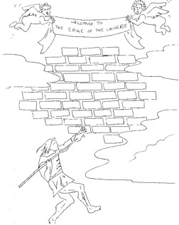
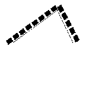
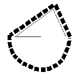
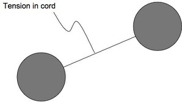
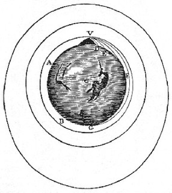
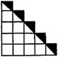

# Thought Experiments
**First published Sat Dec 28, 1996; substantive revision Tue Nov 28, 2023**

*Brown, James Robert, Fehige, Yiftach*

Thought experiments are basically devices of the imagination. They are employed for various purposes such as entertainment, education, conceptual analysis, exploration, hypothesizing, theory selection, theory implementation, etc. Some applications are more controversial than others. Few would object to thought experiments that serve to illustrate complex states of affairs, or those that are used in educational contexts. The situation is different, however, with respect to the appropriation of imagined scenarios to investigate reality (very broadly conceived to include things like electrons, tables, rain, beliefs, morals, people, numbers, universes, and even divine beings). It is this use of thought experiments that attracts most of the attention inside and outside of philosophical discourse. Significant is the overlap here with many other central philosophical topics, such as the nature of the imagination, the importance of understanding in contrast to explanation, the role of intuition in human cognition, and the relationship between fiction and truth. Moreover, thought experiments are interdisciplinary in two important respects. Firstly, not only philosophers study them as a research topic, but also historians, cognitive scientists, psychologists, etc. Secondly, they are used in many disciplines, including biology, economics, history, mathematics, philosophy, and physics (although, interestingly, not with the same frequency in each).

Most often thought experiments are communicated in narrative form, frequently with diagrams. It is important to distinguish between the imagined scenarios that are featured in thought experiments, on the one hand, and the narratives that establish those scenarios in people’s minds, on the other. Once a scenario is imagined it may assume a life on its own, and this explains partly the creative power of a good thought experiment. Experimental results may obtain that actually run counter to the narrative that initiated the discussion of an imagined scenario. Besides, thought experiments should be distinguished from thinking about experiments, from merely imagining any experiments to be conducted outside the imagination, and from psychological experiments with thoughts, though there may be some overlap. They should also be distinguished from counterfactual reasoning in general, as they seem to require a palpable element, which explains the impression that something is experienced in a thought experiment (i.e., being seen, felt, heard, etc.; not literally, of course). In other words, though many call any counterfactual or hypothetical situation a thought experiment (see, e.g., Rescher 1991)[^rescher-1991], this appears too encompassing.

It is a quite different matter as to whether there is a logical structure common to all thought experiments. Based on such considerations of logical structure, a taxonomy has been proposed according to which all thought experiments fall into two classes: “Necessity Refuters” and “Possibility Refuters” (see Sorensen 1992, 132–160)[^sorensen-1992]. Such proposals especially fuel the debate about identity conditions of thought experiments. What modifications to logical structure does a thought experiment tolerate before it ceases to exist and a new one is born? In other words, how much emphasis on propositional characteristics is appropriate in the analysis of thought experiments?

Looking at the development of the discussion about thought experiments over the past thirty years, it is fair to say that thought experiments were primarily an important topic in the philosophy of science and the philosophy of philosophy (“metaphilosophy”), before the scope widened up at a later point. There is a simple reason for that path. At the core of the discussion sits a relatively simple epistemological challenge that is presented in a particularly powerful manner by numerous thought experiments that the history of science has to offer. They suggest that we can learn about the real world by virtue of merely thinking about imagined scenarios. But how can we learn about reality (if we can at all), just by thinking? This is the central question. Are there really thought experiments that enable us to acquire new knowledge about nature without new empirical data? If so, where does the new information come from, assuming that it takes new information to learn anything new about the world by means of thought experiments? Finally, how can we distinguish good from bad instances of thought experiments? These questions seem urgent with respect to scientific thought experiments, because many “recognize them as an occasionally potent tool for increasing our understanding of nature” (Kuhn 1977, p. 241). “Historically their role is very close to the double one played by actual laboratory experiments and observations. First, thought experiments can disclose nature’s failure to conform to a previously held set of expectations. Second, they can suggest particular ways in which both expectation and theory must henceforth be revised” (Kuhn 1977, p. 261). Yet, questions surrounding the epistemological challenge that certain scientific thought experiments pose, are equally urgent with respect to thought experiments outside of the natural sciences. This is especially true with respect to philosophy itself. Philosophy offers numerous examples of thought experiments that play a role similar in importance to some scientific thought experiments. And this fact provokes in turn further inquiries into the relationship between the natural sciences and philosophy, especially with respect to phenomena that implicate both the natural sciences and philosophy, such as the mind and free will (see, e.g., Wilkes 1988; Young 2013)[^wilkes-1988][^young-2013].

If scientific practice has room for thought experiments, then the question arises as to why we would want philosophical methodology to be more discriminatory in this respect. One reason that is often offered is that results of scientific thought experiments may be subjected to further empirical testing. Obviously, this can’t be done for philosophical thought experiments. But, it seems difficult to accept a categorical separation of science and philosophy along these lines. The 17th century saw some of the most brilliant practitioners of thought experimentation in Galileo, Descartes, Newton, and Leibniz, all of whom pursued the project of “natural philosophy.” And in our own time, the creation of quantum mechanics and relativity are almost unthinkable without the crucial role played by thought experiments, most of which relate to important philosophical issues that arise from these scientific theories. Besides, much of ethics, philosophy of language, and philosophy of mind is based on the results of thought experiments in a way that seems very similar to scientific thought experiments (though some might contest this), including Searle’s Chinese room, Putnam’s twin earth, and Jackson’s Mary the colour scientist. Philosophy, even more than the sciences, would be severely impoverished without thought experiments. These observations partly explain why it has been argued that a more “unified” account of thought experiments is desirable (see Boniolo 1997; Cooper 2005, pp. 329–330; Gähde 2000)[^boniolo-1997][^cooper-2005][^gähde-2000]. Of course, it is important not to downplay the significant differences between the sciences and philosophy. But an account of thought experiments seems more powerful if it can do justice to the fact that not only in the sciences do we find many of them.

There have been several attempts to define “thought experiment” along the lines of traditional conceptual analysis (see, e.g., Picha 2011; McComb 2013)[^mccomb-2013][^picha-2011], but likely it will be better to leave the term loosely characterized, so as not to prejudice the ongoing investigation. Of course, we need to have some idea as to what thought experiments are to guide a proper philosophical analysis (see Häggqvist 2009)[^häggqvist-2009], but this does not mean that we need to begin with a technical definition, specifying necessary and sufficient conditions. In fact, many of the most important concepts we deal with remain rather loosely defined when philosophical inquiry begins, e.g., religion or democracy. Luckily, there are plenty of examples to refer to in order to circumscribe our subject matter well enough. As well as those already mentioned, there are Newton’s bucket, Heisenberg’s gamma-ray microscope, Einstein’s elevator, Leibniz’s mill, Parfit’s people who split like amoebas, and Thomson’s violinist. Everyone is probably familiar with some of these. Less familiar thought experiments include the mouse that breaks into the tabernacle of a medieval Roman Catholic Church building to feed on the consecrated wafers kept in there (see Fehige 2018)[^fehige-2018]. Roman Catholic Christians believe that a consecrated wafer is the “body of Christ”. The “substance” of the wafer, understood in terms of Aristotelian categories, is believed to be replaced. In its place is the “substance” of Christ’s body after consecration by a priest. Only the Aristotelian “accidents” of the wafer remain intact (smell, colour, texture, etc.). Does the mouse eat the “body of Christ” (if any human actually does)? If not, then the “body of Christ” seems to be less than an objective reality; if yes, the “body of Christ” must be able to do good in the absence of a believing human soul. Another example less known is “the dome” thought experiment, which is to prove indeterminism in Newtonian physics. Imagine a mass sitting on a radially symmetric surface in a gravitational field. Guided by Newton’s laws of motion one comes to realize that the mass can either remain at rest for all times, or spontaneously move in an arbitrary direction (see Norton 2008)[^norton-2008]. This thought experiment triggers a number of very interesting questions concerning the nature of Newtonian theory, the meaning of “physical”, and the role of idealizations in physics. And, of course, does it show what it claims? (see Malament 2008)[^malament-2008].

This entry continues with an overview of the characteristics of thought experiments in light of examples in Section 1. Section 2 reviews several taxonomies for classifying thought experiments and Section 3 sketches a history of philosophical inquiry into the nature of thought experiments. Section 4 covers several views representing the current state of the debate. The entry concludes by highlighting some trends in discussions surrounding the so-called laboratory of the mind.

## 1. Important Characteristics of Thought Experiments

Theorizing about thought experiments usually turns on the details or the patterns of specific cases. Familiarity with a wide range of examples is crucial for commentators, and the list is very long (see, e.g., Stuart et al. 2018, pp. 558–560)[^stuart-2018][^stuart-2018-2]. We will provide a few here. One of the most beautiful early instances (found in Lucretius, *De Rerum Natura* 1.951–987; see Bailey 1950, pp. 58–59)[^bailey-1950] attempts to show that space is infinite: if there is a purported boundary to the universe, we can toss a spear at it. If the spear flies through, it isn’t a boundary after all; if the spear bounces back, then there must be something beyond the supposed edge of space, a cosmic wall that stopped the spear, a wall that is itself in space. Either way, there is no edge of the universe; thus, space must be infinite.

This example nicely illustrates many of the most common features of what it means to engage in the conduct of thought experiments: we visualize some situation that we have set up in the imagination; we let it run or we carry out an operation; we see what happens; finally, we draw a conclusion. The example also illustrates the fallibility of thought experiments. Since the time of Lucretius, we’ve learned how to conceptualize space so that it could be both finite and unbounded. Imagine a circle, which is a one-dimensional space. As we move around, there is no edge, but it is nevertheless finite. The universe might be a three-dimensional version of this topology. It is, therefore, true that we must try to be mindful of unexpected limitations due to “physical scale effects” (Klee 2008)[^klee-2008], or other such things, when imagining counterfactual scenarios.

*Figure 1.* “Welcome to the edge of the Universe”

Often a real experiment that is meant to be the analogue of a thought experiment is impossible to be carried out as such due to physical, technological, ethical, or financial limitations (see, e.g., Sorensen 1992, pp. 200–202)[^sorensen-1992]; but physical unrealizability needn’t be a defining condition of thought experiments. Rather, the main point is that we seem able to get a grip on nature just by thinking, and therein lies the great interest for philosophy. That was the position of Ernst Mach (see Mach, 1897 and 1905; for a most instructive assessment of his views see Kühne 2006, pp. 165–202, and Sorensen 1992, pp. 51–75)[^mach-1897][^mach-1905][^sorensen-1992]. Thought experiments are on a spectrum of different kinds of experiments. They allow us to tap into a great store of “instinctive knowledge” picked up from past experience. We will get back to Mach’s theory further down. His account of thought experiments remains one of the major theories of how thought experiments work. One of Mach’s favourite examples is due to Simon Stevin (see Mach, 1883, pp. 48–58)[^mach-1883]. When a chain is draped over a double frictionless plane, as in Fig. 2a, how will it move? Add some links as in Fig. 2b. Now it is obvious. The initial setup must have been in static equilibrium. Otherwise, we would have a perpetual motion machine; and according to our experience-based “instinctive knowledge,” says Mach, this is impossible. We do not have to perform the experiment in the real world, which we could not do, anyway, since it would require a perfectly frictionless plane. Nevertheless the outcome seems compelling.

(a)

(b)

Figure 2. “How will it move?”

Judith Thomson provided one of the most striking and effective thought experiments in the moral realm (see Thomson 1971)[^thomson-1971]. Her example is aimed at a popular anti-abortion argument that goes something like this: A fetus is an innocent person. All innocent persons have a right to life. Abortion results in the death of a fetus. Therefore, abortion is morally wrong. In her thought experiment, Thomson asks you to imagine a famous violinist falling into a coma. The society of music lovers determines from medical records that you and you alone can save the violinist’s life by being hooked up to him for nine months. The music lovers break into your home while you are asleep and hook the unconscious (and unknowing, hence innocent) violinist to you. You may want to unhook him, but you are then faced with the following argument put forward by the music lovers: The violinist is an innocent person. All innocent persons have a right to life. Unhooking him will result in his death. Therefore, unhooking him is morally wrong. However, the argument, even though it has the same structure as the anti-abortion argument, does not seem convincing in this case. You would be very generous to remain attached for nine months, but you are not morally obligated to do so. The parallel with the abortion case is evident. Thomson’s thought experiment is effective in distinguishing two concepts that had previously been run together: “right to life” and “right to what is needed to sustain life.” The fetus and the violinist might each have the former, but it is not evident that either has the latter. The upshot is that even if the fetus has a right to life (which Thomson does not believe but allows for the sake of the argument), it may still be morally permissible to abort. Those opposed to Thomson’s view have two options. They can either dismiss her thought experiment as a useless fiction. In fact, thought experiments as a method in ethics have their critics (see, e.g., Dancy 1985)[^dancy-1985]. Alternatively, they can provide a different version of the same scenario to challenge the conclusion. It is a very intriguing feature of thought experiments that they can be “rethought” (see Bokulich 2001)[^bokulich-2001]. Real experiments are frequently open to reinterpretation, too. In this respect there does not seem to be a principled difference between the two classes of experiments.

Like arguments, thought experiments can be criticized in different ways. Perhaps the set up is faulty; perhaps the conclusions drawn from the thought experiment are not justified. Similar criticisms can arise in real experiments. Counter thought experiments are perhaps another form of criticism. They do not target the premises or conclusions involved in a particular thought experiment but question the phenomenon, i.e. the non-propositional heart of an imagined scenario (see Brown 2007)[^brown-2007]. For example, Daniel Dennett is convinced that Frank Jackson’s Mary thought experiment is poor evidence to oppose physicalism in philosophy of mind. In Jackson’s version, Mary, who knows everything physics and the neurosciences can possibly know about colours but grew up in a colourless environment (seeing only black, white and grey things), allegedly learns something new when she sees a red tomato for the first time. Now she knows what it is like to experience red. This is an argument for qualia as something over and above the physical. Instead of a red tomato, Dennett, in his version of the thought experiment, presents Mary with a bright blue banana. In his version of the story (which seems just as plausible as Jackson’s), Mary balks and says she is being tricked, since she knows that bananas are yellow, and this, says Mary, is a consequence of knowing everything physical about colour perception. Mary does not learn anything new when she sees coloured objects for the first time, so there is no case against physicalism after all. Jackson’s initial thought experiment was very persuasive, but Dennett’s seems equally so, thus, undermining Jackson’s argument, although there is greater resistance to the conclusion of the latter than the former! Dennett complains a great deal about the ongoing “Mariology”, as he calls the continuing acceptance of Jackson’s thought experiment as a powerful case against physicalism.

Clearly, thought experiments are characterized by an intriguing plasticity, and this raises the interesting question of what it is that preserves the identity of a thought experiment. Replacing a red tomato with a blue banana might still leave us with the same thought experiment––slightly revised. But, at what point do we get a new thought experiment? This is not merely a question about conceptual vagueness. It helps to facilitate a discussion of the intuitively most plausible view about the cognitive efficacy of thought experiments, according to which this power depends on their being arguments, in a fairly strict sense of argument. John D. Norton holds such a view, which will be discussed below. In light of cases where the discussion of one and the same thought experiment played an important role in settling a dispute, the following problem arises: how can one and the same thought experiment support opposing views about a particular matter if the arguments that correspond to the different versions of the thought experiment that were entertained by the disputing parties are significantly different? The dilemma is: we could say that if there is more than one argument then there is more than one thought experiment involved in the dispute. But if that is true then the disputing parties simply talked past each other. One party presented an argument that the other party ignored while presenting their own. Alternatively, we can say that one thought experiment can correspond to many different arguments. But, if that is true then it becomes unclear in what non-trivial sense thought experiments are supposed to be identical with arguments (see Bishop 1999, and the response by Norton 2004, 63–64)[^bishop-1999].

The plasticity of thought experiments coheres with another feature of thought experiments, namely that they seem to have “evidential significance only historically and locally, i.e., when and where premises that attribute evidential significance to it […] are endorsed” (McAllister 1996, p. 248)[^mcallister-1996].

## 2. Taxonomies of Thought Experiments

Many taxonomies can be found in the literature. They are not mutually exclusive. We will present three of them. The first follows the type of purpose thought experiments serve. A very rudimentary version of it can be found in Mach (1897 and 1905). Such a classification makes sense, because an “imaginary experiment should be judged on its specific purpose” (Krimsky 1973, p. 331)[^krimsky-1973]. Thought experiments are conducted for diverse reasons (see, e.g., DeMay 2006; Sorensen 1992, pp. 7–15)[^sorensen-1992], and in a variety of areas, including economics (see, e.g., Herfeld 2019; Thoma 2016)[^herfeld-2019][^thoma-2016], education (Helm and Gilbert 1985; Helm et al. 1985, Klassen 2006; Sriraman 2006; Stonier 1990)[^helm-1985][^helm-1985-2][^klassen-2006][^sriraman-2006], history (see, e.g., Maar 2014; Reiss 2009)[^maar-2014][^reiss-2009], literature (see, e.g., Davies 2007; Elgin 2004)[^davies-2007], mathematics (see, e.g. Brown 1991 [2011], pp. 90–97; Glas 1999)[^brown-1991][^glas-1999], morality (see, e.g., Hauerwas 1996; Wilson 2016)[^hauerwas-1996][^wilson-2016], as well as the natural sciences (see Krimsky 1973)[^krimsky-1973], the socio-political realm (see, e.g. Roberts 1993; Thaler 2016)[^roberts-1993][^thaler-2016], and theology (see, e.g., Gregersen 2014; Fehige 2024)[^fehige-2024][^gregersen-2014]. Thought experiments may be used to entertain. This is probably true of short stories or novels which some argue qualify as thought experiments if certain conditions apply (see, e.g., Davenport 1983)[^davenport-1983]. Some thought experiments fulfil a specific function within a theory (see Borsboom et al. 2002)[^borsboom-2002]. Others are executed because it is impossible to run the experimental scenario in the real world (see, e.g., Sorensen 1992, pp. 200–202)[^sorensen-1992]. Sometimes thought experiments help to illustrate and clarify very abstract states of affairs, thereby accelerating the process of understanding (see Behmel 2001)[^behmel-2001]. Again others serve as examples in conceptual analysis (see Cohnitz 2006)[^cohnitz-2006]. And, then there are those that matter in the process of theory discovery (Praem and Steglich–Peterson 2015)[^praem-2015]. The thought experiments that have received most of the attention are taken to provide evidence for or against a theory, putting them on a par with real-world experiments (see, e.g., Gendler 2004)[^gendler-2004]. The different ways to use thought experiments, of course, do not exclude one another. Most obviously, for example, a thought experiment can both entertain and make a case against a theory.

A second taxonomy classifies thought experiments in terms of their logical structure (see Sorensen 1992, pp. 132–166)[^sorensen-1992]. The idea is to divide all thought experiments into two types of “alethic refuters”: “Although there are a number of ways to classify thought experiments, a refutation format scores the most points when judged by familiarity, specificity, and simplicity. According to this scheme, thought experiments aim at overturning statements by disproving one of their modal consequences. Modalities are operators that are applied to propositions to yield new propositions. There are deontic modalities (*permissible, forbidden*), epistemic modalities (*know, believe*), and alethic modalities (*possible, necessary*). The alethic modalities are the best–known and more–basic modality. Hence, we won’t miss anything by concentrating on them” (Sorensen 1992, p. 135)[^sorensen-1992]. One type of thought experiment “is designed to refute a statement by showing that something ruled out as impossible by that statement is really possible after all” (Sorensen 1992, p. 135)[^sorensen-1992]. The most discussed examples in the metaphilosophical discussion on thought experiments is of such a type, namely the Gettier scenarios (see Grundmann and Horvarth 2014; Saint-Germier 2021)[^saint-germier-2021]. They are designed to refute the claim that all knowledge is justified, true belief. They serve as a “necessity refuter.” The other type collects examples of “possibility refuters”. They don’t affirm “the possibility of the thought experiment’s content”. Instead, they establish “copossibilities”. A wonderful example is the scenario of an omnipotent God who faces the task of creating a stone too heavy for that God to lift. It seems God cannot succeed. The notion of divine omnipotence causes some headache here.

A third taxonomy (see Brown 1991, chapter 2)[^brown-1991], which has not gone unchallenged (see Norton 1993b)[^norton-1993b], is more limited than the first two insofar as it focuses largely on the class of those thought experiments that are taken to function in theory choice, which is the use of thought experiments that has been receiving most of the attention. According to this taxonomy, the main division is *constructive vs. destructive* and resembles Karl Popper’s distinction between *apologetic* and *critical* thought experiments. Popper actually distinguishes between three types of thought experiments: *heuristic* (to illustrate a theory), *critical* (against a theory) and *apologetic* (in favour of a theory) (see Popper 1959)[^popper-1959]. His case in favour of a critical and against an apologetic use of thought experiments is very limited. He focuses exclusively on quantum physics and doesn’t really say much to address the primary epistemological challenge presented by the success of critical thought experiments.

Among *destructive thought experiments*, the following subtypes can be identified: the simplest of these is to draw out a contradiction in a theory, thereby refuting it. The first part of Galileo’s famous falling bodies example does this. It shows that in Aristotle’s account, a composite body (cannon ball and musket ball attached) would have to fall both faster and slower than the cannon ball alone. A second subtype is constituted by those thought experiments that aim to show that the theory in question is in conflict with other beliefs that we hold. Schrödinger’s well-known cat paradox, for instance, does not show that quantum theory (at least on some interpretations) is internally inconsistent (see Schrödinger 1935, p. 812; translation: Trimmer 1980, p. 328)[^schrödinger-1935]: “A cat is penned up in a steel chamber, along with the following diabolical device (which must be secured against direct interference by the cat): in a Geiger counter there is a tiny bit of radioactive substance, so small, that perhaps in the course of one hour one of the atoms decays, but also, with equal probability, perhaps none; if it happens, the counter tube discharges and through a relay releases a hammer which shatters a small flask of hydrocyanic acid. If one has left this entire system to itself for an hour, one would say that the cat still lives if meanwhile no atom has decayed. The first atomic decay would have poisoned it. The q-function of the entire system would express this by having in it the living and the dead cat (pardon the expression) mixed or smeared out in equal parts.” This thought experiment shows that quantum theory (as interpreted by Bohr) is in conflict with some very powerful common sense beliefs we have about macro-sized objects such as cats––they cannot be both dead and alive in any sense whatsoever. The bizarreness of superpositions in the atomic world is worrisome enough, says Schrödinger, but when it implies that same bizarreness at an everyday level, it is intolerable. There is a third subtype of negative thought experiments, namely when, in effect, a central assumption or premise of the thought experiment itself is undermined. For example, as we have seen above, Thomson showed with her thought experiment that “right to life” and “right to what is needed to sustain life” had been run together. When distinguished, the argument against abortion is negatively affected.

A fourth sub-type of negative thought experiments are “counter thought experiments” (see Brown 2007)[^brown-2007]. Norton very usefully introduces a related idea: “thought-experiment/anti-thought-experiment pairs” (see Norton 2004, pp. 45–49). Above, we have already encountered this subtype in our discussion of Lucretius’ spear thought experiment, and with Dennett’s reply to Jackson’s much discussed Mary the colour scientist thought experiment. Here we would like to add one more example, namely Mach’s counter thought experiment against absolute space. In his *Principia Mathematica*, Newton offers a pair of thought experiments as evidence for absolute space. One is the bucket thought experiment with water climbing the wall (see Fig. 3), the other is about a pair of spheres joined by a cord that maintained its tension in otherwise empty space (see Fig. 4). The explanation for these phenomena, argues Newton, is absolute space: the bucket and the joined spheres are rotating with respect to space itself. In response, Mach modifies the scenario and argues, contra Newton, that the two spheres would move toward one another thanks to the tension in the cord, and if we rotated a very thick, massive ring around a stationary bucket, we would see the water climb the bucket wall. (For further discussion of Mach’s counter thought experiment to Newton’s see Kühne 2006, pp. 191–202). In short, the point of Mach’s counter thought experiment is to describe the phenomena of the thought experiments’ scenarios differently, that is, to declare that different things would happen. Mach’s counter thought experiment undermines our confidence in Newton’s thought experiments. Absolute space might be a plausible explanation of the phenomena in Newton’s thought experiments, but now, in light of Mach’s counter thought experiment, we’re not so sure of the phenomena itself and thus of the idea of absolute space.

*Figure 3.* Stages in the bucket experiment

*Figure 4.* Two spheres held by a cord in otherwise empty space

To be effective, counter thought experiments needn’t be very plausible at all. In a court of law a jury would convict provided guilt is established “beyond a reasonable doubt.” A common defence strategy is to provide an alternative account of the evidence that has just enough plausibility to put the prosecution’s case into some measure of doubt. That is sufficient to undermine it. A counter thought experiment need only do that much to be effective, and in this sense it operates like a “necessity refuter” in Sorensen’s sense.

In addition to destructive ones, there is a second type, the *constructive thought experiments*. Unsurprisingly, there are many ways they could provide positive support for a theory. One of these is to provide a kind of illustration that makes a theory’s claims clear and evident. In such cases thought experiments serve as a kind of heuristic aid. A result may already be well established, but the thought experiment can lead to a very satisfying sense of understanding. In his *Principia Mathematica*, Newton provides a wonderful example showing how the moon is kept in its orbit in just the same way as an object falls to the earth (see Ducheyne 2006, pp. 435–437)[^ducheyne-2006]. He illustrates this by means of a cannon shooting a cannon ball further and further (see Fig. 5). In the limit, the earth curves away as fast as the ball falls, with the eventual result being that the cannon ball will return to the spot where it was fired, and, if not impeded, will go around again and again. This is what the moon is doing. We could arrive at the same conclusion through calculation. But Newton’s thought experiment provides that elusive sense of understanding. It’s a wonderful example of the “aha effect” that is typical of many powerful thought experiments.

*Figure 5.* “The shot heard around the world”

Thomson’s violinist showed that abortion could be morally permissible even when the fetus has a right to life. Similarly, Einstein’s elevator showed that light will bend in a gravitational field, because according to the principle of equivalence, there is no difference between such a frame of reference and one that is accelerating in free space; the laws of physics are the same in all. Suppose then, an observer is inside an elevator sealed off from the outside so that the observer cannot tell whether he is in a gravitational field or accelerating. If it were accelerating, and if a light beam were to enter one side, then, due to the elevator’s motion, the beam would appear to drop or curve down as it crossed the elevator. Consequently, it would have to do the same thing if the elevator was in a gravitational field. Therefore, gravity ‘bends’ light.

Maxwell’s demon showed that entropy could be decreased: The second law of thermodynamics implies that heat won’t pass from a cold body to a hot one. In classical thermodynamics this law is quite strict; but in Maxwell’s kinetic theory of heat there is a probability, though extremely small, of such an event happening. Some thought this a reductio ad absurdum of Maxwell’s theory. To show how it is possible to violate the second law, Maxwell imagined a tiny creature who controls a door between two chambers. Fast molecules from the cold box are let into the hot box, and slow molecules from the hot are allowed into the cold. Thus, there will be an increase in the average speed in the hot box and a decrease in the average speed of molecules in the cold. Since, on Maxwell’s theory, heat is just the average speed of the molecules, there has been a flow of heat from a cold body to a hot one.

Parfit’s splitting persons shows that survival is a more important notion than identity when considering personhood (for a critical discussion see Gendler 2002a)[^gendler-2002a]. We say they “show” such and such, but, “purport to show” might be better, since some of these thought experiments are quite contentious. What they have in common is that they aim to establish something positive. Unlike destructive thought experiments, they are not trying to demolish an existing theory, though they may do that in passing. To repeat an important point: in principle, given the fact that thought experiments can be rethought (see Bokulich 2001)[^bokulich-2001], and that the evidential significance is dependent on historical and local accomplishments (see McAllister 1996)[^mcallister-1996], it cannot be irrelevant to identify the intention of the thought experimenter, if one wants to determine the type of a thought experiment: “An imaginary experiment should be judged on its specific purpose” (Krimsky 1973, p. 331)[^krimsky-1973].

## 3. The History of Thought Experiments

The practice of thought experiments is not an invention of modern science. That fact may be obscured by the dominance of scientific examples in the lively discussions about thought experiments today. The Pre-Socratics “invented thought experimentation as a cognitive procedure and practiced it with great dedication and versatility” (Rescher 2005, p. 2)[^rescher-2005]. “There is no ancient Greek term corresponding to what we nowadays refer to as a thought experiment, and presumably ancient philosophers did not have our modern notion of a thought experiment. But there is no doubt that they did use thought experiments. In fact, they often employed them in ways similar to those of contemporary philosophers, that is, both for defending their own theories as well as for refuting the theories of their opponents ” (Ierodiakonou 2018, p. 31)[^ierodiakonou-2018]. (See also Becker 2018; Diamond 2002, pp. 229–232; Fuhrer 2009; Glas 1999; Ierodiakonou 2005; Ierodiakonou and Roux (eds.) 2011; Irvine 1991; Rescher 1991 and 2005, pp. 61–72). The situation is similar with respect to medieval natural philosophy, although there are further nuances to be considered (see King 1991)[^king-1991]. According to Edward Grant, during the late Middle Ages “the imagination became a formidable instrument in natural philosophy and theology in ways that would have astonished ancient Greek natural philosophers, especially Aristotle” (Grant 2007, p. 201)[^grant-2007]. But this doesn’t mean that we have reason to think of Aristotle as an opponent of the conduct of thought experiments *tout court*. On the contrary, “Aristotle uses thought experiments for argumentative persuasion and in places where, due to the obscure nature of the subject matter or the counterintuitive nature of the thesis they are meant to support, insight cannot be readily communicated by appeal to observational facts” (Corcilius 2018, p. 73)[^corcilius-2018]. With a few exceptions that involved problems of motion, “the scholastics” of the medieval period made no meaningful effort to transform their hypothetical conclusions into specific knowledge about the physical world. They did, however, assume that although these hypothetical conclusions were naturally impossible, God could produce them supernaturally if he wished. Special attention received also a class of medieval thought experiments that does not rely on counterfactuals but depends on theological assumptions to study matters non-theological, namely those thought experiments involving angels, whose existence were affirmed at that time (see Perler 2008)[^perler-2008]. Angels are gone by now (see Clark 1992)[^clark-1992], but not thought experiments. While most thought experiments involving angels have Christianity as their context, there is evidence of the practice of thought experiments also in the context of Islam and Judaism (see McGinnis 2018; Fisch 2019)[^fisch-2019][^mcginnis-2018]. In fact, the case has been made “that Ibn Sina is the first philosopher in the Aristotelian tradition, and thus perhaps the first in Western philosophy overall, to try to identify the psychological processes that go into postulating a hypothetical scenario. Ibn Sina also exhibits an interest in accounting for why, and to what extent, such psychological acts are thought to carry weight in our study of nature” (Kukkonen 2014, p. 434)[^kukkonen-2014].

Ernst Mach is commonly credited with introducing the word “thought experiment” (*Gadankenexperiment*) and thereby coining a term for philosophical discussion (recently done, for instance, by Krauthausen 2015, p. 15)[^krauthausen-2015]. “This view is incorrect, however! […] it can be substantiated that it was used […] already in 1811” (Witt-Hansen 1976, p. 48; see also Buzzoni 2008, pp. 14–15, 61–65; Kühne 2005, pp. 92–224; Moue et al. 2006, p. 63)[^buzzoni-2008][^kühne-2005][^moue-2006][^witt-hansen-1976]. The conceptual history of “thought experiment” goes back at least to the Danish “Tankeexperiment,” as it was used by Hans-Christian Ørsted. We can go back even further and find in the work of the German philosopher-scientist Georg Lichtenberg (1742–1799) a tacit theory of “experiments with thoughts and ideas.” These experiments help to overcome habits of thought that can inhibit scientific progress, and make possible an enlightened philosophy (see Schildknecht 1990, pp. 21, 123–169; Schöne 1982)[^schildknecht-1990][^schöne-1982]. Lichtenberg’s “aphoristic experiments” (see Stern 1963, pp. 112–126)[^stern-1963] reflect “that Lichtenberg’s scientific preoccupations are the formal and thematic prolegomena to his work as a literary artist” (Stern 1963, p. 126)[^stern-1963]. Lichtenberg’s reflections on thought experimentation resemble those of Popper and Thomas S. Kuhn, and it is plausible to think of him as one important figure of the very first period in the history of philosophical inquiry into thought experiments (see Fehige and Stuart 2014)[^fehige-2014][^stuart-2014].

Accordingly, the modern history of the philosophical investigation into thought experiments can be divided into four stages: in the 18th and 19th century the awareness of the importance of thought experiments in philosophy and science emerges. In addition to Lichtenberg and Hans-Christian Ørsted, special mention should be made of Novalis (see Daiber 2001)[^daiber-2001]. The topic reemerges in a more systematic manner at the beginning of the 20th century with little relation to the attempts made at the first stage. The stakeholders of the second stage were Pierre Duhem, Mach, and Alexius Meinong (see Duhem 1913, pp. 304–311; Mach, 1883, pp. 48–58, 1897 and 1905; Meinong 1907)[^duhem-1913][^mach-1883][^mach-1897][^mach-1905][^meinong-1907]. A third stage, probably due to the rediscovery of the importance of scientific practice for a proper understanding of science, followed in the first part of the second half of the 20th century. Again, the contributions of this stage bear little relation to the two previous stages. While the third period has seen a number of noteworthy contributions (Cole 1983; Dancy 1985; Dennett 1985; Fodor 1964; Helm and Gilbert 1985; Helm et al. 1985; Krimsky 1973; McMullin 1985; Myers 1986; Poser 1984; Prudovsky 1989; Rehder 1980a,b; Yourgrau 1962 and 1967)[^dancy-1985][^fodor-1964][^helm-1985][^helm-1985-2][^krimsky-1973][^mcmullin-1985][^myers-1986][^poser-1984][^prudovsky-1989][^rehder-1980a][^yourgrau-1967], the protagonists of this period were Alexandre Koyré, Kuhn and Popper. The ongoing philosophical exploration of thought experiments began in the 1980s, and marks the fourth stage. Arguably, it has been the most prolific one of all four stages. With some very important sign-postings in place (Horowitz and Massey (eds.) 1991; Sorensen 1992; Wilkes 1988), the ongoing discussion took off in light of a debate between James Robert Brown and John D. Norton (see for a concise statement of each position Brown 2004 and Norton 2004)[^brown-2004], which many have found useful to establish a contrast with their own alternative accounts of thought experiments. These views “represent the extremes of platonic rationalism and classic empiricism, respectively” (Moue et al. 2006, p. 69)[^moue-2006]. They will be described below.

## 4. Current Views on Thought Experiments

At this point it is important to recall the key epistemological challenge described in the introduction: how can we learn about the real world through merely thinking about imagined scenarios? This challenge sits at the center of the discussion about thought experiments even though we must note that not all of the work discussed below focuses on it directly. Still, this section describes six views that can be seen as responding in some way to this challenge: The Skeptical Objection, The Intuition-Based Account, The Argument View, Conceptual Constructivism, Experimentalism, and The Mental-Model Account.

### 4.1 The Skeptical Objection

Of course, particular thought experiments have been contested. But for the most part, the practice of thought experiments in the sciences has been cheerfully accepted. Pierre Duhem, the great historian of physics, is almost alone in what has been understood as an outright condemnation of scientific thought experiments (see Duhem 1913, pp. 304–311)[^duhem-1913]. A thought experiment is no substitute for a real experiment, he claimed, and should be forbidden in science, including science education. However, in view of the important role of actual thought experiments in the history of physics — from Galileo’s falling bodies, to Newton’s bucket, to Einstein’s elevator — it is unlikely that anyone will feel or should feel much sympathy for Duhem’s strictures. We hasten to add that Buzzoni (2018) questions the validity of this reading of Duhem, and argues that already Mach’s reception of Duhem’s views suggests a more nuanced reading of Duhem’s position.

Philosophers can be as critical as Duhem when it comes to thought experimenting in their own field (see Peijnenburg and Atkinson 2003; Thagard 2014; Wilson 2016)[^peijnenburg-2003][^thagard-2014][^wilson-2016]. At least thought experiments in science, the skeptic claims, can be tested by physical experiment. However, this is clearly false, since frictionless planes and universes empty of all material bodies cannot be produced in any laboratory. True, the results of philosophical thought experiments cannot be even approximately tested. But, skeptics say little about why thought experiments enjoy such popularity in philosophy. We are inclined to say that skeptics underestimate the importance of thought experiments for the creative mind in any field. Also, one mustn’t forget that the cognitive power of real world experiments isn’t a self-evident matter either.

Few are outright skeptics, however. Many take a more ambiguous stance. Sören Häggqvist, for example, has developed a normative model for philosophical thought experiments (see Häggqvist 1996 and 2009)[^häggqvist-1996][^häggqvist-2009]. Surprisingly, none of the commonly accepted philosophical thought experiments satisfies his model. And the process of identifying successful thought experiments is only the first step in addressing the central epistemological challenge posed by thought experiments. It gets much messier once we begin to ask exactly how reliable “successful” thought experiments are. Granted, there is some justice in worrying about the reliability of philosophical thought experiments (see, e.g., Klee 2008)[^klee-2008]. This might be true for ethics (see Dancy 1985; Jackson 1992; Wilson 2016)[^dancy-1985][^jackson-1992][^wilson-2016], conceptual analysis (see Fodor 1964)[^fodor-1964], and the philosophy of mind: “A popular strategy in philosophy is to construct a certain sort of thought experiment I call intuition pump. […] Intuition pumps are often abused, though seldom deliberately” (Dennett 1985, p. 12). The claim by Dennett and others is that thought experiments too often rest on prejudice and faulty common sense; they are inherently conservative, while real science will likely result in highly-counterintuitive outcomes. Dennett believes that thought experiments rest on naive “folk concepts,” which is why they can be so misguided. It is far from clear that this is a fair charge. Everything involved in Galileo’s thought experiment that produced the principle of relativity could be called “folk concepts.” If we are inside a ship and perform a number of experiments, such as walking about, tossing a ball, watching birds fly about, we could not tell whether we are at rest in port or sailing over a smooth sea. The upshot is that nature behaves the same either way; the laws of nature are the same in any inertial frame. This result is profound and is still with us in Einstein’s relativity, whether it is folk physics or not.

Frequently discussed is the skeptical challenge raised by Kathleen Wilkes. She expresses a deep suspicion of scenarios such as Derek Parfit’s people splitting like an amoeba (see Parfit 1987; Gendler 2002a)[^gendler-2002a][^parfit-1987]. Wilkes wants philosophy “to use science fact rather than science fiction or fantasy” (Wilkes 1988, p. 1)[^wilkes-1988], and therefore to refrain from using thought experiments because they are “both problematic and positively misleading” (Wilkes 1988, p. 2)[^wilkes-1988]. She claims that thought experiments about personal identity in particular often fail to provide the background conditions against which the experiment is set (see Wilkes 1988, p. 7)[^wilkes-1988]. She thinks we would not know what to say if we encountered someone who split like an amoeba. She insists that a legitimate thought experiment must not violate the known laws of nature. We do agree with Wilkes that underdetermination can be a problem. But instead of dismissing thought experiments in philosophy we should consider it a crucial factor in assessing the quality of a thought experiment (see Rescher 2005, pp. 9–14)[^rescher-2005]. That is to say that the more detailed the imaginary scenario in the relevant aspects is, the better the thought experiment (see Brendel 2004, pp. 97–99; Häggqvist 1996, p. 28)[^brendel-2004][^häggqvist-1996].

We also agree that the inferences drawn in thought experimenting are highly problematic if the hypothetical scenario “is inadequately described” (Wilkes 1988, p. 8)[^wilkes-1988]. But Wilkes seems to think that the lack of description is unavoidable, which supposedly amounts to a reason against philosophical thought experiments on personal identity because persons are not natural kinds. This makes it impossible to fill in the necessary information to make the thought experiment work given its unavoidable underdetermination. Wilkes thinks that “whenever we are examining the ranges of concepts that do not pick on natural kinds, the problem of deciding what is or what is not ‘relevant’ to the success of the thought experiment is yet more problematic than the same question as it arises in science; and, unlike the scientific problem, it may not even have an answer in principle” (Wilkes 1988, p. 15)[^wilkes-1988]. She adds that scientific laws — especially those describing biological kinds like human beings — “are not disjoint and independent, detachable from one another […]. They are interrelated, to varying degrees of course” (Wilkes 1988, p. 29)[^wilkes-1988]. This implies, for example, that “a full psychophysiological account of the processes of human perception must at some stage link up with part at least of linguistic ability; for we typically see things under a certain description, and that description may be a very sophisticated one” (Wilkes 1988, p. 29)[^wilkes-1988]. These considerations have her rule out experiments that challenge the human monopoly of personhood. No thought experiment, claims Wilkes, is well conceived if it involves non-human animals or computers as persons. But also those thought experiments can be ruled out which involve the “fission or fusion of humans” because it is not theoretically possible. “The total impact of the sum of laws that group us together as human beings (a natural kind category) precludes our splitting into two […] or fusing with someone else” (Wilkes 1988, p. 36)[^wilkes-1988].

One can ascertain here all too well the inherent difficulties in thinking about personal identity and the limited benefit some thought experiments might have for what is deemed the proper metaphysics of personal identity. Nevertheless, good reasons have been given in favour of the use of thought experiments about personal identity (see Beck 2006; Kolak 1993; Hershenov 2008)[^beck-2006][^hershenov-2008][^kolak-1993]. We also feel that the problems about thought experiments on personal identity reveal more about the intricate nature of the subject than about the usefulness of philosophical thought experiments. And, disregarding other shortcomings in Wilkes’ skepticism (for further discussion of Wilkes’ views see Beck 1992; Brooks 1994; Focquaert 2003; Häggqvist 1996, pp. 27–34)[^beck-1992][^brooks-1994][^focquaert-2003][^häggqvist-1996], her suggestion that thought experimental scenarios would have to satisfy current scientific knowledge about the relevant entities featured in a thought experiment is highly implausible. We learn a great deal about the world and our theories when we wonder, for instance, what would have happened after the big bang if the law of gravity had been an inverse cube law instead of an inverse square. Would stars have failed to form? Reasoning about such a scenario is perfectly coherent and very instructive, even though it violates a law of nature.

To some extent we should share Wilkes’ concern that thought experimenting seems to be constrained only by relevant logical impossibilities and what seems intuitively acceptable. This is indeed problematic because intuitions can be highly misleading and relevant logical impossibilities are fairly ungrounded if they cannot be supplemented by relevant theoretical impossibilities based on current science in order to avoid the jump into futile fantasy. But in order to dismiss thought experimenting as a useful philosophical tool one has to show that intuition cannot be a source of knowledge and that an epistemic tool should be useless because there is a serious chance it can fail. Timothy Williamson has argued that we should forget about intuition as a cushion in the philosophical armchair (see Williamson 2004a,b, 2008, pp. 179–207, and 2009; see also Schaffer 2017)[^williamson-2004a][^williamson-2008][^williamson-2009]. The importance of intuitions in philosophy has been neglected in the past (see Williamson 2004b, p. 109–110)[^williamson-2004b], and for too long intuition didn’t receive the attention it deserves (see, e.g., DePaul and Ramsey (eds.) 1998). Besides the traditional divide between empiricists, rationalists and skeptics, it is not only a very non-uniform use of the word “intuition” that makes it difficult to assess the progress of the last years of philosophical inquiry about intuitions. The situation has been complicated by the contributions of experimental philosophers on intuitions who add different reasons to question their reliability (see for a careful critique of those reasons: Ludwig 2007; see also Ludwig 2018)[^ludwig-2007][^ludwig-2018]. Generally speaking, the reliability of intuitions has been challenged on two grounds. One stems from an evolutionary explanation of the capacity to intuit; another is due to experiments which supposedly show the cultural relativity or racial and gender sensitivity of intuitions (see, e.g., Buckwalter and Stich 2010): “…a substantial list of philosophical intuitions vary across demographic groups and…they are influenced by a number of *prima facie* irrelevant factors…Some writers…have urged that these findings justify a thoroughgoing skepticism about the use of intuitions as evidence in philosophy…But we think this conclusion is much too strong…” (Stich and Toba 2018, p. 379)[^stich-2018]. After all, knowledge without intuitions (if only common sense assumptions) seems impossible.

The recent discussion of intuitions in epistemology has barely made an impact on philosophical reflections about thought experiments. As far as philosophical thought experiments are concerned, this is as it should be, according to Williamson. In this respect George Bealer can be cited in support of Williamson, because for Bealer the talk about philosophical thought experiments reveals a conceptual confusion. Philosophy, he claims, is about “rational intuitions” and thought experiments can be only about “physical intuitions” (see Bealer 1998, pp. 207–208, and 2002, p. 74)[^bealer-1998][^bealer-2002]. To many, this is an implausible claim based on a deeply problematic “phenomenology of intuitions” resulting in a strict separation of “rational intuitions” from “physical intuitions”, on such grounds as an alleged immutability of “rational intuitions”. There are good reasons to believe that thought experiments appeal to intuitions in order to give us new insights about different realms of investigation, including philosophy. This kind of positive connection is what Williamson has in mind when addressing the role of intuitions in philosophical thought experiments like the famous Gettier cases, which overnight found acceptance by the philosophical community in their aim to refute the view that knowledge is justified true belief. While Williamson expects “armchair methods to play legitimately a more dominant role in future philosophy” (Williamson 2009, p. 126)[^williamson-2009], he thinks that “we should stop talking about intuition” (Williamson 2004b, p. 152)[^williamson-2004b]. This does not impress proponents of what we call an intuition-based account of thought experiments, and probably for good reasons, given the problems in Williamson’s approach (see, e.g., Dohrn 2016; Ichikawa and Jarvis 2009; Schaffer 2017)[^ichikawa-2009], and the strong empirical evidence in favour of the positive role that intuitions do play in human cognition (see Myers 2004)[^myers-2004].

### 4.2 The Intuition–Based Account

What we term the “intuition–based account” of thought experiments comes in a naturalistic version (see Brendel 2004; Gendler 2007)[^brendel-2004][^gendler-2007], and in a Platonic version (see Brown 1991a [2011]). We begin with a discussion of the latter. Brown holds that in a few special cases we do go well beyond the old empirical data to acquire a priori knowledge of nature (see also Koyré 1968)[^koyré-1968]. Galileo showed that all bodies fall at the same speed with a brilliant thought experiment that started by destroying the then reigning Aristotelian account. The latter holds that heavy bodies fall faster than light ones (*H* > *L*). But consider Figure 6, in which a heavy cannon ball (*H*) and light musket ball (*L*) are attached together to form a compound object (*H*+*L*); the latter must fall faster than the cannon ball alone. Yet the compound object must also fall slower, since the light part will act as a drag on the heavy part. Now we have a contradiction: *H*+*L* > *H* and *H* > *H*+*L*. That’s the end of Aristotle’s theory. But there is a bonus, since the right account is now obvious: they all fall at the same speed (*H* = *L* = *H*+*L*).

*Figure 6.* Galileo: “I don’t even have to look”

Brown claims this is a priori (though still fallible) knowledge of nature, since there are no new data involved, nor is the conclusion derived from old data. Moreover, is it some sort of logical truth (for a technical challenge of this claim see Urbaniak 2012)[^urbaniak-2012]. This account of thought experiments can be further developed by linking the a priori epistemology to accounts of laws of nature that hold that laws are relations among objectively existing abstract entities. It is thus a form of Platonism, not unlike Platonic accounts of mathematics such as that urged by Kurt Gödel.

The two most often repeated arguments against this sort of Platonism are: it does not identify criteria to distinguish good from bad thought experiments, and it violates the principle of ontological parsimony. These seem to be weak objections. Perhaps they find widespread acceptance because Platonism seems to be unfashionable these days (see Grundmann 2018)[^grundmann-2018], given the general popularity of various forms of naturalism. If intuitions really do the job in a thought experiment, the first objection is weak because neither rationalists nor empiricists have a theory about the reliability of intuitions. So the objection should be that intuitions probably just do not matter in human cognition. However, there are good reasons to question the truth of this claim (see Myers 2004)[^myers-2004]. This is not to marginalize the problems that arise when admitting intuitions as a source of knowledge and justification, especially in philosophy (see Hitchcock 2012)[^hitchcock-2012].

As for the second objection, the appeal to Occam’s razor is in general problematic when it is employed to rule out a theory. Whatever we eliminate by employing the principle of parsimony, we can easily reintroduce it by an inference to the best explanation (see Meixner 2000)[^meixner-2000]. And this is exactly what a Platonist contends his or her Platonism about thought experimenting to be, while conceding that the Platonic intuition appears miraculous. But are they really more miraculous than sense perception, which seems similar in many respects to Platonic intuition? One might want to say yes, because supposedly we have no clue at all how Platonic intuition works but we do have some idea about the nature of sense perception. We know that if an object is far away it appears smaller in vision, and under certain light conditions the same object can look quite different. However, is it really impossible to state similar rules to capture the nature of Platonic intuition? If you are drunk or lack attention you most probably will not be very successful in intuiting anything of philosophical value.

A review of the relevant psychological literature will reveal further criteria that could be employed to identify good and bad conditions for Platonic intuition while thought experimenting. Yet, proponents of the naturalistic version of the intuition–based account wonder how necessary Platonism is once this move is entertained in defence of the reliability of intuitions (see Miščević 2004)[^miščević-2004]. Elke Brendel defines intuitions as mental propositional attitudes accompanied with a strong feeling of certainty. In her view, we can tell two stories to make sense of their cognitive power and plasticity. One story relates to our biological constitution and evolutionary past. The other is about membership in specialized communities. Brendel’s account raises many questions, but it is difficult to resist its appeal. A universal set is appealing to anyone not trained in logic because most things we are familiar with can come in sets, such as books, tables, and philosophers. A set of all sets seems intuitively plausible. The intuition disappears once you work through the problems arising from the idea of a set of all sets. Brendel is quick to insist that such relativity of our intuitions doesn’t imply that they are cognitively useless. Without intuitions, we probably wouldn’t have knowledge, and thought experiments are sometimes the only way to access the intuitions that guide us in our cognitive lives (see Brendel 2004)[^brendel-2004].

### 4.3 The Argument View

John D. Norton is the most influential advocate of what we call “the argument view” of thought experiments (see Norton 1991, 1993, 1996, 2004a,b, 2008)[^norton-1991][^norton-1993][^norton-1996][^norton-2004a][^norton-2008]. Even though the argument view seems to be a natural option for empiricists, it seems that most empiricists find Norton’s argument view too strong. For this reason, many participants in the debate about thought experiments place themselves between the extreme views of Norton and Brown, which function as useful foils for apparently more moderate outlooks. Perhaps (with tongue in cheek) they could agree with Bernard Shaw on the virtues of moderation, when Shaw said of the typical member of the middle class that he is moderately honest, moderately intelligent, and moderately faithful to his spouse. Norton claims that any thought experiment is really a (possibly disguised) argument; it starts with premises grounded in experience and follows deductive or inductive rules of inference in arriving at its conclusion. The picturesque features of any thought experiment which give it an experimental flavour might be psychologically helpful, but are strictly redundant. Thus, says Norton, we never go beyond the empirical premises in a way to which any empiricist would object.

There are three objections that might be offered against Norton. First, his notion of argument is too vague. However, this might not be the best objection: arguments can be deductive (which are perfectly clear) or inductive. If the latter are unclear, the fault is with induction, not with Norton’s argument view. Second, it is argued that Norton simply begs the question: every real world experiment can be rephrased as an argument, but nobody would say that real world experiences are dispensable. The account does not address the question: where do the premises come from? A thought experiment might be an essential step in making the Norton-style reconstruction. Third, a thought experiment that is presented in argument form loses its typical force. The soft-point in Brown’s Platonism is linked to the strength of Norton’s account because Norton claims that any other view implies a commitment to “asking the oracle.” “Imagine an oracle that claims mysterious powers but never delivers predictions that could not be learned by simple inferences from ordinary experience. We would not believe that the oracle had any mysterious powers. I propose the same verdict for thought experiments in science” (Norton 1996, pp. 1142–1143)[^norton-1996]. Defenders of empiricist alternatives deny this dispensability thesis. Brendel (2018) offers a most comprehensive review of merits and perils of the argument view.

### 4.4 Conceptual Constructivism

“Conceptual constructivism”, as we could call it, is among the empiricist alternatives to the argument view. The position has been taken up by Van Dyck (2003) to account especially for Heisenberg’s ɣ-ray microscope; but also by Gendler (1998) to make sense of Galileo’s falling body thought experiment. Gendler’s proposal was advanced in more general terms by Camilleri (2014) in order to establish a firm middle ground between the views of Norton and Brown. Conceptual constructivism was first proposed by Thomas Kuhn (1964). He employs many of the concepts (but not the terminology) of his well-known *Structure of Scientific Revolutions*. On his view a well-conceived thought experiment can bring on a crisis or at least create an anomaly in the reigning theory and so contribute to paradigm change. Thought experiments can teach us something new about the world, even though we have no new empirical data, by helping us to re-conceptualize the world in a new way. Accordingly, some have entertained the option of conceptual constructivism in the form of a Neo-Kantian reading of Einstein’s famous clock in the box thought experiment. Such an approach is inspired by Michael Friedman’s proposal to conceive of scientific revolutions as times when a Kantian kind of natural philosophy plays a major role in guiding scientists from one paradigm to another. The work of Kuhn left us with a puzzle: if scientific rationality is absolutely dependent on a paradigm, and if during scientific revolutions one paradigm replaces another, not in degrees but absolutely, comparable to a “Gestalt” switch, then this transition from one paradigm to the next cannot be a matter of scientific rationality. Are scientific revolutions irrational periods in the history of science? Not necessarily; some kind of natural philosophy may guide the process. Friedman has a Kantian natural philosophy in mind; his proposal did not earn wide acceptance, but the problem remains (see Fisch 2017)[^fisch-2017]. Be that as it may, it is true that thought experiments are a valuable currency in times of scientific revolution. For example, Lennox (1991) has argued that the revolution brought about by Charles Darwin in 1859 was made possible by thought experiments (among other things, of course).

### 4.5 Experimentalism

What we might term “experimentalism” encompasses a wide range of different approaches which all advance the view that thought experiments are a “limiting case” of ordinary experiments. Experimentalism was proposed first by Ernst Mach (1897 and 1905). He defines experimenting in terms of its basic method of variation and its capacity to destroy prejudices about nature. According to Mach, experimenting is innate to higher animals, including humans. The thought experiment just happens on a higher intellectual level but is basically still an experiment. At the centre of thought experimenting is a “Gedankenerfahrung”, an experience in thought. Such an experience is possible because thought experiments draw from “unwillkürliche Abbildungen von Tatsachen” (non-arbitrary images of facts) acquired in past experiences of the world. Some thought experiments are so convincing in their results that an execution seems unnecessary; others could be conducted in a real-world experiment, which is the most natural trajectory of a scientific thought experiment. In any case thought experiments can result in a revision of belief, thereby demonstrating their significance for scientific progress. Mach also appreciates the didactic value of thought experiments: they help us to realize what can be accomplished in thinking and what cannot.

In the spirit of Mach, Sorensen (1992) has offered an aspiring version of experimentalism that accounts for thought experiments in science and philosophy, and tackles many of the central issues of the topic. Sorensen claims that thought experiments are “a subset of unexecuted experiments” (1992, p. 213). By their logical nature they are paradoxes that aim to test modal consequences of propositions. The origin of our capacity of thought experimentation is explained in terms of Darwinian evolution (as in Genz 1999, pp. 25–29)[^genz-1999], though the explanation has been criticized to be only little more than a ‘just so story’ that fails, on a posteriori grounds, to epistemically underwrite that capacity (see Maffie 1997)[^maffie-1997]. Others are more optimistic (see Shepard 2008)[^shepard-2008].

Experimentalism does not have to take a naturalistic turn as it does in Sorensen’s case. In a number of contributions Marco Buzzoni has defended a Neo-Kantian version of experimentalism (see Buzzoni 2004, 2007, 2008, 2011, 2011b, 2013, 2013b)[^buzzoni-2004][^buzzoni-2007][^buzzoni-2008][^buzzoni-2011][^buzzoni-2011b][^buzzoni-2013][^buzzoni-2013b]. Buzzoni (2008) argues for the dialectical unity of thought experiments and real-world experiments. Thought experiments and real-world experiments are claimed to be identical on the “technological-operational” level, and at least in science, one is impossible without the other: without thought experiments there wouldn’t be real-world experiments because we would not know how to put questions to nature; without real-world experiments there wouldn’t be answers to these questions or experience from which they could draw. Given the many scientific thought experiments that cannot be realized in the real-world, Buzzoni might be conflating thought experiments with imagined experiments to be carried out in the real-world (see Fehige 2012, 2013b; and Buzzoni 2013b)[^buzzoni-2013b][^fehige-2012].

Idealizations are common in both real experiments and thought experiments. So-called Aristotelian idealization might ignore, say, the colour of a falling object. Galilean idealizations ignore some physical aspects, such as air friction, to get at the underlying physics (McMullin 1985)[^mcmullin-1985]. So-called Platonic idealization goes beyond this and ignores what would be actually seen even in a Galilean idealization. For instance, a rapidly moving object in special relativity would not look contracted, but rather would look rotated (surprisingly, this phenomenon is not well known). This rotation is ignored as an irrelevant optical phenomenon to yield the correct thought experiment visualization, which is the well-known Lorentz contraction (Brown 2013)[^brown-2013].

### 4.6 The Mental–Model Account

The last of the many accounts that emerged in the discussion about thought experiments is what could be called the “mental–model account.” It attracts the most followers (see Andreas 2011; Bishop 1998; Cooper 2005; Gendler 2004; Palmieri 2003; Nersessian 1992, 1993, 2007; McMullin 1985; Miščević 1992, 2007, 2021)[^andreas-2011][^bishop-1998][^cooper-2005][^gendler-2004][^mcmullin-1985][^miščević-2021][^miščević-1992][^miščević-2007][^nersessian-1992][^nersessian-1993][^nersessian-2007][^palmieri-2003]. When we conduct a thought experiment, according to champions of this view, we manipulate a mental model instead of the physical realm: “The general claim is that in certain problem-solving tasks people reason by constructing a mental model of the situations, events, and processes that in dynamic cases can be manipulated through simulation” (Nersessian 2018, p. 319)[^nersessian-2018]. Like physical models, mental models are non-propositional in nature. This means first of all “that the carefully crafted thought–experimental narrative focuses on the construction of a model of a *kind* of situation and manipulating that model through simulation affords epistemic access to certain features of current representations in a way that manipulating propositional representations using logical rules cannot” (Nersessian 2018, pp. 319–320)[^nersessian-2018]. A narrative functions as a kind of user-manual for building the model, but it isn’t identical to a thought experiment. The biggest problem for the mental–model account is to explain how something non-propositional like a mental model can make an impact on the propositional realm, which happens when a thought experiment causes a revision in beliefs.

## 5. Going Forward

The mental–model approach is one of the most promising of all the accounts the literature on thought experiments has to offer, and this for several reasons. First, it does not seem to be much of a stretch to draw connections to the intuition–based account. In fact, intuitions may be the missing link to connect the essentially non-propositional activities surrounding mental models, on the one hand, and the propositional aspects of thought experiments, on the other. After all, thought experiments involve propositional reasoning, and somehow the non-propositional and propositional aspects of thought experiments must be linked in any account of thought experiments. This is urgent insofar as thought experiments are credited with a meaningful role in theory discovery and theory choice. Second, the mental–model approach also allows for inclusion of important elements of experimentalism and the argument–view. Thought experiments are realized in the mind on mental models, and the method of variation is employed such that the results of the experiment may be subject to a careful reconstruction of propositional lines of reasoning to submit it for careful assessment and critique. Third, the mental–model approach enables us to bring an aspect into focus that has been widely neglected in the discussion so far: the bodily component of (thought) experiments. The exception is the work of the late David Gooding (1992, 1993, 1994, and 1999). Fourth, in critical engagement with such naturalistic proposals, those theories of the body may be put to work that the philosophical school of phenomenology has produced (see Fehige and Wiltsche 2013)[^fehige-2013][^fehige-2013-2]. To be welcomed, therefore, is the entry of phenomenology into the discussion on thought experiments (see Hopp 2014; Wiltsche 2018)[^hopp-2014][^wiltsche-2018]. Fifth, the mental–model account also relates naturally to the most intriguing discussions about the role of literary fiction in thought experiments.

Some have placed “literary fiction on the level of thought experiments” (Swirski 2007, p. 6)[^swirski-2007]. There are two readings of such a claim. According to the first, some literary fiction may be of cognitive power due to the fact that they are thought experiments. In other words, we shouldn’t outright reject the idea that literature can be of cognitive value. Dystopian novels such as Orwell’s *1984* and Huxley’s *Brave New World* are obvious examples. According to the second reading, the power of thought experiments is partially a function of the narrative that conveys it. The work of Novalis remains relevant for the exploration of this link between narrative development and thought experiment: experimental writing and experiments on imagined scenarios go hand in hand; words and thoughts coincide; mind and matter are entangled (see Daiber 2001)[^daiber-2001]. According to the mental–model approach, both readings have a valid point. Literary fiction and narratives of thought experiments can be powerful in establishing mental models in such a way that we can even learn new things about the world at times from the fictional elements of them. The common denominator is the work on mental models each may facilitate. It is in this context that an appreciation can grow for Catherine Elgin’s theory of exemplification to argue against the “valorization of truth in epistemology” (2004, p. 113). This is also the place to consider Andras Kertesz’s (2015) work on conceptual metaphor research in its relevance to the epistemological puzzle that thought experiments pose.

Finally, sixth, mention could be made of visual reasoning in mathematics, which often seems closely related to thought experiments. The standard view of mathematics is that the one and only source of evidence is a proof, and a proof is a derivation from axioms or first principles. Let’s overlook the problem of where the first principles come from. A simple example such as the following casts doubt on the standard view:

> Theorem: *1 + 2 + 3 + … + n = n²/2 + n/2*
>
> Proof: See Figure 7.

*Figure 7.* Picture proof.

The proof works like this: Start at the top and work down, letting the little squares represent numbers, *1 + 2 + 3 + 4 + 5*. The total number of squares in the picture is equal to this sum. Notice also that the number of squares is equal to a large square with sides of length 5 that is cut in half along the diagonal, i.e., *5²/2*, plus the shaded bits that were cut off by the diagonal cut, i.e., *5/2*. It is plausible to claim that the diagram is a perfectly good proof of the theorem. One can “see” complete generality in the picture. Even though it only illustrates the theorem for *n = 5*, somehow we can see that it works for every number, all infinitely many of them. The diagram does not implicitly suggest a “rigorous” verbal or symbolic proof. The regular proof of this theorem is by mathematical induction, but the diagram does not correspond to an inductive proof at all, since the key element in an inductive proof is the passage from *n* to *n + 1*. The simple moral we could draw from the example is just this: We can in special cases correctly infer theorems from pictures, that is, from visualizable situations. There is an intuition and from this intuition we can grasp the truth of the theorem (see Brown 1999 [2008])[^brown-1999].

Our assessment of the prospects of the mental–model account is very rough and speculative, though certainly not implausible. Of course, there are challenges to such a vision of a greater synthesis of the many different takes on thought experiments under the umbrella of the mental-model account. For example, some see additional support arising for the argument–view from computer simulations (see Beisbart 2012)[^beisbart-2012]. Others find that “computational modeling is largely replacing thought experimenting, and the latter will play only a limited role in future practice of science, especially in the sciences of complex nonlinear, dynamical phenomena” (see Chandrasekharan *et al.* 2012, p. 239). But, there are also proposals such as that by Marcus Schulzke (2014) to think of video games philosophically as executable thought experiments. Whatever the merits of this particular proposal, future explorations of the relationship between computer simulations and thought experiments can build on outcomes of closer inquiries into it (see Behmel 2001, pp. 98–108; Di Paolo *et al*. 2000; El Skaf and Imbert 2013; Lenhard 2011; Stäudner 1998; Lenhard 2018)[^behmel-2001][^di-2000][^lenhard-2011]. The work on the nature of the importance of scientific understanding (see, e.g., Stuart 2018)[^stuart-2018][^stuart-2018-2] will inform that exploration as much as the fruits of continuing efforts to clarify the role of the imagination in thought experiments (see, e.g., Meynell 2014; Stuart 2017 and 2021)[^meynell-2014][^stuart-2017][^stuart-2021].

We conclude with an interesting, but still relatively unexplored issue that concerns the relative importance of thought experiments in different disciplines. Physics and philosophy use them extensively. Chemistry, by contrast, seems to attract less attention in this respect. Why is this the case? Perhaps it is merely an historical accident that chemists never developed a culture of doing thought experiments. Perhaps it is tied to some deep feature of the discipline itself (see Snooks 2006)[^snooks-2006]. Economics and history use thought experiments, but apparently not anthropology. A good explanation would likely tell us a lot about the structure of these disciplines.

Related to this is the question of the difference, if any, between thought experiments in the sciences and those in philosophy. We have assumed throughout this entry that they are the same kind of thing. Not everyone sees them this way, so perhaps it should be considered an open question. On the one hand, philosophy and science seem to many to be different kinds of activities. That might suggest that thought experiments would differ in the two areas. On the other hand, there is a huge difference between thought experiments within a single field, e.g., Newton’s bucket attempts to establish absolute space while Schrödinger’s cat aims to show QM as then understood to be absurd. Is the difference between them less than the difference between either of them and Searle’s Chinese Room or Thomson’s violinist? The case one way or the other is not obvious. Of course, there are differences between constructive and destructive thought experiments, but this is true within any discipline. Perhaps for now the default attitude ought to be that there is no categorical difference between scientific and philosophical thought experiments. This should not be treated as a dogmatic principle, but rather a stimulus to look deeper for important subtle contrasts.

## References（引用注释）

> 原文参考文献已转为脚注引用：文内“作者-年份”引用组后附 [^key] 标记，完整条目见本文末脚注定义。

## Academic Tools

> |   | [How to cite this entry](https://plato.stanford.edu/cgi-bin/encyclopedia/archinfo.cgi?entry=thought-experiment). |
> | --- | --- |
> |   | [Preview the PDF version of this entry](https://leibniz.stanford.edu/friends/preview/thought-experiment/) at the [Friends of the SEP Society](https://leibniz.stanford.edu/friends/). |
> |   | [Look up topics and thinkers related to this entry](https://www.inphoproject.org/entity?sep=thought-experiment&redirect=True) at the Internet Philosophy Ontology Project (InPhO). |
> |   | [Enhanced bibliography for this entry](https://philpapers.org/sep/thought-experiment/) at [PhilPapers](https://philpapers.org/), with links to its database. |

## Other Internet Resources

- [Thought Experiments](https://www.oxfordbibliographies.com/abstract/document/obo-9780195396577/obo-9780195396577-0143.xml?rskey=wuYhXP&result=1&q=Thought+Experiments#firstMatch/), entry in the *Oxford Bibliographies*, by James R. Brown and Michael T. Stuart.
- [Thought Experiments and Religion](https://oxfordre.com/religion/display/10.1093/acrefore/9780199340378.001.0001/acrefore-9780199340378-e-24?mediaType=Article), entry in the *Oxford Encyclopedia of Religion*, by Yiftach Fehige.
- [Goodies](http://www.pitt.edu/~jdnorton/Goodies/), a collection of intriguing questions in the philosophy of science, some about thought experiments, by John Norton.
- [An Interactive Version of Thomson’s violin thought experiment](http://www.philosophyexperiments.com/whosebody/Default.aspx).
- [Six famous thought Experiments Explained Quickly](http://www.wimp.com/thoughtexperiments/), a video tutorial.
- [Ethical Thought Experiments Like the Trolley Dilemma](https://www.youtube.com/watch?v=5PpOehMLtT4/), a video tutorial.

## Related Entries

Descartes, René | Galileo Galilei | intuition | Leibniz, Gottfried Wilhelm | Mach, Ernst | moral psychology: empirical approaches | Platonism: in metaphysics | rationalism vs. empiricism

[^it-2006]: The number of papers, anthologies, and monographs has been growing immensely since the beginning of the 1990s. It might be useful to highlight that in existing literature, Kühne (2006) remains the most substantial historical study on the philosophical exploration of thought experiments. And Sorensen (1992) remains the most comprehensive philosophical study of thought experiments. More than other monographs both of these studies well exceed the author’s own systematic contribution to what is widely considered the primary epistemological challenge presented by thought experiments. Also, this bibliography does not include the many (we count about eight) popular books on thought experiments (like *Wittgenstein’s Beetle and Other Classical Thought Experiments* by Martin Cohen); nor do we list fiction that is related to the subject (like *The End of Mr. Y* by Scarlett Thomas, or *God’s Debris* by Scott Adams). Further, for undergraduate teaching purposes one might want to consider *Doing Philosophy: An Introduction Through Thought Experiments* (edited by Theodore Schick, Jr. and Lewis Vaughn, fifth edition, 2012, Boston: McGraw Hill Higher Education), and chapter 5 of Timothy Williamson’s short introduction to philosophical method (Oxford University Press, 2020). Moreover, a number of philosophical journals have dedicated part or all of an issue to the topic of thought experiments, including the *Croatian Journal of Philosophy* (19/VII, 2007), *Deutsche Zeitschrift für Philosophie* (1/59, 2011), *Informal Logic* (3/17, 1995), *Philosophica* (1/72, 2003), *Perspectives on Science* (2/22, 2014), *Berichte zur Wissenschaftsgeschichte* (1/38, 2015)), as well as *TOPOI* (4/38, 2019), *HOPOS* (1/11, 2021), and *Epistemologia* (12/2022). Furthermore, a companion to thought experiments exists now: *The Routledge Companion to Thought Experiments* was published in 2017. Each includes substantial state of the art reports. The bibliography that follows aims to list only publications that address thought experiments as such. Not included are the many specialized papers that discuss a particular thought experiment in its systematic contribution to the discussion of a particular issue (such as Putnam’s twin earth scenario to support semantic externalism). An exception is made, of course, when such work is cited. Unlike in previous versions of this entry, we no longer aim for comprehensiveness in the bibliography that follows.

[^aligica-2009]: Aligica, Paul D., and Anthony J. Evans, 2009, “Thought Experiments, Counterfactuals and Comparative Analysis”, *The Review of Austrian Economics*, 22: 225–239.

[^andreas-2011]: Andreas, Holger, 2011, “Zur Wissenschaftslogik von Gedankenexperimenten”, *Deutsche Zeitschrift für Philosophie*, 59: 75–91.

[^arthur-1999]: Arthur, Richard, 1999, “On Thought Experiments as A Priori Science”, *International Studies in the Philosophy of Science*, 13: 215–229.

[^bailey-1950]: Bailey, Cyril, 1950, *Lucretius on the Nature of Things* (translation of *De Rerum Naturae*), ninth reprint, Oxford: Clarendon Press.

[^batens-2008]: Batens, Diderik, 2008, “On Possibilities and Thought Experiments”, in R. Almeder (ed.), *Rescher Studies*, Heusenstamm: Ontos Verlag, 29–57.

[^bealer-1998]: Bealer, George, 1998, “Intuition and the Autonomy of Philosophy”, in M. DePaul and W. Ramsey (eds.), *Rethinking Intuition: The Psychology of Intuition and Its Role in Philosophical Inquiry*, Lanham: Rowman & Littlefield, 201–239.

[^bealer-2002]: –––, 2002, “Modal Epistemology and the Rationalist Renaissance”, in T. S. Gendler and J. Hawthorne (eds.), *Conceivability and Possibility*, Oxford: Clarendon Press, 71–125.

[^beck-1992]: Beck, Simon, 1992, “Should we Tolerate People who Split?”, *Southern Journal of Philosophy*, 30: 1–17.

[^beck-2006]: –––, 2006, “These Bizarre Fictions: Thought Experiments, Our Psychology and Our Selves”, *Philosophical Papers*, 35: 29–54.

[^becker-2018]: Becker, Alexander, 2018, “Thought Experiments in Plato”, in M. T. Stuart et al. (eds.), *The Routledge Companion to Thought Experiments*, London and New York: Routledge, 44–56.

[^behmel-2001]: Behmel, Albrecht, 2001, *Was sind Gedankenexperimente? Kontrafaktische Annahmen in der Philosophie des Geistes – der Turingtest und das Chinesische Zimmer*, Stuttgart: Ibidem.

[^beisbart-2012]: Beisbart, Claus, 2012, “How can Computer Simulations Produce New Knowledge?”, *European Journal for Philosophy of Science*, 2: 395–434.

[^belkin-1996]: Belkin, Aron, and Tetlock, Philip E. (eds.), 1996, *World Politics: Logical, Methodological, and Psychological Perspectives*, Princeton: Princeton University Press.

[^bishop-1998]: Bishop, Michael, 1998, “An Epistemological Role for Thought Experiments”, in N. Shanks (ed.), *Idealization IX: Idealization in Contemporary Physics*, Amsterdam/Atlanta, GA: Rodopoi, 19–33.

[^bishop-1999]: –––, 1999, “Why Thought Experiments are Not Arguments”, *Philosophy of Science*, 66: 534–541.

[^bokulich-2001]: Bokulich, Alisa, 2001, “Rethinking Thought Experiments”, *Perspectives on Science*, 9: 285–307.

[^boniolo-1997]: Boniolo, Giovanni, 1997, “On a Unified Theory of Models and Thought Experiments in Natural sciences”, *International Studies in Philosophy of Science*, 11: 121–142.

[^borsboom-2002]: Borsboom, Denny, et al., 2002, “Functional Thought Experiments”, *Synthese*, 130: 379–387.

[^borstner-2017]: Borstner, Bojan, and Gartner Smiljana (eds.), 2017, *Thought Experiments between Nature and Society*, Newcastle upon Tyne, UK: Cambridge Scholars Publishing.

[^brendel-1999]: Brendel, Elke, 1999, “Gedankenexperimente als Motor der Wissenschaftsdynamik”, in J. Mittelstraß (ed.), *Die Zukunft des Wissens. XVIII. Deutscher Kongress für Philosophie*, Konstanz: UVK, 785–792.

[^brendel-2004]: –––, 2004, “Intuition Pumps and the Proper Use of Thought Experiments”, *Dialectica*, 58: 88–108.

[^brendel-2018]: –––, 2018, “The Argument View: Are Thought Experiments Mere Picturesque Arguments?”, in M. T. Stuart et al. (eds.), *The Routledge Companion to Thought Experiments*, London and New York: Routledge, 281–293.

[^brooks-1994]: Brooks, David H. M., 1994, “The Method of Thought Experiment”, *Metaphilosophy*, 25: 71–83.

[^brown-1986]: Brown, James Robert, 1986, “Thought Experiments since the Scientific Revolution”, *International Studies in the Philosophy of Science*, 1: 1–15.

[^brown-1991]: –––, 1991 [2011], *Laboratory of the Mind: Thought Experiments in the Natural Sciences*, London: Routledge, Second Edition.

[^brown-1999]: –––, 1999 [2008], *Philosophy of Mathematics: A Contemporary Introduction to the World of Proofs and Pictures*, London and New York: Routledge, second edition.

[^brown-2004]: –––, 2004, “Why Thought Experiments Do Transcend Empiricism”, in C. Hitchcock (ed.), *Contemporary Debates in the Philosophy of Science*, Malden, MA: Blackwell, 23–43.

[^brown-2004b]: –––, 2004b, “Peeking into Plato’s Heaven”, *Philosophy of Science*, 71: 1126–1138.

[^brown-2007]: –––, 2007, “Counter Thought Experiments”, *Royal Institute of Philosophy Supplement 61*, 82: 155–177.

[^brown-2011]: –––, 2011, “Über das Leben im Labor des Geistes”, *Deutsche Zeitschrift für Philosophie*, 59: 65–73.

[^brown-2013]: –––, 2013, “What Do We See In a Thought Experiment?”in M. Frappier et al. (ed.), *Thought Experiments in Science, Philosophy, and the Arts*, New York and London: Routledge, 52–68.

[^bunzl-1996]: Bunzl, Martin, 1996, “The Logic of Thought Experiments”, *Synthese*, 106: 227–240.

[^buschlinger-1993]: Buschlinger, Wolfgang, 1993, *Denkkapriolen. Gedankenexperimente in Naturwissenschaften, Ethik und Philosophy of Mind*, Würzburg: Königshausen & Neumann.

[^butkovic-2007]: Butkovic, Ana, 2007, “What is the Function of Thought Experiments: Kuhn vs. Brown”, *Croatian Journal of Philosophy*, VII: 63–67.

[^buzzoni-2004]: Buzzoni, Marco, 2004, *Esperimento Ed Esperimento Mentale*, Milano: FrankoAngeli.

[^buzzoni-2007]: –––, 2007, “Zum Verhältnis zwischen Experiment und Gedankenexperiment in den Naturwissenschaften”, *Journal for General Philosophy of Science*, 38: 219–237.

[^buzzoni-2008]: –––, 2008, *Thought Experiment in the Natural Sciences*, Würzburg: Königshausen & Neumann.

[^buzzoni-2011]: –––, 2011, “Kant und das Gedankenexperimentieren”, *Deutsche Zeitschrift für Philosophie*, 59: 93–107.

[^buzzoni-2011b]: –––, 2011b, “On Mathematical Thought Experiments”, *Epistemologia: Italian Journal for Philosophy of Science*, XXXIV: 61–88.

[^buzzoni-2013]: –––, 2013, “Thought Experiments from a Kantian Point of View”, in M. Frappier et al. (ed.), *Thought Experiments in Science, Philosophy, and the Arts*, New York and London: Routledge, 90–106.

[^buzzoni-2013b]: –––, 2013b, “On Thought Experiments and the Kantian A Priori in the Natural Sciences: A Reply to Yiftach J. H. Fehige”, *Epistemologia: Italian Journal for Philosophy of Science*, XXXVI: 277–293.

[^buzzoni-2015]: –––, 2015, “Causality, Teleology, and Thought Experiments in Biology”, *Journal for General Philosophy of Science*, 46: 279–299.

[^buzzoni-2018]: –––, 2018, “Pierre Duhem and Ernst Mach on Thought Experiments”, *HOPOS: The Journal of the International Society for the History of Philosophy of Science*, 8: 1–27.

[^camilleri-2012]: Camilleri, Kristian, 2012, “Toward a Constructivist Epistemology of Thought Experiments in Science”, *Synthese*, 191: 1697–1716.

[^cargile-1987]: Cargile, James, 1987, “Definitions and Counterexamples”, *Philosophy*, 62: 179–193.

[^chandrasekharan-2013]: Chandrasekharan, Sanjay et al, 2013, “Computational Modeling: Is This the End of Thought Experiments in Science?”, in M. Frappier et al. (eds.), *Thought Experiments in Philosophy, Science, and the Arts*, London: Routledge, 239–260.

[^clark-1992]: Clark, Stephen R. L., 1992, “Where have all the Angels Gone?”, *Religious Studies*, 28: 221–234.

[^clatterbuck-2013]: Clatterbuck, Hayley, 2013, “The Epistemology of Thought Experiments: A Non-eliminativist, Non-platonic Account”, *European Journal for Philosophy of Science*, 3: 309–329.

[^cohnitz-2006]: Cohnitz, Daniel, 2006, *Gedankenexperimente in der Philosophie*, Paderborn: mentis.

[^cole-1984]: Cole, David, 1984, “Thought and Thought Experiment”, *Philosophical Studies*, 45: 431–444.

[^cooper-2005]: Cooper, Rachel, 2005, “Thought Experiments”, *Metaphilosophy*, 36: 328–347.

[^corcilius-2018]: Corcilius, Klaus, 2018, “Aristotle and Thought Experiments”, in M. T. Stuart et al. (eds.), *The Routledge Companion to Thought Experiments*, London and New York: Routledge, 57–76.

[^cowley-1999]: Cowley, Robert (ed.), 1999, *What-If? The World’s Most Foremost Military Historians Imagine What Might Have Been*, New York: Putnam.

[^cowley-2001]: ––– (ed.), 2001, *More What-If?: Eminent Historians Imagine What Might Have Been*, New York: Putnam.

[^crick-2004]: Crick, Nathan, 2004, “Conquering our Imagination: Thought Experiments and Enthymemes in Scientific Argument”, *Philosophy and Rhetoric*, 37: 21–41.

[^daiber-2001]: Daiber, Jürgen, 2001, *Experimentalphysik des Geistes: Novalis und das romantische Experiment*, Göttingen: Vadenhoeck & Ruprecht.

[^dancy-1985]: Dancy, Jonathan, 1985, “The Role of Imaginary Cases in Ethics”, *Pacific Philosophical Quarterly*, 66: 141–153.

[^davenport-1983]: Davenport, Edward A., 1983, “Literature as Thought Experiment (On Aiding and Abetting the Muse)”, *Philosophy of the Social Sciences*, 13: 279–306.

[^davies-2007]: Davies, David, 2007, “Thought Experiments and Fictional Narratives”, *Croatian Journal of Philosophy*, VII: 29–45.

[^de-2003]: De Baere, Benoit, 2003, “Thought Experiments, Rhetoric, and Possible Worlds”, *Philosophica*, 72: 105–130.

[^de-2003-2]: De Mey, Tim, 2003, “The Dual Nature View of Thought Experiments”, *Philosophica*, 72: 61–78.

[^de-2005a]: –––, 2005a, “Remodeling the Past”, *Foundations of Science*, 10: 47–66.

[^de-2005b]: –––, 2005b, “Tales of the Unexpected: Incongruity-Resolution in Humour Comprehension, Scientific Discovery and Thought Experimentation”, *Logic and Logical Philosophy*, 14: 69–88.

[^de-2006]: –––, 2006, “Imagination’s Grip on Science”, *Metaphilosophy*, 37: 222–239.

[^dennett-1984]: Dennett, Daniel C., 1984, *Elbow Room: The Varieties of Free Will Worth Wanting*, Cambridge: MIT Press.

[^dennett-1991]: –––, 1991, *Consciousness Explained*, New York: Little Brown.

[^dennett-1995]: –––, 1995, “Intuition Pumps”, in J. Brockman (ed.), *The Third Culture*, New York: Simon & Schuster, 181–197.

[^dennett-2005]: –––, 2005, *Sweet Dreams*, Cambridge, MA: MIT Press.

[^depaul-2002]: DePaul, Michael, and William Ramsey (eds.), 2002, *Rethinking Intuition: The Psychology of Intuition & Its Role in Philosophical Inquiry*, Lanham: Rowman & Littlefield.

[^diamond-2002]: Diamond, Cora, 2002, “What if X Isn’t the Number of Sheep? Wittgenstein and Thought-Experiments in Ethics”, *Philosophical Papers*, 31: 227–250.

[^di-2000]: Di Paolo, E. A. et al., 2000, “Simulation Models as Opaque Thought Experiments”, in M. A. McCaskill et al. (eds.), *Proceedings of the Seventh International Conference on Artificial Life*, Cambridge: MIT Press, 497–506.

[^ducheyne-2006]: Ducheyne, Steffen, 2006, “The Argument(s) for Universal Gravitation”, *Foundations of Science*, 11: 419–447.

[^duhem-1913]: Duhem, Pierre, 1913, *La théorie physique son objet et sa structure*, 2ⁿᵈ edition, Paris: Chevalier & Rivière; reprinted, Paris: Librairie Philosophique J. Vrin, 1981; translated by P. Weiner, 1960, *Aim and Structure of Physical Theory*, Princeton: Princeton University Press.

[^el-2013]: El Skaf, Rawad, and Cyrille Imbert, 2013, “Unfolding in the Empirical Sciences: Experiments, Thought Experiments and Computer Simulations”, *Synthese*, 190: 3451–3474.

[^elgin-1993]: Elgin, Catherine Z., 1993, “Understanding: Art and Science”, *Synthese*, 95: 13–28.

[^elgin-1993b]: –––, 1993b, “True Enough”, in Ernest Sosa and Enrique Villanueva (eds.), *Epistemology: Philosophical Issues: Volume 14*, Boston, MA: Blackwell Publishing, 113–131.

[^elgin-2007]: –––, 2007, “The Laboratory of the Mind”, in J. Gibson (ed.), *A Sense of the World: Essays on Fiction, Narrative and Knowledge*, Oxon: Routledge-Taylor Francis, 43–54.

[^elgin-2014]: –––, 2014, “Fiction as Thought Experiment”, *Perspectives on Science*, 22: 221–241.

[^fehige-2012]: Fehige, Yiftach J. H., 2012, “Experiments of Pure Reason. Kantianism and Thought Experiments in Science”, *Epistemologia: Italian Journal for Philosophy of Science*, 35: 141–160.

[^fehige-2013]: –––, 2013, “The Relativized A Priori and the Laboratory of the Mind: Towards a Neo-Kantian Account of Thought Experiments in Science”, *Epistemologia: Italian Journal for Philosophy of Science*, 36: 55–63.

[^fehige-2018]: –––, 2018, “Thought Experiments and Theology”, in M. T. Stuart et al. (eds.), *The Routledge Companion to Thought Experiments*, London and New York: Routledge, 183–194.

[^fehige-2024]: –––, 2024, *Thought Experiments, Science, and Religion*, Leiden: Brill.

[^fehige-2013-2]: –––, and Harald Wiltsche, 2013, “The Body, Thought Experiments, and Phenomenology”, in M. Frappier et al. (eds.), *Thought Experiments in Philosophy, Science, and the Arts*, London: Routledge, 69–89.

[^fehige-2014]: –––, and Michael T. Stuart, 2014, “Origins of the Philosophy of Thought Experiments: The Forerun”, *Perspectives on Science*, 22: 179–220.

[^fisch-2017]: Fisch, Menachem, 2017, *Creatively Undecided: Toward a History and Philosophy of Scientific Agency*, Chicago: Chicago University Press.

[^fisch-2019]: –––, 2019, “Gulliver and the Rabbis: Counterfactual Truth in Science and the Talmud”, *Religions: An Open Access Journal of Theology*, https://doi.org/10.3390/rel10030228.

[^focquaert-2003]: Focquaert, Farah, 2003, “Personal Identity and its Boundaries: Philosophical Thought Experiments”, *Philosophica*, 72: 131–152.

[^fodor-1964]: Fodor, Jerry, 1964, “On Knowing What We Would Say”, *Philosophical Review*, 73: 198–212.

[^frappier-2013]: Frappier, Melanie, and Letitia Meynell, and James Robert Brown (eds.), 2013, *Thought Experiments in Philosophy, Science, and the Arts*, London: Routledge.

[^fuhrer-2007]: Fuhrer, Therese, 2007, “Der Geist im Vollkommenen Körper: Ein Gedankenexperiment in Augustins De civitate 22”, in D. Frede and B. Reis (eds.), *Body and Soul in Ancient Philosophy*, Berlin: de Gruyter, 465–491.

[^gähde-2000]: Gähde, Ulrich, 2000, “Gedankenexperimente in Erkenntnistheorie und Physik: Strukturelle Parallelen”, in J. Nida-Rümlin, *Rationalität, Realismus, Revision*, Berlin: de Gruyter, 457–464.

[^gendler-1998]: Gendler, Tamar S., 1998, “Galileo and the Indispensability of Scientific Thought Experiment”,*The British Journal for the Philosophy of Science*, 49:397–424.

[^gendler-2000]: –––, 2000, *Thought Experiment: On the Powers and Limits of Imaginary Cases*, New York: Garland Press (now Routledge).

[^gendler-2002a]: –––, 2002a, “Personal Identity and Thought-Experiments”, *Philosophical Quarterly*, 52: 34–54.

[^gendler-2002b]: –––, 2002b, “Thought Experiment”, *Encyclopedia of Cognitive Science*, New York; London: Nature/Routledge.

[^gendler-2004]: –––, 2004, “Thought Experiments Rethought— and Reperceived”, *Philosophy of Science*, 71: 1152–1164.

[^gendler-2005]: –––, 2005, “Thought Experiments in Science”, *Encyclopedia of Philosophy*, New York: MacMillan.

[^gendler-2007]: –––, 2007, “Philosophical Thought Experiments, Intuitions, and Cognitive Equilibrium”, *Midwest Studies in Philosophy of Science*, 31: 68–89.

[^gendler-2002]: Gendler, Tamar S., and John Hawthorne (eds.), 2002, *Conceivability and Possibility.* New York/Oxford: Clarendon/Oxford University Press.

[^genz-1999]: Genz, Henning, 1999, *Gedankenexperimente*, Weinheim: Wiley-VCH.

[^georgiou-2007]: Georgiou, Andreas, 2007, “An Embodied Cognition View of Imagery-Based Reasoning in Science: Lessons from Thought Experiments”, *Croatian Journal of Philosophy*, VII: 29–45.

[^glas-1999]: Glas, Eduard, 1999, “Thought Experimentation and Mathematical Innovation”, *Studies in History and Philosophy of Science*, 30: 1–19.

[^gomila-1991]: Gomila, Antoni, 1991, “What is a Thought Experiment?”, *Metaphilosophy*, 22: 84–92.

[^gooding-1992]: Gooding, David C., 1992, “The Cognitive Turn, or, Why Do Thought Experiments Work?”, in R. N. Giere (ed.), *Cognitive Models of Science*, Minneapolis: University of Minnesota Press, 45–76.

[^gooding-1993]: –––, 1993, “What is Experimental About Thought Experiments?”, *Proceedings of the Philosophy of Science Association*, 2: 280–290.

[^gooding-1994]: –––, 1994, “Imaginary Science”, *British Journal for the Philosophy of Science*, 45: 1029–1045.

[^gooding-1999]: –––, 1999, “Thought Experiments”, in E. Craig (ed.), *Encyclopedia of Philosophy: Volume 9*, London: Routledge, 392–397.

[^grant-2007]: Grant, Edward, 2007, “Thought Experiments and the Role of the Imagination”, in *A History of Natural Philosophy: From the Ancient World to Nineteenth Century*, Cambridge: Cambridge University Press, 200–211.

[^gregersen-2014]: Gregersen, Niels H., 2014, “The Role of Thought Experiments in Science and Religion”, in Michael Welker (ed.) *Science and Religion: Past and Future*, Frankfurt/Main: Peter Lang, 129–140.

[^grosdanoff-2007]: Grosdanoff, Boris, 2007, “Reconstruction, Justification and Incompatibility in Norton’s Account of Thought Experiments”, *Croatian Journal of Philosophy*, VII: 69–79.

[^grundmann-2018]: Grundmann, Thomas, 2018, “Plato and the A Priori in Thought Experiments”, in M. T. Stuart et al. (eds.), *The Routledge Companion to Thought Experiments*, London and New York: Routledge, 293–308.

[^grudmann-2014]: Grudmann, Thomas and Joachim Horvath, 2014, “Thought Experiments and the Problem of Deviant Realisations”, *Philosophical Studies*, 170(3): 525–533.

[^hacking-1993]: Hacking, Ian, 1993, “Do Thought Experiments have a Life of Their Own?”, *Proceedings of the Philosophy of Science Association*, 2: 302–308.

[^häggqvist-1996]: Häggqvist, Sören, 1996, *Thought Experiments in Philosophy*, Stockholm: Almqvist & Wiksell International.

[^häggqvist-2007]: –––, 2007, “The A Priori Thesis: A critical Assessment”, *Croatian Journal of Philosophy*, VII: 47–61.

[^häggqvist-2009]: –––, 2009, “A Model for Thought Experiments”, *Canadian Journal of Philosophy*, 39: 56–76.

[^hauerwas-1996]: Hauerwas, Stanley, 1996,“Virtue, Description, and Friendship: A Thought Experiment in Catholic Moral Theology”, *Irish Theological Quarterly*, 62: 170–184.

[^helm-1985]: Helm, Hugh, and John Gilbert, 1985, “Thought Experiments and Physics Education – Part 1”, *Physics Education*, 20: 124–131.

[^helm-1985-2]: Helm, Hugh, and John Gilbert, and Michael D. Watts, 1985, “Thought Experiments and Physics Education – Part 2”, *Physics Education*, 20: 211–217.

[^herfeld-2019]: Herfeld, Catherine, 2019, “Imagination Rather Than Observation in Econometrics: Ragnar Frisch’s Hypothetical Experiments as Thought Experiments”, *HOPOS: The Journal of the International Society for the History of Philosophy of Science*, 9: 35–74.

[^hershenov-2008]: Hershenov, David B., 2008, “A Hylomorphic Account of Thought Experiments Concerning Personal Identity”, *American Catholic Philosophical Quarterly*, 82: 481–502.

[^hintikka-1999]: Hintikka, Jaakko, 1999, “The Emperor’s New Intuitions”, *The Journal of Philosophy*, 96: 127–147.

[^hitchcock-2012]: Hitchcock, Christopher, 2012, “Thought Experiments, Real Experiments, and the Expertise Objection”, *European Journal for Philosophy of Science*, 2: 205–218.

[^hopp-2014]: Hopp, Walter, 2014, “Experiments in Thought”, *Perspectives on Science*, 22: 242–263.

[^horowitz-1998]: Horowitz, Tamara, 1998, “Philosophical Intuitions and Psychological Theory”, *Ethics*, 108: 367–385.

[^horowitz-1991]: Horowitz, Tamara, and Gerald Massey (eds.), 1991, *Thought Experiments in Science and Philosophy*, Lanham: Rowman & Littlefield.

[^humphreys-1993]: Humphreys, Paul, 1993, “Seven Theses on Thought Experiments”, in J. Earman *et al*. (eds.), *Philosophical Problems of the Internal and External World*, Pittsburgh: University of Pittsburgh Press, 205–227.

[^ichikawa-2009]: Ichikawa, Jonathan, and Benjamin Jarvis, 2009, “Thought-experiment Intuition and truth in Fiction”, *Philosophical Studies*, 142: 221–246.

[^ierodiakonou-2005]: Ierodiakonou, Katerina, 2005, “Ancient Thought Experiments: A First Approach”, *Ancient Philosophy*, 25: 125–140.

[^ierodiakonou-2018]: –––, 2018, “The Triple Life of Ancient Thought Experiments”, in M. T. Stuart et al. (eds.), *The Routledge Companion to Thought Experiments*, London and New York: Routledge, 31–43.

[^ierodiakonou-2011]: Ierodiakonou, Katerina, and Sophia Roux (eds.), 2011, *Thought Experiments in Methodological and Historical Contexts*, Leiden: Brill.

[^inwagen-1998]: Inwagen, Peter van, 1998, “Modal Epistemology”, *Philosophical Studies*, 92: 67–84.

[^irvine-1991]: Irvine, Andrew D., 1991, “Thought Experiments in Scientific Reasoning”, in T. Horowitz and G. Massey (eds.), *Thought Experiments in Science and Philosophy*, Lanham: Rowman & Littlefield, 149–166.

[^jackson-1982]: Jackson, Frank, 1982, “Epiphenomenal Qualia”, *Philosophical Quarterly*, 32: 27–36.

[^jackson-2009]: –––, 2009, “Thought Experiments and Possibilities”, *Analysis*, 69: 100–109.

[^jackson-1992]: Jackson, M. W., 1992, “The *Gedankenexperiment* Method of Ethics”, *The Journal of Value Inquiry*, 26: 525–535.

[^janis-1991]: Janis, Allen I., 1991, “Can Thought Experiments Fail?”, in T. Horowitz and G. Massey (eds.), *Thought Experiments in Science and Philosophy*, Lanham: Rowman & Littlefield, 113–118.

[^kalin-1972]: Kalin, Martin G., 1972, “Kant’s Transcendental Arguments as Gedankenexperimente”, *Kant Studien*, 63: 315–328.

[^kassung-2004]: Kassung, Christian, 2004, “Tichy · 2 = ?: Relativitätstheorie als literarisches Gedankenexperiment”, in T. Macho and A. Wunschel (eds.), *Science & Fiction*, Frankfurt am Main: Fischer, pp. 17–32.

[^kertesz-2015]: Kertesz, Andras, 2015, “The Puzzle of Thought Experiments in Conceptual Metaphor Research”, *Foundations of Science*, 20: 147–174.

[^king-1991]: King, Peter, 1991, “Mediaeval Thought-Experiments: The Metamethodology of Mediaeval Science”, in T. Horowitz and G. Massey (eds.), *Thought Experiments in Science and Philosophy*, Lanham: Rowman & Littlefield, 43–64.

[^klassen-2006]: Klassen, Stephen, 2006, “The Science Thought Experiment: How Might it be Used Profitably in the Classroom?”, *Interchange*, 37: 77–96.

[^klee-2008]: Klee, Robert, 2008, “Physical Scale Effects and Philosophical Thought Experiments”, *Metaphilosophy*, 39: 89–104.

[^knox-2018]: Knox, Philip, and Jonathan Morton, and Daniel Reeve (eds.), 2018, *Medieval Thought Experiments: Poetry, Hypothesis, and Experience in the European Middle Ages*, Turnhout, Belgium : Brepols.

[^kolak-1993]: Kolak, Daniel, 1993, “Metaphysics and Metapsychology of Personal Identity: Why Thought Experiments Matter in Deciding Who We Are”, *American Philosophical Quarterly*, 30: 39–50.

[^koyré-1968]: Koyré, Alexandre, 1968, *Metaphysics and Measurement*, London: Chapman and Hall.

[^krauthausen-2015]: Krauthausen, Karin, 2015, “Ermittlung der Empirie: Zu Ernst Machs Methode des Gedankenexperiments”, *Berichte zur Wissenschaftsgeschichte*, 38: 15–40.

[^krimsky-1973]: Krimsky, Sheldon, 1973, “The Use and Misuse of Critical Gedankenexperimente”, *Zeitschrift für allgemeine Wissenschaftstheorie*, 4: 323–334.

[^kuhn-1964]: Kuhn, Thomas S., 1964, “A Function for Thought Experiments”, reprinted in T. Kuhn, *The Essential Tension*, Chicago: University of Chicago Press, 1977, 240–265.

[^kühne-2005]: Kühne, Ulrich, 2005, *Die Methode des Gedankenexperiments*, Frankfurt: Suhrkamp.

[^kujundzic-1995]: Kujundzic, Nebojsa, 1995, “Thought Experiments: Architecture and Economy of Thought”, *The Journal of the British Society for Phenomenology*, 26: 86–93.

[^kujundzic-1998]: –––, 1998, “The Role of Variation in Thought Experiments”, *International Studies in the Philosophy of Science*, 12: 239–243.

[^kujundzic-2013]: –––, 2013, “Thought Experiments, Puzzles, and Paradoxes”, *Philosophy Study*, 3: 750–758.

[^kukkonen-2014]: Kukkonen, Taneli, 2014, “Ibn Sina and the Early History of Thought Experiments”, *Journal of the History of Philosophy*, 53: 433–453.

[^laymon-1991]: Laymon, Ronald, 1991, “Thought Experiments of Stevin, Mach and Gouy: Thought Experiments as Ideal Limits and as Semantic Domains”, in T. Horowitz and G. Massey (eds.), *Thought Experiments in Science and Philosophy*, Lanham: Rowman & Littlefield, 167–192.

[^lenhard-2011]: Lenhard, Johannes, 2011, “Epistemologie der Iteration: Gedankenexperimente und Simulationsexperimente”, *Deutsche Zeitschrift für Philosophie*, 59: 131–154.

[^lennox-1991]: Lennox, James G., 1991, “Darwinian Thought Experiments: A Function for Just-So Stories”, in T. Horowitz and G. Massey (eds.), *Thought Experiments in Science and Philosophy*, Lanham: Rowman & Littlefield, 223–245.

[^ludwig-2007]: Ludwig, Kirk, 2007, “The Epistemology of Thought Experiments: First Person versus Third Person Appraoches”, *Midwest Studies in Philosophy*, 31: 128–159.

[^ludwig-2018]: –––, 2018, “Thought Experiments and Experimental Philosophy”, in M. T. Stuart et al. (eds.), *The Routledge Companion to Thought Experiments*, London and New York: Routledge, 385–405.

[^maar-2014]: Maar, Alexander, 2014, “Possible Uses of Counterfactual Thought Experiments in History”, *Principia*, 18: 87–113.

[^mach-1883]: Mach, Ernst, 1883, *Die Mechanik in ihrer Entwicklung: Historisch-Kritisch Dargestellt*, seventh edition, used here in reprint of 1988, Berlin; Akademie Verlag (trans. by J. McCormack, *The Science of Mechanics*, LaSalle Illinois: Open Court).

[^mach-1897]: –––, 1897, “Über Gedankenexperimente”, in: *Zeitschrift für den physikalischen und chemischen Unterricht*, 10: 1–5.

[^mach-1905]: –––, 1905, “Über Gedankenexperimente”, in *Erkenntnis und Irrtum*, Leipzig: Verlag von Johann Ambrosius Barth, 181–197, (translated by J. McCormack, in *Knowledge and Error*, Dordrecht: Reidel, 134–147).

[^macho-2004]: Macho, Thomas, and Anette Wunschel (eds.), 2004, *Science and Fiction:Über Gedankenexperimente in Wissenschaft, Philosophie und Literatur*, Frankfurt am Main: Fischer Verlag.

[^machery-2011]: Machery, Edouard, 2011,“Thought Experiments and Philosophical Knowledge”, *Metaphilosophy*, 42: 191–214.

[^maffie-1997]: Maffie, James, 1997, “Just-so Stories about ‘Inner Cognitive Africa’: Some Doubts about Sorensen’s Evolutionary Epistemology of Thought Experiments”, *Biology and Philosophy*, 12: 207–224.

[^malmgren-2011]: Malmgren, Anna-Sara, 2011, “Rationalism and the Content of Intuitive Judgements”, *Mind*, 120: 263–327.

[^massey-1991]: Massey, Gerald, 1991, “Backdoor Analyticity”, in T. Horowitz and G. Massey (eds.), *Thought Experiments in Science and Philosophy*, Lanham: Rowman & Littlefield, 285–296.

[^mayer-1999]: Mayer, Verena, 1999, “Was zeigen Gedankenexperimente?”, *Philosophisches Jahrbuch*, 106: 357–378.

[^mcallister-1996]: McAllister, James, 1996, “The Evidential Significance of Thought Experiments in Science”, *Studies in History and Philosophy of Science*, 27: 233–250.

[^mcallister-2004]: –––, 2004, “Thought Experiments and the Belief in Phenomena”, *Proceedings of the 2002 Biennial Meeting of the Philosophy of Science Association, Philosophy of Science*, 71: 1164–1175.

[^mcallister-2005]: –––, 2005, “The Virtual Laboratory: Thought Experiments in Seventeenth-Century Mechanics”, in H. Schramm et al. (eds.), *Collection, Laboratory, Theater: Scenes of Knowledge in the 17th Century*, New York: Walter de Gruyter, 35–56.

[^mccomb-2013]: McComb, Geordie, 2013, “Thought Experiment, Definition, and Literary Fiction”, in M. Frappier et al. (eds.), *Thought Experiments in Philosophy, Science, and the Arts*, London: Routledge, 207–222.

[^mcginnis-2018]: McGinnis, Jon, 2018, “Experimental Thoughts on Thought Experiments in Medieval Islam”, in Michael T. Stuart et al. (eds.), *The Routledge Companion to Thought Experiments*, London and New York: Routledge, 77–91.

[^mcmullin-1985]: McMullin, Ernan, 1985, “Galilean Idealization”, *Studies in History and Philosophy of Science*, 16: 247–273.

[^meinong-1907]: Meinong, Alexius, 1907, “Das Gedankenexperiment”, in *Über die Stellung der Gegenstandstheorie im System der Wissenschaften* (reprinted in the fifth volume of the collected works of Meinong, edited by Rudolf Haller and Rudolf Kindinger, Graz-Austria: Akademische Druck und Verlagsanstalt, 1973, 273–283 [67–77]).

[^meixner-2000]: Meixner, Uwe, 2000, “On Some Realisms Most Realists Don’t Like”,*Metaphysica*, 1: 73–94.

[^malament-2008]: Malament, David B., 2008, “Norton’s Slippery Slope”,*Philosophy of Science*, 75: 799–818.

[^meynell-2014]: Meynell, Letitia, 2014, “Imagination and Insight: A new Acount [sic!] of the Content of Thought Experiments”, *Synthese*, 191: 4149–4168.

[^milligan-2019]: Milligan, Tony, 2019, “Thought Experiments and Novels”, *Studia Humana*, 8: 84–92.

[^miščević-2021]: Miščević, Nenad, 2021, *Thought Experiments*, Cham: Springer.

[^miščević-1992]: –––, 1992, “Mental Models and Thought Experiments”, *International Studies in the Philosophy of Science*, 6: 215–226.

[^miščević-1997]: –––, 1997, “Categorial and Essentialist Intuitions: A Naturalist Perspective”, *Acta Analytica*, 12: 21–39.

[^miščević-2004]: –––, 2004, “The Explainability of Intuitions”, *dialectica*, 58: 43–70.

[^miščević-2007]: –––, 2007, “Modelling Intuitions and Thought Experiments”, *Croatian Journal of Philosophy*, VII: 181–214.

[^morrison-2009]: Morrison, Margaret, 2009, “Models, Measurements, and Computer Simulations: the Changing Face of Experimentation”, *Philosophical Studies*, 143: 33–57.

[^moue-2006]: Moue, Aspasia S. et al., 2006, “Tracing the Development of Thought Experiments in the Philosophy of the Natural Sciences”, *Journal for General Philosophy of Science*, 37: 61–75.

[^myers-1968]: Myers, Mason C., 1968, “Thought Experiments and Secret Stores of Information”, *International Philosophical Quarterly*, 8: 180–192.

[^myers-1986]: –––, 1986, “Analytical Thought Experiments”, *Metaphilosophy*, 17: 109–118.

[^myers-2004]: Myers, David G., 2004), *Intuition. Its powers and perils*, New Haven; London: Yale University Press.

[^nersessian-1992]: Nersessian, Nancy, 1992, “How Do Scientists Think? Capturing the Dynamics of Conceptual Change in Science”, in R. Giere (ed.), *Cognitive Models of Science*, Minneapolis: University of Minnesota Press, 3–44.

[^nersessian-1993]: –––, 1993, “In the Theoretician’s Laboratory: Thought Experimenting as Mental Modeling”, *Proceedings of the Philosophy of Science Association*, 2: 291–301.

[^nersessian-2007]: –––, 2007, “Thought Experiments as Mental Modelling: Empiricism without Logic”, *Croatian Journal of Philosophy*, VII: 125–161.

[^nersessian-2018]: –––, 2018, “Cognitive Science, Mental Models, and Thought Experiments”, in Michael T. Stuart et al. (eds.), *The Routledge Companion to Thought Experiments*, London and New York: Routledge, 309–326.

[^norton-1991]: Norton, John D., 1991, “Thought Experiments in Einstein’s Work”, in T. Horowitz and G. Massey (eds.), *Thought Experiments in Science and Philosophy*, Lanham: Rowman & Littlefield, 129–148.

[^norton-1993]: –––, 1993, “Einstein and Nordström: Some lesser known Thought Experiments in Gravitation”, in J. Earman et al. (eds.), *The Attraction of Gravitation: New Studies in History of General Relativity*, Boston: Birkhäuser, 3–29.

[^norton-1993b]: –––, 1993b, “Seeing the Laws of Nature”, *Metascience*, 3:33–38.

[^norton-1996]: –––, 1996, “Are Thought Experiments Just What You Thought?”, *Canadian Journal of Philosophy*, 26: 333–366.

[^norton-2004a]: –––, 2004a, “On Thought Experiments: Is There More to the Argument?” *Proceedings of the 2002 Biennial Meeting of the Philosophy of Science Association, Philosophy of Science*, 71: 1139–1151. [[Preprint available online](http://philsci-archive.pitt.edu/719/)].

[^norton-2004b]: –––, 2004b, “Why Thought Experiments Do Not Transcend Empiricism”, in C. Hitchcock (ed.), *Contemporary Debates in the Philosophy of Science*, Oxford: Blackwell, 44–66. [[Preprint available online](http://philsci-archive.pitt.edu/960/)].

[^norton-2008]: –––, 2008, “The Dome: An Unexpectedly Simple Failure of Determinism”, *Philosophy of Science*, 75: 786–798.

[^ornelas-2018]: Ornelas, J., A. Cintora, and P. Hernandez, 2018, *Trabajando en el Laboratorio de la Mente: Naturaleza y Alcance de los Experimento Mentales*, San Luis Potosí: Universidad Autónoma de San Luis Potosí.

[^palmer-1984]: Palmer, Anthony, 1984, “The Limits of AI: Thought Experiments and Conceptual investigations”, in S. Torrance (ed.), *The Mind and the Machine: Philosophical Aspects of Artificial Intelligence*, Chichester: Ellis Horwood, pp. 43–50.

[^palmieri-2003]: Palmieri, Paolo, 2003, “Mental Models in Galileo’s Early Mathematization of Nature”, *Studies in History and Philosophy of Science*, 34: 229–264.

[^palmieri-2005]: –––, 2005, “‘Spuntur lo scoglio più duro’: Did Galileo Ever Think the Most Beautiful Thought experiment in the History of Science?”, *Studies in History and Philosophy of Science*, 36: 305–322.

[^parfit-1987]: Parfit, Derek, 1987, *Reasons and Persons*, Oxford: Clarendon Press.

[^peijnenburg-2003]: Peijnenburg, Jeanne, and David Atkinson, 2003, “When are Thought experiments Poor Ones?”, *Journal for General Philosophy of Science*, 34: 305–322.

[^peijnenburg-2007]: –––, 2007, “On poor and not so Poor Thought experiments: A reply to Daniel Cohnitz”, *Journal for General Philosophy of Science*, 38: 159–161.

[^perler-2008]: Perler, Dominik, 2008, “Thought Experiments: The Methodological Function of Angels in Late Medieval Epistemology”, in Isabel Iribarren and Markus Lenz (eds.), *Angels in Medieval Philosophical Inquiry*, Aldershot: Ashgate, 143–153.

[^picha-2011]: Picha, Marek, 2011, *Kdyby chyby. Epistemologie myšlenkových experimentů*, Olomouc: Nakladatelství Olomouc.

[^popper-1959]: Popper, Karl, 1959, “On the Use and Misuse of Imaginary Experiments, especially in Quantum Theory”, in *The Logic of Scientific Discovery*, London: Hutchinson, 442–456.

[^poser-1984]: Poser, Hans, 1984, “Wovon handelt ein Gedankenexperiment?”, in H. P. Poser and H.-W. Schütt (eds.), *Ontologie und Wissenschaft. Philosophische und wissenschaftliche Untersuchungen zur Frage der Objektkonstruktion*, Berlin: TUB-Dokumentationen, Issue 19: 181–198.

[^praem-2015]: Praem, Sara Kier, and Asbjorn Steglich–Petersen, 2015, “Philosophical Thought Experiments as Heuristics for Theory Discovery”, *Synthese*, 192: 2827–2842.

[^prudovsky-1989]: Prudovsky, Gad, 1989, “The Confirmation of the Superposition Principle: The Role of a Constructive Thought Experiment in Galileo’s *Discorsi”*, *Studies in History and Philosophy of Science*, 20: 453–468.

[^pulte-2007]: Pulte, Helmut, 2007, “Gedankenexperiment und Physikalisches Weltbild: Überlegungen zur Bildung von Naturwissenschaft und zur naturwissenschaftlichen Bildung im Anschluss an A. Einstein”, in *Die Kultur moderner Wissenschaft am Beispiel Albert Einstein*, München: Akademie Verlag, 39–68.

[^puskaric-2007]: Puskaric, Ksenija, 2007, “Brown and Berkeley”, *Croatian Journal of Philosophy*, VII: 177–180.

[^rehder-1980a]: Rehder, Wulf, 1980a, “Thought Experiment and Modal Logic”, *Logique et Analyse*, 23: 407–417.

[^rehder-1980b]: –––, 1980b, “Versuche zu einer Theorie von Gedankenexperimenten”, *Grazer Philosophische Studien*, 11: 105–123.

[^reiss-2009]: Reiss, Julian, 2009, “Counterfactuals, Thought Experiments and Singular Causal Inference in History”, *Philosophy of Science*, 76: 712–723.

[^reiss-2013]: –––, 2013, “Genealogical Thought Experiments in Economics”, in M. Frappier et al. (eds.), *Thought Experiments in Philosophy, Science, and the Arts*, London: Routledge, 177–190.

[^rescher-1991]: Rescher, Nicholas, 1991, “Thought Experiments in Presocratic Philosophy”, in T. Horowitz and G. Massey (eds.), *Thought Experiments in Science and Philosophy*, Lanham: Rowman & Littlefield, 31–42.

[^rescher-2003]: –––, 2003, *Imagining Irreality*, Chicago; La Salle: Open Court.

[^rescher-2005]: –––, 2005, *What If?: Thought Experimentation in Philosophy*, New Brunswick, NJ: Transaction Publishers.

[^roberts-1993]: Roberts, Francis, 1993, “Thought Experiments and Social Transformation”, *Journal for the Theory of Social Behaviour*, 23: 399–421.

[^robinson-2004]: Robinson, Howard, 2004, “Thought Experiments, Ontology and Concept-Dependent Truthmakers”, *Monist*, 87: 537–553.

[^saam-2017]: Saam, Nicole J., 2017, “What is a Computer Simulation? A Review of a Passionate Debate”, *Journal for General Philosophy of Science*, 48: 293–309.

[^saint-germier-2021]: Saint-Germier, Pierre, 2021, “Getting Gettier Straight: Thought Experiments, Deviant Realizations and Default Interpretations”, *Synthese*, 198: 1783–1806.

[^schabas-2008]: Schabas, Margaret, 2008, “Hume’s Monetary Thought Experiments”, *Studies in History and Philosophy of Science*, 39: 161–168.

[^schildknecht-1990]: Schildknecht, Christiane, 1990, *Philosophische Masken: Literarische Formen der Philosophie bei Platon, Descartes, Wolff und Lichtenberg*, Stuttgart: Metzler.

[^schlesinger-1995]: Schlesinger, George N., 1995, “The Power of Thought Experiments”, *Foundations of Physics*, 26: 467–482.

[^schöne-1982]: Schöne, A., 1982, *Aufklärung aus dem Geist der Experimentalphysik: Lichtenbergsche Konjunktive*, München: C. H. Beck.

[^schrödinger-1935]: Schrödinger, E., 1935, “The Present Situation in Quantum Mechanics”, trans in J. Wheeler and W. Zurek (eds.), *Quantum Theory and Measurement*, Princeton: Princeton University Press.

[^schulzke-2014]: Schulzke, Marcus, 2014, “Simulating Philosophy: Interpreting Video Games as Executable Thought Experiments”, *Philosophy and Technology*, 27: 251–265.

[^shafer-2017]: Shafer, Michael J., 2017, “’Filling In’, Thought Experiments and Intuitions”, *Episteme*, 14: 255–262.

[^shepard-2008]: Shepard, Roger N., 2008, “The Step to Rationality: The Efficacy of Thought Experiments in Science, Ethics, and Free Will”, *Cognitive Science*, 32: 3–335.

[^snooks-2006]: Snooks, R. J., 2006, “Another Scientific Practice Separating Chemistry from Physics”, *Foundations of Chemistry*, 8: 255–270.

[^sorensen-1992]: Sorensen, Roy A., 1992, *Thought Experiments*, Oxford: Oxford University Press.

[^souder-2003]: Souder, Lawrence, 2003, “What are we to think about Thought Experiments?”, *Argumentation: An International Journal on Reasoning*, 17: 203–217.

[^sriraman-2006]: Sriraman, Bharath, 2006, “An Ode to Imre Lakatos: Quasi-Thought Experiments to Bridge the Ideal and Actual Mathematics Classrooms”, *Interchange*, 37: 151–178.

[^starikova-2007]: Starikova, Irina, 2007, “Proofs and Pictures”, *Croatian Journal of Philosophy*, VII: 81–92.

[^stern-1963]: Stern, J. P., 1963, *Lichtenberg: A Doctrine of Scattered Occassions*, London: Thames and Hudson.

[^stich-2018]: Stich, Stephen, and Kevin Toba, 2018, “Intuition and Its Critics”, in M. T. Stuart et al. (eds.), *The Routledge Companion to Thought Experiments*, London and New York: Routledge, 369–384.

[^stinner-1990]: Stinner, Arthur, 1990, “Philosophy, Thought Experiments, and Large Context Problems in the Secondary Physics Course”, *International Journal of Science Education*, 12: 244–157.

[^stöltzner-2003]: Stöltzner, Michael, 2003, “The Dynamics of Thought Experiments-Comment to Atkinson”, in M. Galavotti (ed.), *Observation and Experiment in the Natural and Social Sciences*, Kluwer: Dordrecht, 2003, 243–258.

[^stuart-2014]: Stuart, Michael T., 2014, “Cognitive Science and Thought Experiments: A Refutation of Paul Thagard’s Skepticism”, *Perspectives on Science*, 22: 264–287.

[^stuart-2016]: –––, 2016, “Taming theory with Thought Experiments: Understanding and Scientific Progress”, *Studies in History and Philosophy of Science*, 58: 24–33.

[^stuart-2016b]: –––, 2016b, “Norton and the Logic of Thought Experiments”, *Axiomathes*, 26: 451–466.

[^stuart-2017]: –––, 2017, “Imagination: A Sine Qua Non of Science”, *Croatian Journal of Philosophy*, XVII: 9–32.

[^stuart-2018]: –––, 2018, “How Thought Experiments Increase Understanding”, in M. T. Stuart et al. (eds.), *The Routledge Companion to Thought Experiments*, London and New York: Routledge, 526–544.

[^stuart-2021]: –––, 2021, “Towards a Dual Process Epistemology of Imagination”, *Synthese*, 198: 1329–1350.

[^stuart-2018-2]: Stuart, Michael T., Yiftach Fehige, and James R. Brown (eds.), 2018, *The Routledge Companion to Thought Experiments*, London and New York: Routledge.

[^swirski-2007]: Swirski, Peter, 2007, *Of Literature and Knowledge: Explorations in Narrative Thought Experiments, Evolution and Game Theory*, London & New York: Routledge.

[^taliaferro-2001]: Taliaferro, Charles, 2001, “Sensibility and Possibilia: A Defense of Thought Experiments”, *Philosophia Christi*, 3: 403–420.

[^taliaferro-2017]: –––, and Elliot Knuths, 2017, “Thought Experiments in Philosophy of Religion: The Virtues of Phenomenological Realism and Values”, *Open Theology*, 3: 167–173.

[^tetlock-2009]: Tetlock, Philip E. et al. (eds.), 2009, *Unmaking the West: What-If? Scenarios That Rewrite World History*, Ann Arbor: University of Michigan Press.

[^thagard-2014]: Thagard, Paul, 2014, “Thought Experiments Considered Harmful”, *Perspectives on Science*, 22: 288–305.

[^thaler-2016]: Thaler, Mathias, 2016, “Unhinged Frames: Assessing Thought Experiments in Normative Political Theory”, *British Journal of Political Science*, 48: 1119–1141.

[^thoma-2016]: Thoma, Johanna, 2016, “On the Hidden Thought Experiments of Economic Theory”, *Philosophy of the Social Sciences*, 46: 129–146.

[^thomson-1971]: Thomson, Judith Jarvis, 1971, “A Defense of Abortion”, *Philosophy and Public Affairs*, 1: 47–66.

[^urbaniak-2012]: Urbaniak, Rafal, 2012, “”Platonic“ Thought Experiments: How on Earth?”, *Synthese*, 187: 731–752.

[^urbaniec-1988]: Urbaniec, Jacek, 1988, “In Search of a Philosophical Experiment”, *Metaphilosophy*, 19: 294–306.

[^van-2003]: Van Bendegem, Jean Paul, 2003, “Thought Experiments in Mathematics: Anything But Proof”, *Philosophica*, 72: 9–33.

[^van-2003-2]: Van Dyck, Maarten, 2003, “The Roles of One Thought Experiment in Interpreting Quantum Mechanics: Werner Heisenberg Meets Thomas Kuhn”, *Philosophica*, 72: 1–21.

[^walsh-2011]: Walsh, Adrian, 2011, “A Moderate Defence of the Use of Thought Experiments in Applied Ethics”, *Ethical Theory and Moral Practice*, 14: 467–481.

[^weber-2003]: Weber, Erik, and Tim DeMey, 2003, “Explanation and Thought Experiments in History”, *History and Theory*, 42: 28–38.

[^wilkes-1988]: Wilkes, Kathleen V., 1988, *Real People: Personal Identity without Thought Experiments*, Oxford: Oxford University Press.

[^williamson-2004a]: Williamson, Timothy, 2004a, “Armchair Philosophy, Metaphysical Modality and Counterfactual Thinking”, *Proceedings of the Aristotelian Society*, CV: 1–23.

[^williamson-2004b]: –––, 2004b, “Philosophical ‘Intuitions’ and Scepticism about Judgement”, *dialectica*, 58: 109–153.

[^williamson-2008]: –––, 2008, *The Philosophy of Philosophy*, Malden, MA, et al: Blackwell.

[^williamson-2009]: –––, 2009, “Replies to Kornblinth, Jackson and Moore 1”, *Analysis*, 69: 125–135.

[^wilson-2016]: Wilson, James, 2016, “VII–Internal Validity and External Validity in Thought Experiments”, *Proceedings of the Aristotelian Society*, CXVI: 127–152.

[^wiltsche-2018]: Wiltsche, Harald, 2018, “Phenomenology and Thought Experiments: Thought Experiments as Anticipation Pumps”, in M. T. Stuart et al. (eds.), *The Routledge Companion to Thought Experiments*, London and New York: Routledge, 342–365.

[^winchester-1990]: Winchester, Ian, 1990, “Thought Experiments and Conceptual Revision”, *Studies in Philosophy and Education*, 10: 73–80.

[^witt-hansen-1976]: Witt-Hansen, Johannes, 1976, “H. C. Orsted, Kant and The Thought Experiment”, *Danish Yearbook of Philosophy*, 13: 48–56.

[^ylikoski-2003]: Ylikoski, Petri, 2003, “Thought Experiments in Science Studies”, *Philosophica*, 72: 35–59.

[^young-2013]: Young, Garry, 2013, *Philosophical Psychopathology: Philosophy Without Thought Experiments*, Hampshire, UK: Palgrave Macmillan.

[^yourgrau-1964]: Yourgrau, Wolfgang, 1964, “On the Logical Status of so-called Thought Experiments”, *Proceedings of the Xth International Congress of the History of Science*, Paris: Herman, 359–362.

[^yourgrau-1967]: –––, 1967, “On models and thought experiments in quantum theory”, *Monatsberichte der Deutschen Akademie der Wissenschaften zu Berlin*, 9: 886–874.
