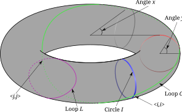
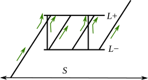
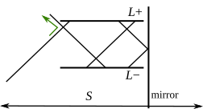
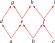
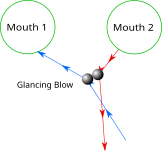
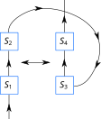

# Time Travel and Modern Physics
**First published Thu Feb 17, 2000; substantive revision Mon Mar 6, 2023**

*Smeenk, Christopher, Arntzenius, Frank, Maudlin, Tim*

Time travel has been a staple of science fiction. With the advent of general relativity it has been entertained by serious physicists. But, especially in the philosophy literature, there have been arguments that time travel is inherently paradoxical. The most famous paradox is the grandfather paradox: you travel back in time and kill your grandfather, thereby preventing your own existence. To avoid inconsistency some circumstance will have to occur which makes you fail in this attempt to kill your grandfather. Doesn’t this require some implausible constraint on otherwise unrelated circumstances? We examine such worries in the context of modern physics.

## 1. Paradoxes Lost?

Modern physics strips away many aspects of the manifest image of time. Time as it appears in the equations of classical mechanics has no need for a distinguished present moment, for example. Relativity theory leads to even sharper contrasts. It replaces absolute simultaneity, according to which it is possible to unambiguously determine the time order of distant events, with relative simultaneity: extending an “instant of time” throughout space is not unique, but depends on the state of motion of an observer. More dramatically, in general relativity the mathematical properties of time (or better, of spacetime)—its topology and geometry—depend upon how matter is arranged rather than being fixed once and for all. So physics can be, and indeed has to be, formulated without treating time as a universal, fixed background structure. Since general relativity represents gravity through spacetime geometry, the allowed geometries must be as varied as the ways in which matter can be arranged. Alongside geometrical models used to describe the solar system, black holes, and much else, the scope of variation extends to include some exotic structures unlike anything astrophysicists have observed. In particular, there are spacetime geometries with curves that loop back on themselves: closed timelike curves (CTCs), which describe the possible trajectory of an observer who returns exactly back to their earlier state—without any funny business, such as going faster than the speed of light. These geometries satisfy the relevant physical laws, the equations of general relativity, and in that sense time travel is physically possible.

Yet circular time generates paradoxes, familiar from science fiction stories featuring time travel:[^note-1]

- *Consistency:* Kurt plans to murder his own grandfather Adolph, by traveling along a CTC to an appropriate moment in the past. He is an able marksman, and waits until he has a clear shot at grandpa. Normally he would not miss. Yet if he succeeds, there is no way that he will then exist to plan and carry out the mission. Kurt pulls the trigger: what can happen?
- *Underdetermination:* Suppose that Kurt first travels back in order to give his earlier self a copy of *How to Build a Time Machine.* This is the same book that allows him to build a time machine, which he then carries with him on his journey to the past. Who wrote the book?
- *Easy Knowledge:* A fan of classical music enhances their computer with a circuit that exploits a CTC. This machine efficiently solves problems at a higher level of computational complexity than conventional computers, leading (among other things) to finding the smallest circuits that can generate Bach’s oeuvre—and to compose new pieces in the same style. Such easy knowledge is at odds with our understanding of our epistemic predicament. (This third paradox has not drawn as much attention.)

The first two paradoxes were once routinely taken to show that solutions with CTCs should be rejected—with charges varying from violating logic, to being “physically unreasonable”, to undermining the notion of free will. Closer analysis of the paradoxes has largely reversed this consensus. Physicists have discovered many solutions with CTCs and have explored their properties in pursuing foundational questions, such as whether physics is compatible with the idea of objective temporal passage (starting with Gödel 1949)[^gödel-1949]. Philosophers have also used time travel scenarios to probe questions about, among other things, causation, modality, free will, and identity (see, e.g., Earman 1972 and Lewis’s seminal 1976 paper)[^earman-1972][^lewis-1976].

We begin below with *Consistency*, turning to the other paradoxes in later sections. A standard, stone-walling response is to insist that the past cannot be changed, as a matter of logic, even by a time traveler (e.g., Gödel 1949, Clarke 1977, Horwich 1987)[^clarke-1977][^gödel-1949][^horwich-1987]. Adolph cannot both die and survive, as a matter of logic, so any scheme to alter the past must fail. In many of the best time travel fictions, the actions of a time traveler are constrained in novel and unexpected ways. Attempts to change the past fail, and they fail, often tragically, in just such a way that they set the stage for the time traveler’s self-defeating journey. The first question is whether there is an analog of the consistent story when it comes to physics in the presence of CTCs. As we will see, there is a remarkable general argument establishing the existence of consistent solutions. Yet a second question persists: why can’t time-traveling Kurt kill his own grandfather? Doesn’t the necessity of failures to change the past put unusual and unexpected constraints on time travelers, or objects that move along CTCs? The same argument shows that there are in fact no constraints imposed by the existence of CTCs, in some cases. After discussing this line of argument, we will turn to the palatability and further implications of such constraints if they are required, and then turn to the implications of quantum mechanics.

## 2. Topology and Constraints

Wheeler and Feynman (1949) were the first to claim that the fact that nature is continuous could be used to argue that causal influences from later events to earlier events, as are made possible by time travel, will not lead to paradox without the need for any constraints. Maudlin (1990) showed how to make their argument precise and more general, and argued that nonetheless it was not completely general.

Imagine the following set-up. We start off having a camera with a black and white film ready to take a picture of whatever comes out of the time machine. An object, in fact a developed film, comes out of the time machine. We photograph it, and develop the film. The developed film is subsequently put in the time machine, and set to come out of the time machine at the time the picture is taken. This surely will create a paradox: the developed film will have the opposite distribution of black, white, and shades of gray, from the object that comes out of the time machine. For developed black and white films (i.e., negatives) have the opposite shades of gray from the objects they are pictures of. But since the object that comes out of the time machine is the developed film itself it we surely have a paradox.

However, it does not take much thought to realize that there is no paradox here. What will happen is that a uniformly gray picture will emerge, which produces a developed film that has exactly the same uniform shade of gray. No matter what the sensitivity of the film is, as long as the dependence of the brightness of the developed film depends in a continuous manner on the brightness of the object being photographed, there will be a shade of gray that, when photographed, will produce exactly the same shade of gray on the developed film. This is the essence of Wheeler and Feynman’s idea. Let us first be a bit more precise and then a bit more general.

For simplicity let us suppose that the film is always a uniform shade of gray (i.e., at any time the shade of gray does not vary by location on the film). The possible shades of gray of the film can then be represented by the (real) numbers from 0, representing pure black, to 1, representing pure white.

Let us now distinguish various stages in the chronological order of the life of the film. In stage $S_1$ the film is young; it has just been placed in the camera and is ready to be exposed. It is then exposed to the object that comes out of the time machine. (That object in fact is a later stage of the film itself). By the time we come to stage $S_2$ of the life of the film, it has been developed and is about to enter the time machine. Stage $S_3$ occurs just after it exits the time machine and just before it is photographed. Stage $S_4$ occurs after it has been photographed and before it starts fading away. Let us assume that the film starts out in stage $S_1$ in some uniform shade of gray, and that the only significant change in the shade of gray of the film occurs between stages $S_1$ and $S_2$. During that period it acquires a shade of gray that depends on the shade of gray of the object that was photographed. In other words, the shade of gray that the film acquires at stage $S_2$ depends on the shade of gray it has at stage $S_3$. The influence of the shade of gray of the film at stage $S_3$, on the shade of gray of the film at stage $S_2$, can be represented as a mapping, or function, from the real numbers between 0 and 1 (inclusive), to the real numbers between 0 and 1 (inclusive). Let us suppose that the process of photography is such that if one imagines varying the shade of gray of an object in a smooth, continuous manner then the shade of gray of the developed picture of that object will also vary in a smooth, continuous manner. This implies that the function in question will be a continuous function. Now any continuous function from the real numbers between 0 and 1 (inclusive) to the real numbers between 0 and 1 (inclusive) must map at least one number to itself. One can quickly convince oneself of this by graphing such functions. For one will quickly see that any continuous function $f$ from $[0,1]$ to $[0,1]$ must intersect the line $x=y$ somewhere, and thus there must be at least one point $x$ such that $f(x)=x$. Such points are called fixed points of the function. Now let us think about what such a fixed point represents. It represents a shade of gray such that, when photographed, it will produce a developed film with exactly that same shade of gray. The existence of such a fixed point implies a solution to the apparent paradox.

Let us now be more general and allow color photography. One can represent each possible color of an object (of uniform color) by the proportions of blue, green and red that make up that color. (This is why television screens can produce all possible colors.) Thus one can represent all possible colors of an object by three points on three orthogonal lines $x, y$ and $z$, that is to say, by a point in a three-dimensional cube. This cube is also known as the “Cartesian product” of the three line segments. Now, one can also show that any continuous map from such a cube to itself must have at least one fixed point. So color photography can not be used to create time travel paradoxes either!

Even more generally, consider some system $P$ which, as in the above example, has the following life. It starts in some state $S_1$, it interacts with an object that comes out of a time machine (which happens to be its older self), it travels back in time, it interacts with some object (which happens to be its younger self), and finally it grows old and dies. Let us assume that the set of possible states of $P$ can be represented by a Cartesian product of $n$ closed intervals of the reals, i.e., let us assume that the topology of the state-space of $P$ is isomorphic to a finite Cartesian product of closed intervals of the reals. Let us further assume that the development of $P$ in time, and the dependence of that development on the state of objects that it interacts with, is continuous. Then, by a well-known fixed point theorem in topology (see, e.g., Hocking & Young 1961: 273)[^hocking-1961], no matter what the nature of the interaction is, and no matter what the initial state of the object is, there will be at least one state $S_3$ of the older system (as it emerges from the time travel machine) that will influence the initial state $S_1$ of the younger system (when it encounters the older system) so that, as the younger system becomes older, it develops exactly into state $S_3$. Thus without imposing any constraints on the initial state $S_1$ of the system $P$, we have shown that there will always be perfectly ordinary, non-paradoxical, solutions, in which everything that happens, happens according to the usual laws of development. Of course, there is looped causation, hence presumably also looped explanation, but what do you expect if there is looped time?

Unfortunately, for the fan of time travel, a little reflection suggests that there are systems for which the needed fixed point theorem does not hold. Imagine, for instance, that we have a dial that can only rotate in a plane. We are going to put the dial in the time machine. Indeed we have decided that if we see the later stage of the dial come out of the time machine set at angle $x$, then we will set the dial to $x+90$, and throw it into the time machine. Now it seems we have a paradox, since the mapping that consists of a rotation of all points in a circular state-space by 90 degrees does not have a fixed point. And why wouldn’t some state-spaces have the topology of a circle?

However, we have so far not used another continuity assumption which is also a reasonable assumption. So far we have only made the following demand: the state the dial is in at stage $S_2$ must be a continuous function of the state of the dial at stage $S_3$. But, the state of the dial at stage $S_2$ is arrived at by taking the state of the dial at stage $S_1$, and rotating it over some angle. It is not merely the case that the effect of the interaction, namely the state of the dial at stage $S_2$, should be a continuous function of the cause, namely the state of the dial at stage $S_3$. It is additionally the case that path taken to get there, the way the dial is rotated between stages $S_1$ and $S_2$ must be a continuous function of the state at stage $S_3$. And, rather surprisingly, it turns out that this can not be done. Let us illustrate what the problem is before going to a more general demonstration that there must be a fixed point solution in the dial case.

Forget time travel for the moment. Suppose that you and I each have a watch with a single dial neither of which is running. My watch is set at 12. You are going to announce what your watch is set at. My task is going to be to adjust my watch to yours no matter what announcement you make. And my actions should have a continuous (single valued) dependence on the time that you announce. Surprisingly, this is not possible! For instance, suppose that if you announce “12”, then I achieve that setting on my watch by doing nothing. Now imagine slowly and continuously increasing the announced times, starting at 12. By continuity, I must achieve each of those settings by rotating my dial to the right. If at some point I switch and achieve the announced goal by a rotation of my dial to the left, I will have introduced a discontinuity in my actions, a discontinuity in the actions that I take as a function of the announced angle. So I will be forced, by continuity, to achieve every announcement by rotating the dial to the right. But, this rotation to the right will have to be abruptly discontinued as the announcements grow larger and I eventually approach 12 again, since I achieved 12 by not rotating the dial at all. So, there will be a discontinuity at 12 at the latest. In general, continuity of my actions as a function of announced times can not be maintained throughout if I am to be able to replicate all possible settings. Another way to see the problem is that one can similarly reason that, as one starts with 12, and imagines continuously making the announced times earlier, one will be forced, by continuity, to achieve the announced times by rotating the dial to the left. But the conclusions drawn from the assumption of continuous increases and the assumption of continuous decreases are inconsistent. So we have an inconsistency following from the assumption of continuity and the assumption that I always manage to set my watch to your watch. So, a dial developing according to a continuous dynamics from a given initial state, can not be set up so as to react to a second dial, with which it interacts, in such a way that it is guaranteed to always end up set at the same angle as the second dial. Similarly, it can not be set up so that it is guaranteed to always end up set at 90 degrees to the setting of the second dial. All of this has nothing to do with time travel. However, the impossibility of such set ups is what prevents us from enacting the rotation by 90 degrees that would create paradox in the time travel setting.

Let us now give the positive result that with such dials there will always be fixed point solutions, as long as the dynamics is continuous. Let us call the state of the dial before it interacts with its older self the initial state of the dial. And let us call the state of the dial after it emerges from the time machine the final state of the dial. There is also an intermediate state of the dial, after it interacts with its older self and before it is put into the time machine. We can represent the initial or intermediate states of the dial, before it goes into the time machine, as an angle $x$ in the horizontal plane and the final state of the dial, after it comes out of the time machine, as an angle $y$ in the vertical plane. All possible $\langle x,y\rangle$ pairs can thus be visualized as a torus with each $x$ value picking out a vertical circular cross-section and each $y$ picking out a point on that cross-section. See figure 1.

*Figure 1*

Figure 1 [An extended description of figure 1 is in the supplement.]

Suppose that the dial starts at angle $i$ which picks out vertical circle $I$ on the torus. The initial angle $i$ that the dial is at before it encounters its older self, and the set of all possible final angles that the dial can have when it emerges from the time machine is represented by the circle $I$ on the torus (see figure 1). Given any possible angle of the emerging dial, the dial initially at angle $i$ will develop to some other angle. One can picture this development by rotating each point on $I$ in the horizontal direction by the relevant amount. Since the rotation has to depend continuously on the angle of the emerging dial, circle $I$ during this development will deform into some loop $L$ on the torus. Loop $L$ thus represents all possible intermediate angles $x$ that the dial is at when it is thrown into the time machine, given that it started at angle $i$ and then encountered a dial (its older self) which was at angle $y$ when it emerged from the time machine. We therefore have consistency if $x=y$ for some $x$ and $y$ on loop $L$. Now, let loop $C$ be the loop which consists of all the points on the torus for which $x=y$. Ring $I$ intersects $C$ at point $\langle i,i\rangle$. Obviously any continuous deformation of $I$ must still intersect $C$ somewhere. So $L$ must intersect $C$ somewhere, say at $\langle j,j\rangle$. But that means that no matter how the development of the dial starting at $I$ depends on the angle of the emerging dial, there will be some angle for the emerging dial such that the dial will develop exactly into that angle (by the time it enters the time machine) under the influence of that emerging dial. This is so no matter what angle one starts with, and no matter how the development depends on the angle of the emerging dial. Thus even for a circular state-space there are no constraints needed other than continuity.

Unfortunately there are state-spaces that escape even this argument. Consider for instance a pointer that can be set to all values between 0 and 1, where 0 and 1 are not possible values. That is, suppose that we have a state-space that is isomorphic to an open set of real numbers. Now suppose that we have a machine that sets the pointer to half the value that the pointer is set at when it emerges from the time machine.

*Figure 2*

Figure 2 [An extended description of figure 2 is in the supplement.]

Suppose the pointer starts at value $I$. As before we can represent the combination of this initial position and all possible final positions by the line $I$. Under the influence of the pointer coming out of the time machine the pointer value will develop to a value that equals half the value of the final value that it encountered. We can represent this development as the continuous deformation of line $I$ into line $L$, which is indicated by the arrows in figure 2. This development is fully continuous. Points $\langle x,y\rangle$ on line $I$ represent the initial position $x=I$ of the (young) pointer, and the position $y$ of the older pointer as it emerges from the time machine. Points $\langle x,y\rangle$ on line $L$ represent the position $x$ that the younger pointer should develop into, given that it encountered the older pointer emerging from the time machine set at position $y$. Since the pointer is designed to develop to half the value of the pointer that it encounters, the line $L$ corresponds to $x=1/2 y$. We have consistency if there is some point such that it develops into that point, if it encounters that point. Thus, we have consistency if there is some point $\langle x,y\rangle$ on line $L$ such that $x=y$. However, there is no such point: lines $L$ and $C$ do not intersect. Thus there is no consistent solution, despite the fact that the dynamics is fully continuous.

Of course if 0 were a possible value, $L$ and $C$ would intersect at 0. This is surprising and strange: adding one point to the set of possible values of a quantity here makes the difference between paradox and peace. One might be tempted to just add the extra point to the state-space in order to avoid problems. After all, one might say, surely no measurements could ever tell us whether the set of possible values includes that exact point or not. Unfortunately there can be good theoretical reasons for supposing that some quantity has a state-space that is open: the set of all possible speeds of massive objects in special relativity surely is an open set, since it includes all speeds up to, but not including, the speed of light. Quantities that have possible values that are not bounded also lead to counter examples to the presented fixed point argument. And it is not obvious to us why one should exclude such possibilities. So the argument that no constraints are needed is not fully general.

An interesting question of course is: exactly for which state-spaces must there be such fixed points? The arguments above depend on a well-known fixed point theorem (due to Schauder) that guarantees the existence of a fixed point for compact, convex state spaces. We do not know what subsequent extensions of this result imply regarding fixed points for a wider variety of systems, or whether there are other general results along these lines. (See Kutach 2003 for more on this issue.)[^kutach-2003]

A further interesting question is whether this line of argument is sufficient to resolve *Consistency* (see also Dowe 2007)[^dowe-2007]. When they apply, these results establish the existence of a solution, such as the shade of uniform gray in the first example. But physicists routinely demand more than merely the existence of a solution, namely that solutions to the equations are stable—such that “small” changes of the initial state lead to “small” changes of the resulting trajectory. (Clarifying the two senses of “small” in this statement requires further work, specifying the relevant topology.) Stability in this sense underwrites the possibility of applying equations to real systems given our inability to fix initial states with indefinite precision. (See Fletcher 2020 for further discussion.)[^fletcher-2020] The fixed point theorems guarantee that for an initial state $S_1$ there is a solution, but this solution may not be “close” to the solution for a nearby initial state, $S'$. We are not aware of any proofs that the solutions guaranteed to exist by the fixed point theorems are also stable in this sense.

## 3. The General Possibility of Time Travel in General Relativity

Time travel has recently been discussed quite extensively in the context of general relativity. General relativity places few constraints on the global structure of space and time. This flexibility leads to a possibility first described in print by Hermann Weyl:

> Every world-point is the origin of the double-cone of the active future and the passive past [i.e., the two lobes of the light cone]. Whereas in the special theory of relativity these two portions are separated by an intervening region, it is certainly possible in the present case [i.e., general relativity] for the cone of the active future to overlap with that of the passive past; so that, in principle, it is possible to experience events now that will in part be an effect of my future resolves and actions. Moreover, it is not impossible for a world-line (in particular, that of my body), although it has a timelike direction at every point, to return to the neighborhood of a point which it has already once passed through. (Weyl 1918/1920 [1952: 274])[^weyl-1918]

A time-like curve is simply a space-time trajectory such that the speed of light is never equaled or exceeded along this trajectory. Time-like curves represent possible trajectories of ordinary objects. In general relativity a curve that is everywhere timelike locally can nonetheless loop back on itself, forming a CTC. Weyl makes the point vividly in terms of the light cones: along such a curve, the future lobe of the light cone (the “active future”) intersects the past lobe of the light cone (the “passive past”). Traveling along such a curve one would never exceed the speed of light, and yet after a certain amount of (proper) time one would return to a point in space-time that one previously visited. Or, by staying close to such a CTC, one could come arbitrarily close to a point in space-time that one previously visited. General relativity, in a straightforward sense, allows time travel: there appear to be many space-times compatible with the fundamental equations of general relativity in which there are CTC’s. Space-time, for instance, could have a Minkowski metric everywhere, and yet have CTC’s everywhere by having the temporal dimension (topologically) rolled up as a circle. Or, one can have wormhole connections between different parts of space-time which allow one to enter “mouth $A$” of such a wormhole connection, travel through the wormhole, exit the wormhole at “mouth $B$” and re-enter “mouth $A$” again. CTCs can even arise when the spacetime is topologically $\mathbb{R}^4$, due to the “tilting” of light cones produced by rotating matter (as in Gödel 1949’s spacetime)[^gödel-1949].

General relativity thus appears to provide ample opportunity for time travel. Note that just because there are CTC’s in a space-time, this does not mean that one can get from any point in the space-time to any other point by following some future directed timelike curve—there may be insurmountable practical obstacles. In Gödel’s spacetime, it is the case that there are CTCs passing through every point in the spacetime. Yet these CTCs are not geodesics, so traversing them requires acceleration. Calculations of the minimal fuel required to travel along the appropriate curve should discourage any would-be time travelers (Malament 1984, 1985; Manchak 2011)[^malament-1984][^manchak-2011]. But more generally CTCs may be confined to smaller regions; some parts of space-time can have CTC’s while other parts do not. Let us call the part of a space-time that has CTC’s the “time travel region” of that space-time, while calling the rest of that space-time the “normal region”. More precisely, the “time travel region” consists of all the space-time points $p$ such that there exists a (non-zero length) timelike curve that starts at $p$ and returns to $p$. Now let us turn to examining space-times with CTC’s a bit more closely for potential problems.

## 4. Two Toy Models

In order to get a feeling for the sorts of implications that closed timelike curves can have, it may be useful to consider two simple models. In space-times with closed timelike curves the traditional initial value problem cannot be framed in the usual way. For it presupposes the existence of Cauchy surfaces, and if there are CTCs then no Cauchy surface exists. (A Cauchy surface is a spacelike surface such that every inextendable timelike curve crosses it exactly once. One normally specifies initial conditions by giving the conditions on such a surface.) Nonetheless, if the topological complexities of the manifold are appropriately localized, we can come quite close. Let us call an edgeless spacelike surface $S$ a *quasi-Cauchy* surface if it divides the rest of the manifold into two parts such that

1. every point in the manifold can be connected by a timelike curve to $S$, and
2. any timelike curve which connects a point in one region to a point in the other region intersects $S$ exactly once.

It is obvious that a quasi-Cauchy surface must entirely inhabit the normal region of the space-time; if any point $p$ of $S$ is in the time travel region, then any timelike curve which intersects $p$ can be extended to a timelike curve which intersects $S$ near $p$ again. In extreme cases of time travel, a model may have no normal region at all (e.g., Minkowski space-time rolled up like a cylinder in a time-like direction), in which case our usual notions of temporal precedence will not apply. But temporal anomalies like wormholes (and time machines) can be sufficiently localized to permit the existence of quasi-Cauchy surfaces.

Given a timelike orientation, a quasi-Cauchy surface unproblematically divides the manifold into its *past* (i.e., all points that can be reached by past-directed timelike curves from $S)$ and its *future* (ditto *mutatis mutandis*). If the whole past of $S$ is in the normal region of the manifold, then $S$ is a *partial Cauchy surface*: every inextendable timelike curve which exists to the past of $S$ intersects $S$ exactly once, but (if there is time travel in the future) not every inextendable timelike curve which exists to the future of $S$ intersects $S$. Now we can ask a particularly clear question: consider a manifold which contains a time travel region, but also has a partial Cauchy surface $S$, such that all of the temporal funny business is to the future of $S$. If all you could see were $S$ and its past, you would not know that the space-time had any time travel at all. The question is: are there any constraints on the sort of data which can be put on $S$ and continued to a global solution of the dynamics which are different from the constraints (if any) on the data which can be put on a Cauchy surface in a simply connected manifold and continued to a global solution? If there is time travel to our future, might we we able to tell this now, because of some implied oddity in the arrangement of present things?

It is not at all surprising that there might be constraints on the data which can be put on a locally space-like surface which passes through the time travel region: after all, we never think we can freely specify what happens on a space-like surface and on another such surface to its future, but in this case the surface at issue lies to its own future. But if there were particular constraints for data on a partial Cauchy surface then we would apparently need to have to rule out some sorts of otherwise acceptable states on $S$ if there is to be time travel to the future of $S$. We then might be able to establish that there will be no time travel in the future by simple inspection of the present state of the universe. As we will see, there is reason to suspect that such constraints on the partial Cauchy surface are non-generic. But we are getting ahead of ourselves: first let’s consider the effect of time travel on a very simple dynamics.

The simplest possible example is the Newtonian theory of perfectly elastic collisions among equally massive particles in one spatial dimension. The space-time is two-dimensional, so we can represent it initially as the Euclidean plane, and the dynamics is completely specified by two conditions. When particles are traveling freely, their world lines are straight lines in the space-time, and when two particles collide, they exchange momenta, so the collision looks like an “$X$” in space-time, with each particle changing its momentum at the impact.[^note-2] The dynamics is purely local, in that one can check that a set of world-lines constitutes a model of the dynamics by checking that the dynamics is obeyed in every arbitrarily small region. It is also trivial to generate solutions from arbitrary initial data if there are no CTCs: given the initial positions and momenta of a set of particles, one simply draws a straight line from each particle in the appropriate direction and continues it indefinitely. Once all the lines are drawn, the worldline of each particle can be traced from collision to collision. The boundary value problem for this dynamics is obviously well-posed: any set of data at an instant yields a unique global solution, constructed by the method sketched above.

What happens if we change the topology of the space-time by hand to produce CTCs? The simplest way to do this is depicted in figure 3: we cut and paste the space-time so it is no longer simply connected by identifying the line $L-$ with the line $L+$. Particles “going in” to $L+$ from below “emerge” from $L-$ , and particles “going in” to $L-$ from below “emerge” from $L+$.

*Figure 3:*

Figure 3: Inserting CTCs by Cut and Paste. [An extended description of figure 3 is in the supplement.]

How is the boundary-value problem changed by this alteration in the space-time? Before the cut and paste, we can put arbitrary data on the simultaneity slice $S$ and continue it to a unique solution. After the change in topology, $S$ is no longer a Cauchy surface, since a CTC will never intersect it, but it is a partial Cauchy surface. So we can ask two questions. First, can arbitrary data on $S$ always be continued to a global solution? Second, is that solution unique? If the answer to the first question is $no$, then we have a backward-temporal constraint: the existence of the region with CTCs places constraints on what can happen on $S$ even though that region lies completely to the future of $S$. If the answer to the second question is $no$, then we have an odd sort of indeterminism, analogous to the unwritten book: the complete physical state on $S$ does not determine the physical state in the future, even though the local dynamics is perfectly deterministic and even though there is no other past edge to the space-time region in $S$’s future (i.e., there is nowhere *else* for boundary values to come from which could influence the state of the region).

In this case the answer to the first question is *yes* and to the second is *no*: there are no constraints on the data which can be put on $S$, but those data are always consistent with an infinitude of different global solutions. The easy way to see that there always is a solution is to construct the minimal solution in the following way. Start drawing straight lines from $S$ as required by the initial data. If a line hits $L-$ from the bottom, just continue it coming out of the top of $L+$ in the appropriate place, and if a line hits $L+$ from the bottom, continue it emerging from $L-$ at the appropriate place. Figure 4 represents the minimal solution for a single particle which enters the time-travel region from the left:

*Figure 4:*

Figure 4: The Minimal Solution. [An extended description of figure 4 is in the supplement.]

The particle “travels back in time” three times. It is obvious that this minimal solution is a global solution, since the particle always travels inertially.

But the same initial state on $S$ is also consistent with other global solutions. The new requirement imposed by the topology is just that the data going into $L+$ from the bottom match the data coming out of $L-$ from the top, and the data going into $L-$ from the bottom match the data coming out of $L+$ from the top. So we can add any number of vertical lines connecting $L-$ and $L+$ to a solution and still have a solution. For example, adding a few such lines to the minimal solution yields:

*Figure 5:*

Figure 5: A Non-Minimal Solution. [An extended description of figure 5 is in the supplement.]

The particle now collides with itself twice: first before it reaches $L+$ for the first time, and again shortly before it exits the CTC region. From the particle’s point of view, it is traveling to the right at a constant speed until it hits an older version of itself and comes to rest. It remains at rest until it is hit from the right by a younger version of itself, and then continues moving off, and the same process repeats later. It is clear that this is a global model of the dynamics, and that any number of distinct models could be generating by varying the number and placement of vertical lines.

Knowing the data on $S$, then, gives us only incomplete information about how things will go for the particle. We know that the particle will enter the CTC region, and will reach $L+$, we know that it will be the only particle in the universe, we know exactly where and with what speed it will exit the CTC region. But we cannot determine how many collisions the particle will undergo (if any), nor how long (in proper time) it will stay in the CTC region. If the particle were a clock, we could not predict what time it would indicate when exiting the region. Furthermore, the dynamics gives us no handle on what to think of the various possibilities: there are no probabilities assigned to the various distinct possible outcomes.

Changing the topology has changed the mathematics of the situation in two ways, which tend to pull in opposite directions. On the one hand, $S$ is no longer a Cauchy surface, so it is perhaps not surprising that data on $S$ do not suffice to fix a unique global solution. But on the other hand, there is an added constraint: data “coming out” of $L-$ must exactly match data “going in” to $L+$, even though what comes out of $L-$ helps to determine what goes into $L+$. This added consistency constraint tends to cut down on solutions, although in this case the additional constraint is more than outweighed by the freedom to consider various sorts of data on ${L+}/{L-}$.

The fact that the extra freedom outweighs the extra constraint also points up one unexpected way that the supposed paradoxes of time travel may be overcome. Let’s try to set up a paradoxical situation using the little closed time loop above. If we send a single particle into the loop from the left and do nothing else, we know exactly where it will exit the right side of the time travel region. Now suppose we station someone at the other side of the region with the following charge: if the particle should come out on the right side, the person is to do something to *prevent* the particle from going in on the left in the first place. In fact, this is quite easy to do: if we send a particle in from the right, it seems that it can exit on the left and *deflect* the incoming left-hand particle.

Carrying on our reflection in this way, we further realize that if the particle comes out on the right, we might as well send *it* back in order to deflect itself from entering in the first place. So all we really need to do is the following: set up a perfectly reflecting particle mirror on the right-hand side of the time travel region, and launch the particle from the left so that—*if nothing interferes with it*—it will just barely hit $L+$. Our paradox is now apparently complete. If, on the one hand, nothing interferes with the particle it will enter the time-travel region on the left, exit on the right, be reflected from the mirror, re-enter from the right, and come out on the left to prevent itself from ever entering. So if it enters, it gets deflected and never enters. On the other hand, if it never enters then nothing goes in on the left, so nothing comes out on the right, so nothing is reflected back, and there is nothing to deflect it from entering. So if it doesn’t enter, then there is nothing to deflect it and it enters. If it enters, then it is deflected and doesn’t enter; if it doesn’t enter then there is nothing to deflect it and it enters: paradox complete.

But at least one solution to the supposed paradox is easy to construct: just follow the recipe for constructing the minimal solution, continuing the initial trajectory of the particle (reflecting it the mirror in the obvious way) and then read of the number and trajectories of the particles from the resulting diagram. We get the result of figure 6:

*Figure 6:*

Figure 6: Resolving the “Paradox”. [An extended description of figure 6 is in the supplement.]

As we can see, the particle approaching from the left never reaches $L+$: it is deflected first by a particle which emerges from $L-$. But it is not deflected *by itself*, as the paradox suggests, it is deflected by another particle. Indeed, there are now *four* particles in the diagram: the original particle and three particles which are confined to closed time-like curves. It is not the leftmost particle which is reflected by the mirror, nor even the particle which deflects the leftmost particle; it is another particle altogether.

The paradox gets it traction from an incorrect presupposition. If there is only one particle in the world at $S$ then there is only one particle which could participate in an interaction in the time travel region: the single particle would have to interact with its earlier (or later) self. But there is no telling what might come out of $L-$: the only requirement is that whatever comes out must match what goes in at $L+$. So if you go to the trouble of constructing a working time machine, you should be prepared for a different kind of disappointment when you attempt to go back and kill yourself: you may be prevented from entering the machine in the first place by some completely unpredictable entity which emerges from it. And once again a peculiar sort of indeterminism appears: if there are many self-consistent things which could prevent you from entering, there is no telling which is even likely to materialize. This is just like the case of the unwritten book: the book is never written, so nothing determines what fills its pages.

So when the freedom to put data on $L-$ outweighs the constraint that the same data go into $L+$, instead of paradox we get an embarrassment of riches: many solution consistent with the data on $S$, or many possible books. To see a case where the constraint “outweighs” the freedom, we need to construct a very particular, and frankly artificial, dynamics and topology. Consider the space of all linear dynamics for a scalar field on a lattice. (The lattice can be though of as a simple discrete space-time.) We will depict the space-time lattice as a directed graph. There is to be a scalar field defined at every node of the graph, whose value at a given node depends linearly on the values of the field at nodes which have arrows which lead to it. Each edge of the graph can be assigned a weighting factor which determines how much the field at the input node contributes to the field at the output node. If we name the nodes by the letters *a*, *b*, *c*, etc., and the edges by their endpoints in the obvious way, then we can label the weighting factors by the edges they are associated with in an equally obvious way.

Suppose that the graph of the space-time lattice is *acyclic*, as in figure 7. (A graph is *Acyclic* if one can not travel in the direction of the arrows and go in a loop.)

*Figure 7:*

Figure 7: An Acyclic Lattice. [An extended description of figure 7 is in the supplement.]

It is easy to regard a set of nodes as the analog of a Cauchy surface, e.g., the set $\{a, b, c\}$, and it is obvious if arbitrary data are put on those nodes the data will generate a unique solution in the future.[^note-3] If the value of the field at node $a$ is 3 and at node $b$ is 7, then its value at node $d$ will be $3W_{ad}$ and its value at node $e$ will be $3W_{ae} + 7W_{be}$. By varying the weighting factors we can adjust the dynamics, but in an acyclic graph the future evolution of the field will always be unique.

Let us now again artificially alter the topology of the lattice to admit CTCs, so that the graph now is cyclic. One of the simplest such graphs is depicted in figure 8: there are now paths which lead from $z$ back to itself, e.g., $z$ to $y$ to $z$.

*Figure 8:*

Figure 8: Time Travel on a Lattice. [An extended description of figure 8 is in the supplement.]

Can we now put arbitrary data on $v$ and $w$, and continue that data to a global solution? Will the solution be unique?

In the generic case, there will be a solution and the solution will be unique. The equations for the value of the field at $x, y$, and $z$ are:

$$\begin{align} x &= vW_{vx} + zW_{zx} \\ y &= wW_{wy} + zW_{zy} \\ z &= xW_{xz} + yW_{yz}. \end{align}$$

Solving these equations for $z$ yields

$$ z = (vW_{vx} + zW_{zx})W_{xz} + (wW_{wy} + zW_{zy})W_{yz}, $$

or

$$ z = \frac{(vW_{vx}W_{xz} + wW_{wy}W_{yz})} {(1 - W_{zx}W_{xz} - W_{zy}W_{yz})}, $$

which gives a unique value for $z$ in the generic case. But looking at the space of all possible dynamics for this lattice (i.e., the space of all possible weighting factors), we find a singularity in the case where $1-W_{zx}W_{xz} - W_{zy}W_{yz} = 0$. If we choose weighting factors in just this way, then arbitrary data at $v$ and $w$ cannot be continued to a global solution. Indeed, if the scalar field is everywhere non-negative, then this particular choice of dynamics puts ironclad constraints on the value of the field at $v$ and $w$: the field there must be zero (assuming $W_{vx}$ and $W_{wy}$ to be non-zero), and similarly all nodes in their past must have field value zero. If the field can take negative values, then the values at $v$ and $w$ must be so chosen that $vW_{vx}W_{xz} = -wW_{wy}W_{yz}$. In either case, the field values at $v$ and $w$ are severely constrained by the existence of the CTC region even though these nodes lie completely to the past of that region. It is this sort of constraint which we find to be unlike anything which appears in standard physics.

Our toy models suggest three things. The first is that it may be impossible to prove in complete generality that arbitrary data on a partial Cauchy surface can *always* be continued to a global solution: our artificial case provides an example where it cannot. The second is that such odd constraints are not likely to be generic: we had to delicately fine-tune the dynamics to get a problem. The third is that the opposite problem, namely data on a partial Cauchy surface being consistent with *many* different global solutions, is likely to be generic: we did not have to do any fine-tuning to get this result.

This third point leads to a peculiar sort of indeterminism, illustrated by the case of the unwritten book: the entire state on $S$ does not determine what will happen in the future even though the local dynamics is deterministic and there are no other “edges” to space-time from which data could influence the result. What happens in the time travel region is constrained but not determined by what happens on $S$, and the dynamics does not even supply any *probabilities* for the various possibilities. The example of the photographic negative discussed in section 2, then, seems likely to be unusual, for in that case there is a *unique* fixed point for the dynamics, and the set-up plus the dynamical laws *determine* the outcome. In the generic case one would rather expect *multiple* fixed points, with no room for anything to influence, even probabilistically, *which* would be realized. (See the supplement on

[Remarks and Limitations on the Toy Models](time-travel-phys.toy-models.md).

It is ironic that time travel should lead generically not to contradictions or to constraints (in the normal region) but to *underdetermination* of what happens in the time travel region by what happens everywhere else (an underdetermination tied neither to a probabilistic dynamics nor to a free edge to space-time). The traditional objection to time travel is that it leads to contradictions: there is no consistent way to complete an arbitrarily constructed story about how the time traveler intends to act. Instead, though, it appears that the more significant problem is underdetermination: the story can be consistently completed in many different ways.

## 5. Slightly More Realistic Models of Time Travel

Echeverria, Klinkhammer, and Thorne (1991) considered the case of 3-dimensional single hard spherical ball that can go through a single time travel wormhole so as to collide with its younger self.

*Figure 9*

Figure 9 [An extended description of figure 9 is in the supplement.]

The threat of paradox in this case arises in the following form. Consider the initial trajectory of a ball as it approaches the time travel region. For some initial trajectories, the ball does not undergo a collision before reaching mouth 1, but upon exiting mouth 2 it will collide with its earlier self. This leads to a contradiction if the collision is strong enough to knock the ball off its trajectory and deflect it from entering mouth 1. Of course, the Wheeler-Feynman strategy is to look for a “glancing blow” solution: a collision which will produce exactly the (small) deviation in trajectory of the earlier ball that produces exactly that collision. Are there always such solutions?[^note-4]

Echeverria, Klinkhammer & Thorne found a large class of initial trajectories that have consistent “glancing blow” continuations, and found none that do not (but their search was not completely general). They did not produce a rigorous proof that every initial trajectory has a consistent continuation, but suggested that it is very plausible that every initial trajectory has a consistent continuation. That is to say, they have made it very plausible that, in the billiard ball wormhole case, the time travel structure of such a wormhole space-time does not result in constraints on states on spacelike surfaces in the non-time travel region.

In fact, as one might expect from our discussion in the previous section, they found the opposite problem from that of inconsistency: they found underdetermination. For a large class of initial trajectories there are multiple different consistent “glancing blow” continuations of that trajectory (many of which involve multiple wormhole traversals). For example, if one initially has a ball that is traveling on a trajectory aimed straight between the two mouths, then one obvious solution is that the ball passes between the two mouths and never time travels. But another solution is that the younger ball gets knocked into mouth 1 exactly so as to come out of mouth 2 and produce that collision. Echeverria et al. do not note the possibility (which we pointed out in the previous section) of the existence of additional balls in the time travel region. We conjecture (but have no proof) that for every initial trajectory of $A$ there are some, and generically many, multiple-ball continuations.

Friedman, Morris, et al. (1990) examined the case of source-free non-self-interacting scalar fields traveling through such a time travel wormhole and found that no constraints on initial conditions in the non-time travel region are imposed by the existence of such time travel wormholes. In general there appear to be no known counter examples to the claim that in “somewhat realistic” time-travel space-times with a partial Cauchy surface there are no constraints imposed on the state on such a partial Cauchy surface by the existence of CTC’s. (See, e.g., Friedman & Morris 1991; Thorne 1994; Earman 1995; Earman, Smeenk, & Wüthrich 2009; and Dowe 2007.)[^dowe-2007][^earman-1995][^friedman-1991][^thorne-1994]

How about the issue of constraints in the time travel region $T$? *Prima facie*, constraints in such a region would not appear to be surprising. But one might still expect that there should be no constraints on states on a spacelike surface, provided one keeps the surface “small enough”. In the physics literature the following question has been asked: for any point $p$ in $T$, and any space-like surface $S$ that includes $p$ is there a neighborhood $E$ of $p$ in $S$ such that any solution on $E$ can be extended to a solution on the whole space-time? With respect to this question, there are some simple models in which one has this kind of extendability of local solutions to global ones, and some simple models in which one does not have such extendability, with no clear general pattern. The technical mathematical problems are amplified by the more conceptual problem of what it might mean to say that one could create a situation which forces the creation of closed timelike curves. (See, e.g., Yurtsever 1990; Friedman, Morris, et al. 1990; Novikov 1992; Earman 1995; and Earman, Smeenk, & Wüthrich 2009)[^earman-1995][^novikov-1992][^yurtsever-1990]. What are we to think of all of this?

## 6. The Possibility of Time Travel Redux

The toy models above all treat billiard balls, fields, and other objects propagating through a background spacetime with CTCs. Even if we can show that a consistent solution exists, there is a further question: what kind of matter and dynamics could generate CTCs to begin with? There are various solutions of Einstein’s equations with CTCs, but how do these exotic spacetimes relate to the models actually used in describing the world? In other words, what positive reasons might we have to take CTCs seriously as a feature of the actual universe, rather than an exotic possibility of primarily mathematical interest?

We should distinguish two different kinds of “possibility” that we might have in mind in posing such questions (following Stein 1970)[^stein-1970]. First, we can consider a solution as a candidate cosmological model, describing the (large-scale gravitational degrees of freedom of the) entire universe. The case for ruling out spacetimes with CTCs as potential cosmological models strikes us as, surprisingly, fairly weak. Physicists used to simply rule out solutions with CTCs as unreasonable by fiat, due to the threat of paradoxes, which we have dismantled above. But it is also challenging to make an observational case. Observations tell us very little about global features, such as the existence of CTCs, because signals can only reach an observer from a limited region of spacetime, called the past light cone. Our past light cone—and indeed the collection of all the past light cones for possible observers in a given spacetime—can be embedded in spacetimes with quite different global features (Malament 1977, Manchak 2009)[^malament-1977][^manchak-2009]. This undercuts the possibility of using observations to constrain global topology, including (among other things) ruling out the existence of CTCs.

Yet the case in favor of taking cosmological models with CTCs seriously is also not particularly strong. Some solutions used to describe black holes, which are clearly relevant in a variety of astrophysical contexts, include CTCs. But the question of whether the CTCs themselves play an essential representational role is subtle: the CTCs arise in the maximal extensions of these solutions, and can plausibly be regarded as extraneous to successful applications. Furthermore, many of the known solutions with CTCs have symmetries, raising the possibility that CTCs are not a stable or robust feature. Slight departures from symmetry may lead to a solution without CTCs, suggesting that the CTCs may be an artifact of an idealized model.

The second sense of possibility regards whether “reasonable” initial conditions can be shown to lead to, or not to lead to, the formation of CTCs. As with the toy models above, suppose that we have a partial Cauchy surface $S$, such that all the temporal funny business lies to the future. Rather than simply assuming that there is a region with CTCs to the future, we can ask instead whether it is possible to *create* CTCs by manipulating matter in the initial, well-behaved region—that is, whether it is possible to build a time machine. Several physicists have pursued “chronology protection theorems” aiming to show that the dynamics of general relativity (or some other aspects of physics) rules this out, and to clarify why this is the case. The proof of such a theorem would justify neglecting solutions with CTCs as a source of insight into the nature of time in the actual world. But as of yet there are several partial results that do not fully settle the question. One further intriguing possibility is that even if general relativity by itself does protect chronology, it may not be possible to formulate a sensible theory describing matter and fields in solutions with CTCs. (See SEP entry on Time Machines; Smeenk and Wüthrich 2011 for more.)[^smeenk-2011]

There is a different question regarding the limitations of these toy models. The toy models and related examples show that there are consistent solutions for simple systems in the presence of CTCs. As usual we have made the analysis tractable by building toy models, selecting only a few dynamical degrees of freedom and tracking their evolution. But there is a large gap between the systems we have described and the time travel stories they evoke, with Kurt traveling along a CTC with murderous intentions. In particular, many features of the manifest image of time are tied to the thermodynamical properties of macroscopic systems. Rovelli (unpublished) considers a extremely simple system to illustrate the problem: can a clock move along a CTC? A clock consists of something in periodic motion, such as a pendulum bob, and something that counts the oscillations, such as an escapement mechanism. The escapement mechanism cannot work without friction; this requires dissipation and increasing entropy. For a clock that counts oscillations as it moves along a time-like trajectory, the entropy must be a monotonically increasing function. But that is obviously incompatible with the clock returning to precisely the same state at some future time as it completes a loop. The point generalizes, obviously, to imply that anything like a human, with memory and agency, cannot move along a CTC.

## 7. Even If There are Constraints, So What?

Since it is not obvious that one can rid oneself of all constraints in realistic models, let us examine the argument that time travel is implausible, and we should think it unlikely to exist in our world, in so far as it implies such constraints. The argument goes something like the following. In order to satisfy such constraints one needs some pre-established divine harmony between the global (time travel) structure of space-time and the distribution of particles and fields on space-like surfaces in it. But it is not plausible that the actual world, or any world even remotely like ours, is constructed with divine harmony as part of the plan. In fact, one might argue, we have empirical evidence that conditions in any spatial region can vary quite arbitrarily. So we have evidence that such constraints, whatever they are, do not in fact exist in our world. So we have evidence that there are no closed time-like lines in our world or one remotely like it. We will now examine this argument in more detail by presenting four possible responses, with counterresponses, to this argument.

**Response 1.** There is nothing implausible or new about such constraints. For instance, if the universe is spatially closed, there has to be enough matter to produce the needed curvature, and this puts constraints on the matter distribution on a space-like hypersurface. Thus global space-time structure can quite unproblematically constrain matter distributions on space-like hypersurfaces in it. Moreover we have no realistic idea what these constraints look like, so we hardly can be said to have evidence that they do not obtain.

**Counterresponse 1.** Of course there are constraining relations between the global structure of space-time and the matter in it. The Einstein equations relate curvature of the manifold to the matter distribution in it. But what is so strange and implausible about the constraints imposed by the existence of closed time-like curves is that these constraints in essence have nothing to do with the Einstein equations. When investigating such constraints one typically treats the particles and/or field in question as test particles and/or fields in a given space-time, i.e., they are assumed not to affect the metric of space-time in any way. In typical space-times without closed time-like curves this means that one has, in essence, complete freedom of matter distribution on a space-like hypersurface. (See response 2 for some more discussion of this issue). The constraints imposed by the possibility of time travel have a quite different origin and are implausible. In the ordinary case there is a causal interaction between matter and space-time that results in relations between global structure of space-time and the matter distribution in it. In the time travel case there is no such causal story to be told: there simply has to be some pre-established harmony between the global space-time structure and the matter distribution on some space-like surfaces. This is implausible.

**Response 2.** Constraints upon matter distributions are nothing new. For instance, Maxwell’s equations constrain electric fields $\boldsymbol{E}$ on an initial surface to be related to the (simultaneous) charge density distribution $\varrho$ by the equation $\varrho = \text{div}(\boldsymbol{E})$. (If we assume that the $E$ field is generated solely by the charge distribution, this conditions amounts to requiring that the $E$ field at any point in space simply be the one generated by the charge distribution according to Coulomb’s inverse square law of electrostatics.) This is not implausible divine harmony. Such constraints can hold as a matter of physical law. Moreover, if we had inferred from the apparent free variation of conditions on spatial regions that there could be no such constraints we would have mistakenly inferred that $\varrho = \text{div}(\boldsymbol{E})$ could not be a law of nature.

**Counterresponse 2.** The constraints imposed by the existence of closed time-like lines are of quite a different character from the constraint imposed by $\varrho = \text{div}(\boldsymbol{E})$. The constraints imposed by $\varrho = \text{div}(\boldsymbol{E})$ on the state on a space-like hypersurface are:

1. local constraints (i.e., to check whether the constraint holds in a region you just need to see whether it holds at each point in the region),
2. quite independent of the global space-time structure,
3. quite independent of how the space-like surface in question is embedded in a given space-time, and
4. very simply and generally stateable.

On the other hand, the consistency constraints imposed by the existence of closed time-like curves (i) are not local, (ii) are dependent on the global structure of space-time, (iii) depend on the location of the space-like surface in question in a given space-time, and (iv) appear not to be simply stateable other than as the demand that the state on that space-like surface embedded in such and such a way in a given space-time, do not lead to inconsistency. On some views of laws (e.g., David Lewis’ view) this plausibly implies that such constraints, even if they hold, could not possibly be laws. But even if one does not accept such a view of laws, one could claim that the bizarre features of such constraints imply that it is implausible that such constraints hold in our world or in any world remotely like ours.

**Response 3.** It would be strange if there are constraints in the non-time travel region. It is not strange if there are constraints in the time travel region. They should be explained in terms of the strange, self-interactive, character of time travel regions. In this region there are time-like trajectories from points to themselves. Thus the state at such a point, in such a region, will, in a sense, interact with itself. It is a well-known fact that systems that interact with themselves will develop into an equilibrium state, if there is such an equilibrium state, or else will develop towards some singularity. Normally, of course, self-interaction isn’t true instantaneous self-interaction, but consists of a feed-back mechanism that takes time. But in time travel regions something like true instantaneous self-interaction occurs. This explains why constraints on states occur in such time travel regions: the states “*ab initio*” have to be “equilibrium states”. Indeed in a way this also provides some picture of why indeterminism occurs in time travel regions: at the onset of self-interaction states can fork into different equi-possible equilibrium states.

**Counterresponse 3.** This is explanation by woolly analogy. It all goes to show that time travel leads to such bizarre consequences that it is unlikely that it occurs in a world remotely like ours.

**Response 4.** All of the previous discussion completely misses the point. So far we have been taking the space-time structure as given, and asked the question whether a given time travel space-time structure imposes constraints on states on (parts of) space-like surfaces. However, space-time and matter interact. Suppose that one is in a space-time with closed time-like lines, such that certain counterfactual distributions of matter on some neighborhood of a point $p$ are ruled out if one holds that space-time structure fixed. One might then ask

> Why does the actual state near $p$ in fact satisfy these constraints? By what divine luck or plan is this local state compatible with the global space-time structure? What if conditions near $p$ had been slightly different?

And one might take it that the lack of normal answers to these questions indicates that it is very implausible that our world, or any remotely like it, is such a time travel universe. However the proper response to these question is the following. There are no constraints in any significant sense. If they hold they hold as a matter of accidental fact, not of law. There is no more explanation of them possible than there is of any contingent fact. Had conditions in a neighborhood of $p$ been otherwise, the global structure of space-time would have been different. So what? The only question relevant to the issue of constraints is whether an arbitrary state on an arbitrary spatial surface $S$ can always be embedded into a space-time such that that state on $S$ consistently extends to a solution on the entire space-time.

But we know the answer to that question. A well-known theorem in general relativity says the following: any initial data set on a three dimensional manifold $S$ with positive definite metric has a unique embedding into a maximal space-time in which $S$ is a Cauchy surface (see, e.g., Geroch & Horowitz 1979: 284 for more detail)[^geroch-1979], i.e., there is a unique largest space-time which has $S$ as a Cauchy surface and contains a consistent evolution of the initial value data on $S$. Now since $S$ is a Cauchy surface this space-time does not have closed time like curves. But it may have extensions (in which $S$ is not a Cauchy surface) which include closed timelike curves, indeed it may be that any maximal extension of it would include closed timelike curves. (This appears to be the case for extensions of states on certain surfaces of Taub-NUT space-times. See Earman, Smeenk, & Wüthrich 2009). But these extensions, of course, will be consistent. So properly speaking, there are no constraints on states on space-like surfaces. Nonetheless the space-time in which these are embedded may or may not include closed time-like curves.

**Counterresponse 4.** This, in essence, is the stonewalling answer which we indicated in section 1. However, whether or not you call the constraints imposed by a given space-time on distributions of matter on certain space-like surfaces “genuine constraints”, whether or not they can be considered lawlike, and whether or not they need to be explained, the existence of such constraints can still be used to argue that time travel worlds are so bizarre that it is implausible that our world or any world remotely like ours is a time travel world.

Suppose that one is in a time travel world. Suppose that given the global space-time structure of this world, there are constraints imposed upon, say, the state of motion of a ball on some space-like surface when it is treated as a test particle, i.e., when it is assumed that the ball does not affect the metric properties of the space-time it is in. (There is lots of other matter that, via the Einstein equation, corresponds exactly to the curvature that there is everywhere in this time travel worlds.) Now a real ball of course does have some effect on the metric of the space-time it is in. But let us consider a ball that is so small that its effect on the metric is negligible. Presumably it will still be the case that certain states of this ball on that space-like surface are not compatible with the global time travel structure of this universe.

This means that the actual distribution of matter on such a space-like surface can be extended into a space-time with closed time-like lines, but that certain counterfactual distributions of matter on this space-like surface can not be extended into the same space-time. *But note that the changes made in the matter distribution (when going from the actual to the counterfactual distribution) do not in any non-negligible way affect the metric properties of the space-time.* (Recall that the changes only effect test particles.) Thus the reason why the global time travel properties of the counterfactual space-time have to be significantly different from the actual space-time is not that there are problems with metric singularities or alterations in the metric that force significant global changes when we go to the counterfactual matter distribution. The reason that the counterfactual space-time has to be different is that in the counterfactual world the ball’s initial state of motion starting on the space-like surface, could not “meet up” in a consistent way with its earlier self (could not be consistently extended) if we were to let the global structure of the counterfactual space-time be the same as that of the actual space-time. Now, it is not bizarre or implausible that there is a counterfactual dependence of manifold structure, even of its topology, on matter distributions on spacelike surfaces. For instance, certain matter distributions may lead to singularities, others may not. We may indeed in some sense have causal power over the topology of the space-time we live in. But this power normally comes via the Einstein equations. But it is bizarre to think that there could be a counterfactual dependence of global space-time structure on the arrangement of certain tiny bits of matter on some space-like surface, where changes in that arrangement by assumption do not affect the metric *anywhere in space-time in any significant way*. It is implausible that we live in such a world, or that a world even remotely like ours is like that.

Let us illustrate this argument in a different way by assuming that wormhole time travel imposes constraints upon the states of people prior to such time travel, where the people have so little mass/energy that they have negligible effect, via the Einstein equation, on the local metric properties of space-time. Do you think it more plausible that we live in a world where wormhole time travel occurs but it only occurs when people’s states are such that these local states happen to combine with time travel in such a way that nobody ever succeeds in killing their younger self, or do you think it more plausible that we are not in a wormhole time travel world?[^note-5]

## 8. Computational Models

An alternative approach to time travel (initiated by Deutsch 1991)[^deutsch-1991] abstracts away from the idealized toy models described above.[^note-6] This computational approach considers instead the evolution of bits (simple physical systems with two discrete states) through a network of interactions, which can be represented by a circuit diagram with gates corresponding to the interactions. Motivated by the possibility of CTCs, Deutsch proposed adding a new kind of channel that connects the *output* of a given gate back to its *input*—in essence, a backwards-time step. More concretely, given a gate that takes $n$ bits as input, we can imagine taking some number $i \lt n$ of these bits through a channel that loops back and then do double-duty as inputs. Consistency requires that the state of these $i$ bits is the same for output and input. (We will consider an illustration of this kind of system in the next section.) Working through examples of circuit diagrams with a CTC channel leads to similar treatments of *Consistency* and *Underdetermination* as the discussion above (see, e.g., Wallace 2012: § 10.6)[^wallace-2012]. But the approach offers two new insights (both originally due to Deutsch): the *Easy Knowledge* paradox, and a particularly clear extension to time travel in quantum mechanics.

A computer equipped with a CTC channel can exploit the need to find consistent evolution to solve remarkably hard problems. (This is quite different than the first idea that comes to mind to enhance computational power: namely to just devote more time to a computation, and then send the result back on the CTC to an earlier state.) The gate in a circuit incorporating a CTC implements a function from the input bits to the output bits, under the constraint that the output and input match the *i* bits going through the CTC channel. This requires, in effect, finding the fixed point of the relevant function. Given the generality of the model, there are few limits on the functions that could be implemented on the CTC circuit. Nature has to solve a hard computational problem just to ensure consistent evolution. This can then be extended to other complex computational problems—leading, more precisely, to solutions of **NP**-complete problems in polynomial time (see Aaronson 2013: Chapter 20 for an overview and further references)[^aaronson-2013]. The limits imposed by computational complexity are an essential part of our epistemic situation, and computers with CTCs would radically change this.

## 9. Quantum Mechanics to the Rescue?

We now turn to the application of the computational approach to the quantum physics of time travel (see Deutsch 1991; Deutsch & Lockwood 1994)[^deutsch-1991][^deutsch-1994]. By contrast with the earlier discussions of constraints in classical systems, they claim to show that time travel never imposes any constraints on the pre-time travel state of quantum systems. The essence of this account is as follows.[^note-7]

A quantum system starts in state $S_1$, interacts with its older self, after the interaction is in state $S_2$, time travels while developing into state $S_3$, then interacts with its younger self, and ends in state $S_4$ (see figure 10).

*Figure 10*

Figure 10 [An extended description of figure 10 is in the supplement.]

Deutsch assumes that the set of possible states of this system are the mixed states, i.e., are represented by the density matrices over the Hilbert space of that system. Deutsch then shows that for any initial state $S_1$, any unitary interaction between the older and younger self, and any unitary development during time travel, there is a consistent solution, i.e., there is at least one pair of states $S_2$ and $S_3$ such that when $S_1$ interacts with $S_3$ it will change to state $S_2$ and $S_2$ will then develop into $S_3$. The states $S_2, S_3$ and $S_4$ will typically be not be pure states, i.e., will be non-trivial mixed states, even if $S_1$ is pure. In order to understand how this leads to interpretational problems let us give an example. Consider a system that has a two dimensional Hilbert space with as a basis the states $\vc{+}$ and $\vc{-}$. Let us suppose that when state $\vc{+}$ of the young system encounters state $\vc{+}$ of the older system, they interact and the young system develops into state $\vc{-}$ and the old system remains in state $\vc{+}$. In obvious notation:

$$\vc{+}_1 \vc{+}_3 \text{ develops into } \vc{-}_2 \vc{+}_4.$$

Similarly, suppose that:

$$\begin{align} &\vc{+}_1 \vc{-}_3 \text{ develops into } \vc{+}_2 \vc{-}_4, \\ &\vc{-}_1 \vc{+}_3 \text{ develops into } \vc{-}_2 \vc{-}_4, \text{ and} \\ &\vc{-}_1 \vc{-}_3 \text{ develops into } \vc{+}_2 \vc{+}_4. \end{align}$$

Let us furthermore assume that there is no development of the state of the system during time travel, i.e., that $\vc{+}_2$ develops into $\vc{+}_3$, and that $\vc{-}_2$ develops into $\vc{-}_3$.

Now, if the only possible states of the system were $\vc{+}$ and $\vc{-}$ (i.e., if there were no superpositions or mixtures of these states), then there is a constraint on initial states: initial state $\vc{+}_1$ is impossible. For if $\vc{+}_1$ interacts with $\vc{+}_3$ then it will develop into $\vc{-}_2$, which, during time travel, will develop into $\vc{-}_3$, which inconsistent with the assumed state $\vc{+}_3$. Similarly if $\vc{+}_1$ interacts with $\vc{-}_3$ it will develop into $\vc{+}_2$, which will then develop into $\vc{+}_3$ which is also inconsistent. Thus the system can not start in state $\vc{+}_1$.

But, says Deutsch, in quantum mechanics such a system can also be in any mixture of the states $\vc{+}$ and $\vc{-}$. Suppose that the older system, prior to the interaction, is in a state $S_3$ which is an equal mixture of 50% $\vc{+}_3$ and 50% $\vc{-}_3$. Then the younger system during the interaction will develop into a mixture of 50% $\vc{+}_2$ and 50% $\vc{-}_2$, which will then develop into a mixture of 50% $\vc{+}_3$ and 50% $\vc{-}_3$, which is consistent! More generally Deutsch uses a fixed point theorem to show that no matter what the unitary development during interaction is, and no matter what the unitary development during time travel is, for any state $S_1$ there is always a state $S_3$ (which typically is not a pure state) which causes $S_1$ to develop into a state $S_2$ which develops into that state $S_3$. Thus quantum mechanics comes to the rescue: it shows in all generality that no constraints on initial states are needed!

One might wonder why Deutsch appeals to mixed states: will superpositions of states $\vc{+}$ and $\vc{-}$ not suffice? Unfortunately such an idea does not work. Suppose again that the initial state is $\vc{+}_1$. One might suggest that that if state $S_3$ is

$$\sqt \vc{+}_3 + \sqt \vc{-}_3$$

one will obtain a consistent development. For one might think that when initial state $\vc{+}_1$ encounters the superposition

$$\sqt\vc{+}_3 + \sqt\vc{-}_3,$$

it will develop into superposition

$$\sqt\vc{+}_2 + \sqt\vc{-}_2,$$

and that this in turn will develop into

$$\sqt\vc{+}_3 + \sqt\vc{-}_3,$$

as desired. However this is not correct. For initial state $\vc{+}_1$ when it encounters

$$\sqt\vc{+}_3 + \sqt\vc{-}_3,$$

will develop into the entangled state

$$\sqt\vc{-}_2\vc{+}_4 + \sqt\vc{+}_2\vc{-}_4.$$

In so far as one can speak of the state of the young system after this interaction, it is in the mixture of 50% $\vc{+}_2$ and 50% $\vc{-}_2$, not in the superposition

$$\sqt\vc{+}_2 + \sqt\vc{-}_2.$$

So Deutsch does need his recourse to mixed states.

This clarification of why Deutsch needs his mixtures does however indicate a serious worry about the simplifications that are part of Deutsch’s account. After the interaction the old and young system will (typically) be in an entangled state. Although for purposes of a measurement on one of the two systems one can say that this system is in a mixed state, one can not represent the full state of the two systems by specifying the mixed state of each separate part, as there are correlations between observables of the two systems that are not represented by these two mixed states, but are represented in the joint entangled state. But if there really is an entangled state of the old and young systems directly after the interaction, how is one to represent the subsequent development of this entangled state? Will the state of the younger system remain entangled with the state of the older system as the younger system time travels and the older system moves on into the future? On what space-like surfaces are we to imagine this total entangled state to be? At this point it becomes clear that there is no obvious and simple way to extend elementary non-relativistic quantum mechanics to space-times with closed time-like curves: we apparently need to characterize not just the entanglement between two systems, but entanglement relative to specific spacetime descriptions.

How does Deutsch avoid these complications? Deutsch assumes a mixed state $S_3$ of the older system prior to the interaction with the younger system. He lets it interact with an arbitrary pure state $S_1$ younger system. After this interaction there is an entangled state $S'$ of the two systems. Deutsch computes the mixed state $S_2$ of the younger system which is implied by this entangled state $S'$. His demand for consistency then is just that this mixed state $S_2$ develops into the mixed state $S_3$. Now it is not at all clear that this is a legitimate way to simplify the problem of time travel in quantum mechanics. But even if we grant him this simplification there is a problem: how are we to understand these mixtures?

If we take an ignorance interpretation of mixtures we run into trouble. For suppose that we assume that in each individual case each older system is either in state $\vc{+}_3$ or in state $\vc{-}_3$ prior to the interaction. Then we regain our paradox. Deutsch instead recommends the following, many worlds, picture of mixtures. Suppose we start with state $\vc{+}_1$ in all worlds. In some of the many worlds the older system will be in the $\vc{+}_3$ state, let us call them *A*-worlds, and in some worlds, *B*-worlds, it will be in the $\vc{-}_3$ state. Thus in *A*-worlds after interaction we will have state $\vc{-}_2$ , and in *B*-worlds we will have state $\vc{+}_2$. During time travel the $\vc{-}_2$ state will remain the same, i.e., turn into state $\vc{-}_3$, but the systems in question will travel from *A*-worlds to *B*-worlds. Similarly the $\vc{+}$ $_2$ states will travel from the *B*-worlds to the *A*-worlds, thus preserving consistency.

Now whatever one thinks of the merits of many worlds interpretations, and of this understanding of it applied to mixtures, in the end one does not obtain genuine time travel in Deutsch’s account. The systems in question travel from one time in one world to another time in another world, but no system travels to an earlier time in the same world. (This is so at least in the normal sense of the word “world”, the sense that one means when, for instance, one says “there was, and will be, only one Elvis Presley in this world.”) Thus, even if it were a reasonable view, it is not quite as interesting as it may have initially seemed. (See Wallace 2012 for a more sympathetic treatment, that explores several further implications of accepting time travel in conjunction with the many worlds interpretation.)[^wallace-2012]

We close by acknowledging that Deutsch’s starting point—the claim that this computational model captures the essential features of quantum systems in a spacetime with CTCs—has been the subject of some debate. Several physicists have pursued a quite different treatment of evolution of quantum systems through CTC’s, based on considering the “post-selected” state (see Lloyd et al. 2011)[^lloyd-2011]. Their motivations for implementing the consistency condition in terms of the post-selected state reflects a different stance towards quantum foundations. A different line of argument aims to determine whether Deutsch’s treatment holds as an appropriate limiting case of a more rigorous treatment, such as quantum field theory in curved spacetimes. For example, Verch (2020) establishes several results challenging the assumption that Deutsch’s treatment is tied to the presence of CTC’s, or that it is compatible with the entanglement structure of quantum fields.

## 10. Conclusions

What remains of the grandfather paradox in general relativistic time travel worlds is the fact that in some cases the states on edgeless spacelike surfaces are “overconstrained”, so that one has less than the usual freedom in specifying conditions on such a surface, given the time-travel structure, and in some cases such states are “underconstrained”, so that states on edgeless space-like surfaces do not determine what happens elsewhere in the way that they usually do, given the time travel structure. There can also be mixtures of those two types of cases. The extent to which states are overconstrained and/or underconstrained in realistic models is as yet unclear, though it would be very surprising if neither obtained. The extant literature has primarily focused on the problem of overconstraint, since that, often, either is regarded as a metaphysical obstacle to the possibility time travel, or as an epistemological obstacle to the plausibility of time travel in our world. While it is true that our world would be quite different from the way we normally think it is if states were overconstrained, underconstraint seems at least as bizarre as overconstraint. Nonetheless, neither directly rules out the possibility of time travel.

If time travel entailed contradictions then the issue would be settled. And indeed, most of the stories employing time travel in popular culture are logically incoherent: one cannot “change” the past to be different from what it was, since the past (like the present and the future) only occurs once. But if the only requirement demanded is logical coherence, then it seems all too easy. A clever author can devise a coherent time-travel scenario in which everything happens just once and in a consistent way. This is just too cheap: logical coherence is a very weak condition, and many things we take to be metaphysically impossible are logically coherent. For example, it involves no logical contradiction to suppose that water is not molecular, but if both chemistry and Kripke are right it is a metaphysical impossibility. We have been interested not in logical possibility but in physical possibility. But even so, our conditions have been relatively weak: we have asked only whether time-travel is consistent with the universal validity of certain fundamental physical laws and with the notion that the physical state on a surface prior to the time travel region be unconstrained. It is perfectly possible that the physical laws obey this condition, but still that time travel is not metaphysically possible because of the nature of time itself. Consider an analogy. Aristotle believed that water is homoiomerous and infinitely divisible: any bit of water could be subdivided, in principle, into smaller bits of water. Aristotle’s view contains no logical contradiction. It was certainly consistent with Aristotle’s conception of water that it be homoiomerous, so this was, for him, a conceptual possibility. But if chemistry is right, Aristotle was wrong both about what water is like and what is possible for it. It can’t be infinitely divided, even though no logical or conceptual analysis would reveal that.

Similarly, even if all of our consistency conditions can be met, it does not follow that time travel is physically possible, only that some specific physical considerations cannot rule it out. The only serious proof of the possibility of time travel would be a demonstration of its actuality. For if we agree that there is no actual time travel in our universe, the supposition that there might have been involves postulating a substantial difference from actuality, a difference unlike in kind from anything we could know if firsthand. It is unclear to us exactly what the content of possible would be if one were to either maintain or deny the possibility of time travel in these circumstances, unless one merely meant that the possibility is not ruled out by some delineated set of constraints. As the example of Aristotle’s theory of water shows, conceptual and logical “possibility” do not entail possibility in a full-blooded sense. What exactly such a full-blooded sense would be in case of time travel, and whether one could have reason to believe it to obtain, remain to us obscure.

## References（引用注释）

> 原文参考文献已转为脚注引用：文内“作者-年份”引用组后附 [^key] 标记，完整条目见本文末脚注定义。

## Academic Tools

> |   | [How to cite this entry](https://plato.stanford.edu/cgi-bin/encyclopedia/archinfo.cgi?entry=time-travel-phys). |
> | --- | --- |
> |   | [Preview the PDF version of this entry](https://leibniz.stanford.edu/friends/preview/time-travel-phys/) at the [Friends of the SEP Society](https://leibniz.stanford.edu/friends/). |
> |   | [Look up topics and thinkers related to this entry](https://www.inphoproject.org/entity?sep=time-travel-phys&redirect=True) at the Internet Philosophy Ontology Project (InPhO). |
> |   | [Enhanced bibliography for this entry](https://philpapers.org/sep/time-travel-phys/) at [PhilPapers](https://philpapers.org/), with links to its database. |

## Other Internet Resources

- Adlam, Emily, unpublished, “[Is There Causation in Fundamental Physics? New Insights from Process Matrices and Quantum Causal Modelling](https://arxiv.org/abs/2208.02721)”, 2022, arXiv: 2208.02721. doi:10.48550/ARXIV.2208.02721
- Rovelli, Carlo, unpublished, “[Can We Travel to the Past? Irreversible Physics along Closed Timelike Curves](https://arxiv.org/abs/1912.04702)”, arXiv: 1912.04702. doi:10.48550/ARXIV.1912.04702

## Related Entries

causation: backward | determinism: causal | quantum mechanics | quantum mechanics: retrocausality | space and time: being and becoming in modern physics | time machines | time travel

## Notes（原文脚注）

## Notes to Time Travel and Modern Physics

[^note-1]: There is a large philosophical literature on the first two paradoxes (and others), see, e.g., the entry on time travel, Wasserman (2018), and Effingham (2020), but very little on the easy knowledge paradox (emphasized by Deutsch 1991, discussed further below)[^deutsch-1991]. Our approach differs from the literature surveyed in these two books by focusing on the physical—rather than metaphysical—possibility of time travel.

[^note-2]: Multiple collisions are handled in the obvious way by continuity considerations: just continue straight lines through the collision point and identify which particle is which by their ordering in space.

[^note-3]: The dynamics here is radically non-time-reversible. Indeed, the dynamics is deterministic in the future direction but not in the past direction.

[^note-4]: One might hope that fixed point theorems can be used to prove the existence of solutions in this type of cases too. Consider, for instance, a fixed initial state of motion *I* of the ball. Then consider all the possible velocities and locations and times $\langle v,x,t\rangle$ at which such a ball could enter mouth 1 of the wormhole. Each such triple $\langle v,x,t\rangle$ will determine the trajectory of that ball out of mouth 2. One can then look at the continuation of the trajectory from state *I* and that from state *s*, and see whether these trajectories collide. Then one can see for each possible triple $\langle v,x,t\rangle$ whether the ball that starts in state *I* will be collided into mouth 1, and if it is, with which speed at what location and at which time this will occur. Thus given state *I*, each triple $\langle v,x,t\rangle$ maps onto another triple $\langle v',x',t'\rangle$. One might then suggest appealing to a fixed point theorem to argue that there must be a solution for each initial state *I*. However, in the first place the set of possible speeds and times are open sets. And in the second place there can be multiple wormhole traversals. Thus the relevant total state-space of wormhole mouth crossings consists of discretely many completely disconnected state-spaces (with increasing numbers of dimensions). So standard fixed point theorems do not apply directly. It should be noted that the results that have been achieved regarding this case do make use of fixed points theorems quite extensively. But their application is limited to certain sub-problems, and do not yield a fully general proof of the lack of constraints for arbitrary *I*.

[^note-5]: This argument, especially the second illustration of it, is similar to the one in Horwich (1987: 124–128). However, we do not share Horwich’s view that it only tells against time travel of humans into their local past.

[^note-6]: Recently physicists have developed a similar computational approach (called the process matrix formalism) to describe interactions among systems with indefinite causal structure. See Adlam (unpublished) for a philosophical discussion and references to the physics literature.

[^note-7]: In this section we will presume familiarity with quantum mechanics. See, for example, the entry on quantum mechanics, and its extremely useful guide to further reading, for an entry point to this subject.

[^aaronson-2013]: Aaronson, Scott, 2013, *Quantum Computing since Democritus*, Cambridge: Cambridge University Press. doi:10.1017/CBO9780511979309

[^arntzenius-2006]: Arntzenius, Frank, 2006, “Time Travel: Double Your Fun”, *Philosophy Compass*, 1(6): 599–616. doi:10.1111/j.1747-9991.2006.00045.x

[^clarke-1977]: Clarke, C.J.S., 1977, “Time in General Relativity” in *Foundations of Space-Time Theory*, *Minnesota Studies in the Philosophy of Science*, Vol VIII, Earman, J., Glymour, C., and Stachel, J. (eds), pp. 94–108. Minneapolis: University of Minnesota Press.

[^deutsch-1991]: Deutsch, David, 1991, “Quantum Mechanics near Closed Timelike Lines”, *Physical Review D*, 44(10): 3197–3217. doi:10.1103/PhysRevD.44.3197

[^deutsch-1994]: Deutsch, David and Michael Lockwood, 1994, “The Quantum Physics of Time Travel”, *Scientific American*, 270(3): 68–74. doi:10.1038/scientificamerican0394-68

[^dowe-2007]: Dowe, Phil, 2007, “Constraints on Data in Worlds with Closed Timelike Curves”, *Philosophy of Science*, 74(5): 724–735. doi:10.1086/525617

[^earman-1972]: Earman, John, 1972, “Implications of Causal Propagation Outside the Null Cone”, *Australasian Journal of Philosophy*, 50(3): 222–237. doi:10.1080/00048407212341281

[^earman-1995]: Earman, John, 1995, *Bangs, Crunches, Whimpers, and Shrieks: Singularities and Acausalities in Relativistic Spacetimes*, New York: Oxford University Press.

[^earman-2009]: Earman, John, Christopher Smeenk, and Christian Wüthrich, 2009, “Do the Laws of Physics Forbid the Operation of Time Machines?”, *Synthese*, 169(1): 91–124. doi:10.1007/s11229-008-9338-2

[^echeverria-1991]: Echeverria, Fernando, Gunnar Klinkhammer, and Kip S. Thorne, 1991, “Billiard Balls in Wormhole Spacetimes with Closed Timelike Curves: Classical Theory”, *Physical Review D*, 44(4): 1077–1099. doi:10.1103/PhysRevD.44.1077

[^effingham-2020]: Effingham, Nikk, 2020, *Time Travel: Probability and Impossibility*, Oxford: Oxford University Press. doi:10.1093/oso/9780198842507.001.0001

[^fletcher-2020]: Fletcher, Samuel C., 2020, “The Principle of Stability”, *Philosopher’s Imprint*, 20: article 3. [[Fletcher 2020 available online](http://hdl.handle.net/2027/spo.3521354.0020.003)]

[^friedman-1991]: Friedman, John and Michael Morris, 1991, “The Cauchy Problem for the Scalar Wave Equation Is Well Defined on a Class of Spacetimes with Closed Timelike Curves”, *Physical Review Letters*, 66(4): 401–404. doi:10.1103/PhysRevLett.66.401

[^friedman-1990]: Friedman, John, Michael S. Morris, Igor D. Novikov, Fernando Echeverria, Gunnar Klinkhammer, Kip S. Thorne, and Ulvi Yurtsever, 1990, “Cauchy Problem in Spacetimes with Closed Timelike Curves”, *Physical Review D*, 42(6): 1915–1930. doi:10.1103/PhysRevD.42.1915

[^geroch-1979]: Geroch, Robert and Gary Horowitz, 1979, “Global Structures of Spacetimes”, in *General Relativity: An Einstein Centenary Survey*, Stephen Hawking and W. Israel (eds.), Cambridge/New York: Cambridge University Press, Chapter 5, pp. 212–293.

[^gödel-1949]: Gödel, Kurt, 1949, “A Remark About the Relationship Between Relativity Theory and Idealistic Philosophy”, in *Albert Einstein, Philosopher-Scientist*, Paul Arthur Schilpp (ed.), Evanston, IL: Library of Living Philosophers, 557–562.

[^hocking-1961]: Hocking, John G. and Gail S. Young, 1961, *Topology*, (Addison-Wesley Series in Mathematics), Reading, MA: Addison-Wesley.

[^horwich-1987]: Horwich, Paul, 1987, “Time Travel”, in his *Asymmetries in Time: Problems in the Philosophy of Science*, , Cambridge, MA: MIT Press, 111–128.

[^kutach-2003]: Kutach, Douglas N., 2003, “Time Travel and Consistency Constraints”, *Philosophy of Science*, 70(5): 1098–1113. doi:10.1086/377392

[^lewis-1976]: Lewis, David, 1976, “The Paradoxes of Time Travel”, *American Philosophical Quarterly*, 13(2): 145–152.

[^lloyd-2011]: Lloyd, Seth, Lorenzo Maccone, Raul Garcia-Patron, Vittorio Giovannetti, and Yutaka Shikano, 2011, “Quantum Mechanics of Time Travel through Post-Selected Teleportation”, *Physical Review D*, 84(2): 025007. doi:10.1103/PhysRevD.84.025007

[^malament-1977]: Malament, David B., 1977, “Observationally Indistinguishable Spacetimes: Comments on Glymour’s Paper”, in *Foundations of Space-Time Theories*, John Earman, Clark N. Glymour, and John J. Stachel (eds.), (Minnesota Studies in the Philosophy of Science 8), Minneapolis, MN: University of Minnesota Press, 61–80.

[^malament-1984]: –––, 1984, “‘Time Travel’ in the Gödel Universe”, *PSA: Proceedings of the Biennial Meeting of the Philosophy of Science Association*, 1984(2): 91–100. doi:10.1086/psaprocbienmeetp.1984.2.192497

[^malament-1985]: –––, 1985, “Minimal Acceleration Requirements for ‘Time Travel’, in Gödel Space‐time”, *Journal of Mathematical Physics*, 26(4): 774–777. doi:10.1063/1.526566

[^manchak-2009]: Manchak, John Byron, 2009, “Can We Know the Global Structure of Spacetime?”, *Studies in History and Philosophy of Science Part B: Studies in History and Philosophy of Modern Physics*, 40(1): 53–56. doi:10.1016/j.shpsb.2008.07.004

[^manchak-2011]: –––, 2011, “On Efficient ‘Time Travel’ in Gödel Spacetime”, *General Relativity and Gravitation*, 43(1): 51–60. doi:10.1007/s10714-010-1068-3

[^maudlin-1990]: Maudlin, Tim, 1990, “Time-Travel and Topology”, *PSA: Proceedings of the Biennial Meeting of the Philosophy of Science Association*, 1990(1): 303–315. doi:10.1086/psaprocbienmeetp.1990.1.192712

[^novikov-1992]: Novikov, I. D., 1992, “Time Machine and Self-Consistent Evolution in Problems with Self-Interaction”, *Physical Review D*, 45(6): 1989–1994. doi:10.1103/PhysRevD.45.1989

[^smeenk-2011]: Smeenk, Chris and Christian Wüthrich, 2011, “Time Travel and Time Machines”, in the *Oxford Handbook on Time*, Craig Callender (ed.), Oxford: Oxford University Press, 577–630..

[^stein-1970]: Stein, Howard, 1970, “On the Paradoxical Time-Structures of Gödel”, *Philosophy of Science*, 37(4): 589–601. doi:10.1086/288328

[^thorne-1994]: Thorne, Kip S., 1994, *Black Holes and Time Warps: Einstein’s Outrageous Legacy*, (Commonwealth Fund Book Program), New York: W.W. Norton.

[^verch-2020]: Verch, Rainer, 2020, “The D-CTC Condition in Quantum Field Theory”, in *Progress and Visions in Quantum Theory in View of Gravity*, Felix Finster, Domenico Giulini, Johannes Kleiner, and Jürgen Tolksdorf (eds.), Cham: Springer International Publishing, 221–232. doi:10.1007/978-3-030-38941-3_9

[^wallace-2012]: Wallace, David, 2012, *The Emergent Multiverse: Quantum Theory According to the Everett Interpretation*, Oxford: Oxford University Press. doi:10.1093/acprof:oso/9780199546961.001.0001

[^wasserman-2018]: Wasserman, Ryan, 2018, *Paradoxes of Time Travel*, Oxford: Oxford University Press. doi:10.1093/oso/9780198793335.001.0001

[^weyl-1918]: Weyl, Hermann, 1918/1920 [1922/1952], *Raum, Zeit, Materie*, Berlin: Springer; fourth edition 1920. Translated as *Space—Time—Matter*, Henry Leopold Brose (trans.), New York: Dutton, 1922. Reprinted 1952, New York: Dover Publications.

[^wheeler-1949]: Wheeler, John Archibald and Richard Phillips Feynman, 1949, “Classical Electrodynamics in Terms of Direct Interparticle Action”, *Reviews of Modern Physics*, 21(3): 425–433. doi:10.1103/RevModPhys.21.425

[^yurtsever-1990]: Yurtsever, Ulvi, 1990, “Test Fields on Compact Space‐times”, *Journal of Mathematical Physics*, 31(12): 3064–3078. doi:10.1063/1.528960
