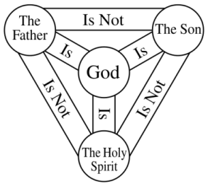
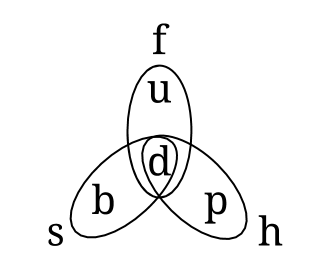
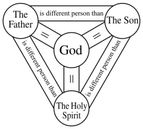
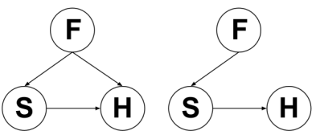
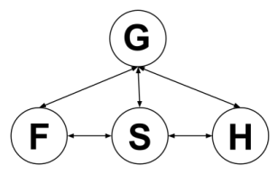
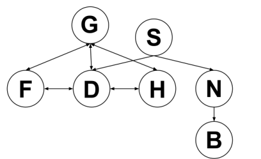

# Trinity
**First published Thu Jul 23, 2009; substantive revision Thu Aug 14, 2025**

*Tuggy, Dale*

A Trinity doctrine is commonly expressed as the statement that the one God exists as or in three equally divine “Persons”, the Father, the Son, and the Holy Spirit. Every term in this statement (God, exists, as or in, equally divine, Person) has been variously understood. The guiding principle has been the creedal declaration that the Father, Son, and Holy Spirit of the New Testament are consubstantial (i.e. the same in substance or essence, Greek: *homoousios*). Because this shared substance or essence is a divine one, this is understood to imply that all three named individuals are divine, and equally so. Yet the three in some sense “are” the one God of the Bible.

After its formulation and imperial enforcement towards the end of the fourth century, this sort of Christian theology reigned more or less unchallenged. But before this, and again in post-Reformation modernity, the origin, meaning, and justification of trinitarian doctrine has been repeatedly disputed. These debates are discussed in supplementary documents to this entry. One aspect of these debates concerns the logical coherence of trinitarian theology. If there are three who are equally divine, isn’t that to say there are at least three gods? Yet the tradition asserts exactly one god. Since the revival of analytic philosophy of religion in the 1960s, many Christian philosophers have pursued what is now called analytic theology, in which doctrines are given formulations which are precise, and it is hoped coherent and otherwise defensible. This article surveys these recent versions of the Trinity doctrine developed using this analytic approach, leveraging concepts from contemporary metaphysics, logic, and epistemology.

## 1. One-self Theories

One-self theories assert the Trinity, despite initial appearances, to contain exactly one self.

### 1.1 Selves, gods, and modes

A self is a being who is in principle capable of knowledge, intentional action, and interpersonal relationships. A deity is commonly understood to be a sort of extraordinary self. In the Bible, the deity Yahweh (a.k.a. “the LORD”) commands, forgives, controls history, predicts the future, occasionally appears in humanoid form, enters into covenants with human beings, and sends prophets, whom he even allows to argue with him. More than a common deity in a pantheon of deities, he is portrayed as being the one creator of the cosmos, and as having uniquely great power, knowledge, and goodness.

Trinitarians believe this revelation of the one God as a great self to have been supplemented or superseded by later revelation showing the one God to be three “Persons” (Greek: *hypostaseis* or *prosopa*, Latin: *personae*). Some Trinity theories understand the Persons to be selves and then try to show that the falsity of monotheism does not follow. (See section 2 below.) A rival approach is to explain that these three divine Persons are really ways the one divine self is, that is to say, modes of the one god; this reduces all but one of the three or four apparent divine selves (Father, Son, Spirit, the triune God) to the remaining one. That is, one of these four is the one god, and the others are his modes. Because the New Testament seems to portray the Son and Spirit as somehow subordinate to the one God, one-self Trinity theories always either reduce Father, Son, and Spirit to modes of the one, triune God, or reduce the Son and Spirit to modes of the Father, who is supposed to be numerically identical to the one God. (See section 1.8 for views on which only the Holy Spirit is reduced to a mode of the Father.)

Because God in the Bible is portrayed as a great self, at the popular level of trinitarian Christianity one-self thinking has a firm hold. Liturgical statements, song lyrics, and sermons frequently use trinitarian names (“Father”, “Son”, “Jesus”, “God”, etc.) as if they were interchangeable, co-referring terms, referring directly or indirectly (via a mode) to one and the same divine self.

### 1.2 What is a mode?

A mode is supposed to be a “way a thing is”, but that might mean several things. A “mode of *X*” might be

- an intrinsic property of *X* (e.g., a power of *X*, an action of *X*)
- a relation that *X* bears to some thing or things (e.g., *X*’s loving itself, *X*’s being greater than *Y*, *X* appearing wonderful to *Y* and to *Z*)
- a state of affairs or event which includes *X* (e.g., *X* loving *Y*, it being the case that *X* is great)

One-self trinitarians often seem to have in mind the last of these. (E.g., The Son is the event of God’s relating to us as friend and savior. Or the Son is the event of God’s taking on flesh and living and dying to reveal the Father to humankind. Or the Son is the eternal event or state of affairs of God’s living in a son-like way.) If an event is (in the simplest case) an entity having a property (or a relation) at a time, then the Son (etc.) will be identified with God’s having a certain property, or being in a certain relation, at a time (or timelessly). By a natural slide of thought and language, the Son (or Spirit) may just be thought of and spoken of as a certain divine property, rather than God’s having of it (e.g., God’s wisdom).

Modes may be essential to the thing or not; a mode may be something a thing could exist without, or something which it must always have so long as it exists. (Or on another way to understand the essential/non-essential distinction, a mode may belong to a thing’s definition or not.)

There are three ways these modes of an eternal being may be temporally related to one another: maximally overlapping, non-overlapping, or partially overlapping. First, they may be eternally concurrent—such that this being always, or timelessly, has all of them. Second, they may be strictly sequential (non-overlapping): first the being has only one, then only another, then only another. Finally, some of the modes may be had at the same times, partially overlapping in time.

### 1.3 One-self Theories and “Modalism” in Theology

Influential 20th century theologians Karl Barth (1886–1968) and Karl Rahner (1904–84) endorse one-self Trinity theories and suggest replacements for the term “Person”. They argue that in modern times “person” has come to mean a self. But three divine selves would be three gods. So even if “Person” should be retained as traditional, its meaning should be expounded using phrases like “modes of being” (Barth) or “manners of subsisting” (Rahner) (Ovey 2008, 203–13; Rahner 1997, 42–45, 103–15)[^ovey-2008][^rahner-1997].

Barth’s own summary of his position is:

> As God is in Himself Father from all eternity, He begets Himself as the Son from all eternity. As He is the Son from all eternity, He is begotten of Himself as the Father from all eternity. In this eternal begetting of Himself and being begotten of Himself, He posits Himself a third time as the Holy Spirit, that is, as the love which unites Him in Himself. (Barth 1956, 1)[^barth-1956]

All of Barth’s capitalized pronouns here refer to one and the same self, the self-revealing God, eternally existing in three ways. Similarly, Rahner says that God

> is – at once and necessarily – the unoriginate who mediates himself to himself (Father), the one who is in truth uttered for himself (Son), and the one who is received and accepted in love for himself (Spirit) – and… *as a result of this*, he [i.e. God] is the one who can freely communicate himself. (Rahner 1997, 101–2)[^rahner-1997]

Similarly, theologian Alastair McGrath writes that

> when we talk about God as one person, we mean one person *in the modern sense of the word* [i.e. a self], and when we talk about God as three persons, we mean three persons *in the ancient sense of the word* [i.e. a persona or role that is played]. (McGrath 1988, 131)[^mcgrath-1988]

All three theologians assume that the three modes of God are all essential and maximally overlapping.

Mainstream Christian theologians nearly always reject “modalism”, meaning a one-self theory like that of Sabellius (fl. 220), an obscure figure who was thought to teach that the Father, Son, and Holy Spirit are sequential, non-essential modes, something like ways God interacts with his creation. Thus, in one epoch, God exists in the mode of Father, during the first century he exists as Son, and then after Christ’s resurrection and ascension, he exists as Holy Spirit (Leftow 2004, 327; McGrath 2007, 254–55)[^leftow-2004][^mcgrath-2007]. Sabellian modalism is usually rejected on the grounds that such modes are strictly sequential, or because they are not intrinsic features of God, or because they are intrinsic but not essential features of God. The first aspect of Sabellian modalism conflicts with episodes in the New Testament where the three appear simultaneously, such as the baptism of Jesus in Matthew 3:16–17. The last two are widely held to be objectionable because it is held that a doctrine of the Trinity should tell us about how God really is, not merely about how God appears, or because a trinitarian doctrine should express (some of) God’s essence. Modern scholars call ancient modalists “Modalistic Monarchians” because they upheld the sole monarchy of the Father, or “patripassians” for their (alleged) acceptance of the view that the Father suffered in the life of the man Jesus.

While Sabellian one-self theories were rejected for the reasons above, these reasons don’t rule out all one-self Trinity theories, such as ones positing the Three as God’s modes in the sense of his eternally having certain intrinsic and essential features. Sometimes a one-self Trinity doctrine is expounded as meaning this, e.g. that God (non-contingently) acts as Creator, Redeemer, and Comforter, or describing “God as transcendent abyss, God as particular yet unbounded intelligence, and God as the immanent creative energy of being… three distinct ways of being God”, with the named modes being intrinsic and essential to God (Ward 2002, 236; cf. Ward 2000, 90; Ward 2015)[^ward-2000][^ward-2002][^ward-2015].

### 1.4 Trinity as Incoherent

The simplest sort of one-self theory affirms that God is, because omniscient, omnipotent, and omnibenevolent, the one divine self, and each Person of the Trinity just is that same self. The “Athanasian” creed (on which see section 5.3) seems to imply that each Person just is God, even while being distinct from the other two Persons. Since the high middle ages some trinitarians have used a Trinity Shield diagram to explain their views.

If each occurrence of “is” here expresses numerical identity, commonly expressed in modern logical notation as “=” then the chart illustrates these claims:

1. Father = God
2. Son = God
3. Spirit = God
4. Father ≠ Son
5. Son ≠ Spirit
6. Spirit ≠ Father

But the conjunction of these claims, which has been called “popular Latin trinitarianism”, is demonstrably incoherent (Layman 2016, 138–39)[^layman-2016]. Because the numerical identity relation is defined as transitive and symmetrical, 1–3 imply the denials of 4–6. If 1–6 are steps in an argument, that argument can continue thus:

1. God = Son (from 2, by the symmetry of =)
2. Father = Son (from 1, 7, by the transitivity of =)
3. God = Spirit (from 3, by the symmetry of =)
4. Son = Spirit (from 2, 9, by the transitivity of =)
5. God = Father (from 1, by the symmetry of =)
6. Spirit = Father (from 3, 11, the transitivity of =)

This shows that 1–3 imply the denials of 4–6, namely, 8, 10, and 12. Any Trinity doctrine which implies all of 1–6 is incoherent. Less formally: it is self-evident that things which are numerically identical to the same thing must also be numerically identical to one another. Thus, if each Person just is God, that collapses the Persons into numerically one and the same thing. But a trinitarian by definition says that the Persons are numerically distinct from one another.

None of this is news to the Trinity theorists whose work is surveyed in this entry. Each theory here is built with a view towards undermining the above argument. In other words, each theorist discussed here, with the exception of some Mysterians (see section 4.2), denies that “the doctrine of the Trinity”, rightly understood, implies all of 1–6. Most theories here aim for coherence, although one (section 4.3) holds that the full truth about the Trinity includes true contradictions, although not the contradictions just mentioned.

### 1.5 Divine Life Streams

Brian Leftow sets the agenda for his own one-self theory in an attack on “social”, that is, multiple-self theories. (See sections 2 and 3.1 below.) In contrast to these, he asserts that

> there is just one divine being (or substance), God…[As Thomas Aquinas says,] God begotten receives numerically the same nature God begetting has. To make Aquinas’ claim perfectly plain, I introduce a technical term, “trope”. Abel and Cain were both human. So they had the same nature, humanity. Yet each also had his own nature, and Cain’s humanity was not identical with Abel’s… A trope is an individualized case of an attribute. Their bearers individuate tropes: Cain’s humanity is distinct from Abel’s just because it is Cain’s, not Abel’s. With this term in hand, I now restate Aquinas’ claim: while Father and Son instance the divine nature (deity), they have but one trope of deity between them, which is God’s…bearers individuate tropes. If the Father’s deity is God’s, this is because the Father *just is* God. (1999, 203–4)

Leftow characterizes this theory as “Latin”, following the recent practice of contrasting Western or Latin with Eastern or Greek or “social” Trinity theories. He considers it to be in the lineage of some prominent Latin-language theorists. (See the supplementary document on the history of trinitarian doctrines, section 3.3.2, on Augustine, and section 4.1, on Thomas Aquinas.) In a later discussion Leftow adds that this Trinity theory needn’t commit to trope theory about properties. Rather, whether or not properties are tropes, “the Father’s having deity = [is numerically identical to] the Son’s having deity. For both are at bottom just *God’s* having deity” (Leftow 2007, 358)[^leftow-2007]. This claim that there is but one token of deity between the Persons is required by the sixth “ecumenical” council; see the supplementary document on the history of trinitarian doctrines, section 3.4.

Leftow makes an extended analogy with time travel; just as a dancer may repeatedly time travel back to the dance stage, resulting in a whole chorus line of dancers, so God may eternally live his life in three “streams” or “strands” (2004, 312–23). Each Person-constituting “strand” of God’s life is supposed to count as a “complete” life (although for any one of the three, there’s more to God’s life than it) (2004, 312). Just as the many stages of the time-traveling dancer’s life are united into stages of her by their being causally connected in the right way, so too, analogously, the lives of each of the three Persons count as “strands of” the life of God because of the Father generating the Son and the Father and the Son spirating the Spirit (313–14, cf. 321–22, Leftow 2012a, 313)[^leftow-2012a].

Time-travel does not require that entities are four-dimensional (2012b, 337). If a single dancer, then, time travels to the past to dance with herself, this does not amount to one temporal part of her dancing with a different temporal part of her. If that were so, neither dancer would be identical to the (whole, temporally extended) woman. But Leftow supposes that both would be identical with her, not merely her temporal parts. He holds that if time travel is possible, a self may have multiple instances or iterations at a time. The Trinity is like this, subtracting out the time dimension; God, in timeless eternity, lives out three lives, or we might say exists in three aspects. In one he’s Father, in another Son, and in another the Holy Spirit. But they are all one self, the one God as it were three times repeated or multiplied.

Leftow argues that his theory isn’t any undesirable form of “modalism” (i.e. a *heretical* one-self theory) because

> Nothing in my account of the Trinity precludes saying that the Persons’ distinction is an eternal, necessary, non-successive and intrinsic feature of God’s life, one which would be there even if there were no creatures. (2004, 327)

Leftow wants to show what is wrong with the following argument (2004, 305–6; cf. 2007, 359):

1. the Father = God
2. the Son = God
3. God = God
4. the Father = the Son (from 1–3)
5. the Father generates the Son
6. God generates God (from 1, 2, 5).

Creedal orthodoxy requires 1–3 and 5, yet 1–3 imply the unorthodox 4, and 1, 2 and 5 imply the unorthodox (and necessarily false) statement 6. So what to do? Lines 1–4 seem perfectly clear, and the inference from 1–3 to 4 seems valid. So too does the inference from 1, 2, and 5 to 6. Why should 6 be thought impossible? The idea is that whatever its precise meaning, “generation” is some sort of causing or originating, something in principle nothing can do to itself. One would expect Leftow, as a one-self trinitarian, to deny 1 and 2, on the grounds that neither Father nor Son are identical to the one self which is God, but rather, each is a mode of God. But Leftow instead argues that premises 1 and 2 are unclear, and that depending on how they are understood, the argument will either be sound but not heretical, or unsound because it is invalid, 4 not following from 1–3, and 6 not following from 1, 2, and 5.

The argument seems straightforward so long as we read “Father” and “Son” as merely singular referring terms. But Leftow asserts that they are also definite descriptions “which may be temporally rigid or non-rigid” (Leftow 2012b, 334–35)[^leftow-2012b]. A temporally rigid term refers to a being at all parts of its temporal career. Thus, if “the president of the United States” is temporally rigid, then in the year 2013 we may truly say that “The president of the United States lived in Indonesia”, not of course, while he was president, but it is true of the man who was president in 2013, that in his past, he lived in Indonesia. If the description “president of the United States” (used in 2013) is *not* temporally rigid, then it refers to Barack Obama only in the presidential phase of his life, and so the sentence above would be false.

“The Father”, then, is a disguised description, something like “the God who is in some life unbegotten” (2012b, 335). (For “the Son” we would substitute “begotten” for the last word.) Because the “=” sign can have a temporally non-rigid description on one or both sides of it, then there can be “temporary identities”, that is, identity statements which are true only at some times but not others. Leftow gives as an example the sentence “that infant = Lincoln”; this is true when Lincoln is an infant but false when he has grown up. Such identity statements can only be true or false relative to times, or to something time-like (2004, 324). If the terms “Father” and “Son” are temporally rigid, or at least like such a term in that each applies to God at all portions of his life (which isn’t *temporally* ordered), then 4 does follow from 1–3. But 4, Leftow argues, is theologically innocuous, as it means something like “the God who is in some life the Father is also the God who is in some life the Son” (2012b, 335). This is “compatible with the lives, and so the Persons, remaining distinct,” seemingly, distinct instances of God (each of which is identical to God), and Leftow accepts 1–4 as sound only if 4 means this.

If the terms “Father” and “Son” are temporally *non–*rigid, or at least *like* such a term in that each applies to God relative to some one portion of his life but not relative to the others, then the argument is unsound. Relative to the Father-strand of God’s life, 1 will be true but 2 will be false. Relative to the Son-strand, 2 will be true, but 1 will be false. 3 and 5 will be true relative to any strand, but in any case, we will not be able to establish either 4 or 6.

Leftow’s theory depends on a concept of modes–intrinsic, essential, eternal ways God is, that is, lives or life-strands. But he does *not* identify the “Persons” of the Trinity with these modes. Rather, he asserts that the modes somehow constitute, cause, or give rise to each Person (2007, 373–75). Like theories that reduce these Persons to mere modes of a self, Leftow’s theory has it that what may appear to be three selves actually turn out to be one self, God. But they, all (apparently) three of them, *just are* (are numerically, absolutely identical to) that one self, that is, God thrice over or thrice repeated.

Some philosophers object that Leftow’s time-travel analogy is unhelpful because time-travel is impossible (Hasker 2009, 158)[^hasker-2009]. Similarly, one may object that Leftow is trying to illuminate the obscure (the Trinity) by the equally or more obscure (the alleged possibility of time travel, and timeless analogues to it).

One may wonder whether Leftow’s life stream theory is really trinitarian. Do not his Persons really, so to speak, collapse into one, since each is numerically identical to God? Isn’t this modalism, rather than trinitarianism (McCall 2003, 428)[^mccall-2003]? Again, one may worry that Leftow’s concept of God being “repeated” or having multiple instances or iterations is either incoherent or unintelligible. And how can such Persons be fully God or fully divine when they exist because of something which is more fundamental, God’s life-strands (Byerly 2019, 81)[^byerly-2019]?

William Hasker objects that assuming Leftow’s theory,

> In the Gospels, we have the spectacle of God–as–Son *praying to himself*, namely to God–as–Father … on the cross, “My God, why have you forsaken me?” On the view we are considering, this comes out as *“Why have I–as–Father forsaken myself–as–Son?”* (Hasker 2009, 166)[^hasker-2009]

In reply, Leftow argues that if we accept the coherence of time travel stories, we should not be bothered by the prospect of “one person at one point in his life begging the same person at another point” (2012a, 321). About the cry of abandonment on the cross, Leftow urges that the New Testament reveals a Christ who (although divine and so omniscient) did not have full access to his knowledge, specifically knowledge of his relation to the Father, and so Christ could not have meant what Hasker said above. Instead, he “would have been using the Son’s ‘myself’ and ’I,’ which … pick out only the Son” (2012a, 322).

Hasker also objects that Leftow’s one–self theory collapses the interpersonal relationships of the members of the Trinity into God’s relating to himself, and suggests that in Leftow’s view, God would enjoy self–love, but not other–love, and so would not be perfect (2009, 161–62, 2012, 331). (On this sort of argument see sections 2.3 and 2.5 below.) Leftow replies that the self–love in question would be “relevantly like love of someone else” and so, presumably, of equal value (2012b, 339).

Does the theory imply “patripassianism”, the traditionally rejected view that the Father suffers? (After all, the Son suffers, and both he and the Father are identical to God.) Leftow argues that nothing heretical follows; if his analysis is right “then claiming that the Father is on the Cross is like claiming that The Newborn [sic] is eligible to join the AARP [an organization for retirees]”, that is, true but misleading (2012b, 336).

### 1.6 Analogy to an Extended Simple

Recent metaphysicians have discussed the possibility of a simple (partless) physical object which is nonetheless spatially extended, occupying regions of space, but without having parts that occupy the sub-regions. Martin Pickup (2016) makes an analogy between this and the idea of a triune God, inspiring his own “Latin” account. Motivated by skepticism about any three-self theory, and taking the “Athanasian” creed as a starting point, he understands the claims that each Person “is God” as asserting the numerical identity of God with that Person. While God is like an extended simple, the relationships between the Persons is “analogous to the relationships between the spatial regions that an extended simple occupies” (418).

The theological costs of this account are high; since each Person is numerically identical with God, each Person is numerically identical to each of the others. One accepting this account thereby denies each of claims 4–6 in section 1.4 above. In response Pickup denies that tradition requires the distinctness of the Persons (427). Another cost is that since each Person is numerically the same with God and God is three Persons, each Person will be three Persons. Pickup concedes that such claims “sound bad” but replies that any “Latin” account of the Trinity will as such have to accept them (428).

### 1.7 Difficulties for One-self Theories

A one-self Trinity is hard to square with the New Testament theme of the interpersonal relationship between Father and Son (Layman 2016, 129–30; McCall 2010, 87–88, 2014, 117–27; Plantinga 1989, 23–27)[^layman-2016][^mccall-2010][^mccall-2014][^plantinga-1989]. Any one-self theory is also hard to square with the Son’s role as mediator between God and humankind (Tuggy and Date 2020, 122–23)[^tuggy-2020]. These teachings arguably assume the Son to be a self, not a mere mode of a self, and to be a different self than his Father. Theories such as Ward’s (section 1.3 above), which make the Son a mere mode, make him something less than a self, whereas others (see section 1.6) make him a self, but the same self as his Father. Either way, the Son seems not to be qualified either to mediate between God and humankind, or to be a friend of the one he calls “Father”.

Again, many traditional Incarnation theories assume that the eternal Son who becomes incarnate (who enters into a hypostatic union with a complete human nature) is the same self as the historical man Jesus of Nazareth. But no mere mode could be the same self as anything, and the New Testament seems to teach that this man was sent by *another* self, God.

Some one–self theories run into trouble about God’s relation to the cosmos. If God exists necessarily and is essentially the creator and the redeemer of created beings in need of salvation, this implies it is not possible for there to be no creation, or for there to be no fallen creatures; God could not have avoided creating beings in need of redemption. One-self trinitarians may get around this by more carefully specifying the properties in question: not *creator* but *creator of anything else there might be*, and not *redeemer* but *redeemer of any creatures in need of salvation there might be and which he should want to save*.

### 1.8 The Holy Spirit as a Mode of God

Some ancient Christians, most 17th-19th century unitarians, present-day “biblical unitarians”, and some modern subordinationists such as the Jehovah’s Witnesses hold the Holy Spirit to be a mode of God—God’s power, presence, or action in the world. (See the supplementary document on [unitarianism](trinity.unitarianism.md).) Not implying modalism about the Son, this position is harder to refute on New Testament grounds, although mainstream theologians and some subordinationist unitarians reject it as inconsistent with New Testament language which arguably implies that the Holy Spirit is a self (Clarke 1738, 147)[^clarke-1738]. Modalists about the Spirit counter with other biblical language which suggests that the “Spirit of God” or “Holy Spirit” refers to either God himself, a mode of God (e.g., his power), or an effect of a mode of God (e.g., supernatural human abilities such as healing). (Burnap 1845, 226–52; Lardner 1793a, 79–174; Wilson 1846, 325–32.)[^burnap-1845][^lardner-1793a][^wilson-1846] This exegetical dispute is difficult, as all natural languages allow persons to be described in mode-terms (“Hillary is Bill’s strength.”) and modes to be described in language which literally applies only to persons. (“God’s wisdom told him not to create beer-sap trees.”)

## 2. Three-self Theories

One-self Trinity theories are motivated in part by the concern that if there are three divine selves, this implies that there are three gods. Three-self theories, in various ways, deny this implication. They hold the Persons of the Trinity to be selves (as defined above, section 1.1). A major motivation here is that the New Testament writings seem to assume that the Father and Son (and, some also argue, the Holy Spirit) are different selves (e.g. Layman 2016, 131–32)[^layman-2016].

### 2.1 Relative Identity Theories

Why can’t multiple divine selves be one and the same god? It would seem that by being the same god, they must be numerically the same entity; “they” are really one, and so “they” can’t differ in any way (that is, this one entity can’t differ from itself). But then, they (really: it) can’t be different divine selves.

Relative identity theorists think there is some mistake in this reasoning, so that things may be different somethings yet the same something else. They hold that the above reasoning falsely assumes something about numerical sameness, arguing that numerical sameness, or identity, either can be or always is relative to a kind or concept.

Relative identity theorists are concerned to rebut this sort of argument:

1. The Father is God.
2. The Son is God.
3. Therefore, the Father is the Son.

If each occurrence of “is” here is interpreted as identity (“absolute” or non-relative identity), then this argument is indisputably valid. Things identical to the same thing must also be identical to one another. The relative identity trinitarian argues that one should read the “is” in 1 and 2 as meaning “is the same being as” and the “is” in 3 as meaning “is the same divine Person as”. Doing this, one may say that the argument is invalid, having true premises but a false conclusion.

These theorists reject another response to the above argument, which would be to reject it as invalid because 1 and 2 mean that each is a mode of God (see section 1), and while these claims are true, they don’t imply 3, since the Father and the Son are two different modes. Against this, the theories of this section assume that the three Persons of the Trinity are three selves (Rea 2009, 406. 419; van Inwagen 1995, 229–31)[^rea-2009][^inwagen-1995].

Following Rea (2003) we divide relative identity trinitarian theories into the pure and the impure. Pure theories accept (1) either that there is no such relation as absolute identity or that such statements are definable in terms of relative-identity relations, and (2) that trinitarian statements of sameness and difference (e.g. the Father is God, the Father is not the Son) are to be analyzed as involving relative and not absolute identity relations, whereas the impure theories accept only (2), allowing that statements about absolute identity (e.g. a = b) may be intelligible, true, and not definable in terms of relative identity statements, against (1). (434–38)

#### 2.1.1 Pure Relative Identity Theories

Peter Geach (1972, 1973, 1980) argues that it is meaningless to ask whether or not some a and b are “the same”; rather, sameness is relative to a sortal concept. Thus, while it is senseless to ask whether or not Paul and Saul are identical, we can ask whether or not Paul and Saul are the same human, same person, same apostle, same animal, etc. The doctrine of the Trinity is construed as the claim that the Father, Son, and Holy Spirit are the same *God*, but are not the same *Person*. They are “God-identical but Person-distinct” (Rea 2003, 432)[^rea-2003].

As Joseph Jedwab explains, traditional Trinity language and commitments arguably lead naturally to a relative identity account.

> *Prima facie*, the doctrine of the Trinity implies the sortal relativity of identity thesis, which says that where “*R*” and “*S*” are sortals, it could be that for some x and y, x and y are the same *R* but different *S*s. The Father and the Son are the same God, else they are two Gods, which implies polytheism and so is false. But the Father and the Son are different divine Persons, else they are one divine Person, which implies the Sabellian heresy and so is false. So the Father and the Son are the same God but different divine Persons. (2015, 124)

Geach’s approach to the Trinity is developed by Martinich (1978, 1979) and Cain (1989). Jedwab (2015) criticizes Cain’s version as implying philosophical, theological and christological difficulties. Cain (2016) defends his more Geachian approach.

Pure relative identity trinitarianism depends on the controversial claim that there’s no such relation as (non-sortal-relative, absolute) identity. Most philosophers hold, to the contrary, that the identity relation and its logic are well-understood; such are expounded in recent logic text-books, and philosophers frequently argue in ways that assume there is such a relation as identity (Baber 2015, 165; Layman 2016, 141)[^baber-2015][^layman-2016]. One might turn to a weaker relative identity doctrine; outside the context of the Trinity, philosopher Nicholas Griffin (1977; cf. Rea 2003, 435–36)[^rea-2003] has argued that while there *are* identity relations, they are not basic, but must be understood in terms of relative identity relations. On either view, relative identity relations are fundamental.

It has been objected to Geach’s claim about the senselessness of asking if a and b are (non-relatively) “the same” that,

> Given that we have succeeded in picking out something by the use of “*a*” and in picking out something by the use of “*b*” it surely is a complete determinate proposition that *a* = *b*, that is, it is surely either true or false that the item we have picked out with “*a*” is the item we have picked out with “*b*”. (Alston and Bennett 1984, 558)[^alston-1984]

Rea objects that pure relative identity theory presupposes some sort of metaphysical anti-realism, the controversial doctrine that there is no realm of real objects which exists independently of human thought (2003, 435–36). Baber replies that such worries are misguided, as the only aim of relative identity theory should be to show a way in which the Trinity might be coherent (2015, 170).

Trenton Merricks objects that if a and b “are the same F”, this implies that a is an F, that b is an F, and that a and b are (absolutely, non-relatively) identical. But this widely accepted analysis is precisely what relative identity trinitarians deny. This leads to the objection that relative-identity trinitarian claims are unintelligible (that is, we have no grasp of what they mean). If someone asserts that Fluffy and Spike are “the same dog” yet denies that each is a dog and that Fluffy = Spike, we have no idea what this person is asserting. Similarly with the claim that Father and Son are “the same God” but are not identical (Merricks 2006, 301–5, 321; cf. Layman 2016, 141–42)[^layman-2016][^merricks-2006].

Baber (2015) replies that if the sortal *dog* is “dominant”, meaning that for any sortal F, if x and y are the same dog, they will also be the same F, then the claim that Fluffy and Spike are the same dog but not absolutely identical *is* intelligible. After all, we can understand that the claim implies that Fluffy and Spike are the same animal, the same pet, and so on (167). The relative identity trinitarian, Baber says, must hold that “*Being* does not dominate [i.e. imply sameness with respect to] *Person* but rather that *Person* dominates *Being*”. However, there’s no easy way to prove this, and dominance claims are theory-relative (*ibid.*). But such a claim will just be a part of the relative identity theorist’s Trinity theory (169).

One may also object to either sort of relative identity account being the historical doctrine on the grounds that only those conversant in the logic of the last 120 years or so have ever had a concept of relative identity. But this may be disputed; Anscombe and Geach (1961, 118) argue that Aquinas should be interpreted along these lines, Richard Cartwright (1987, 193) claims to find the idea of relative identity in the works of Anselm and in the Eleventh Council of Toledo (675), and Jeffrey Brower (2004) finds a similar account in the works of Peter Abelard. (On Aquinas, see the supplementary document on the history of trinitarian doctrines section 4.) Christopher Hughes Conn (2019) argues that Anselm was the first to consciously develop a Trinity theory involving relative identity.

#### 2.1.2 Impure Relative Identity Theories: A Relative Identity Logic

Peter van Inwagen (1995, 2003, 2022) tries to show that there is a set of propositions representing a possibly orthodox interpretation of the “Athanasian” creed (see section 5.3) which is demonstrably self-consistent, refuting claims that the Trinity doctrine is obviously self-contradictory. He formulates a trinitarian doctrine using a concept of relative identity, without employing the concept of absolute identity or presupposing that there is or isn’t such a thing (1995, 241). Specifically, he proves that the following eight claims (understood as involving relative and never absolute identity, the names being read as descriptions) don’t imply a contradiction in his system of relative identity logic.

1. There is (exactly) one God.
2. There are (exactly) three divine Persons.
3. There are three divine Persons in one divine Being.
4. God is the same being as the Father.
5. God is a person.
6. God is the same person as the Father.
7. God is the same person as the Son.
8. The Son is not the same person as the Father.
9. God is the same being as the Father. (249, 254)

Van Inwagen neither endorses this Trinity theory, nor presumes to pronounce it orthodox, and he admits that it does little to reduce the mysteriousness of the traditional language.

It may be objected, as to the preceding theory, that van Inwagen’s relative identity trinitarianism is unintelligible. Merricks argues that this problem is more acute for van Inwagen than for Geach, as the former declines to adopt Geach’s claim that all assertions of identity, in all domains of discourse, and in everyday life, are sortal-relative (Merricks 2006, 302–4)[^merricks-2006]. That is, if we all understand absolute identity claims, the most natural interpretation of a sentence like “God is the same person as the Son” is the conjunction of these three claims: God is a person, the Son is a person, and God = the Son. If someone declined to agree with all three of those statements yet asserted that “God is the same person as the Son,” her meaning would be unclear.

Michael Rea (2003) objects that by remaining neutral on the issue of identity, van Inwagen’s theory allows that the three Persons are (absolutely) non-identical, in which case “it is hard to see what it could possibly mean to say that they are the *same being*” (Rea 2003, 441)[^rea-2003]. It seems that any things which are non-identical are *not* the same being. Thus, van Inwagen must assume that there is absolute identity, and deny that this relation holds between the Persons. Thus, van Inwagen has not demonstrated the consistency of (this version of) trinitarianism. Further, the theory doesn’t rule out polytheism, as it doesn’t deny that there are non-identical divine beings. In sum, the impure relative identity trinitarian owes us a plausible and orthodox metaphysical story about how non-identical beings may nonetheless be “one God”, and van Inwagen hasn’t done this, staying as he has in the realm of logic (Rea 2003, 441–42)[^rea-2003].

In later discussions van Inwagen goes farther, claiming that trinitarian doctrine is inconsistent “if the standard logic of identity is correct”, and denying there is any “relation that is both universally reflexive [i.e., everything bears the relation to itself] and forces indiscernibility [i.e. things standing in the relation can’t differ]” (2003, 92; cf. 2022). Thus, there’s no such relation as classical or absolute identity, but there are instead only various relative identity relations (92–93). In so doing he moves to a “pure” relative identity approach to the Trinity, as described in section 2.1.1. Although he professes belief in the Trinity, van Inwagen does not commit to a relative identity Trinity doctrine (2022, 130–31).

Many philosophers would object that whatever reason there is to believe in the Trinity, it is *more* obvious that there’s such a relation as identity, that the indiscernibility of identicals is true, and that we do successfully use singular referring terms.

Jc Beall points out the cost of positing unmarked equivocations in the sources of trinitarian doctrine, e.g. in the “Athanasian” creed (2023a, 101, 107–8). Beall also objects that van Inwagen and other relative identity theorists have not adequately described the entailments of the various sorts of relative-identity claims (2023a, 102), and in particular they fail to specify sufficient conditions for the truth of claims involving them (2021, 140–45). Worse, given some plausible assumptions if there are relative identity relations then there are also absolute identity relations, and on some other plausible assumptions contradictions come back even while using the recommended relative identity paraphrases (2023a, 104–5, 108–11).

Vlastimil Vohánka (2013a) argues that van Inwagen has done nothing to show the logical possibility of any Trinity theory. Just because a set of claims can’t be proven inconsistent in van Inwagen’s relative identity logic, it doesn’t follow that such claims don’t imply a contradiction, or that it is metaphysically possible that all the claims are true. At one point van Inwagen tells a short non-theological story whose claims, when translated into his relative identity logic, have the same forms as the Trinity propositions. The story, he argues, is clearly not self-contradictory; thus, he concludes, neither are the Trinity propositions, since they have the same logical forms. In response, Vohánka concocts a short non-theological story whose claims translate into claims of the same form in relative identity logic yet *are* clearly logically impossible (207–11). He concludes that “there’s no ground for thinking that formal consistency in [relative identity logic] guarantees logical possibility”, and that “sharing a form in [relative identity logic] with a logically possible proposition does not guarantee logical possibility” (211–12). Van Inwagen agrees (2022, 124–25).

#### 2.1.3 Impure Relative Identity Theories: Constitution Trinitarianism

Another theory claims to possess the sort of metaphysical story van Inwagen’s theory lacks. Based on the metaphysical concept of constitution, Rea and Brower develop a three-self Trinity theory according to which each Person is non-identical to the others, as well as to God, but is nonetheless “numerically the same” as all of them (Brower and Rea 2005a; Rea 2009, 2011)[^brower-2005a][^rea-2009][^rea-2011]. They employ an analogy between the Christian God and material objects. When we look at a bronze statue of Athena, we’re viewing one material object, yet we can distinguish the lump of bronze from the statue. These cannot be identical, as they differ (e.g., the lump could, but the statue couldn’t survive being smashed flat). We should say that the lump and statue stand in a relation of “accidental sameness”. This means that they needn’t be, but in fact are “numerically the same” without being identical. While they are numerically one physical object, they are two hylomorphic compounds, that is, two compounds of form and matter, sharing their matter. This, they hold, is a plausible solution to the problem of material constitution (Rea 1995).

Similarly, the Persons of the Trinity are so many selves constituted by the same stuff (or something analogous to a stuff). These selves, like the lump and statue, are numerically the same without being identical, but they don’t stand in a relation of *accidental* sameness, as they could not fail to be related in this way. Father, Son, and Spirit are three quasi form-matter compounds. The forms are properties like “being the Father, being the Son, and being the Spirit; or perhaps being Unbegotten, being Begotten and Proceeding” (Rea 2009, 419)[^rea-2009]. The single subject of those properties is “something that plays the role of matter,” which Rea calls “the divine essence” or “the divine nature” (Brower and Rea 2005a, 68; Rea 2009, 420)[^brower-2005a][^rea-2009]. Whereas in the earlier discussion “the divine essence [is] not… an individual thing in its own right” (Brower and Rea 2005a, 68; cf. Craig 2005, 79)[^brower-2005a][^craig-2005], in a later piece, Rea holds the divine nature to be a substance (i.e. an entity, an individual being), and moreover “numerically the same” substance as each of the three. Thus, it isn’t a fourth substance; nor is it a fourth divine Person, as it isn’t, like each of the three, a form-(quasi-)matter compound, but only something analogous to a lump of matter, something which constitutes each of the Three (Rea 2009, 420; Rea 2011, sec. 6)[^rea-2009][^rea-2011]. Rea adds that this divine nature is a fundamental power which is sharable and multiply locatable. He doesn’t say whether it is either universal or particular, saying, “I am unsure whether I buy into the universal/particular distinction” (Rea 2011, sec. 6)[^rea-2011]. All properties, in his view, are powers, and vice versa. Thus, this divine nature is both a power and a property, and it plays a role like that of matter in the Trinity.

This three-self theory may be illustrated as follows (Tuggy 2013, 134)[^tuggy-2013].

There would seem to be seven realities here, none of which is (absolutely) identical to any of the others. Four of them are properties: the divine nature (d), being unbegotten (u), being begotten (b), and proceeding (p). Three are hylomorphic (form-matter) compounds: Father, Son, and Holy Spirit (f, s, h)–each with the property d playing the role of matter within it, and each having its own additional property (respectively: u, b, and p) playing the role of form within it. Each of these compounds is a divine self. The ovals can be taken to represent the three hylomorphs (form-matter compounds) or the three hylomorphic compounding relations which obtain among the seven realities posited. Three of these seven (f, s, h) are to be counted as one god, because they are hylomorphs with only one divine nature (d) between them. Thus, of the seven items, three are properties (u, b, p), three are substances which are hylomorphic compounds (f, s, h), and one is both a property and a substance, but a simple substance, not a compound one (d).

Brower and Rea argue that their theory stands a better chance of being orthodox than its competitors, and urge in its favor that leading medieval trinitarians such as Augustine, Anselm, and Aquinas say things which seem to require a concept of numerical sameness without identity. (See Marenbon 2007, Brower 2004, and the supplementary document on the history of Trinity theories, sections 3.3.2, on Augustine, and 4.1, on Thomas Aquinas.)[^brower-2004][^marenbon-2007]

In contrast to other relative-identity theories, this theory seems well-motivated, for its authors can point to something outside trinitarian theology which requires the controversial concept of numerical sameness without identity. This concept, they can argue, was not concocted solely to acquit the trinitarian of inconsistency. But this strength is also its weakness, for philosophers are heavily divided on the reality, nature, and metaphysical utility of constitution. Some deny that a metaphysics of material objects should involve constitution, since strictly speaking there are no statues or pillars, for these apparent objects should be understood as mere modes of the particles that compose them. Arguably, truths about statues and pillars supervene on truths about arrangements of particles (Byerly 2019, 82–83)[^byerly-2019].

This Constitution theory has been criticized as underdeveloped, unclear in its aims, unintelligible, incompatible with self-evident truths, unorthodox relative to Roman Catholicism, polytheistic and not monotheistic, not truly trinitarian, involving too many divine individuals (primary substances), out of step with the broad historical catholic tradition, implying that the Persons of the Trinity can’t simultaneously differ in non-modal and non-temporal properties, not a theological improvement over simpler relative identity approaches, and as wrongly implying that terms like “God” are systematically ambiguous (Craig 2005; Hasker 2010b; Hughes 2009; Layman 2016; Leftow 2018; Pruss 2009; Tuggy 2013)[^craig-2005][^hasker-2010b][^hughes-2009][^layman-2016][^leftow-2018][^tuggy-2013].

#### 2.1.4 Impure Relative Identity Theories: Conciliar Social Theory

Scott Williams has constructed a similar theory in a series of articles and a book (Williams 2013, 2017, 2020, 2021, 2022a, 2024)[^williams-2013][^williams-2017][^williams-2020][^williams-2022a][^williams-2024]; this was formerly dubbed a “Latin Social Trinity”, but now the preferred term is “Conciliar Social Trinity”. One of several motivations for this theory is to build a theory consistent with the requirements of all seven “ecumenical” councils (Williams 2022, sec. 3; 2024, 3; see also section 5.3 below).

In common with Leftow’s “Latin” theory and Hasker’s “Social” theory (see sections 1.5, 2.4), Williams says that there is one “concrete instance or trope of the divine nature” which is a constituent of each Person. Each Person is also constituted by an incommunicable attribute, begetting (Father), being begotten (Son), and being spirated (Spirit) (2017, 324). He understands each Person to be “an incommunicable existence of an intellectual nature” (326). In his view any person is a person “ontologically and explanatorily prior to any cognitive acts of volitions that that person in question has or might have” (2017, 327; cf. 2013, 2019). Each Person is essentially numerically the same essence as the one divine essence, while being a numerically different Person from the other two Persons. Thus, the account involves irreducible relations of kind-relative numerical sameness. In a later piece Williams clarifies that to say that “The Father is God” is to be understood as “numerical predication”; the meaning is that the divine nature is a constituent of the Father. But unlike alleged cases of “numerical sameness without identity”, this relation between the divine nature and the Father is asymmetrical (2024, 27–29). But the divine Persons are not (absolutely) numerically identical to one another, and each is not (absolutely) numerically identical to the divine essence. This divine essence is like an Aristotelian first substance in that it exists on its own (not in another) and in being a concrete particular, but unlike first substances it is communicable, in other words, it can be shared by non-identical things, the divine Persons (2017, 326). The term “God” can refer to any of the Persons, or to the divine essence. The term “Trinity” is a plural-referring term which refers to the plurality of the divine Persons (2013, 85). (See section 5.1.)

Williams considers it an axiom of trinitarian theorizing that “the divine persons are necessarily unified or necessarily agree regarding all things” (2017, 321). Some rival theories try to account for this “necessary agreement thesis” by showing how, allegedly, the Persons would have to come up with some policy which would prevent disagreement. Williams finds such claims “philosophically unsatisfying”, and instead argues that the three Persons can never disagree because they have numerically one will, one power of choosing (322). Unlike any other three persons, the Persons of the Trinity, because they share one divine nature, share one set of powers, and so any exercise of any divine power belongs to each of the three. In this case, Williams analyzes thinking as producing and using a token sentence in what we might call divine mentalese. Building on work by John Perry on indexical terms like “I”, Williams points out that a single token of a sentence in English may be used by different agents, and may thus have multiple meanings. For example,

> Suppose that Peter produces…a sign that reads, “I am happy,” and that Peter uses this sign by holding it up. Peter affirms that Peter is happy. Later, Peter puts the sign on the ground and Paul picks up the same sign and holds it up such that Paul affirms that Paul is happy. Paul uses numerically the same token as Peter did, yet when Paul uses it he affirms something different than Peter. (2013, 81)

Similarly, if divine Persons think using a language-like divine mentalese, then one token of this may be used by different Persons and have a different significance for each. The idea is that a person relates to a proposition (the content of his thought) by means of a token sentence which he produces and uses to think. But these mental acts, given that the Persons share one set of powers, must be shared by all three of them. Yet, the thoughts thereby thought will differ. For example,

> if the Father uses a mental token of “I am God the Father” and in so doing affirms a proposition, then the Father affirms that God the Father is identical to God the Father. If the Son uses the same mental token of “I am God the Father”… the Son affirms the proposition that the Son is essentially numerically the same divine nature as the Father without being identical to the Father. (2017, 331)

This account denies as an ungrounded modern assumption that “distinct and incommunicable intellectual acts and volitional acts are necessary conditions for being a person” (339). While it employs recent thinking about indexical terms and other matters, Williams considers this account to fit well with historical theologians such as Gregory of Nyssa, Henry of Ghent, and John Duns Scotus (345). That the persons share all mental acts does not imply that they share one mind or that there is one consciousness in the Trinity. Rather, the access consciousness, experiential consciousness, and introspective consciousness of each Person may differ (2020, 102–7).

A New Testament reader might question the assumption that the Persons of the Trinity can’t differ with respect to will, given the temptation of the Son (but not of the Father) and an occasion when the Son asked the Father to be excused from a difficult trial (Matthew 4:1–11; James 1:13; Mark 14:36).

In a response, William Hasker objects that it seems that sometimes human beings can think without using any language. Why, then, should we suppose divine Persons to think only by means of mental token sentences? Perhaps they can just relate directly to propositions (the contents of their thoughts). Worse, Williams posits that this divine mental language is ambiguous, but Hasker says, “we would naturally expect a divine language of thought to be very precise indeed, perhaps maximally so” (Hasker 2018b, 364)[^hasker-2018b]. He also objects that the theory wrongly counts mental acts and has various problems of coherence and intelligibility.

Williams replies that divine mental tokens are needed “to explain why a divine person’s mental act is directed at (among all possible propositions) the proposition it is directed at” (2020, 115). He denies that ambiguity is always an imperfection of a language and urges that there is nothing objectionable about divine Persons using mental tokens that can be used to express various propositions (110–11). This complex dialectic unfolds in a series of articles in the journal *Faith and Philosophy*; the details are beyond the scope of this entry.

#### 2.1.5 Impure Relative Identity Theories: Episodic Personhood

Another relative identity theory by Justin Mooney (2021) depends on an entirely different metaphysical account to show how multiple persons may each be the same being. Metaphysician Ned Markosian proposes a thought experiment in which a man dies and is mummified, and then a long time later the mummy’s parts are re-arranged into a living woman who has an utterly different psychology than the dead man. The point is that the woman is the same object as the man but is not the same person as the man, because the instances of personhood in his life aren’t part of the same episode of personhood (656–56). Mooney applies Markosian’s ideas about “identity under a sortal” to the Trinity. On this account, “God is a single, divine substance that is simultaneously or atemporally participating in three distinct episodes of personhood–those of the Father, Son, and Spirit” (658). Thus, each Person just is God, but none is the same Person as any other divine Person. The account may be illustrated by modifying the traditional Trinity shield:

On this theory, being different Persons doesn’t imply being numerically distinct.

One may worry that such Persons must be one and the same Person since they have but one substance between them, but Mooney answers that they are individuated by their causal relationships, following Swinburne (1994). In addition, following Effingham, he says that they are not one and the same Person because they aren’t linked by immanent causal relations. (658–59) These are “those causal links an entity bears to itself from one time to another whereby the way it is earlier on causes how it is later on” (Effingham 2015, 35)[^effingham-2015]. Following Moreland and Craig (2017), Mooney adds that God possesses three mental faculties, each had by one of the Persons (659). Finally, adapting ideas from Swinburne (1994), he says that

> the Father’s episode of personhood occurs simply because God is a divine being, and a divine being is essentially a personal being. By nature, God instantiates whatever psychological properties are necessary for being a person. The Son’s episode of personhood occurs because the Father wills that there is an instantiation of personhood by the divine substance which is not immanent-causally linked to the Father’s instantiation of personhood. And the Spirit’s episode occurs because one or both of these persons will(s) that there is yet another instantiation of personhood by the divine substance which is not connected by immanent causal relations to either the Father’s or the Son’s instantiation of personhood. (659)

He remains neutral on whether this process is either temporal or necessary.

Unlike other relative identity theories, this account, like some one-self theories, affirms the absolute identity of each Person with God; each is the same thing or being or primary substance, God. This generates a concern that the account may be heretical modalism. Mooney replies that “if Markosian’s episodic view of personal identity is right, the model is not modalist” (660). The reason is that on this account there are three episodes of personhood, which implies that there are three Persons, even though there is one being which is the component thing in each episode, a single subject of the properties that are involved in being a Person.

Even though the account has it that these three are different Persons, still, it identifies each with God, which entails their identity with one another; being the same thing as God, they must be the same thing as each other. Given this, it would seem that they can’t differ in any way, e.g. the Son becomes incarnate but the Father does not (660). Mooney replies that the Trinity is mysterious, and that probably a sentence like “The Son became incarnate but the Father didn’t” might be understood as not requiring a simultaneous or eternal difference between the being that is the Son and the one which is the Father. In Markosian’s thought experiment, one would think that person-names would track with the different stages in the career of the one object, so that, say, “Alice” would refer to the thing only in its latest stages, and “Bob” would apply to it only in its pre-mummy career. Thus, names like “Father” and “Son” should refer to God only in one or the other of God’s Person-episodes. Mooney suggests, then, that “The Son became incarnate but the Father didn’t” will be true if and only if the Son but not the Father is the same person as someone who became incarnate, that is, God becomes incarnate in the Person-episode associated with the name “Son” but not in the one associated with “Father” (661).

This, Mooney argues, shows why when counting objects, we should count by (absolute) identity, while when counting persons we should count by the relation same-person. In the Trinity, then, we count one thing but three Persons; the Persons are the same thing but different Persons (662). The account also solves his “problem of Triunity” (2018), which is that as normally analyzed, these three statements can’t all be true, and yet arguably a trinitarian is committed to all three of them:

1. God is triune.
2. The Son is God.
3. The Son is not triune. (2021, 663)

The solution is that even though “strictly speaking, the Son is triune” since the Son just is God and God is triune, the meaning of 3 is that “the Son is not the *same person* as anyone who is triune”, which is both true and consistent with 1 and 2. Mooney adds that the property being triune should not be confused with the property of being the same Person as someone who is triune; only the first, in his view, is an essential divine attribute (663–64).

Mooney argues that this account also solves problems relating to divine processions and aseity. The Son, being God, must have the property of aseity. But Mooney suggests that the Father’s generation of the Son doesn’t explain the Son’s existence (which would rule out the Son’s aseity), but only the Son’s being a person distinct from the Father (665).

The viability of this theory rests on a particular metaphysics of personhood. One might think, contra Markosian and Mooney, that the woman in the story is one being, the mummy is a second being (even though composed of many or all of the same parts), and the man is a third being. Similarly, one may wonder whether numerically distinct Persons can each be numerically the same as one god. The theory implies the falsity of the principle that for any x and y, if they are different Fs, then x is an F, y is an F, and x ≠ y. One might also question the theory’s way of dealing with apparent differences between the (numerically identical) Persons; any differences of the form “the Father is F but the Son is not F” are analyzed as meaning “the Father is the same Person as someone who is F and the Son is not the same Person as someone who is F”. Does the original claim really mean what the analysis says?

### 2.2 20th Century Theologians and “Social” Theories

Some influential 20th-century theologians interpreted the Trinity as containing just one self. (See section 1.3 above.) In the second half of the century, many theologians reacted against one-self theories, criticizing them as modalist or as somehow near-modalist. This period also saw the wide and often uncritical adoption of a paradigm for classifying Trinity theories which derives from 19th c. French Catholic theologian Théodore de Régnon (Barnes 1995)[^barnes-1995]. On this paradigm, Western or Latin or Augustinian theories are contrasted with Eastern or Greek or Cappadocian theories, and the difference between the camps is said to be merely one of emphases or “starting points”. The Western theories, it is said, emphasize or “start with” God’s oneness, and try to show how God is also three, whereas the Eastern theories emphasize or “start with” God’s threeness, and try to show how God is also one. The two are thought to emphasize, respectively, psychological or social analogies for understanding the Trinity, and so the latter is often called “social” trinitarianism. But this paradigm is now widely rejected as unhelpful and simply not accurate to the history of Trinitarian theology (Cross 2002, 2009; Holmes 2012; McCall 2003; Williams 2022b, 356–57)[^cross-2002][^mccall-2003][^williams-2022b][^holmes-2012].

Although the language of “Latin” vs. “social” Trinity theories has been adopted by many analytic philosophers (e.g. Leftow 1999; Hasker 2010c)[^hasker-2010c][^leftow-1999], these have interpreted the different theories as logically inconsistent (i.e. such that both can’t be true), and not merely as differing in style, emphasis, or sequence.

Some 20th century theological sources, accepting the de Régnon paradigm, blame the Western tradition for “overemphasizing the oneness” of God, and recommend that balance may be restored by looking to the Eastern tradition. A number of concerns characterize theologians in this 20th and 21st century movement of “social” trinitarianism:

- Preserving genuinely interpersonal relationships between the Persons of the Trinity, particularly the Father and the Son.
- Doing justice to the New Testament idea of Christ as a personal mediator between God and humankind.
- Suspicion that the “static” categories of Greek philosophy have in previous trinitarian theologies obscured the dynamic and personal nature of the triune God.
- Concern that traditional or Western trinitarian theology has made the doctrine irrelevant to practical concerns such as politics, gender relations, and family life.
- The idea that to be Love itself, or for God to be perfectly loving, God must contain three subjects or persons (or at any rate, more than one). (See sections 2.3 and 2.5.)

(For surveys of this literature see Kärkkäinen 2007; Olson and Hall 2002, 95–115; Peters 1993, 103–45.)[^kärkkäinen-2007][^olson-2002][^peters-1993] These writers are often unclear about what Trinity theory they’re endorsing. The views seem to range from tritheism, to the idea that the Trinity is an event, to something that differs only slightly, or only in emphasis, from pro-Nicene or one-self theories (see section 1 and section 3.3 of the supplementary document on the history of trinitarian doctrines). Merricks observes that some views advertised as “social trinitarianism” make it “sound equivalent to the thesis that the Doctrine of the Trinity is true but modalism is false” (Merricks 2006, 306)[^merricks-2006]. However, a number of Christian philosophers, and some theologians employing the methods of analytic philosophy, have started with this literature and then proceeded to develop relatively clear three-self Trinity theories, which are surveyed here. They differ in how they attempt to secure monotheism (Leftow 1999)[^leftow-1999]. There are many such Trinity theories, and it is not clear that all the options have yet been explored (Davidson 2016)[^davidson-2016].

### 2.3 Ersatz Monotheism

A problem for any three-self Trinity theory is that numerically three selves seem to be numerically three things. And according to a theory of essences or natures, a thing which has or which is an instance of an essence or nature is thereby a thing of a certain kind. All Trinity theories include the Nicene claim that the Persons of the Trinity have between them but one essence or nature, the divine one. But it would seem that by definition a thing with the divine essence is a god, and so three such things would be three gods.

Some three-self theories in effect concede that they imply tritheism (three things, each of which has properties sufficient for being a god), but argue that surely a correct Trinity theory can’t avoid the right type of tritheism, and can avoid any undesirable tritheism, such as ones involving unequal divinity of the Persons, Persons which are in some sense independent, or Persons who are in principle separable (McCall 2010, 2014; Plantinga 1988, 1989; Yandell 2010, 2015)[^mccall-2010][^mccall-2014][^plantinga-1988][^plantinga-1989][^yandell-2010][^yandell-2015].

Richard Swinburne has developed a type of three-self Trinity theory which in the eyes of most critics seems to be “a fairly straightforward form of tritheism” (Alston 1997, 55; see also Beall 2023a, 100; Clark 1996; Davidson 2016; Feser 1997; Howard-Snyder 2015a; Rea 2006; van Inwagen and Howard-Snyder 1998; van Inwagen 2003, 88; Vohánka 2014, 56)[^alston-1997][^beall-2023a][^clark-1996][^davidson-2016][^howard-snyder-2015a][^rea-2006][^inwagen-2003][^inwagen-1998][^vohánka-2014]. In a series of articles and books Swinburne’s views have changed in significant ways (Swinburne 1988, 1994, 2008, 2018)[^swinburne-1988][^swinburne-1994][^swinburne-2008][^swinburne-2018], but this entry focuses on his latest work on the Trinity.

Swinburne aims to build his theory on widespread traditional agreements between most catholic theologians since at least the fourth and fifth centuries (Swinburne 2018, 419)[^swinburne-2018]. The Persons of the Trinity are three beings, each a self which satisfies Boethius’s definition of a “person” as “an individual substance (*substantia*) of a rational nature” (421). Each is divine in that each has all the divine attributes. “A divine person is naturally understood as one who is essentially eternally omnipotent and exists (in some sense) ‘necessarily’ ” (427). He argues that omnipotence entails perfect goodness and omniscience. While all three of the Persons exist necessarily (inevitably), the Father does this independently while the Son and Spirit exist of necessity dependently, because necessarily, the Father exists, and his existence implies that he causes them (437, n. 14). These actions of the Father are inevitable and not voluntary, but they are via the Father’s will (425, 428). This causing is traditionally described as the eternal generation of the Son by the Father, and the eternal proceeding of the Spirit from the Father, or from the Father and the Son. For Swinburne, the Son is “caused by the Father alone” while the Spirit is “caused by the Father and/or through the Son” (429). The theory then is committed to one of these two models of the divine processions.

Swinburne has constructed a couple versions of an argument which purports to show why, if there is at least one divine being or Person, there must be exactly three, with the second and third caused ultimately by the first. In other words, given that it is possible that there be a divine Person, it is metaphysically impossible that there be only one, and it is metaphysically necessary that there be exactly three. Most trinitarians have assumed that such an argument is neither possible nor desirable, as the Trinity can be known only by divine revelation. Against this, Swinburne says that “even if you regard the New Testament as an infallible source of doctrine, you cannot derive from it a doctrine of the Trinity”, because when it comes to passages about the Spirit,

> there are non-Trinitarian ways of interpreting…[these] which are just as plausible as interpreting them as expressing the doctrine that the Holy Spirit is a divine person…So unless Christians today recognize some good a priori argument for a doctrine of the Trinity (and most of them do not recognize such an argument), or unless they consider that the fact that the subsequent Church taught a doctrine of the Trinity is a significant reason for interpreting the relevant passages in a Trinitarian way, it seems to me that most Christians today (that is, those not acquainted with any a priori argument for its truth) would not be justified in believing the doctrine. (419–20)

One may wonder if there could be two omnipotent beings; there have been arguments from theism (at least one god) to monotheism (exactly one god) based on the idea that it’d be impossible for there to be more than one who is omnipotent. (See the Monotheism entry, section 5.) Suppose that one omnipotent being willed a certain object to move and simultaneously another omnipotent being willed that it should remain in place. It would seem that whether the object moves or stays in place, one of the being’s wills is thwarted, so that, contrary to our stipulation, one of them fails to be omnipotent. Swinburne argues that such conflicts of will are impossible given the omniscience, perfect goodness, and causal relations of the omnipotent beings. In his view, in causing the Son and Spirit, the Father must “lay down the rules determining who has the right to do which actions; and the other members of the Trinity would recognize his right, as the source of their being to lay them down” (428).

Inspired by similar arguments given by Richard of St.-Victor (d. 1173), Swinburne argues that a divine Person must be perfect in love. But

> perfect love must be fully mutual love, reciprocated in kind and quantity, involving total sharing, the kind of love involved in a perfect marriage; and only a being who could share with him the rule of the universe could fully reciprocate the love of another such…it would be a unique best action for the Father to cause the existence of the Son, and so inevitably he would do so…at each moment of everlasting time the Father must always cause the Son to exist, and so always keep the Son in being. (429–30)

Thus, if there is one divine Person, there must also be another. Further, there must be a third, for

> A twosome can be selfish…Perfect love for a beloved…must involve the wish that the beloved should be loved by someone else also. Hence it will be a unique best action for the Father to cause the existence of a third divine being whom Father and Son could love and by whom each could be loved. Hence the Holy Spirit. And I suggest that it would be best if the Father included the Son as co-cause (as he is of all other actions of the Father) in causing the Spirit. And again they must have caused the Spirit to exist at each past moment of everlasting time. Hence the Trinity must always have existed. (430)

What stops this process of deity-proliferation from careening into four, seventy-four, or four million divine Persons? Swinburne replies that it is *not* better to cause four (or more) divine Persons than it is to cause three, since

> when there is an infinite series of incompatible possible good actions, each better than the previous one, available to some agent, it is not logically possible that he do the best one–because there is no best action. An agent is perfectly good in that situation if he does any one of those good actions. So since to bring about only three divine persons would be incompatible with an alternative action of bringing about only four divine persons, and so generally, the perfect goodness of the Father would be satisfied by his bringing about only two further divine persons. He does not have to bring about a fourth divine person in order to fulfil his divine nature. To create a fourth divine person would therefore be an act of will, not an act of nature. But then any fourth divine person would not exist necessarily in the sense in which the second and third divine persons exist necessarily–his existence would not be a necessary consequence of the existence of a necessary being; and hence he would not be divine. So there cannot be a fourth divine person. There must be and can only be three divine persons. (430–31)

In sum, divinity implies “perfect love” which implies exactly three divine Persons.

Lebens and Tuggy (2019) object that such arguments trade on the ambiguity of “perfect love”. Divinity, by implying moral perfection, implies the character trait of being perfectly loving. But someone may have this and yet not be in the sort of interpersonal relationship that Swinburne describes as “perfect love”. (See also Tuggy 2021.)[^tuggy-2021] Using familial analogies, Brian Leftow challenges Swinburne’s claim that the three would lack an overriding reason to produce a fourth, noting that “Cooperating with two to love yet another is a greater ‘balancing act’ than cooperating with one to love yet another” (1999, 241).

Tuggy (2004) objects that if a three-self theory like Swinburne’s were true, it would seem that one or more members of the Trinity have wrongfully deceived us by leading us to falsely believe that there is only one divine self. He also argues that the New Testament writings assume that “God” and “the Father of Jesus” (in all but a few cases) co-refer, reflecting the assumption that God and the Father are numerically the same. (See also Tuggy 2019.)[^tuggy-2019] Denying this last claim, he argues, amounts to an uncharitable and unreasonable attribution of a serious confusion to the New Testament writers and (if they’re to be believed) to Jesus as well. These arguments are rebutted by William Hasker (2009) and the argument is continued in Hasker 2011 and Tuggy 2014.

The most common objection to Swinburne’s Trinity theory is that it is tritheism and not monotheism. Looking, for instance, at this account of divine processions, a reader wonders why this doesn’t amount to one god eternally causing a second god, and with that second god eternally causing a third god. To assuage such concerns, Swinburne argues that on his model of the Trinity, it is natural to say that there is “one God”. Swinburne observes that the Greek *theos* (and equally the Latin *deus*) may be used either as a name, a singular referring term picking out a certain individual thing, or as a predicate, a descriptive word equivalent in meaning to “divine”, which might in principle be applied to more than one thing. Then he observes,

> While no doubt the Fathers of the [381] Council did not have a clear view of what was the sense in which there is just one “God” and the sense in which each of the three beings is “God” the distinction between the two senses of the crucial words makes available one obvious way of resolving the apparent contradiction. This is by thinking of these words as having the former sense [i.e. referring to one thing like a name] when the Creed says that there is “one God”, and as having the latter sense [i.e. being equivalent to the adjective “divine”] when it claims that each of the beings “is God.” Thus understood, the Creed is saying that there is one unique thing which it names “God,” which consists of three beings. (420)

The suggestion is that the tradition is somewhat confused, and we should charitably interpret its talk of “one God” as referring to the Trinity. (However, see the opening line of the Nicene creed.) What sort of thing is this Trinity? It is not a divine Person and is not a thing (Person or not) with the divine essence. Rather, it is a thing of which the three divine beings (selves, persons) are proper parts (425). Despite this complex entity not having the divine essence (and so, not being a god), Swinburne sometimes refers to it as “God himself” (424). He argues that these three beings can’t help but cooperate, and so agrees with the traditional claim that apart from the aforementioned eternal causings of one another, any act of one Person of the Trinity is an act of all three Persons (425). In sum, “This common omnipotence, omniscience, and perfect goodness in the community of action makes it that case that in a natural sense there is one God” (428). That is, given the three divine beings described above, it is “natural”, when it comes to the name-like use of the word “God,” to apply the term to that thing which is the whole consisting of those three Persons. But it remains that there are three things here each of which is divine, and that this whole is not itself divine; it’s hard to see why this is monotheism and not tritheism.

Brian Leftow objects that in Swinburne’s account God is not itself divine. Nor does it makes sense to worship it, as it is not the sort of thing which can be aware of our addressing it. Further, the issue of monotheism isn’t the issue of how unified the divine beings are, but rather of how many there are.

> it is hardly plausible that Greek paganism would have been a form of monotheism had Zeus & Co. been more alike, better behaved, and linked by the right causal connections. (Leftow 1999, 232; cf. Rea 2006)[^leftow-1999][^rea-2006]

Moreover, Swinburne’s theory entails serious inequalities of power among the Three, jeopardizes the personhood of each, and carries the serious price of allowing (contrary to most theists) that a divine being may be created, and the possibility of more than one divine being (Leftow 1999, 236–40)[^leftow-1999].

Daniel Howard-Snyder (2016) argues that Swinburne is committed to descriptive polytheism, normative polytheism, and cultic polytheism, and so is a “polytheist *par excellence*”. He also argues that Swinburne’s account of the Trinity is unorthodox.

Daniel Spencer (2019) argues that the several factors which Swinburne and others appeal to in order to lend some sort of unity to the three persons are inadequate to show how they amount to one God and not three gods. At best we get three divine beings who in some ways resemble a god. Spencer observes that sometimes Swinburne simply accepts tritheism, as when he says that there are three divine individuals or beings (Spencer 2019, 192, 198 n. 2; Swinburne 1994, 170, 179)[^spencer-2019][^swinburne-1994]. In his first treatment of the subject Swinburne talks of “three Gods” (Swinburne 1988, 234)[^swinburne-1988]. In later writings he doesn’t use that phrase, but his conception of the Persons is substantially the same. Spencer observes that in principle, making the Persons proper parts of a whole which is the only God might do the trick (195–96), and Swinburne does suggest that there is a part-whole relationship between the Persons and God; however, for Swinburne the whole is not a god.

Perhaps the most sympathetic voice in the literature is William Hasker (2013, ch. 18), but in the end he agrees that Swinburne has not done enough to unify the Persons. (Hasker 2013b, chs. 25–28, 2018, 5–7; Swinburne 2014)[^hasker-2013b][^swinburne-2014]

### 2.4 Trope-Constitution Monotheism

William Hasker (2013b, 2024) has constructed what is arguably the most developed three-self theory of the Trinity. As with Swinburne, his thoughts have developed over decades, but this entry will focus on his recent publications. For Hasker, following Plantinga, the Persons of the Trinity are “distinct centers of knowledge, will, love, and action…*persons* in some full sense of the term” (2013b, 22, cf. ch. 24). Hasker argues that such a view is widespread in ancient sources, including Gregory of Nyssa and Augustine (chs. 4–5, 9). While we can’t reasonably retain the ancient doctrine of divine simplicity (ch. 7, 2016, 2018a, 7–8, 18–19), we ought to uphold as many of the traditional claims as possible, for we should assume divine guidance of theological development, even though “the Church’s doctrine of the Trinity is not as such to be found in the New Testament” (2013b, 8). The “fathers” of the late fourth century should be seen as “the giants on whose shoulders we need to stand” (10). In the second part of his book (chs. 11–20) Hasker interacts with a number of Trinity theories, attempting to salvage whatever is correct in them for use in his own three-self theory; he incorporates ideas particularly from Leftow, Craig, Rea, and Swinburne.

For Hasker, the Persons of the Trinity are three divine selves (Chapters 22–25). Against a modern Protestant trend, Hasker insists that a doctrine of processions must be retained, arguing that it enjoys “significant support” from scripture (217), and he points out the awkwardness accepting “the main results of the [ancient] trinitarian controversy” while thinking that this “developmental process…had at its heart a fundamentally wrong assumption”, that is, that the Son and Spirit exist because of the Father (222–23).

Hasker spends several chapters (25–28) addressing the question: “in virtue of what do the three persons constitute *one* God?” (203). The three enjoy some sort of unity of will and fellowship, and they are united in that the second and third exist and have the divine nature because of the first, but such factors don’t, by themselves, imply that they somehow amount to a single god. Hasker holds that a crucial factor is the idea of their shared divine nature as a concrete property or trope. Following Craig, sometimes Hasker characterizes this concrete divine nature as a divine mind or soul. He argues that for all we know, it is possible for one such trope of divinity “to support simultaneously three distinct lives” which belong to the Persons (228). He argues that this possibility is indirectly supported by split-brain and multiple-personality phenomena in human psychology. He takes these to show that “It is possible for a single concrete human nature–a single trope of humanness–to support simultaneously two or more centers of consciousness” (236).

This supporting or sustaining relation, Hasker says, may optionally be specified to involve the divine nature constituting each Person (ch. 28).

> We shall say, then, that the one concrete divine nature sustains eternally the three distinct life-streams of the Father, Son, and Holy Spirit, and that in virtue of this the nature *constitutes* each of the persons although it *is not identical* with the persons. (244)

Constitution is defined here as asymmetric, so none of the Persons also constitutes the divine nature (245). In a later discussion, he seems to make constitution central to the theory (Hasker 2018a)[^hasker-2018a]. Adapting work on the metaphysics of material constitution by Lynne Rudder Baker, Hasker offers this definition:

Suppose x has F as its primary kind, and y has G as its primary kind. Then x constitutes y at a time t just in case at time t

1. *x* and *y* have all their parts in common,
2. *x* is in *G*-favorable circumstances
3. necessarily, if [an object] *x* of primary kind *F* is in *G*-favorable circumstances, [there is] an object [*y*] of primary kind *G* [that] shares all its parts with *x*, and
4. causal activity is required for there to be such a *G*, the form of activity depending on the natures of *F* and *G* (Hasker 2024, 25; for previous formulations see Hasker 2018a, 16–17, 2013b, 241–43; Howard-Snyder 2015b, 108–9)[^hasker-2013b][^hasker-2018a][^hasker-2024][^howard-snyder-2015b]

Applying this doctrine of non-material constitution to the Trinity, to say that the divine nature constitutes the Father is to say that the divine nature and the Father have all their parts in common and that the nature is in divine-Person-favorable circumstances. For a thing of the type “divine mind/soul or concrete nature” to be in “divine trinitarian Person”-favorable circumstances means that there is a divine trinitarian Person which has all his parts in common with the first thing, and that it is conceivable that the first thing exists even though there is nothing of the type “divine trinitarian Person” that has all its parts in common with it. Hasker adds that in his view all the entities mentioned here are simple (lacking proper parts), so each will be what metaphysicians call an improper part of one another, satisfying condition i. (This claim is problematic, since as normally definied an “improper part” of x is identical with x; see the entry on Mereology, section 2.1. But for Hasker, the divine nature and each Person are non-identical.) Hasker also clarifies that the conceptual possibility in condition iv does not imply metaphysical possibility; Hasker denies that this is metaphysically possible: the divine nature exists but no divine Person exists (2018a, 18). He adds that

> The divine nature constitutes the divine trinitarian Persons when it sustains simultaneously three divine life-streams, each life-stream including cognitive, affective, and volitional states. Since in fact the divine nature does sustain three such life-streams simultaneously, there are exactly three divine Persons. (2018a, 17)

Presumably the divine-Person-favorable circumstances which the divine nature is in, is support of these life-streams.

Hasker argues that the “grammar” of the Trinity forbids a Christian from saying things like “three gods” based on there being three Persons each of which is divine (2013b, 247). Again, although “God” in the New Testament nearly always refers to the Father, one can’t infer that the Father and God are numerically one (248). With a nod to a mereological account of the Persons and God, he says that “Each Person is wholly God, but each Person is not the whole of God” (250; cf. 257). Hasker also argues that the “Athanasian” creed can be read as non-paradoxical if we realize that it is laying down rules about what must be said and what must not be said (250–54).

In the end, as with Swinburne, the Trinity which is called “God” is not literally a god, as it is not divine. But Hasker suggests that

> in virtue of the closeness of their union, the Trinity is at times referred to as if it were a single person. The Trinity is divine, exhibiting all the essential divine attributes—not by possessing knowledge, power, and so on distinct from those of the divine persons, but rather in view of the fact that the Trinity consists precisely of those three persons and of nothing else. It is this Trinity which we are to worship, and obey, and love as our Lord and our God. (2013b, 258)

In an attack on theories of divine simplicity, in which he sets aside considerations of God as Trinity, Hasker objects that if God is simple, God is “dehumanized” in that God must lack certain qualities which Christians should think God literally shares with human beings, such as caring for and being responsive to his creatures, and being able to either judge or forgive them (2016, sec. 5). But while none of those qualities implies being human, each arguably implies selfhood. Yet Hasker denies that God is literally a self.

Brian Leftow points out the oddness of ascribing a soul to God the Trinity.

> This [soul] is not God. It is not a Person either. It is some other sort of concrete divine individual. We had not suspected that a spirit could have a soul; lo, God does! (Leftow 2018, 10)[^leftow-2018]

Leftow also objects that the sentence “God is the ultimate reality” seems to be true by definition. But on Hasker’s theory, this soul (a.k.a. the divine nature), which is not God, would be the ultimate reality, being the source of the Persons and so of God (the Trinity) (12). Again, Leftow objects that this theory is not monotheistic; rather, the theory features three deities which we can’t describe as such because there is one object (the divine nature/soul) which constitutes them (15).

Daniel Howard-Snyder objects that Hasker’s talk of the nature “supporting” or “sustaining” the lives or “life-streams” of the Persons is unintelligible (2015b, 108–10). He also argues that it is unclear quite what constitutes the Persons, as in various places Hasker says that this is the divine mind/soul, the concrete divine nature (a trope of divinity), and a single mental substance–and these would appear to be different claims (110). Also, monotheism uncontroversially implies that there is exactly one god. But Hasker forbids saying that any of the Persons is a god. And by definition being a god implies having the divine nature, and like others Hasker understands divinity to imply perfection in knowledge, power to intentionally act, and moral goodness–thus, divinity implies being a self. This, Howard-Snyder says, is a necessary truth and one with which basically all Christians agree. But Hasker’s “God”, whether this is a community or a composite object, is not a self, and so is not literally divine. But then, we’ve run out of candidates for being the only god; if neither the Father, nor the Son, nor the Spirit is a god, then it would seem that for Hasker there is no god! Anticipating monotheism-related objections, Hasker lobs various charges at Howard-Snyder (112–13), but in the end it seems that Hasker’s view is just that “God” can be spoken of *as if* it were a self (114–15; 2024, 27). Taking a term from recent philosophy of mind, Howard-Snyder says that for Hasker God is a “zombie”, a merely apparent self which in fact lacks any consciousness, any point of view and any mentality (114). He concludes that Hasker is not aiming for the sober metaphysical truth about the Trinity but is instead settling for some sort of “as-ifery”. How, he asks, could it be more accurate to describe God as “omnipotent and omniscient” than it is to describe God as “powerless and ignorant” when on Hasker’s account God is straightforwardly the latter? (115)

Hasker replies that his claim that the divine nature supports the lives of the Persons is no more unintelligible than is the claim that “my desktop computer supports word processing”; to support is to “maintain in being or in action; to keep up, keep going” (Hasker 2018a, 11)[^hasker-2018a]. Nor should it worry us that we can’t understand how this supporting works (12).

A broadly similar theory is sketched by Joseph Jedwab (2022) using a different concept of constitution and the Neo-Lockean idea that facts about persons exist because of more basic facts involving non-persons. Here each Person exists only because of God/the divine nature having a certain united stream of conscious experiences. “The fact that the Father exists is wholly constituted by the fact that God has the first total [experience] stream” (184). All of these experiences (from all three streams) have God as their subject but each stream belongs to a different Person. Unlike these Persons, God, being perfect, must be fundamental (i.e. not exist because of anything else) (186). No Person on this account can be numerically identical with God, but Jedwab argues that there is nonetheless a natural sense in which on this account each Person “is God”, namely, each is wholly constituted by facts involving God (186–87). Jedwab also extends the theory to include Incarnation.

### 2.5 Tri-personal Monotheism

William Lane Craig offers a model of how more traditionally trinitarian claims might be coherently put together; his previous version was called “Trinity Monotheism” (Moreland and Craig 2017, Craig 2006)[^craig-2006][^moreland-2017], but his revised model is called “Tri-personal Monotheism” (Craig 2024a)[^craig-2024a][^craig-2024a-2]. The main difference between these is linguistic; before, Craig took “the Trinity” to be a singular referring term for the only god, but now he understands “the Trinity” as a plural referring term for the Father, Son, and Spirit. But the core of the new account is the same:

> We naturally equate a rational soul with a person, since the human souls with which we are acquainted are persons. But the reason human souls are individual persons is because each soul is equipped with one set of rational faculties sufficient for being a person … God is a soul which is endowed with three complete sets of rational faculties, each sufficient for personhood … God, though one soul … [is] not one person but three, for God would have three centers of self-consciousness, intentionality, and volition, as social Trinitarians maintain. (Craig 2024a, 53)[^craig-2024a][^craig-2024a-2]

This soul, for Craig, is the only god, the tripersonal God, but he no longer calls this “the Trinity”. The Persons of the Trinity and the triune God are not “divine” in the same sense.

> One way [to be divine] is by being an instance of the divine nature … there is only one such instance … the triune God. But the persons can be fully divine in some other way, such as sharing in the concrete divine nature. Maybe they are metaphysically inseparable and overlapping parts of God. (2024c, 243)

Tuggy (2024b, 160) objects that such a soul would be only a single person whose personhood is twice over-determined, and that it is unclear how multiple persons would result from a soul being able to think in three ways. But Craig (2024a, 53–54; 2024c, 241–42) maintains that the view is clear and philosophically unproblematic, and that incoherence threatens a Trinity doctrine only when statements that each Person “is God” are interpreted as statements of numerical identity. Against arguments that the New Testament authors presuppose the numerical identity of the one God with the Father (alone) (Tuggy 2024a)[^tuggy-2024a], Craig objects that this is impossible because ancient people didn’t grasp, or didn’t clearly grasp, the concept of numerical identity (2024b, 203; 2024c, 243). Tuggy replies that certain scriptural and creedal phenomena show that they did, which is unsurprising, as it is normal for adult humans to have that concept (2024c, 260–61).

For several other objections to Craig’s previous theory, most of which also apply to Tri-personal Monotheism, see Howard-Snyder 2003.

Stephen Layman (2016) has constructed a similar and arguably better developed three-self Trinity theory. Motivated by the New Testament, Layman says that the three Persons of the Trinity are three selves (124–31). Each is “divine” in that he is a fitting object of worship, and so is God the Trinity. God the Trinity is literally a social entity, a concrete, primary substance which is strongly analogous to a living thing, and which like a living thing is a self-maintaining event (149–50). “Strictly speaking, only the Trinity, the community of divine persons, is God, that is, ruler of all” (148). Yet the Persons are “of one substance” in that “each belongs to the kind *divine being*”, where this means a Person which is a part of a god (150–51, 165–66).

One may object that a social entity can’t be a god, as such a thing is merely an abstraction. Layman answers that social entities are concrete, not abstract, and can intentionally act (159–60). Intentionally acting requires having intentions, but social entities may have these, even though they are not selves or even subjects of consciousness. Social entities may have intentions because their parts (i.e. various selves) have them. As a fallback, Layman suggests the view that social entities may act even though they’re incapable of intentional action (159). Layman argues that the Trinity can be omnipotent, perfectly good, and omniscient because its Persons are (160). Why then is the Trinity not a fourth divine person (see section 3.1)?

> In order to count as a person, an entity must be able to refer to itself rightly with the first-person singular pronoun “I” (or its equivalent). And the Trinity can not do this. (161)

But doesn’t the Bible portray God as a self who speaks in the first-person? Layman concedes that the Old Testament does. But because they believe in progressive divine revelation, Christians should read the Old Testament as corrected by the New Testament. And in the New Testament arguably there are “three divine persons (conscious beings)”; Old Testament passages where “God” speaks first-person should be read as the Father speaking on behalf of the Trinity (164).

The account is not polytheism because only the Trinity is God, and because of the necessary unity of the three (160, 167). But isn’t “Every divine person is a god” true by definition? No, because “divine” can mean relating to a god (without being a god), and in this common meaning the Persons of this theory are “divine”. Similarly, a hand can be “human” without itself being a human being (165).

How can the Son and Spirit be fully divine if each is caused by the Father and so does not exist *a se*? Layman answers that “the objector’s intuition that *divinity requires aseity* is not shared by those who drew up the [Nicene] creed” (167). Further, “it seems to me that aseity is clearly not essential to divinity, that is, it is not essential for being worthy of worship”. The qualities of omnipotence, omniscience, eternality, perfect goodness, and necessary existence are sufficient to guarantee the worship-worthiness of the Persons (168).

Like Swinburne Layman argues that a God who is a single self is impossible. While aware than a theist may understand God to be “perfectly loving” in the sense of having a perfect disposition to love which doesn’t have to be actualized, Layman nonetheless asserts that “There is … considerable plausibility in the claim that a truly solitary person who throughout all eternity never expressed any love for anyone would not be a perfectly loving person” (153). Given that impossibility, since God must be perfect independently of creation, “a truly solitary person would not be divine, for it would not be in love, perfectly loving” (154). Additionally, Layman argues that it is “inconceivable” that a divine Person should flourish without loving another, and that surely only the love of finite selves would not be enough (154–55). A solitary divine Person would be “an appropriate object of pity” (155). Again, Layman argues that the Bible suggests that a divine Person must have not only splendor (exalted attributes) but also glory, “something at least akin to fame–a kind of recognition, approval, or appreciation” which is conferred by another (156). A solitary divine Person would be lacking this glory; but presumably a divine Person must have glory. Thus, there couldn’t be just one divine person (156–57). Layman is skeptical about philosophical arguments purporting to show why there must be exactly three divine Persons, but he think’s he’s shown why there can’t be only one. The limit of divine Persons to three, in his view, can only come from the Bible (157–58).

### 2.6 Material Monotheism

Christopher Hughes (2009) suggests a theory much like the Constitution theory (section 2.1.2 above) but without its controversial claim that there can be numerical sameness without identity. On this picture,

> we have just one (bit of?) divine “matter,” three divine forms, and three (“partially overlapping,” materially indiscernible but formally discernible divine hylomorphs [compounds of form and matter]…“divine person” is true of the three hylomorphs, but…“God” is true of the (one and only) (bit of?) “divine matter.” (2009, 309)

On this theory, “The Father is God,” means that the Father has God for his matter, or that the Father is “materiated by” God, and “The Father is the same God as the Son” means that these two are materiated by the same God (309–10).

An objection is that the one God of Christianity is not supposed to be a portion of matter. Hughes replies that *perhaps* it is orthodox to say that God is a very unusual kind of matter (310).

Alternately, Hughes suggests a retreat from matter terminology, and argues that Persons of the Trinity can’t bear the same relation they bear to one another that each bears to God. That is, it can’t be correct, for example, that Father and Son are consubstantial, and that the Father and God are consubstantial. The reason is that for two things to be consubstantial is for there to be something which both are “substantiated” or “ensubstanced” by. They are consubstantial *because* they both bear this other relation to a third, substantiating thing. Thus, e.g. “The Father is God” means “The Father is (a person of the substance) God.” Thus, even though Father and Son are numerically two, still it can be true that “There is just one (substance) God” (311).

On this alternate view, though, what does it mean to say that God is the substance of a divine Person? Hughes suggests that the case is analogous to material objects. A sweater and some wool thread are “co-materiate” in that both are “materiated” or “enmattered” by one portion of matter, though they are numerically distinct (311; cf. 313). Hughes suggests it is an open question whether this is a different theory, or just a restatement of the first “in more traditional theological terminology.” It will be the latter “If we can stretch the notion of ‘matter’ far enough to cover God, and stretch the notion of material substance (aka hylomorph) far enough to cover the divine persons” (312). Hughes ends on a Negative Mysterian note (see section 4.1 below), claiming that it is an advantage of this last account that ensubstancement is “a (very, though not entirely) mysterious relation” (313).

Leftow (2018) objects that this theory features four things which are divine, which is at least one too many. Further, on this account God has but the Persons lack the divine attribute of aseity, which makes the Persons “at best only second-class deities” (10).

### 2.7 Concept-relative Monotheism

Einar Bøhn (2011) argues that trinitarian problems of self-consistency vanish when one realizes that the Trinity “is just an ordinary case of one-many identity” (363). He takes from Frege the idea that number-properties are concept-relative. Thus,

> conceptualizing the portion of reality that is God as the Father, the Son, and the Holy Spirit, we have conceptualized it as being three in number, but it is nonetheless the same portion of reality as what we might conceptualize as God, and hence as being one in number. (366)
>
> There is no privileged way of conceptualizing [this portion of reality] in terms of which we can explain the other way. Both ways are equally legitimate. (369)

A difficulty for this approach is that most philosophers don’t think there can be one-many identity relations, since identity is of necessity a one-one relation. Some allow there can be many-many identities; for instance, it may be that the three men who committed the robbery are identical to the three men who were convicted of the robbery. Those who believe identity can be one-many typically do so because they accept the controversial thesis that composition (the relation of parts to a whole they compose) should be understood as identity. Although Bøhn does accept that thesis (Bøhn 2014)[^bøhn-2014], he argues that this Trinity theory relies only on our having “a primitive notion of plural identity” (2011, 371), that is, a concept we understand without reference to any concept from mereological (parts and wholes) theory. For example, we can recognize a certain human body to be identical to a certain plurality of head, torso, two arms, and two legs. And we can recognize that a pair of shoes is identical to a plurality of shoes (365).

Bøhn argues that orthodoxy, by the standards of either the New Testament or the “Athanasian” Creed (see section 5.3), requires that the Persons of the Trinity be distinct (i.e. no one is identical to any other) but not that any is identical to the one God. Rather, orthodoxy requires that the one God is identical to the Three considered as a plurality. Thus, e.g. “The Father is God” must be read predicatively, that is, not as identifying the Father with God, but rather as describing the Father as divine (364, 367 n. 13).

Does this theory make God’s triunity dependent on human thought? And might the divine portion of reality equally well be conceived as seventeen? Bøhn replies,

> That numerical properties are relational properties with concepts as their relational units is compatible with reality having a real and objective numerical structure. (372)

Thus, it doesn’t follow that any conceptualization of this portion of reality is equally correct. While in this context he demurs from saying anything about concepts (372), it seems that Bøhn assumes in Fregean fashion that concepts are objective and not mind-dependent (Bøhn 2013, sec. 1).

Joseph Long (2019) objects that the theory is unorthodox because it requires a type of thing which is divine and yet which is neither the Trinity nor any divine Person. Further, Bøhn’s talk of “portions of reality” is unintelligible. Finally, orthodoxy demands that the Persons of the Trinity “are one God *regardless* of our conceptual scheme”, whereas on this account whether or not the Persons are one god is relative to how we conceptualize them.

Sheiva Kleinschmidt (2012) argues that theories on which composition is explained in terms of identity are of no use to the trinitarian, for such theories add no significant options to the options the trinitarian already has.

## 3. Four-self, No-self, and Indeterminate Self Theories

Some Trinity theories don’t fit in to either one-self or three-self categories, because they imply more divine selves than three, less than one, or are unclear about how many selves there might be in the Trinity.

### 3.1 God as a Functional Person

Chad McIntosh (2015) formulates a Trinity theory which is similar to three-self theories except that it adds God the Trinity as a fourth divine self. This theory is inspired by recent work by philosophers on group persons. It’s a longstanding part of legal tradition to treat various kinds of non-persons, such as corporations, as if they were persons. This is particularly useful, e.g. in holding corporations responsible for damages they cause. But some philosophers have argued for group agency realism, the thesis that some groups of persons are themselves literal persons, with interests, knowledge, freedom, power to intentionally act, and moral responsibility (168–71). McIntosh distinguishes “intrinsicist” persons, persons which are so because of their nature, from “functional” persons, persons which are so because of how they function. On this account the Persons of the Trinity are intrinsicist persons, while God the Trinity is a functional person (171).

McIntosh argues that since moral responsibility implies personhood (of some kind), and it is clear that the Trinity must be praiseworthy, e.g. “for having achieved salvation for humankind” or “just for having the character of a loving community”, then the Trinity must himself be a person. And it is widely agreed by Christians that the Trinity should be worshiped, but a non-person can’t be a fitting recipient of worship (173).

One may object that the Christian God is supposed to be a Trinity of Persons, not a Quaternity of Persons. As Leftow objects to another theory,

> the very fact that the doctrine the Creed states is known as that of the Trinity militates against calling a four-[divine]-individuals view orthodox. Had the Creed-writers envisioned God plus the Persons as adding up to four divine individuals, surely the doctrine would have been called Quaternity from the beginning (Leftow 2018, 10)[^leftow-2018].

McIntosh replies that the tradition demands that there are exactly three Persons (Greek: *hypostaseis*) which share the divine nature or essence, which is captured by his claim that there are exactly three intrinsicist Persons. This account does *not* claim that God is a fourth *hypostasis*, a fourth intrinsicist Person. Rather, God is a functional person, a Person not by his essence, but rather who exists as a Person because of the unified functioning of the Father, Son, and Spirit (174).

McIntosh argues that the theory neatly sidesteps a number of common objections to three-self theories: here, God is a self and not merely a group or a composite object which is less than a self. In contrast with three-self theories, as a literal self, personal pronouns may be literally used of him. And this group which is a “he” can have the divine attributes which imply being a self, such as omniscience and moral perfection. It also, McIntosh argues, either falsifies or casts doubt on the key premise in Tuggy’s divine deception argument against three-self theories (175–77, 180; see section 2.3.) Following some Old Testament scholars, McIntosh claims that ancient Israelites recognized many groups, including their own nation, as literal (group, functional) persons. He argues that this belief explains a number of oddities in the Old Testament, such as the idea of group guilt, apparent beings which seem in some sense to be extensions of Yahweh’s personhood, and texts which switch easily between singular and plural subjects (177–80).

### 3.2 Temporal Parts Monotheism

H. E. Baber (2002) argues that a Trinity theory may posit the Persons as “successive, non-overlapping temporal parts of one God” (11). This one God is neither simple nor timeless, but is a temporally extended self with shorter-lived temporally extended selves as his parts. This does not violate the requirement of monotheism, because we should count gods by “tensed identity”, which is “not identity but rather the relation that obtains between individuals at a time, *t*, when they share a stage [i.e. a temporal part] at *t*” (5). At any given time, only one self bears this relation of temporal-stage sharing with God.

How can any of these selves be divine given that they are neither timeless nor everlasting? Following Parfit’s work on personal identity, she argues that a self may last through time without being identical to any later self at the later times; that is, “identity is not what matters for survival” (6). Each of these non-eternal selves, then, counts as the continuation of the previous one, and is everlasting in the sense that it is a temporal part of an everlasting whole, God. The obscure traditional generation and procession relations are re-interpreted as non-causal relations between God and two of his temporal parts, the Son and Spirit (13–14). In a later paper, she argues that *any* trinitarian may and should accept this re-interpretation (Baber 2008)[^baber-2008].

Although Baber argues that this is a “minimally decent” Trinity theory, she admits that it is heretical, and names it a “Neo-Sabellian” theory, because on it, the Persons of the Trinity are non-overlapping, temporary modes of the one God (15; on Sabellianism see section 1.3). But the Persons in this theory are not mere modes; they are truly substances and selves, and there are (at least) three of them, though each is counted as the continuation of the one(s) preceding him. It is unclear whether the theory posits *only* three selves (10–11). But she argues that the theory is preferable to many of its rivals “since it does not commit us to relative identity or require any *ad hoc* philosophical commitments” (15), and even though its divine selves don’t overlap, sense can be made of, e.g. Jesus’s interaction with his Father (meaning not the prior divine Person, but God, the temporal whole of whom Jesus is a temporal part) (11–14).

This theory is notable in being a case not of rational reconstruction, but of doctrinal revision (Tuggy 2011)[^tuggy-2011]. Many of its features are controversial, such as its unorthodoxy, its metaphysical commitments to temporal parts and the lasting of selves without diachronic identity, its denials of divine simplicity and divine timelessness, and its redefinitions of “monotheism”, “generation”, and “procession”.

In a later discussion Baber argues that some form or other of Sabellianism about the Trinity is theoretically straightforward and fits well with popular Christian piety. Further, such theories can survive the common objections that they imply that God is only contingently trinitarian, and that they characterize God only in relation to the cosmos. While some Sabellian theories do have those implications, Baber argues that a trinitarian may just accept them (2019, 134–38).

Alternately, Baber (2019) develops a structuralist approach to the Trinity which doesn’t imply anything about how many selves it involves.

### 3.3 Persons as Relational Qua-Objects

Rob Koons (2018) constructs an account inspired by Aquinas, Augustine, and recent work on “qua-objects” by Fine and by Asher. Following the latter, Koons understands “*qua*-modified noun phrases as picking out *intentional objects* consisting of tropes or accidents, metaphysical parts of the base object” (346). Koons holds that even everyday objects imply the existence of such intentional objects, i.e. things that can be thought. Thus, we can distinguish Trump-qua-husband from Trump-qua-President; while these are real objects of thought, they both amount to being properties of Trump, which Koons thinks of as metaphysical parts of Donald Trump.

Unlike most of the other theories in this entry, Koons builds his on the foundation of divine simplicity, traditionally understood. According to this, God is numerically identical with his nature, his one action, and his existence. God has no accidental (non-essential) properties and no proper parts, and he just is any essential property of his. In sum, God has no parts or components in any sense. While one might suppose that this would rule out God being a Trinity, Koons argues that to the contrary, we can understand how and why God is a Trinity by “locating God in an extreme and exotic region of logical space” (339).

The divine nature just is any divine attribute, e.g. omnipotence. In addition, Koons argues that the divine nature just is “an *intentional relation*: namely, perfect knowledge and perfect love.”. Understanding or knowledge generally should be understood “as an *internal relation* between the mind and its external object.” (340).

Following Aquinas, Koons says that God (a.k.a. the divine nature) understands all things through himself; God is essentially omniscient and essentially self-understanding. Thus, the divine nature implies the existence of three relational qua-objects, which are the Persons of the Trinity. These are not merely three ways we can think of God, or three ways God may appear to us, but rather these objects result from *God’s* essential self-understanding (345). Each of these four things–God (the divine nature), the Father, the Son, and the Spirit–has the divine nature as its one metaphysical component, and each has all the divine attributes (346). Each of those four is numerically distinct from each of the three others (347).

The theory requires more than the relation of (absolute) numerical sameness or identity. In addition, Koons defines a relation of “real” sameness. Like identity, this relation is reflexive and symmetrical, but unlike identity it is neither transitive nor Euclidean (such that if any x is related to some y and to some z then this implies that y and z are related in that same way). Thus, real sameness is not an equivalence relation (348, 357 n. 5) According to this theory each Person is really the same as the divine nature (God), but not identical to him. But no Person here is really the same as any other Person; all three are really distinct from one another. To summarize: there are four divine realities on this model of the Trinity. The three Persons are so many qua-objects, while God is not. None of these four is really distinct from God; all are really the same as him. Yet none of the four is identical to any of the others (348).

One may ask why there should be only three qua-objects here, when objects like a human person or an apple, having many properties, might imply hundreds or thousands of qua-objects. The answer is that not every qua-object of God is a divine Person. Many such, Koons says, are contingent, e.g. God-as-creator, or God-as-friend-of-Abraham; such would not have existed had God not created. And any qua-object of God which involves only an essential property of his, e.g. God-as-omnipotent, is numerically identical to God (345). To be a “hypostatic qua-object” (i.e. a God-as-thing which is a divine Person) something must exist necessarily, be numerically distinct from God, and be such that “It is not wholly grounded in a logical or conceptual way on any other divine *qua*-object or objects. So, it must be fully determinate (non-general, non-disjunctive, and non-negative) in its definition” (346). This last condition is meant to prevent the proliferation of divine qua-objects (354–56). Koons argues that this account explains why there are exactly three divine Persons.

> My main claim is that, as a matter of metaphysical necessity, there are exactly three hypostatic *qua*-objects (namely, Father, Son, and Spirit, as defined above). This is because there are only two intrinsic, relational properties of God (knowing and being known), and these give rise (on purely logical grounds) to only three non-disjunctive combinations. (346)

Divine love doesn’t imply further Persons because it’s the same relational property as divine self-knowing. God-as-knower isn’t numerically the same as God-as-known because of the essential asymmetry of the knowing relation. Divine love, Koons says, is a kind of charity or friendship; thus, lover and beloved can’t be numerically identical. So if the Father loves the Son, this implies that they are numerically distinct (non-identical). It also implies that they are really distinct and not really the same. In specifying what he means by real distinctness Koons writes,

> Two *qua*-objects with the same ultimate base are really distinct if and only if they are numerically distinct and the distinction between them is *intrinsic* to their ultimate base. (348)

The distinction between these qua-objects Father and Son is intrinsic to their ultimate base, God (the divine nature) because he is the intrinsic yet relational property of love (348–49). This has the consequence that “the divine nature cannot love or be loved by any of the divine Persons” (351).

Koons argues that this theory has many advantages over some rivals. Against the constitution based three-self theory of Brower and Rea (see section 2.1.3), it allows for divine simplicity, as the Trinity does not involve any metaphysical components or parts other than the divine nature. And he claims that their account amounts to tritheism, “since each Person is divine in His own unique and incomparable way”. In contrast, on Koons’s theory, “each of the three Persons is divine in the same way–simply by being a divine *qua*-object, and the divine nature is complete and fully divine in itself”. Again, Koons’s theory can, and theirs can’t, explain why there are exactly three divine Persons. And their theory requires three different odd and hard to explain personal attributes (352). As contrasted with any “social” theory, this one doesn’t have divine Persons which are really distinct from the divine nature (God) (353).

Koons recognizes that many will object that this theory is tetratheism; it features four realities, each of which is divine; prima facie, these would be four gods. Koons believes that the real sameness of each of the Persons with God should rule out any polytheism and rule in monotheism. He offers this definition of monotheism:

> There is one and only one thing such that no divine being is really distinct from it (348).

This is equivalent to:

> There is one and only one thing such that every divine being is really the same as it.

But a “divine being” is a god. Thus the meaning of this definition can be restated as:

> There is one and only one thing such that every god is really the same as it. Or: There is one and only one thing such that no god is really distinct from it.

This is a controversial definition; one may think that Koons simply redefines “monotheism” as compatible with any number of gods greater than zero. Put differently, one may count things by identity. Why can’t one also count gods in this way? Again, if a is a god, and b is a god, and they are non-identical, what is it about “real sameness” that implies that they’re really the same god? Why isn’t this an *ad hoc*, theory-saving definition?

One may wonder here how the four realities can be equally divine. It would seem that whereas God (the divine nature) would not exist because of any other, and so would exist *a se*, each of the qua-object persons would exist because of God, their base. Wouldn’t this make God greater than each of the Persons? Again, on this account each of these four is intrinsically and essentially divine, yet the Persons can love, while God can not. How then can all four be omnipotent?

Some will judge this theory to inherit all the problems of the traditional divine simplicity doctrine it assumes. Others will consider its fit with simplicity to be a feature and not a bug. Koons points out that it also assumes constituent ontology, a Thomistic account of thought, and the claim that the divine nature is an intentional relation (356).

### 3.4 Persons as Improper Parts of God

An account of the Trinity by Daniel Molto tries to preserve the idea found especially in Western creeds that “each divine person is, in some sense, all of God” (2018, 395). (Because of this he claims the title “Latin” for the theory.) He employs a non-standard mereology (theory of parts and wholes) to interpret what he considers to be the three requirements for a Trinity theory: that there’s only one god, that no Person of the Trinity is identical to any other, and that in some sense it is true that each Person individually “is wholly” God (400). The view is that God, the Father, the Son, and the Spirit are all improper parts of one another, while none is numerically identical to any other. This is shown in the following chart; the lines represent the symmetrical and transitive improper parthood relation.

On more “classical” mereological systems, if A is an improper part of B, this implies that A and B are numerically identical, but in the system suggested by Molto, this is denied. He argues that this change is not merely theologically motivated, but may be applicable to other issues in metaphysics (410–13).

Molto discusses a problem for the model which arises from the transitivity of parthood and the axiom that things which are improper parts of one another must have all their proper parts in common. If the body of the incarnate Son is a proper part of him, then given Molto’s model of the Trinity, this body would also have to be a proper part of God, of the Father, and of the Holy Spirit – claims which most Christian theologians would reject. In response, he adds three further elements to the model, as shown here:

Here, D = the divine nature of the Son, N = the human nature of the Son, and B = the body of the Son. As before, the lines with arrows on each end represent the symmetrical improper parthood relation. In this illustration the one-arrow lines represent the asymmetrical *proper* parthood relation. Thus, the divine nature of the Son and the human nature of the Son are proper parts of the composite Son, and the human body is a proper part of the human nature (and thus, also of the composite Son).

Molto leaves it up to theologians whether this sort of theory is orthodox (514–17). His suggestion is only that this may be a simpler and less controversial solution to the logical problem of the Trinity, that is, to showing how trinitarian claims do not imply a contradiction (397–98, 416–17).

## 4. Mysterianism

The core meaning of the ancient Greek *mysterion* is something hidden or secret, especially religious rites which are accessible only to the select few. In the New Testament, a “mystery” is usually a formerly hidden thing which has now been divinely revealed (Toulmin 1807)[^toulmin-1807]. But in time Christians came to describe their sacraments as “mysteries” in the older sense, and often nowadays to call some thing or doctrine a “mystery” is to celebrate it as holy and valuable.

But there is also a long tradition of claiming that the Trinity doctrine, rightly understood, is in some sense a mystery, something hidden or formerly hidden. There are four non-exclusive meanings here. First, to say this doctrine is a mystery is to say that it is unknowable apart from divine revelation, by far a majority view among trinitarians. Second, that the Trinity is a “mystery” may be to say that it is to some degree unexplainable. While some trinitarians have attempted to explain some facts about the Trinity, e.g. why there must be more than one divine Person (see section 2.3 above), it is uncontroversial that many aspects of it are presently unexplainable by us, e.g. why does the Father spirate the Spirit, but generate the Son? Any theist, trinitarian or not, will hold that there is quite a lot about God which can’t be explained, but of course this is also true of stars, viruses, and birds. Third, to say that this doctrine is a mystery may be to say that the meanings of its sentences are to some degree hidden from us, so that the doctrine is to some degree unintelligible. While they are in principle fully understandable (presumably God understands them), our present limits render them only partially understandable by us. Fourth, to say that the Trinity is a mystery may be to say that it appears to imply one or more contradictions; the truth, in a sense, is hidden from us by this appearance of incoherence, which on the assumption that all contradictions are false and not true, is the appearance of falsehood. Generally, but not always, the idea here is that our current limitations are responsible for this appearance; in principle, one may see how the claims are coherent after all, and so perhaps in the next life this veil will be removed.

These last two senses of “mystery” have been widely deployed in accounts of the doctrine of the Trinity. Normally it is a strike against a theory if it contains hard to understand claims or seeming contradictions. But the Mysterian urges that these difficulties are to be expected given God’s greatness and our present limits; it would be a mistake to expect either clarity or seeming coherence. Intellectual humility demands that we accept either or both. This entry describes those who claim the Trinity doctrine contains sentences which to some degree can’t be understood as Negative Mysterians, while those who urge that it seems to imply one or more contradictions are Positive Mysterians.

A difficulty with both approaches is: how can we be sure that these problems are thrust on us by the evidence and are not the product of our own speculative mis-steps? Neither partial unintelligibility nor seeming incoherence seem to follow simply from the idea of a much greater God revealing himself to mere humans. Why couldn’t an all-knowing and all-powerful being carefully curate the revealed information so as to avoid both problems, with or without bolstering our cognitive capacities? Again, how would one know the limits of human understanding, or that one has reached them? One answer to these concerns is that the failure of even great theologians so far to find a mystery-free model of the Trinity makes it likely that such a model is impossible for us in this life (Vohánka 2013b, 86–89)[^vohánka-2013b].

At its extreme, a Mysterian may hold that no first-order theory of the Trinity is possible, so we must be content with delineating a consistent “grammar of discourse” about the Trinity, i.e., policies about what should and shouldn’t be said about it. In this extreme form, Mysterianism may be a sort of sophisticated position by itself—to the effect that one repeats the creedal formulas and refuses to explain how, if at all, one interprets them.

More common is a moderate form, where Mysterianism supplements a Trinity theory which has some understandable content, but which is vague or otherwise problematic. Thus, Mysterianism is commonly held as a supplement to one of the theories of sections 1–3.

Christian unitarian views on the Father, Son, and Spirit are typically motivated in part by hostility to Mysterianism. (See the supplementary document on [unitarianism](trinity.unitarianism.md).) But the same can said of many of the theories of sections 1–3.

Sophisticated modern-era Mysterians include Leibniz and the theologian Moses Stuart (1780–1852). (Antognazza 2007; Leibniz *Theodicy*, 73–122; Stuart 1834, 26–50.)[^antognazza-2007][^stuart-1834]

### 4.1 Negative Mysterianism

In the late fourth-century pro-Nicene consensus Negative Mysterianism takes the form of refusing to state in literal language what there are three of in God, how they’re related to God or to the divine essence, and how they’re related to each other. (See section 3.3 in the supplementary document on the history of Trinity theories.) The Persons of the Trinity, in this way of thinking, are somewhat like three men, but also somewhat like a mind, its thought, and its will, and also somewhat like a root, a tree trunk, and a branch. Multiple incongruous analogies are given, the idea being that a minimal content of the doctrine is thereby expressed, though we remain unable to convert the non-literal claims to literal ones, and may even be unable to express in what respects the analogies do and don’t fit. Negative Mysterianism goes hand in hand with the doctrines of divine incomprehensibility (that God or God’s essence can’t be understood completely, at all, or adequately) and divine ineffability (that no human concept, or at least none of some subset of these, applies literally to God). Some recent studies have emphasized the centrality of Negative Mysterianism to the pro-Nicene tradition of trinitarian thought, chastising recent theorists who seem to feel unconstrained by it (Ayres 2004; Coakley 1999; Dixon 2003)[^coakley-1999][^ayres-2004][^dixon-2003].

The practical upshot of this is being content to merely repeat the approved trinitarian sentences. Thus, after considering and rejecting as inadequate multiple analogies for the Trinity, Gregory of Nazianzus concludes,

> So, in the end, I resolved that it was best to say “goodbye” to images and shadows, deceptive and utterly inadequate as they are to express that reality. I resolved to keep close to the more truly religious view and rest content with some few words, taking the Spirit as my guide and, in his company and in partnership with him, safeguarding to the end the genuine illumination I had received from him, as I strike out a path through this world. To the best of my powers I will persuade all men to worship Father, Son, and Holy Spirit as the single Godhead and power, because to him belong all glory, honor, and might forever and ever. Amen. (Nazianzus, *Oration 31*, 143.)

Often a Negative Mysterian will say that the Trinity doctrine enables us to know *that* but not *how* God is triune (Vohánka 2013b, 83–84)[^vohánka-2013b]. Oliver Crisp (2019) sets forth a Trinity doctrine which is thin in content. Specifically,

> The terms “person” and “essence” … demarcate the way in which God is three and the way in which God is one … [they] are referring terms that are placeholders; we do not have a clear conceptual grasp on their semantic content. (100)

Nonetheless this theory is “the best explanation given the data of Scripture and the testimony of the earliest witnesses to the apostolic message” (85).

Jean-Baptiste Guillon (2022) argues that coherence concerns are a distraction from the harder problem of how believers can assign any meaning at all to traditional trinitarian sentences. He proposes an account based on experiences available even to laypeople (194–99).

Opponents of this sort of mysterianism object to it as misdirection, special pleading, neglect of common sense, or deliberate obfuscation. They emphasize that trinitarian theories are human constructs, and a desideratum of any theory is clarity. We literally can’t believe what is expressed in trinitarian language, if we don’t have a good enough grasp of its meaning, and to the extent that we don’t understand it, it can’t guide our other theological beliefs, our actions, or our worship (Cartwright 1987; Dixon 2003, 125–31; Nye 1691b, 47)[^cartwright-1987][^dixon-2003][^nye-1691b]. Negative Mysterians reply that it is well-grounded in tradition, and that those who are not naively overconfident in human reason expect significant unclarity in the contents of this doctrine.

### 4.2 Positive Mysterianism

The Positive Mysterian holds that trinitarian doctrine, rightly understood, *seems* to imply one or more contradictions; the human mind is adequate to understand many truths about God, although it breaks down at a certain stage, when the most profound divinely revealed truths are entertained. Sometimes an analogy with recent physics is offered; if we find mysteries (i.e., apparent contradictions) there, such as light appearing to be both a particle and a wave, why should we be shocked to find them in theology (van Inwagen 1995, 224–27)[^inwagen-1995]?

The best-developed Positive Mysterian theory is that of James Anderson (2005, 2007), who develops Alvin Plantinga’s epistemology (and later Michael Huemer’s phenomenal conservatism, Anderson 2023)[^anderson-2023] so that beliefs in mysteries (merely apparent contradictions) may be rational, warranted, justified, and known. Orthodox belief about the Trinity, Anderson holds, involves believing, for example, that Jesus is identical to God, the Father is identical to God, and that Jesus and the Father are not identical. Similarly, one must believe that the Son is omniscient but lacks knowledge about at least one matter. These, he grants, are *apparent* contradictions, but for the believer they are strongly warranted and justified by the divine testimony of Scripture. He argues that numerous attempts by recent theologians and philosophers to interpret one of the apparently contradictory pairs in a way that makes the pair consistent always result in a lapse of orthodoxy (2007, 11–59). He argues that the Christian should take these trinitarian mysteries to be “MACRUEs”, merely apparent contradictions resulting from unarticulated equivocations, and he gives plausible non-theological examples of these (220–25).

It is plausible that if a claim appears contradictory to someone, she thereby by has a strong epistemic “defeater” for that belief, i.e., a further belief or other mental state which robs the first belief of rational justification and/or warrant. A stock example is a man viewing apparently red objects. The man then learns that a red light is shining on them. In learning this, he acquires a defeater for his belief that the items before him are red. Thus with the Trinity, if the believer discovers an apparent contradiction in her Trinity theory, doesn’t that defeat her belief in that theory? Anderson argues that it does not, at least, if she reflects properly on the situation. The above thought, Anderson argues, should be countered with the doctrine of divine incomprehensibility, which says that we don’t know all there is to know about God. Given this truth, the believer should not be surprised to find herself in the above epistemic situation, and so, the believer’s trinitarian belief is either insulated from defeat, or if it’s already been defeated, that defeat is undone by the preceding realization (2007, 209–54).

Dale Tuggy (2011) argues that Anderson’s doctrine of divine incomprehensibility is true but trivial, and not obviously relevant to the rationality of belief in apparent contradictions about God. The probability of our being stuck with such beliefs is a function not only of God’s greatness in comparison to humans’ cognitive powers, but also of what and how much God chooses to reveal about himself. Nor is it clear that God would be motivated to pay the costs of inflicting apparently contradictory divine revelations on us. Moreover, Anderson has not ruled out that the apparent contradictions come not from the texts alone, but also from our theories or pre-existing beliefs. Finally, he argues that due to the comparative strength of “seemings”, a believer committed to paradoxes like those cited above will, sooner or later, acquire an epistemic defeater for her beliefs.

In a reply, Anderson (2018) denies that divine incomprehensibility is trivial, while agreeing that many things other than God are incomprehensible (297). While Tuggy had attacked his suggestions about why God would want to afflict us with apparent contradictions, Anderson clarifies that

> my theory doesn’t *require* me to identify positive reasons for God permitting or inducing MACRUEs. For even if I concede Tuggy’s point that “the prior probability of God inducing MACRUEs in us is either low or inscrutable,” the doctrine of [divine] incomprehensibility can still serve as…an undercutting defeater for the inference from *D appears to be logically inconsistent* to *D is false.* (298–99)

The defense doesn’t require, Anderson argues, any more than that MACRUEs are “*not very improbable* given theism” (299). As to whether these apparent contradictions result from the texts rightly understood, or whether they result from the texts together with mistaken assumptions we bring to them, this is a question only biblical exegesis can decide, not any *a priori* considerations (300). As to Tuggy’s charge that a believer in theological paradoxes will inevitably acquire an undefeated defeater for her beliefs, Anderson argues that this has not been shown, and that Tuggy overlooks how a believer may reasonably add a relevant belief to her seemingly inconsistent set of beliefs, such as that the apparently conflicting claims P and Q are only approximately true, or that “P and Q are the best way for her to conceptualize matters given the information available to her, but they don’t represent the whole story” (304).

Anderson’s central idea is that the alleged contradictions of Christian doctrine will turn out to be *merely* apparent. In contrast, a few theologians have held that the true Trinity doctrine implies not merely apparent but also real contradictions. Such hold either that there are exceptions to the logical law of non-contradiction or that there is no such law. (See the entry on contradiction.) While some philosophers have argued on mostly non-religious grounds for dialetheism, the claim that there can be true contradictions, this position has for the most part not been taken seriously by Christian theologians, although it has popped up here and there as an extreme minority report (Anderson 2007, 117–26; Lourié 2019a, 2019b)[^anderson-2007][^lourié-2019a][^lourié-2019b].

### 4.3 Contradictory Mysterianism

Logician Jc Beall (2023a) vigorously defends a version of the doctrine of the Trinity on which there are apparent and real contradictions, claims which are both true and false. “The full truth about God contains falsehoods; for the full truth is contradictory” (2023a, 95). Johnson and Molto (2023) have argued that contradictions are well-suited to be what Roman Catholic tradition means by “mysteries” in the strictest sense of the term. Beall does not lead with the idea of mystery, but his account acknowledges a “familiar experience of mystery” when attempting to simultaneously think and believe, for example, that it’s true that Christ is God and it’s false that Christ is God (Beall 2023a, 79)[^beall-2023a]. Given that logic itself dosen’t rule out true contradictions, in Beall’s view the unsuccessful project of accurately consistentizing this doctrine should be given up (99–130).

Building on his earlier work, this account assumes that “Christ is a contradictory being, one of whom some contradictions are true” (2023a, 4; Beall 2021)[^beall-2021], that theology aims at truth and so is subject to logic (2023a, 5–8), that there is only one god, the triune God (8–11), and that the “Athanasian” creed specifies “the ‘axioms’ (so to speak) of trinitarian reality” (9). That creed, read in a “simple, flat-footed — and charitable” way, requires:

> 1. “the divine persons are pairwise distinct (i.e., non-identical).”
> 2. “each divine person is (identical to) God.”
> 3. “the number of gods is 1 (viz., God).” (10)

These Persons’ divinity is not of any lesser sort; “*being divine* is no more nor less than *being identical to God*” (12).

Beall holds that logic itself does not include any identity relation; any theory has to specify what sort of identity relation(s) it recognizes (Beall 2023a, chs. 2–3)[^beall-2023a]. The above axioms are supposed to motivate the view that the trinitarian identity relation is non-transitive; since each Person is (in the special, trinitarian sense) identical to God yet no Person is identical to any other, the argument of section 1.4 above must be invalid. Using his preferred account of logical entailment (ch. 2) and what he calls a “leibnizian recipe” for defining identity relations (44–51), such “identity” relations are defined, roughly, as indistinguishability regarding a certain range of non-identity predicates in a theory (44–46). Adding the assumption that there can be true contradictions, Beall employs that recipe to define a specifically trinitarian concept of identity which is non-transitive (51–52). Thus, when it is understood that the sort of identity is this specifically trinitarian kind, the argument of section 1.4 above is invalid at steps 8, 10, and 12.

The account requires three contradictions employing that specific identity concept: the Father is identical to God and it’s not the case that the Father is identical to God, the Son is identical to God and it’s not the case that the Son is identical to God, and the Holy Spirit is identical to God and it’s not the case that the Holy Spirit is identical to God (Beall 2023a, 63–78)[^beall-2023a]. God’s threeness or tri-unity is God’s identity with each of Father, Son, and Holy Spirit (40). God’s oneness is the identity of each of those with God (70). Partial counting conventions are specified which imply the following counts: one triune being, one triune god, three divine Persons, and one omnipotent thing (60–66, 86–87).

Beall argues that this contradictory account is better motivated than its coherence-aimed rivals, and that it betters them in several theoretical virtues, including simplicity, metaphysical and epistemological neutrality, and providing a unified solution to both Incarnation and Trinity (chs. 4–5; Beall 2021, corrected by Beall 2023a, 91–94)[^beall-2021][^beall-2023a].

Beall has addressed many objections (Beall 2019, 418–30; 2021, ch. 4; 2023a, ch. 5; 2023b )[^beall-2019]. Probably the hardest are based on Christian tradition; neither the Bible nor the patristic mainstream (Reese 2023)[^reese-2023] seem to be intentionally putting forward a contradictory doctrine of God. Again, Christian tradition does not allow asserting the falsity of statements like “The Father is God” and “The Son is God,” which this theology requires (even though on this account both are also true) (Kilby 2024; see the replies in Beall 2023, 94–95 and 2024)[^beall-2024][^kilby-2024].

Scott Williams (2024) objects that by identifying each Person with God the account is heretical modalism, and that since the specified identity relation is symmetrical, “The Father is God” implies “God is the Father,” which is contrary to the requirements of the “ecumenical councils” (26).

## 5. Beyond Coherence

Analytic literature on the Trinity has been laser-focused on the logical coherence of “the” doctrine, addressing an imagined critic arguing that the doctrine is clearly incoherent. They defend it by suggesting models of the Trinity, intelligible and arguably coherent interpretations of most or all of the traditional language. But in recent work the tools of analytic philosophy have also been applied to several closely related issues.

### 5.1 “The Trinity” and Tripersonality

The term “Trinity” has been used either as a singular referring term or as a plural referring term (Tuggy 2020)[^tuggy-2020]. The first usage goes hand in hand with the claim that the one God just is the tripersonal God, the Trinity. But the earlier use of “Trinity” (Greek: *trias*, Latin: *trinitas*)–where that term refers to a “they” and not a “he” or an “it”–still survives, and some Trinty theories imply that the term “Trinity” refers only in this way.

Most statements of faith by trinitarian Christian groups and most theologians seem to assume or imply that the Trinity just is God (and vice-versa); the only god is the tripersonal God, the Trinity, thus “Trinity” is normally a singular referring term denoting that reality. This God, it is assumed, does not merely happen to be tripersonal, but must be so; on such a view, it looks like tripersonality will be an essential divine attribute. Thus, it can seem axiomatic that “Christians hold that God is Trinitarian in God’s essential nature” (Davis and Yang 2017, 226)[^davis-2017]. Some Trinity theories embrace this (section 2.5). However, if this is so, it is hard to see how each of the Persons could be divine in the way the one God is divine, since generally trinitarians don’t want to say that each Person is tripersonal. (See section 2.1.5 for an exception.)

Thus, some purported Trinity theories eschew a thing which is tripersonal, while affirming three divine Persons whose divinity does *not* require tripersonality (sections 2.1.3, 2.1.4). For such theories, “Trinity” is a plural referring term. Joshua Sijuwade (2021a, 2021b) and Beau Branson (2022, 2024b) have argued for a “Monarchical Trinitarianism” on which there is no tripersonal god, but rather the unique god is identical with the Father alone, although the other two Persons are fully divine and can be called “God.” Branson (2024a) argues that because the Son and Spirit are inseparable from the Father they should be counted as one god.

Steven Nemes’s “post-catholic doctrine of the Trinity” is despite the name a non-standard unitarian theology, on which God the Father is the one God, who is “Reality itself” such that all other things are his self-caused modes (2023, chs. 5, 7). What is triadic, according to Nemes, is how God is experienced, as “the World-Whole … the particular Object [i.e. various finite things we experience] … and as the absolute Life which gives one to oneself in life” (202). Jesus, the human Son of God not one of those three, but is rather understood along the lines of a spirit-Christology, God empowering a real human Messiah, by his spirit (ch. 6).

### 5.2 Logic Puzzles and Language

While many discussions start with claims that are seen as the heart of the “Athanasian” creed, a recent piece by Justin Mooney (2018, 1) starts with this seemingly inconsistent triad of claims:

1. God is triune.
2. The Son is not triune.
3. The Son is God.

Dale Tuggy (2014, 186) presents this inconsistent triad.

1. The Christian God is a self.
2. The Christian God is the Trinity.
3. The Trinity is not a self.

One-self and four-self trinitarians deny 3, and three-self trinitarians deny 1. But Tuggy argues that for scriptural reasons a Christian should deny 2. (See also section 5.4 and the supplementary document on the history of trinitarian doctrines, section 2.)

Ryan Byerly (2019) explains “the philosophical challenge of the Trinity” as centering on the key Nicene term “consubstantial” (Greek: *homoousios*). How can the three Persons be “consubstantial” so that each equally in some sense “is God”, where this implies neither their numerical identity, nor that there’s more than one god?

Jedwab and Keller (2019, 173) see the fundamental challenge for the orthodox trinitarian as showing how this seemingly inconsistent triad of claims is, rightly understood, consistent:

1. There is exactly one God.
2. There are exactly three divine Persons.
3. Each divine person is God.

They argue that this must involve paraphrases, clearer formulations of 1–3 which can be seen as possibly all true. They compare how the theories of sections 2.1, 2.3, and 1.5 above must do this, and conclude that it is easier for the first of these to provide paraphrases which plausibly express the same claims as the originals, which is a point in favor of such relative identity theories.

Beau Branson (2019) explores these claims as constituting “the logical problem of the Trinity”: each Person “is God”, they are distinct from one another, and yet there is only one thing which “is God”. These provide materials for a formidable argument against any doctrine that entails those seven claims. He argues that all possible non-heretical solutions to that problem either equivocate on the predicate “is God” (roughly: what are called “social” theories, discussed in sections 2.2–7) or insist that divine Persons must be counted by some relation other than “absolute” or “classical” identity (i.e. relative identity theories as discussed in section 2.1).

Another recent piece compares different approaches to the Trinity by how they respond to an anti-trinitarian argument based on alleged differences between the Father and the Son (Tuggy 2016b)[^tuggy-2016b].

Steven Nemes (2023, ch. 3) poses a four-way destructive dilemma for trinitarians, arguing that a Trinity doctrine clashes with other theological commitments of catholic Christianity whether (1) the Persons are ontologically prior to the essence, (2) the essence is ontologically prior to the Persons, (3) the Persons are the essence are distinct but “coeval” (on the same ontological level), (4) the Persons just are the essence.

### 5.3 Foundations

A tradition going back at least to Cartwright (1987) is using the language of the so-called “Athanasian” creed to generate contradictions, the task of the philosophical theologian then being to show how these can be avoided by more careful analysis. This Latin document is by an unknown author and is not the product of any known council. Modern scholarship places it well after the life of Athanasius (d. 373) and sees it as influenced by the writings of Augustine (Kelly 1964)[^kelly-1964].

Objecting to making it a standard of trinitarian theology, several authors have pointed out its dubious provenance and coherence, and have observed that it has mainly been accepted in the Western realm and not in the East, and that it seems to stack the deck against three-self theories (Layman 2016 136–37, 169–71; McCall 2003, 427)[^layman-2016][^mccall-2003]. Williams argues that it fails to adequately express the trinitarian doctrine of the “ecumenical” councils, on which see below (2022b, 354–56; 2024, 21). Tuggy (2016b) objects that starting with this problematic creed causes analytic theologians to neglect the question of if and how the teaching of this creed is the same as various statements from the “ecumenical” councils, pre-Nicene theologies, or the Bible. But William Hasker argues that rightly understood, the claims of this creed may not be paradoxical, as it is largely concerned with what may and may not be said (2013b, 250–54). Often overlooked is the fact that a Roman Catholic council and Pope endorsed it in 1439 (Tanner 1990, 550–53 )[^tanner-1990].

Apart from the “Athanasian” creed, H.E. Baber describes five different foundations for theorizing about the Trinity, endorsing the fourth.

> This poses the question of what the ‘foundations’ for the philosophical investigation of Trinitarian theology should be if it is not either [1] the declarations of Church councils or [2] the theological works of the Fathers or [3] Scripture which…does not include any Trinitarian doctrine…what philosophical theology should be about…[is] [4] the discourse and practice of the Church, and by that I do not mean [5] the doctrinal claims of the Church in its pretension to being a teaching institution, but [4] the liturgy, hymnody, and art, customs and practices, religious objects and religious devotions which, together, constitute the Christian religion and its practice. The aim of philosophical theology is to make sense of the discourse and provide a rationale for the practices while avoiding logical incoherence. (Baber 2019, 186–87)[^baber-2019]

Some in the literature fall cleanly into one of Baber’s categories, but more commonly, work in analytic theology is done while leaving unclear just what are the foundations of trinitarian theorizing.

Timothy Pawl (2020) and Scott Williams focus on the teachings of the seven “ecumenical” councils, which arguably specify trinitarian language required by all catholic traditions. Williams (2022b, 2024) has shown that giving an ecumenical-council-friendly account of the Trinity is harder than many suppose, since the sixth ecumenical council (Constantinople III, 680–81) demands that among the Trinity, because of the shared divine essence, in Williams’s summary, “each divine action-token is shared by the three divine hypostases, and it is not the case that one and only one divine hypostasis can perform one action-token” (2022, 343). This arguably rules out most three-self theories, on which each Person has his own mind, power, and will; see section 2 above, especially 2.1.4.

In favor of Baber’s second approach, Beau Branson (2018) critiques what he calls “the virtue approach”–basically, treating theological issues like metaphysical or logical puzzles calling for creative theorizing–as point-missing, question begging, and unclear. In contrast, he advocates for “the historical approach”, which assumes that the content of “the doctrine of the Trinity” should be considered as fixed by the views of “mainly various fourth-century theologians” (sec. 4). It is misguided, he argues, to focus merely on the theoretical virtues of various rational reconstructions of what traditional Trinity language is really supposed to be expressing, as most of these will not plausibly be expressing *the* historical doctrine. New-fangled accounts, Branson argues, have a burden of showing how they, if coherent, imply that the historical doctrine of the Trinity is coherent, and indeed why the former should even count as a version of the latter (sec. 5). (Similarly with other theoretical virtues.) At any rate, nothing about the project of analytic theology requires the neglect of the crucial historical definers of the Trinity doctrine (sec. 13).

Analytic theologians have expended much effort on metaphysical models which *if accurate* would arguably show that “the doctrine of the Trinity” is coherent (i.e. seemingly not self-contradictory). But only a recent monograph by Vlastimil Vohánka (2014) asks in depth how, if at all, a person might be able to know that the doctrine of the Trinity is logically possible. Vohánka argues for “Weak Modal Scepticism about the Trinity Doctrine” (83), which is the claim that “it is psychologically impossible to see evidently and apart from religious experience that the Trinity doctrine is logically possible” (86). The arguments for this conclusion defy easy summary (but see Chapter 7 and Jaskolla 2015)[^jaskolla-2015]. What is “the doctrine” in question? Vohánka uses a minimal definition, that “there are three persons, each of whom is God but there is just one being which is God” (47). Admittedly, this better fits one-self theories than it does three or four-self theories (52–57) Like most, Vohánka assumes that a Trinity doctrine is essential to Christianity (57–58), so the main thesis implies the impossibility of knowing that Christianity is logically possible. But the overall project is not an attack on the truth or knowability of Christianity (see the author’s clarifications about his aims on 244–47, 276–77). Rather, such claims as the Trinity and Christianity seemingly can’t be evident to us (i.e. roughly, can’t be obviously true to us, as is 1+1=2 and such propositions–see 18), and moreover, we shouldn’t expect that we’ll have any religious experience in this life which is sufficient to make them evident (277). For all that’s been said, such claims “may well be epistemically justified, well-argued, have clearly high non-logical probability, etc.”. But the Christian philosopher should give up on “fulfilling the classical idea of evidentness in matters viewed by him as of utmost importance: the truth of Christianity and of the Trinity doctrine” (279).

### 5.4 Competing Narratives

In some scholarly circles it is taken as obvious that New Testament teaching is not trinitarian–that it neither asserts, nor implies, nor assumes anything about a tripersonal god (see e.g. Baber 2019, 148–56; Küng 1995, 95–96; see also supplement on the history of Trinity doctrines, section 2)[^baber-2019][^küng-1995]. But most analytic literature on the Trinity assumes the truth of an orthodox narrative about where Trinity theories come from. According to this, from the beginning Christians were implicitly trinitarian; that is, they held views which imply that God is a Trinity, but typically did not realize this or have adequate language to express it. By at least the late 300s, they had gained enough new language and/or concepts to express what they had been committed to all along.

But in recent analytic literature on the Trinity there are two counternarratives, both of which see the idea of a triune God as entering into Christian traditions in the last half of the 300s. Beau Branson (2022) argues that “Monarchical Trinitarianism”, which in his view correctly understands the theology of the authoritative fourth century Greek “fathers” (Basil of Caesarea, Gregory of Nyssa, and Gregory of Nazianzus) is a trinitarian theology on which “Strictly speaking, when used as a singular term, the name ‘God’ refers to the Father” (22). He contrasts this with most other Trinity theories, which he calls “egalitarian” or “symmetrical”, theories on which “all three persons have an ‘equal claim’ to being called ‘God,’ *in any and every sense*” (24). Branson criticizes Tuggy’s (2016a) analyses of the concepts *trinitarian* and *unitarian* and offers rival definitions on which “Monarchical Trinitarianism” counts as trinitarian and not unitarian. To be trinitarian, a theology needs only to assert that “there are exactly three divine ‘persons’ (or individuals, etc.). Nevertheless…there is exactly one God” (2022, 17). As Branson understands the history of Christian theology, the idea that “the Trinity” is a tripersonal God is a misunderstanding of tradition which is due particularly to “Western” thinkers, such as Augustine. Branson cites some recent Orthodox theologians who hold, like John Behr, that “there is not One God the Trinity, but One God Father Almighty” (Behr 2018, 330)[^behr-2018]. In reply, Tuggy (2020) has argued that recent Orthodox theologians seem divided on this point, and that the idea of a triune God (the one God as the Trinity) is found even in some of the Greek writers Branson claims as exemplars of theological orthodoxy.

Another recent counternarrative sees ancient mainstream Christian theology as changing from unitarian to trinitarian. Tuggy (2019, 2024a) argues that in the New Testament the one God is not the Trinity but rather the Father alone. The argument moves from facts mostly about the texts of the New Testament to what the authors probably thought about the one God, using what philosophers of science call the likelihood principle or the prime principle of confirmation. Tuggy sees such identification of the one God with the Father dominating early Christian theologies until around the time of the second ecumenical council in 381 C.E. (see the supplementary documents on [unitarianism](trinity.unitarianism.md) and on the [history of views on the Trinity](trinity.trinity-history.md)). Then, the Son and the Spirit, which in many 2nd to early 4th century theologies were two lesser deities in addition to God, were taught to, together with the Father, somehow comprise the one God, the Trinity (2016b, secs. 2–3).

## References（引用注释）

> 原文参考文献已转为脚注引用：文内“作者-年份”引用组后附 [^key] 标记，完整条目见本文末脚注定义。

### Recent Philosophical Sources

### Recent Non-Philosophical Sources

### Historical Sources (Primary and Secondary)

## Academic Tools

> |   | [How to cite this entry](https://plato.stanford.edu/cgi-bin/encyclopedia/archinfo.cgi?entry=trinity). |
> | --- | --- |
> |   | [Preview the PDF version of this entry](https://leibniz.stanford.edu/friends/preview/trinity/) at the [Friends of the SEP Society](https://leibniz.stanford.edu/friends/). |
> |   | [Look up topics and thinkers related to this entry](https://www.inphoproject.org/entity?sep=trinity&redirect=True) at the Internet Philosophy Ontology Project (InPhO). |
> |   | [Enhanced bibliography for this entry](https://philpapers.org/sep/trinity/) at [PhilPapers](https://philpapers.org/), with links to its database. |

## Other Internet Resources

### Recent Articles and Historical Documents

- Aquinas, *Summa Theologiae*, [Part 1, Question 31: The unity or plurality in God](https://www.newadvent.org/summa/1031.htm)
- Bowman, R., 2011, “[The Biblical Basis for the Doctrine of the Trinity: An Outline Study](http://bib.irr.org/biblical-basis-of-doctrine-of-trinity)”
- Catholic Review “[Roman Catholic] [Guide to the Ecumenical Councils of the Church](https://catholicreview.org/guide-to-the-ecumenical-councils-of-the-church/)”
- Cartwright, R. 1987, “[On the Logical Problem of the Trinity](https://andrewmbailey.com/trinity/Cartwright.html)”
- Craig, W. L. [articles on the Trinity](https://www.reasonablefaith.org/search/eyJyZXN1bHRfcGFnZSI6InNlYXJjaCIsImtleXdvcmRzIjoiVHJpbml0eSIsInN1Ym1pdCI6IkdPIn0)
- [Christian Classics Ethereal Library](https://ccel.org/)
- [Early Christian Writings](https://www.earlychristianwritings.com/)
- [Fourth Century online](https://www.fourthcentury.com/)
- John of Damascus, *[An Exact Exposition of the Orthodox Faith](http://www.orthodox.net/fathers/exactidx.html)*.
- Unitarian Torch[Translations of Materials from Early Modern Transylvanian Unitarians](https://unitariantorch.com/)

### Other Resources

Articles on the Trinity in:

- [*Internet Encyclopedia of Philosophy*](http://www.iep.utm.edu/trinity/).
- [*Oxford Handbooks Online*](https://www.oxfordhandbooks.com/view/10.1093/oxfordhb/9780199935314.001.0001/oxfordhb-9780199935314-e-27).
- *[Agatheos: European Journal for Philosophy of Religion](https://publicera.kb.se/aejpr/search/index?query=Trinity&dateFromYear=&dateFromMonth=&dateFromDay=&dateToYear=&dateToMonth=&dateToDay=&authors=)*
- [*Faith and Philosophy*](https://place.asburyseminary.edu/do/search/?q=Trinity&start=0&context=13513065&facet=)
- [*Journal of Analytic Theology*](https://journals.tdl.org/jat/index.php/jat/search/search?query=Trinity&authors=&title=&abstract=&galleyFullText=&suppFiles=&dateFromMonth=&dateFromDay=&dateFromYear=&dateToMonth=&dateToDay=&dateToYear=&dateToHour=23&dateToMinute=59&dateToSecond=59&discipline=&subject=&type=&coverage=&indexTerms=)
- [Logos.com](https://www.logos.com/grow/nook-what-is-the-trinity-doctrine-101/?msockid=05059b7112e86d6221a88ef2137c6cbc)
- [PhilPapers](https://philpapers.org/s/Trinity)
- [*Religious Studies*](https://www.cambridge.org/core/journals/religious-studies/listing?q=Trinity&_csrf=rbJxuv8v-Ohs0gyNw1YmdvkXMmoC62j0RAlk&searchWithinIds=38601D210B54555BDB22082CECA7B6CC)
- [*St. Andrews Encyclopaedia of Theology*](https://www.saet.ac.uk/index.php/search?search=Trinity&btnG=Search)
- *[Theopedia](https://www.theopedia.com/trinity)*

Other resources:

- [trinities—theories about the father, son, and holy spirit](http://trinities.org/blog), a blog and podcast by the author of this entry.

## Related Entries

Abelard [Abailard], Peter | Abner of Burgos | al-Kindi | analogy: medieval theories of | analogy and analogical reasoning | Aquinas, Thomas | Augustine of Hippo | Bayle, Pierre | Boethius, Anicius Manlius Severinus | Bonaventure | Bruno, Giordano | Buridan, John [Jean] | Christian theology, philosophy and | Clarke, Samuel | Collins, Anthony | contradiction | dependence, ontological | dialetheism | Duns Scotus, John | Edwards, Jonathan | essential vs. accidental properties | eternity, in Christian thought | events | freedom: divine | God: and other ultimates | Holkot [Holcot], Robert | Ibn Taymiyya | identity | identity: relative | Kaspi, Joseph | Llull, Ramon | Locke, John: on personal identity | many, problem of | material constitution | medieval philosophy | Meister Eckhart | mereology | mereology: medieval | monotheism | Neoplatonism | Newton, Isaac | Norris, John | Numenius | omnipotence | omniscience | ordinary objects | Origen | panentheism | personal identity | personalism | Philoponus | Plotinus | plural quantification | Polqar, Isaac | process theism | properties | Pseudo-Dionysius the Areopagite | reasoning: defeasible | relations | relations: medieval theories of | religion: epistemology of | religion: philosophy of | religious language | revelation, divine | simplicity: divine | singular terms: medieval theories of | sortals | states of affairs | substance | temporal parts | time travel | transcendentalism | tropes | universals: the medieval problem of | Valla, Lorenzo | William of Auvergne | William of Champeaux | Wodeham, Adam de

[^alston-1997]: Alston, W., 1997, “Swinburne and Christian Theology” [Review of Swinburne’s *The Christian God*], *International Journal for Philosophy of Religion*, 41: 35–57.

[^alston-2005]: –––, 2005, “Two Cheers for Mystery”, in *God and the Ethics of Belief: New Essays in Philosophy of Religion*, A. Dole and A. Chignell (eds.), New York: Cambridge University Press, pp. 99–114.

[^alston-1984]: Alston, W. P. and J. Bennett, 1984, “Identity and Cardinality: Geach and Frege”, *The Philosophical Review*, 93(4): 553–67.

[^anderson-2005]: Anderson, J., 2005, “In Defence of Mystery: A Reply to Dale Tuggy”, *Religious Studies*, 41(2): 145–63.

[^anderson-2007]: –––, 2007, *Paradox in Christian Theology: An Analysis of Its Presence, Character, and Epistemic Status*, Waynesboro, Georgia: Paternoster Theological Monographs.

[^anderson-2018]: –––, 2018, “On the Rationality of Positive Mysterianism”, *International Journal for Philosophy of Religion*, 83(3): 291–307.

[^anderson-2023]: –––, 2023, “Seeming Is Believing? An Exploration of Doxastic Responses to the Christological Paradox”, in Rutledge (ed.) 2023, pp. 79–100.

[^baber-2002]: Baber, H., 2002, “Sabellianism Reconsidered”, *Sophia*, 41(2): 1–18.

[^baber-2008]: –––, 2008, “Trinity, Filioque and Semantic Ascent”, *Sophia*, 47(2): 149–60.

[^baber-2015]: –––, 2015, “The Trinity: Relative Identity Redux”, *Faith and Philosophy*, 32(2): 161–71.

[^baber-2019]: –––, 2019, *The Trinity: A Philosophical Investigation*, London: SCM Press.

[^beall-2019]: Beall, J., 2019, “Christ — A Contradiction: A Defense of Contradictory Christology”, *Journal of Analytic Theology*, 7: 400–33.

[^beall-2021]: –––, 2021, *The Contradictory Christ*, New York: Oxford University Press.

[^beall-2023a]: –––, 2023a, *Divine Contradiction*, New York: Oxford University Press.

[^beall-2023b]: –––, 2023b, “Ten Objections to Contradictory Theology”, in Rutledge (ed.) 2023, 52–65.

[^beall-2024]: –––, 2024, “Divine Contradiction: Replies to Critics”, *Religious Studies*, 60(4): 717–35.

[^bøhn-2011]: Bøhn, E., 2011, “The Logic of the Trinity”, *Sophia*, 50: 363–74.

[^bøhn-2014]: –––, 2014, “Unrestricted Composition as Identity”, in *Composition as Identity*, D. Baxter and A. Cotnoir (eds.), New York: Oxford University Press, pp. 143–68.

[^branson-2018]: Branson, B., 2018, “Ahistoricity in Analytic Theology”, *American Catholic Philosophical Quarterly*, 92(2): 195–224.

[^branson-2019]: –––, 2019, “No New Solutions to the Logical Problem of the Trinity”, *Journal of Applied Logics*, 6(2): 1051–91.

[^branson-2022]: –––, 2022, “One God, the Father: The Neglected Doctrine of the Monarchy of the Father, and Its Implications for the Analytic Debate about the Trinity”, *TheoLogica*, 6(2): 6–58.

[^branson-2024a]: –––, 2024a, “God and his Word and his Spirit are One God”, in McIntosh (ed.) 2024, pp. 55–85.

[^branson-2024b]: –––, 2024b, “The Icon of the Invisible God”, in McIntosh (ed.) 2024, pp. 210–21.

[^brower-2005a]: Brower, J. E. and M. Rea, 2005a, “Material Constitution and the Trinity”, *Faith and Philosophy*, 22(1): 57–76.

[^brower-2005b]: –––, 2005b, “Understanding the Trinity”, *Logos: A Journal of Catholic Thought and Culture*, 8(1): 145–47.

[^byerly-2019]: Byerly, T., 2019, “Truthmaker Trinitarianism”, *TheoLogica*, 3(2): 77–97.

[^cain-1989]: Cain, J., 1989, “The Doctrine of the Trinity and the Logic of Relative Identity”, *Religious Studies*, 25: 141–52.

[^cain-2016]: –––, 2016, “On the Geachian Theory of the Trinity and Incarnation: A Reply to Jedwab”, *Faith and Philosophy*, 33(4): 474–86.

[^cartwright-1987]: Cartwright, R., 1987, “On the Logical Problem of the Trinity”, in his *Philosophical Essays*, Cambridge, MA: MIT Press, pp. 187–200.

[^clark-1996]: Clark, K., 1996, “Trinity or Tritheism?”, *Religious Studies*, 32(4): 463–76.

[^coakley-1999]: Coakley, S., 1999, “ ‘Persons’ in the ‘Social’ Doctrine of the Trinity: Gregory of Nyssa and the Current Analytic Discussion”, in *The Trinity: An Interdisciplinary Symposium on the Trinity*, S. Davis, D. Kendall and G. O’Collins (eds.), New York: Oxford University Press, pp. 123–145.

[^conn-2019]: Conn, C., 2019, “Anselm, the Holy Trinity, and the Relative Identity Thesis”, *TheoLogica*, 3(2): 31–56.

[^craig-2005]: Craig, W. L., 2005, “Does the Problem of Material Constitution Illuminate the Doctrine of the Trinity?”, *Faith and Philosophy*, 22(1): 77–86.

[^craig-2006]: –––, 2006, “Trinity Monotheism Once More: A Response to Daniel Howard-Snyder”, *Philosophia Christi*, 8(1): 101–13.

[^craig-2024a]: –––, 2024a, “Tri-Personal Monotheism”, in McIntosh (ed.) 2024, pp. 28–54.

[^craig-2024b]: –––, 2024b, “Is Socinianism Biblical?”, in McIntosh (ed.) 2024, pp. 200–9.

[^craig-2024a-2]: –––, 2024a, “In Defense of Biblical Trinitarianism”, in McIntosh (ed.) 2024, pp. 235–46.

[^cross-2002]: Cross, R., 2002, “Two Models of the Trinity?”, *Heythrop Journal*, 43(3): 275–94.

[^cross-2007]: –––, 2007, “*Quid tres?* On What Precisely Augustine Professes Not to Understand in *De Trinitate* 5 and 7”, *Harvard Theological Review*, 100(2): 215–32.

[^cross-2010]: –––, 2010, “Latin Trinitarianism: Some Conceptual and Historical Considerations” in *Philosophical and Theological Essays on the Trinity*, T. McCall and M. Rea (eds.), New York: Oxford University Press, pp. 201–13

[^cross-2012]: –––, 2012, “Medieval Trinitarianism and Modern Theology” in *Rethinking Trinitarian Theology*, R. Woźniak and G. Maspero (eds.), New York: T. & T. Clark , pp. 26–43

[^davidson-2016]: Davidson, M., 2016, “The Logical Space of Social Trinitarianism”, *Faith and Philosophy*, 33(3): 333–57.

[^davis-2017]: Davis, S., and E. Yang, 2017, “Social Trinitarianism Unscathed”, *Journal of Analytic Theology*, 5: 220–29.

[^effingham-2015]: Effingham, N., 2015, “Multiple Location and Christian Philosophical Theology”, *Faith and Philosophy*, 32(1): 25–44.

[^geach-1972]: Geach, P. T., 1972, “Identity”, in his *Logic Matters*, Berkeley: University of California Press, pp. 238–47.

[^geach-1972-2]: –––, 1972, “Identity—a Reply”, in his *Logic Matters*, Berkeley: University of California Press, pp. 247–49.

[^geach-1973]: –––, 1973, “Ontological Relativity and Relative Identity”, in *Logic and Ontology*, M. K. Munitz (ed.), New York: New York University Press, pp. 287–302.

[^geach-1980]: –––, 1980, *Reference and Generality: An Examination of Some Medieval and Modern Theories*, Ithaca: Cornell University Press.

[^griffin-1977]: Griffin, N., 1977, *Relative Identity*, Oxford: Clarendon Press.

[^guillon-2022]: Guillon, Jean-Baptiste, 2022, “Trinity: Mysterianism and the Problem of Meaninglessness”, *TheoLogica*, 6(2): 174–205.

[^hasker-2009]: Hasker, W., 2009, “A Leftovian Trinity?”, *Faith and Philosophy* 26(2): 154–66.

[^hasker-2010a]: –––, 2010a, “Has a Trinitarian God Deceived Us?”, in *Philosophical and Theological Essays on the Trinity*, T. McCall and M. Rea (eds.), New York: Oxford University Press, pp. 38–51.

[^hasker-2010b]: –––, 2010b, “Constitution and the Trinity: The Brower-Rea Proposal”, *Faith and Philosophy*, 27(3): 321–29.

[^hasker-2010c]: –––, 2010c, “Objections to Social Trinitarianism”, *Religious Studies*, 46(4): 421–39.

[^hasker-2011]: –––, 2011, “Deception and the Trinity: A Rejoinder to Tuggy”, *Religious Studies*, 47(1): 117–20.

[^hasker-2012]: –––, 2012, “Dancers, Rugby Players, and Trinitarian Persons”, *Faith and Philosophy*, 29(3): 325–33.

[^hasker-2013b]: –––, 2013b, *Metaphysics and the Tri-Personal God*, New York: Oxford University Press.

[^hasker-2016]: –––, 2016, “Is Divine Simplicity a Mistake?”, *American Catholic Philosophical Quarterly*, 90(4): 699–725.

[^hasker-2018a]: –––, 2018a, “The One Divine Nature”, *TheoLogica*, 3(2): 1–20.

[^hasker-2018b]: –––, 2018b, “Can a Latin Theory Be Social? A Response to Scott Williams”, *Faith and Philosophy*, 35(3): 356–66.

[^hasker-2024]: –––, 2024, “Knowing God as Trinity”, in McIntosh (ed.) 2024, pp. 3–27.

[^howard-snyder-2003]: Howard-Snyder, D., 2003, “Trinity Monotheism”, *Philosophia Christi*, 5(2): 375–403.

[^howard-snyder-2015a]: –––, 2015a, “Trinity”, in *The Routledge Encyclopedia of Philosophy*, London: Taylor and Francis.

[^howard-snyder-2015b]: –––, 2015b, “[Review of:] William Hasker: *Metaphysics and the Tri-Personal God*”, *Faith and Philosophy*, 32(1): 106–15.

[^howard-snyder-2016]: –––, 2016, “Two Peas in a Single Polytheistic Pod: John Hick and Richard Swinburne”, *Journal of Philosophical Research*, 41 (Supplement: Selected Papers in Honor of William P. Alston): 17–32.

[^hughes-2009]: Hughes, C., 2009, “Defending the Consistency of the Doctrine of the Trinity” in *Philosophical and Theological Essays on the Trinity*, T. McCall and M. Rea (eds.), New York: Oxford University Press, pp. 293–313

[^jaskolla-2015]: Jaskolla, L., 2015, “[Review of] Vlastimil Vohánka, *Modality, Logical Probability, and the Trinity: In Defence of a Weak Scepticism*”, *Notre Dame Philosophical Reviews*, 2015.05.12. [[Jaskolla 2015 available online](https://ndpr.nd.edu/news/modality-logical-probability-and-the-trinity-in-defence-of-a-weak-scepticism/)]

[^jedwab-2015]: Jedwab, J., 2015, “Against the Geachian Theory of the Trinity and Incarnation”, *Faith and Philosophy*, 32(2): 125–45.

[^jedwab-2022]: –––, 2022, “A Neo-Lockean Theory of the Trinity and Incarnation”, *Roczniki Filozoficzne*, 70(1): 173–90.

[^johnson-2023]: Johnson, S. and D. Molto, 2023, “Mystery at the Spandrels”, in Rutledge (ed.) 2023, pp. 173–90.

[^jedwab-2019]: Jedwab, J. and J. Keller, 2019, “Paraphrase and the Doctrine of the Trinity”, *Faith and Philosophy*, 36(2): 173–94.

[^kilby-2024]: Kilby, K. 2024, “Divine Contradiction: Fascinating but Unpersuasive”, *Religious Studies*, 60(4): 691–94.

[^kleinschmidt-2012]: Kleinschmidt, S., 2012, “Many-One Identity and the Trinity” in *Oxford Studies in Philosophy of Religion* (Volume 4), J. Kvanvig (ed.), New York: Oxford University Press, pp. 84–96.

[^layman-1988]: Layman, C., 1988, “Tritheism and the Trinity”, *Faith and Philosophy*, 5(3): 291–98.

[^layman-2016]: –––, 2016, *Philosophical Approaches to the Atonement, Incarnation, and the Trinity*, New York: Palgrave Macmillan.

[^lebens-2019]: Lebens, S. and D. Tuggy, 2019, “Dormant Dispositions, Agent Value, and the Trinity”, *Journal of Analytic Theology*, 7: 142–55.

[^leftow-1999]: Leftow, B., 1999, “Anti Social Trinitarianism”, in *The Trinity : An Interdisciplinary Symposium on the Trinity*, S. T. Davis, D. Kendall and G. O’Collins (eds.), New York: Oxford University Press, pp. 203–49.

[^leftow-2004]: –––, 2004, “A Latin Trinity”, *Faith and Philosophy*, 21(3): 304–33.

[^leftow-2007]: –––, 2007, “Modes without Modalism”, in *Persons: Human and Divine*, P. van Inwagen and D. Zimmerman (eds.), New York: Oxford University Press, pp. 357–75.

[^leftow-2010]: –––, 2010, “Two Trinities: Reply to Hasker”, *Religious Studies*, 46(4): 441–47.

[^leftow-2012a]: –––, 2012a, “Time Travel and the Trinity”, *Faith and Philosophy*, 29(3): 313–24.

[^leftow-2012b]: –––, 2012b, “On Hasker on Leftow on Hasker on Leftow”, *Faith and Philosophy*, 29(3): 334–39.

[^leftow-2018]: –––, 2018, “The Trinity is Unconstitutional”, *Religious Studies*, 54(3): 1–18.

[^long-2019]: Long, J., 2019, “Mystery of the Trinity: a Reply to Einar Bøhn”, *Sophia*, 58: 301–7.

[^martinich-1978]: Martinich, A. P., 1978, “Identity and Trinity”, *The Journal of Religion*, 58: 169–81.

[^martinich-1979]: –––, 1979, “God, Emperor and Relative Identity”, *Franciscan Studies*, 39: 180–91.

[^mccall-2003]: McCall, T., 2003, “Social Trinitarianism and Tritheism Again: A Response to Brian Leftow”, *Philosophia Christi*, 5(2): 405–30.

[^mccall-2010]: –––, 2010, *Which Trinity? Whose Monotheism? Philosophical and Systematic Theologians on the Metaphysics of Trinitarian Theology*, Grand Rapids, MI: Eerdmans.

[^mccall-2014]: –––, 2014, “Relational Trinity: Creedal Perspective” in *Two Views on the Doctrine of the Trinity*, J. Sexton (ed.), Grand Rapids, Michigan: Zondervan, pp. 113–38.

[^mcintosh-2016]: McIntosh, C., 2016, “The God of the Groups: Social Trinitarianism and Group Agency”, *Religious Studies*, 52(2): 167–86.

[^mcintosh-2024]: ––– (ed.), 2024, *One God, Three Persons, Four Views*, Eugene: Cascade Books.

[^merricks-2006]: Merricks, T., 2006, “Split Brains and the Godhead”, in *Knowledge and Reality: Essays in Honor of Alvin Plantinga*, T. Crisp, M. Davidson, and D. Vander Laan (eds.), Dordrecht: Springer, pp. 299–326.

[^molto-2018]: Molto, D., 2018, “The Mereology of Latin Trinitarianism”, *Religious Studies*, 54(Special Edition 3): 395–418.

[^mooney-2018]: Mooney, J., 2018, “A New Logical Problem for the Doctrine of the Trinity”, *Religious Studies*, 54(1): 1–13.

[^mooney-2021]: –––, 2021, “An Episodic Account of Divine Personhood”, *Religious Studies*, 57(4): 654–68.

[^moreland-2017]: Moreland, J. P. and W. L. Craig, 2017 [2003], *Philosophical Foundations for a Christian Worldview, 2nd ed.*, Downers Grove, IL: InterVarsity Press.

[^nemes-2023]: Nemes, S., 2023, *Trinity and Incarnation: A Post-Catholic Theology*, Eugene, OR: Wipf and Stock.

[^pawl-2020]: Pawl, T., 2020, “Conciliar Trinitarianism, Divine Identity Claims, and Subordination”, *TheoLogica*, 4(2): 1–27.

[^pickup-2016]: Pickup, M., 2016, “The Trinity and Extended Simples”, *Faith and Philosophy*, 33(4): 414–40.

[^plantinga-1988]: Plantinga, C., 1988, “The Threeness/Oneness Problem of the Trinity”, *Calvin Theological Journal*, 23: 37–53.

[^plantinga-1989]: –––, 1989, “Social Trinity and Tritheism”, in R. Feenstra (ed.), *Trinity, Incarnation, and Atonement*, South Bend, IN: University of Notre Dame Press, pp. 21–47.

[^rea-2003]: Rea, M., 2003, “Relative Identity and the Doctrine of the Trinity”, *Philosophia Christi*, 5(2): 431–45.

[^rea-2006]: –––, 2006, “Polytheism and Christian Belief”, *Journal of Theological Studies*, 57(1): 133–48.

[^rea-2009]: –––, 2009, “Trinity”, in *The Oxford Handbook of Philosophical Theology*, T. Flint and M. Rea (eds.), New York: Oxford University Press, pp. 403–29.

[^rea-2011]: –––, 2011, “Hylomorphism and the Incarnation”, in *The Metaphysics of the Incarnation*, A. Marmodoro and J. Hill (eds.), Oxford: Oxford University Press, pp. 134–52.

[^reese-2023]: Reese, P., 2023, “Contradictory Christology: A Conciliar Concern”, *Asian Journal of Philosophy*, 2(1): 1–14.

[^rutledge-2023]: Rutledge, J. (ed.), 2023*Paradox and Contradiction in Theology*, London: Routledge.

[^sijuwade-2021]: Sijuwade, J., 2021, “Monarchical Trinitarianism: A Metaphysical Proposal”, *TheoLogica*, (5)2: 41–80.

[^sijuwade-2022a]: –––, 2022a, “Building the Monarchy of the Father”, *Religious Studies*, (58)2: 436–55.

[^spencer-2019]: Spencer, D., 2019, “Social Trinitarianism and the Tripartite God”, *Religious Studies*, 55(2): 189–98.

[^swinburne-1988]: Swinburne, R., 1988, “Could There Be More Than One God?”, *Faith and Philosophy*, (5): 225–41.

[^swinburne-1994]: –––, 1994, *The Christian God*, New York: Oxford University Press.

[^swinburne-2008]: –––, 2008, *Was Jesus God?*, New York: Oxford University Press.

[^swinburne-2014]: –––, 2014, “[Review of ] William Hasker: *Metaphysics and the Tri-personal God.*”, *International Journal for Philosophy of Religion*, 76(1): 99–101.

[^swinburne-2018]: –––, 2018, “The Social Theory of the Trinity”, *Religious Studies*, 54 (Special Issue 3): 419–37.

[^tuggy-2004]: Tuggy, D., 2004, “Divine Deception, Identity, and Social Trinitarianism”, *Religious Studies*, 40: 269–87.

[^tuggy-2011]: –––, 2011, “On Positive Mysterianism”, *International Journal for Philosophy of Religion*, 69(3): 205–26.

[^tuggy-2013]: –––, 2013, “Constitution Trinitarianism: An Appraisal”, *Philosophy and Theology*, 25(1): 129–62.

[^tuggy-2014]: –––, 2014, “Divine Deception and Monotheism”, *Journal of Analytic Theology*, 2: 186–209.

[^tuggy-2016a]: –––, 2016a, “Tertullian the Unitarian”, *European Journal for Philosophy of Religion*, 8(3): 179–99.

[^tuggy-2016b]: –––, 2016b, “Metaphysics and Logic of the Trinity”, *Oxford Handbooks Online*, published online 05 December 2016. doi:10.1093/oxfordhb/9780199935314.013.27 [[available online](https://www.oxfordhandbooks.com/view/10.1093/oxfordhb/9780199935314.001.0001/oxfordhb-9780199935314-e-27)]

[^tuggy-2019]: –––, 2019, “The Unfinished Business of the Reformation”, in *Herausforderungen und Modifikationen des klassischen Theismus: Band 1: Trinität*, T. Marschler and T. Schärtl (eds.), Munster: Aschendorff Verlag, pp. 199–227.

[^tuggy-2020]: –––, 2020, “When and How in the History of Theology Did the Triune God Replace the Father as the Only True God?”, *TheoLogica*, 4(2): 27–51.

[^tuggy-2021]: –––, 2021, “Antiunitarian Arguments from Divine Perfection”, *Journal of Analytic Theology*, 9: 262–90.

[^tuggy-2024a]: –––, 2024a, “New Testament Theology is Unitarian”, in McIntosh (ed.) 2024, pp. 86–112.

[^tuggy-2024b]: –––, 2024b, “Changing the Subject, Cognitive Faculties, and ‘God’ ”, in McIntosh (ed.) 2024, pp. 158–66.

[^tuggy-2024c]: –––, 2024c, “Facts are Facts”, in McIntosh (ed.) 2024, pp. 258–66.

[^inwagen-1995]: van Inwagen, P., 1995, “And Yet They Are Not Three Gods But One God”, in his *God, Knowledge, and Mystery*, Ithaca: Cornell University Press, pp. 222–59.

[^inwagen-2003]: –––, 2003, “Three Persons in One Being: On Attempts to Show That the Doctrine of the Trinity is Self-Contradictory”, in *The Trinity: East/West Dialogue*, M. Stewart (ed.), Boston: Kluwer, pp. 83–97.

[^inwagen-2022]: –––, 2022, “Richard Cartwright on Logic and the Trinity”, *TheoLogica*, 6(2): 112–35.

[^inwagen-1998]: van Inwagen, P. and D. Howard-Snyder, 1998, “Trinity”, in *The Routledge Encyclopedia of Philosophy*, London: Taylor and Francis. doi:10.4324/9780415249126-K105-1 [[available online](https://www.rep.routledge.com/articles/thematic/trinity/v-1/sections/swinburnes-theory)]

[^vohánka-2013a]: Vohánka, V., 2013a, “Why Peter van Inwagen Does Not Help in Showing the Logical Possibility of the Trinity”, *Studia Neoaristotelica*, 10(2): 196–214.

[^vohánka-2013b]: –––, 2013b, “Mysterianism about Consciousness and the Trinity”, *Theologica Olomucensia, Acta Universitatis Palackianae Olomucensis*, 14: 69–90.

[^vohánka-2014]: –––, 2014, *Modality, Logical Probability, and the Trinity: In Defence of a Weak Scepticism*, Heusenstamm, Germany: Editiones Scholasticae.

[^williams-2013]: Williams, S., 2013, “Indexicals and the Trinity: Two Non-Social Models”, *Journal of Analytic Theology*, 1(1): 74–94.

[^williams-2017]: –––, 2017, “Unity of Action in a Latin Social Model of the Trinity,” *Faith and Philosophy*, 34(3): 321–46.

[^williams-2019]: –––, 2019, “Persons in Patristic and Medieval Christian Theology”, in *Persons: A History*, A. LoLordo (ed.), New York: Oxford University Press, pp. 52–84.

[^williams-2020]: –––, 2020, “In Defense of a Latin Social Trinity: A Response to William Hasker”, *Faith and Philosophy*, 37(1): 96–117.

[^williams-2022a]: –––, 2022a, “Why There Wasn’t, and How There Can Be, a Latin Social Trinity”, in *Claiming God: Essays in Honor of Marilyn McCord Adams*, C. Helmer and S. Craigo-Snell (eds.), Eugene: Wipf and Stock, 153–74.

[^williams-2022b]: –––, 2022b, “Discovery of the Sixth Ecumenical Council’s Trinitarian Theology: Historical, Ecclesial, and Theological Implications”, *Journal of Analytic Theology*, 10: 332–62. [[available online](https://jat-ojs-baylor.tdl.org/jat/article/view/455)]

[^williams-2024]: –––, 2024, *The Trinity*, Cambridge: Cambridge University Press.

[^yandell-2010]: Yandell, K. 2010, “How Many Times Does Three Go Into One?”, in *Philosophical and Theological Essays on the Trinity*, T. McCall and M. Rea (eds.), New York: Oxford University Press, pp. 151–68.

[^yandell-2015]: –––, 2015, “The Doctrine of the Trinity: Consistent and Coherent” in *Building on the Foundations of Evangelical Theology: Essays in Honor of John S. Feinberg*, G. Allison and S. Wellum (eds.), Wheaton, IL: Crossway, pp. 151–67.

[^anonymous-1989]: Anonymous, 1989, *Reasoning from the Scriptures*, Brooklyn, NY: Watchtower Bible and Tract Society.

[^barnes-1995]: Barnes, M., 1995, “De Régnon Reconsidered”, *Augustinian Studies*, 26(2): 51–79.

[^barth-1956]: Barth, K., 1956, *Church Dogmatics Volume I: The Doctrine of the Word of God (Prolegomena to Church Dogmatics, Being Vol. I, 2)[Second Half-Volume]*, trans. G.T. Thomson, H. Knight, G.W. Bromiley, and T.F. Torrance (eds.), Edinburgh: T. & T. Clark.

[^behr-2018]: Behr, J., 2018, “One God Father Almighty”, *Modern Theology*, 34(3): 320–30.

[^bowman-2024]: Bowman, R. and J. E. Komoszewski, 2024, *The Incarnate Christ and His Critics*, Grand Rapids: Kregal Academic.

[^buzzard-1998]: Buzzard, A. and C. Hunting, 1998, *The Doctrine of the Trinity: Christianity’s Self-Inflicted Wound*, San Francisco: Christian Universities Press.

[^dixon-2015]: Dixon, D. et al., 2015, *The Son of God: Three Views of the Identity of Jesus*, Eugene, OR: Wipf and Stock.

[^ellenson-2000]: Ellenson, D., 2000, “A Jewish View of the Christian God: Some Cautionary and Hopeful Remarks”, in *Christianity in Jewish Terms*, T. Frymer-Kensky, et al. (eds.), Boulder: Westview Press, pp. 69–76.

[^freeman-2009]: Freeman, C., 2009, *A.D. 381: Heretics, Pagans, and the Dawn of the Monotheistic State*, Woodstock, NY: Overlook Press.

[^geisler-2002]: Geisler, N. and A. Saleeb, 2002, *Answering Islam: The Crescent in Light of the Cross*, 2nd ed., Grand Rapids, MI: Baker Books.

[^george-2002]: George, T., 2002, *Is the Father of Jesus the God of Muhammad?*, Grand Rapids, MI: Zondervan.

[^graeser-2003]: Graeser, M., J. Lynn, et al., 2003 [2000], *One God and One Lord: Reconsidering the Cornerstone of the Christian Faith*, 3rd ed., Indianapolis: Christian Educational Services.

[^griffiths-1996]: Griffiths, J. G., 1996, *Triads and Trinity*, Cardiff: University of Wales Press.

[^harris-1992]: Harris, M., 1992, *Jesus as God: The New Testament Use of Theos in Reference to Jesus*, Grand Rapids, MI: Baker.

[^holmes-2012]: Holmes, S., 2012, *The Quest for the Trinity: The Doctrine of God in Scripture, History and Modernity*, Downers Grove, IL: InterVarsity Press.

[^huffer-2010]: Huffer, A., 2010 [1960], *Systematic Theology*, McDonough, GA: Atlanta Bible College.

[^hurtado-2003]: Hurtado, L., 2003, *Lord Jesus Christ: Devotion to Jesus in Earliest Christianity*, Grand Rapids, MI: Eerdmans.

[^hurtado-2005]: –––, 2005, *How on Earth Did Jesus Become a God?: Historical Questions About Earliest Devotion to Jesus*, Grand Rapids, MI: Eerdmans.

[^kärkkäinen-2007]: Kärkkäinen, V., 2007, *The Trinity: Global Perspectives*, Louisville: Westminster John Knox Press.

[^küng-1995]: Küng, H., 1995, *Christianity: Essence, History, Future*, New York: Continuum.

[^mababaya-2004]: Mababaya, M. U., 2004, *Oneness of God: The Ultimate Solution to the Trinitarian Controversy*, 3rd ed., Riyadh: International Islamic Publishing House.

[^mcgrath-1988]: McGrath, A., 1988, *Understanding the Trinity*, Grand Rapids, MI: Academie Books.

[^mcgrath-2007]: –––, 2007 [1993], *Christian Theology: An Introduction, 4th edition*, Malden, MA: Blackwell.

[^ochs-2000]: Ochs, P., 2000, “The God of the Jews and Christians”, in *Christianity in Jewish Terms*, T. Frymer-Kensky (ed.), Boulder, CO: Westview Press, pp. 49–69.

[^olson-1999]: Olson, R. 1999, *The Story of Christian Theology: Twenty Centuries of Tradition and Reform*, Downers Grove, IL: InterVarsity Press.

[^olson-2002]: Olson, R. and C. A. Hall, 2002, *The Trinity*, Grand Rapids, MI: Eerdmans.

[^ovey-2008]: Ovey, M., 2008, “A private love? Karl Barth and the triune God” in *Engaging with Barth: Contemporary Evangelical Critiques*, D. Gibson and D. Strange (eds.), New York: T&T Clark, pp. 198–231.

[^peters-1993]: Peters, T., 1993, *God as Trinity: Relationality and Temporality in Divine Life*, Louisville: Westminster/John Knox Press.

[^peters-2000]: –––, 2000, *God—the World’s Future: Systematic Theology for a New Era, 2nd ed.*, Minneapolis: Fortress Press.

[^rahner-1997]: Rahner, K., 1997 [1967], *The Trinity*, trans. Joseph Donceel, New York: Crossroad Publishing Company.

[^sanders-2016]: Sanders, F., 2016, *The Triune God*, Grand Rapids, MI: Zondervan Academic.

[^schwöbel-2012]: Schwöbel, C., 2012, “The Same God? The Perspective of Faith, the Identity of God, Tolerance, and Dialogue” in *Do We Worship the Same God? Jews, Christians, and Muslims in Dialogue*, M. Volf (ed.), Grand Rapids, MI: Eerdmans, pp. 1–17.

[^shah-kazemi-2012]: Shah-Kazemi, R., 2012, “Do Muslims and Christians Believe in the Same God?” in *Do We Worship the Same God? Jews, Christians, and Muslims in Dialogue*, M. Volf (ed.), Grand Rapids, MI: Eerdmans, pp. 76–147.

[^sigal-2006]: Sigal, G., 2006, *Trinity Doctrine Error: A Jewish Analysis*, Bloomington, IN: Xlibris.

[^singer-2014a]: Singer, T., 2014a, *Let’s Get Biblical!: Why Doesn’t Judaism Accept the Christian Messiah?*, Vol. 1, New Expanded Ed., Monsey: Outreach Judaism.

[^singer-2014b]: –––, 2014b, *Let’s Get Biblical!: Why Doesn’t Judaism Accept the Christian Messiah?*, Vol. 2, New Expanded Ed., Monsey: Outreach Judaism.

[^stafford-2007]: Stafford, G., 2007 [1998], *Jehovah’s Witnesses Defended*, 3rd ed., Huntington Beach: Elihu Books.

[^tennant-1986]: Tennant, H., 1986, *The Christadelphians: What They Believe and Preach*, Birmingham: The Christadelphian.

[^turner-2012]: Turner, D., 2012, “Christians, Muslims, and the Name of God: Who Owns It, and How Would We Know?” in *Do We Worship the Same God? Jews, Christians, and Muslims in Dialogue*, M. Volf (ed.), Grand Rapids, MI: Eerdmans, pp. 18–36.

[^gorder-2003]: van Gorder, A. C., 2003, *No God but God: A Path to Muslim-Christian Dialogue on God’s Nature*, Maryknoll, NY: Orbis Books.

[^volf-2011]: Volf, M., 2011, *Allah: A Christian Response*, New York: HarperOne.

[^ward-2000]: Ward, K., 2000, *Christianity: A Short Introduction*, Oxford: Oneworld.

[^ward-2002]: –––, 2002, *God: A Guide for the Perplexed*, Oxford: Oneworld.

[^ward-2015]: –––, 2015, *Christ and the Cosmos: A Reformulation of Trinitarian Doctrine*, New York: Cambridge University Press.

[^adamson-2006]: Adamson, P., 2006, *Al-Kindi*, New York: Oxford University Press.

[^agatho-1991]: Agatho, 1991 [681], “The Letter of Pope Agatho and of the Roman Synod of 125 Bishops”, in *The Seven Ecumenical Councils of the Undivided Church*, H. Percival (trans.), Grand Rapids, MI: Eerdmans, pp. 340–41.

[^agatho-nd]: –––, “The Letter of Pope Agatho, Pope of Old Rome, to the Emperor”, in *The Seven Ecumenical Councils of the Undivided Church*, H. Percival (trans.), Grand Rapids, MI: Eerdmans, pp. 328–39.

[^kindi-1993]: al-Kindi, A., 1993 [n.d., ca. 820], “The Apology of Al-Kindi”, trans. A. Tien in *The Early Muslim-Christian Dialogue: A Collection of Documents from the First Three Islamic Centuries (632–900 A. D.): Translations with Commentary*, N. Newman (ed.), Hatfield, PA: Interdisciplinary Biblical Research Institute, pp. 381–545.

[^anatolios-2011]: Anatolios, K., 2011, *Retrieving Nicaea: The Development and Meaning of Trinitarian Doctrine*, Grand Rapids: Baker Academic.

[^anonymous-1991]: Anonymous, 1991 [681], “The Definition of Faith [from the Council at Constantinople, 680–81]”, in *The Seven Ecumenical Councils of the Undivided Church*, H. Percival (trans.), Grand Rapids, MI: Eerdmans, pp. 344–46.

[^anonymous-2016]: Anonymous [formerly attributed to Hippolytus] 2016 [n.d. ca. 233], *Refutation of All Heresies*, D. Litwa (trans.), Atlanta: SBL Press.

[^anscombe-1961]: Anscombe, G. E. M. and P. T. Geach, 1961, *Three Philosophers*, Oxford: Basil Blackwell.

[^antognazza-2007]: Antognazza, M., 2007, *Leibniz on the Trinity and the Incarnation*, trans. Gerald Parks, New Haven: Yale University Press.

[^aquinas-1920]: Aquinas, T., 1920 [n.d., ca. 1266–68], *Summa Theologica*, trans. Fathers of the English Dominican Province, London: Oates and Washburne.

[^aquinas-1957]: –––, 1957 [n.d., ca. 1259–65], *Summa Contra Gentiles: Book Four: Salvation*, trans. C. J. O’Neil, Notre Dame: University of Notre Dame Press.

[^athanasius-2011]: Athanasius, 2011 [n.d. ca. 360], “Letters to Serapion on the Holy Spirit”, in *Athanasius the Great and Didymus the Blind: Works on the Spirit*, M. DelCogliano (trans.), Yonkers: St. Vladimir’s Seminary Press, pp. 51–137.

[^augustine-1991]: Augustine, 1991 [n.d., ca. 400–420], *The Trinity*, trans. E. Hill, New York: New City Press.

[^augustine-1993]: –––, 1993 [n.d., ca. 397–420], *Confessions*, trans. F. Sheed, Indianapolis: Hackett.

[^augustine-1998]: –––,1998 [n.d., ca. 413–26], *The City of God against the Pagans*, trans. R. Dyson, New York: Cambridge University Press.

[^ayres-2004]: Ayres, L., 2004, *Nicaea and Its Legacy: An Approach to Fourth-Century Trinitarian Theology*, New York: Oxford University Press.

[^basil-2011]: Basil, 2011 [n.d. ca. 373–75], *On the Holy Spirit*, S. Hildebrand (trans.), Yonkers: St Vladimir’s Seminary Press.

[^basil-2012]: –––, 2012 [n.d., mid- to late 370s], “Homily on Not Three Gods,” in *On Christian Doctrine and Practice*, M. DelCogliano (trans.), Yonkers: St Vladimir’s Seminary Press, pp. 259–76.

[^basil-2012-2]: –––, 2012 [n.d., mid- to late 370s], “Homily Against the Sabellians, Anomoians, and Pneumatomachians,” in *On Christian Doctrine and Practice*, M. DelCogliano (trans.), Yonkers: St. Vladimir’s Seminary Press, pp. 277–303.

[^belsham-1817]: Belsham, T., 1817 [1811], *A Calm Inquiry into the Scripture Doctrine concerning the Person of Christ, Second Edition*, London: The Unitarian Society. [Reprint: Morrisville, NC: Lulu.com, 2009.]

[^berger-1991]: Berger, D. 1991 [1979], “The Jewish-Christian Debate in the High Middle Ages,” in *Essential Papers on Judaism and Christianity in Conflict: From Late Antiquity to the Reformation*, edited by J. Cohen (ed.), New York: New York University Press, pp. 484–513.

[^berger-1820]: –––, 1820 [1812], *Memoirs of the Late Reverend Theophilus Lindsey, 2nd Edition*, London: Rowland Hunter. [Reprint: Morrisville, NC: Lulu.com, 2007.]

[^biddle-1691]: Biddle, J., 1691 [1648], *A Confession of Faith Touching the Holy Trinity; According to the Scripture*, in *The Faith of One God*, T. Firmin (ed.), London: Thomas Firmin. [Reprint: in *The Faith of One God*, Morrisville, NC: Lulu.com, 2008.]

[^bodrožić-2017]: Bodrožić, I. and V. Soić, 2017, “Heretical Doctrine of Photinus of Sirmium in Hilary of Poitiers’ De Trinitate”, *Vox Patrum*, 68: 283–314.

[^brennecke-2014]: Brennecke, H., 2014, “Introduction: Framing the Historical and Theological Problems”, in *Arianism: Roman Heresy and Barbarian Creed*, G. Berndt and R. Steinacher (eds.), Burlington: Ashgate, pp. 1–19.

[^brower-2004]: Brower, J., 2004, “Trinity”, in *The Cambridge Companion to Abelard*, J. Brower and K. Guilfoy (eds.), Cambridge: Cambridge University Press, pp. 223–57.

[^burnap-1845]: Burnap, G., 1845, *Expository Lectures on the Principal Passages of the Scriptures which relate to the Doctrine of the Trinity*, Boston: James Munroe and Co. [Reprint: Morrisville, NC: Lulu.com, 2007.]

[^channing-1890]: Channing, W., 1890 [1819], “Unitarian Christianity: Discourse at the Ordination of the Rev. Jared Sparks. Baltimore, 1819,” in *The Works of William E. Channing, D.D., New and Complete Edition, Rearranged*, Boston: American Unitarian Association, pp. 367–84.

[^christie-1808]: Christie, W., 1808, *Dissertations on the Unity of God*, Philadelphia: William Christie. [Reprint: Morrisville, NC: Lulu.com, 2008.]

[^christie-1810]: –––, 1810 [1784], *Discourses on the Divine Unity, Third Edition*, London: D. Eaton. [Reprint: Morrisville, NC: Lulu.com, 2009.]

[^clarke-1738]: Clarke, S., 1738 [1712], *The Scripture-Doctrine of the Trinity, Wherein Every Text in the New Testament Relating to That Doctrine is Distinctly Considered; and the Divinity of Our Blessed Saviour, According to the Scriptures, Proved and Explained* [4th ed.], in *The Works of Samuel Clarke, D. D., Late Rector of St. James’s Westminster; in Four Volumes.*, Vol. 4., B. Hoadly (ed.), London: John and Paul Knapton. [Reprint: in *The Scripture-Doctrine of the Trinity and Related Writings*, Morrisville, NC: Lulu.com, 2007.]

[^coudert-1999]: Coudert, A., 1999, “The Kabbala Denudata”, in *The Columbia History of Western Philosophy*, R. Popkin (ed.), New York: MJF Books, pp. 363–66.

[^crellius-1691]: Crellius, J. 1691 [1631], *The Unity of God. Asserted and Defended. In Two Books.* trans. Anonymous, London. [Reprint: Early English Books Online Editions, n.d.]

[^crellius-1818]: Crellius, J. et. al., 1818 [1680, 1605], *The Racovian Catechism, with Notes and Illustrations, Translated from the Latin: To Which Is Prefixed a Sketch of the History of Unitarianism in Poland and the Adjacent Countries*, T. Rees (trans.), London: Longman, Hurst, Rees, Orme, and Brown. [Reprint: Morrisville, NC: Lulu.com, 2007.]

[^crescas-1992]: Crescas, H., 1992 [n.d., ca. 1398], *The Refutation of Christian Principles*, D. J. Lasker (trans.), Albany, New York: State University of New York Press.

[^cross-1999]: Cross, R., 1999, *Duns Scotus*, New York: Oxford University Press.

[^cross-2005]: –––, 2005, *Duns Scotus on God*, Burlington: Ashgate.

[^davis-1983]: Davis, L., 1983, *The First Seven Ecumenical Councils (325–787): Their History and Theology*, Collegeville: The Liturgical Press.

[^davids-2005]: Davids, A. and P. Valkenberg, 2005, “John of Damascus: The Heresy of the Ishmaelites”, in *The Three Rings: Textual Studies in the Historical Trialogue of Judaism, Christianity, and Islam*, B. Roggema, M. Poorthuis and P. Valjenberg (eds.), Dudley, MA: Peeters, pp. 71–90.

[^delcogliano-2021]: DelCogliano, M., 2021, “The Emergence of the Pro-Nicene Alliance”, in *The Cambridge Companion to the Council of Nicaea*, Y. Kim (ed.), Cambridge: Cambridge University Press, pp. 256–81.

[^dillon-1996]: Dillon, J., 1996 [1977], *The Middle Platonists: 80 B.C. to A.D. 220, Revised edition*, Ithaca: Cornell University Press.

[^dixon-2003]: Dixon, P., 2003, *Nice and Hot Disputes: The Doctrine of the Trinity in the Seventeenth Century*, New York: T & T Clark.

[^ebied-2005]: Ebied, R. Y. and D. Thomas (eds.), 2005, *Muslim-Christian Polemic During the Crusades: The Letter from the People of Cyprus and Ibn Abi Talib Al-Dimashqi’s Response*, Boston: Brill.

[^emlyn-2021]: Emlyn, T. 2021 [1702], *An Humble Inquiry into the Scripture-Account of Jesus Christ, Updated Edition*, D. Tuggy and K. Chandler (eds.), Nashville: Theophilus Press.

[^erismann-2008]: Erismann, C., 2008, “The Trinity, Universals, and Particular Substances: Philoponus and Roscelin”, *Traditio*, 63: 277–305.

[^ferguson-1976]: Ferguson, J. P., 1976, *Dr. Samuel Clarke: An Eighteenth Century Heretic*, Kineton: Roundwood Press.

[^gaston-2007]: Gaston, T., 2007, *Proto-Trinity: The Development of the Doctrine of the Trinity in the First and Second Christian Centuries*, M. Phil Thesis, University of Birmingham, http://etheses.bham.ac.uk/151/.

[^gaston-2023]: –––, 2023, *Dynamic Monarchianism: The Earliest Christology? 2nd ed.*, Nashville: Theophilus Press.

[^goshen-gottstein-2004]: Goshen-Gottstein, A., 2004, “The Triune God and the Decaune God: Christianity and Kabbalah as Objects of Jewish Polemics with Special Reference to Meir Ben Simeon of Narbonne’s Nfilhemet Mitzvah”, in *Religious Polemics in Context*, edited by C. Kooi and T. Hettema (eds.), Assen: Royal Van Gorcum, pp. 165–97.

[^grodzins-2009]: Grodzins, D., 2009, “Unitarianism” in *The Oxford Handbook of Transcendentalism*, J. Myerson, S. Petrulionis, and L. Walls (eds.), New York: Oxford University Press.

[^gwynne-2021]: Gwynne, D., 2021, “Reconstructing the Council of Nicaea”, in *The Cambridge Companion to the Council of Nicaea*, Y. Kim (ed.), Cambridge: Cambridge University Press, pp. 90–110.

[^haddad-1995]: Haddad, W. Z., 1995, “A Tenth-Century Speculative Theologian’s Refutation of the Basic Doctrines of Christianity: Al-Baqillani (d. A.D. 1013)”, in *Christian-Muslim Encounters*, Y. Y. Haddad and W. Z. Haddad (eds.), Gainesville: University of Florida Press, pp. 82–94.

[^hanson-1988]: Hanson, R. P. C., 1988, *The Search for the Christian Doctrine of God*, Edinburgh: T. & T. Clark.

[^haynes-1797]: Haynes, H., 1797 [1750], *The Scripture-Account of the Attributes and Worship of God, Third Edition* in *Tracts. Printed and Published by the Unitarian Society for Promoting Christian Knowledge and the Practice of Virtue, Vol. 11*, London. [Reprint: as *The Scripture-Account of the Attributes and Worship of God*, Morrisville, NC: Lulu.com, 2008.]

[^heine-1998]: Heine, R. 1998, “The Christology of Callistus”, *Journal of Theological Studies*, 49(1): 56–91.

[^hughes-1989]: Hughes, C., 1989, *On a Complex Theory of a Simple God: An Investigation in Aquinas’ Philosophical Theology*, Ithaca: Cornell University Press.

[^justin-1997]: Justin 1997 [n.d. 151–55], *First Apology* in *St. Justin Martyr: The First and Second Apologies*, trans. L.W. Barnard, New York: Paulist Press, pp. 23–72.

[^justin-2003]: –––, 2003 [n.d. ca. 151–55], *Dialogue with Trypho*, trans. T. Falls and T. Halton, in *St. Justin Martyr: Dialogue with Trypho*, Washington, D.C.: The Catholic University of America Press, 3–212.

[^justinian-2017]: Justinian, 2017 [543], “*Letter to Menas [Ep. Ad Menam]*” in *Origen: On First Principles, Vol. 2*, J. Behr (trans.), Oxford: Oxford University Press, p. 598.

[^kelly-1964]: Kelly, J. N. D., 1964, *The Athanasian Creed*, New York: Harper and Row.

[^kelly-1978]: –––, 1978, *Early Christian Doctrines*, New York: Harper and Row.

[^kinzig-2024]: Kinzig, W., 2024, *A History of Early Christian Creeds*, Berlin: De Gruyter.

[^kopecek-1979]: Kopecek, T. A., 1979, *A History of Neo-Arianism, Vol. 1*, Cambridge, MA: The Philadelphia Patristic Foundation, Ltd.

[^lamson-1828]: Lamson, A., 1828. “On the Doctrine of Two Natures in Jesus Christ.” in *Tracts of the American Unitarian Association, First Series, Vol. 2.* Boston: 181–216. [Reprint: in *Sixteen American Unitarian Tracts*, Morrisville, NC: Lulu.com, 2007.]

[^lamson-1875]: –––, 1875 [1860], *The Church of the First Three Centuries: Or, Notices of the Lives and Opinions of the Early Fathers, with Special Reference to the Doctrine of the Trinity; Illustrating its Late Origin and Gradual Formation, Revised and Enlarged Edition*, Boston: Horace B. Fuller. [Reprint: Toronto: University of Toronto Libraries, 2009.]

[^lardner-1793a]: Lardner, N., 1793a [1759], “A Letter Written in the Year 1730, Concerning the Question, Whether the Logos Supplied the Place of an Human Soul in the Person of Jesus Christ”, in *Tracts. Printed and Published by the Unitarian Society for Promoting Christian Knowledge and the Practice of Virtue, Vol. 7*, London: The Unitarian Society for Promoting Christian Knowledge and the Practice of Virtue, pp. 1–212. [Reprint: in *Lardner on the Trinity*, Morrisville, NC: Lulu.com, 2007.]

[^lardner-1793b]: –––, 1793b [1784], “Two Schemes of a Trinity Considered, and the Divine Unity Asserted. Four Discourses Upon Philip. ii. 5…11”, in *Tracts. Printed and Published by the Unitarian Society for Promoting Christian Knowledge and the Practice of Virtue, Vol. 7*, London: The Unitarian Society for Promoting Christian Knowledge and the Practice of Virtue, pp. 1–79. [Reprint: in *Lardner on the Trinity*, Morrisville, NC: Lulu.com, 2007.]

[^lasker-1977]: Lasker, D. J., 1977, *Jewish Philosophical Polemics Against Christianity in the Middle Ages*, Portland, OR: Littman Library of Jewish Civilization, 2007.

[^leibniz-1985]: Leibniz, G. W., 1985 [1710], *Theodicy*, trans. E. Huggard, La Salle, IL: Open Court.

[^lienhard-1999]: Lienhard, J., 1999, *Contra Marcellum: Marcellus of Ancyra and Fourth-Century Theology*, Washington, D.C.: Catholic University of America Press.

[^lindsey-1776]: Lindsey, T., 1776, *A Sequel to the Apology on Resigning the Vicarage of Catterick, Yorkshire*, London; J. Johnson. [Reprint: Morrisville, NC: Lulu.com, 2008.]

[^lindsey-1783]: –––, 1783, *An Historical View of the State of the Unitarian Doctrine and Worship, from the Reformation to Our Own Times*, London: J. Johnson.

[^lindsey-1818]: –––, 1818 [1774], *The Apology of Theophilus Lindsey on Resigning the Vicarage of Catterick, Yorkshire, 5th Edition*, London: The Unitarian Society. [Reprint: Morrisville, NC: Lulu.com, 2007.]

[^lloyd-2020]: Lloyd, D., 2020, *Novatian’s Theology of the Father and Son: A Study in Ontological Subordinationism*, Lanham: Lexington Books/Fortress Academic.

[^lourié-2019a]: Lourié, B., 2019a, “Theodore the Studite’s Christology Against Its Logical Background”, *Studia Humana*, (8)1: 99–113.

[^lourié-2019b]: –––, 2019b, “What Means ‘Tri-’ in ‘Trinity’? An Eastern Patristic Approach to the ‘Quasi-Ordinals’ ”, *Journal of Applied Logics*, 6(6): 1093–1107.

[^mann-2005]: Mann, W. E., 2005, “Anselm on the Trinity”, in *The Cambridge Companion to Anselm*, B. Leftow and B. Davies (eds.), New York: Cambridge University Press, pp. 257–78.

[^marenbon-2003]: Marenbon, J., 2003, *Boethius*, New York: Oxford University Press.

[^marenbon-2007]: –––, 2007, “Abelard’s Changing Thoughts on Sameness and Difference in Logic and Theology”, *American Catholic Philosophical Quarterly*, 81(2): 229–50.

[^matt-1983]: Matt, D. C., 1983, *Zohar: The Book of Enlightenment*, trans. D. C. Matt, Ramsey, New Jersey: Paulist Press.

[^minns-2010]: Minns, D., 2010, *Irenaeus: An Introduction*, London: T & T Clark.

[^morgan-1853]: Morgan, C., 1853 [1795], *An Investigation of the Trinity of Plato and of Philo Judaeus*, Cambridge: Cambridge University Press. [Reprint: Morrisville, NC: Lulu.com, 2008.]

[^nazianzus-2002]: Nazianzus, G., 2002 [379], *Oration 31* in *On God and Christ: The Five Theological Orations and Two Letters to Cleonides*, trans. F. Williams and L. Wickham, Crestwood, New York: St. Vladimir’s Seminary Press, pp. 117–43.

[^newman-1890]: Newman, J., 1890 [1833], *The Arians of the Fourth Century*, 7th. ed, London: Longmans, Green and Co.

[^norton-1859]: Norton, A., 1859 [1833], *A Statement of Reasons for Not Believing the Doctrines of Trinitarians, Concerning the Nature of God and the Person of Christ, 3rd edition*, Boston: Walker, Wise, and Company. [Reprint: Ann Arbor, MI: Scholarly Publishing Office, University of Michigan Library, 2005.]

[^novatian-1974]: Novatian, 1974 [n.d. ca. 240–50], *The Trinity*, in *Novatian: The Trinity; The Spectacles; Jewish Foods; In Praise of Purity; Letters*, R. DeSimone (trans.), Washington, D.C.: The Catholic University of America Press, pp. 23–111.

[^nye-1691a]: Nye, S., 1691a [1690], *The Acts of the Great Athanasius. With Notes, By Way of Illustration, On His Creed, 2nd edition*, in *The Faith of One God*, T. Firmin (ed.), London: Thomas Firmin. [Reprint: in *The Faith of One God*, Morrisville, NC: Lulu.com, 2008.]

[^nye-1691b]: –––, 1691b [1687], *A Brief History of the Unitarians, Called Also Socinians. In Four Letters, Written to a Friend. The Second Edition, Corrected; with some Additions*, in *The Faith of One God*, T. Firmin (ed.), London: Thomas Firmin. [Reprint: in *The Faith of One God*, Morrisville, North Carolina: Lulu.com, 2008.]

[^nye-1693]: –––, 1693, *Considerations on the Explications of the Doctrine of the Trinity*, in *A Second Collection of Tracts, Proving The God and Father of our Lord Jesus Christ, the only True God*, T. Firmin (ed.), London: Thomas Firmin. [Reprint: in *A Second Collection of Tracts, Proving The God and Father of our Lord Jesus Christ, the only True God*, Morrisville, North Carolina: Lulu.com, 2008.]

[^nyssa-1954]: Nyssa, G., 1954 [n.d., ca. 375], *An Answer to Ablabius: That We Should Not Think of Saying There Are Three Gods*, trans. C. C. Richardson in *Christology of the Later Fathers*, E. R. Hardy (ed.), Philadelphia: Westminster Press, pp. 256–67.

[^nyssa-1893]: –––, 1893 [n.d., ca. 385], *The Great Catechism*, trans. W. Moore in *Nicene and Post-Nicene Fathers, Second Series, Vol. 5, Gregory of Nyssa: Dogmatic Treatises*, P. Schaff and H. Wallace (eds.), pp. 471–509. [Reprint: New York: Cosimo Classics, 2007.]

[^origen-2008]: Origen, 2008 [n.d. c. 242], *Commentary on the Gospel According to John, Books 1–10*, R. Heine (trans.), Washington, D.C.: The Catholic University of America Press.

[^owen-1852]: Owen, J., 1852 [1655], *Vindiciae Evangelicae: or, The Mystery of the Gospel Vindicated and Socinianism Examined*, in *The Works of John Owen Vol. 12*, W. Goold (ed.), Edinburgh: T&T Clark. [Reprint: Morrisville, NC: Lulu.com, 2009.]

[^paasch-2012]: Paasch, J., 2012, *Divine Production in Late Medieval Trinitarian Theology: Henry of Ghent, Duns Scotus, and William Ockham*, New York: Oxford University Press.

[^parvis-2021]: Parvis, S., 2021, “The Reception of Nicaea and Homoousios to 360”, in *The Cambridge Companion to the Council of Nicaea*, Y. Kim (ed.), Cambridge: Cambridge University Press, pp. 225–55.

[^pfizenmaier-1997]: Pfizenmaier, T. C., 1997, *The Trinitarian Theology of Dr. Samuel Clarke (1675–1729): Context, Sources, and Controversy*, New York: E. J. Brill.

[^philo-1993]: Philo, 1993 [n.d., ca. 1–50 CE], *The Works of Philo*, trans. C. Yonge, Peabody, MA: Hendrickson Publishers.

[^plantinga-1986]: Plantinga, C., 1986, “Gregory of Nyssa and the Social Analogy of the Trinity”, *The Thomist*, 50: 325–52.

[^platti-1994]: Platti, E., 1994, “Yahya B. Adi and His Refutation of Al-Warraq’s Treatise on the Trinity in Relation to His Other Works”, in *Christian Arabic Apologetics During the Abbasid Period (750–1258)*, S. K. Samir and J. S. Nielsen (eds.), New York: E. J. Brill, pp. 172–91.

[^plotinus-2004]: Plotinus, 2004 [n.d., ca. 263–70], *Enneads*, in *Neoplatonic Philosophy: Introductory Readings*, J. Dillon and L. P. Gerson (eds.), Indianapolis: Hackett.

[^priestley-1791a]: Priestley, J., 1791a [1771], *An Appeal to the Serious and Candid Professors of Christianity*, in *Tracts. Printed and Published by the Unitarian Society for Promoting Christian Knowledge and the Practice of Virtue. Vol. 1*, London: The Unitarian Society, pp. 1–75. [Reprint: in *Three Tracts by Joseph Priestley*, Morrisville, NC: Lulu.com, 2007.]

[^priestley-1791b]: –––, 1791b [1772], *A Familiar Illustration of Certain Passages of Scripture*, in *Tracts. Printed and Published by the Unitarian Society for Promoting Christian Knowledge and the Practice of Virtue. Vol. 1*, London: The Unitarian Society, pp. 77–177. [Reprint: in *Three Tracts by Joseph Priestley*, Morrisville, NC: Lulu.com, 2007.]

[^priestley-1791c]: Priestley, J., 1791c [1783], *A General View of the Arguments for the Unity of God; and against the Divinity and Pre-Existence of Christ; from Reason, from the Scriptures, and from History*, in *Tracts. Printed and Published by the Unitarian Society for Promoting Christian Knowledge and the Practice of Virtue. Vol. 1*, London: The Unitarian Society, pp. 179–214. [Reprint: in *Three Tracts by Joseph Priestley*, Morrisville, NC: Lulu.com, 2007.]

[^priestley-1871]: –––, 1871 [1782], *A History of the Corruptions of Christianity*, London: The British and Foreign Unitarian Association. [Reprint: Morrisville, NC: Lulu.com, 2007.]

[^rees-1818]: Rees, T., 1818, “Historical Introduction” in *The Racovian Catechism*, trans. T. Rees, London: Longman, Hurst, Rees, Orme, and Brown, pp. i–xcii. [Reprint: in *The Racovian Catechism*, Morrisville, NC: Lulu.com, 2007.]

[^scholem-1974]: Scholem, G., 1974, *Kabbalah*, New York: Meridian.

[^snobelen-2005]: Snobelen, S., 2005, “Isaac Newton, Socinianism and ‘the One Supreme God,’” in *Socinianism and Arminianism: Antitrinitarians, Calvinists, and Cultural Exchange in Seventeenth-Century Europe*, M. Mulsow and J. Rohls (eds.), Leiden: Brill, 2005, pp. 241–93.

[^stead-1977]: Stead, G. C., 1977, *Divine Substance*, Oxford: Clarendon Press.

[^stead-1985]: –––, 1985, “The Origins of the Doctrine of the Trinity, 2” in his *Substance and Illusion in the Christian Fathers*, London: Variorum Reprints, pp. 582–8.

[^stead-1994]: –––, 1994, *Philosophy in Christian Antiquity*, New York: Cambridge University Press.

[^stuart-1834]: Stuart, M., 1834 [1825], *Letters on the Trinity and on the Divinity of Christ; Addressed to the Rev. William E. Channing, in Answer to His Sermon “on the Doctrines of Christianity”*, Aberdeen: George King. [Reprint: in *Channing vs. Stuart on the Trinity and the Incarnation*, Morrisville, NC: Lulu.com, 2007.]

[^swanson-1995]: Swanson, M. N., 1995, “Ibn Taymiyya and the Kitab al-Burhan: A Muslim Controversialist Responds to a Ninth-Century Arabic Christian Apology”, in *Christian-Muslim Encounters*, Y. Y. Haddad and W. Z. Haddad (eds.), Gainesville: University Press of Florida, pp. 95–107.

[^tanner-1990]: Tanner, N., 1990, *Decrees of the Ecumenical Councils, Vol. 1*, Washington, DC: Georgetown University Press.

[^tavard-1997]: Tavard, G., 1997, *Trina Deitas: The Controversy Between Hincmar and Gottschalk*, Milwaukee: Marquette University Press.

[^taymiyya-1984]: Taymiyya, 1984 [n.d., ca. 1317], *A Muslim Theologian’s Response to Christianity [The Correct Answer to Those Who Changed the Religion of Christ]*, trans. T. F. Michel, Delmar, New York: Caravan Books,

[^tertullian-1920]: Tertullian, 1920 [n.d., ca. 218], *Against Praxeas* trans. A. Souter, New York: The Macmillan Company.

[^thom-2012]: Thom, P., 2012, *The Logic of the Trinity: Augustine to Ockham*, New York: Fordham University Press.

[^thomas-2001]: Thomas, D., 2001, “The Doctrine of the Trinity in the Early Abbasid Era”, in *Islamic Interpretations of Christianity*, L. Ridgeon (ed.), Curzon: Palgrave Macmillan, pp. 78–98.

[^timothy-1993]: Timothy and Mahdi, 1993 [n.d., ca. 781], “The Dialogue of Patriarch Timothy I with Caliph Mahdi”, trans. A. Mingana, in *The Early Christian-Muslim Dialogue: A Collection of Documents from the First Three Islamic Centuries (632–900 A. D). Translations with Commentary.* N. A. Newman (ed.), Hatfield, Pennsylvania: Interdisciplinary Biblical Research Institute, pp. 163–267.

[^toulmin-1791]: Toulmin, J., 1791 [1789], *A Review of the Life, Character and Writings of the Rev. John Biddle, M. A.*, in *Tracts. Printed and Published by the Unitarian Society for Promoting Christian Knowledge and the Practice of Virtue, Vol. 4.* London, pp. 1–141.

[^toulmin-1807]: –––, 1807 [1791], *The Meaning Which the Word Mystery Bears in the New Testament; Considered and Applied in a Sermon, Preached to an Assembly of Ministers*, 3rd ed., London: J. Johnson.

[^vinzent-2013]: Vinzent, M., 2013, “From Zephyrinus to Damasus. What Did Roman Bishops Believe?”, *Studia Patristica*, 43: 273–86.

[^walker-2013]: Walker, C., 2013, *Reason and Religion in Late Seventeenth–Century England: The Politics and Theology of Radical Dissent*, New York: I.B. Taurus.

[^ware-1834]: Ware, Jr., H., 1834 [1827], *Outline of the Testimony of Scripture against the Trinity*, 2nd edition, Boston: American Unitarian Association.

[^wiles-1996]: Wiles, M., 1996, *Archetypal Heresy: Arianism Through The Centuries*, New York: Oxford University Press.

[^williams-2006]: Williams, D., 2006, “Monarchianism and Photinus of Sirmium as the Persistent Heretical Face of the Fourth Century”, *Harvard Theological Review*, 99(2): 187–206.

[^williams-1967]: Williams, G. H., 1967, “Unitarianism”, in *The Encyclopedia of Philosophy*, P. Edwards (ed.), New York: Macmillan.

[^williams-2000]: –––, 2000, *The Radical Reformation, Third Edition*, Kirksville, MO: Truman State University Press.

[^williams-2001]: Williams, R., 2001, *Arius: Heresy and Tradition*, Grand Rapids, MI: Eerdmans.

[^wilson-1846]: Wilson, J., 1846 [1833], *Scripture Proofs and Scriptural Illustrations of Unitarianism*, 3rd ed., London: Chapman Brothers. [Reprint: Morrisville, NC: Lulu.com, 2007.]

[^wolfe-2025]: Wolfe, B. N., et al., 2025, *Arianism Revisited: An Introduction to Non-Nicene Theologies*, Minneapolis: Fortress Press.

[^wolfson-1973]: Wolfson, H., 1973, *Studies in the History of Philosophy and Religion, Vol. 1*, I. Twersky and G. Williams (eds.), Cambridge, MA: Harvard University Press.

[^wolfson-1976]: –––, 1976, *The Philosophy of Kalam*, Cambridge, MA: Harvard University Press.

[^wolfson-1977]: –––, 1977, “Saadia on the Trinity and Incarnation”, in *Studies in the History of Philosophy and Religion, Vol. 2*, I. Twersky and G. H. Williams (eds.), Cambridge, MA: Harvard University Press, pp. 393–414.

[^worcester-1854]: Worcester, N., 1854 [1810], *Bible News: Or, Sacred Truths Relating to the Living God, His only Son, and Holy Spirit, Fifth Edition*, Boston: Crosby, Nichols, & Co. [Reprint: Morrisville, NC: Lulu.com, 2008.]

[^zachhuber-2020]: Zachhuber, J., 2020, *The Rise of Christian Theology and the End of Ancient Metaphysics: Patristic Philosophy from the Cappadocian Fathers to John of Damascus*, Oxford: Oxford University Press.
