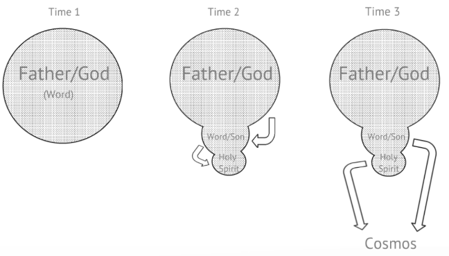

# trinity — trinity-history（supplement）

> （《trinity》词条补充材料，源：plato.stanford.edu/entries/trinity/trinity-history.html）

#### Supplement to Trinity

## History of Trinitarian Doctrines

- 1. Introduction
- 2. The Christian Bible
- 2.1 The Old Testament
- 2.2 The New Testament
- 3. Development of Creeds
- 3.1 Up to 325 CE
- 3.1.1 The One God in the Trinity
- 3.1.2 Tertullian
- 3.2 325–381: The “Arian” Controversy
- 3.3 The pro-Nicene Consensus
- 3.3.1 Gregory of Nyssa
- 3.3.2 Augustine
- 3.3.3 The “Athanasian” Creed
- 3.4 Later Patristic Developments
- 4. Medieval Theories
- 4.1 Thomas Aquinas
- 4.2 John Duns Scotus
- 5. Post–Medieval Developments

### 1. Introduction

This supplementary document discusses the history of Trinity theories. Although early Christian theologians speculated in many ways on the Father, Son, and Holy Spirit, no one clearly and fully asserted the doctrine of the Trinity as explained at the top of the main entry until around the end of the so-called “Arian” controversy. (See 3.2 below and section 3.1 of the supplementary document on unitarianism.) Nonetheless, proponents of such theories always claim them to be in some sense founded on, or at least illustrated by, biblical texts.

Sometimes popular antitrinitarian literature paints “the” doctrine as strongly influenced by, or even illicitly poached from some non-Christian religious or philosophical tradition. Divine threesomes abound in the religious writings and art of ancient Europe, Egypt, the near east, and Asia. These include various threesomes of male deities, of female deities, of Father-Mother-Son groups, or of one body with three heads, or three faces on one head (Griffiths 1996). However, similarity alone doesn’t prove Christian copying or even indirect influence, and many of these examples are, because of their time and place, unlikely to have influenced the development of Christian views.

A direct influence on second century Christian theology is the Jewish philosopher and theologian Philo of Alexandria (a.k.a. Philo Judaeus) (ca. 20 BCE–ca. 50 CE), the product of Alexandrian Middle Platonism (with elements of Stoicism and Pythagoreanism). Inspired by the *Timaeus* of Plato, Philo read the Jewish Bible as teaching that God created the cosmos by his Word (*logos*), the first-born son of God. Alternately, or via further emanation from this Word, God creates by means of his creative power and his royal power, conceived of both as his powers, and yet as agents distinct from him, giving him, as it were, metaphysical distance from the material world (Philo *Works*; Dillon 1996, 139–83; Morgan 1853, 63–148; Norton 1859, 332–74; Wolfson 1973, 60–97).

Another influence may have been the Neopythagorean Middle Platonist Numenius (fl. 150), who posited a triad of gods, calling them, alternately, “Father, creator and creature; fore-father, offspring and descendant; and Father, maker and made” (Guthrie 1917, 125), or on one ancient report, Grandfather, Father, and Son (Dillon 1996, 367). Moderatus taught a similar triad somewhat earlier (Stead 1985, 583).

Justin Martyr (d. ca. 165) describes the origin of the *logos* (= the pre-human Jesus) from God using three metaphors (light from the sun, fire from fire, speaker and his speech), each of which is found in either Philo or Numenius (Gaston 2007, 53). Accepting the Philonic thesis that Plato and other Greek philosophers received their wisdom from Moses, he holds that Plato in his dialogue *Timaeus* discussed the Son (*logos*), as, Justin says, “the power next to the first God”. And in Plato’s second letter, Justin finds a mention of a third, the Holy Spirit (Justin, *First Apology*, 60). As with the Middle Platonists, Justin’s triad is hierarchical or ordered. And Justin’s scheme is not, properly, trinitarian. The one God is not the three, but rather one of them and the primary one, the ultimate source of the second and third.

Justin and later second century Christians influenced by Platonism take over a concept of divine transcendence from Platonism, in light of which

> no one with even the slightest intelligence would dare to assert that the Creator of all things left his super-celestial realms to make himself visible in a little spot on earth. (Justin, *Dialogue*, 92 [ch. 60])

Consequently, any biblical theophany (appearance of a god) on earth, as well as the actual labor of creation, can’t have been the action of the highest god, God, but must instead have been done by another one called “God” and “Lord”, namely the *logos*, the pre-human Jesus, also called “the angel of the Lord”.

Another influence may have been the Neoplatonist Plotinus’ (204–70 CE) triad of the One, Intellect, and Soul, in which the latter two mysteriously emanate from the One, and “are the One and not the One; they are the one because they are from it; they are not the One, because it endowed them with what they have while remaining by itself” (Plotinus *Enneads*, 85). Plotinus even describes them as three *hypostaseis*; see the entry on Plotinus. Augustine tells us that he and other Christian intellectuals of his day believed that the Neoplatonists had some awareness of the persons of the Trinity (*Confessions* VIII.3; *City* X.23).

Many thinkers influential in the development of trinitarian doctrines were steeped in the thought not only of Middle Platonism and Neoplatonism, but also the Stoics, Aristotle, and other currents in Greek philosophy (Hanson 1988, 856–69). Whether one sees this background as a providentially supplied and useful tool, or as an unavoidably distorting influence, those developing the doctrine saw themselves as trying to build a systematic Christian theology on the Bible while remaining faithful to earlier post-biblical tradition. Many also had the aim of showing Christianity to be consistent with the best of Greek philosophy. But even if the doctrine had a non-Christian origin, it would not follow that it is false or unjustified; it could be, that through Philo (or whomever), God revealed the doctrine to the Christian church. Still, it is contested issue whether or not the doctrine can be deduced or otherwise inferred from the Christian Bible, so we must turn to it.

### 2. The Christian Bible

#### 2.1 The Old Testament

No trinitarian doctrine is taught in the Old Testament. Sophisticated trinitarians grant this, holding that the doctrine was revealed by God only later, in New Testament times (c.50–c.100) and/or in the Patristic era (c. 100–800). They usually also add, though, that with hindsight, we can see that a number of texts either portray or foreshadow the co-working of the Father, Son, and Holy Spirit.

For example, in Genesis 18, Yahweh appears to Abraham as three men, and the text has often been read as though the men spoke as one, with one voice. What is this, they urge, if not an appearance of, or even a triple temporary incarnation of the three persons within God’s nature? (Other interpretations identify Yahweh with one of the men, the one who stays behind while the others travel to Sodom in Genesis 19.)

In numerous other passages, many Christian readers hold, the preincarnate Son of God is mentioned, or even appears in bodily form to do the bidding of his Father, and is (so they believe) sometimes called the “angel of the Lord”. Some have even identified the preincarnate Christ as Michael, protecting angel over Israel mentioned in the books of Daniel, Jude, and Revelation.

And in several passages, Yahweh refers to himself, or is referred to using plural terms. Non-trinitarians usually read this as a plural of majesty, a form of magnifying speech which occurs in a number of ancient languages, or a conversation between God and angels, while trinitarians often read this as a conversation between the persons of the Trinity.

In sum, Christians read the Old Testament through the lens of the New. For example, the former speaks of God as working by his “word”, “wisdom”, or “spirit”. Some New Testament passages call Jesus Christ the word and wisdom of God, and in the Gospel of John, Jesus talks about the sending of another comforter or helper, the “Holy Spirit”. Thus, some Christians claim the door was open to positing two divine intelligent agents in addition to “the Father”, by, through, or in whom the Father acts, one of whom was incarnated in the man Jesus. In opposition, other Christian readers have taken these passages to involve anthropomorphization of divine attributes, urging that Greek speculations unfortunately encouraged the aforementioned hypostasizations.

#### 2.2 The New Testament

The New Testament contains no explicit trinitarian doctrine. However, many Christian theologians, apologists, and philosophers hold that a Trinity doctrine can be inferred from what the New Testament teaches about God. But how may it be inferred? Is the inference deductive, or is it an inference to the best explanation? And is it based on what is implicitly taught there, or on what is merely assumed there? Many Christian theologians and apologists seem to hold it is a deductive inference.

In contrast, other Christians admit that their preferred doctrine of the Trinity not only (1) can’t be inferred from the Bible alone, but also (2) that there’s inadequate or no evidence for it there, and even (3) that what is taught in the Bible is incompatible with the doctrine. These Christians believe the doctrine solely on the authority of later doctrinal pronouncements of the True Christian Church (typically one of: the Catholic Church, the Eastern Orthodox tradition, or the mainstream of the Christian tradition, broadly understood). Some Catholic apologists have argued that this doctrine shows the necessity of the teaching authority of the Church, this doctrine being constitutive of Christianity but underivable from the Bible apart from the Church’s guidance in interpreting it. This stance is not popular among Christians who are neither Catholic nor Eastern Orthodox. (2) would be the main sticking point, although some groups deny all three.

Many Christian apologists argue that the doctrine of the Trinity is “biblical” (i.e. either it is implicitly taught there, or it is the best explanation of what is taught there) using three sorts of arguments. They begin by claiming that the Father of Jesus Christ is the one true God taught in the Old Testament. They then argue that given what the Bible teaches about Christ and the Holy Spirit, they must be “fully divine” as well. Thus, we must, as it were, “move them within” the nature of the one God. Therefore, there are three fully divine persons “in God”. While this may be paradoxical, it is argued that this is what God has revealed to humankind through the Bible.

The types of arguments employed to show the “full divinity” of Christ and the Holy Spirit work as follows.

1. *S* did action *A*.
2. For any *x*, if *x* does action *A*, *x* is fully divine.
3. Therefore, *S* is fully divine.

E.g., *A* = non-culpably pronouncing the forgiveness of sins, non-culpably receiving worship, raising the dead, truly saying “Before Abraham was, I am”, creating the cosmos.

1. The Bible applies title or description “*F*” to *S*.
2. For any *x*, if the Bible applies title “*F*” to *x*, then *x* is fully divine.
3. Therefore, *S* is fully divine.

E.g., *F* = the first and the last, a god, the God, our savior, Lord

1. *S* has quality *Q*.
2. For any *x*, if *x* has quality *Q*, then *x* is fully divine.
3. *S* is fully divine.

E.g., *Q* = sinlessness, omniscience, the power to perform miracles, something Christians should be baptized in the name of

While such arguments are deductively valid, they suffer from a crucial ambiguity: What is meant by “fully divine”? Until this is made clear, it isn’t clear which of the trinitarian theories is being argued for. A person being “fully divine” might, according to various theorists, amount to being constituted by the matter-like divine nature, being identical to God, being a mind of God, being a way God relates to himself or the world, and so on. Further, the epistemic status of each argument’s second premise may depend on what “divine” means.

Opponents of these arguments typically give biblical counterexamples to the second premise (e.g., humans who are called “gods” but aren’t divine in the relevant sense, humans who are authorized by God to forgive sins but aren’t divine in the relevant sense). In other cases, they also challenge the first premise (e.g., Jesus denied being omniscient, there are inadequate grounds to say that the Son of God created the cosmos).

Another form of argument runs as follows.

1. Passage *E* is a true prophecy predicting that the God of Israel, Yahweh, will do action *A*.
2. Passage *F* truly asserts that the prophecy in *E* was fulfilled in the life of Jesus Christ.
3. Therefore, Jesus Christ just is the God of Israel, Yahweh.

Opponents reply that this argument is invalid; it is possible for the premises to be true even though the conclusion is false. Even though the prediction “George W. Bush will conquer Iraq” may be said to be fulfilled by the actions of General Smith, it doesn’t follow that Smith and Bush are one and the same. Rather, Smith acted as the agent of Bush. Similarly, Yahweh acts through his servant Jesus. Again, it is a commonplace of biblical scholarship on the New Testament use of Old Testament texts that the New Testament authors believe there to be multiple meanings of prophetic texts, so that a text about someone or something else, even God, can have a fulfillment in Jesus, e.g. Matthew 2:15, Philippians 2:10–11; such uses then are not a way of implying the identity of Jesus with Yahweh. Another disadvantage of this argument is that even if it is sound, the conclusion is undesirable. If Jesus and God are held to be (numerically) identical, and one adds that the Father is “fully divine” in this same sense, i.e. the Father is numerically identical to God, then it logically follows that Jesus just is (is numerically identical to) the Father. (See main entry section 4.1.) Yet according to any trinitarian some things are true of one that are not true of the other. This is why most Trinity theories decline to identify more than one of the three persons with God. On the other hand, some embrace this as a mystery —something which appears to be or really is contradictory but is nonetheless true. (See main entry sections 4.2–3.)

This traditional case for the divinity of Jesus and the Holy Spirit may be best construed not as a collection of deductive arguments, but rather as an inference to the best explanation, an attempt to infer what best explains all the biblical texts considered together. In this genre, however, alternate explanations are rarely explored in any detail, much less shown to be inferior.

Many arguments of the above types date back to ancient times, and have been repeated in similar forms whenever mainstream trinitarianism has been attacked (Bowman 2007; Bowman and Komoszewski 2024; George 2006; Stuart 1834). A number of well-developed refutations of these arguments dating from the 17th to 19th centuries have been largely forgotten by present-day theologians, philosophers, and apologists (Burnap 1845; Clarke 1978; Crellius et. al. *Racovian*; Crellius 1691; Emlyn *Humble*; Haynes 1797; Lardner 1793a-b; Lindsey 1776, 1818; Norton 1859; Nye 1691b; Priestley 1791a-c; Wilson 1846).

### 3. Development of Creeds

#### 3.1 Up to 325 CE

3.1.1 The One God in the Trinity

Early Christianity was theologically diverse, although as time went on a “catholic” movement, a bishop-led, developing organization which, at least from the late second century, claimed to be the true successors of Jesus’ apostles, became increasingly dominant, out-competing many gnostic and Jewish-Christian groups. Still, confining our attention to what scholars now call this “catholic” or “proto-orthodox” Christianity, it contained divergent views about the Father, Son, and Holy Spirit. No theologian in the first three Christian centuries was a trinitarian in the sense of believing that the one God is tripersonal, containing equally divine “Persons”, Father, Son, and Holy Spirit.

The terms we translate as “Trinity” (Latin: *trinitas*, Greek: *trias*) seem to have come into use only in the last two decades of the second century; but this early usage doesn’t reflect trinitarian belief. These late second and third century authors use such terms not to refer to the one God, but rather to refer to the plurality of the one God, together with his Son (or Word) and his Spirit. They profess a triad or threesome, but not a triune or tripersonal God. Nor did they consider these to be equally divine. A common strategy for defending monotheism in this period is to emphasize the unique divinity of the Father. Thus Origen (ca. 186–255),

> The God and Father, holding all things together, is superior to every being, giving to each, from his own, to be whatever it is; the Son, being less than the Father, is superior to rational creatures alone, for he is second to the Father; and the Holy Spirit is still less, dwelling with the holy ones alone. So that in this way the power of the Father is greater than the Son and the Holy Spirit, and that of the Son is greater than the Holy Spirit, and again the power of the Holy Spirit differs greatly from other holy beings. (Origen, quoted in Justinian’s *Letter to Menas*, 598—a passage censored out of Origen’s *On First Principles* 1.3)

Many scholars call this strain of Christian theology “subordinationist”, as the Son and Spirit are always in some sense derivative of, less than, and subordinate to their source, the one God, that is, the Father. One may also call this theology “unitarian”, in the sense that the one God just is the Father, and not equally the Son and Spirit, so that the one God is “unipersonal”. As this sort of theology features no tripersonal God, it is misleading to call it “trinitarian.” (See also Origen, *John*, 98–103 [2.2.12–33]. For similar contemporary views, see Lloyd 2020; Novatian, *Trinity*; *Refutation of All Heresies*, 747–63 [10.32–34].)

While views about the Spirit remained comparatively undeveloped, and as in the New Testament the Spirit was not worshiped, in the second and third centuries catholic Christianity came to attribute a “a divine nature” to Jesus, and to firmly establish his being called “God”. Language which had been very unusual in the first century (Harris 1992) now became the norm; Jesus was now “God” or “a god”, but not the one true God. (e.g. Novatian, *Trinity*, ch. 31; Justin *First*, ch. 13) This divine Son (i.e. the pre-human Jesus) was mysteriously “generated” by God either just before creation (late 2nd to early 3rd c. logos theologians or in timeless eternity (from Origen and Novatian on).

While these developments were new, the worship of Jesus was not. As against earlier theories that it developed only slowly and because of Gentile influence, recent work has shown that Jesus was worshipped alongside God in the earliest known Christianity (Hurtado 2003, 2005). While the basis cited for this practice in the New Testament is God’s post-resurrection exaltation of Jesus (Hurtado 2003, 640–41), later it was assumed that its basis was Jesus’ having something divine within him.

This logos theory subordinationism was opposed by many Christians, particularly the less-educated and less-Hellenized ones, who viewed such schemes of two creators (God working through the Logos as his instrument) and two “gods” to be incompatible with monotheism. Many wielded the slogan “We uphold the monarchy of the Father,” i.e. the Father as the only true God (John 17:1–3). Since Harnack historians have divided these “monarchians” into Modalistic Monarchians and Dynamic Monarchians. For the Modalists, the divine Son is the Father acting in a certain way; some allegedly used the term “Sonfather”, spoke of the Father being crucified, or described God making himself a Son to himself; at any rate, opposing Justin, they denied that the Father was one god and the Logos another (Heine 1998, 74). Some scholars now see Irenaeus as an influential early adopter of this approach (Minns 2010, ch. 4). The Dynamic Monarchians held that the Logos of John 1 was a power (*dunamis*) of God by which he acted through his human Messiah, the man Jesus (John 14:10, 2 Corinthians 5:19). At least some of them claimed that theirs was the original, apostolic Christology and theology, and it has been argued that such views were early and widespread (Gaston 2023). Novatian, Origen, and the author of *Refutation of All Heresies* write against both of these rival views which were found in mainstream churches in their time and before. In their lifetimes and after a string of Roman bishops held Modalistic Monarchian views (Vinzent 2013). But by the end of the third century, it seems that Logos theory had become a majority view among theologically-educated bishops; nonetheless Modalistic one *hypostasis* theories vied for prominence into the middle of the fourth century (see the Supplement on Unitarianism, section 3.1), and the Dynamic Monarchian bishop Photinus of Sirmium debated his position at a council in 351 but was anathematized by that council and a string of later councils, eventually being deposed and exiled (Williams 2006; Bodrožić and Soić 2017). Dynamic Monarchian “Photinians” were on the radar of heresy-hunters into the early fifth century.

3.1.2 Tertullian

Since he uses the word *trinitas* and says that the Father, Son, and Spirit share a divine *substantia* (substance), Tertullian (ca. 160–225) is a subordinationist who sounds trinitarian to many modern readers. His *Against Praxeas* was written against Modalistic Monarchianism. Tertullian mocked them as “patripassians”, for (allegedly) implying that the Father suffered when Jesus was crucified, something widely assumed to be impossible.

Here is a graphic illustration of Tertullian’s *trinitas*—not a triune God, but rather a triad or group of three, with God as the founding member.

Under the influence of Stoic philosophy, Tertullian believes that all real things are material. God is a spirit, but a spirit is a material thing made out of a finer sort of matter. At the beginning, God is alone, though he has his own reason within him. Then, when it is time to create, he brings the Son into existence, using but not losing a portion of his spiritual matter. Then the Son, using a portion of the divine matter shared with him, brings into existence the Spirit. And the two of them are God’s instruments, his agents, in the creation and governance of the cosmos.

The Son, on this theory, is not God himself, nor is he divine in the same sense that the Father is. Rather, the Son is “divine” in that he is made of a portion of the matter that the Father is composed of. This makes them “one substance” or not different as to essence. But the Son isn’t the same god as the Father, though he can, because of what he’s made of, be called “God”. Nor is there any tripersonal God here, but only a tripersonal portion of matter — that smallest portion shared by all three. The one God is sharing a portion of his stuff with another, by causing another to exist out of it, and then this other does likewise, sharing some of this matter with a third.

Against the common believers concerned with monotheism, Tertullian argues that although the above process results in two more who can be called “God”, it does not introduce two more gods — not gods in the sense that Yahweh is a god. There is still, as there can only be, one ultimate source of all else, the Father. Thus, monotheism is upheld. Tuggy 2016a points out that the view is unitarian; the one God is unipersonal both at the start and the end of this process. Nor are the Persons equally divine; Tertullian holds that the Son is “ignorant of the last day and hour, which is known to the Father only” (Tertullian, *Praxeas*, ch. 27; Matthew 24:36).

The three are “undivided” in the sense that the Father, in sharing some of his matter, never loses any; rather, that matter comes to simultaneously compose more than one being. The chart above might suggest that this portion of matter is one thing with three parts; but it is conceived of merely as a quantity of matter. The Father is one entity, the Son is a second, and the Spirit is a third. Nor are they parts of any whole; the latter two simply share some of the Father’s divine stuff. Tertullian does not argue that the three compose or otherwise are the one God. Instead, Tertullian argues that a king may share his one kingdom with subordinate rulers, and yet it may still be one kingdom. Likewise, God (i.e. the Father) may share the governance of the cosmos with his Son (*Praxeas*, ch. 4)

Despite these fundamental differences from later orthodoxy, Tertullian is now hailed by trinitarians as a forerunner because of his use of the term *trinitas* and his view that it (at the last stage) consists of three persons with a common or shared *substantia*.

#### 3.2 325–381: The “Arian” Controversy

Somehow around 320 a controversy arose in Alexandria between the presbyter Arius and others. The issue may have been Arius’ take on Proverbs 8:22–31 in which lady Wisdom, widely interpreted as the Logos or the pre-human Jesus, says “The Lord created me at the beginning of his work” (v. 22). The bishop Alexander rebuked Arius, but Arius did not give way, and in turn he accused his bishop of Sabellianism (Kopecek 1979, 4–5). Arius and his views enjoyed a lot of popular support, and it seems that some of his supporters met together outside of the bishop-controlled churches.

Alexander escalated, organizing a local council of Egyptian and Libyan bishops in 320 or 321 which condemned and deposed Arius and several of his clerical associates (Davis 1983, 53; Williams 2001, 56). Arius fled Alexandria to Palestine, where he found support from some bishops including Eusebius of Caesarea. These launched an extensive letter-writing campaign to other bishops, drumming up support for Arius’ views: essentially, that the Father alone, the one God, is without source, and that the Logos exists by his will, and so is not co-eternal with him, having been generated before the ages so that God could create through him.

Alexander retaliated with a letter-writing campaign of his own. He accused Arius of adoptionism and Alexander seemed to imply both the identity and distinctness of the Father and Son, a Mysterian position. The Logos is neither created from nothing, nor is he ungenerated like the Father, but is in-between those, having been generated in an indescribable way. According to Arius, Alexander had publicly taught that the Son/Logos is “ungeneratedly generated” (Kopecek 1979, 12–15).

Arius continued to gain allies, including the powerful and energetic Eusebius of Nicomedia, bishop in the city which at the time was an imperial residence and capital of the eastern half of the Roman empire. It was in Nicomedia that Arius penned his *Thalia*, which says, in part,

> He [the Son] possesses nothing proper to God . . . For he is not equal to God, nor yet is he of the same substance (*homoousios*) . . . there exists a trinity (*trias*) in unequal glories, for their hypostases are not mixed with each other . . . The Father is other than the Son in substance (*kat’ ousian*) because he is without beginning. (Williams 2001, 102, modified)

With Eusebius of Nicomedia now directing it, Arius’ letter-writing campaign continued to gain him allies. Alexander now accused Eusebius of wanting to be in charge of the catholic church and pointed out that Arius and his allies were defying the decision of the local council that had ruled against Arius. The letter-writing war continued, and Arius and friends even dared to return to Alexandria, creating chaos. Arius’ views were declared orthodox around 320–22 by councils held in Bithynia and in Palestine, and both meetings also demanded that Alexander reinstate Arius as a presbyter in Alexandria (Hanson 1988, 135–36).

Meanwhile the emperor Constantine had called for a council in Ancyra to deal with disputes about the date of Easter. In 324 he sent a letter to Arius and Alexander urging them to stop quibbling and to unite together. In early 325 the emperor’s representative, the bishop Ossius (or Hosius) of Cordova, convened a council of 59 bishops in Antioch which took Alexander’s side and provisionally excommunicated Eusebius of Caesarea and a few other bishops (Kopecek 1979, 42–45). At this meeting “the bishops introduced an innovation in ecclesiastical practice: they issued a creedal statement. Hitherto, creeds were for catechumens, this one was designed for bishops” (Davis 1983, 55).

Constantine proposed a bigger meeting at Ancyra, which he later changed to Nicaea. He hosted this in mid-325, a council chaired by his representative Ossius, with perhaps 220 bishops (Gwynn 2021, 92–95); probably no more than ten percent were favorable to Arius (Kopecek 1979, 48–50; Williams 2001, 67–68). Most were from the east, so despite its later reputation, it was not “truly ecumenical”, although with the entourages of all these present, including the emperor, there may have been as many as 2000 people present (Gwynn 2021, 93, 95). Later Hilary of Poitiers and Athanasius claimed the number of bishops was 318 based on Genesis 14:14 and Barnabas 9:8.

The condemnation of Arius’ side was a foregone conclusion (for conflicting eyewitness accounts of the proceedings see Gwynn 2021, 96–102), and they eventually composed the original Nicene creed which included the statement that the Father and Son were one in essence (*homoousios*), seemingly picking that word, despite its considerable baggage, because it would be unacceptable to Arius. It also called the Father and Son “true God from true God”, combining language from John 17:3 and 1 John 5:20, although our evidence suggests that before this the latter had not widely been thought to predicate “true God” of the Son. But it was hereafter. (The grammar is ambiguous and nowadays scholars are divided.) The creed also, by later standards confusingly, anathematized the view that the Son is “of another *hypostasis* or *ousia*” than the Father (Hanson 1988, 167). The creed was “a mine of potential confusion and consequently most unlikely to be a means of ending” the controversy (Hanson 1988, 168). At the time the term *homoousios* was widely disliked, as it had been coined by Gnostics, was not found in the New Testament, suggested a material view of the divine nature and Sabellianism, and had been condemned by the synod in 268 which deposed Paul of Samosata (Davis 1983, 61–62). But the term served its purpose. Most bishops present, even Eusebius of Caesarea, signed it, under threat by the emperor of exile. Arius and a few others did not sign and were later exiled. The meeting moved on to unrelated matters of dating Easter and church discipline (Davis 1983, 63–69; Gwynn 2021, 102–9). It is unclear whether or not Arius was at the meeting, as he is only mentioned in the anathemas attached to their creed (Gwynn 2021, 102).

This was the low point for Arius and company, but their fortunes soon improved. In 326 Eusebius of Caesarea organized and led a council at Antioch which deposed a couple of anti-Arius bishops, and in late 327 Arius was invited to Constantine’s court where he presented a vague creed of his own, agreed to the Nicene creed, and was un-exiled (Kopecek 1979, 57–59). “Within three years of the Nicene Council of 325, all the important Arians were back in the good graces of Constantine and the majority of Christendom’s bishops” (Kopecek 1979, 59). Meanwhile the theologian Asterius (d. ca. 341) was energetically defending subordinationist views around the eastern half of the empire (Wolfe et. al. 2025, 36–37).

Around 333 Arius and Constantine publicly clashed, and the emperor invited Arius to a council in Jerusalem in 335 held in part to dedicate a new church there. There he was declared orthodox and a letter was dispatched to Athanasius, who was now bishop of Alexandria. A council held in Tyre in 334–35 had convicted Athanasius of “violence and sacrilege” (Wolfe et. al. 2025, 34). They deposed him, excommunicated him, and forbade his return to Alexandria (Hanson 1988, 247–62). Shortly after, he was exiled by the emperor. By 336, as far as the emperor was concerned, Arius was in good standing; but that year Arius suddenly and unexpectedly died, which his enemies interpreted as divine judgment.

This did not end the controversy, which was not so much about Arius as about clashing theological ideas. Williams (2001) explains that Arius “was never unequivocally a hero for the parties associated with his name . . . ‘Arianism’ as a coherent system, founded by a single great figure and sustained by his disciples, is a fantasy . . . based on the polemic of Nicene writers, above all Athanasius” (82). It was to be a long and twisting road until the new language of the 325 creed was widely affirmed as the keystone of orthodoxy and Athanasius was revered as a hero and a saint (Parvis 2021; DelCogliano 2021). For more on the controversy after Arius’ death see the supplementary document on Unitarianism section 3.1.

#### 3.3 The pro-Nicene Consensus

Around the time of the messy Council of Constantinople (Davis 1983, ch. 3; Freeman 2009, 91–104; Hanson 1988, 791–823), as imperial and ecclesial forces began to systematically extinguish subordinationist groups in the eastern and western empires (Wiles 1996, 27–40), the kind of trinitarianism which finally prevailed within the mainstream institutions of Christianity began to gel into a recognizable form. Following Hanson (1988) and Ayres (2004) we call this the “pro-Nicene consensus”. This consensus spanned the east-west (Greek-Latin) divide. Thus, to present this view we summarize the accounts of two influential theorists, one from each side of this cultural and linguistic divide: Gregory of Nyssa, and Augustine of Hippo, who was converted a few years after the 381 council.

3.3.1 Gregory of Nyssa

Gregory of Nyssa (ca. 335–ca. 395) is now known as one of the Cappadocian Fathers, the other two being his older brother Basil of Caesarea (ca. 329–79) and Gregory Nazianzus (329–89). These three active bishops are credited with establishing a consistent terminology for the Trinity, namely using *hypostasis* or *prosopon* for what God is three of, and *ousia* (along with *phusis*) for what God is one of. (On their lives, careers, and extant writings, see Ayres 2004 and Hanson 1996.) We look briefly at Nyssa’s views here, as illustrating several points about the pro-Nicene consensus.

Nyssa notoriously compares the Trinity to three human beings (Nyssa *Answer*, 256). Largely on this basis, he (and the other Cappadocians) have been interpreted as proto-social trinitarians (see section 2.1 of the main text), holding the three persons to be three subjects of consciousness and action, of the same kind, one essence in the way that any two examples of a natural kind are, such as two humans (Plantinga 1986). However, it has been objected that the three men analogy was suggested by his opponents; it is neither Nyssa’s only nor his main analogy for the Trinity (Coakley 1999).

In Nyssa’s letter *An Answer to Ablabius: That We Should Not Think of Saying There are Three Gods* he responds to an objection passed on by his correspondent, the younger bishop Ablabius: even though three men share a single humanity, we call them “three men”, so if Father, Son, and Holy Spirit share a single divinity, why shouldn’t we call them “three gods” (Nyssa *Answer*, 256–7)? After a flippant answer, he argues that both ways of speaking are on a par, but they are both incorrect; that is, both talk of many gods and of many men involve “a customary misuse of language” (257). In both cases, he argues that the general term refers to the single, common nature. More accurately, he adds, the term “godhead” refers only to a divine operation of seeing or beholding, as “His nature cannot be named and is ineffable” (259). Moreover, the Bible ascribes this operation equally to each of the three (260). Does it not follow that there are three seers, “three gods who are beheld in the same operation” (261)? Nyssa argues that it does not.

> In the case of men… since we can differentiate the action of each while they are engaged in the same task, they are rightly referred to in the plural….With regard to the divine nature, on the other hand, it is otherwise….Rather does every operation which extends from God to creation… have its origin in the Father, proceed through the Son, and reach its completion by the Holy Spirit. For the action of each in any matter is not separate and individualized. But whatever occurs… occurs through the three Persons, and is not three separate things….we cannot enumerate as three gods those who jointly, inseparably, and mutually exercise their divine power. (261–2; cf. 266, Nyssa *On the Holy Trinity*))

We’re unable to differentiate, Nyssa thinks, any distinct works of the persons. The word “deity” (or “Godhead”) signifies only a certain work. Therefore, we’re unable to count, and shouldn’t speak of three distinct deities (261–64).

A problem with Nyssa’s argument is that words like “work”, “operation”, and “action” can refer to either an activity (exercise of a thing’s powers) or the result thereof. Thus, a series of plannings and drawings, etc., or the resulting building can be called what a certain architect did (or his work, operation, action). And one thing or event may be the result of a great many activities by different agents, as when dozens of construction workers contribute their actions to one result, such as a building (or the coming into existence of a building). Nyssa seizes on examples of the actions of the Father, Son, and Spirit having a single result. But though their “operation” (i.e. result) is one, it doesn’t follow that they or their actions are one. Moreover, Nyssa speaks of the divine Persons in the plural, and holds them to differ. While the divine nature is “undifferentiated”, the three Persons differ causally. “To say that something [i.e. the Father] exists without generation explains the mode of its existence. But what it is is not made evident by the expression” (267).

Thus, while it is left unclear what the persons are, it is emphasized that a distinction between them hasn’t been obliterated. Being a realist about universals, he holds that the Three share one universal nature (i.e. deity). But he is hard pressed to show why it doesn’t follow that there are three gods (264–66). In the end, his main aim is simply to uphold the mysterious tradition passed down to him (257; cf. Nyssa *Great*, ch. 1–3).

The bedrock of pro-Nicene trinitarianism is a metaphysics of God as unique, simple (lacking any sort of parts, composition, or differing intrinsic aspects), and therefore incomprehensible (we can’t grasp all truths about God, or any truths about God’s essential nature) and ineffable (such that no human concept applies literally to it). Thus as Ayres notes,

> Pro-Nicenes assume that one can draw no analogies between God and creation that will either deliver knowledge of God’s essence or that can involve us in grasping clearly where and why an analogy fails. (Ayres 2004, 284)

Any analogy offered is therefore quickly supplemented by others. Its opponents view this as obfuscation, while its proponents consider the differing analogies to be complimentary and in some sense informative. While pro-Nicenes hold the Persons to be (somehow) distinct, they show little interest in developing a metaphysical account of what it is to be a divine Person. In sum, the Nicene pattern of speech and thought about the Father, Son, and Holy Spirit is held by them to be spiritually beneficial, but it doesn’t admit of clarification. This view is strongly Mysterian (see main entry section 4).

3.3.2 Augustine

Augustine is arguably a one-self trinitarian. For him, the one God is the Trinity. And this one God is almost always addressed and described using singular personal pronouns. He is an object of our love, as much as our neighbors and ourselves, and he has all the features of a self described in the main entry, section 1.1. He is a simple, timeless, and perfect self, a subject of complete knowledge, who freely creates all other things, and who exists in a truer or deeper way. The true believer can not say “that there are not three somethings [in the Trinity], because Sabellius fell into heresy by saying precisely that.” (Augustine, *Trinity*, 227 [VII.3.9]; cf. *City* 425 [X.24], 462 [XI.10]) One must say “three persons”, but for Augustine these are not three selves.

His mammoth *On the Trinity* (Latin: *De Trinitate*) has been endlessly mined by later theologians. In it, Augustine is concerned to defend Pro-Nicene trinitarianism against lingering “Arianism” and other heresies, confessing that this “is also my faith inasmuch as it is the Catholic faith” (70 [I.2.7]). He argues that the Bible implicitly teaches this sort of trinitarianism, on which the rest of the book is an extended meditation. This meditation, he concedes, fails to yield much by way of understanding. He holds that sin has corrupted our minds, so that we can’t understand the doctrine, which we should still hope to understand in the next life (230–32 [VII.4], 430 [XV.6.45], 435 [XV.6.50]). At the end he confesses “among all these things that I have said about that supreme trinity… I dare not claim that any of them is worthy of this unimaginable mystery” (434 [XV.6.50]). Indeed, near the beginning he pictures the whole book as a grudging concession to certain unnamed Christians, “talkative reason-mongers who have more conceit than capacity”, who conclude that their teachers don’t know what they are talking about, simply because those teachers are reluctant to speak of deep truths (67 [I.1]). Augustine’s goal is not so much to understand the Trinity and communicate this to others, but rather to say some things that will deliver a small shred of understanding, which may entice the reader to pursue the experience of God (434–37 [XV.6.50–51]). Because of this dim view of what humans are equipped to understand, much of the book is actually about how to talk about the Trinity, rather than about the Trinity itself. We may at least confess the correct doctrine, even if only later we come to understand what we’ve been saying.

Despite this pronounced Negative Mysterian note (see section 4.1 of the main entry), Augustine does seem to have a rudimentary metaphysics of the Trinity which he uncritically receives and assumes cannot be significantly developed.

Augustine suggests that the standard creedal term “Person” (Greek: *hypostasis* or *prosopon*; Latin: *persona*) is adopted simply so that something may be said in answer to the question “What is God three of?” (224–30 [VII.3], 241 [VIII.1.1], 398 [XV.1.5]) The term “Person”, he thinks, signifies a genus, but it is one for which we can provide no species. In contrast, “divine essence” names neither a genus nor a species, and functions somewhat like a mass-term. It is supposed to be one in the items which share it, and to make them, in some sense, numerically one (Cross 2007).

*On the Trinity* is famous for what later authors call its “psychological analogies” of the Trinity. Augustine reasons that if we can’t catch intellectual sight of the Trinity directly, at least we can see reflections, images, or indications of the Trinity in the created realm, above all in the highest part of human beings (the mind), who are made “in the image and likeness of God” (Augustine *Trinity*, 231 [VII.4.12]; Genesis 1:26). In the human mind we may encounter several “trinities”, given here in the order that they somehow correspond to the Father, Son, and Holy Spirit:

- lover, loved object, the lover’s love for that object (255 [VIII.5.13])
- the mind, its knowledge, its love (272–75 [IX.1])
- the mind’s remembering itself, understanding itself, and willing itself (298–89 [X.4])
- memory, understanding, and will (374–82 [XIV.2–3)
- the mind’s remembering God, understanding God, and willing God (383–92 [XIV.4–5])
- existing, knowing that one exists, loving the fact that one exists (Augustine *City*, 483–84 [XI.26];cf. *Confessions* 264–65 [XIII.11])

These are taken to be “images” of the Trinity, with the final three being in some sense the most accurate. (He also discusses a few “trinities” or threefold processes which he doesn’t hold to be images of the Trinity.) Although he apparently considers the contemplation of these to be helpful in the pursuit of God, in the last section (Book XV) of *On the Trinity*, Augustine emphasizes that even these are “immeasurably inadequate” to represent God (428 [XV.6.43]). The main reason is that these three are activities which a person does or faculties a person has, whereas God “just is” his memory, understanding, and will; the doctrine of divine simplicity thus renders the mental analogies *at best* minimally informative. Further, temporal processes seem ill-suited to represent the nature of an essentially immutable God.

Augustine holds that God is simple and thus essentially immutable. Words which are predicated “accidentally” of creatures, such as good or wise, are predicated of God essentially. Applied to us, these words signify properties we happen to possess, and which we might have not possessed, but applied to God, they all indicate the same thing, God’s simple essence. What about terms such as “Father” and “Son”? As God can’t have accidental features, these can’t be predicated accidentally. But Augustine doesn’t want to say that they are essentially predicated either. He suggests that they are relationally predicated, that is, applied to God not because of his essence or accidents, but rather because of how God is related to himself. He explores but ultimately rejects the idea that all true predication of God is relational (Books V-VII). He finally holds that some terms apply equally to each of the three divine Persons, whereas certain relational terms apply primarily to one of the three. In sum,

> This Trinity is one God: it is simple even though it is a Trinity… because it is what it has, except insofar as one Person is spoken of in relation to another. (Augustine *City*, 462 [XI.10])

The Trinity, and also each “Person” has as it were only one ingredient: the divine essence which is the one God. It is mysterious how extrinsic relations, the sole subject of which is this simple entity, could make it contain three inter-related “Persons”. But Augustine thinks that no one understands what those are anyway; the doctrine is in the end a Negative Mystery. See main entry, section 4 on Mysterianism. See Thom (2012, ch 2) for a formal treatment of Augustine’s theory.

Most later trinitarians interact in some way with Augustine’s huge body of work on the topic, and many consider that they are following in his footsteps. (See sections 4.1, on Thomas Aquinas, and 4.2, on John Duns Scotus, below, and section 2.1 of the main text.) Augustine’s medieval successors all reject three-self approaches to the Trinity (Cross 2012, 26–27).

Important medieval philosopher-theologians not discussed here who develop Augustine’s trinitarianism include Boethius (ca. 480–525), Anselm of Canterbury (1033–1109) (Marenbon 2003, 66–95; Mann 2004), and Peter Abelard (1079–1142) (Brower 2005; Marenbon 2007).

3.3.3 The “Athanasian” Creed

The so-called Athanasian Creed (also known by the Latin words it begins with, as the *Quicumque vult*) is a widely adopted and beloved formulation of the doctrine. It shows strong Augustinian influence and is thought to be the product of an unknown late 5th or early 6th century writer (Kelly 1964). Contemporary philosophical discussions often begin with this creed, at it puts pro-Nicene trinitarianism into a memorably short and palpably paradoxical form.

It reads, in part,

> Whoever desires to be saved must above all things hold the Catholic faith. Unless a man keeps it in its entirety inviolate, he will assuredly perish eternally. Now this is the Catholic faith, that we worship one God in Trinity and Trinity in unity, without either confusing the persons or dividing the substance. For the Father’s person is one, the Son’s another, the Holy Spirit’s another; but the God-head [divinity] of the Father, the Son and the Holy Spirit is one, their glory is equal, their majesty coeternal. Such as the Father is, such is the Son, such also the Holy Spirit. The Father is increate, the Son increate, the Holy Spirit increate . . . infinite . . . eternal. Yet there are not three eternals, but one eternal; just as there are not three increates or three infinites, but one increate and one infinite. In the same way the Father is almighty, the Son almighty, the Holy Spirit almighty; yet there are not three almighties, but one almighty. Thus the Father is God, the Son God, the Holy Spirit God; and yet there are not three Gods, but there is one God . . . yet there are not three Lords, but there is one Lord. Because just as we are obliged by Christian truth to acknowledge each person separately both God and Lord, so we are forbidden by the Catholic religion to speak of three Gods or Lords. The Father is from none, not made nor created nor begotten. The Son is from the Father alone, not made nor created but begotten. The Holy Spirit is from the Father and the Son, not made nor created nor begotten but proceeding. So there is one Father, not three Fathers; one Son, not three Sons; one Holy Spirit, not three Holy Spirits. And in this trinity there is nothing before or after, nothing greater or less, but all three persons are coeternal with each other and coequal. Thus in all things, as has been stated above, both Trinity in unity and unity in Trinity must be worshipped. So he who desires to be saved should think thus of the Trinity. (Translated in Kelly 1964, 17–18)

By the latter part, it follows by the indiscernibility of identicals that no Person of the Trinity is identical with any other. By the earlier part it seems to follow that there are thus at least three eternal (etc.) things. But it asserts that there’s only one eternal (etc.) thing. Hence, the creed seems to contradict itself, and has been attacked as such (Biddle 1691, i; Nye 1691a, 11; Priestley 1871, 321).

Showing where the above argument for inconsistency goes wrong is a major motivation of most recent Trinity theories (see sections 1–3 of the main entry). In contrast, most Mysterians hold that the argument goes wrong somehow, though no one can say quite where. (See sections 4.1–2 of the main entry.) Other trinitarians simply reject the creed. But one recent account accepts it as contradictory yet true (main entry section 4.3). On the status of this creed also see main entry section 5.3.

#### 3.4 Later Patristic Developments

Johannes Zachhuber observes that there was a “mismatch between the terms and concepts central to the classical theory initiated by the Cappadocians [to understand the Trinity, i.e. distinguishing between *ousia* and *hypostasis*] and the conceptual demands of the Christological controversy” (2020, 311). After the Trinity controversy was forcibly ended in 381, attention shifted to understanding how Christ could be fully divine and yet truly human as well. Further councils in 431 and 451 only added fuel to the fire and caused long-lasting divisions. Both defenders of Chalcedon and their Miaphysite opponents theorized about how, metaphysically, to interpret *ousia* and *hypostasis*. The Miaphysite Alexandrian philosopher John Philoponus (ca. 490–570) understood them in an Aristotelian way, where the former is something existing only in the mind, and the latter is a concrete individual (Zachhuber 2022, ch. 5; see also the section on Tritheism in the entry on John Philoponus). Chalcedonians rejected this as tritheistic.

In order to avoid implying Nestorianism (two selves in Christ), Chalcedonians now claimed that Christ’s divine nature is a *hypostasis*, but his human nature somehow gets its *hypostasis* (i.e. individual existence) from the divine nature (Zachhuber 2020, 196–201, 257–73). In the seventh century there were controversies about how many wills the incarnate Christ has (Davis 1983, 260–79). The council at Constantinople in 680–81 answered that in Christ there are two wills, one per nature, a divine will and a human will. As these wills are considered to be the sources of actions, they also “glorify two natural operations . . . We recognize the miracles and the sufferings as of one and the same [Person], but of one or of the other nature of which he is and in which he exists” (*Definition of Faith*, 345).

But as Scott Williams (2022b, 2024, 17–19) has pointed out, this council also endorsed a letter from Pope Agatho (r. 678–81) which makes some strong assertions about the Trinity. One might suppose that as one of three divine Persons, Christ has his own divine will (and actions), and so do the Father and the Holy Spirit, so that in the Trinity there are three divine wills and three distinct streams of action (“operations”). Most three-self Trinity theories assume this; see main entry, section 2. But in his letter Pope Agatho says that supposing “three personal wills, and three personal operations” in the Trinity is “absurd and truly profane” (Agatho, *Letter*, 332–33). The council also endorsed a statement recently composed by Agatho and a synod at Rome which says about the Trinity, “one is the essence . . . that is to say one is the godhead, one the eternity, one the power, one the kingdom, one the glory . . . one the essential will and operation of the same Holy and inseparable Trinity, which hath created all things” (*Letter of Agatho and of the Roman Synod*, 340). It can be argued that this is what the tradition meant all along, going back to Gregory of Nyssa (Williams 2024, 10–11); even though this divine *ousia* is shared, it exists as singular and concrete. Those who share it then have, because of it, only a single divine will and operation.

This seems to clash with the New Testament, which portrays only the Father as doing some actions and only the Son as doing some other actions. According to this council any such scenario is metaphysically impossible.

### 4. Medieval Theories

Church council decisions are treated by Catholicism and Orthodoxy much like supreme court decisions in American jurisprudence. While early rulings may be bent, twisted, and expanded to meet new needs, they are at least in theory inviolable precedents. Thus employing the power of the state, mainstream Christian tradition ensured that these boundaries weren’t violated, and theorizing about the Trinity from around 400 CE until the Reformation (ca. 1517) was forcibly kept within the bounds of creedal orthodoxy. Most medieval trinitarian theories are essentially elaborations on the pro-Nicene consensus in a more confidently metaphysical mode. That is, they adhere strictly to the creedal statements as well as writings of their tradition’s most authoritative church fathers but are less reticent to give fuller accounts of what the Persons are and how they are related to one another and to God or the divine essence.

There were short-lived exceptions to this conformity; periodically, allegedly tritheistic trinitarian theologies were proposed and quickly suppressed (Erismann 2008; Pelikan 1978, 264–7; Tavard 1997).

#### 4.1 Thomas Aquinas

Thomas Aquinas sets out a highly developed and difficult Trinity theory (*Summa Contra Gentiles* 4.1–26, *Summa Theologiae* I.27–43). God is “pure act”, that is, he has no potentialities of any kind. God is also utterly simple, with no distinct parts, properties, or actions. We may truly say, though, that God understands and wills. These divine processes are reflexive relations which are the Persons of the Trinity. The Word eternally generated by God is a *hypostasis*, what Aristotle calls a first substance, which shares the essence of God, but which is nonetheless “relationally distinct” from God. The Persons of the Trinity, as they share the divine essence, are related more closely than things which are merely tokens of a kind (e.g., identical twins), but he seems to hold that none are identical to either of the others (they are truly three). Aquinas develops Augustine’s idea that the “Persons” of the Trinity are individuated by their relations. For Aquinas, the relations Paternity, Sonship, and Spirithood are real and distinct things in some sense “in” God, which “constitute and distinguish” the three persons of the Trinity (Hughes 1989, 197). The persons are distinct *per relationes* (as to their relations) but not distinct *per essentiam* (as to their essence or being). In the words of one commenter,

> [For Aquinas,] relations both constitute and distinguish the divine persons: insofar as relations are the divine essence (*secundum res*) [i.e. they’re the same thing], they constitute those persons, and insofar as they are relations with converses, they distinguish those persons. (Hughes 1989, 217)

But how may these relations be, constitute, or somehow give rise to *three* divine *hypostaseis* when each *just is* the divine essence? For if each is the divine essence, won’t it follow that each just is (i.e. is identical to) both of the others as well? Aquinas holds that it does *not* follow—that would amount to modalism, not orthodox trinitarianism. To show why it doesn’t follow, he distinguishes between *identitas secundum rem et rationem* (sameness of thing and of concepts) and mere *identitas secundum rem* (sameness of thing). To the preceding objection, then, Aquinas says that the alleged consequence would follow only if the persons were the same both in thing and in concept. But they are not; they are merely the same thing.

This move is puzzling. Aquinas holds that the three are not merely similar or derived from the same source, but are in *some* strong sense the same, but *not* identical (i.e. numerically the same) which he appears to understand as sameness in both thing and concept. Even this last is surprising; one would think that for Aquinas “sameness in thing” just is identity, and that “sameness in concept” would mean that we apply the same concept to some apparent things (whether or not they are in fact one or many). Christopher Hughes holds that Aquinas is simply confused, his desire for orthodoxy having led him into this (and other) necessary falsehoods. On Hughes’s reading, Aquinas does think of “sameness in thing” as identity, but he incoherently holds it to be non-transitive (i.e. if *A* and *B* are identical, and *B* and *C* are identical, it doesn’t follow that *A* and *C* are identical), while in some contexts assuming (correctly) that it is transitive (Hughes 1989, 217–40).

The interpretation of Aquinas on these points is difficult. Other recent philosophers, more sympathetic to Aquinas’ theory, have not tried to salvage all of it, but have, with the help of various distinctions not explicitly made by Aquinas, sought to salvage his basic approach. This involves developing and trying to vindicate his apparently mode-based approach to the Persons (which seem to be God’s relating to himself in three ways), showing how these relations may in fact be substantial Persons, or specifying a relation which the Persons may each bear to the divine essence which is something short of (classical, absolute) identity but much like it. (See sections 1 and 2.1 of the main entry.)

#### 4.2 John Duns Scotus

Richard Cross argues that John Duns Scotus (1265/6–1308) has “one of the most compelling and powerfully coherent accounts of the Trinity ever constructed” (Cross 2005, 159).

Realists about universals hold that in addition to individual humans, there is a universal thing, or “common nature” called “humanity” (Each individual human, for example Peter, is an “instance of” this common nature, humanity. Similarly, the Father, Son, and Holy Spirit are three “exemplifications” of the “universal” called “divinity”.) However, divinity, unlike humanity, is not “divided in” its instances or exemplifications; that is, while three instances of humanity amount to three humans, three exemplifications of divinity don’t amount to three divine beings. Rather, each of the three exemplifications (Father, Son, and Holy Spirit) is the one God. Thus, the Persons are related to God somewhat as concrete things are related to the universals of which they are examples (Cross 1999, 61–71). Indeed, the divine nature or essence is a universal, although it is also a substance (a.k.a. substantial individual, subsistent thing, thing with *per se* existence) (Cross 2005, 181). Further, though it is a substance, it is also “that power in virtue of which a divine person can produce other divine persons” (Cross 2005, 206).

How are the Persons related to each other? They have the divine nature in common. They are related to each other in a way somehow similar to two physical objects which are simultaneously made of the same stuff or matter (this is merely an analogy—Scotus doesn’t believe God or any divine Person to be partly composed of matter). The Persons, as it were, partially but don’t entirely “overlap”, as each is also partly composed of a unique personal property, not had by the two others. Each Person, in Scotus’s terms, is “essentially identical” with the divine essence, but not “formally” or “hypostatically” identical. In the same way, Peter is essentially identical with humanity, but isn’t formally identical with it, having his own haecceity (his own individual essence, or “thisness”) not had by any other human. But whereas Peter and Paul are “really distinct”, the persons of the Trinity are not, at least if being “really distinct” implies being separable (Cross 1999, 69). Further, as Cross explicates this view, the divine nature or essence is nothing more than “the overlap of” the persons, which saves it from being some fourth divine thing in God (Cross 2005, 166). Nonetheless, it is metaphysically “prior to” the persons, in the sense of being the form in virtue of which the three relations obtain. Moreover, this essence “immediately determines” the Father, and only through him is it determined to the Son and Spirit. This process is causal, but does not imply, Scotus holds, that the Son and Spirit are subordinate to the Father, or that they are imperfect or less divine than he (Cross 2005, 176–80, 245–48).

The Son and Spirit are produced willingly but necessarily, the Son being the divine Word as generated by God’s memory, as had by the Father. The Holy Spirit is God’s love for his own essence. Like Augustine, he holds that the persons are distinguished by their relational properties, but he does this on the basis of church tradition, not because he finds anything impossible in the supposition that the persons are distinguished by absolute (non-relational) properties. While the relational properties of paternity, sonship, and being spirated constitute the three Persons, he denies that those are their only unique properties (Cross 1999, 62–67). These properties are supposed to explain why the Persons, unlike the divine essence, are not communicable (Cross 2005, 163).

Is it possible for anything to be related as Scotus thinks the members of the Trinity are to the divine essence? As Cross asks, “if the divine essence is indivisible, how can it be instantiated by three different persons?” (Cross 1999, 68) Scotus claims that the divine essence is “repeatable” or “communicable” without being “divisible” (Cross 1999, 68). He gives a soul-body analogy: just as the intellective soul is equally in each organ without being “divided” or composed of parts, so the divine essence relates to the three persons. But the divine essence is the only universal, he holds, which is communicable in this way.

Scotus gives some perfect-being and other arguments to the effect that there must be two and only two productions within God, and only one unproduced producer (the Father, not the divine nature in him). Moreover, the divine essence, being a “quiddity” (exemplifiable or communicable thing) exists in or as some non-exemplifiable thing or *suppositum*, here, the person of the Father (Cross 2005, 127–52).

This theory hasn’t been much discussed; few Christian thinkers past or present have claimed to understand it. Since the Reformation era, many theologians and philosophers have been impatient with this sort of confident metaphysical speculation, preferring to dismiss it as learned nonsense. However, Cross has painstakingly laid out its motivations and content. See Thom 2012, ch. 10 for formal explication of the theory and Paasch 2012 for critical evaluation and comparison with other medieval theories.

### 5. Post-Medieval Developments

Starting in the great upheaval of the sixteenth century Protestant Reformation many Christians re-examined the New Testament and rejected many later developments as incompatible with apostolic doctrine, lacking adequate basis in it, and often as contrary to reason as well. Initially, many Reformation leaders de-emphasized trinitarian doctrine and seemed unsure whether or not to confine it to the same waste bin as the doctrines of papal authority and transubstantiation (Williams 2000, 459–60). In the end, though, those in what historians call the “Magisterial Reformation” decisively fell in line on behalf of creedal orthodoxy (roughly in line with the pro-Nicene consensus), while other groups, now described as the “Radical Reformation”, either downplayed it, ignored it, or denied it as inconsistent with the Bible and reason. This led to several controversies between creedal trinitarians and what came to be called “unitarians” (earlier, “Socinians”) about biblical interpretation, Christology, and the Christian doctrine of God, from the mid-16th to the mid-19th centuries. (See the supplementary document on [unitarianism](trinity.unitarianism.md).)

As history played out, the practically non-trinitarian groups and some of the antitrinitarian groups evolved into trinitarian ones. Although unitarian and alternative views of the Trinity have repeatedly re-emerged in various Christian and quasi-Christian movements, the vast majority of Christians and Christian groups today at least in theory adhere to the authority of the Constantinopolitan and “Athanasian” creeds. At the same time, theologians have lamented that many Christian groups are functionally non-trinitarian (though not antitrinitarian) or nearly so in their piety and preaching.

In recent theology, the Trinity has become a popular subject for speculation, and its practical relevance for worship, marriage, gender relations, religious experience, and politics, has been repeatedly asserted. (See section 2.2 of the main text.) It has fallen to Christian philosophers and philosophically aware theologians to sort out what precisely the doctrine amounts to, and to defend it against charges of inconsistency and unintelligibility.

The doctrine’s basis or lack of basis in the New Testament, so vehemently debated from the 16th through the 19th centuries, is not presently a popular topic of debate. Some theologians hold the attempt to derive the doctrine from the Bible to be hopelessly naive, while other theologians, many Christian philosophers and apologists accept the common arguments (see section 2.2 above) as decisive. Again, the postmodern view that there are no better or worse interpretations of texts may play a role in quenching interest among academic theologians. Finally, it may simply be that trust in the mainstream tradition, or in various particular Christian traditions, currently runs high; many confess trinitarianism simply because their church officially does, or because it and/or the mainstream tradition tells them that the Bible teaches it. Distrust of councils and post-biblical religious authorities has largely evaporated, even among Protestants from historically anti-clerical and non-creedal groups. Ecumenical movements and anti-sectarian sentiments probably also play a role in deflecting attention from the issues, in that to many it seems perverse to attack one of the few doctrines on which all the biggest Christian groups agree. In recent years, however, some mainstream trinitarians have undertaken to refute Christian unitarian minority reports (McIntosh (ed.) 2024; Dixon et. al. 2015).
