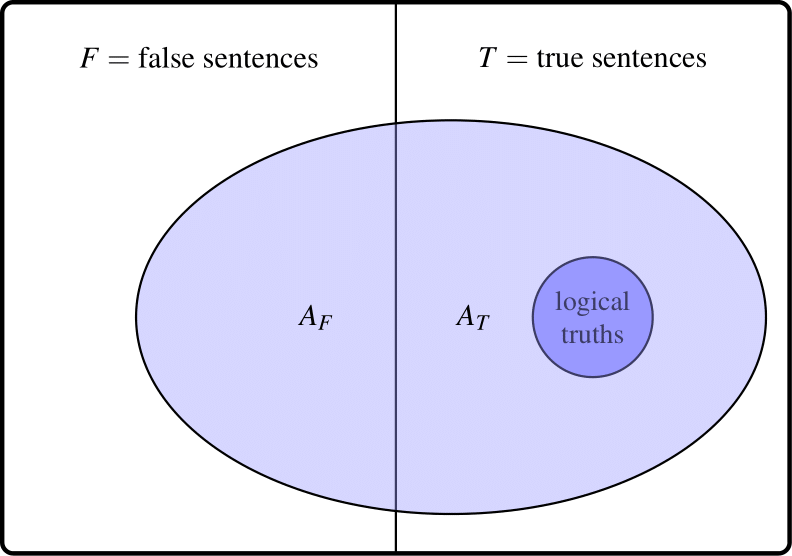
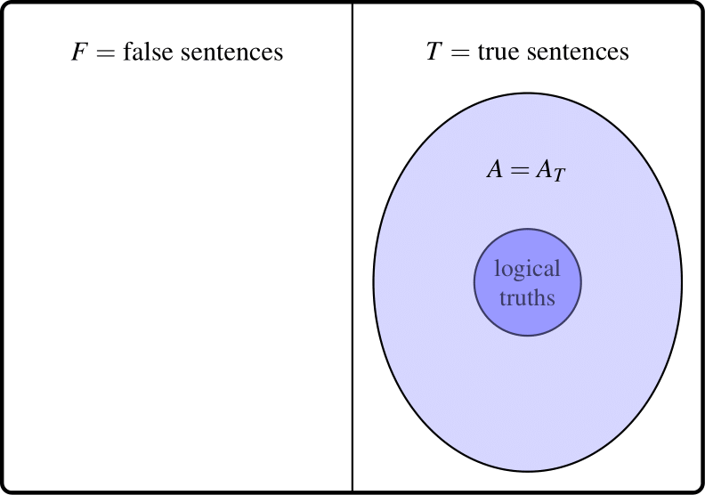
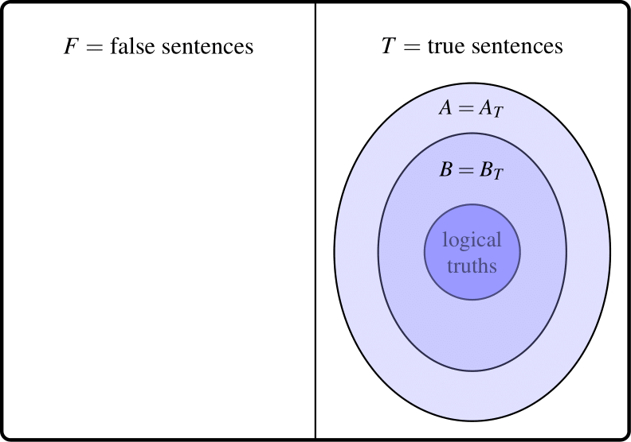
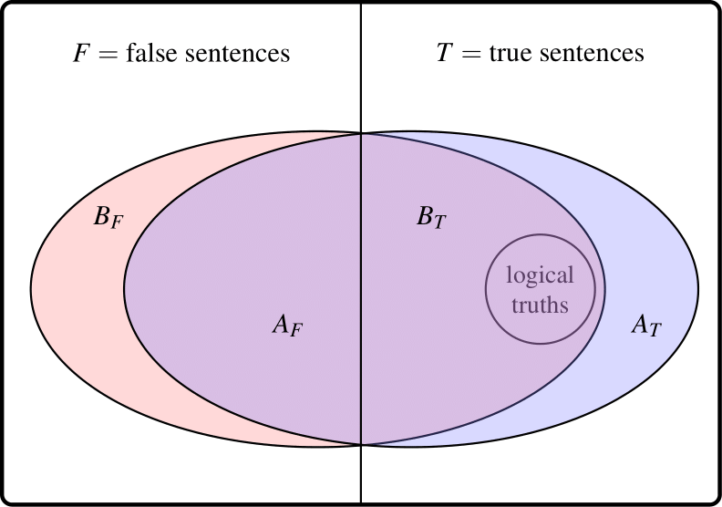
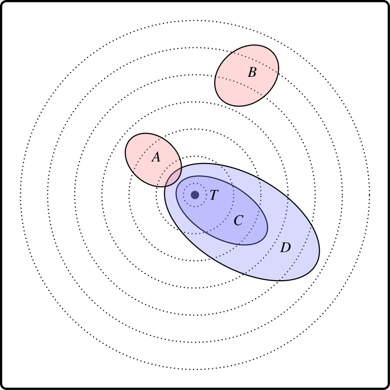
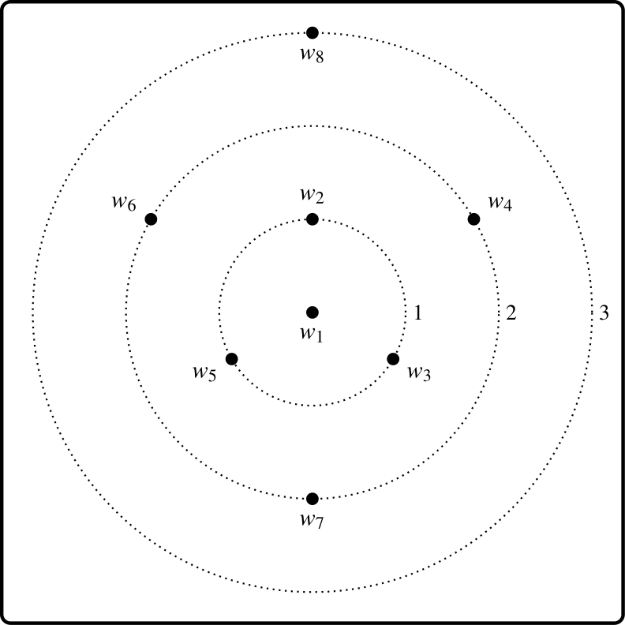
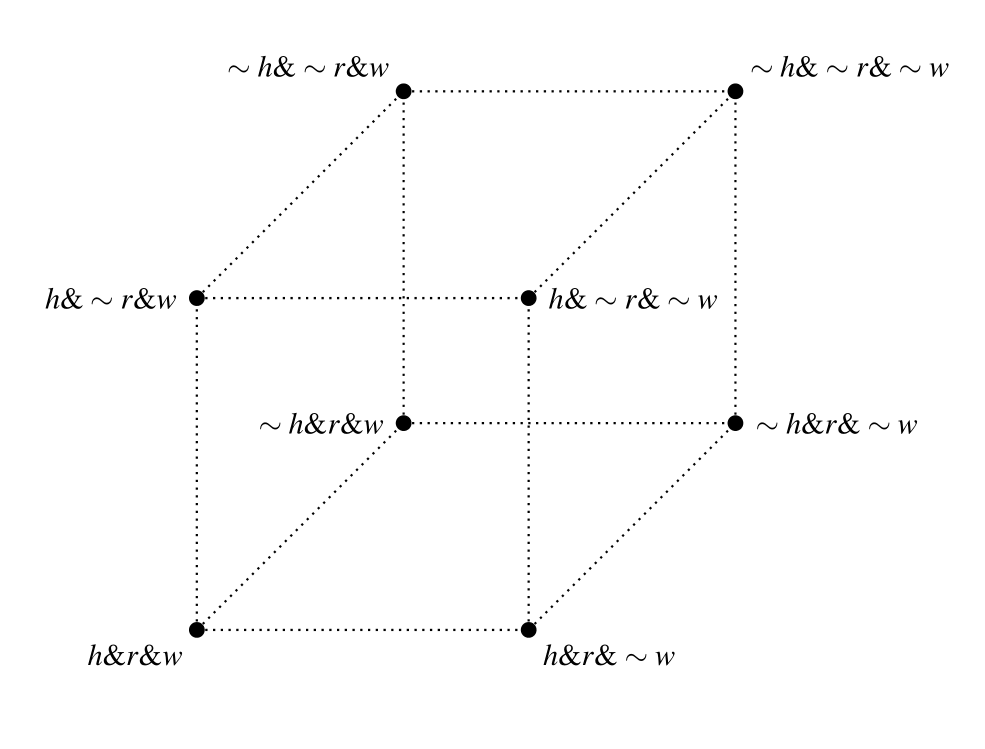

# Truthlikeness
**First published Wed Jul 11, 2001; substantive revision Mon Nov 21, 2022**

*Oddie, Graham, Cevolani, Gustavo*

*Truth* is widely held to be the constitutive aim of inquiry. Even those who think the aim of inquiry is something more accessible than the truth (such as the empirically discernible truth), as well as those who think the aim is something more robust than possessing truth (such as the possession of knowledge) still affirm truth as a necessary component of the end of inquiry. And, other things being equal, it seems better to end an inquiry by endorsing the truth rather than falsehoods.

Even if there is something to the thought that inquiry aims at truth, it has to be admitted that truth is a rather coarse-grained property of propositions. Some falsehoods seem to realize the aim of getting at the truth better than others. Some truths better realize the aim than other truths. And perhaps some falsehoods even realize the aim better than some truths do. The dichotomy of the class of propositions into truths and falsehoods needs to be supplemented with a more fine-grained ordering – one which classifies propositions according to their *closeness* to the truth, their degree of *truthlikeness*, or their *verisimilitude*.

We begin with the logical problem of truthlikeness: the problem of giving an adequate account of the concept and determining its logical properties. In §1 we lay at the logical problem and various possible solutions to it. In §1.1 we examine the basic assumptions which generate the logical problem, which in part explains why the problem emerged when it did. Attempted solutions to the problem quickly proliferated, but they can be gathered together under three broad lines of attack. The first two, the *content approach* (§1.2) and the *consequence approach* (§1.3), were both initiated by Popper in his ground-breaking work; although Popper’s specific proposals did not capture the intuitive concept (and were technically inadequate), the content and consequence approaches are still being actively developed and refined. The third, the *likeness* (or *similarity*) *approach*, takes the *likeness* in *truthlikeness* seriously; the main results and problems facing the likeness approach are outlined in §1.4.

There are two further problems of truthlikeness, both of which presuppose the solution of the logical problem. One is the *epistemological* problem of truthlikeness (§2). Even given a solution to the logical problem, there remains a question about our epistemic access to truthlikeness. The other is the *axiological* problem: what kind of *cognitive values* are truth and truthlikeness? The relations between truth, truthlikeness, and cognitive value are explored in §3.

## 1. The Logical Problem

Truth, perhaps even more than beauty and goodness, has been the target of an extraordinary amount of philosophical dissection and speculation. By comparison with truth, the more complex and much more interesting concept of truthlikeness has only recently become the subject of serious investigation. The logical problem of truthlikeness is to give a consistent and materially adequate account of the concept. But first, we have to make it plausible that there is a coherent concept in the offing to be investigated.

### 1.1 What’s the problem?

Suppose we are interested in what is the number of planets in the solar system. With the demotion of Pluto to planetoid status, the truth of this matter is that there are precisely 8 planets. Now, the proposition *the number of planets in our solar system is 9* may be false, but quite a bit closer to the truth than the proposition that *the number of planets in our solar system is 9 billion*. (One falsehood may be closer to the truth than another falsehood.) The true proposition *the number of the planets is between 7 and 9 inclusive* is closer to the truth than the true proposition that *the number of the planets is greater than or equal to 0*. (So a truth may be closer to the truth than another truth.) Finally, the proposition that *the number of the planets is either less than or greater than 9* may be true but it is arguably not as close to the *whole* truth as its highly accurate but strictly false negation: *that there are 9 planets.*

This particular numerical example is admittedly simple, but a wide variety of judgments of relative likeness to truth crop up both in everyday parlance as well as in scientific discourse. While some involve the relative accuracy of claims concerning the value of numerical magnitudes, others involve the sharing of properties, structural similarity, or closeness among putative laws.

Consider a non-numerical example, also highly simplified but quite topical in the light of the recent rise in status of the concept of *fundamentality*. Suppose you are interested in the truth about which particles are fundamental. At the outset of your inquiry all you know are various logical truths, like the tautology *either electrons are fundamental or they are not*. Tautologies are pretty much useless in helping you locate the truth about fundamental particles. Suppose that the standard model is actually on the right track. Then, learning that electrons are fundamental edges you a little bit closer to your goal. It is by no means the complete truth about fundamental particles, but it is a piece of it. If you go on to learn that electrons, along with muons and tau particles, are a kind of lepton and that all leptons are fundamental, you have presumably edged closer.

If this is right, then some truths are closer to the truth about fundamental particles than others.

The discovery that atoms are not fundamental, that they are in fact composite objects, displaced the earlier hypothesis that *atoms are fundamental*. For a while the proposition that *protons, neutrons and electrons are the fundamental components of atoms* was embraced, but unfortunately it too turned out to be false. Still, this latter falsehood seems closer to the truth than its predecessor (assuming, again, that the standard model is true). And even if the standard model contains errors, as surely it does, it is presumably closer to the truth about fundamental particles than these other falsehoods.

So again, some falsehoods may be closer to the truth about fundamental particles than other falsehoods.

As we have seen, a tautology is not a terrific truth locator, but if you moved from the tautology that *electrons either are or are not fundamental* to embrace the false proposition *that electrons are not fundamental* you would have moved further from your goal.

So, some truths are closer to the truth than some falsehoods.

But it is by no means obvious that all truths about fundamental particles are closer to the whole truth than any falsehood. The false proposition that *electrons, protons and neutrons are the fundamental components of atoms*, for instance, may well be an improvement over the tautology.

If this is right, certain falsehoods are closer to the truth than some truths.

Investigations into the concept of truthlikeness only began in earnest in the early nineteen sixties. Why was *truthlikeness* such a latecomer to the philosophical scene? It wasn’t until the latter half of the twentieth century that mainstream philosophers gave up on the Cartesian goal of infallible knowledge. The idea that we are quite possibly, even probably, mistaken in our most cherished beliefs, that they might well be just *false*, was mostly considered tantamount to capitulation to the skeptic. By the middle of the twentieth century, however, it was clear that many of our commonsense beliefs, as well as previous scientific theories, are strictly speaking, false. Further, the increasingly rapid turnover of scientific theories suggested that, far from being certain, they are ever vulnerable to refutation, and typically are eventually refuted and replaced by some new theory. The history of inquiry is one of a parade of refuted theories, replaced by other theories awaiting their turn at the guillotine. (This is the “dismal induction”, see also the entry on realism and theory change in science.)

*Realism* holds that the constitutive aim of inquiry is the truth of some matter. *Optimism* holds that the history of inquiry is one of progress with respect to its constitutive aim. But *fallibilism* holds that our theories are false or very likely to be false, and to be replaced by other false theories. To combine these three ideas, we must affirm that some false propositions better realize the goal of truth – are closer to the truth – than others. We are thus stuck with the logical problem of truthlikeness.

While a multitude of apparently different solutions to the problem have been proposed, they can be classified into three main approaches, each with its own heuristic – the *content* approach, the *consequence* approach and the *likeness* approach. Before exploring these possible solutions to the logical problem, it could be useful to dispel a couple of common confusions, since truthlikeness should not be conflated with either epistemic probability or with vagueness. We discuss this latter notion in the supplement [Why truthlikeness is not probability or vagueness](truthlikeness.vagueness.md) (see also the entry on vagueness); as for the former, we shall discuss the difference between (expected) truthlikeness and probability when discussing the epistemological problem (§2).

### 1.2 The content approach

Karl Popper was the first philosopher to take the logical problem of truthlikeness seriously enough to make an assay on it. This is not surprising, since Popper was also the first prominent realist to embrace a very radical fallibilism about science while also trumpeting the epistemic superiority of the enterprise. In his early work, he implied that the only kind of progress an inquiry can make consists in falsification of theories. This is a little depressing, to say the least. It is almost as depressing as the pessimistic induction. What it lacks is a positive account of how a succession of falsehoods might constitute positive cognitive progress. Perhaps this is why Popper’s early work received a pretty short shrift from other philosophers. If a miss is as good as a mile, and all we can ever establish with confidence is that our inquiry has missed its target once again, then epistemic pessimism seems inevitable. Popper eventually realized that falsificationism is compatible with optimism provided we have an acceptable notion of verisimilitude (or truthlikeness). If some false hypotheses are closer to the truth than others, then the history of inquiry may turn out to be one of progress towards the goal of truth. Moreover, it may even be reasonable, on the basis of our evidence, to conjecture that our theories are in fact making such progress, even though we know they are all false or highly likely to be false.

Popper saw clearly that the concept of truthlikeness should not be confused with the concept of epistemic probability, and that it has often been so confused. (See Popper 1963 for a history of the confusion and the supplement [Why truthlikeness is not probability or vagueness](truthlikeness.vagueness.md) for an explanation of the difference between the two concepts.) Popper’s insight here was facilitated by his deep but largely unjustified antipathy to epistemic probability. He thought that his starkly falsificationist account favored bold, contentful theories. Degree of informative content varies inversely with probability – the greater the content the less likely a theory is to be true. So if you are after theories which seem, on the evidence, to be true, then you will eschew those which make bold – that is, highly improbable – predictions. On this picture, the quest for theories with high probability is simply misguided.

To see this distinction between truthlikeness and probability clearly, and to articulate it, was one of Popper’s most significant contributions, not only to the debate about truthlikeness, but to philosophy of science and logic in general. However, his deep antagonism to probability, combined with his love of boldness, was both a blessing and a curse. The blessing: it led him to produce not only the first interesting and important account of truthlikeness, but to initiate an approach to the problem in terms of content. The curse: content alone, as Popper envisaged it, is insufficient to characterize truthlikeness.

Popper made the first attempt to solve the problem in his famous collection *Conjectures and Refutations*. As a great admirer of Tarski’s assay on the concept of truth, he modelled his theory of truthlikeness on Tarski’s theory. First, let a matter for investigation be circumscribed by a formalized language $L$ adequate for discussing it. Tarski showed us how each possible world, or model of the language, induces a partition of sentences of $L$ into those that are true and those that are false. The set of all sentences true in the actual world is thus a complete true account of the world, as far as that language goes. It is aptly called the Truth, $T$. $T$ is the target of the investigation couched in $L$. It is the theory (relative to the resources in $L)$ that we are seeking. If truthlikeness is to make sense, theories other than $T$, even false theories, come more or less close to capturing $T$.

$T$, the Truth, is a theory only in the technical Tarskian sense, not in the ordinary everyday sense of that term. It is a set of sentences closed under the consequence relation: $T$ may not be finitely axiomatizable, or even axiomatizable at all. However, it is a perfectly good set of sentences all the same. In general, we will follow the Tarski-Popper usage here and call any set of sentences closed under consequence a *theory*, and we will assume that each proposition we deal with is identified with a theory in this sense. (Note that theory $A$ logically entails theory $B$ just in case $B$ is a subset of $A$.)

The complement of $T$, the set of false sentences $F$, is not a theory even in this technical sense. Since falsehoods always entail truths, $F$ is not closed under the consequence relation. (This may be the reason why we have no expression like *the Falsth*: the set of false sentences does not describe a possible alternative to the actual world.) But $F$ too is a perfectly good set of sentences. The consequences of any theory $A$ that can be formulated in $L$ will thus divide between $T$ and $F$. Popper called the intersection of $A$ and $T$, the *truth content* of $A$ ($A_T$), and the intersection of $A$ and $F$, the *falsity content* of $A$ ($A_T$). Any theory $A$ is thus the union of its non-overlapping truth content and falsity content. Note that since every theory entails all logical truths, these will constitute a special set, at the center of $T$, which will be included in every theory, whether true or false.

\*Diagram 1\*. Truth and falsity contents of false theory $A$

A false theory will cover some of $F$, but because every false theory has true consequences, including all logical truths, it will also overlap with $T$ (Diagram 1).

A true theory, however, will only overlap $T$ (Diagram 2):

\*Diagram 2\*. True theory $A$ is identical to its own truth content

Amongst true theories, then, it seems that the more true sentences that are entailed, the closer we get to $T$, hence the more truthlike. Set theoretically that simply means that, where $A$ and $B$ are both true, $A$ will be more truthlike than $B$ just in case $B$ is a proper subset of $A$ (which for true theories means that $B_T$ is a proper subset of $A_T$). Call this principle: *the value of content for truths*.

\*Diagram 3\*. True theory $A$ has more truth content than true theory $B$

This essentially syntactic account of truthlikeness has some nice features. It induces a partial ordering of truths, with the whole Truth $T$ at the top of the ordering: $T$ is closer to the Truth than any other true theory. The set of logical truths is at the bottom: further from the Truth than any other true theory. In between these two extremes, true theories are ordered simply by logical strength: the more logical content, the closer to the Truth. Since probability varies inversely with logical strength, amongst truths the theory with the greatest truthlikeness $(T)$ must have the smallest probability, and the theory with the largest probability (the logical truth) is the furthest from the Truth. Popper made a simple and perhaps plausible generalization of this. Just as truth content (coverage of $T)$ counts in favor of truthlikeness, falsity content (coverage of $F)$ counts against. In general then, a theory $A$ is closer to the truth if it has more truth content without engendering more falsity content, or has less falsity content without sacrificing truth content (diagram 4):

\*Diagram 4\*. False theory $A$ closer to the Truth than false theory $B$

The generalization of the truth content comparison, by incorporating falsity content comparisons, also has some nice features. It preserves the comparisons of true theories mentioned above. The truth content $A_T$ of a false theory $A$ (itself a theory in the Tarskian sense) will clearly be closer to the truth than $A$ (Diagram 1). And the whole truth $T$ will be closer to the truth than any falsehood $B$ because the truth content of $B$ must be contained within $T$, and the falsity content of $T$ (the empty class) must be properly contained within the non-empty falsity content of $B$.

Despite its attractive features, the account has a couple of disastrous consequences. Firstly, since a falsehood has some false consequences, and no truth has any, it follows that no falsehood can be as close to the truth as a logical truth – the weakest of all truths. A logical truth leaves the location of the truth wide open, so it is rather worthless as an approximation to the whole truth. On Popper’s account, no falsehood can ever be more worthwhile than a worthless logical truth. (We could call this result *the absolute worthlessness of falsehoods*).

Furthermore, it is impossible to add a true consequence to a false theory without thereby adding additional false consequences (or subtract a false consequence without subtracting true consequences). So the account entails that no false theory is closer to the truth than any other. We could call this result *the relative worthlessness of all falsehoods*. These worthlessness results were proved independently by Pavel Tichý and David Miller (Miller 1974, and Tichý 1974)[^tichý-1974] – for a proof, see the supplement on [Why Popper’s definition of truthlikeness fails: the Tichý-Miller theorem](truthlikeness.tichy-miller.md).

It is tempting (and Popper was so tempted) to retreat in the face of these results to something like the comparison of truth contents alone. That is to say, $A$ is as close to the truth as $B$ if $B_T$ is contained in $A_T$, and $A$ is closer to the truth than $B$ just in case $B_T$ is properly contained in $B_T$. Call this the *Simple Truth Content account*.

This Simple Truth Content account preserves what many consider to be the chief virtue of Popper’s account: the value of content for truths. And while it delivers the absolute worthlessness of falsehoods (no falsehood is closer to the truth than a tautology) it avoids the relative worthlessness of falsehoods. If $A$ and $B$ are both false, then $A_T$ may well properly contain $B_T$. But that holds if and only if $A$ is logically stronger than $B$. That is to say, a false proposition is the closer to the truth the stronger it is. According to this principle – call it *the value of content for falsehoods* – the false proposition that *there are nine planets, and all of them are made of green cheese* is more truthlike than the false proposition *there are nine planets*. And so once one knows that a certain theory is false one can be confident that tacking on any old arbitrary proposition, no matter how inaccurate it is, will lead us inexorably closer to the truth. This is sometimes called the *child’s play* objection. Among false theories, *brute logical strength* becomes the sole criterion of a theory’s likeness to truth.

Even though Popper’s particular proposals were flawed, his idea of comparing truth-content and falsity-content is nevertheless worth exploring. Several philosophers have developed variations on the idea. Some stay within Popper’s essentially syntactic paradigm, elucidating content in terms of consequence classes (e.g., Newton Smith 1981; Schurz and Weingartner 1987, 2010; Cevolani and Festa 2020)[^cevolani-2020][^schurz-1987][^schurz-2010]. Others have switched to a semantic conception of content, construing semantic content in terms of classes of possibilities, and searching for a plausible theory of distance between those.

A variant of this approach takes the class of models of a language as a surrogate for possible states of affairs (Miller 1978a)[^miller-1978a]. The other utilizes a semantics of incomplete possible states like those favored by structuralist accounts of scientific theories (Kuipers 1987b, Kuipers 2019)[^kuipers-1987b][^kuipers-2019]. The idea which these accounts have in common is that the distance between two propositions $A$ and $B$ is measured by the *symmetric difference* $A\mathbin{\Delta} B$ of the two sets of possibilities: $(A - B)\cup(B - A)$. Roughly speaking, the larger the symmetric difference, the greater the distance between the two propositions. Symmetric differences might be compared qualitatively – by means of set-theoretic inclusion – or quantitatively, using some kind of probability measure. Both can be shown to have the general features of a measure of distance.

The fundamental problem with the content approach lies not in the way it has been articulated, but rather in the basic underlying assumption: that truthlikeness is a function of just two variables – content and truth value. This assumption has several rather problematic consequences.

Firstly, any given proposition $A$ can have only two degrees of verisimilitude: one in case it is false and the other in case it is true. This is obviously wrong. A theory can be false in very many different ways. The proposition that *there are eight planets* is false whether there are nine planets or a thousand planets, but its degree of truthlikeness is much higher in the first case than in the latter. Secondly, if we combine the value of content for truths and the value of content for falsehoods, then if we fix truth value, verisimilitude will vary only according to amount of content. So, for example, two equally strong false theories will have to have the same degree of verisimilitude. That’s pretty far-fetched. That *there are ten planets* and that *there are ten billion planets* are (roughly) equally strong, and both are false in fact, but the latter seems much further from the truth than the former.

Finally, how might strength determine verisimilitude amongst false theories? There seem to be just two plausible candidates: that verisimilitude increases with increasing strength (the principle of the value of content for falsehoods) or that it decreases with increasing strength (the principle of the disvalue of content for falsehoods). Both proposals are at odds with attractive judgements and principles, which suggest that the original content approach is in need of serious revision (see, e.g., Kuipers 2019 for a recent proposal)[^kuipers-2019].

### 1.3 The Consequence Approach

Popper crafted his initial proposal in terms of the true and false consequences of a theory. Any sentence at all that follows from a theory is counted as a consequence that, if true, contributes to its overall truthlikeness, and if false, detracts from that. But it has struck many that this both involves an enormous amount of double counting, and that it is the indiscriminate counting of arbitrary consequences that lies behind the Tichý-Miller trivialization result.

Consider a very simple framework with three primitive sentences: $h$ (for the state *hot*), $r$ (for *rainy*) and $w$ (for *windy*). This framework generates a very small space of eight possibilities. The eight maximal conjunctions (like $h \amp r \amp w, {\sim}h \amp r \amp w,$ etc.) of the three primitive sentences and of their negations express those possibilities.

Suppose that in fact it is hot, rainy and windy (expressed by the maximal conjunction $h \amp r \amp w)$. Then the claim that it is cold, dry and still (expressed by the sentence ${\sim}h \amp{\sim}r \amp{\sim}w)$ is further from the truth than the claim that it is cold, rainy and windy (expressed by the sentence ${\sim}h \amp r \amp w)$. And the claim that it is cold, dry and windy (expressed by the sentence ${\sim}h \amp{\sim}r \amp w)$ is somewhere between the two. These kinds of judgements, which seem both innocent and intuitively correct, Popper’s theory cannot accommodate. And if they are to be accommodated we cannot treat all true and false consequences alike. For the three false claims mentioned here have exactly the same number of true and false consequences (this is the problem we called *the relative worthlessness of all falsehoods*).

Clearly, if we are going to measure closeness to truth by counting true and false consequences, some true consequences should count more than others. For example, $h$ and $r$ are both true, and ${\sim}h$ and ${\sim}r$ are false. The former should surely count in favor of a claim, and the latter against. But ${\sim}h\rightarrow{\sim}r$ is true and $h\rightarrow{\sim}r$ is false. After we have counted the truth $h$ in favor of a claim’s truthlikeness and the falsehood ${\sim}r$ against it, should we also count the true consequence ${\sim}h\rightarrow{\sim}r$ in favor, and the falsehood $h\rightarrow{\sim}r$ against? Surely this is both unnecessary and misleading. And it is precisely counting sentences like these that renders Popper’s account susceptible to the Tichý-Miller argument.

According to the consequence approach, Popper was right in thinking that truthlikeness depends on the relative sizes of classes of true and false consequences, but erred in thinking that all consequences of a theory count the same. Some consequences are *relevant*, some aren’t. Let $R$ be some criterion of relevance of consequences; let $A_R$ be the set of *relevant* consequences of $A$. Whatever the criterion $R$ is it has to satisfy the constraint that $A$ be recoverable from (and hence equivalent to) $A_R$. Popper’s account is the limiting one – all consequences are relevant. (Popper’s relevance criterion is the empty one, $P$, according to which $A_P$ is just $A$ itself.) The *relevant truth content of A* (abbreviated $A_R^T$) can be defined as $A_R\cap T$ (or $A\cap T_R$), and similarly the *relevant falsity content of* $A$ can be defined as $A_R\cap F$. Since $A_R = (A_R\cap T)\cup(A_R\cap F)$ it follows that the union of true and false relevant consequences of $A$ is equivalent to $A$. And where $A$ is true $A_R\cap F$ is empty, so that A is equivalent to $A_R\cap T$ alone.

With this restriction to relevant consequences we can basically apply Popper’s definitions: one theory is more truthlike than another if its relevant truth content is larger and its relevant falsity content no larger; or its relevant falsity content is smaller, and its relevant truth content is no smaller.

This idea was first explored by Mortensen in his 1983, but he abandoned the basic idea as unworkable. Subsequent proposals within the broad program have been offered by Burger and Heidema 1994, Schurz and Weingartner 1987 and 2010, and Gemes 2007. (Gerla 2007 also uses the notion of the relevance of a “test” or factor, but his account is best located more squarely within the likeness approach.)[^gerla-2007]

One possible relevance criterion that the $h$-$r$-$w$ framework might suggest is *atomicity*. This amounts to identifying relevant consequences as *basic* ones, i.e., atomic sentences or their negations (Cevolani, Crupi and Festa 2011; Cevolani, Festa and Kuipers 2013)[^cevolani-2011][^cevolani-2013]. But even if we could avoid the problem of saying what it is for a sentence to be atomic, since many distinct propositions imply the same atomic sentences, this criterion would not satisfy the requirement that $A$ be equivalent to $A_R$. For example, $(h\vee r)$ and $({\sim}h\vee{\sim}r)$, like tautologies, imply no atomic sentences at all. This latter problem can be solved by resorting to the notion of *partial consequence*; interestingly, the resulting account becomes virtually indentical to one version of the likeness approach (Cevolani and Festa 2020)[^cevolani-2020].

Burger and Heidema 1994 compare theories by positive and negative sentences. A positive sentence is one that can be constructed out of $\amp,$ $\vee$ and any true basic sentence. A negative sentence is one that can be constructed out of $\amp,$ $\vee$ and any false basic sentence. Call a sentence *pure* if it is either positive or negative. If we take the relevance criterion to be *purity*, and combine that with the relevant consequence schema above, we have Burger and Heidema’s proposal, which yields a reasonable set of intuitive judgments. Unfortunately purity (like atomicity) does not quite satisfy the constraint that $A$ be equivalent to the class of its relevant consequences. For example, if $h$ and $r$ are both true then $({\sim}h\vee r)$ and $(h\vee{\sim}r)$ both have the same pure consequences (namely, none).

Schurz and Weingartner 2010 use the following notion of relevance $S$: being equivalent to a disjunction of atomic propositions or their negations. With this criterion they can accommodate a range of intuitive judgments in the simple weather framework that Popper’s account cannot.

For example, where $\gt_S$ is the relation of *greater S-truthlikeness* we capture the following relations among false claims, which, on Popper’s account, are mostly incommensurable:

$$ (h \amp{\sim}r) \gt_S ({\sim}r) \gt_S ({\sim}h \amp{\sim}r). $$

and

$$ (h\vee r) \gt_S ({\sim}r) \gt_S ({\sim}h\vee{\sim}r) \gt_S ({\sim}h \amp{\sim}r). $$

The relevant consequence approach faces three major hurdles.

The first is an extension problem: the approach does produce some intuitively acceptable results in a finite propositional framework, but it needs to be extended to more realistic frameworks – for example, first-order and higher-order frameworks (see Gemes 2007 for an attempt along these lines)[^gemes-2007].

The second is that, like Popper’s original proposal, it judges no false proposition to be closer to the truth than any truth, including logical truths. Schurz and Weingartner (2010) have answered this objection by quantitatively extending their qualitative account by assigning weights to relevant consequences and summing; one problem with this is that it assumes finite consequence classes.

The third involves the language-dependence of any adequate relevance criterion. This problem will be outlined and discussed below in connection with the likeness approach (§1.4.3).

### 1.4 The Likeness Approach

In the wake of the difficulties facing Popper’s approach, two philosophers, working quite independently, suggested a radically different approach: one which takes the *likeness* in truthlikeness seriously (Tichý 1974, Hilpinen 1976)[^hilpinen-1976][^tichý-1974][^tichý-1976]. This shift from content to likeness was also marked by an immediate shift from Popper’s essentially syntactic approach (something it shares with the consequence program) to a semantic approach.

Traditionally the semantic contents of sentences have been taken to be non-linguistic, or rather non-syntactic, items – *propositions*. What propositions are is highly contested, but most agree that a proposition carves the class of possibilities into two sub-classes – those in which the proposition is true and those in which it is false. Call the class of worlds in which the proposition is true its *range*. Some have proposed that propositions be *identified* with their ranges (for example, David Lewis, in his 1986). This is implausible since, for example, the informative content of $7+5=12$ seems distinct from the informative content of $12=12$, which in turn seems distinct from the informative content of Gödel’s first incompleteness theorem – and yet all three have the same range: they are all true in all possible worlds. Clearly, if semantic content is supposed to be sensitive to informative content, classes of possible worlds will are not discriminating enough. We need something more fine-grained for a full theory of semantic content.

Despite this, the range of a proposition is certainly an important aspect of informative content, and it is not immediately obvious why truthlikeness should be sensitive to differences in the way a proposition picks out its range. (Perhaps there are cases of logical falsehoods some of which seem further from the truth than others. For example $7+5=113$ might be considered further from the truth than $7+5=13$ though both have the same range – namely, the empty set of worlds; see Sorensen 2007.) But as a first approximation, we will assume that it is not hyperintensional and that logically equivalent propositions have the same degree of truthlikess. The proposition that *the number of planets is eight* for example, should have the same degree of truthlikeness as the proposition that *the square of the number of the planets is sixty four*.

Leaving apart the controversy over the nature of possible worlds, we shall call the complete collection of possibilities, given some array of features, the *logical space*, and call the array of properties and relations which underlie that logical space, the *framework* of the space. Familiar logical relations and operations correspond to well-understood set-theoretic relations and operations on ranges. The range of the conjunction of two propositions is the intersection of the ranges of the two conjuncts. Entailment corresponds to the subset relation on ranges. The actual world is a single point in logical space – a complete specification of every matter of fact (with respect to the framework of features) – and a proposition is true if its range contains the actual world, false otherwise. The whole Truth is a true proposition that is also complete: it entails all true propositions. The range of the Truth is none other than the singleton of the actual world. That singleton is the target, the bullseye, the thing at which the most comprehensive inquiry is aiming.

Without additional structure on the logical space we have just three factors for a theorist of truthlikeness to work with – the size of a proposition (content factor), whether it contains the actual world (truth factor), and which propositions it implies (consequence factor). The likeness approach requires some additional structure to the logical space. For example, worlds might be more or less *like* other worlds. There might be a betweenness relation amongst worlds, or even a fully-fledged distance metric. If that’s the case, we can start to see how one proposition might be closer to the Truth – the proposition whose range contains just the actual world – than another. The core of the likeness approach is that truthlikeness supervenes on the likeness between worlds.

The likeness theorist has two tasks: firstly, making it plausible that there is an appropriate likeness or distance function on worlds; and secondly, extending likeness between individual worlds to likeness of propositions (i.e., sets of worlds) to the actual world. Suppose, for example, that worlds are arranged in similarity spheres nested around the actual world, familiar from the Stalnaker-Lewis approach to counterfactuals. Consider Diagram 5.

\*Diagram 5\*. Verisimilitude by similarity circles

The bullseye is the actual world and the small sphere which includes it is $T$, the Truth. The nested spheres represent likeness to the actual world. A world is less like the actual world the larger the first sphere of which it is a member. Propositions $A$ and $B$ are false, $C$ and $D$ are true. A carves out a class of worlds which are rather close to the actual world – all within spheres two to four – whereas $B$ carves out a class rather far from the actual world – all within spheres five to seven. Intuitively $A$ is closer to the bullseye than is $B$.

The largest sphere which does not overlap at all with a proposition is plausibly a measure of how close the proposition is to being true. Call that the *truth factor*. A proposition $X$ is closer to being true than $Y$ if the truth factor of $X$ is included in the truth factor of $Y$. The truth factor of $A$, for example, is the smallest non-empty sphere, $T$ itself, whereas the truth factor of $B$ is the fourth sphere, of which $T$ is a proper subset: so $A$ is closer to being true than $B$.

If a proposition includes the bullseye, then of course it is true simpliciter and it has the maximal truth factor (the empty set). So all true propositions are equally close to being true. But truthlikeness is not just a matter of being close to being true. The tautology, $D,$ $C$ and the Truth itself are equally true, but in that order they increase in their closeness to the whole truth.

Taking a leaf out of Popper’s book, Hilpinen argued that closeness to the whole truth is in part a matter of degree of informativeness of a proposition. In the case of the true propositions, this correlates roughly with the smallest sphere which totally includes the proposition. The further out the outermost sphere, the less informative the proposition is, because the larger the area of the logical space which it covers. So, in a way which echoes Popper’s account, we could take truthlikeness to be a combination of a truth factor (given by the likeness of that world in the range of a proposition that is closest to the actual world) and a content factor (given by the likeness of that world in the range of a proposition that is furthest from the actual world):

> $A$ is closer to the truth than $B$ if and only if $A$ does as well as $B$ on both truth factor and content factor, and better on at least one of those.

Applying Hilpinen’s definition we capture two more particular judgements, in addition to those already mentioned, that seem intuitively acceptable: that $C$ is closer to the truth than $A$, and that $D$ is closer than $B$. (Note, however, that we have here a partial ordering: $A$ and $D$, for example, are not ranked.) We can derive from this various apparently desirable features of the relation *closer to the truth*: for example, that the relation is transitive, asymmetric and irreflexive; that the Truth is closer to the Truth than any other theory; that the tautology is at least as far from the Truth as any other truth; that one cannot make a true theory worse by strengthening it by a truth (a weak version of the value of content for truths); that a falsehood is not necessarily improved by adding another falsehood, or even by adding another truth (a repudiation of the value of content for falsehoods).

But there are also some worrying features here. While it avoids the relative worthlessness of falsehoods, Hilpinen’s account, just like Popper’s, entails the absolute worthlessness of all falsehoods: no falsehood is closer to the truth than any truth. So, for example, Newton’s theory is deemed to be no more truthlike, no closer to the whole truth, than the tautology.

Characterizing Hilpinen’s account as a combination of a truth factor and an information factor seems to mask its quite radical departure from Popper’s account. The incorporation of similarity spheres signals a fundamental break with the pure content approach, and opens up a range of possible new accounts: what such accounts have in common is that the truthlikeness of a proposition is a *non-trivial function of the likeness to the actual world of worlds in the range of the proposition*.

There are three main problems for any concrete proposal within the likeness approach. The first concerns an account of likeness between states of affairs – in what does this consist and how can it be analyzed or defined? The second concerns the dependence of the truthlikeness of a proposition on the likeness of worlds in its range to the actual world: what is the correct function? (This can be called “the extension problem”.) And finally, there is the famous problem of “translation variance” or “framework dependence” of judgements of likeness and of truthlikeness. This last problem will be taken up in §1.4.3.

#### 1.4.1 Likeness of worlds in a simple propositional framework

One objection to Hilpinen’s proposal (like Lewis’s proposal for counterfactuals) is that it assumes the similarity relation on worlds as a primitive, there for the taking. At the end of his 1974 paper, Tichý not only suggested the use of similarity rankings on worlds, but also provided a ranking in propositional frameworks and indicated how to generalize this to more complex frameworks.

Examples and counterexamples in Tichý 1974 are exceedingly simple, utilizing the little propositional framework introduced above, with three primitives – $h$ (for the state *hot*), $r$ (for *rainy*) and $w$ (for *windy*). Corresponding to the eight-members of the logical space generated by distributions of truth values through the three basic conditions, there are eight maximal conjunctions (or constituents):

| $w_1$ | $h \amp r \amp w$ |   | $w_5$ | ${\sim}h \amp r \amp w$ |
| --- | --- | --- | --- | --- |
| $w_2$ | $h \amp r \amp{\sim}w$ |   | $w_6$ | ${\sim}h \amp r \amp{\sim}w$ |
| $w_3$ | $h \amp{\sim}r \amp w$ |   | $w_7$ | ${\sim}h \amp{\sim}r \amp w$ |
| $w_4$ | $h \amp{\sim}r \amp{\sim}w$ |   | $w_8$ | ${\sim}h \amp{\sim}r \amp{\sim}w$ |

Worlds differ in the distributions of these traits, and a natural, albeit simple, suggestion is to measure the likeness between two worlds by the number of agreements on traits. This is tantamount to taking distance to be measured by the size of the symmetric difference of generating states – the so-called city-block measure. As is well known, this will generate a genuine metric, in particular satisfying the triangular inequality. If $w_1$ is the actual world this immediately induces a system of nested spheres, but one in which the spheres come with numbers attached:

\*Diagram 6\*. Similarity circles for the weather space

Those worlds orbiting on the sphere $n$ are of distance $n$ from the actual world.

In fact, the structure of the space is better represented not by similarity circles, but rather by a three-dimensional cube:

\*Diagram 7\*. The three-dimensional weather space

This way of representing the space makes a clearer connection between distances between worlds and the role of the atomic propositions in generating those distances through the city-block metric. It also eliminates inaccuracies in the relations between the worlds that are not at the center that the similarity circle diagram suggests.

#### 1.4.2 The likeness of a proposition to the truth

Now that we have numerical distances between worlds, numerical measures of propositional likeness to, and distance from, the truth can be defined as some function of the distances, from the actual world, of worlds in the range of a proposition. But which function is the right one? This is the *extension problem*.

Suppose that $h \amp r \amp w$ is the whole truth about the weather. Following Hilpinen, we might consider overall distance of a propositions from the truth to be some function of the distances from actuality of two extreme worlds. Let *truth*$(A)$ be the truth value of $A$ in the actual world. Let *min*$(A)$ be the distance from actuality of that world in $A$ closest to the actual world, and *max*$(A)$ be the distance from actuality of that world in $A$ furthest from the actual world. Table 1 display the values of the *min* and *max* functions for some representative propositions.

| $\boldsymbol{A}$ | ***truth*$(\boldsymbol{A})$** | ***min*$(\boldsymbol{A})$** | ***max*$(\boldsymbol{A})$** |
| --- | --- | --- | --- |
| $h \amp r \amp w$ | true | 0 | 0 |
| $h \amp r$ | true | 0 | 1 |
| $h \amp r \amp{\sim}$w | false | 1 | 1 |
| $h$ | true | 0 | 2 |
| $h \amp{\sim}r$ | false | 1 | 2 |
| ${\sim}h$ | false | 1 | 3 |
| ${\sim}h \amp{\sim}r \amp w$ | false | 2 | 2 |
| ${\sim}h \amp{\sim}r$ | false | 2 | 3 |
| ${\sim}h \amp{\sim}r \amp{\sim}w$ | false | 3 | 3 |

\*Table 1\*. The *min* and *max* functions.

The simplest proposal (made first in Niiniluoto 1977)[^niiniluoto-1977] would be to take the average of the *min* and the *max* (call this measure *min-max-average*). This would remedy a rather glaring shortcoming which Hilpinen’s qualitative proposal shares with Popper’s proposal, namely that no falsehood is closer to the truth than any truth (even the worthless tautology). This numerical equivalent of Hilpinen’s proposal renders all propositions comparable for truthlikeness, and some falsehoods it deems more truthlike than some truths.

But now that we have distances between all worlds, why take only the extreme worlds in a proposition into account? Why shouldn’t every world in a proposition potentially count towards its overall distance from the actual world?

A simple measure which does count all worlds is average distance from the actual world. *Average* delivers all of the particular judgements we used above to motivate Hilpinen’s proposal in the first place, and in conjunction with the simple metric on worlds it delivers the following ordering of propositions in our simple framework:

| $\boldsymbol{A}$ | ***truth*$(\boldsymbol{A})$** | ***average*$(\boldsymbol{A})$** |
| --- | --- | --- |
| $h \amp r \amp w$ | true | 0 |
| $h \amp r$ | true | 0.5 |
| $h \amp r \amp{\sim}$w | false | 1.0 |
| $h$ | true | 1.3 |
| $h \amp{\sim}r$ | false | 1.5 |
| ${\sim}h$ | false | 1.7 |
| ${\sim}h \amp{\sim}r \amp w$ | false | 2.0 |
| ${\sim}h \amp{\sim}r$ | false | 2.5 |
| ${\sim}h \amp{\sim}r \amp{\sim}w$ | false | 3.0 |

\*Table 2\*. The *average* function.

This ordering looks promising. Propositions are closer to the truth the more they get the basic weather traits right, further away the more mistakes they make. A false proposition may be made either worse or better by strengthening $(h \amp r \amp{\sim}w$ is better than ${\sim}w$ while ${\sim}h \amp{\sim}r \amp{\sim}w$ is worse). A false proposition (like $h \amp r \amp{\sim}w)$ can be closer to the truth than some true propositions (like $h)$. And so on.

These judgments may be sufficient to show that *average* is superior to *min-max-average*, at least on this group of propositions, but they are clearly not sufficient to show that averaging is the right procedure. What we need are some straightforward and compelling general desiderata which jointly yield a single correct function. In the absence of such a proof, we can only resort to case by case comparisons.

Furthermore *average* has not found universal favor. Notably, there are pairs of true propositions such that *average* deems the stronger of the two to be the further from the truth. According to *average*, the tautology is not the true proposition furthest from the truth. Averaging thus violates the Popperian principle of the value of content for truths, see Table 3 for an example.

| $\boldsymbol{A}$ | ***truth*$(\boldsymbol{A})$** | ***average*$(\boldsymbol{A})$** |
| --- | --- | --- |
| $h \vee{\sim}r \vee w$ | true | 1.4 |
| $h \vee{\sim}r$ | true | 1.5 |
| $h \vee{\sim}h$ | true | 1.5 |

\*Table 3\*. *average* violates the value of content for truths.

Let’s then consider other measures, like the *sum* function – the sum of the distances of worlds in the range of a proposition from the actual world (Table 4).

| $\boldsymbol{A}$ | ***truth*$(\boldsymbol{A})$** | ***sum*$(\boldsymbol{A})$** |
| --- | --- | --- |
| $h \amp r \amp w$ | true | 0 |
| $h \amp r$ | true | 1 |
| $h \amp r \amp{\sim}$w | false | 1 |
| $h$ | true | 4 |
| $h \amp{\sim}r$ | false | 3 |
| ${\sim}h$ | false | 8 |
| ${\sim}h \amp{\sim}r \amp w$ | false | 2 |
| ${\sim}h \amp{\sim}r$ | false | 5 |
| $h \amp{\sim}r \amp{\sim}w$ | false | 3 |

\*Table 4\*. The *sum* function.

The *sum* function is an interesting measure in its own right. While, like *average*, it is sensitive to the distances of all worlds in a proposition from the actual world, it is not plausible as a measure of distance from the truth, and indeed no one has proposed it as such a measure. What *sum* does measure is a certain kind of distance-weighted *logical weakness*. In general the weaker a proposition is, the larger its *sum* value. But adding words far from the actual world makes the *sum* value larger than adding worlds closer to it. This guarantees, for example, that of two truths the *sum* of the logically weaker is always greater than the *sum* of the stronger. Thus *sum* might play a role in capturing the value of content for truths. But it also delivers the implausible value of content for falsehoods. If you think that there is anything to the likeness program it is hardly plausible that the falsehood ${\sim}h \amp{\sim}r \amp{\sim}w$ is closer to the truth than its consequence ${\sim}h$. Niiniluoto argues that *sum* is a good likeness-based candidate for measuring Hilpinen’s “information factor”. It is obviously much more sensitive than is *max* to the proposition’s informativeness about the location of the truth.

Niiniluoto thus proposes, as a measure of distance from the truth, the average of this information factor and Hilpinen’s truth factor: *min-sum-average*. Averaging the more sensitive information factor (*sum*) and the closeness-to-being-true factor (*min*) yields some interesting results (see Table 5).

| $\boldsymbol{A}$ | ***truth*$(\boldsymbol{A})$** | ***min-sum-average*$(\boldsymbol{A})$** |
| --- | --- | --- |
| $h \amp r \amp w$ | true | 0 |
| $h \amp r$ | true | 0.5 |
| $h \amp r \amp{\sim}$w | false | 1 |
| $h$ | true | 2 |
| $h \amp{\sim}r$ | false | 2 |
| ${\sim}h$ | false | 4.5 |
| ${\sim}h \amp{\sim}r \amp w$ | false | 2 |
| ${\sim}h \amp{\sim}r$ | false | 3.5 |
| ${\sim}h \amp{\sim}r \amp{\sim}w$ | false | 3 |

\*Table 5\*. The *min-sum-average* function.

For example, this measure deems $h \amp r \amp w$ more truthlike than $h \amp r$, and the latter more truthlike than $h$. And in general *min-sum-average* delivers the value of content for truths. For any two truths the *min* factor is the same (0), and the *sum* factor increases as content decreases. Furthermore, unlike the symmetric difference measures, *min-sum-average* doesn’t deliver the objectionable value of contents for falsehoods. For example, ${\sim}h \amp{\sim}r \amp{\sim}w$ is deemed further from the truth than ${\sim}h$. But *min-sum-average* is not quite home free, at least from an intuitive point of view. For example, ${\sim}h \amp{\sim}r \amp{\sim}w$ is deemed closer to the truth than ${\sim}h \amp{\sim}r$. This is because what ${\sim}h \amp{\sim}r \amp{\sim}w$ loses in closeness to the actual world (*min*) it makes up for by an increase in strength (*sum*).

In deciding how to proceed here we confront a methodological problem. The methodology favored by Tichý is very much bottom-up. For the purposes of deciding between rival accounts it takes the intuitive data very seriously. Popper (along with Popperians like Miller) favor a more top-down approach. They are suspicious of folk intuitions, and sometimes appear to be in the business of constructing a new concept rather than explicating an existing one. They place enormous weight on certain plausible general principles, largely those that fit in with other principles of their overall theory of science: for example, the principle that strength is a virtue and that the stronger of two true theories (and maybe even of two false theories) is the closer to the truth. A third approach, one which lies between these two extremes, is that of reflective equilibrium. This recognizes the claims of both intuitive judgements on low-level cases, and plausible high-level principles, and enjoins us to bring principle and judgement into equilibrium, possibly by tinkering with both. Neither intuitive low-level judgements nor plausible high-level principles are given advance priority. The protagonist in the truthlikeness debate who has argued most consistently for this approach is Niiniluoto.

How might reflective equilibrium be employed to help resolve the current dispute? Consider a different space of possibilities, generated by a single magnitude like the number of the planets $(N).$ Suppose that $N$ is in fact 8 and that the further $n$ is from 8, the further the proposition that $N=n$ from the Truth. Consider the three sets of propositions in Table 6. In the left-hand column we have a sequence of false propositions which, intuitively, decrease in truthlikeness while increasing in strength. In the middle column we have a sequence of corresponding true propositions, in each case the strongest true consequence of its false counterpart on the left (Popper’s “truth content”). Again members of this sequence steadily increase in strength. Finally on the right we have another column of falsehoods. These are also steadily increasing in strength, and like the left-hand falsehoods, seem (intuitively) to be decreasing in truthlikeness as well.

| **Falsehood (1)** | **Strongest True Consequence** | **Falsehood (2)** |
| --- | --- | --- |
| $10 \le N \le 20$ | $N=8$ or $10 \le N \le 20$ | $N=9$ or $10 \le N \le 20$ |
| $11 \le N \le 20$ | $N=8$ or $11 \le N \le 20$ | $N=9$ or $11 \le N \le 20$ |
| …… | …… | …… |
| $19 \le N \le 20$ | $N=8$ or $19 \le N \le 20$ | $N=9$ or $19 \le N \le 20$ |
| $N= 20$ | $N=8$ or $N= 20$ | $N=9$ or $N= 20$ |

\*Table 6\*.

Judgements about the closeness of the true propositions in the center column to the truth may be less intuitively clear than are judgments about their left-hand counterparts. However, it would seem highly incongruous to judge the truths in Table 6 to be steadily increasing in truthlikeness, while the falsehoods both to the left and the right, both marginally different in their overall likeness relations to truth, steadily decrease in truthlikeness. This suggests that that all three are sequences of steadily increasing strength combined with steadily *decreasing* truthlikeness. And if that’s right, it might be enough to overturn Popper’s principle that amongst true theories strength and truthlikeness must covary (even while granting that this is not so for falsehoods).

If this argument is sound, it removes an objection to averaging distances, but it does not settle the issue in its favor, for there may still be other more plausible counterexamples to averaging that we have not considered.

Schurz and Weingartner argue that this extension problem is the main defect of the likeness approach:

> the problem of extending truthlikeness from possible worlds to propositions is intuitively underdetermined. Even if we are granted an ordering or a measure of distance on worlds, there are many very different ways of extending that to propositional distance, and apparently no objective way to decide between them. (Schurz and Weingartner 2010, 423)[^schurz-2010]

One way of answering this objection head on is to identify principles that, given a distance function on worlds, constrain the distances between worlds and sets of worlds, principles perhaps powerful enough to identify a unique extension.

Apart from the extension problem, two other issues affect the likeness approach. The first is how to apply it beyond simple propositional examples as the ones considered above (Popper’s content approach, whatever else its shortcomings, can be applied in principle to theories expressible in any language, no matter how sophisticated). We discuss this in the supplement on [Extending the likeness approach to first-order and higher-order frameworks](truthlikeness.complex-frameworks.md).

The second has to do with the fact that assessments of relative likeness are sensitive to how the framework underlying the logical space is defined. This “framework dependence” issue is discussed in the next section.

#### 1.4.3 The framework dependence of likeness

The single most powerful and influential argument against the whole likeness approach is the charge that it is “language dependent” or “framework dependent” (Miller 1974a, 197 a, 1976, and most recently defended, vigorously as usual, in his 2006)[^miller-1974a][^miller-1976]. Early formulations of the likeness approach (Tichý 1974, 1976, Niiniluoto 1976)[^tichý-1974][^tichý-1976] proceeded in terms of syntactic surrogates for their semantic correlates – sentences for propositions, predicates for properties, constituents for partitions of the logical space, and the like. The question naturally arises, then, whether we obtain the same measures if all the syntactic items are translated into an essentially equivalent language – one capable of expressing the same propositions and properties with a different set of primitive predicates. Newton’s theory can be formulated with a variety of different primitive concepts, but these formulations are typically taken to be equivalent. If the degree of truthlikeness of Newton’s theory were to vary from one such formulation to another, then while such a concept might still might have useful applications, it would hardly help to vindicate realism.

Take our simple weather-framework above. This trafficks in three primitives – *hot*, *rainy*, and *windy*. Suppose, however, that we define the following two new weather conditions:

> *minnesotan* $ =_{df}$ *hot* if and only if *rainy*
>
> *arizonan* $ =_{df}$ *hot* if and only if *windy*

Now it appears as though we can describe the same sets of weather states in the new $h$-$m$-$a$-ese language based on the above conditions. Table 7 shows the translations of four representative theories between the two languages.

|   | *$h$-$r$-$w$-ese* | *$h$-$m$-$a$-ese* |
| --- | --- | --- |
| $T$ | $h \amp r \amp w$ | $h \amp m \amp a$ |
| $A$ | ${\sim}h \amp r \amp w$ | ${\sim}h \amp{\sim}m \amp{\sim}a$ |
| $B$ | ${\sim}h \amp{\sim}r \amp w$ | ${\sim}h \amp m \amp{\sim}a$ |
| $C$ | ${\sim}h \amp{\sim}r \amp{\sim}w$ | ${\sim}h \amp m \amp a$ |

\*Table 7\*.

If $T$ is the truth about the weather then theory $A$, in $h$-$r$-$w$-ese, seems to make just one error concerning the original weather states, while $B$ makes two and $C$ makes three. However, if we express these two theories in $h$-$m$-$a$-ese however, then this is reversed: $A$ appears to make three errors and $B$ still makes two and $C$ makes only one error. But that means the account makes truthlikeness, unlike truth, radically language-relative.

There are two live responses to this criticism. But before detailing them, note a dead one: the likeness theorist cannot object that $h$-$m$-$a$ is somehow logically inferior to $h$-$r$-$w$, on the grounds that the primitives of the latter are essentially “biconditional” whereas the primitives of the former are not. This is because there is a perfect symmetry between the two sets of primitives. Starting within $h$-$m$-$a$-ese we can arrive at the original primitives by exactly analogous definitions:

> *rainy* $ =_{df}$ *hot* if and only if *minnesotan*
> *windy* $ =_{df}$ *hot* if and only if *arizonan*

Thus if we are going to object to $h$-$m$-$a$-ese it will have to be on other than purely logical grounds.

Firstly, then, the likeness theorist could maintain that certain predicates (presumably “hot”, “rainy” and “windy”) are primitive in some absolute, realist, sense. Such predicates “carve reality at the joints” whereas others (like “minnesotan” and “arizonan”) are gerrymandered affairs. With the demise of predicate nominalism as a viable account of properties and relations this approach is not as unattractive as it might have seemed in the middle of the last century. Realism about universals is certainly on the rise. While this version of realism presupposes a sparse theory of properties – that is to say, it is not the case that to every definable predicate there corresponds a genuine universal – such theories have been championed both by those doing traditional a priori metaphysics of properties (e.g. Bealer 1982)[^bealer-1982] as well as those who favor a more empiricist, scientifically informed approach (e.g. Armstrong 1978, Tooley 1977)[^tooley-1977]. According to Armstrong, for example, which predicates pick out genuine universals is a matter for developed science. The primitive predicates of our best fundamental physical theory will give us our best guess at what the genuine universals in nature are. They might be predicates like electron or mass, or more likely something even more abstruse and remote from the phenomena – like the primitives of String Theory.

One apparently cogent objection to this realist solution is that it would render the task of empirically estimating degree of truthlikeness completely hopeless. If we know a priori which primitives should be used in the computation of distances between theories it will be difficult to estimate truthlikeness, but not impossible. For example, we might compute the distance of a theory from the various possibilities for the truth, and then make a weighted average, weighting each possible true theory by its probability on the evidence. That would be the credence-mean estimate of truthlikeness (see §2). However, if we don’t even know which features should count towards the computation of similarities and distances then it appears that we cannot get off first base.

To see this consider our simple weather frameworks. Suppose that all I learn is that it is rainy. Do I thereby have some grounds for thinking $A$ is closer to the truth than $B$? I would if I also knew that $h$-$r$-$w$-ese is the language for calculating distances. For then, whatever the truth is, $A$ makes one fewer mistake than $B$ makes. $A$ gets it right on the rain factor, while $B$ doesn’t, and they must score the same on the other two factors whatever the truth of the matter. But if we switch to $h$-$m$-$a$-ese then $A$’s epistemic superiority is no longer guaranteed. If, for example, $T$ is the truth then $B$ will be closer to the truth than $A$. That’s because in the $h$-$m$-$a$ framework raininess as such doesn’t count in favor or against the truthlikeness of a proposition.

This objection would fail if there were empirical indicators not just of which atomic states obtain, but also of which are the genuine ones, the ones that really carve reality at the joints. Obviously the framework would have to contain more than just $h, m$ and $a$. It would have to contain resources for describing the states that indicate whether these were genuine universals. Maybe whether they enter into genuine causal relations will be crucial, for example. Once we can distribute probabilities over the candidates for the real universals, then we can use those probabilities to weight the various possible distances which a hypothesis might be from any given theory.

The second live response is both more modest and more radical. It is more modest in that it is not hostage to the objective priority of a particular conceptual scheme, whether that priority is accessed a *priori* or *a posteriori*. It is more radical in that it denies a premise of the invariance argument that at first blush is apparently obvious. It denies the equivalence of the two conceptual schemes. It denies that $h \amp r \amp w$, for example, expresses the very same proposition as $h \amp m \amp a$ expresses. If we deny translatability then we can grant the invariance principle, and grant the judgements of distance in both cases, but remain untroubled. There is no contradiction (Tichý 1978)[^tichý-1978].

At first blush this response seems somewhat desperate. Haven’t the respective conditions been *defined* in such a way that they are simple equivalents by fiat? That would, of course, be the case if $m$ and $a$ had been introduced as defined terms into $h$-$r$-$w$. But if that were the intention then the likeness theorist could retort that the calculation of distances should proceed in terms of the primitives, not the introduced terms. However, that is not the only way the argument can be read. We are asked to contemplate two partially overlapping sequences of conditions, and two spaces of possibilities generated by those two sequences. We can thus think of each possibility as a point in a simple three dimensional space. These points are ordered triples of 0s and 1s, the $n$th entry being 0 if the $n$th condition is satisfied and 1 if it isn’t. Thinking of possibilities in this way, we already have rudimentary geometrical features generated simply by the selection of generating conditions. Points are adjacent if they differ on only one dimension. A path is a sequence of adjacent points. A point $q$ is between two points $p$ and $r$ if $q$ lies on a shortest path from $p$ to $r$. A region of possibility space is convex if it is closed under the betweenness relation – anything between two points in the region is also in the region (Oddie 1987, Goldstick and O’Neill 1988)[^goldstick-1988][^oddie-1987].

Evidently we have two spaces of possibilities, S1 and S2, and the question now arises whether a sentence interpreted over one of these spaces expresses the very same thing as any sentence interpreted over the other. Does $h \amp r \amp w$ express the same thing as $h \amp m \amp a$? $h \amp r \amp w$ expresses (the singleton of) $u_1$ (which is the entity $\langle 1,1,1\rangle$ in S1 or $\langle 1,1,1\rangle_{S1})$ and $h \amp m \amp a$ expresses $v_1$ (the entity $\langle 1,1,1\rangle_{S2}). {\sim}h \amp r \amp w$ expresses $u_2 (\langle 0,1,1\rangle_{S1})$, a point adjacent to that expressed by $h \amp r \amp w$. However ${\sim}h \amp{\sim}m \amp{\sim}a$ expresses $v_8 (\langle 0,0,0\rangle_{S2})$, which is not adjacent to $v_1 (\langle 1,1,1\rangle_{S2})$. So now we can construct a simple proof that the two sentences do not express the same thing.

- $u_1$ is adjacent to $u_2$.
- $v_1$ is not adjacent to $v_8$.
- *Therefore*, either $u_1$ is not identical to $v_1$, or $u_2$ is not identical $v_8$.
- *Therefore*, either $h \amp r \amp w$ and $h \amp m \amp a$ do not express the same proposition, or ${\sim}h \amp r \amp w$ and ${\sim}h \amp{\sim}m \amp{\sim}a$ do not express the same proposition.

Thus at least one of the two required intertranslatability claims fails, and $h$-$r$-$w$-ese is not intertranslatable with $h$-$m$-$a$-ese. The important point here is that a space of possibilities already comes with a structure and the points in such a space cannot be individuated without reference to rest of the space and its structure. The identity of a possibility is bound up with its geometrical relations to other possibilities. Different relations, different possibilities. This kind of response has also been endorsed in the very different truth-maker proposal put forward in Fine (2021, 2022)[^fine-2021][^fine-2022].

This kind of rebuttal to the Miller argument would have radical implications for the comparability of actual theories that appear to be constructed from quite different sets of primitives. Classical mechanics can be formulated using mass and position as basic, or it can be formulated using mass and momentum. The classical concepts of velocity and of mass are different from their relativistic counterparts, even if they were “intertranslatable” in the way that the concepts of $h$-$r$-$w$-ese are intertranslatable with $h$-$m$-$a$-ese.

This idea meshes well with recent work on conceptual spaces in Gärdenfors (2000)[^gärdenfors-2000][^gärdenfors-2000-2]. Gärdenfors is concerned both with the semantics and the nature of genuine properties, and his bold and simple hypothesis is that properties carve out convex regions of an $n$-dimensional quality space. He supports this hypothesis with an impressive array of logical, linguistic and empirical data. (Looking back at our little spaces above it is not hard to see that the convex regions are those that correspond to the generating (or atomic) conditions and conjunctions of those. See Burger and Heidema 1994.) While Gärdenfors is dealing with properties, it is not hard to see that similar considerations apply to propositions, since propositions can be regarded as 0-ary properties.

Ultimately, however, this response may seem less than entirely satisfactory by itself. If the choice of a conceptual space is merely a matter of taste then we may be forced to embrace a radical kind of incommensurability. Those who talk $h$-$r$-$w$-ese and conjecture ${\sim}h \amp r \amp w$ on the basis of the available evidence will be close to the truth. Those who talk $h$-$m$-$a$-ese while exposed to the “same” circumstances would presumably conjecture ${\sim}h \amp{\sim}m \amp{\sim}a$ on the basis of the “same” evidence (or the corresponding evidence that they gather). If in fact $h \amp r \amp w$ is the truth (in $h$-$r$-$w$-ese) then the $h$-$r$-$w$ weather researchers will be close to the truth. But the $h$-$m$-$a$ researchers will be very far from the truth.

This may not be an explicit contradiction, but it should be worrying all the same. Realists started out with the ambition of defending a concept of truthlikeness which would enable them to embrace both fallibilism and optimism. But what the likeness theorists seem to have ended up with here is something that suggests a rather unpalatable incommensurability of competing conceptual frameworks. To avoid this, the realist will need to affirm that some conceptual frameworks really are better than others. Some really do “carve reality at the joints” and others don’t. But is that something the realist should be reluctant to affirm?

## 2. The Epistemological Problem

The quest to nail down a viable concept of truthlikeness is motivated, at least in part, by fallibilism (§1.1). It is certainly true that a viable notion of distance from the truth renders progress in an inquiry through a succession of false theories at least possible. It is also true that if there is no such viable notion, then truth can be retained as the goal of inquiry only at the cost of making partial progress towards it virtually impossible. But does the mere *possibility* of making progress towards the truth improve our epistemic lot? Some have argued that it doesn’t (see for example Laudan 1977, Cohen 1980, Newton-Smith 1981)[^cohen-1980][^laudan-1977][^newton-smith-1981]. One common argument can be recast in the form of a simple dilemma. Either we can ascertain the truth, or we can’t. If we can ascertain the truth then we do not need a concept of truthlikeness – it is an entirely useless addition to our intellectual repertoire. But if we cannot ascertain the truth, then we cannot ascertain the degree of truthlikeness of our theories either. So again, the concept is useless for all practical purposes. (See the entry on scientific progress, especially §2.4.)

Consider the second horn of this dilemma. Is it true that if we can’t know what the (whole) truth of some matter is, we also cannot ascertain whether or not we are making progress towards it? Suppose you are interested in the truth about the weather tomorrow. Suppose you learn (from a highly reliable source) that it will be hot. Even though you don’t know the *whole* truth about the weather tomorrow, you do know that you have added a truth to your existing corpus of weather beliefs. One does not need to be able to ascertain the whole truth to ascertain some less-encompassing truths. And it seems to follow that you can also know you have made at least some progress towards the whole weather truth.

This rebuttal is too swift. It presupposes that the addition of a new truth $A$ to an existing corpus $K$ guarantees that your revised belief $K$\*$A$ constitutes progress towards the truth. But whether or not $K$\*$A$ is closer to the truth than $K$ depends not only on a theory of truthlikeness but also on a theory of belief revision. (See also the entry on the logic of belief revision.)

Let’s consider a simple case. Suppose $A$ is some newly discovered truth, and that $A$ is compatible with $K$. Assume that belief revision in such cases is simply a matter of so-called *expansion* – i.e., conjoining $A$ to $K$. Consider the case in which $K$ also happens to be true. Then any account of truthlikeness that endorses the value of content for truths (e.g. Niiniluoto’s *min-sum-average*) guarantees that $K$\*$A$ is closer to the truth than $K$. That’s a welcome result, but it has rather limited application. Typically one doesn’t know that $K$ is true: so even if one knows that $A$ is true, one cannot use this fact to celebrate progress.

The situation is more dire when it comes to falsehoods. If $K$ is in fact false then, without the disastrous principle of the value of content for falsehoods, there is certainly no guarantee that $K$\*$A$ will constitute a step toward the truth. (And even if one endorsed the disastrous principle one would hardly be better off. For then the addition of any proposition, whether true or false, would constitute an improvement on a false theory.) Consider again the number of the planets, $N$. Suppose that the truth is N$=8$, and that your existing corpus $K$ is ($N=7 \vee N=100)$. Suppose you somehow acquire the truth $A$: $N\gt 7$. Then $K$\*$A$ is $N=100$, which (on *average*, *min-max-average* and *min-sum-average*) is further from the truth than $K$. So revising a false theory by adding truths by no means guarantees progress towards the truth.

For theories that reject the value of content for truths (e.g., the *average* proposal) the situation is worse still. Even if $K$ happens to be true, there is no guarantee that expanding $K$ with truths will constitute progress. Of course, there will be certain general conditions under which the value of content for truths holds. For example, on the *average* proposal, the expansion of a true $K$ by an atomic truth (or, more generally, by a convex truth) will guarantee progress toward the truth.

So under very special conditions, one can know that the acquisition of a truth will enhance the overall truthlikeness of one’s theories, but these conditions are exceptionally narrow and provide at best a very weak defense against the dilemma. (See Niiniluoto 2011. For rather more optimistic views of the relation between truthlikeness and belief revision see Kuipers 2000, Lavalette, Renardel & Zwart 2011, Cevolani, Crupi and Festa 2011, and Cevolani, Festa and Kuipers 2013.)[^cevolani-2011][^cevolani-2013][^kuipers-2000][^kuipers-2011][^niiniluoto-2011][^renardel-2011]

A different tack is to deny that a concept is useless if there is no effective empirical decision procedure for ascertaining whether it applies. For even if we cannot know for sure what the value of a certain unobservable magnitude is, we might well have better or worse *estimates* of the value of the magnitude on the evidence. And that may be all we need for the concept to be of practical value. Consider, for example, the propensity of a certain coin-tossing set-up to produce heads – a magnitude which, for the sake of the example, we assume to be not directly observable. Any non-extreme value of this magnitude is compatible with any number of heads in a sequence of $n$ tosses. So we can never know with certainty what the actual propensity is, no matter how many tosses we observe. But we can certainly make rational estimates of the propensity on the basis of the accumulating evidence. Suppose one’s initial state of ignorance of the propensity is represented by an even distribution of credences over the space of possibilities for the propensity (i.e., the unit interval). Using Bayes theorem and the Principal Principle, after a fairly small number of tosses we can become quite confident that the propensity lies in a small interval around the observed relative frequency. Our *best estimate* of the value of the magnitude is its *expected value* on the evidence.

Similarly, suppose we don’t and perhaps cannot know which constituent is in fact true. But suppose that we do have a good measure of distance between constituents (or the elements of some salient partition of the space) $C_i$ and we have selected the right extension function. So we have a measure $TL(A\mid C_i)$of the truthlikeness of a proposition $A$ given that constituent $C_i$ is true. Provided we also have a measure of epistemic probability $P$ (where $P(C_i\mid e)$ is the degree of rational credence in $C_i$ given evidence $e)$ we also have a measure of the *expected* degree of truthlikeness of $A$ on the evidence (call this $\mathbf{E}TL(A\mid e))$ which we can identify with the best epistemic estimate of truthlikeness. (Niiniluoto, who first explored this concept in his 1977, calls the epistemic estimate of degree of truthlikeness on the evidence, or expected degree of truthlikeness, *verisimilitude*. Since *verisimilitude* is typically taken to be a synonym for *truthlikeness,* we will not follow him in this, and will stick instead with *expected truthlikeness* for the epistemic notion. See also Maher (1993)[^maher-1993].)

$$ \mathbf{E}TL(A\mid e) = \sum_i TL(A\mid C_i)\times P(C_i \mid e). $$

Clearly, the expected degree of truthlikeness of a proposition $is$ epistemically accessible, and it can serve as our best empirical estimate of the objective degree of truthlikeness. Progress occurs in an inquiry when actual truthlikeness increases. And apparent progress occurs when the expected degree of truthlikeness increases. (See the entry on scientific progress, §2.5.) This notion of expected truthlikeness is comparable to, but sharply different from, that of epistemic probability: the supplement on [Expected Truthlikeness](truthlikeness.expected-truthlikeness.md) discusses some instructive differences between the two concepts.

With this proposal, Niiniluoto also made a connection with the application of decision theory to epistemology. Decision theory is an account of what it is rational to do in light of one’s beliefs and desires. One’s goal, it is assumed, is to maximize utility. But given that one does not have perfect information about the state of the world, one cannot know for sure how to accomplish that. Given uncertainty, the rule to maximize utility or value cannot be applied in normal circumstances. So under conditions of uncertainty, what it is rational to do, according to the theory, is to maximize *subjective expected utility*. Starting with Hempel’s classic 1960 essay, epistemologists conjectured that decision-theoretic tools might be applied to the problem of theory *acceptance* – which hypothesis it is rational to accept on the basis of the total available evidence to hand. But, as Hempel argued, the values or utilities involved in a decision to accept a hypothesis cannot be simply regular practical values. These are typically thought to be generated by one’s desires for various states of affairs to obtain in the world. But the fact that one would very much like a certain favored hypothesis to be true does not increase the cognitive value of accepting that hypothesis.

> This much is clear: the utilities should reflect the value or disvalue which the different outcomes have from the point of view of pure scientific research rather than the practical advantages or disadvantages that might result from the application of an accepted hypothesis, according as the latter is true or false. Let me refer to the kind of utilities thus vaguely characterized as purely scientific, or epistemic, utilities. (Hempel 1960, 465)[^hempel-1960]

If we had a decent theory of *epistemic utility* (also known as *cognitive utility* or *cognitive value*), perhaps what hypotheses one ought to accept, or what experiments one ought to perform, or how one ought to revise one’s corpus of belief in the light of new information, could be determined by the rule: maximize expected epistemic utility (or maximize expected cognitive value). Thus decision-theoretic epistemology was born.

Hempel went on to ask what epistemic utilities are implied in the standard conception of scientific inquiry – “…construing the proverbial ’pursuit of truth’ in science as aimed at the establishment of a maximal system of true statements…” Hempel (1960)[^hempel-1960], p 465)

Already we have here the germ of the idea central to the truthlikeness program: that the goal of an inquiry is to end up accepting (or “establishing”) the theory that yields the whole truth of some matter. It is interesting that, around the same time that Popper was trying to articulate a content-based account of truthlikeness, Hempel was attempting to characterize partial fulfillment of the goal (that is, of maximally contentful truth) in terms of some combination of truth and content. These decision-theoretic considerations lead naturally to a brief consideration of the axiological problem of truthlikeness.

## 3. The Axiological Problem

Our interest in the concept of truthlikeness seems grounded in the value of highly truthlike theories. And that, in turn, seems grounded in the value of truth.

Let’s start with the putative value of truth. Truth is not, of course, a good-making property of the objects of belief states. The proposition $h \amp r \amp w$ is not a better *proposition* when it happens to be hot, rainy and windy than when it happens to be cold, dry and still. Rather, the cognitive state of *believing* $h \amp r \amp w$ is often deemed to be a good state to be in if the proposition is true, not good if it is false. So the state of *believing truly* is better than the state of *believing falsely*.

At least some, perhaps most, of the value of believing truly can be accounted for instrumentally. Desires mesh with beliefs to produce actions that will best achieve what is desired. True beliefs will generally do a better job of this than false beliefs. If you are thirsty and you believe the glass in front of you contains safe drinking water rather than lethal poison then you will be motivated to drink. And if you do drink, you will be better off if the belief you acted on was true (you quench your thirst) rather than false (you end up dead).

We can do more with decision theory utilizing purely practical or non-cognitive values. For example, there is a well-known, decision-theoretic, *value-of-learning theorem*, the Ramsey-Good theorem, which partially vindicates the value of gathering new information, and it does so in terms of “practical” values, without assuming any purely cognitive values. (Good 1967.)[^good-1967] Suppose you have a choice to make, and you can either choose now, or choose after doing some experiment. Suppose further that you are rational (you always choose by expected value) and that the experiment is cost-free. It follows that performing the experiment and then choosing always has at least as much expected value as choosing without further ado. Further, doing the experiment has higher expected value if one possible outcome of the experiment would alter the relative values of some your options. So, you should do the experiment just in case the outcome of the experiment could make a difference to what you choose to do. Of course, the expected gain of doing the experiment has to be worth the expected cost. Not all information is worth pursuing when you have limited time and resources.

David Miller notes the following serious limitation of the Ramsey-Good value-of-learning theorem:

> The argument as it stands simply doesn’t impinge on the question of why evidence is collected in those innumerable cases in theoretical science in which no decisions will be, or anyway are envisaged to be, affected. (Miller 1994, 141)[^miller-1994].

There are some things that we think are worth knowing about, the knowledge of which would not change the expected value of any action that one might be contemplating performing. We spent billions of dollars conducting an elaborate experiment to determine whether the Higgs boson exists, and the results were promising enough that Higgs was awarded the Nobel Prize for his prediction. The discovery may also yield practical benefits, but it is the *cognitive* change it induces that makes it worthwhile. It is valuable simply for what it did to our credal state – not just our credence in the existence of the Higgs, but our overall credal state. We may of course be wrong about the Higgs – the results might be misleading – but from our new epistemic viewpoint it certainly appears to us that we have made cognitive gains. We have a little bit more evidence for the truth, or at least the truthlikeness, of the standard model.

What we need, it seems, is an account of pure cognitive value, one that embodies the idea that getting at the truth is itself valuable whatever its practical benefits. As noted this possibility was first explicitly raised by Hempel, and developed in various difference ways in the 1960s and 1970s by Levi (1967)[^levi-1967] and Hilpinen (1968)[^hilpinen-1968], amongst others. (For recent developments see the entry epistemic utility arguments for probabilism, §6.)

We could take the cognitive value of believing a single proposition $A$ to be positive when $A$ is true and negative when $A$ is false. But acknowledging that belief comes in degrees, the idea might be that the stronger one’s belief in a truth (or of one’s disbelief in a falsehood), the greater the cognitive value. Let $V$ be the characteristic function of answers, both complete and partial, to the question $\{C_1, C_2 , \ldots ,C_n , \ldots \}$. That is to say, where $A$ is equivalent to some disjunction of complete answers:

- $V_i (A) = 1$ if $A$ is entailed by the complete answer $C_i$ (i.e $A$ is true according to $C_i)$;
- $V_i (A) = 0$ if the negation of $A$ is entailed by the complete answer $C_i$ (i.e., $A$ is false according to $C_i)$.

Then the simple view is that the cognitive value of believing $A$ to degree $P(A)$ (where $C_i$ is the complete true answer) is greater the closer $P(A)$ is to the actual value of $V_i (A)$– that is, the smaller $|V_i (A)-P(A)|$ is. Variants of this idea have been endorsed, for example by Horwich (1982, 127–9)[^horwich-1982], and Goldman (1999)[^goldman-1999], who calls this “veristic value”.

$|V_i (A)-P(A)|$ is a measure of how far $P(A)$ is from $V_i (A)$, and $-|V_i (A)-P(A)|$ of how close it is. So here is the simplest linear realization of this desideratum:

$$ Cv^1 _i (A, P) = - |V_i (A)-P(A)|. $$

But there are of course many other measures satisfying the basic idea. For example we have the following quadratic measure:

$$ Cv^2 _i (A, P) = -((V_i (A)- P(A))^2. $$

Both $Cv^1$ and $Cv^2$ reach a maximum when $P(A)$ is maximal and $A$ is true, or $P(A)$ is minimal and $A$ is false; and a minimum when $P(A)$ is maximal and $A$ is false, or $P(A)$ is minimal and $A$ is true.

These are measures of *local* value – the value of investing a certain degree of belief in a single answer $A$ to the question $Q$. But we can agglomerate these local values into the value of a total credal state $P$. This involves a substantive assumption: that the value of a credal state is some additive function of the values of the individual beliefs states it underwrites. A credal state, relative to inquiry $Q$, is characterized by its distribution of credences over the elements of the partition $Q$. An *opinionated* credal state is one that assigns credence 1 to just one of the complete answers. The best credal state to be in, relative to the inquiry $Q$, is the opinionated state that assigns credence 1 to the complete correct answer. This will also assign credence 1 to every true answer, and 0 to every false answer, whether partial or complete. In other words, if the correct answer to $Q$ is $C_i$ then the best credal state to be in is the one identical to $V_i$: for each partial or complete answer $A$ to $Q, P(A) = V_i (A)$. This credal state is the state of believing the truth, the whole truth and nothing but the truth about $Q$. Other total credal states (whether opinionated or not) should turn out to be less good than this perfectly accurate credal state. But there will, of course, have to be more constraints on the accuracy and value of total cognitive states.

Assuming additivity, the value of the credal state $P$ can be taken to be the (weighted) sum of the cognitive values of local belief states.

> $CV_i(P) = \sum_A \lambda_A Cv_i(A,P)$ (where $A$ ranges over all the answers, both complete and incomplete, to question $Q)$, and the *λ*-terms assign a fixed (non-contingent) weight to the contribution of each answer $A$ to overall accuracy.

Plugging in either of the above local cognitive value measures, total cognitive value is maximal for an assignment of maximal probability to the true complete answer, and falls off as confidence in the correct answer falls away.

Since there are many different measures that reflect the basic idea of the value of true belief how are we to decide between them? We have here a familiar problem of underdetermination. Joyce (1998) lays down a number of desiderata, most of them very plausible, for a measure of what he calls the *accuracy* of a cognitive state. These desiderata are satisfied by the $Cv^2$ but not by $Cv^1$. In fact all the members of a family of closely related measures, of which $Cv^2$ is a member, satisfy Joyce’s desiderata:

$$ CV_i(P) = \sum_A -\lambda_A [(V_i (A) - P(A))^2]. $$

Giving equal weight to all propositions $(\lambda_A =$ some non-zero constant $c$ for all $A)$, this is equivalent to the *Brier* measure (see the entry on epistemic utility arguments for probabilism, §6). Given the *λ*–weightings can vary, there is considerable flexibility in the family of admissible measures.

Our main interest here is whether any of these so-called *scoring rules* (rules which score the overall accuracy of a credal state) might constitute an acceptable measure of the cognitive value of a credal state.

Absent specific refinements to the *λ*–weightings, the quadratic measures seem unsatisfactory as a solution either to the problem of accuracy or to the problem of cognitive value. Suppose you are inquiring into the number of the planets and you end up fully believing that the number of the planets is 9. Given that the correct answer is 8, your credal state is not perfect. But it is pretty good, and it is surely a much better credal state to be in than the opinionated state that sets probability 1 on the number of planets being 9 billion. It seems rather natural to hold that the cognitive value of an opinionated credal state is sensitive to the degree of *truthlikeness* of the complete answer that it fixes on, not just to its *truth value*. But this is not endorsed by quadratic measures.

Joyce’s desiderata build in the thesis that accuracy is insensitive to the distances of various different complete answers from the complete true answer. The crucial principle is *Extensionality*.

> Our next constraint stipulates that the “facts” which a person’s partial beliefs must “fit” are exhausted by the truth-values of the propositions believed, and that the only aspect of her opinions that matter is their strengths. (Joyce 1998, 591)

We have already seen that this seems wrong for opinionated states that confine all probability to a false hypothesis. Being convinced that the number of planets in the solar system is 9 is better than being convinced that it is 9 billion. But the same idea holds for truths. Suppose you believe truly that the number of the planets is either 7, 8, 9 or 9 billion. This can be true in four different ways. If the number of the planets is 8 then, intuitively, your belief is a little bit closer to the truth than if it is 9 billion. (This judgment is endorsed by both the *average* and the *min-sum-average* proposals.) So even in the case of a true answer to some query, the value of believing that truth can depend not just on its truth and the strength of the belief, but on where the truth lies. If this is right *Extensionality* is misguided.

Joyce considers a variant of this objection: namely, that given Extensionality Kepler’s beliefs about planetary motion would be judged to be no more accurate than Copernicus’s. His response is that there will always be propositions which distinguish between the accuracy of these falsehoods:

> I am happy to admit that Kepler held more accurate beliefs than Copernicus did, but I think the sense in which they were more accurate is best captured by an extensional notion. While Extensionality rates Kepler and Copernicus as equally inaccurate when their false beliefs about the earth’s orbit are considered apart from their effects on other beliefs, the advantage of Kepler’s belief has to do with the other opinions it supports. An agent who strongly believes that the earth’s orbit is elliptical will also strongly believe many more truths than a person who believes that it is circular (e.g., that the average distance from the earth to the sun is different in different seasons). This means that the overall effect of Kepler’s inaccurate belief was to improve the extensional accuracy of his system of beliefs as a whole. Indeed, this is why his theory won the day. I suspect that most intuitions about falsehoods being “close to the truth” can be explained in this way, and that they therefore pose no real threat to Extensionality. (Joyce 1998, 592)

Unfortunately, this contention – that considerations of accuracy over the whole set of answers which the two theories give will sort them into the right ranking – isn’t correct (Oddie 2019)[^oddie-2019].

Wallace and Greaves (2005) assert that the weighted quadratic measures “can take account of the value of verisimilitude.” They suggest this can be done “by a judicious choice of the coefficients” (i.e., the *λ*–values). They go on to say: “… we simply assign high $\lambda_A$ when $A$ is a set of ’close’ states.” (Wallace and Greaves 2005, 628). ’Close’ here presumably means ’close to the actual world’. But whether an answer $A$ contains complete answers that are close to the actual world – that is, whether $A$ is *truthlike* – is clearly a world-dependent matter. The coefficients $\lambda_A$ were not intended by the authors to be world-dependent. (But whether or not the co-efficients of world-dependent or world-independent the quadratic measures cannot capture truthlikeness. See Oddie 2019.)[^oddie-2019]

One defect of the quadratic class of measures, combined with world-independent weights, corresponds to a problem familiar from the investigation of attempts to capture truthlikeness simply in terms of classes of true and false consequences, or in terms of truth value and content alone. Any two complete false answers yield precisely the same number of true consequences and the same number of false consequences. The local quadratic measure accords the same value to each true answer and the same disvalue to each false answer. So if, for example, all answers are given the same *λ*–weighting in the global quadratic measure, any two opinionated false answers will be accorded the same degree of accuracy by the corresponding global measure.

It may be that there are ways of tinkering with the *λ*–terms to avoid the objection, but on the face of it the notions of local cognitive value embodied in both the linear and quadratic rules seem to be deficient because they omit considerations of truthlikeness even while valuing truth. It seems that any adequate measure of the cognitive value of investing a certain degree of belief in $A$ should take into account not just whether $A$ is true or false, but here the truth lies in relation to the worlds in $A$.

Whatever our account of cognitive value, each credal state $P$ assigns an expected cognitive value to every credal state $Q$ (including $P$ itself of course).

$$ \mathbf{E}CV_P(Q) = \sum_i P(C_i) CV_i(Q). $$

Suppose we accept the injunction that one ought to maximize expected value as calculated from the perspective of one’s current credal state. Let us say that a credal state $P$ is *self-defeating* if to maximize expected value from the perspective of $P$ itself one would have to adopt some distinct credal state $Q$, *without the benefit of any new information*:

> $P$ is *self-defeating* = for some $Q$ distinct from $P$, *$\mathbf{E}$CV$_P$*$(Q) \gt$ *$\mathbf{E}$CV$_P$*$(P)$.

The requirement of *propriety* requires that no credal state be self-defeating. No credal state demands that you shift to another credal state without new information. One feature of the quadratic family of proper scoring rules is that they guarantee *propriety*, and *propriety* is an extremely attractive feature of cognitive value. From *propriety* alone, one can construct arguments for the various elements of probabilism. For example, *propriety* effectively guarantees that the credence function must obey the standard axioms governing additivity (Leitgeb and Pettigrew 2010)[^leitgeb-2010]; *propriety* guarantees a version of the value-of-learning theorem in purely cognitive terms (Oddie, 1997)[^oddie-1997]; *propriety* provides an argument that conditionalization is the only method of updating compatible with the maximization of expected cognitive value (Oddie 1997, Greaves and Wallace 2005, and Leitgeb and Pettigrew 2010)[^leitgeb-2010][^oddie-1997]. Not only does propriety deliver these goods for probabilism, but any account of cognitive value that doesn’t obey *propriety* entails that self-defeating probability distributions should be eschewed *a priori*. (And that might appear to violate a fundamental commitment of empiricism.)

There is however a powerful argument that any measure of cognitive value that satisfies *propriety* cannot deliver a fundamental desideratum on an adequate theory of truthlikeness (or accuracy): the principle of *proximity*. Every serious account of truthlikeness satisfies *proximity*. But *proximity* and *propriety* turn out to be incompatible, given only very weak assumptions (see Oddie 2019 and, for an extended critique, also Schoenfield 2022)[^oddie-2019][^schoenfield-2022]. If this is right then the best account of *genuine* accuracy cannot provide a vindication of pure probabilism.

## 4. Conclusion

We are all fallibilists now, but we are not all skeptics, or antirealists or nihilists. Most of us think inquiries can and do progress even when they fall short of their goal of locating the truth of the matter. We think that an inquiry can progress by moving from one falsehood to another falsehood, or from one imperfect credal state to another. To reconcile epistemic optimism with realism in the teeth of the dismal induction we need a viable concept of truthlikeness, a viable account of the empirical indicators of truthlikeness, and a viable account of the role of truthlikeness in cognitive value. And all three accounts must fit together appropriately.

There are a number of approaches to the logical problem of truthlikeness but, unfortunately, there is as yet little consensus on what constitutes the best or most promising approach, and prospects for combining the best features of each approach do not at this stage seem bright. In fact, recent work on whether the three main approaches to the logical problem of truthlikeness presented above are compatible seems to point to a negative answer (see the supplement on [The compatibility of the approaches](truthlikeness.compatibility-approaches.md)). There is, however, much work to be done on both the epistemological and the axiological aspects of truthlikeness, and it may well be that new constraints will emerge from those investigations that will help facilitate a fully adequate solution to the logical problem as well.

## References（引用注释）

> 原文参考文献已转为脚注引用：文内“作者-年份”引用组后附 [^key] 标记，完整条目见本文末脚注定义。

## Academic Tools

> |   | [How to cite this entry](https://plato.stanford.edu/cgi-bin/encyclopedia/archinfo.cgi?entry=truthlikeness). |
> | --- | --- |
> |   | [Preview the PDF version of this entry](https://leibniz.stanford.edu/friends/preview/truthlikeness/) at the [Friends of the SEP Society](https://leibniz.stanford.edu/friends/). |
> |   | [Look up topics and thinkers related to this entry](https://www.inphoproject.org/entity?sep=truthlikeness&redirect=True) at the Internet Philosophy Ontology Project (InPhO). |
> |   | [Enhanced bibliography for this entry](https://philpapers.org/sep/truthlikeness/) at [PhilPapers](https://philpapers.org/), with links to its database. |

## Other Internet Resources

[Please contact the author with suggestions.]

## Related Entries

epistemic utility arguments for epistemic norms | logic: of belief revision | Popper, Karl | properties | realism: and theory change in science | scientific progress | truth

[^aronson-1995]: Aronson, J., Harré, R., and Way, E.C., 1995, *Realism Rescued: How Scientific Progress is Possible*, Chicago: Open Court.

[^aronson-1997]: Aronson, J., 1997, “Truth, Verisimilitude, and Natural Kinds”, *Philosophical Papers*, 26: 71–104.

[^armstrong-1983]: Armstrong, D. M., 1983, *What is a Law of Nature?*, Cambridge: Cambridge University Press.

[^barnes-1990]: Barnes, E., 1990, “The Language Dependence of Accuracy”, *Synthese*, 84: 54–95.

[^barnes-1991]: –––, 1991, “Beyond Verisimilitude: A Linguistically Invariant Basis for Scientific Progress”, *Synthese*, 88: 309–339.

[^barnes-1995]: –––, 1995, “Truthlikeness, Translation, and Approximate Causal Explanation”, *Philosophy of Science*, 62/2: 15–226.

[^bealer-1982]: Bealer, G., 1982, *Quality and Concept*, Oxford: Clarendon.

[^brink-1987]: Brink, C., & Heidema, J., 1987, “A verisimilar ordering of theories phrased in a propositional language”, *The British Journal for the Philosophy of Science*, 38: 533–549.

[^britton-2004]: Britton, T., 2004, “The problem of verisimilitude and counting partially identical properties”, *Synthese*, 141: 77–95.

[^britz-1995]: Britz, K., and Brink, C., 1995, “Computing verisimilitude”, *Notre Dame Journal of Formal Logic*, 36(2): 30–43.

[^burger-1994]: Burger, I. C., and Heidema, J., 1994, “Comparing theories by their positive and negative contents”, *British Journal for the Philosophy of Science*, 45: 605–630.

[^burger-2005]: –––, 2005, “For better, for worse: comparative orderings on states and theories”, in R. Festa, A. Aliseda, and J. Peijnenburg (eds.), *Confirmation, Empirical Progress, and Truth Approximation*, Amsterdam, New York: Rodopi, 459–488.

[^carnap-1952]: Carnap, R., 1952, *The Continuum of Inductive Methods*. Chicago: University of Chicago Press.

[^cevolani-2020]: Cevolani, G. and Festa, R., 2020, “A partial consequence account of truthlikeness”, *Synthese*, 197(4): 1627–1646.

[^cevolani-2011]: Cevolani, G., Crupi, V. and Festa, R., 2011, “Verisimilitude and Belief Change for Conjunctive Theories”, *Erkenntnis*, 75(2): 183–202.

[^cevolani-2013]: Cevolani, G., Festa, R, & Kuipers, T. A. F., 2013, “Verisimilitude and belief change for nomic conjunctive theories”, *Synthese*, 190(16): 3307–3324.

[^cohen-1980]: Cohen, L.J., 1980, “What has science to do with truth?”, *Synthese*, 45: 489–510.

[^cohen-1987]: –––, 1987, “Verisimilitude and legisimilitude”, in Kuipers 1987a, 129–45.

[^fine-2021]: Fine, K., 2021, “Verisimilitude and Truthmaking”, *Erkenntnis*, 86(5): 1239–1276.

[^fine-2022]: –––, 2022, “Some Remarks on Popper’s Qualitative Criterion of Verisimilitude”, *Erkenntnis*, 87(1): 213–236.

[^gärdenfors-2000]: Gärdenfors, P., 2000, *Conceptual Spaces*, Cambridge: MIT Press.

[^gemes-2007]: Gemes, K., 2007, “Verisimilitude and Content”, *Synthese*, 154(2): 293–306.

[^gerla-1992]: Gerla, G., 1992, “Distances, diameters and verisimilitude of theories”, *Archive for mathematical Logic*, 31(6): 407–14.

[^gerla-2007]: –––, 2007, “Point free geometry and verisimilitude of theories”, *Journal of Philosophical Logic*, 36: 707–733.

[^gärdenfors-2000-2]: Gärdenfors, P., 2000, *Conceptual Spaces*, Cambridge: MIT Press.

[^goldstick-1988]: Goldstick, D. and B. O’Neill, 1988. “Truer” in *Philosophy of Science*, 55: 583–597.

[^goldman-1999]: Goldman, A., 1999, *Knowledge in a Social World*, Oxford: Oxford University Press.

[^good-1967]: Good, I.J., 1967, “On the Principle of Total Evidence”, in *The British Journal for the Philosophy of Science*, 17(4): 319–321.

[^harris-1974]: Harris, J., 1974, “Popper’s definition of ‘Verisimilitude’”, *The British Journal for the Philosophy of Science*, 25: 160–166.

[^hempel-1960]: Hempel, C. G., 1960, “Inductive inconsistencies”, in *Synthese*, 12(4): 439–69.

[^hilpinen-1968]: Hilpinen, R., 1968, *Rules of acceptance and inductive logic*. Amsterdam: North Holland.

[^hilpinen-1976]: –––, 1976, “Approximate truth and truthlikeness”, in Przelecki, *et al*. (eds.), *Formal Methods in the Methodology of the Empirical Sciences*, Dordrecht: Reidel, 19–42

[^hintikka-1963]: Hintikka, J., 1963, “Distributive normal forms in first-order logic” in *Formal Systems and Recursive Functions* (Proceedings of the Eighth Logic Colloquium), J.N. Crossley and M.A.E. Dummett (eds.), Amsterdam: North-Holland, 47-90.

[^hintikka-1966]: –––, 1966, “A two-dimensional continuum of inductive methods”, in J. Hintikka and P. Suppes, *Aspects of Inductive Logic*. Dordrecht: Reidel. 113–32.

[^horwich-1982]: Horwich, P., 1982, *Probability and Evidence*, Cambridge: Cambridge University Press.

[^kieseppa-1996]: Kieseppa, I.A., 1996, *Truthlikeness for Multidimensional, Quantitative Cognitive Problems*, Dordrecht: Kluwer.

[^kieseppa-1996-2]: –––, 1996, “Truthlikeness for Hypotheses Expressed in Terms of n Quantitative Variables”, *Journal of Philosophical Logic*, 25: 109–134.

[^kieseppa-1996-3]: –––, 1996, “On the Aim of the Theory of Verisimilitude”, *Synthese*, 107: 421–438

[^kuipers-1987a]: Kuipers, T. A. F. (ed.), 1987a, *What is closer-to-the-truth? A parade of approaches to truthlikeness* (Poznan Studies in the Philosophy of the Sciences and the Humanities, Volume 10), Amsterdam: Rodopi.

[^kuipers-1987b]: –––, 1987b, “A structuralist approach to truthlikeness”, in Kuipers 1987a, 79–99.

[^kuipers-1987c]: –––, 1987c, “Truthlikeness of stratified theories”, in Kuipers 1987a, 177–186.

[^kuipers-1992]: –––, 1992, “Naive and refined truth approximation”, *Synthese*, 93: 299–341.

[^kuipers-2000]: –––, 2000, *From Instrumentalism to Constructive Realism*, Dordrecht: Reidel.

[^kuipers-2011]: –––, 2011, “Basic and Refined Nomic Truth Approximation by Evidence-Guided Belief Revision in AGM-Terms”, *Erkenntnis*, 75(2): 223–236.

[^kuipers-2019]: –––, 2019, *Nomic Truth Approximation Revisited*, Cham: Springer

[^laudan-1977]: Laudan, Larry, 1977, *Progress and Its Problems: Towards a Theory of Scientific Growth*, Berkeley: University of California Press.

[^leitgeb-2010]: Leitgeb, H. and R. Pettigrew, 2010, “An Objective Justification of Bayesianism I: Measuring Inaccuracy”, Philosophy of Science, 77: 201–235.

[^levi-1967]: Levi, Isaac, 1967, *Gambling with Truth*. Cambridge, MA: MIT Press.

[^lewis-1988]: Lewis, David, 1988, “Statements Partly About Observation”, in *Philosophical Papers*, 17: 1–3

[^maher-1993]: Maher, Patrick, 1993, *Betting on Theories*, Cambridge: Cambridge University Press.

[^miller-1974a]: Miller, D., 1974a, “Popper’s Qualitative Theory of Verisimilitude”, *The British Journal for the Philosophy of Science*, 25: 166–177.

[^miller-1974b]: –––, 1974b, “On the Comparison of False Theories by Their Bases”, *The British Journal for the Philosophy of Science*, 25(2): 178–188

[^miller-1975a]: –––, 1975a, “The Accuracy of Predictions”, *Synthese* 30(1–2): 159–191.

[^miller-1975b]: –––, 1975b, “The Accuracy of Predictions: A Reply”, *Synthese*, 30(1–2): 207–21.

[^miller-1976]: –––, 1976, “Verisimilitude Redeflated”, *The British Journal for the Philosophy of Science*, 27(4): 363–381.

[^miller-1978a]: –––, 1978a, “The Distance Between Constituents”, *Synthese*, 38(2): 197–212.

[^miller-1978b]: –––, 1978b, “On Distance from the Truth as a True Distance”, in Hintikka *et al*. (eds.), *Essays on Mathematical and Philosophical Logic*, Dordrecht: Reidel, 415–435.

[^miller-1994]: –––, 1994, *Critical Rationalism: A Restatement and Defence*, Chicago: Open Court.

[^miller-2006]: –––, 2006, *Out Of Error: Further Essays on Critical Rationalism*, Aldershot: Ashgate.

[^mormann-2005]: Mormann, T., 2005, “Geometry of Logic and Truth Approximation”, in Festa, R., et al. (eds.), *Poznan Studies in the Philosophy of the Sciences and the Humanities: Confirmation, Empirical Progress and Truth Approximation*, 83: 431–54.

[^mormann-2006]: –––, 2006, “Truthlikeness for Theories on Countable Languages”, Jarvie, I. et al. (eds.) *Karl Popper: A Centenary Assessment. Volume III: Science*, Aldershot: Ashgate, 3–15.

[^newton-smith-1981]: Newton-Smith, W.H., 1981, *The Rationality of Science*, Boston: Routledge & Kegan Paul.

[^niiniluoto-1977]: Niiniluoto, I., 1977, “On the Truthlikeness of Generalizations”, in Butts *et al*. (eds.), *Basic Problems in Methodology and Linguistics*, Dordrecht: Reidel, 121–147.

[^niiniluoto-1978a]: –––, 1978a, “Truthlikeness: Comments on Recent Discussion”, *Synthese*, 38: 281–329.

[^niiniluoto-1978b]: –––, 1978b, “Verisimilitude, Theory-Change, and Scientific Progress”, in I. Niiniluoto *et al*. (eds.), *The Logic and Epistemology of Scientific Change*, *Acta Philosophica Fennica*, 30(2–4), Amsterdam: North-Holland, 243–264.

[^niiniluoto-1979a]: –––, 1979a, “Truthlikeness in First-Order Languages”, in I. Niiniluoto *et al*. (eds.), *Essays on Mathematical and Philosophical Logic*, Dordrecht: Reidel, 437–458.

[^niiniluoto-1979b]: –––, 1979b, “Degrees of Truthlikeness: From Singular Sentences to Generalizations”, *The British Journal for the Philosophy of Science*, 30: 371–376.

[^niiniluoto-1982a]: –––, 1982a, “Scientific Progress”, *Synthese*, 45(3): 427–462.

[^niiniluoto-1982b]: –––, 1982b, “What Shall We Do With Verisimilitude?”, *Philosophy of Science*, 49: 181–197.

[^niiniluoto-1983]: –––, 1983, “Verisimilitude vs. Legisimilitude”, *Studia Logica*, 42(2–3): 315–329.

[^niiniluoto-1986]: –––, 1986, “Truthlikeness and Bayesian Estimation”, *Synthese*, 67: 321–346.

[^niiniluoto-1987a]: –––, 1987a, “How to Define Verisimilitude”, in Kuipers 1987a, 11–23.

[^niiniluoto-1987b]: –––, 1987b, “Verisimilitude with Indefinite Truth”, in Kuipers 1987a, 187–195.

[^niiniluoto-1987c]: –––, 1987c, *Truthlikeness*, Dordrecht: Reidel.

[^niiniluoto-1997]: –––, 1997, “Reference Invariance and Truthlikeness”, in *Philosophy of Science*, 64: 546–554.

[^niiniluoto-1998]: –––, 1998, “Survey Article: Verisimilitude: The Third Period”, in *The British Journal for the Philosophy of Science*, 49: 1–29.

[^niiniluoto-1999]: –––, 1999, *Critical Scientific Realism*, Oxford: Clarendon.

[^niiniluoto-2003]: –––, 2003, “Content and likeness definitions of verisimilitude”, in Hintikka et al. (eds.) *Philosophy and Logic: In Search of the Polish Tradition*, Dordrecht: Kluwer, 27–36.

[^niiniluoto-2005]: –––, 2005, “Abduction and truthlikeness”, in. *Poznan Studies in the Philosophy of the Sciences and the Humanities*, 83(1): 255–275.

[^niiniluoto-2011]: –––, 2011, “Revising beliefs towards the truth”, in *Erkenntnis*, 75: 165–181.

[^oddie-1978]: Oddie, G., 1978, “Verisimilitude and distance in logical space”, *Acta Philosophica Fennica*, 30(2–4): 227–243.

[^oddie-1982]: –––, 1982, “Cohen on verisimilitude and natural necessity”, *Synthese*, 51: 355–79.

[^oddie-1986a]: –––, 1986a, *Likeness to Truth*, (Western Ontario Series in Philosophy of Science), Dordrecht: Reidel.

[^oddie-1987]: –––, 1987, “Truthlikeness and the convexity of propositions” in *What is Closer-to-the-Truth?*, T. Kuipers (ed.), Amsterdam: Rodopi, 197–217.

[^oddie-1990]: –––, 1990, “Verisimilitude by power relations”, *British Journal for the Philosophy of Science*, 41: 129–35.

[^oddie-1997]: –––, 1997, “Conditionalization, cogency and cognitive value”, *The British Journal for the Philosophy of Science*, 48: 533–41.

[^oddie-2013]: –––, 2013, “The content, consequence and likeness approaches to verisimilitude: compatibility, trivialization,and underdetermination”, *Synthese*, 190: 1647–1687

[^oddie-2019]: –––, 2019, “What accuracy could not be”, *British Journal for the Philosophy of Science*, 70(2): 551–580.

[^oddie-1991]: Oddie, G. and P. Milne, 1991, “Act and value: expectations and the representability of moral theories”, *Theoria*, 48: 165–82.

[^pearce-1983]: Pearce, D., 1983, “Truthlikeness and translation: a comment on Oddie”, *The British Journal for the Philosophy of Science*, 34: 380–5.

[^popper-1963]: Popper, K. R., 1963, *Conjectures and Refutations*, London: Routledge.

[^popper-1976]: –––, 1976, “A note on verisimilitude”, *The British Journal for the Philosophy of Science*, 27(2): 147–159.

[^psillos-1999]: Psillos, S., 1999, *Scientific Realism: How Science Tracks Truth*, London: Routledge.

[^renardel-2011]: Renardel de Lavalette, G. R. & Zwart, Sjoerd D., 2011, “Belief Revision and Verisimilitude Based on Preference and Truth Orderings”. *Erkenntnis*, 75(2): 237–254.

[^rosenkrantz-1975]: Rosenkrantz, R., 1975, “Truthlikeness: comments on David Miller”, *Synthese*, 30(1–2): 193–7.

[^ryan-1995]: Ryan, M. and P.Y. Schobens, 1995, “Belief revision and verisimilitude”, *Notre Dame Journal of Formal Logic*, 36: 15–29.

[^schoenfield-2022]: Schoenfield, M., 2022, “Accuracy and verisimilitude: The good, the bad, and the ugly”, *British Journal for the Philosophy of Science*, 73(2): 373–406.

[^schurz-1987]: Schurz, G., and Weingartner, P., 1987, “Verisimilitude defined by relevant consequence-elements”, in Kuipers 1987a, 47–77.

[^schurz-2010]: –––, 2010, “Zwart and Franssen’s impossibility theorem holds for possible-world-accounts but not for consequence-accounts of verisimilitude”, *Synthese* 172(3): 415–36.

[^smith-2005]: Smith, N., 2005, “Vagueness as closeness”, *Australasian Journal of Philosophy*, 83: 157–83

[^sorenson-2007]: Sorenson, R. 2007, “Logically Equivalent: But Closer to the Truth”, *British Journal for the Philosophy of Science*, 58: 287–97.

[^tarski-1969]: Tarski, A., 1969, “The concept of truth in formalized languages” in J. Woodger (ed.), *Logic, Semantics, and Metamathematics*, Oxford: Clarendon.

[^teller-2001]: Teller, P., 2001, “The Twilight of the Perfect Model Model”, *Erkenntnis*, 55: 393–415.

[^tichý-1974]: Tichý, P., 1974, “On Popper’s definitions of verisimilitude”, *The British Journal for the Philosophy of Science*, 25: 155–160.

[^tichý-1976]: –––, 1976, “Verisimilitude Redefined”, *The British Journal for the Philosophy of Science*, 27: 25–42.

[^tichý-1978]: –––, 1978, “Verisimilitude Revisited” *Synthese*, 38: 175–196.

[^tooley-1977]: Tooley, M., 1977, “The Nature of Laws”, *Canadian Journal of Philosophy*, 7: 667–698.

[^urbach-1983]: Urbach, P., 1983, “Intimations of similarity: the shaky basis of verisimilitude”, *The British Journal for the Philosophy of Science*, 34: 166–75.

[^vetter-1977]: Vetter, H., 1977, “A new concept of verisimilitude”, *Theory and Decision*, 8: 369–75.

[^volpe-1995]: Volpe, G., 1995, “A semantic approach to comparative verisimilitude”, *The British Journal for the Philosophy of Science*, 46: 563–82.

[^weston-1992]: Weston, T., 1992, “Approximate truth and scientific realism”, *Philosophy of Science*, 59: 53–74.

[^zamora-1992]: Zamora Bonilla, J. P., 1992, “Truthlikeness Without Truth: A Methodological Approach”, *Synthese*, 93: 343–72.

[^zamora-1996]: –––, 1996, “Verisimilitude, Structuralism and Scientific Progress”, *Erkenntnis*, 44: 25–47.

[^zamora-2000]: –––, 2000, “Truthlikeness, Rationality and Scientific Method”, *Synthese*, 122: 321–335.

[^zamora-2002]: –––, 2002, “Verisimilitude and the Dynamics of Scientific Research Programmes”, *Journal for the General Philosophy of Science*, 33: 349–368

[^zwart-2001]: Zwart, S. D., 2001, *Refined Verisimilitude*, Dordrecht: Kluwer.

[^zwart-2007]: Zwart, S. D., and M. Franssen, 2007, “An impossibility theorem for verisimilitude”, *Synthese*, 158(1): 75–92.
