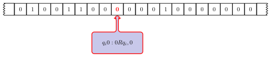
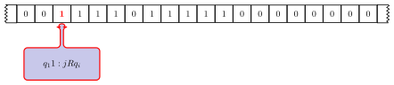
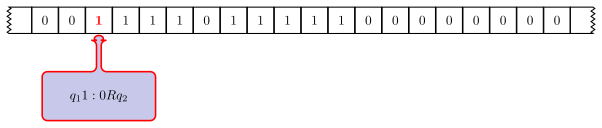

# Turing Machines
**First published Mon Sep 24, 2018; substantive revision Wed May 21, 2025**

*De Mol, Liesbeth*

Turing machines, first described by Alan Turing in Turing 1936–7, are simple abstract computational devices intended to help investigate the extent and limitations of what can be computed. Turing’s ‘automatic machines’, as he termed them in 1936, were specifically devised for the computation of real numbers. They were first named ‘Turing machines’ by Alonzo Church in a review of Turing’s paper (Church 1937)[^church-1937]. Today, they are considered to be one of the foundational models of computability and (theoretical) computer science.[^note-1]

## 1. Definitions of the Turing Machine

### 1.1 Turing’s Definition

Turing introduced Turing machines in the context of research into the foundations of mathematics. More particularly, he used these abstract devices to prove that there is no effective general method or procedure to solve, calculate or compute every instance of the following problem:

> *Entscheidungsproblem* The problem to decide for every statement in first-order logic (the so-called restricted functional calculus, see the entry on classical logic for an introduction) whether or not it is derivable in that logic.

Note that in its original form (Hilbert & Ackermann 1928)[^hilbert-1928], the problem was stated in terms of validity rather than derivability. Given Gödel’s completeness theorem (Gödel 1929)[^gödel-1929] proving that there is an effective procedure (or not) for derivability is also a solution to the problem in its validity form. In order to tackle this problem, one needs a formalized notion of “effective procedure” and Turing’s machines were intended to do exactly that.

In what follows, we provide a definition of Turing machines that stays quite close to Turing’s original definition but using a more standard notation. Note that Turing, in his paper, did not provide a stable definition nor notation but introduced a variety of notations (Post 1947, Mélès 2020/21)[^mélès-2020][^post-1947]. A Turing machine then, or a *computing machine* as Turing called it, in Turing’s original definition is a theoretical machine which can be in a finite number of configurations $q_{1},\ldots,q_{n}$ (the states of the machine, called *m*-configurations by Turing). It is supplied with a one-way infinite and one-dimensional tape divided into squares each capable of carrying exactly one symbol. At any moment, the machine is scanning the content of *one* square *r* which is either blank (symbolized by $S_0$) or contains a symbol $S_{1},\ldots ,S_{m}$ with $S_1 = 0$ and $S_2 = 1$.

The machine is an automatic machine ($a$-machine) which means that at any given moment, the behavior of the machine is completely determined by the current state and symbol (called the *configuration*) being scanned. This is the so-called *determinacy condition* (Section 3). These *a*-machines are contrasted with the so-called choice machines for which the next state depends on the decision of an external device or operator (Turing 1936–7: 232)[^turing-1936]. A Turing machine is capable of three types of action:

1. Print $S_i$, move one square to the left (*L*) and go to state $q_{j}$
2. Print $S_i$, move one square to the right (*R*) and go to state $q_{j}$
3. Print $S_i$, do not move (*N*) and go to state $q_{j}$

The ‘program’ of a Turing machine can then be written as a finite set of quintuples of the form:

$$q_{i}S_{j}S_{i,j}M_{i,j}q_{i,j}$$

Where $q_i$ is the current state, $S_j$ the content of the square being scanned, $S_{i,j}$ the new content of the square; $M_{i,j}$ specifies whether the machine is to move one square to the left, to the right or to remain at the same square, and $q_{i,j}$ is the next state of the machine. These quintuples are also called the transition rules of a given machine. The Turing machine $T_{\textrm{Simple}}$ which, when started from a blank tape, computes the sequence $S_0S_1S_0S_1\ldots$ is then given by Table 1.

*Table 1:* Quintuple representation of $T_{\textrm{Simple}}$

$$ \begin{align}\hline ;q_{1}S_{0}S_{0}Rq_{2}\\ ;q_{1}S_{1}S_{0}Rq_{2}\\ ;q_{2}S_{0}S_{1}Rq_{1}\\ ;q_{2}S_{1}S_{1}Rq_{1}\\\hline \end{align} $$

Note that $T_{\textrm{Simple}}$ will never enter a configuration where it is scanning $S_1$ so that two of the four quintuples are redundant. Another well-known format to represent the ‘program’ of a Turing machine and which was also used by Turing is the *transition table*. Table 2 gives the transition table of $T_{\textrm{Simple}}$.

*Table 2:* Transition table for $T_{\textrm{Simple}}$

|   | $S_0$ | $S_1$ |
| --- | --- | --- |
| $q_1$ | $S_{0}\opR q_{2}$ | $S_{0}\opR q_{2}$ |
| $q_2$ | $S_{1}\opR q_{1}$ | $S_{1}\opR q_{1}$ |

Where current definitions of Turing machines usually have only one type of symbols (usually just 0 and 1; it was proven by Shannon that any Turing machine can be reduced to a binary Turing machine (Shannon 1956)[^shannon-1956][^shannon-1956-2]) Turing also considered *computing machines* that use two kinds of symbols: the *figures* which consist entirely of 0s and 1s and the so-called *symbols of the second kind*. These are differentiated on the Turing machine tape by using a system of alternating squares of figures and symbols of the second kind. One sequence of alternating squares contains the figures and is called the sequence of *F*-squares. It contains the *sequence computed by the machine*; the other is called the sequence of *E*-squares. The latter are used to mark *F*-squares and are there to “assist the memory” (Turing 1936–7: 232)[^turing-1936]. The content of the *E*-squares is liable to change. *F*-squares however cannot be changed which means that one cannot implement algorithms whereby earlier computed digits need to be changed. Moreover, the machine will never print a symbol on an *F*-square if the *F*-square preceding it has not been computed yet. This usage of *F* and *E*-squares can be quite useful (see Sec. 2.3) but, as was shown by Emil L. Post, it results in a number of complications (see Sec. 1.2).

There are two important observations to be made concerning the abstract nature of Turing’s *automatic machine*. The first concerns the definition of the machine itself, namely that the machine’s tape is infinite which corresponds to the assumption of an infinite memory. The second concerns the definition of a Turing computable function, namely that a function is considered Turing computable if there exists a set of instructions that will result in a Turing machine computing the function regardless of the amount of time it takes. One can think of this as assuming the availability of potentially infinite time to complete the computation.

These two assumptions are intended to ensure that the definition of computation that results is not too narrow. It ensures that no computable function will fail to be Turing-computable solely because there is insufficient time or memory to complete the computation. It follows that there is an important distinction to be made between what is computable in theory and computable in practice. Indeed, some Turing computable functions for instance may not ever be computable in practice, since they may require more memory than can be built using all of the (finite number of) atoms in the universe. *If* then we accept the Turing machine model as a reasonable model of the modern computer, then any result which shows that a function is not Turing computable is very strong, since it would imply that no computer that we could ever build could carry out the computation. In Section 2.4, it is shown that there are functions which are not Turing-computable.

### 1.2 Post’s Definition

Turing’s definition was standardized through (some of) Post’s modifications of it in Post 1947. In that paper Post proves that a certain problem from mathematics known as Thue’s problem or the word problem for semi-groups is not Turing computable (or, in Post’s words, recursively unsolvable). Roughly speaking, Post’s main strategy was to show that if it were decidable then the following decision problem from Turing 1936–7 would also be decidable:

> **PRINT?** The problem to decide for every Turing machine *M* whether or not it will ever print some symbol (for instance, 0).

It was however proven by Turing that **PRINT?** is not Turing computable and so the same holds true of Thue’s problem.

While the uncomputability of **PRINT?** plays a central role in Post’s proof, Post believed that Turing’s proof of that was affected by the “spurious Turing convention” (Post 1947: 9)[^post-1947], viz. the system of *F* and *E*-squares. Thus, Post introduced a modified version of the Turing machine. The most important differences between Post’s and Turing’s definition are:

1. Post’s Turing machine, when in a given state, either prints or moves and so its transition rules are more ‘atomic’ (it does not have the composite operation of moving and printing). This results in the quadruple notation of Turing machines, where each quadruple is in one of the three forms of Table 3: Table 3: Post’s Quadruple notation $$ \begin{aligned}\hline & q_iS_jS_{i,j}q_{i,j}\\ & q_iS_jLq_{i,j}\\ & q_iS_jRq_{i,j}\\\hline \end{aligned} $$
2. Post’s Turing machine has only one kind of symbol and so does not rely on the Turing system of *F* and *E*-squares.
3. Post’s Turing machine has a two-way infinite tape.
4. Post’s Turing machine halts when it reaches a state for which no actions are defined.

Note that Post’s reformulation of the Turing machine is much rooted in (Post 1936)[^post-1936]. That short paper introduced a formalism that is almost identical to Turing’s machines. However, unlike Turing, Post did not focus on the computation of real numbers but on a formalism to define solvability. This explains why Post needed a halting state, unlike Turing.

(Some of) Post’s modifications of Turing’s definition became part of the definition of the Turing machine in standard works such as Kleene 1952 and Davis 1958. Since that time, several (logically equivalent) definitions have been introduced. Today, standard definitions of Turing machines are, in some respects, closer to Post’s Turing machines than to Turing’s machines. In what follows we will use a variant on the standard definition from Minsky 1967 which uses the quintuple notation but has no *E* and *F*-squares and includes a special halting state *H*. It also has only two move operations, viz., *L* and *R* and so the action whereby the machine merely prints is not used. When the machine is started, the tape is blank except for some finite portion of the tape. Note that the blank square can also be represented as a square containing the symbol $S_0$ or simply 0. The finite content of the tape will also be called the *dataword* on the tape.

### 1.3 The Definition Formalized

Talk of “tape” and a “read-write head” is intended to aid the intuition (and reveals something of the time in which Turing was writing) but plays no important role in the definition of Turing machines. In situations where a formal analysis of Turing machines is required, it is appropriate to spell out the definition of the machinery and program in more mathematical terms. Purely formally a Turing machine can be specified as a quadruple $T = (Q,\Sigma, s, \delta)$ where:

- *Q* is a finite set of states *q*
- $\Sigma$ is a finite set of symbols
- *s* is the initial state $s \in Q$
- $\delta$ is a transition function determining the next move: $$\delta : (Q \times \Sigma) \rightarrow (\Sigma \times \{L,R\} \times Q)$$

The transition function for the machine *T* is a function from computation states to computation states. If $\delta(q_i,S_j) = (S_{i,j},D,q_{i,j})$, then when the machine’s state is $q_j$, reading the symbol $S_j$, $T$ replaces $S_j$ by $S_{i,j}$, moves in direction $D \in \{L,R\}$ and goes to state $q_{i,j}$.

### 1.4 Describing the Behavior of a Turing Machine

We introduce a representation which allows us to describe the behavior or dynamics of a Turing machine $T_n$, relying on the notation of the *complete configuration* (Turing 1936–7: 232)[^turing-1936] also known today as *instantaneous description* (ID) (Davis 1982: 6)[^davis-1982]. At any stage of the computation of $T_{i}$ its ID is given by:

- (1)the content of the tape, that is, its data word
- (2)the location of the reading head
- (3)the machine’s internal state

So, given some Turing machine *T* which is in state $q_{i}$ scanning the symbol $S_{j}$, its ID is given by $Pq_{i}S_{j}Q$ where *P* and *Q* are the finite words to the left and right hand side of the square containing the symbol $S_{j}$. Figure 1 gives a visual representation of an ID of some Turing machine *T* in state $q_i$ scanning the tape.

*Figure 1:* A complete configuration of some Turing machine *T*. [An extended description of figure 1 is in the supplement.]

The notation thus allows us to capture the developing behavior of the machine and its tape through its consecutive IDs. Figure 2 gives the first few consecutive IDs of $T_{\textrm{Simple}}$ using a graphical representation. Its simulated behavior can be accessed [here.](https://www.turingmachine.io/?import-gist=4b4b8a9f450b6a4ea061945db0791ccf)

*Figure 2:* The dynamics of $T_{\textrm{Simple}}$ graphical representation. (The animation can be started by clicking on the picture and then using the left and right arrows to move through it.) [An extended description of figure 2 is in the supplement.]

One can also explicitly print the consecutive IDs, using their symbolic representations. This results in a so-called state-space diagram of the behavior of a Turing machine. So, for $T_{\textrm{Simple}}$ we get (Note that $\overline{0}$ means the infinite repetition of 0s):

$$\begin{matrix} \overline{0}q_1{\bf 0}\overline{0}\\ \overline{0}{\color{blue} 0}q_2{\bf 0}\overline{0}\\ \overline{0}{\color{blue}01}q_1{\bf 0}\overline{0}\\ \overline{0}{\color{blue}010}q_2{\bf 0}\overline{0}\\ \overline{0}{\color{blue}0101}q_1{\bf 0}\overline{0}\\ \overline{0}{\color{blue}01010}q_2{\bf 0}\overline{0}\\ \vdots \end{matrix}$$

## 2. Computing with Turing Machines

As explained in Sec. 1.1, Turing machines were originally intended to formalize the notion of computability in order to tackle a fundamental problem of mathematics. Independently of Turing, Emil Post (Post 1936)[^post-1936] and Alonzo Church (Church 1936) gave a different but logically equivalent formulation (see Sec. 4). Today, most computer scientists agree that Turing’s, or any other logically equivalent, formal notion captures *all* computable problems, viz. it is assumed that for any computable problem, there exists a Turing machine which computes it. This is known as the *Church-Turing thesis*, *Turing’s thesis* (when the reference is only to Turing’s work) or *Church’s thesis* (when the reference is only to Church’s work). Note that this does not say anything about the many basic intensional differences between the broad variety of computationally equivalent formal devices that have been developed since Turing’s time. That is, computability here is interpreted extensionally (what can be computed) and not in an operational manner (how it is being computed) (Martini 2020)[^martini-2020].

The thesis implies that, if accepted, any problem not computable by a Turing machine is not computable by any finite means whatsoever. Indeed, since it was Turing’s ambition to capture “[all] the possible processes which can be carried out in computing a number” (Turing 1936–7: 249)[^turing-1936], it follows that, if we accept Turing’s analysis:

- Any problem not computable by a Turing machine is not “computable” in the absolute sense (at least, absolute relative to humans, see Section 3).
- For any problem that we believe is computable, we should be able to construct a Turing machine which computes it. To put it in Turing’s wording: It is my contention that [the] operations [of a computing machine] include all those which are used in the computation of a number. (Turing 1936–7: 231)[^turing-1936]

In this section, examples will be given which illustrate the computational power and boundaries of the Turing machine model. Section 3 then discusses some philosophical implications related to Turing’s thesis with respect to the Turing machine model.

### 2.1 Some (Simple) Examples

In order to speak about a Turing machine that does something useful from the human perspective, we will have to provide an interpretation of the symbols recorded on the tape. For example, if we want to design a machine which will compute some mathematical function, addition say, then we will need to describe how to interpret the ones and zeros appearing on the tape as numbers.

In the examples that follow we will represent the number *n* as a block of $n+1$ copies of the symbol ‘1’ on the tape. Thus we will represent the number 0 as a single ‘1’ and the number 3 as a block of four ‘1’s. This is called *unary notation*.

We will also have to make some assumptions about the configuration of the tape when the machine is started, and when it finishes, in order to interpret the computation. We will assume that if the function to be computed requires *n* arguments, then the Turing machine will start with its head scanning the leftmost ‘1’ of a sequence of *n* blocks of ‘1’s. The blocks of ‘1’s representing the arguments must be separated by a single occurrence of the symbol ‘0’. For example, to compute the sum $3+4$, a Turing machine will start in the configuration shown in Figure 3.

*Figure 3:* Initial configuration for a computation over two numbers *n* and *m*. [An extended description of figure 3 is in the supplement.]

Here the supposed addition machine takes two arguments representing the numbers to be added, starting at the leftmost 1 of the first argument. The arguments are separated by a single 0 as required, and the first block contains four ‘1’s, representing the number 3, and the second contains five ‘1’s, representing the number 4.

A machine must finish in standard configuration too. There must be a single block of symbols (a sequence of 1s representing some number or a symbol representing another kind of output) and the machine must be scanning the leftmost symbol of that sequence. If the machine correctly computes the function then this block must represent the correct answer.

##### Addition of two numbers *n* and *m*

Table 4 gives the transition table of a Turing machine $T_{\textrm{Add}_2}$ which adds two natural numbers *n* and *m*. We assume the machine starts in state $q_1$ scanning the leftmost 1 of the $n+1$ 1s representing *n*.

*Table 4:* Transition table for $T_{\textrm{Add}_2}$

|   | 0 | 1 |
| --- | --- | --- |
| $q_1$ | / | $0\opR q_2$ |
| $q_2$ | $1\opR q_3$ | $1\opR q_2$ |
| $q_3$ | $0\opR q_{4}$ | $1\opL q_3$ |
| $q_4$ | $/$ | $0\opR q_{\textrm{halt}}$ |

The idea of doing an addition with Turing machines when using unary representation is to shift the leftmost number *n* one square to the right. This is achieved by erasing the leftmost 1 of the $n +1$ 1s (this is done in state $q_1$) and then setting the 0 between the $n+1$ and $m+1$ 1s to 1 (state $q_2$). We then have $n + m + 2$ 1s on the tape and so we still need to erase one additional 1. This is done by erasing the leftmost 1 (states $q_3$ and $q_4$). Figure 4 shows this computation for $3 + 4$.

*Figure 4:* The computation of $3+4$ by $T_{\textrm{Add}_2}$ (The animation can be started by clicking on the picture and then using the left and right arrows to move through it.) A full simulation, with the possibility of changing the input and the behavior, can be found [here](https://www.turingmachine.io/?import-gist=9d3685d569594da278897b7c1f1f488c) [An extended description of figure 4 is in the supplement.]

##### Addition of *n* numbers

We can generalize $T_{\textrm{Add}_2}$ to a Turing machine $T_{\textrm{Add}_i}$ for the addition of an arbitrary number *i* of integers $n_1, n_2,\ldots, n_j$. We assume again that the machine starts in state $q_1$ scanning the leftmost 1 of $n_1+1$ 1s. The transition table for such a machine $T_{\textrm{Add}_i}$ is given in Table 5.

*Table 5:* Transition table for $T_{\textrm{Add}_i}$

|   | 0 | 1 |
| --- | --- | --- |
| $q_1$ | / | $0\opR q_2$ |
| $q_2$ | $1\opR q_3$ | $1\opR q_2$ |
| $q_3$ | $0\opL q_{6}$ | $1\opL q_4$ |
| $q_4$ | $0\opR q_5$ | $1\opL q_4$ |
| $q_5$ | / | $0\opR q_1$ |
| $q_6$ | $0\opR q_{\textrm{halt}}$ | $1\opL q_6$ |

The machine $T_{\textrm{Add}_i}$ uses the principle of shifting the addends to the right which was also used for $T_{\textrm{Add}_2}$. More particularly, $T_{add_i}$ computes the sum of $n_1 + 1$, $n_2 + 1$,… $n_i+1$ from left to right, viz. it computes this sum as follows:

$$\begin{align} N_1 & = n_1 + n_2 + 1\\ N_2 & = N_1 + n_3 \\ N_3 &= N_2 + n_4\\ &\vdots\\ N_i &= N_{i-1} + n_i + 1 \end{align} $$

The most important difference between $T_{\textrm{Add}_2}$ and $T_{\textrm{Add}_i}$ is that $T_{\textrm{Add}_i}$ needs to verify if the leftmost addend $N_j, 1 < j \leq i$ is equal to $N_i$. This is achieved by checking whether the first 0 to the right of $N_j$ is followed by another 0 or not (states $q_2$ and $q_3$). If it is not the case, then there is at least one more addend $n_{j+1}$ to be added. Note that, as was the case for $T_{\textrm{Add}_2}$, the machine needs to erase an additional one from the addend $n_{j+1}$ which is done via state $q_5$. It then moves back to state $q_1$. If, on the other hand, $N_j = N_i$, the machine moves to the leftmost 1 of $N_i = n_1 + n_2 + \ldots + n_i + 1 $ and halts. A full simulation, with the possibility of changing the input and the behavior of $T_{\textrm{Add}_i}$, can be accessed [here](https://www.turingmachine.io/?import-gist=35df4f570d9c971f958a5314089d28b9)

### 2.2 Computable Numbers and Decision Problems

Turing’s original paper is concerned with *computable (real) numbers*. A (real) number is Turing computable if there exists a Turing machine which computes an arbitrarily precise approximation to that number. All of the algebraic numbers (roots of polynomials with algebraic coefficients) and many transcendental mathematical constants, such as *e* and $\pi$ are Turing-computable. Turing gave several examples of classes of numbers computable by Turing machines as a heuristic argument showing that a wide diversity of classes of numbers can be computed by Turing machines (see section 10 *Examples of large classes of numbers which are computable* in Turing 1936–7)[^turing-1936].

One might wonder however in what sense computation with numbers, viz. calculation, captures *non-numerical* but computable problems and so how Turing machines are supposed to capture *all* general and effective procedures which determine whether something is the case or not. Examples of such problems are:

- “decide for any given *x* whether or not *x* denotes a prime”
- “decide for any given *x* whether or not *x* is the description of a Turing machine”.

In general, these problems are of the form:

- “decide for any given *x* whether or not *x* has property *X*”

An important challenge of both theoretical and concrete advances in computing (often at the interface with other disciplines) has become the problem of providing an interpretation of *X* such that it can be tackled computationally. To give just one concrete example, in daily computational practices it might be important to have a method to decide for any digital “source” whether or not it can be trusted and so one needs a computational interpretation of trust.

The *characteristic function* of a predicate is a function which has the value TRUE or FALSE when given appropriate arguments. In order for such functions to be computable, Turing relied on Gödel’s insight that these kind of problems can be encoded as a problem about numbers (See Gödel’s incompleteness theorem and the next Sec. 2.3) In Turing’s wording:

> The expression “there is a general process for determining …” has been used [here] […] as equivalent to “there is a machine which will determine …”. This usage can be justified if and only if we can justify our definition of “computable”. For each of these “general process” problems can be expressed as a problem concerning a general process for determining whether a given integer *n* has a property $G(n)$ [e.g. $G(n)$ might mean “*n* is satisfactory” or “*n* is the Gödel representation of a provable formula”], and this is equivalent to computing a number whose *n*-th figure is 1 if $G(n)$ is true and 0 if it is false. (1936–7: 248)

It is the possibility of coding the “general process” problems as numerical problems that is essential to Turing’s construction of the universal Turing machine and its use within a proof that shows there are problems that cannot be computed by a Turing machine.

### 2.3 Turing’s Universal Machine

The universal Turing machine which was constructed to prove the uncomputability of certain problems, is, roughly speaking, a Turing machine that is able to compute what any other Turing machine computes. Assuming that the Turing machine notion fully captures computability (and so that Turing’s thesis is valid), it is implied that anything which can be “computed”, can also be computed by that one universal machine. Conversely, any problem that is not computable by the universal machine is considered to be uncomputable.

This is the rhetorical and theoretical power of the universal machine concept, viz. that one relatively simple formal device captures all “*the possible processes which can be carried out in computing a number*” (Turing 1936–7)[^turing-1936]. It is also one of the main reasons why Turing has been *retrospectively* identified as one of the founding fathers of computer science (see Section 5).

So how to construct a universal machine *U* out of the set of basic operations we have at our disposal? Turing’s approach is the construction of a machine *U* which is able to (1) ‘interpret’ the program of *any* other machine $T_{n}$ and, based on that “interpretation”, (2) ‘mimic’ the behavior of $T_{n}$. To this end, a method is needed so that the program and the behavior of $T_n$ are, to a certain extend, interchangeable since both aspects are to be manipulated on the same tape and by the same machine. This is achieved by Turing in two basic steps: the development of (1) a notational method and (2) a set of elementary functions which treats that notation—independent of whether it is formalizing the program or the behavior of $T_n$—as text to be compared, copied down, erased, etc. In other words, Turing develops a technique that allows to treat program and behavior of a Turing machine on the same level.

#### 2.3.1 Interchangeability of program and behavior: a notation

Given some machine $T_n$, Turing’s basic idea is to construct a machine $T_n'$ which, rather than directly printing the output of $T_n$, prints out the successive complete configurations or instantaneous descriptions of $T_n$. In order to achieve this, $T_n'$:

> […] could be made to depend on having the rules of operation […] of [$T_n$] written somewhere within itself […] each step could be carried out by referring to these rules. (Turing 1936–7: 242)[^turing-1936]

In other words, $T_n'$ prints out the successive complete configurations of $T_n$ by having the program of $T_n$ written on its tape. Thus, Turing needs a notational method which makes it possible to ‘capture’ two different aspects of a Turing machine on one and the same tape in such a way they can be treated *by the same machine*, viz.:

- (1) its description in terms of *what it should do*—the quintuple notation
- (2) its description in terms of *what it is doing*—the complete configuration notation

Thus, a first and perhaps most essential step, in the construction of *U* are the quintuple and complete configuration notation and the idea of putting them on the same tape. More particularly, the tape is divided into two regions which we will call the *A* and *B* region here. The *A* region contains a notation of the ‘program’ of $T_n$ and the *B* region a notation for the successive complete configurations of $T_n$. In Turing’s paper they are separated by an additional symbol “::”.

To simplify the construction of *U* and in order to encode any Turing machine as a unique number, Turing develops a third notation which permits to express the quintuples and complete configurations with letters only. This is determined by [Note that we use Turing’s original encoding. Of course, there is a broad variety of possible encodings, including binary encodings]:

- Replacing each state $q_i$ in a quintuple of $T_n$ by $$D\underbrace{A\ldots A}_i,$$ so, for instance $q_3$ becomes $DAAA$.
- Replacing each symbol $S_{j}$ in a quintuple of $T_n$ by $$D\underbrace{C\ldots C}_j,$$ so, for instance, $S_1$ becomes $DC$.

Using this method, each quintuple of some Turing machine $T_n$ can be expressed in terms of a sequence of capital letters and so the ‘program’ of any machine $T_{n}$ can be expressed by the set of symbols *A, C, D, R, L, N* and ;. This is the so-called *Standard Description* (S.D.) of a Turing machine. Thus, for instance, the S.D. of $T_{\textrm{Simple}}$ is:

;*DADDRDAA*;*DADCDRDAA*;*DAADDCRDA*;*DAADCDCRDA*

This is, essentially, Turing’s version of [Gödel numbering](https://plato.stanford.edu/entries/goedel-incompleteness/sup1.html). Indeed, as Turing shows, one can easily get a numerical description representation or *Description Number* (D.N.) of a Turing machine $T_{n}$ by replacing:

- “A” by “1”
- “C” by “2”
- “D” by “3”
- “L” by “4”
- “R” by “5”
- “N” by “6”
- “;” by “7”

Thus, the D.N. of $T_{\textrm{Simple}}$ is:

7313353117313135311731133153173113131531

Note that every machine $T_n$ has a unique D.N.; a D.N. represents one and one machine only.

Clearly, the method used to determine the $S.D.$ of some machine $T_n$ can also be used to write out the successive complete configurations of $T_n$. Using “:” as a separator between successive complete configurations, the first few complete configurations of $T_{\textrm{Simple}}$ are:

:*DAD*:*DDAAD*:*DDCDAD*:*DDCDDAAD*:*DDCDDCDAD*

#### 2.3.2 Interchangeability of program and behavior: a basic set of functions

Having a notational method to write the program and successive complete configurations of some machine $T_n$ on one and the same tape of some other machine $T_n'$ is the first step in Turing’s construction of *U*. However, *U* should also be able to “emulate” the program of $T_n$ as written in region *A* so that it can actually write out its successive complete configurations in region *B*. Moreover it should be possible to “take out and exchange[…] [the rules of operations of some Turing machine] for others” (Turing 1936–7: 242)[^turing-1936]. Viz., it should be able not just to calculate but also to compute. It should, for instance, be able to “recognize” whether it is in region *A* or *B* and it should be able to determine whether or not a certain sequence of symbols is the next state $q_i$ which needs to be executed.

This is achieved by Turing through the construction of a sequence of Turing computable problems such as:

- Finding the leftmost or rightmost occurrence of a sequence of symbols
- Marking a sequence of symbols by some symbol $a$ (remember that Turing uses two kinds of alternating squares)
- Comparing two symbol sequences
- Copying a symbol sequence

Turing develops a notational technique, called *skeleton tables*, for these functions which serves as a kind of shorthand notation for a complete Turing machine table but can be easily used to construct more complicated machines from previous ones. The technique is quite reminiscent of the recursive technique of composition (see: recursive functions).

To illustrate how such functions are Turing computable, we discuss one such function in more detail, viz. the compare function. It is constructed on the basis of a number of other Turing computable functions which are built on top of one another. In order to understand how these functions work, remember that Turing used a system of alternating *F* and *E*-squares where the *F*-squares contain the actual quintuples and complete configurations and the *E*-squares are used to mark off certain parts of the machine tape. For the comparing then of two sequences of symbols $W_1$ and $W_2$, each symbol of $W_1$ will be marked by some symbol $a$ and each symbol of $W_2$ will be marked by some symbol *b*.

Turing defined nine different functions to show how the compare function can be computed with Turing machines:

- FIND$(q_{i}, q_{j},a)$: this machine function searches for the leftmost occurrence of $a$. If $a$ is found, the machine moves to state $q_{i}$ else it moves to state $q_{j}$. This is achieved by having the machine first move to the beginning of the tape (indicated by a special mark) and then to have it move right until it finds $a$ or reaches the rightmost symbol on the tape.
- FINDL$(q_{i}, q_{j},a)$: the same as FIND but after $a$ has been found, the machine moves one square to the left. This is used in functions which need to compute on the symbols in *F*-squares which are marked by symbols $a$ in the *E*-squares.
- ERASE$(q_{i},q_{j},a)$: the machine computes FIND. If $a$ is found, it erases $a$ and goes to state $q_{i}$ else it goes to state $q_{j}.$
- ERASE_ALL$(q_j,a) = \textrm{ERASE}(\textrm{ERASE}\_\textrm{ALL}, q_j,a)$: the machines computes ERASE on $a$ repeatedly until all $a$’s have been erased. Then it moves to $q_{j}.$
- EQUAL$(q_i,q_j,a)$: the machine checks whether or not the current symbol is $a$. If yes, it moves to state $q_i$ else it moves to state $q_j.$
- CMP_XY$(q_i,q_j,b) = \textrm{FINDL(EQUAL}(q_i,q_j,x), q_j, b)$: whatever the current symbol *x*, the machine computes FINDL on *b* (and so looks for the symbol marked by *b*). If there is a symbol *y* marked with *b*, the machine computes $\textrm{EQUAL}$ on *x* and *y*, else, the machine goes to state $q_j$. In other words, CMP_XY$(q_i,q_j,b)$ compares whether the current symbol is the same as the leftmost symbol marked *b*.
- COMPARE_MARKED$(q_i,q_j,q_n,a,b)$: the machine checks whether the leftmost symbols marked $a$ and *b* respectively are the same. If there is no symbol marked $a$ nor *b*, the machine goes to state $q_{n}$; if there is a symbol marked $a$ and one marked *b* and they are the same, the machine goes to state $q_i$, else the machine goes to state $q_j$. The function is computed as $\textrm{FINDL(CMP}\_XY(q_i,q_j,b), \textrm{FIND}(q_j,q_n,b),a).$
- $\textrm{COMPARE}\_\textrm{ERASE}(q_iq_j,q_n,a,b)$: the same as COMPARE_MARKED but when the symbols marked $a$ and *b* are the same, the marks $a$ and *b* are erased. This is achieved by computing $\textrm{ERASE}$ first on $a$ and then on *b*.
- $\textrm{COMPARE}\_\textrm{ALL}(q_j,q_n,a,b)$ The machine compares the sequences *A* and *B* marked with $a$ and *b* respectively. This is done by repeatedly computing COMPARE_ERASE on $a$ and *b*. If *A* and *B* are equal, all $a$’s and *b*’s will have been erased and the machine moves to state $q_j$, else, it will move to state $q_n$. It is computed by $$\textrm{COMPARE}\_\textrm{ERASE}(\textrm{COMPARE}\_\textrm{ALL}(q_j,q_n,a,b),q_j,q_n,a,b)$$ and so by recursively calling $\textrm{COMPARE}\_\textrm{ALL}$.

In a similar manner, Turing defines the following functions:

- $\textrm{COPY}(q_i,a)$: copy the sequence of symbols marked with $a$’s to the right of the last complete configuration and erase the marks.
- $\textrm{COPY}_{n}(q_i, a_1,a_2,\ldots ,a_n)$: copy down the sequences marked $a_1$ to $a_n$ to the right of the last complete configuration and erase all marks $a_i.$
- $\textrm{REPLACE}(q_i, a,b)$: replace all letters $a$ by $b.$
- $\textrm{MARK}\_\textrm{NEXT}\_\textrm{CONFIG}(q_i,a) $: mark the first configuration $q_iS_j$ to the right of the machine’s head with the letter $a.$
- $\textrm{FIND}\_\textrm{RIGHT}(q_i,a)$: find the rightmost symbol $a.$

Using the basic functions COPY, REPLACE and COMPARE, Turing constructs a universal Turing machine.

Below is an outline of the universal Turing machine indicating how these basic functions indeed allow for the construction of a Turing machine which can emulate the behavior of any other Turing machine. It is assumed that upon initialization, *U* has on its tape the S.D. of some Turing machine $T_n$. Remember that Turing uses the system of alternating *F* and *E*-squares and so, for instance, the S.D. of $T_{\textrm{Simple}}$ will be written on the tape of *U* as:

;_*D*_*A*_*D*_*D*_*R*_*D*_*A*_*A*_*;*_*D*_*A*_*D*_*C*_*D*_*R*_*D*_*A*_*A*_*;*_*D*_*A*_*A*_*D*_*D*_*C*_*R*_*D*_*A*_*;*_*D*_*A*_*A*_*D*_*C*_*D*_*C*_*R*_*D*_*A*_

where “_” indicates an unmarked *E*-square.

- INIT: To the right of the rightmost quintuple of *T*_*n*, *U* prints ::_:_*D*_*A*_, where _ indicates an unmarked *E*-square.
- FIND_NEXT_STATE: The machine first marks (1) with *y* the configuration $q_{CC,i}S_{CC,j}$ of the rightmost (and so last) complete configuration computed by *U* in the *B* part of the tape and (2) with *x* the configuration $q_{q,m}S_{q,n}$ of the leftmost quintuple which is not preceded by a marked (with the letter *z*) semicolon in the *A* part of the tape. The two configurations are compared. If they are identical, the machine moves to MARK_OPERATIONS, if not, it marks the semicolon preceding $q_{q,m}S_{q,n}$ with *z* and goes to FIND_NEXT_STATE. This is easily achieved using the function COMPARE_ALL which means that, whatever the outcome of the comparison, the marks *x* and *y* will be erased. For instance, suppose that $T_n = T_{\textrm{Simple}}$ and that the last complete configuration of $T_{\textrm{Simple}}$ as computed by *U* is: $$\tag{1} \label{CC_univ} :\_\underbrace{D\_}_{S_0}\underbrace{D\_C\_}_{S_1}\underbrace{D\_}_{S_0}\textcolor{Sienna}{\underbrace{D\_A\_A\_}_{q_{2}}\underbrace{D\_}_{S_0}} $$ Then *U* will move to region *A* and determine that the corresponding quintuple is: $$\tag{2}\label{quint_univ} \textcolor{Sienna}{\underbrace{D\_A\_A\_}_{q_{2}}\underbrace{D\_}_{S_{0}}}\underbrace{D\_C\_}_{S_1}\underbrace{R\_}\underbrace{D\_A\_}_{q_1}$$
- MARK_OPERATIONS: The machine *U* marks the operations that it needs to execute in order to compute the next complete configuration of $T_n$. The printing and move (L,R, N) operations are marked with *u* and the next state with *y*. All marks *z* are erased. Continuing with our example, *U* will mark (2) as follows: $$D\_A\_A\_D\_\textcolor{DarkOrchid}{DuCuRu}\textcolor{green}{DyAy}$$
- MARK_COMPCONFIG: The last complete configuration of $T_n$ as computed by *U* is marked into four regions: the configuration $q_{CC,i}S_{CC,j}$ itself is left unmarked; the symbol just preceding it is marked with an *x* and the remaining symbols to the left or marked with *v*. Finally, all symbols to the right, if any, are marked with *w* and a “:” is printed to the right of the rightmost symbol in order to indicate the beginning of the next complete configuration of $T_n$ to be computed by *U*. Continuing with our example, (1) will be marked as follows by *U*: $$\textcolor{Crimson}{\underbrace{Dv}_{S_0}\underbrace{DvCv}_{S_1}}\textcolor{blue}{\underbrace{Dx}_{S_0}}\underbrace{D\_A\_A\_}_{q_2}\underbrace{D\_}_{S_0}:\_$$ *U* then goes to PRINT
- PRINT. It is determined if, in the instructions that have been marked in MARK_OPERATIONS, there is an operation Print 0 or Print 1. If that is the case, $0:$ respectively $1:$ is printed to the right of the last complete configuration. This is not a necessary function but Turing insisted on having *U* print out not just the (coded) complete configurations computed by $T_n$ but also the actual (binary) real number computed by $T_n$.
- PRINT_COMPLETE_CONFIGURATION. *U* prints the next complete configuration and erases all marks *u, v, w, x, y*. It then returns to FIND_NEXT_STATE. *U* first searches for the rightmost letter *u*, to check which move is needed (*R, L, N*) and erases the mark *u* for *R, L, N*. Depending on the value *L, R* or *N* will then write down the next complete configuration by applying COPY$_5$ to *u, v, w, x, y*. The move operation (*L, R, N*) is accounted for by the particular combination of *u, v, w, x, y*: $$\begin{array}{ll} \textrm{When ~} L: & \textrm{COPY}_5(\textrm{FIND}\_\textrm{NEXT}\_\textrm{STATE}, \textcolor{crimson}{v},\textcolor{green}{y},\textcolor{blue}{x},\textcolor{DarkOrchid}{u},\textcolor{RawSienna}{w})\\ \textrm{When ~} R: & \textrm{COPY}_5(\textrm{FIND}\_\textrm{NEXT}\_\textrm{STATE}, \textcolor{crimson}{v},\textcolor{blue}{x},\textcolor{DarkOrchid}{u},\textcolor{green}{y},\textcolor{RawSienna}{w})\\ \textrm{When ~} N: & \textrm{COPY}_5(\textrm{FIND}\_\textrm{NEXT}\_\textrm{STATE}, \textcolor{crimson}{v},\textcolor{blue}{x},\textcolor{green}{y},\textcolor{DarkOrchid}{u},\textcolor{RawSienna}{w}) \end{array}$$ Following our example, since $T_{\textrm{Simple}}$ needs to move right, the new rightmost complete configursiation of $T_{\textrm{Simple}}$ written on the tape of *U* is: $$\textcolor{crimson}{\underbrace{D\_}_{S_0}\underbrace{D\_C\_}_{S_1}}\textcolor{blue}{\underbrace{D\_}_{S_0}}\textcolor{DarkOrchid}{\underbrace{D\_C\_}_{S_1}}\textcolor{green}{\underbrace{D\_A\_}_{q_1}} $$ Since we have that for this complete configuration the square being scanned by $T_{\textrm{Simple}}$ is one that was not included in the previous complete configuration (viz. $T_{\textrm{Simple}}$ has reached beyond the rightmost previous point) the complete configuration as written out by *U* is in fact incomplete. This small defect was corrected by Post (Post 1947)[^post-1947] by including an additional instruction in the function used to mark the complete configuration in the next round.

As is clear, Turing’s universal machine indeed requires that program and ‘data’ produced by that program are manipulated interchangeably, viz. the program and its productions are put next to each other and treated in the same manner, as sequences of letters to be copied, marked, erased and compared. Therein lies the combinatorial and textual character of computability as defined by Turing and others (Lassègue and Longo 2012)[^lassègue-2012]. There is nothing magical or mysterious about its computation.

Turing’s particular construction is quite intricate with its reliance on the *F* and *E*-squares, the use of a rather large set of symbols and a rather arcane notation used to describe the different functions discussed above. Since 1936 several modifications and simplifications have been implemented. The removal of the difference between *F* and *E*-squares was already discussed in Section 1.2 and it was proven by Shannon that any Turing machine, including the universal machine, can be reduced to a binary Turing machine (Shannon 1956)[^shannon-1956][^shannon-1956-2]. Since the 1950s, there has been quite some research on what could be the smallest possible universal devices (with respect to the number of states and symbols) and quite some “small” universal Turing machines have been found. These results are usually achieved by relying on other equivalent models of computability such as, for instance, tag systems. For a survey on research into small universal devices (see Margenstern 2000; Woods & Neary 2009)[^margenstern-2000][^woods-2009].

### 2.4 The Halting Problem and the Entscheidungsproblem

As explained, the purpose of Turing’s paper was to show that the Entscheidungsproblem for first-order logic is not computable. The same result was achieved independently by Church (1936a, 1936b) using a different kind of formal device which is logically equivalent to a Turing machine (see Sec. 4). The result went very much against what Hilbert had hoped to achieve with his finitary and formalist program. Indeed, next to Gödel’s incompleteness results, they broke much of Hilbert’s dream of making mathematics void of *Ignorabimus* as expressed in the following words of Hilbert:

> The true reason why Comte could not find an unsolvable problem, lies in my opinion in the assertion that there exists no unsolvable problem. Instead of the stupid Ignorabimus, our solution should be: We must know. We shall know. (1930: 963) [translation by the author]

Note that the solvability Hilbert is referring to here concerns solvability of mathematical problems in general and not just mechanically solvable. It is shown however in Mancosu et al. 2009 (p. 94), that this general aim of solving every mathematical problem, underpins two particular convictions of Hilbert namely that (1) the axioms of number theory are complete and (2) that there are no undecidable problems in mathematics.

#### 2.4.1 Direct and indirect proofs of uncomputable decision problems

So, how can one show, for a particular decision problem $\textrm{D}_i$, that it is not computable? There are two main methods:

- **Indirect proof:** take some problem $\textrm{D}_{\textrm{uncomp}}$ which is already known to be uncomputable and show that the problem “reduces” to $\textrm{D}_{i}$.
- **Direct proof:** prove the uncomputability of $\textrm{D}_{i}$ directly by assuming some version of the Church-Turing thesis.

Today, one usually relies on the first method while it is evident that in the absence of a problem $\textrm{D}_{\textrm{uncomp}}$, Turing but also Church and Post (see Sec. 4) had to rely on the direct approach.

The notion of reducibility has its origins in the work of Turing and Post who considered several variants (Post 1947; Turing 1939)[^post-1947][^turing-1939]. The concept was later appropriated in the context of computational complexity theory and is today one of the basic concepts of both computability and computational complexity theory (Odifreddi 1989; Sipser 1996)[^odifreddi-1989][^sipser-1996]. Roughly speaking, a reduction of a problem $D_i$ to a problem $D_j$ comes down to providing an effective procedure for translating every instance $d_{i,m}$ of the problem $D_i$ to an instance $d_{j,n}$ of $D_j$ in such a way that an effective procedure for solving $d_{j,n}$ also yields an effective procedure for solving $d_{i,m}$. In other words, if $D_i$ reduces to $D_j$ then, if $D_i$ is uncomputable so is $D_j$. Note that the reduction of one problem to another can also be used in decidability proofs: if $D_i$ reduces to $D_j$ and $D_j$ is known to be computable then so is $D_i$.

In the absence of **D**$_{\textrm{uncomp}}$ a very different approach was required and Church, Post and Turing each used more or less the same approach to this end (Gandy 1988)[^gandy-1988]. First of all, one needs a formalism which captures the notion of computability. Turing proposed the Turing machine formalism to this end. A second step is to show that there are problems that are not computable within the formalism. To achieve this, a uniform process **U** needs to be set-up relative to the formalism which is able to compute every computable number. One can then use (some form of) diagonalization in combination with **U** to derive a contradiction. Diagonalization was introduced by Cantor to show that the set of real numbers is “uncountable” or not denumerable. A variant of the method was used also by Gödel in the proof of his [first incompleteness theorem](https://plato.stanford.edu/entries/goedel-incompleteness/sup2.html).

#### 2.4.2 Turing’s basic problem CIRC?, PRINT? and the Entscheidungsproblem

Recall that in Turing’s original version of the Turing machine, the machines are computing real numbers. This implied that a “well-behaving” Turing machine should in fact never halt and print out an infinite sequence of figures. Such machines were identified by Turing as *circle-free*. All other machines are called *circular machines*. A number *n* which is the D.N. of a circle-free machine is called *satisfactory*.

This basic difference is used in Turing’s proof of the uncomputability of:

> **CIRC?** The problem to decide for every number *n* whether or not it is satisfactory

The proof of the uncomputability of **CIRC?** uses the construction of a hypothetical and circle-free machine $T_{decide}$ which computes the diagonal sequence of the set of all computable numbers computed by the circle-free machines. Hence, it relies for its construction on the universal Turing machine and a hypothetical machine that is able to decide **CIRC?** for each number *n* given to it. It is shown that the machine $T_{decide}$ becomes a circular machine when it is provided with its own description number, hence the assumption of a machine which is capable of solving **CIRC?** must be false.

Based on the uncomputability of **CIRC?**, Turing then shows that also **PRINT?** is not computable. More particularly he shows that if **PRINT?** were to be computable, also **CIRC?** would be decidable, viz. he rephrases **PRINT?** in such a way that it becomes the problem to decide for any machine whether or not it will print an infinity of symbols which would amount to deciding **CIRC?**.

Finally, based on the uncomputability of **PRINT?** Turing shows that the Entscheidungsproblem is not decidable. This is achieved by showing:

1. how for each Turing machine *T*, it is possible to construct a corresponding formula **T** in first-order logic and
2. if there is a general method for determining whether **T** is provable, then there is a general method for proving that *T* will ever print 0. This is the problem **PRINT?** and so cannot be decidable (provided we accept Turing’s thesis).

It thus follows from the uncomputability of **PRINT?**, that the Entscheidungsproblem is not computable.

#### 2.4.3 The halting problem

Given Turing’s focus on computable real numbers, his base decision problem is about determining whether or not some Turing machine will *not* halt and so is not quite the same as the more well-known halting problem:

- **HALT?** The problem to decide for every Turing machine *T* whether or not *T* will halt.

Note that Turing’s problem **PRINT?** is very close to **HALT?** (see Davis 1958: Chapter 5, Theorem 2.3)[^davis-1958].

A popular proof of **HALT?** goes as follows. Assume that **HALT?** is computable. Then it should be possible to construct a Turing machine which decides, for each machine $T_i$ and some input *w* for $T_i$ whether or not $T_i$ will halt on *w*. Let us call this machine $T_{H}$. More particularly, we have:

$$ T_H(T_i,w) = \left\{ \begin{array}{ll} \textrm{HALT} & \textrm{if \(T_i\) halts on } w\\ \textrm{LOOP} & \textrm{if \(T_i\) loops on } w \end{array} \right. $$

We now define a second machine $T_D$ which relies on the assumption that the machine $T_H$ can be constructed. More particularly, we have:

$$ T_D(T_i,D.N.~of~ T_i) = \left\{ \begin{array}{ll} \textrm{HALT} & \textrm{if \(T_i\) does not halt on its own} \\ & \qquad \textrm{description number}\\ \textrm{LOOP} & \textrm{if \(T_i\) halts on its own} \\ & \qquad \textrm{description number}\\ \end{array} \right. $$

If we now set $T_i$ to $T_D$ we end up with a contradiction: if $T_D$ halts it means that $T_D$ does not halt and vice versa. A popular but quite informal variant of this proof was given by Christopher Strachey in the context of programming (Strachey 1965, Daylight 2021)[^daylight-2021][^strachey-1965].

### 2.5 Variations on the Turing machine

As is clear from Sections 1.1 and 1.2, there is a variety of definitions of the Turing machine. One can use a quintuple or quadruple notation; one can have different types of symbols or just one; one can have a two-way infinite or a one-way infinite tape; etc. Several other less obvious modifications have been considered and used in the past. These modifications can be of two kinds: generalizations or restrictions. These do not result in “stronger” or “weaker” models. Viz. these modified machines compute no more and no less than the Turing computable functions. This adds to the robustness of the Turing machine definition.

##### Binary machines

In his short 1936 note Post considers machines that either mark or unmark a square which means we have only two symbols $S_0$ and $S_1$ but he did not prove that this formulation captures exactly the Turing computable functions. It was Shannon who proved that for any Turing machine *T* with *n* symbols there is a Turing machine with two symbols that simulates *T* (Shannon 1956)[^shannon-1956][^shannon-1956-2]. He also showed that for any Turing machine with *m* states, there is a Turing machine with only two states that simulates it.

##### Non-erasing machines

Non-erasing machines are machines that can only overprint $S_0$. In Moore 1952, it was mentioned that Shannon proved that non-erasing machines can compute what any Turing machine computes. This result was given in a context of actual digital computers of the 50s which relied on punched tape (and so, for which, one cannot erase). Shannon’s result however remained unpublished. It was Wang who published the result (Wang 1957)[^wang-1957].

##### Non-writing machines

It was shown by Minsky that for every Turing machine there is a non-writing Turing machine with two tapes that simulates it (Minsky 1961, 438–445)[^minsky-1961]

##### Multiple tapes

Instead of one tape one can consider a Turing machine with multiple tapes. This turned out the be very useful in several different contexts. For instance, Minsky, used two-tape non-writing Turing machines to prove that a certain decision problem defined by Post (the decision problem for tag systems) is non-Turing computable (Minsky 1961)[^minsky-1961]. Hartmanis and Stearns then, in their founding paper for computational complexity theory, proved that any *n*-tape Turing machine reduces to a single tape Turing machine and so anything that can be computed by an *n*-tape or multitape Turing machine can also be computed by a single tape Turing machine, and conversely (Hartmanis & Stearns 1965)[^hartmanis-1965]. They used multitape machines because they were considered to be closer to actual digital computers.

##### *n*-dimensional Turing machines

Another variant is to consider Turing machines where the tape is not one-dimensional but *n*-dimensional. This variant too reduces to the one-dimensional variant.

##### Non-deterministic machines

An apparently more radical reformulation of the notion of Turing machine is that of non-deterministic Turing machines. As explained in 1.1, one fundamental condition of Turing’s machines is the so-called determinacy condition, viz. the idea that at any given moment, the machine’s behavior is completely determined by the configuration or state it is in and the symbol it is scanning. Next to these, Turing also mentions the idea of choice machines for which the next state is not completely determined by the state and symbol pair. Instead, some external device makes a random choice of what to do next. Non-deterministic Turing machines are a kind of choice machines: for each state and symbol pair, the non-deterministic machine makes an arbitrary choice between a finite (possibly zero) number of states. Thus, unlike the computation of a deterministic Turing machine, the computation of a non-deterministic machine is a tree of possible configuration paths. One way to visualize the computation of a non-deterministic Turing machine is that the machine spawns an exact copy of itself and the tape for each alternative available transition, and each machine continues the computation. If any of the machines terminates successfully, then the entire computation terminates and inherits that machine’s resulting tape. Notice the word successfully in the preceding sentence. In this formulation, some states are designated as *accepting states* and when the machine terminates in one of these states, then the computation is successful, otherwise the computation is unsuccessful and any other machines continue in their search for a successful outcome. The addition of non-determinism to Turing machines does not alter the extent of Turing-computability. Non-determinism was introduced for finite automata in the paper, Rabin & Scott 1959, where it is also shown that adding non-determinism does not result in more powerful automata. Non-deterministic Turing machines are an important model in the context of computational complexity theory.

##### Weak and semi-weak machines

Weak Turing machines are machines where some word over the alphabet is repeated infinitely often to the left and right of the input. Semi-weak machines are machines where some word is repeated infinitely often either to the left or right of the input. These machines are generalizations of the standard model in which the initial tape contains some finite word (possibly nil). They were introduced to determine smaller universal machines. Watanabe was the first to define a universal semi-weak machine with six states and five symbols (Watanabe 1961)[^watanabe-1961]. Recently, a number of researchers have determined several small weak and semi-weak universal Turing machines (e.g., Woods & Neary 2007; Cook 2004)[^cook-2004][^woods-2007]

Besides these variants on the Turing machine model, there are variants that result in models which capture, in some well-defined sense, more than the (Turing)-computable functions. Examples of such models are oracle machines (Turing 1939)[^turing-1939], trial-and-error machines (Putnam 1965)[^putnam-1965], infinite-time Turing machines (Hamkins & Lewis 2008) and accelerating Turing machines (Copeland 2002)[^copeland-2002]. There are various reasons for introducing such “stronger” models. Some are well-known models of computability and recursion theory and are used in the theory of higher-order recursion and relative computability (oracle machines); others, like the accelerating machines, were introduced in the context of supertasks and the idea of providing physical models that “compute” functions which are not Turing-computable. Note however that such models do not provide an *effective* method to solve incomputable problems such as the halting problem. Still others were introduced to offer elaborations to the notion of computation (think of trial-and-error computation) or to provide models that are “closer” to actual computational practices. See also Sec. 3.1.

## 3. Philosophical Issues Related to Turing Machines

### 3.1 Human and Machine Computations

In its original context, Turing’s identification between the computable numbers and Turing machines was aimed at proving that the Entscheidungsproblem is *not* a computable problem and so is not a so-called “general process” problem (Turing 1936–7: 248)[^turing-1936]. The basic assumption to be made for this result to be valid is that our “intuitive” notion of computability can be formally defined as Turing computability and so that there are no “computable” problems that are not Turing computable. But what was Turing’s “intuitive” notion of computability and how can we be sure that it really covers all computable problems, and, more generally, all kinds of computations? This is a very basic question in the philosophy of computer science.

At the time Turing was writing his paper, the modern computer was not developed yet and so rephrasings of Turing’s thesis which identify Turing computability with computability by a modern computer are interpretations rather than historically correct statements of Turing’s thesis. The existing computing machines at the time Turing wrote his paper, such as the differential analyzer or desk calculators, were quite restricted in what they could compute and were used in a context of human computational practices (Grier 2007)[^grier-2007]. It is thus not surprising that Turing did not attempt to formalize machine computation but rather human computation and so computable problems in Turing’s paper become computable by human means. This is very explicit in Section 9 of Turing 1936–7 where he shows that Turing machines are a ‘natural’ model of (human) computation by analyzing the process of human computation. The analysis results in a kind of abstract human ‘computor’ who fulfills a set of different conditions that are rooted in Turing’s recognition of a set of human limitations which restrict what we can compute (of our sensory apparatus but also of our mental apparatus). This ‘computor’ computes (real) numbers on an infinite one-dimensional tape divided into squares [Note: Turing assumed that the reduction of the 2-dimensional character of the paper a human mathematician usually works on “is not essential of computation” (Turing 1936–7: 249)[^turing-1936]]. It has the following restrictions (Gandy 1988; Sieg 1994)[^gandy-1988][^sieg-1994]:

- **Determinacy condition D** “The behaviour of the computer at any moment is determined by the symbols which they are observing and his ‘state of mind’ at that moment.” (Turing 1936–7: 250)[^turing-1936]
- **Boundedness condition B1** “there is a bound B to the number of symbols or squares which the computer can observe at one moment. If they wish to observe more, they must use successive observations.” (Turing 1936–7: 250)[^turing-1936]
- **Boundedness condition B2** “the number of states of mind which need be taken into account is finite” (Turing 1936–7: 250)[^turing-1936]
- **Locality condition L1** “We may […] assume that the squares whose symbols are changed are always ‘observed’ squares.” (Turing 1936–7: 250)[^turing-1936]
- **Locality condition L2** “each of the new observed squares is within *L* squares of an immediately previously observed square.” (Turing 1936–7: 250)[^turing-1936]

It is this so-called “direct appeal to intuition” (1936–7: 249) of Turing’s analysis and resulting model that explain why the Turing machine is today considered by many as the best standard model of computability (for a strong statement of this point of view, see Soare 1996)[^soare-1996]. Indeed, from the above set of conditions one can quite easily derive Turing’s machines. This is achieved basically by analyzing the restrictive conditions into “‘simple operations’ which are so elementary that it is not easy to imagine them further divided” (Turing 1936–7: 250)[^turing-1936].

The focus on human computation in Turing’s analysis of computation, has led researchers to extend Turing’s analysis to computation by physical devices. This results in (versions of) the so-called physical Church-Turing thesis. Robin Gandy focused on extending Turing’s analysis to discrete mechanical devices (note that he did not consider analog machines). More particularly, like Turing, Gandy starts from a basic set of restrictions of computation by discrete mechanical devices and, on that basis, develops a new model which he proved to be reducible to the Turing machine model. This work is continued by Wilfried Sieg who proposed the framework of Computable Dynamical Systems (Sieg 2008)[^sieg-2008]. Others have considered the possibility of “reasonable” models from physics which “compute” something that is not Turing computable. See for instance Aaronson, Bavarian, & Gueltrini 2024 [Other Internet Resources] in which it is shown that *if* closed timelike curves would exist, the halting problem would become solvable with finite resources. Others have proposed alternative models for computation which are inspired by the Turing machine model but capture specific aspects of current computing practices for which the Turing machine model is considered less suited. One example here are the persistent Turing machines (Goldin 2000)[^goldin-2000] intended to capture interactive processes. These and other related proposals have been considered by some authors as reasonable models of computation that somehow compute more than Turing machines. It is the latter kind of statements that became affiliated with research on so-called hypercomputation resulting in the early 2000s in a rather fierce debate in the computer science community, see, e.g., Teuscher 2004 for various positions. More recently, it was argued that the execution model that results from Turing machines are not suitable to capture interactive computation and that, by consequence, the Turing machine model does not provide a satisfactory mechanistic explanation of interactive computation (Martin et al. 2023)[^martin-2023]. Unlike earlier work in this direction, this does not result in claims about hypercomputation but rather raises the significance of research which considers more realistic models of interactive computation.

### 3.2 Thesis, Definition, Axioms or Theorem

Strictly speaking, Turing’s thesis is not provable, since it states an identification between a vague and intuitive concept (computability) and a formal definition (Turing machines). By consequence, many have interpreted it as a thesis or as a definition. Alonzo Church very clearly insisted that any such identification should be understood as a definition. Emil Post, in contrast, spoke of a hypothesis and, ultimately, a natural law. Stephen C. Kleene then was the first to use the notion of thesis to accommodate both Church’s and Post’s interpretations (Kleene 1943)[^kleene-1943].

Clearly, the thesis would be refuted if one would be able to provide an intuitively acceptable effective procedure for a task that is not Turing-computable. This far, no such counterexample has been found. Other independently defined notions of computability based on alternative foundations, such as recursive functions have also been shown to be extensionally equivalent to Turing computability. These equivalences between quite different formulations indicate that there is a natural and robust notion of computability underlying our understanding. Given this apparent robustness of our notion of computability, some have proposed to avoid the notion of a thesis altogether and instead propose a set of axioms used to sharpen the informal notion. There are several approaches, most notably, an approach of structural axiomatization where computability itself is axiomatized (Sieg 2008)[^sieg-2008] and one whereby an axiomatization is given from which the Church-Turing thesis can be derived (Dershowitz & Gurevich 2008)[^dershowitz-2008].

## 4. Alternative Historical Models of Computability

Besides the Turing machine, several other models were introduced independently of Turing in the context of research into the foundation of mathematics which resulted in theses that are logically equivalent to Turing’s thesis. For each of these models it was proven that they capture the Turing computable functions. Note that the development of the modern computer stimulated the development of other models such as register machines or Markov algorithms. More recently, computational approaches in disciplines such as biology or physics, resulted in bio-inspired and physics-inspired models such as Petri nets or quantum Turing machines. A discussion of such models, however, lies beyond the scope of this entry.

### 4.1 General Recursive Functions

The original formulation of general recursive functions can be found in Gödel 1934, which built on a suggestion by Herbrand. In Kleene 1936 a simpler definition was given and in Kleene 1943 the standard form which uses the so-called minimization or $\mu$-operator was introduced. For more information, see the entry on recursive functions.

Church used the definition of general recursive functions to state his thesis:

> **Church’s thesis** Every effectively calculable function is general recursive

In the context of recursive function one uses the notion of recursive solvability and unsolvability rather than Turing computability and uncomputability. This terminology is due to Post (1944).

### 4.2 λ-Definability

Church’s λ-calculus has its origin in the papers (Church 1932, 1933)[^church-1932][^church-1933] where he aimed for a logical foundation of mathematics. It was Church’s conviction at that time that this different formal approach might avoid Gödel incompleteness (Sieg 1997: 177)[^sieg-1997]. However, the logical system proposed by Church was proven inconsistent by his two PhD students Stephen C. Kleene and Barkley Rosser and so they started to focus on a subpart of that logic which was basically the λ-calculus. Church, Kleene and Rosser started to λ-define any calculable function they could think of and quite soon Church proposed to define effective calculability in terms of λ-definability. However, it was only after Church, Kleene and Rosser had established that general recursiveness and λ-definability are equivalent that Church announced his thesis publicly and in terms of general recursive functions rather than λ-definability (Davis 1982; Sieg 1997)[^davis-1982][^sieg-1997]. See the supplement on The λ-Calculus and Type Theory to the entry on Alonzo Church.

Today, λ-calculus is considered to be a basic model in the theory of programming.

### 4.3 Post Production Systems

Around 1920–21 Emil Post developed different but related types of production systems in order to develop a syntactical form which would allow him to tackle the decision problem for first-order logic. One of these forms are Post canonical systems *C* which became later known as Post production systems.

A canonical system consists of a finite alphabet $\Sigma$, a finite set of initial words $W_{0,0}$, $W_{0,1}$,…, $W_{0,n}$ and a finite set of production rules of the following form:

$$ \begin{array}{c} g_{11}P_{i_{1}^{1}}g_{12}P_{i_{2}^{1}} \ldots g_{1m_{1}}P_{i^{1}_{m_{1}}}g_{1 {(m_{1} + 1)}}\\ g_{21}P_{i_{1}^{2}}g_{22}P_{i_{2}^{2}} \ldots g_{2m_{2}}P_{i^{2}_{m_{2}}}g_{2 {(m_{2} + 1)}}\\ ……………………………\\ g_{k1}P_{i_{1}^{k}}g_{k2}P_{i_{2}^{k}} \ldots g_{km_{k}}P_{i^{k}_{m_{k}}}g_{k {(m_{k} + 1)}}\\ \textit{produce}\\ g_{1}P_{i_{1}}g_{2}P_{i_{2}} \ldots g_{m}P_{i_{m}}g_{(m + 1)}\\ \end{array} $$

The symbols *g* are a kind of metasymbols: they correspond to actual sequences of letters in actual productions. The symbols *P* are the operational variables and so can represent any sequence of letters in a production. So, for instance, consider a production system over the alphabet $\Sigma = \{a,b\}$ with initial word:

$$W_0 = ababaaabbaabbaabbaba$$

and the following production rule:

$$ \begin{array}{c} P_{1,1}bbP_{1,2}\\ \textit{produces}\\ P_{1,3}aaP_{1,4}\\ \end{array} $$

Then, starting with $W_0$, there are three possible ways to apply the production rule and in each application the variables $P_{1,i}$ will have different values but the values of the g’s are fixed. Any set of finite sequences of words that can be produced by a canonical system is called a *canonical set*.

A special class of canonical forms defined by Post are normal systems. A normal system *N* consists of a finite alphabet $\Sigma$, one initial word $W_0 \in \Sigma^{\ast}$ and a finite set of production rules, each of the following form:

$$ \begin{array}{c} g_iP\\ \textit{produces}\\ Pg_i'\\ \end{array} $$

Any set of finite sequences of words that can be produced by a normal system is called a *normal set*. Post was able to show that for any canonical set *C* over some alphabet $\Sigma$ there is a normal set *N* over an alphabet $\Delta$ with $\Sigma \subseteq \Delta$ such that $C = N \cap \Sigma^{\ast}$. It was his conviction that (1) any set of finite sequences that can be generated by finite means can be generated by canonical systems and (2) the proof that for every canonical set there is a normal set which contains it, which resulted in Post’s thesis I:

> **Post’s thesis I** (Davis 1982)[^davis-1982] Every set of finite sequences of letters that can be generated by finite processes can also be generated by normal systems. More particularly, any set of words on an alphabet $\Sigma$ which can be generated by a finite process is of the form $N \cap \Sigma^{\ast}$, with *N* a normal set.

Post realized that “[for the thesis to obtain its full generality] a complete analysis would have to be made of all the possible ways in which the human mind could set up finite processes for generating sequences” (Post 1965: 408)[^post-1965] and it is quite probable that the formulation 1 given in Post 1936 and which is almost identical to Turing’s machines is the result of such an analysis.

Post production systems became important formal devices in computer science and, more particularly, formal language theory (Davis 1989; Pullum 2011)[^davis-1989][^pullum-2011].

### 4.4 Formulation 1

In 1936 Post published a short note from which one can derive Post’s second thesis (De Mol 2013):

> **Post’s thesis II** Solvability of a problem in the intuitive sense coincides with solvability by formulation 1

Formulation 1 is very similar to Turing machines but the ‘program’ is given as a list of directions which a human worker needs to follow. Instead of a one-way infinite tape, Post’s ‘machine’ consists of a two-way infinite symbol space divided into boxes. The idea is that a worker is working in this symbol space, being capable of a set of five primitive acts ($O_{1}$ mark a box, $O_{2}$ unmark a box, $O_{3}$ move one box to the left, $O_{4}$ move one box to the right, $O_{5}$ determining whether the box he is in is marked or unmarked), following a finite set of directions $d_{1}$,…, $d_{n}$ where each direction $d_{i}$ always has one of the following forms:

1. Perform one of the operations ($O_{1}$–$O_4$) and go to instruction $d_{j}$
2. Perform operation $O_{5}$ and according as the box the worker is in is marked or unmarked follow direction $d_{j'}$ or $d_{j''}$.
3. Stop.

Post also defined a specific terminology for his formulation 1 in order to define the solvability of a problem in terms of formulation 1. These notions are applicability, finite-1-process, 1-solution and 1-given. Roughly speaking these notions assure that a decision problem is solvable with formulation 1 on the condition that the solution given in the formalism always terminates with a correct solution.

## 5. Impact of Turing Machines on Computer Science

Turing is today one of the most celebrated figures of computer science. Many consider him as the father of computer science and the fact that the main award in the computer science community is called the Turing award is a clear indication of that (Daylight 2015)[^daylight-2015]. This was strengthened by the Turing centenary celebrations from 2012, which were largely coordinated by S. Barry Cooper. This resulted not only in an enormous number of scientific events around Turing but also a number of initiatives that brought the idea of Turing as the father of computer science also to the broader public (Bullynck, Daylight, & De Mol 2015)[^bullynck-2015][^daylight-2015]. Amongst Turing’s contributions which are today considered as pioneering, the 1936 paper on Turing machines stands out as the one which has the largest impact on computer science. However, recent historical research shows also that one should treat the impact of Turing machines with great care and that one should be careful in retrofitting the past into the present.

### 5.1 Impact on Theoretical Computer Science

Today, the Turing machine and its theory are part of the theoretical foundations of computer science. It is a standard reference in research on foundational questions such as:

- What is an algorithm?
- What is a computation?
- What is a physical computation?
- What is an efficient computation?
- etc.

It is also one of the main models for research into a broad range of subdisciplines in theoretical computer science such as: variant and minimal models of computability, higher-order computability, computational complexity theory, algorithmic information theory, etc. This significance of the Turing machine model for theoretical computer science has at least two historical roots.

First of all, there is the continuation of the work in mathematical logic from the 1920s and 1930s by people like Martin Davis—who was a student of Post and Church—and Kleene. Within that tradition, Turing’s work was of course well-known and the Turing machine was considered as the best model of computability given. Both Davis and Kleene published a book in the 1950s on these topics (Kleene 1952; Davis 1958)[^davis-1958][^kleene-1952] which soon became standard references not just for early computability theory but also for more theoretical reflections in the late 1950s and 1960s on computing.

Secondly, one sees that in the 1950s there is a need for theoretical models to reflect on the new computing machines, their abilities and limitations and this in a more systematic manner. It is in that context that the theoretical work already done was picked up. One important development is automata theory in which one can situate, amongst others, the development of other machine models like the register machine model or the Wang *B* machine model which are, ultimately, rooted in Turing’s and Post’s machines; there are the minimal machine designs discussed in Section 5.2; and there is the use of Turing machines in the context of what would become the origins of formal language theory, viz the study of different classes of machines with respect to the different “languages” they can recognize and so also their limitations and strengths. It are these more theoretical developments that contributed to the establishment of computational complexity theory in the 1960s. Of course, besides Turing machines, other models also played and play an important role in these developments. Still, within theoretical computer science it is mostly the Turing machine which remains thé model, even today. Indeed, when in 1965 one of the founding papers of computational complexity theory (Hartmanis & Stearns 1965)[^hartmanis-1965] is published, it is the multitape Turing machine which was introduced as the standard model for the computer.

### 5.2 Turing Machines and the Modern Computer

In several accounts, Turing has been identified not just as the father of computer science but as the father of the modern computer. The classical story for this more or less goes as follows: the blueprint of the modern computer can be found in von Neumann’s EDVAC design and today classical computers are usually described as having a so-called von Neumann architecture. One fundamental idea of the EDVAC design is the so-called stored-program idea. Roughly speaking this means the storage of instructions and data in the same memory allowing the manipulation of programs as data. There are good reasons for assuming that von Neumann knew the main results of Turing’s paper (Davis 1988, Haigh and Priestley 2020)[^davis-1988][^haigh-2020]. Thus, one could argue that the stored-program concept originates in Turing’s notion of the universal Turing machine and, singling this out as the defining feature of the modern computer, some might claim that Turing is the father of the modern computer. Another related argument is that Turing was the first who “captured” the idea of a general-purpose machine through his notion of the universal machine and that in this sense he also “invented” the modern computer (Copeland & Proudfoot 2011)[^copeland-2011]. This argument is then strengthened by the fact that Turing was also involved with the construction of an important class of computing devices (the Bombe) used for decrypting the German Enigma code and later proposed the design of the ACE (Automatic Computing Engine) which was explicitly identified as a kind of physical realization of the universal machine by Turing himself:

> Some years ago I was researching on what might now be described as an investigation of the theoretical possibilities and limitations of digital computing machines. […] Machines such as the ACE may be regarded as practical versions of this same type of machine. (Turing 1947)[^turing-1947]

Note however that Turing already knew the ENIAC and EDVAC designs, two of the earliest modern computers, and proposed the ACE as a kind of improvement on that design (amongst others, it had a simpler hardware architecture).

These claims about Turing as the inventor and/or father of the computer have been scrutinized by some historians of computing (Daylight 2014; Haigh 2013; Haigh 2014; Mounier-Kuhn 2012)[^daylight-2014][^haigh-2013][^haigh-2014][^mounier-kuhn-2012], mostly in the wake of the Turing centenary and this from several perspectives. Based on that research it is clear that claims about Turing being the inventor of the modern computer give a distorted and biased picture of the development of the modern computer. At best, he is one of the many who made a contribution to one of the several historical developments (scientific, political, technological, social and industrial) which resulted, ultimately, in (our concept of) the modern computer. Indeed, the “first” computers are the result of a wide number of innovations and so are rooted in the work of not just one but several people with diverse backgrounds and viewpoints.

In the 1950s then the (universal) Turing machine starts to become an accepted model in relation to actual computers and is used as a mathematical tool to reflect on the limits and potentials of general-purpose computers by both engineers, mathematicians and logicians. More particularly, with respect to machine designs, the universal machine concept provided a mathematical basis for the insight from practice that only a few number of operations were required to built a general-purpose machine. This inspired in the 1950s reflections on minimal machine architectures. Frankel, who (partially) constructed the MINAC stated this as follows:

> One remarkable result of Turing’s investigation is that he was able to describe a single computer which is able to compute *any* computable number. He called this machine a *universal computer*. It is thus the “best possible” computer mentioned.
>
> […] This surprising result shows that in examining the question of what problems are, in principle, solvable by computing machines, we do not need to consider an infinite series of computers of greater and greater complexity but may think only of a single machine.
>
> Even more surprising than the theoretical possibility of such a “best possible” computer is the fact that it need not be very complex. The description given by Turing of a universal computer is not unique. Many computers, some of quite modest complexity, satisfy the requirements for a universal computer. (Frankel 1956: 635)[^frankel-1956]

The result was a series of experimental machines such as the MINAC, TX-0 (Lincoln Lab) or the ZERO machine (van der Poel) which in their turn became predecessors of a number of commercial machines. It is worth pointing out that also Turing’s ACE machine design fits into this philosophy. It was also commercialized as the BENDIX G15 machine (De Mol, Bullynck, & Daylight 2018).

Of course, by minimizing the machine instructions, coding or programming became a much more complicated task. To put it in Turing’s words who clearly realized this trade-off between code and (hard-wired) instructions when designing the ACE: “[W]e have often simplified the circuit at the expense of the code” (Turing 1947)[^turing-1947]. And indeed, one sees that with these early minimal designs, much effort goes into developing more efficient coding strategies. It is here that one can also situate one historical root of making the connection between the universal Turing machine and the important principle of the interchangeability between hardware and programs.

Today, the universal Turing machine is by many still considered as the main theoretical model of the modern computer especially in relation to the so-called von Neumann architecture. Of course, other models have been introduced for other architectures such as the Bulk synchronous parallel model for parallel machines or the persistent Turing machine for modeling interactive problems.

### 5.3 Theories of Programming

The idea that any general-purpose machine can, in principle, be modeled as a universal Turing machine also became an important principle in the context of automatic programming in the later 1950s and early 1960s. In the machine design context it was the minimizing of the machine instructions that was the most important consequence of that viewpoint. In the programming context then it was about the idea that one can built a machine that is able to ‘mimic’’ the behavior of any other machine and so, ultimately, the interchangeability between machine hardware and language implementations. This is introduced in several forms in the later 1950s by people like John W. Carr III and Saul Gorn—who were also actively involved in the shaping of the *Association for Computing Machinery (ACM)*—as the unifying theoretical idea for automatic programming which indeed is about the (automatic) “translation” of higher-order to lower-level, and, ultimately, machine code. Thus, also in the context of programming, the universal Turing machine started to take on its foundational role in the 1950s (Daylight 2015)[^daylight-2015].

Whereas the Turing machine is and was a fundamental theoretical model delimiting what is possible and not on the general level, it did not have a real impact on the syntax and semantics of programming languages. In that context it were rather λ-calculus and Post production systems that had an effect (though also here one should be careful in overstating the influence of a formal model on a programming practice). In fact, Turing machines were often regarded as machine models rather than as a model for programming:

> Turing machines are not conceptually different from the automatic computers in general use, but they are very poor in their control structure. […] Of course, most of the theory of computability deals with questions which are not concerned with the particular ways computations are represented. It is sufficient that computable functions be represented somehow by symbolic expressions, e.g., numbers, and that functions computable in terms of given functions be somehow represented by expressions computable in terms of the expressions representing the original functions. However, a practical theory of computation must be applicable to particular algorithms. (McCarthy 1963: 37)[^mccarthy-1963]

Thus one sees that the role of the Turing machine for computer science should be situated rather on the theoretical level: the universal machine is today by many still considered as the model for the modern computer while its ability to mimic machines through its manipulation of programs-as-data is one of the basic principles of modern computing. Moreover, its robustness as a model of computability have made it the main model to challenge if one is attacking versions of the so-called (physical) Church-Turing thesis.

## References（引用注释）

> 原文参考文献已转为脚注引用：文内“作者-年份”引用组后附 [^key] 标记，完整条目见本文末脚注定义。

## Academic Tools

> |   | [How to cite this entry](https://plato.stanford.edu/cgi-bin/encyclopedia/archinfo.cgi?entry=turing-machine). |
> | --- | --- |
> |   | [Preview the PDF version of this entry](https://leibniz.stanford.edu/friends/preview/turing-machine/) at the [Friends of the SEP Society](https://leibniz.stanford.edu/friends/). |
> |   | [Look up topics and thinkers related to this entry](https://www.inphoproject.org/entity?sep=turing-machine&redirect=True) at the Internet Philosophy Ontology Project (InPhO). |
> |   | [Enhanced bibliography for this entry](https://philpapers.org/sep/turing-machine/) at [PhilPapers](https://philpapers.org/), with links to its database. |

## Other Internet Resources

- Aaronson, Scott, Mohammad Bavarian, Toby Cubitt, Sabee Grewal, Giulio Gueltrini, Ryan O’Donnell, Marien Raat, 2024, “[Computability Theory of Closed Timelike Curves](https://arxiv.org/abs/1609.05507)”, manuscript available at arXiv.org.
- “Turing Machines”, *Stanford Encyclopedia of Philosophy* (Fall 2018 Edition), Edward N. Zalta (ed.), URL = <[http://plato.stanford.edu/archives/fall2018/entries/turing-machine/](http://plato.stanford.edu/archives/fall2018/entries/turing-machine/)>. [This was the previous entry on Turing Machines in the SEP, written by David Barker-Plummer.].
- [The Alan Turing Home Page](https://www.turing.org.uk/turing/), maintained by Andrew Hodges
- [Bletchley Park](https://www.bletchleypark.org.uk/), in the U.K., where, during the Second World War, Alan Turing was involved in code breaking activities at Station X.

### Busy Beaver

- [Collaborative project on Busy Beavers led by Tristan Stérin.](https://bbchallenge.org/story)
- [Michael Somos’ page of Busy Beaver references (from archive.org).](https://web.archive.org/web/20161105013714/http://somos.crg4.com:80/bb.html)

### Artistic projects

- [A poetic proof of the halting problem by Geoff Pullum](http://www.lel.ed.ac.uk/~gpullum/loopsnoop.html)
- [Illuminated universal Turing machines,](https://www.verostko.com/manchester/manchester.html) an art project by Roman Verostko, a digital art pioneer.
- [Turing drawings,](https://maximecb.github.io/Turing-Drawings/#) an art project by Maxime Chevalier-Boisvert.

### The Halting Problem

- [Halting problem is solvable (funny)](https://web.archive.org/web/20240523061414/https://www.netfunny.com/rhf/jokes/89q4/halting.760.html)

### Online Turing Machine Simulators

Abstractly speaking, Turing machines are more powerful than any device that can actually be built, given the infinite availability of time and space, but they can be simulated both in software and hardware.

#### Software simulators

There are many Turing machine simulators available online. Here are two browser-based simulators that allow you to play around, built your own machine and store it.

- [Turing machine simulator by Andy Li](https://turingmachine.io/)
- [Turing machine simulator by Martin Ugarte](https://turingmachinesimulator.com/)

#### Hardware simulators

- [Turing Machine in the Classic Style](http://aturingmachine.com/), Mike Davey’s physical Turing machine simulator.
- [Lego of Doom](http://legoofdoom.blogspot.com/), Turing machine simulator using Lego™.
- [An analysis of the computational complexity of Gisbert Hasenjaeger’s electromechanical Turing machine](https://mural.maynoothuniversity.ie/id/eprint/12409/1/Woods_Wang_2014.pdf). The machine was built in 1963.

## Related Entries

Church, Alonzo | Church-Turing Thesis | computability and complexity | computational complexity theory | recursive functions | Turing, Alan

### Acknowledgments

The version of this entry published on September 24, 2018 is essentially a new entry, though the author would like to acknowledge the few sentences that remain from the previous version written by David Barker-Plummer. See also footnote 1 for an acknowledgment to S. Barry Cooper.

## Notes（原文脚注）

[^note-1]: The new version of this entry published in September 2018 was influenced by the work of S. Barry Cooper in 2015. He was going to update an older version of the entry, but he died shortly after he began work. His most important change at that time was to sketch some of the points he was planning to discuss in an updated entry. We used these points as a guideline to shape the 2018 version. They can be summarized as follows:

1. The description of the algorithmic activity is explicitly aimed at the machine, rather than at an attendant human. And this activity is reduced by Turing to its simplest elements, yielding an honesty about the work done appropriate to the measuring of computational complexity or allowing more general computations of infinite length.
2. The role of the data to be manipulated is clear and relatively flexible within the logical structure of the algorithm, a spotlighting appropriate to today’s informational world.
3. The focus on a ‘machine’, based on Turing’s modelling of it on the *human* computer following instructions, makes clearer the dependence of the implementation of abstract computation on the provision of a physical host. And conversely, Turing’s clear description of the modelling and its incorporation of all possibilities, persuaded Gödel and others of the validity of the Church-Turing thesis.
4. Turing’s predilection for ingenious programs arose from an early awareness of the flexibility of the balance between computer hardware and software. But it was his description of the program using language representable as data readable by the machine that anticipated the program-as-data paradigm. And the latter led to Turing’s *Universal machine* (see below), and the theoretical underpinning of John von Neumann’s *logical architecture*, so important in the history of today’s stored-program computer.
5. In Turing 1936–7, the unsolvability of Hilbert’s *Entscheidungsproblem* becomes more clearly associated with the *sampling* of *collated* computable data—clarifying the association of incomputability with descriptions involving the use of quantifiers. The relationship of descriptions using natural language to the underlying computability, or lack of it, is an ongoing area of research and speculation.

We note here that Section 5 was written based on point iv.

[^barwise-1993]: Barwise, Jon and John Etchemendy, 1993, *Turing’s World*, Stanford, CA: CSLI Publications.

[^boolos-1974]: Boolos, George S. and Richard C. Jeffrey, 1974, *Computability and Logic*, Cambridge: Cambridge University Press; fifth edition 2007. doi:10.1017/CBO9780511804076 (fifth edition)

[^bromley-1985]: Bromley, Allan G., 1985, “Stored Program Concept. The Origin of the Stored Program Concept”, Technical Report 274, Basser Department of Computer Science, November 1985. [[Bromley 1985 available online](https://web.archive.org/web/20171002030127/http://sydney.edu.au/engineering/it/research/tr/tr274.pdf)]

[^bullynck-2015]: Bullynck, Maarten, Edgar G. Daylight, and Liesbeth De Mol, 2015, “Why Did Computer Science Make a Hero Out of Turing?”, *Communications of the ACM*, 58(3): 37–39.doi:10.1145/2658985

[^church-1932]: Church, Alonzo, 1932, “A Set of Postulates for the Foundation of Logic”, *Annals of Mathematics*, 33(2): 346–366. doi:10.2307/1968337

[^church-1933]: –––, 1933, “A Set of Postulates for the Foundation of Logic (Second Paper)”, *Annals of Mathematics*, 34(4): 839–864. doi:10.2307/1968702

[^church-1936a]: –––, 1936a, “An Unsolvable Problem of Elementary Number Theory”, *American Journal of Mathematics*, 58(2): 345–363.

[^church-1936b]: –––, 1936b, “A Note on the Entscheidungsproblem”, *Journal of Symbolic Logic*, 1(1): 40–41. doi:10.2307/2269326

[^church-1937]: –––, 1937, “Review of: On Computable Numbers with An Application to the Entscheidungsproblem by A.M. Turing”, *Journal of Symbolic Logic*, 2(1): 42–43. doi:10.1017/S002248120003958X

[^cook-2004]: Cook, Matthew, 2004, “Universality in Elementary Cellular Automata”, *Complex Systems*, 15(1): 1–40.

[^cooper-2013]: Cooper, S. Barry and Jan Van Leeuwen, 2013, *Alan Turing: His Work and Impact*, Amsterdam: Elsevier. doi:10.1016/C2010-0-66380-2

[^copeland-2002]: Copeland, B. Jack, 2002, “Accelerating Turing Machines”, *Minds and Machines*, 12(2): 281–301. doi:10.1023/A:1015607401307

[^copeland-2011]: Copeland, B. Jack and Diane Proudfoot, 2011, “Alan Turing: Father of the Modern Computer”, *The Rutherford Journal*, 4: 1. [[Copeland & Proudfoot 2011 available online](http://www.rutherfordjournal.org/article040101.html)]

[^davis-1958]: Davis, Martin, 1958 [1982], *Computability and Unsolvability*, New York: McGraw-Hill. Reprinted Dover, 1982.

[^davis-1965]: –––, 1965, *The Undecidable. Basic papers on undecidable propositions, unsolvable problems and computable functions*, New York: Raven Press.

[^davis-1978]: –––, 1978, “What is a Computation?”, Lynn Arthur Steen (ed.), *Mathematics Today: Twelve Informal Essays*, New York: Springer, pp. 241–267. doi:10.1007/978-1-4613-9435-8_10

[^davis-1982]: –––, 1982, “Why Gödel Didn’t Have Church’s Thesis”, *Information and Control*, 54:(1–2): 3–24. doi:10.1016/S0019-9958(82)91226-8

[^davis-1988]: –––, 1988, “Mathematical Logic and the Origin of the Modern Computer”, in Herken 1988: 149–174.

[^davis-1989]: –––, 1989, “Emil Post’s Contribution to Computer Science”, *Proceedings of the Fourth Annual Symposium on Logic in Computer Science*, IEEE Computer Society Press, pp. 134–137. doi:10.1109/LICS.1989.39167

[^davis-2015]: Davis, Martin and Wilfried Sieg, 2015, “Conceptual Confluence in 1936: Post and Turing”, in Giovanni Sommaruga and Thomas Strahm (eds.), *Turing’s Revolution: The Impact of His Ideas about Computability*, Cham: Springer. doi:10.1007/978-3-319-22156-4_1

[^daylight-2014]: Daylight, Edgar G., 2014, “A Turing Tale”, *Communications of the ACM*, 57(10): 36–38. doi:10.1145/2629499

[^daylight-2021]: –––, 2021, “The Halting Problem and Security’s Language-Theoretic Approach: Praise and Criticism From a Technical Historian”, *Computability*, 10(2): 141–158.

[^daylight-2015]: –––, 2015, “Towards a Historical Notion of ‘Turing—The Father of Computer Science’”, *History and Philosophy of Logic*, . 36(3): 205–228. doi:10.1080/01445340.2015.1082050

[^de-2013]: De Mol, Liesbeth, 2013, “Generating, Solving and the Mathematics of Homo Sapiens. Emil Post’s Views On computation”, Hector Zenil (ed.), *A Computable Universe. Understanding Computation & Exploring Nature As Computation*, Hackensack, NJ: World Scientific, pp. 45–62. doi:10.1142/9789814374309_0003 [[De Mol 2013 available online](https://hal.univ-lille3.fr/hal-01396500/document)]

[^de-2018]: De Mol, Liesbeth, Maarten Bullynck, and Edgar G. Daylight, 2018, “Less is More in the Fifties: Encounters between Logical Minimalism and Computer Design during the 1950s”, *IEEE Annals of the History of Computing*, 40(1): 19–45. doi:10.1109/MAHC.2018.012171265 [[De Mol et al. 2018 available online](https://hal.univ-lille3.fr/hal-01345592)]

[^deutsch-1985]: Deutsch, D., 1985, “Quantum Theory, the Church-Turing Principle and the Universal Quantum Computer”, *Proceedings of the Royal Society A*, 400(1818): 97–117. doi:10.1098/rspa.1985.0070

[^dershowitz-2008]: Dershowitz, Nachum and Yuri Gurevich, 2008, “ A Natural Axiomatization of Computability and Proof of Church’s Thesis”, *Bulletin of Symbolic Logic*, 14(3): 299–350.

[^frankel-1956]: Frankel, Stanley, 1956, “Useful Applications of a Magnetic-Drum Computer”, *Electrical Engineering*, 75(7): 634–39, doi:10.1109/EE.1956.6442018

[^gandy-1980]: Gandy, Robin, 1980, “Church’s Thesis and Principles for Mechanism”, in Jon Barwise, H. Jerome Keisler, and Kenneth Kunen (eds.), *The Kleene Symposium: Proceedings of the Symposium Held June 18–24, 1978 at Madison, Wisconsin, U.S.A.*, (Studies in Logic and the Foundations of Mathematics, 101), Amsterdam: North-Holland, pp. 123–148. doi:10.1016/S0049-237X(08)71257-6

[^gandy-1988]: –––, 1988, “The Confluence of Ideas in 1936”, in Herken 1988: 55–111.

[^gödel-1929]: Gödel, Kurt, 1929, “Die Vollständigkeit der Axiome des logischen Funktionenkalkül”, *Monatshefte für Mathematik und Physik*, 37: 349–360. doi:10.1007/BF01696781

[^gödel-1934]: –––, 1934, “On Undecidable Propositions of Formal Mathematical Systems”, mimeographed lecture notes by S. C. Kleene and J. B. Rosser, Institute for Advanced Study, Princeton, NJ; corrected and amplified in Davis 1965: 41–74.

[^goldin-2000]: Goldin, Dina, 2000, “Persistent Turing Machines as a Model of Interactive Computation”, *International Symposium on Foundations of Information and Knowledge Systems* (Lecture Notes in Computer Science: 1762), Berlin: Springer, pp. 116–135.

[^grier-2007]: Grier, David Alan, 2007, *When Computers Were Human*, Princeton, NJ: Princeton University Press.

[^haigh-2013]: Haigh, Thomas, 2013, “‘Stored Program Concept’ Considered Harmful: History and Historiography”, in Paola Bonizzoni, Vasco Brattka, and Benedikt Löwe, *The Nature of Computation. Logic, Algorithms, Applications: 9th Conference on Computability in Europe, CiE 2013, Milan, Italy, July 1–5, 2013 Proceedings*, (Lecture Notes in Computer Science, 7921), Berlin: Springer, pp. 241–251. doi:10.1007/978-3-642-39053-1_28

[^haigh-2014]: –––, 2014, “Actually, Turing Did Not Invent the Computer”, *Communications of the ACM*, 57(1): 36–41. doi:10.1145/2542504

[^haigh-2020]: Haigh, Thomas and Mark Priestley, 2020, “Von Neumann Thought Turing’s Universal Machine was ‘Simple and Neat’: But That Didn’t Tell Him How to Design a Computer”, *Communications of the ACM*, 63(1): 26–32.

[^hamkins-2000]: Hamkins, Joel David and Andy Lewis, 2000, “Infinite Time Turing Machines”, *Journal of Symbolic Logic*, 65(2): 567–604. doi:10.2307/2586556

[^hartmanis-1965]: Hartmanis, J. and R.E. Stearns, 1965, “On the Computational Complexity of Algorithms” *Transactions of the American Mathematical Society*, 117: 285–306. doi:10.1090/S0002-9947-1965-0170805-7

[^herken-1988]: Herken, Rolf, (ed.), 1988, *The Universal Turing Machine: A Half-Century Survey*, New York: Oxford University Press.

[^hilbert-1930]: Hilbert, David, 1930, “Naturerkennen und Logik”, *Naturwissenschaften*, 18(47–49): 959–963. doi:10.1007/BF01492194

[^hilbert-1928]: Hilbert, David and Wilhelm Ackermann, 1928, *Grundzüge der Theoretischen Logik*, Berlin: Springer. doi:10.1007/978-3-642-65400-8

[^hodges-1983]: Hodges, Andrew, 1983, *Alan Turing: The Enigma*, New York: Simon and Schuster.

[^kleene-1936]: Kleene, Stephen Cole, 1936, “General Recursive Functions of Natural Numbers”, *Mathematische Annalen*, 112: 727–742. doi:10.1007/BF01565439

[^kleene-1943]: –––, 1943, “Recursive predicates and quantifiers”, *Transactions of the American Mathematical Society*, 53(1): 41–73. doi:10.2307/2267986

[^kleene-1952]: –––, 1952, *Introduction to Metamathematics*, Amsterdam: North Holland.

[^lambek-1961]: Lambek, Joachim, 1961, “How to Program an Infinite Abacus”, *Canadian Mathematical Bulletin*, 4: 295–302. doi:10.4153/CMB-1961-032-6

[^lassègue-2012]: Lassègue, Jean, and Giuseppe Longo, 2012, “What is Turing’s Comparison between Mechanism and Writing Worth?”, in Barry Cooper, et al. (eds.), *How the World Computes. CiE 2012* (Lecture Notes in Computer Science: 7318), Berlin, Heidelberg: Springer, pp. 450–461.

[^lewis-1981]: Lewis, Henry R. and Christos H. Papadimitriou, 1981, *Elements of the Theory of Computation*, Englewood Cliffs, NJ: Prentice-Hall.

[^lin-1965]: Lin, Shen and Tibor Radó, 1965, “Computer Studies of Turing Machine Problems”, *Journal of the Association for Computing Machinery*, 12(2): 196–212. doi:10.1145/321264.321270

[^mancosu-2009]: Mancosu, Paolo, Richard Zach, and Calixto Badesa, 2009, “The Development of Mathematical Logic from Russell to Tarski, 1900–1935”, in Leila Haaparanta (ed.), *The Development of Modern Logic*, New York: Oxford University Press, pp. 318–470. doi:10.1093/acprof:oso/9780195137316.003.0029 [[Mancosu et al. 2009 available online](https://ucalgary.ca/rzach/papers/history.html)]

[^margenstern-2000]: Margenstern, Maurice, 2000, “Frontier Between Decidability and Undecidability: A Survey”, *Theoretical Computer Science*, 231(2): 217–251. doi:10.1016/S0304-3975(99)00102-4

[^martin-2023]: Martin, Alice; Magnaudet, Mathieu; Conversy, Spéphanie, 2023, “Computers as Interactive Machines: Can We Build an Explanatory Abstraction?”, *Minds and Machines*, 33(1): 83–112.

[^martini-2020]: Martini, Simone, 2020, “The Standard Model for Programming Languages: The Birth of a Mathematical Theory of Computation”, in Frank S. de Boer and Jacopo Mauro (eds.), *Developments in the Design and Implementation of Programming Languages* (Open Access Series in Informatics), Schloss Dagstuhl: Leibniz-Zentrum für Informatik, Article No. 8: 8:1–8:13. [[Martini 2020 available online](https://drops.dagstuhl.de/storage/01oasics/oasics-vol086-gabbriellis-festschrift/OASIcs.Gabbrielli.8/OASIcs.Gabbrielli.8.pdf)]

[^mccarthy-1963]: McCarthy, John, 1963, “A Basis for a Mathematical Theory of Computation”, in: P. Braffort and D. Hirschberg, *Computer Programming and Formal Systems*, Amsterdam: North-Holland, pp. 33–70. [[McCarthy 1963 available online](http://www-formal.stanford.edu/jmc/basis1/basis1.html)]

[^mélès-2020]: Mélès, Baptiste, 2020/21. “Les langages de Turing”, in *Intellectica. Revue de l’Association pour la Recherche Cognitive*, 72: 81–110.

[^minsky-1961]: Minsky, Marvin, 1961, “Recursive Unsolvability of Post’s Problem of ‘Tag’ and other Topics in Theory of Turing Machines”, *Annals of Mathematics*, 74(3): 437–455. doi:10.2307/2269716

[^minsky-1967]: –––, 1967, *Computation: Finite and Infinite Machines*, Englewood Cliffs, NJ: Prentice Hall.

[^moore-1952]: Moore, E.F., 1952, “A simplified universal Turing machine”, *Proceedings of the Association of Computing Machinery* (meetings at Toronto, Ontario), Washington, DC: Sauls Lithograph, 50–55. doi:10.1145/800259.808993

[^mounier-kuhn-2012]: Mounier-Kuhn, Pierre, 2012, “Logic and Computing in France: A Late Convergence”, in *AISB/IACAP World Congress 2012: History and Philosophy of Programming*, University of Birmingham, 2–6 July 2012. [[Mounier-Kuhn 2012 available online](https://www.academia.edu/5252629/Logic_and_Computing_in_France_A_Late_Convergence)]

[^odifreddi-1989]: Odifreddi, P., 1989, *Classical Recursion Theory*, Amsterdam: Elsevier.

[^petzold-2008]: Petzold, Charles, 2008, *The Annotated Turing: A Guided Tour Through Alan Turing’s Historic Paper on Computability and Turing Machines*, Indianapolis, IN: Wiley.

[^post-1936]: Post, Emil L., 1936, “Finite Combinatory Processes-Formulation 1”, *Journal of Symbolic Logic*, 1(3): 103–105. doi:10.2307/2269031

[^post-1944]: –––, 1944, “Recursively Enumerable Sets of Positive Integers and Their Decision Problems”, *Bulletin of the American Mathematical Society*, 50(5): 284–316. [[Post 1944 available online](https://projecteuclid.org/euclid.bams/1183505800)]

[^post-1947]: –––, 1947, “Recursive Unsolvability of a Problem of Thue”, *Journal of Symbolic Logic*, 12(1): 1–11. doi:10.2307/2267170

[^post-1965]: –––, 1965, “Absolutely Unsolvable Problems and Relatively Undecidable Propositions—Account of an Anticipation”, in Martin Davis (ed.), *The Undecidable: Basic Papers on Undecidable Propositions, Unsolvable Problems and Computable Functions*, New York: Raven Press. Corrected republication 2004, Dover publications, New York, pp. 340–433.

[^pullum-2011]: Pullum, Geoffrey K., 2011, “On the Mathematical Foundations of *Syntactic Structures*”, *Journal of Logic, Language and Information*, 20(3): 277–296. doi:10.1007/s10849-011-9139-8

[^putnam-1965]: Putnam, Hilary, 1965, “Trial and Error Predicates and the Solution to a Problem of Mostowski”, *The Journal of Symbolic Logic*, 30(1): 49–57.

[^rabin-1959]: Rabin, M.O. and D. Scott, 1959, “Finite Automata and their Decision Problems”, *IBM Journal of Research and Development*, 3(2): 114–125. doi:10.1147/rd.32.0114

[^radó-1962]: Radó, Tibor, 1962, “On Non-Computable Functions”, *Bell System Technical Journal*, 41(3/May): 877–884. doi:10.1002/j.1538-7305.1962.tb00480.x

[^shannon-1956]: Shannon, Claude E., 1956, “A Universal Turing Machine with Two Internal States”, in Shannon & McCarthy 1956: 157–165. doi:10.1515/9781400882618-007

[^shannon-1956-2]: Shannon, Claude E. and John McCarthy (eds), 1956, *Automata Studies*, (Annals of Mathematics Studies, 34), Princeton: Princeton University Press.

[^shapiro-2007]: Shapiro, Stewart, 2007, “Computability, Proof, and Open-Texture”, in Adam Olszewski, Jan Wolenski, and Robert Janusz (eds.), *Church’s Thesis After 70 years*, Berlin: Ontos Verlag, pp. 420–455. doi:10.1515/9783110325461.420

[^sieg-1994]: Sieg, Wilfried, 1994, “Mechanical Procedures and Mathematical Experience”, in Alexander George (ed.), *Mathematics and Mind*, Oxford: Oxford University Press, pp. 71–117.

[^sieg-1997]: –––, 1997, “Step by Recursive Step: Church’s Analysis of Effective Calculability”, *The Bulletin of Symbolic Logic*, 3(2): 154–180. doi:10.2307/421012

[^sieg-2008]: –––, 2008, “Church without Dogma: Axioms for Computability”, in S. Barry Cooper, Benedikt Löwe, and Andrea Sorbi (eds.), *New Computational Paradigms: Changing Conceptions of What is Computable*, New York: Springer Verlag, pp. 139–152. doi:10.1007/978-0-387-68546-5_7

[^sipser-1996]: Sipser, Michael, 1996, *Introduction to the Theory of Computation*, Boston: PWS Publishing.

[^soare-1996]: Soare, Robert I., 1996, “Computability and Recursion”, *Bulletin for Symbolic Logic*, 2(3): 284–321. doi:10.2307/420992

[^strachey-1965]: Strachey, Christopher, 1965, “An Impossible Program (letter to the editor )”, *The Computer Journal*, 7(4): 313. doi:10.1093/comjnl/7.4.313

[^teuscher-2004]: Teuscher, Christof (ed.), 2004, *Alan Turing: Life and Legacy of a Great Thinker*, Berlin: Springer. doi:10.1007/978-3-662-05642-4

[^turing-1936]: Turing, A.M., 1936–7, “On Computable Numbers, With an Application to the Entscheidungsproblem”, *Proceedings of the London Mathematical Society*, s2–42: 230–265; correction *ibid*., s2–43: 544–546 (1937). doi:10.1112/plms/s2-42.1.230 and doi:10.1112/plms/s2-43.6.544

[^turing-1937]: –––, 1937, “Computability and λ-Definability”, *Journal of Symbolic Logic*, 2(4): 153–163. doi:10.2307/2268280

[^turing-1939]: –––, 1939, “Systems of Logic Based on Ordinals”, *Proceedings of the London Mathematical Society*, s2–45: 161–228. doi:10.1112/plms/s2-45.1.161

[^turing-1947]: –––, 1947 [1986], “Lecture to the London Mathematical Society on 20 February 1947”, reprinted in *A M. Turing’s ACE Report of 1946 and Other Papers: Papers by Alan Turing and Michael Woodger*, (Charles Babbage Institute Reprint, 10), B.E. Carpenter and R.W. Doran (eds.), Cambridge, MA: MIT Press, 1986.

[^turing-1954]: –––, 1954, “Solvable and Unsolvable Problems”, *Science News*, (February, Penguin), 31: 7–23.

[^wang-1957]: Wang, Hao, 1957, “A Variant to Turing’s Theory of Computing Machines”, *Journal of the ACM*, 4(1): 63–92. doi:10.1145/320856.320867

[^watanabe-1961]: Watanabe, Shigeru, 1961, “5-Symbol 8-State and 5-Symbol 6-State Universal Turing Machines”, *Journal of the ACM*, 8(4): 476–483. doi:10.1145/321088.321090

[^woods-2007]: Woods, Damien and Turlough Neary, 2007, “Small Semi-Weakly Universal Turing Machines”, in Jérôme Durand-Lose and Maurice Margenstern (eds.), *Machines, Computations, and Universality: 5th International Conference, MCU 2007 Orléans, France, September 10–13, 2007*, (Lecture Notes in Computer Science, 4664), Berlin: Springer, pp. 303–315. doi:10.1007/978-3-540-74593-8_26

[^woods-2009]: –––, 2009, “The Complexity of Small Universal Turing Machines: A Survey”, *Theoretical Computer Science*, 410(4–5): 443–450. doi:10.1016/j.tcs.2008.09.051
