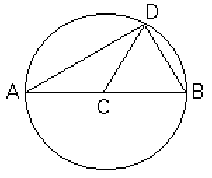

# The Medieval Problem of Universals
**First published Sun Sep 10, 2000; substantive revision Sun Feb 27, 2022**

*Klima, Gyula*

“The problem of universals” in general is a historically variable bundle of several closely related, yet in different conceptual frameworks rather differently articulated metaphysical, logical, and epistemological questions, ultimately all connected to the issue of how universal cognition of singular things is possible. How do we know, for example, that the Pythagorean theorem holds *universally*, for *all* possible right triangles? Indeed, how can we have any awareness of a potential infinity of all possible right triangles, given that we could only see a finite number of actual ones? How can we universally indicate all possible right triangles with the phrase ‘right triangle’? Is there something common to them all signified by this phrase? If so, what is it, and how is it related to the particular right triangles? The *medieval* problem of universals is a logical, and historical, continuation of the *ancient* problem generated by Plato’s (428–348 B.C.E.) theory answering such a bundle of questions, namely, his theory of Ideas or Forms.

## 1. Introduction

The inherent problems with Plato’s original theory were recognized already by Plato himself. In his *Parmenides* Plato famously raised several difficulties, for which he apparently did not provide satisfactory answers. Aristotle (384–322 B.C.E.), with all due reverence to his teacher, consistently rejected Plato’s theory, and heavily criticized it throughout his own work. (Hence the famous saying, *amicus Plato sed magis amica veritas*).[^note-1] Nevertheless, despite this explicit doctrinal conflict, Neo-Platonic philosophers, pagans (such as Plotinus ca. 204–270, and Porphyry, ca. 234–305) and Christians (such as Augustine, 354–430, and Boethius, ca. 480–524) alike, observed a basic concordance between Plato’s and Aristotle’s approach, crediting Aristotle with an explanation of how the human mind acquires its universal concepts of particular things from experience, and Plato with providing an explanation of how the universal features of particular things are established by being modeled after their universal archetypes.[^note-2] In any case, it was this general attitude toward the problem in late antiquity that set the stage for the ever more sophisticated medieval discussions.[^note-3] In these discussions, the concepts of the human mind, therefore, were regarded as posterior to the particular things represented by these concepts, and hence they were referred to as *universalia post rem* (‘universals after the thing’). The universal features of singular things, inherent in these things themselves, were referred to as *universalia in re* (‘universals in the thing’), answering the universal exemplars in the divine mind, the *universalia ante rem* (‘universals before the thing’).[^note-4] All these, universal concepts, universal features of singular things, and their exemplars, are expressed and signified by means of some obviously universal signs, the universal (or common) terms of human languages. For example, the term ‘man’, in English is a universal term, because it is truly predicable of all men in one and the same sense, as opposed to the singular term ‘Socrates’, which in the same sense, i.e., when not used equivocally, is only predicable of one man (hence the need to add an ordinal number to the names of kings and popes of the same name).

Depending on which of these items (universal features of singular things, their universal concepts, or their universal names) they regarded as the primary, really existing universals, it is customary to classify medieval authors as being *realists*, *conceptualists*, or *nominalists*, respectively. The *realists* are supposed to be those who assert the existence of real universals *in* and/or *before* particular things, the *conceptualists* those who allow universals only, or primarily, as concepts of the mind, whereas *nominalists* would be those who would acknowledge only, or primarily, universal words. But this rather crude classification does not adequately reflect the genuine, much more subtle differences of opinion between medieval thinkers. (No wonder one often finds in the secondary literature distinctions between, “moderate” and “extreme” versions of these crudely defined positions.) In the first place, nearly *all* medieval thinkers agreed on the existence of universals *before* things in the form of divine ideas existing in the divine mind,[^note-5] but all of them denied their existence in the form of mind-independent, real, eternal entities originally posited by Plato. Furthermore, medieval thinkers also agreed that particular things have certain features which the human mind is able to comprehend in a universal fashion, and signify by means of universal terms. As we shall see, their disagreements rather concerned the types of the relationships that hold between the particular things, their individual, yet universally comprehensible features, the universal concepts of the mind, and the universal terms of our languages, as well as the ontological status of, and distinctions between, the individualized features of the things and the universal concepts of the mind. Nevertheless, the distinction between “realism” and “nominalism”, especially, when it is used to refer to the distinction between the radically different ways of doing philosophy and theology in late-medieval times, is quite justifiable, provided we clarify what *really* separated these ways, as I hope to do in the later sections of this article.

In this brief summary account, I will survey the problem both from a systematic and from a historical point of view. In the next section I will first motivate the problem by showing how naturally the questions concerning universals emerge if we consider how we come to know a universal claim, i.e., one that concerns a potentially infinite number of particulars of a given kind, in a simple geometrical demonstration. I will also briefly indicate why a naïve Platonic answer to these questions in terms of the theory of perfect Forms, however plausible it may seem at first, is inadequate. In the third section, I will briefly discuss how the specific medieval questions concerning universals emerged, especially in the context of answering Porphyry’s famous questions in his introduction to Aristotle’s *Categories*, which will naturally lead us to a discussion of Boethius’ Aristotelian answers to these questions in his second commentary on Porphyry in the fourth section. However, Boethius’ Aristotelian answers anticipated only one side of the medieval discussions: the mundane, philosophical theory of universals, in terms of Aristotelian abstractionism. But the other important, Neo-Platonic, theological side of the issue provided by Boethius, and, most importantly, by St. Augustine, was for medieval thinkers the theory of ontologically primary universals as the creative archetypes of the divine mind, the Divine Ideas. Therefore, the fifth section is going to deal with the main ontological and epistemological problems generated by this theory, namely, the apparent conflict between divine simplicity and the multiplicity of divine ideas, on the one hand, and the tension between the Augustinian theory of divine illumination and Aristotelian abstractionism, on the other. Some details of the early medieval Boethian-Aristotelian approach to the problem and its combination with the Neo-Platonic Augustinian tradition *before* the influx of the newly recovered logical, metaphysical, and physical writings of Aristotle and their Arabic commentaries in the second half of the 12ᵗʰ century will be taken up in the sixth section, in connection with Abelard’s (1079–1142) discussion of Porphyry’s questions. The seventh section will discuss some details of the characteristic metaphysical approach to the problem in the 13ᵗʰ century, especially as it was shaped by the influence of Avicenna’s (980–1037) doctrine of common nature. The eighth section outlines the most general features of the logical conceptual framework that served as the common background for the metaphysical disagreements among the authors of this period. I will argue that it is precisely this common logical-semantical framework that allows the grouping together of authors who endorse sometimes radically different metaphysics and epistemologies (not only in this period, but also much later, well into the early modern period) as belonging to what in later medieval philosophy came to be known as the “realist” *via antiqua*, the “old way” of doing philosophy and theology. By contrast, it was precisely the radically different logical-semantical approach initiated by William Ockham (ca. 1280–1350), and articulated and systematized most powerfully by Jean Buridan (ca. 1300–1358), that distinguished the “nominalist” *via moderna*, the “modern way” of doing philosophy and theology from the second half of the 14ᵗʰ century. The general, distinctive characteristics of this “modern way” will be the discussed in the ninth section. Finally, the concluding tenth section will briefly indicate how the separation of the two *viae*, in addition to a number of extrinsic social factors, contributed to the disintegration of scholastic discourse, and thereby to the disappearance of the characteristically medieval problem of universals, as well as to the re-mergence of recognizably the same problem in different guises in early modern philosophy.

## 2. The Emergence of the Problem

It is easy to see how the problem of universals emerges, if we consider a geometrical demonstration, for example, the demonstration of Thales’ theorem. According to the theorem, any triangle inscribed in a semicircle is a right triangle, as is shown in the following diagram:

*Figure 1.*

Figure 1. Thales’ theorem

Looking at this diagram, we can see that all we need to prove is that the angle at vertex D of triangle ABD is a right angle. The proof is easy once we realize that since lines AC, DC, and BC are the radii of a circle, the triangles ACD and DCB are isosceles triangles, whence their base angles are equal. For then, if we denote the angles of ABD by the names of their vertices, this fact entails that D=A + B; and so, since A + B + D=180ᵒ, it follows that 2A + 2B=180ᵒ; therefore, A + B=90ᵒ, that is, D=90ᵒ, **q. e. d.**

Of course, from our point of view, the important thing about this demonstration is not so much the *truth* of its conclusion as *the way* it proves this conclusion. For the conclusion is a universal theorem, which has to concern all possible triangles inscribed in any possible semicircle whatsoever, not just the one inscribed in the semicircle in the figure above. Yet, apparently, in the demonstration above we were talking only about that triangle. So, how can we claim that whatever we managed to prove concerning that particular triangle will hold for all possible triangles?

If we take a closer look at the diagram, we can easily see the appeal of the Platonic answer to this question. For upon a closer look, it is clear that, despite appearances to the contrary, this demonstration *cannot* be about the triangle in this diagram. Indeed, in the demonstration we assumed that the lines AC, DC, and BC were all perfectly equal, straight lines. However, if we zoom in on the figure, we can clearly see that these lines are far from being equal; in fact, they are not even straight lines:

*Figure 2.*

Figure 2. The result of zooming in on Figure 1.

The demonstration was certainly not about the collection of jagged black surfaces that we can see here. Rather, the demonstration concerned something we did not see with our bodily eyes, but what we had in mind all along, understanding it to be a triangle, with perfectly straight edges, touching a perfect circle in three unextended points, which are all perfectly equidistant from the center of the circle. The figure we could see was only a convenient “reminder” of what we are supposed to have in mind when we want to prove that a certain property, namely, that it is a right triangle, has to belong to the object in our mind in virtue of what it is, namely, a triangle inscribed in a semicircle. Obviously, the conclusion applies perfectly only to the perfect triangle we had in mind, whereas it holds for the visible figure only insofar as, and to the extent that, this figure resembles the object we had in mind. But this figure fails to have this property precisely insofar as, and to the extent that, it falls short of the object in our mind.

However, on the basis of this point it should also be clear that the conclusion *does* apply to this figure, and every other visible triangle inscribed in a semicircle as well, insofar as, and to the extent that, it manages to imitate the properties of the perfect object in our mind. Therefore, the Platonic answer to the question of what this demonstration was about, namely, that it was about a perfect, ideal triangle, which is invisible to the eyes, but is graspable by our understanding, at once provides us with an explanation of the possibility of universal, necessary knowledge. By knowing the properties of the Form or Idea, we know all its particulars, i.e., all the things that imitate it, insofar as they imitate or participate in it. So, the Form itself is a universal entity, a universal model of all its particulars; and since it is the knowledge of this universal entity that can enable us to know at once all its particulars, it is absolutely vital for us to know *what* it is, *what* it is *like*, and exactly *how* it is *related to* its particulars. However, obviously, all these questions presuppose that *it* *is* at all, namely, that such a universal entity *exists*.

But the existence of such an entity seems to be rather precarious. Consider, for instance, the perfect triangle we were supposed to have in mind during the demonstration of Thales’ theorem. If it is a perfect triangle, it obviously has to have three sides, since a perfect triangle has to be a triangle, and nothing can be a triangle unless it has three sides. But of those three sides either at least two are equal or none, that is to say, the triangle in question has to be either isosceles or scalene (taking ‘isosceles’ broadly, including even equilateral triangles, for the sake of simplicity). However, since it is supposed to be the universal model of *all* triangles, and not only of isosceles triangles, this perfect triangle cannot be an isosceles, and for the same reason it cannot be a scalene triangle either. Therefore, such a universal triangle would have to have inconsistent properties, namely, *both* that it is either isosceles or scalene *and* that it is neither isosceles nor scalene. However, obviously nothing can have these properties at the same time, so nothing can be a universal triangle any more than a round square. So, apparently, no universal triangle can exist. But then, what was our demonstration about? Just a little while ago, we concluded that it could not be directly about any particular triangle (for it was not about the triangle in the figure, and it was even less about any other particular triangle not in the figure), and now we had to conclude that it could not be about a universal triangle either. But are there any further alternatives? It seems obvious that through this demonstration we do gain universal knowledge concerning all particulars. Yet it is also clear that we do not, indeed, we cannot gain this knowledge by examining all particulars, both because they are potentially infinite and because none of them perfectly satisfies the conditions stated in the demonstration. So, there must have been something wrong in our characterization of the universal, which compelled us to conclude that, in accordance with that characterization, universals could not exist. Therefore, we are left with a whole bundle of questions concerning the nature and characteristics of universals, questions that cannot be left unanswered if we want to know how universal, necessary knowledge is possible, if at all.

## 3. The Origin of the Specifically Medieval Problem of Universals

What we may justifiably call the first formulation of “the *medieval* problem of universals” (distinguishing it from the both logically and historically related ancient problems of Plato’s Theory of Forms) was precisely such a bundle of questions famously raised by Porphyry in his *Isagoge*, that is, his *Introduction to Aristotle’s Categories*. As he wrote:

> (1) Since, Chrysaorius, to teach about Aristotle’s *Categories* it is necessary to know what genus and difference are, as well as species, property, and accident, and since reflection on these things is useful for giving definitions, and in general for matters pertaining to division and demonstration, therefore I shall give you a brief account and shall try in a few words, as in the manner of an introduction, to go over what our elders said about these things. I shall abstain from deeper enquiries and aim, as appropriate, at the simpler ones.
>
> (2) For example, I shall beg off saying anything about (a) whether genera and species are real or are situated in bare thoughts alone, (b) whether as real they are bodies or incorporeals, and (c) whether they are separated or in sensibles and have their reality in connection with them. Such business is profound, and requires another, greater investigation. Instead I shall now try to show how the ancients, the Peripatetics among them most of all, interpreted genus and species and the other matters before us in a more logical fashion. [Porphyry, *Isagoge*, in Spade 1994 (henceforth, *Five Texts*), p. 1.]

Even though in this way, by relegating them to a “greater investigation”, Porphyry left these questions unanswered, they certainly proved to be irresistible for his medieval Latin commentators, beginning with Boethius, who produced not just one, but two commentaries on Porphyry’s text; the first based on Marius Victorinus’s (*fl*. 4ᵗʰ c.) translation, and the second on his own.[^note-6]

In the course of his argument, Boethius makes it quite clear what sort of entity a universal would have to be.

> A universal must be common to several particulars
>
> 1. in its entirety, and not only in part
> 2. simultaneously, and not in a temporal succession, and
> 3. it should constitute the substance of its particulars.[^note-7]

However, as Boethius argues, nothing in real existence can satisfy these conditions. The main points of his argument can be reconstructed as follows.

Anything that is common to many things in the required manner has to be simultaneously, and as a whole, in the substance of these many things. But these many things are several beings precisely because they are distinct from one another in their being, that is to say, the act of being of one is distinct from the act of being of the other. However, if the universal constitutes the substance of a particular, then it has to have the same act of being as the particular, because constituting the substance of something means precisely this, namely, sharing the act of being of the thing in question, as the thing’s substantial part. But the universal is supposed to constitute the substance of all of its distinct particulars, as a whole, at the same time. Therefore, the one act of being of the universal entity would have to be identical with all the distinct acts of being of its several particulars at the same time, which is impossible.[^note-8]

This argument, therefore, establishes that no one thing can be a universal in its being, that is to say, nothing can be both one being and common to many beings in such a manner that it shares its act of being with those many beings, constituting their substance.

This can easily be visualized in the following diagram, where the tiny lightning bolts indicate the acts of being of the entities involved, namely, a woman, a man, and their universal humanity (the larger dotted figure).

*Figure 3.*

![Consists of three 'matchstick human' characters (as on public bathroom doors), a bigger one on the top, drawn in dashed lines, representing the universal humanity, a female on the lower left and a male character on the lower right, representing individual humans. Each has a lightning bolt symbol next to it, representing their acts of being, showing that the acts of being of the individuals are not identical, while the act of being of the universal would have to be identical with these distinct acts of being, which is impossible.](../assets/universals-medieval/image3.gif)

Figure 3. Illustration of the first part of Boethius’ argument

But then, Boethius goes on, we should perhaps say that the universal is not one being, but rather many beings, that is, [the collection of][^note-9] those constituents of the individual essences of its particulars on account of which they all fall under the same universal predicable. For example, on this conception, the genus ‘animal’ would not be some one entity, a universal animality over and above the individual animals, yet somehow sharing its being with them all (since, as we have just seen, that is impossible), but rather [the collection of] the individual animalities of all animals.

Boethius rejects this suggestion on the ground that whenever there are several generically similar entities, they have to have a genus; therefore, just as the individual animals had to have a genus, so too, their individual animalities would have to have another one. However, since the genus of animalities cannot be one entity, some ‘super-animality’ (for the same reason that the genus of animals could not be one entity, on the basis of the previous argument), it seems that the genus of animalities would have to be a number of further ‘super-animalities’. But then again, the same line of reasoning should apply to these ‘super-animalities’, giving rise to a number of ‘super-super-animalities’, and so on to infinity, which is absurd. Therefore, we cannot regard the genus as some real being even in the form of [a collection of] several distinct entities. Since similar reasonings would apply to the other Porphyrian predicables as well, no universal can exist in this way.

Now, a universal either exists in reality independently of a mind conceiving of it, or it only exists in the mind. If it exists in reality, then it either has to be one being or several beings. But since it cannot exist in reality in either of these two ways, Boethius concludes that it can only exist in the mind.[^note-10]

However, to complicate matters, it appears that a universal cannot exist in the mind either. For, as Boethius says, the universal existing in the mind is some universal understanding of some thing outside the mind. But then this universal understanding is either disposed in the same way as the thing is, or differently. If it is disposed in the same way, then the thing also must be universal, and then we end up with the previous problem of a really existing universal. On the other hand, if it is disposed differently, then it is false, for “what is understood otherwise than the thing is is false” (*Five Texts*, Spade 1994, p. 23 (21)). But then, all universals in the understanding would have to be false representations of their objects; therefore, no universal knowledge would be possible, whereas our considerations started out precisely from the existence of such knowledge, as seems to be clear, e.g., in the case of geometrical knowledge.

## 4. Boethius’ Aristotelian Solution

Boethius’ solution of the problem stated in this form consists in the rejection of this last argument, by pointing out the ambiguity of the principle that “what is understood otherwise than the thing is is false”. For in one sense this principle states the obvious, namely, that an act of understanding that represents a thing *to* *be* otherwise than the thing is is false. This is precisely the reading of this principle that renders it plausible. However, in another sense this principle would state that an act of understanding which represents the thing in a manner which is different from the manner in which the thing exists is false. In this sense, then, the principle would state that if the mode of representation of the act of understanding is different from the mode of being of the thing, then the act of understanding is false. But this is far from plausible. In general, it is simply not true that a representation can be true or faithful only if the mode of representation matches the mode of being of the thing represented. For example, a written sentence is a true and faithful representation of a spoken sentence, although the written sentence is a visible, spatial sequence of characters, whereas the spoken sentence is an audible, temporal pattern of articulated sounds. So, what exists as an audible pattern of sounds is represented visually, that is, the mode of existence of the thing represented is radically different from the mode of its representation. In the same way, when particular things are represented by a universal act of thought, the things exist in a particular manner, while they are represented in a universal manner, still, this need not imply that the representation is false. But this is precisely the sense of the principle that the objection exploited. Therefore, since in this sense the principle can be rejected, the objection is not conclusive.[^note-11]

However, it still needs to be shown that in the particular case of universal representation the mismatch between the mode of its representation and the mode of being of the thing represented does in fact not entail the falsity of the representation. This can easily be seen if we consider the fact that the falsity of an act of understanding consists in representing something *to be* in a way it is not. That is to say, properly speaking, it is only an act of *judgment* that can be false, by which we think something *to be* somehow. But a *simple* act of understanding, by which we simply understand something without thinking it *to be* somehow, that is, without attributing anything to it, cannot be false. For example, I can be mistaken if I form in my mind the judgment that a man *is* running, whereby I conceive a man *to be* somehow, but if I simply think of a man without attributing either running or not running to him, I certainly cannot make a mistake as to how he *is*.[^note-12] In the same way, I would be mistaken if I were to think that a triangle is neither isosceles nor scalene, but I am certainly not in error if I simply think of a triangle without thinking either that it is isosceles or that it is scalene. Indeed, it is precisely this possibility that allows me to form the universal mental representation, that is, the universal concept of all particular triangles, regardless of whether they are isosceles or scalene. For when I think of a triangle in general, then I certainly do not think of something that is a triangle and is neither isosceles nor scalene, for that is impossible, but I simply think of a triangle, not thinking that it is an isosceles and not thinking that it is a scalene triangle. This is how the mind is able to separate in thought what are inseparable in real existence. Being either isosceles or scalene is inseparable from a triangle in real existence. For it is impossible for something *to be* a triangle, and yet *not to be* an isosceles and *not* *to be* a scalene triangle either. Still, it is not impossible for something to be *thought to be* a triangle and *not* to be *thought to be* an isosceles and *not* to be *thought to be* a scalene triangle either (although of course, it still has to be thought to be either-isosceles-or-scalene). This separation in thought of those things that cannot be separated in reality is the process of *abstraction*.[^note-13] In general, by means of the process of abstraction, our mind (in particular, the faculty of our mind Aristotle calls *active intellect* (*nous poietikos*, in Greek, *intellectus agens*, in Latin) is able to form universal representations of particular objects by disregarding what distinguishes them, and conceiving of them only in terms of those of their features in respect of which they do not differ from one another.

In this way, therefore, if universals are regarded as universal mental representations existing in the mind, then the contradictions emerging from the Platonic conception no longer pose a threat. On this Aristotelian conception, universals need not be thought of as somehow sharing their being with all their distinct particulars, for their being simply consists in their being thought of, or rather, the particulars’ being thought of in a universal manner. This is what Boethius expresses by saying in his final replies to Porphyry’s questions the following:

> … genera and species subsist in one way, but are understood in an another. They are incorporeal, but subsist in sensibles, joined to sensibles. They are understood, however, as subsisting by themselves, and as not having their being in others. [*Five Texts*, Spade 1994, p. 25][^spade-1994]

But then, if in this way, by positing universals in the mind, the most obvious inconsistencies of Plato’s doctrine can be avoided, no wonder that Plato’s “original” universals, the universal models which particulars try to imitate by their features, found their place, in accordance with the long-standing Neo-Platonic tradition, in the divine mind.[^note-14] It is this tradition that explains Boethius’ cautious formulation of his conclusion concerning Aristotelianism pure and simple, as not providing us with the whole story. As he writes:

> … Plato thinks that genera and species and the rest are not only understood as universals, but also exist and subsist apart from bodies. Aristotle, however, thinks that they are understood as incorporeal and universal, but subsist in sensibles.
>
> I did not regard it as appropriate to decide between their views. For that belongs to a higher philosophy. But we have carefully followed out Aristotle’s view here, not because we would recommend it the most, but because this book, [the *Isagoge*], is written about the *Categories*, of which Aristotle is the author. [*Five Texts*, Spade 1994, p. 25][^spade-1994]

## 5. Platonic Forms as Divine Ideas

Besides Boethius, the most important mediator between the Neo-Platonic philosophical tradition and the Christianity of the Medieval Latin West, pointing out also its theological implications, was St. Augustine. In a passage often quoted by medieval authors in their discussions of divine ideas, he writes as follows:

> … in Latin we can call the Ideas “forms” or “species”, in order to appear to translate word for word. But if we call them “reasons”, we depart to be sure from a proper translation — for reasons are called “logoi” in Greek, not Ideas — but nevertheless, whoever wants to use this word will not be in conflict with the fact. For Ideas are certain principal, stable and immutable forms or reasons of things. They are not themselves formed, and hence they are eternal and always stand in the same relations, and they are contained in the divine understanding. [Spade 1985, Other Internet Resources, p. 383][^note-15]

As we could see from Boethius’ solution, in this way, if Platonic Forms are not universal beings existing in a universal manner, but their universality is due to a universal manner of understanding, we can avoid the contradictions arising from the “naïve” Platonic conception. Nevertheless, placing universal ideas in the divine mind as the archetypes of creation, this conception can still do justice to the Platonic intuition that what accounts for the necessary, universal features of the ephemeral particulars of the visible world is the presence of some universal exemplars in the source of their being. It is precisely in virtue of having some insight into these exemplars themselves that we can have the basis of universal knowledge Plato was looking for. As St. Augustine continues:

> And although they neither arise nor perish, nevertheless everything that is able to arise and perish, and everything that does arise and perish, is said to be formed in accordance with them. Now it is denied that the soul can look upon them, unless it is a rational one, [and even then it can do so] only by that part of itself by which it surpasses [other things] — that is, by its mind and reason, as if by a certain “face”, or by an inner and intelligible “eye”. To be sure, not each and every rational soul in itself, but [only] the one that is holy and pure, that [is the one that] is claimed to be fit for such a vision, that is, the one that keeps that very eye, by which these things are seen, healthy and pure and fair and like the things it means to see. What devout man imbued with true religion, even though he is not yet able to see these things, nevertheless dares to deny, or for that matter fails to profess, that all things that exist, that is, whatever things are contained in their own genus with a certain nature of their own, so that that they might exist, are begotten by God their author, and that by that same author everything that lives is alive, and that the entire safe preservation and the very order of things, by which changing things repeat their temporal courses according to a fixed regimen, are held together and governed by the laws of a supreme God? If this is established and granted, who dares to say that God has set up all things in an irrational manner? Now if it is not correct to say or believe this, it remains that all things are set up by reason, and a man not by the same reason as a horse — for that is absurd to suppose. Therefore, single things are created with their own reasons. But where are we to think these reasons exist, if not in the mind of the creator? For he did not look outside himself, to anything placed [there], in order to set up what he set up. To think that is sacrilege. But if these reasons of all things to be created and [already] created are contained in the divine mind, and [if] there cannot be anything in the divine mind that is not eternal and unchangeable, and [if] Plato calls these principal reasons of things “Ideas”, [then] not only are there Ideas but they are true, because they are eternal and [always] stay the same way, and [are] unchangeable. And whatever exists comes to exist, however it exists, by participation in them. But among the things set up by God, the rational soul surpasses all [others], and is closest to God when it is pure. And to the extent that it clings to God in charity, to that extent, drenched in a certain way and lit up by that intelligible light, it discerns these reasons, not by bodily eyes but by that principal [part] of it by which it surpasses [everything else], that is, by its intelligence. By this vision it becomes most blessed. These reasons, as was said, whether it is right to call them Ideas or forms or species or reasons, many are permitted to call [them] whatever they want, but [only] to a very few [is it permitted] to see what is true. [Spade 1985, Other Internet Resources, pp. 383–384]

Augustine’s conception, then, saves Plato’s original intuitions, yet without their inconsistencies, while it also combines his philosophical insights with Christianity. But, as a rule, a really intriguing solution of a philosophical problem usually gives rise to a number of further problems. This solution of the original problem with Plato’s Forms is no exception.

### 5.1 Divine Ideas and Divine Simplicity

First of all, it generates a particular ontological/theological problem concerning the relationship between God and His Ideas. For according to the traditional philosophical conception of divine perfection, God’s perfection demands that He is absolutely simple, without any composition of any sort of parts.[^note-16] So, God and the divine mind are not related to one another as a man and his mind, namely as a substance to one of its several powers, but whatever powers God *has* He *is*. Furthermore, the Divine Ideas themselves cannot be regarded as being somehow the eternal products of the divine mind distinct from the divine mind, and thus from God Himself, for the only eternal being is God, and everything else is His creature. Now, since the Ideas are not creatures, but the archetypes of creatures in God’s mind, they cannot be distinct from God. However, as is clear from the passage above, there are several Ideas, and there is only one God. So how can these several Ideas possibly be one and the same God?

Augustine never explicitly raised the problem, but for example Aquinas, who (among others) did, provided the following rather intuitive solution for it (ST1, q. 15, a. 2). The Divine Ideas are in the Divine Mind as its objects, i.e., as the things understood. But the diversity of the objects of an act of understanding need not diversify the act itself (as when understanding the Pythagorean theorem, we understand both squares and triangles). Therefore, it is possible for the self-thinking divine essence to understand itself in a single act of understanding so perfectly that this act of understanding not only understands the divine essence as it is in itself, but also in respect of all possible ways in which it can be imperfectly participated by any finite creature. The cognition of the diversity of these diverse ways of participation accounts for the plurality of divine ideas. But since all these diverse ways are understood in a single eternal act of understanding, which is nothing but the act of divine being, and which in turn is again the divine essence itself, the multiplicity of ideas does not entail any corresponding multiplicity of the divine essence. To be sure, this solution may still give rise to the further questions as to what these diverse ways are, exactly how they are related to the divine essence, and how their diversity is compatible with the unity and simplicity of the ultimate object of divine thought, namely, divine essence itself. In fact, these are questions that were raised and discussed in detail by authors such as Henry of Ghent (c. 1217–1293), Thomas of Sutton (ca. 1250–1315), Duns Scotus (c. 1266–1308) and others.[^note-17]

### 5.2 Illuminationism vs. Abstractionism

Another major issue connected to the doctrine of divine ideas, as should also be clear from the previously quoted passage, was the bundle of epistemological questions involved in Augustine’s doctrine of divine illumination. The doctrine — according to which the human soul, especially “one that is holy and pure”, obtains a specific supernatural aid in its acts of understanding, by gaining a direct insight into the Divine Ideas themselves — received philosophical support in terms of a typically Platonic argument in Augustine’s *De Libero Arbitrio*.[^note-18] The argument can be reconstructed as follows.

> **The Augustinian Argument for Illumination**.
>
> 1. I can come to know from experience only something that can be found in experience [self-evident]
> 2. Absolute unity cannot be found in experience [assumed]
> 3. Therefore, I cannot come to know absolute unity from experience. [1,2]
> 4. Whatever I know, but I cannot come to know from experience, I came to know from a source that is not in this world of experiences. [self-evident]
> 5. I know absolute unity. [assumed]
> 6. Therefore, I came to know absolute unity from a source that is not in this world of experiences. [3,4,5]
>
> *Proof of 2*. Whatever can be found in experience is some material being, extended in space, and so it has to have a multitude of spatially distinct parts. Therefore, it is many in respect of those parts. But what is many in some respect is not one in that respect, and what is not one in some respect is not absolutely one. Therefore, nothing can be found in experience that is absolutely one, that is, nothing in experience is an absolute unity.
>
> *Proof of 5*. I know that whatever is given in experience has many parts (even if I may not be able to discern those parts by my senses), and so I know that it is not an absolute unity. But I can have this knowledge only if I know absolute unity, namely, something that is not many in any respect, not even in respect of its parts, for, in general, I can know that something is F in a certain respect, and not an F in some other respect, only if I know what it is for something to be an F without any qualification. (For example, I know that the two halves of a body, taken together, are not absolutely two, for taken one by one, they are not absolutely one, since they are also divisible into two halves, etc. But I can know this only because I know that for obtaining absolutely two things [and not just two multitudes of further things], I would have to have two things that in themselves are absolutely one.) Therefore, I know absolute unity.

It is important to notice here that this argument (crucially) assumes that the intellect is passive in acquiring its concepts. According to this assumption, the intellect merely receives the cognition of its objects as it finds them. By contrast, on the Aristotelian conception, the human mind actively processes the information it receives from experience through the senses. So by means of its faculty appropriately called the active or agent intellect, it is able to produce from a limited number of experiences a universal concept equally representing all possible particulars falling under that concept. In his commentary on Aristotle’s *De Anima* Aquinas insightfully remarks:

> The reason why Aristotle came to postulate an active intellect was his rejection of Plato’s theory that the essences of sensible things existed apart from matter, in a state of actual intelligibility. For Plato there was clearly no need to posit an active intellect. But Aristotle, who regarded the essences of sensible things as existing in matter with only a potential intelligibility, had to invoke some abstractive principle in the mind itself to render these essences actually intelligible. [*In De Anima*, bk. 3, lc. 10]

On the basis of these and similar considerations, therefore, one may construct a rather plausible Aristotelian counterargument, which is designed to show that we need not necessarily gain our concept of absolute unity from a supernatural source, for it is possible for us to obtain it from experience by means of the active intellect. Of course, similar considerations should apply to other concepts as well.

> **An Aristotelian-Thomistic counterargument from abstraction**.
>
> 1. I know from experience everything whose concept my active intellect is able to abstract from experience. [self-evident]
> 2. But my active intellect is able to abstract from experience the concept of unity, since we all experience each singular thing as being one, distinct from another. [self-evident, common experience][^note-19]
> 3. Therefore, I know unity from experience by abstraction. [1,2]
> 4. Whenever I know something from experience by abstraction, I know both the thing whose concept is abstracted and its limiting conditions from which its concept is abstracted. [self-evident]
> 5. Therefore, I know both unity and its limiting conditions from which its concept is abstracted. [3,4]
> 6. But whenever I know something and its limiting conditions, and I can conceive of it without its limiting conditions (and this is precisely what happens in abstraction), I can conceive of its absolute, unlimited realization. [self-evident]
> 7. Therefore, I can conceive of the absolute, unlimited realization of unity, based on the concept of unity I acquired from experience by abstraction. [5,6]
> 8. Therefore, it is not necessary for me to have a preliminary knowledge of absolute unity before all experience, from a source other than this world of experiences. [7]

To be sure, we should notice here that this argument *does* *not* *falsify* *the doctrine* of illumination. Provided it works, it only *invalidates* the Augustinian-Platonic *argument* for illumination. Furthermore, this is obviously not a sweeping, knock-down refutation of the idea that at least some of our concepts perhaps could not so simply be derived from experience by abstraction; in fact, in the particular case of unity, and in general, in connection with our transcendental notions (i.e., notions that apply in each Aristotelian category, so they *transcend* the limits of each one of them, such as the notions of *being*, *unity*, *goodness*, *truth*, etc.), even the otherwise consistently Aristotelian Aquinas would have a more complicated story to tell (see Klima 2000b)[^klima-2000b]. Nevertheless, although Aquinas would still leave some room for illumination in his epistemology, he would provide for illumination an entirely naturalistic interpretation, as far as the acquisition of our intellectual concepts of material things is concerned, by simply identifying it with the “intellectual light in us”, that is, the active intellect, which enables us to acquire these concepts from experience by abstraction.[^note-20] Duns Scotus, who opposed Aquinas on so many other points, takes basically the same stance on this issue. Other medieval theologians, especially such prominent “Augustinians” as Bonaventure, Matthew of Aquasparta, or Henry of Ghent, would provide greater room for illumination in the form of a direct, specific, supernatural influence needed for human intellectual cognition in this life besides the general divine cooperation needed for the workings of our natural powers, in particular, the abstractive function of the active intellect.[^note-21] But they would not regard illumination as supplanting, but rather as supplementing intellectual abstraction.

As we could see, Augustine makes recognition of truth dependent on divine illumination, a sort of irradiation of the intelligible light of divine ideas, which is accessible only to the few who are “holy and pure”.

But this seems to go against at least

> 1. the experience that there are knowledgeable non-believers or pagans
>
> 2. the Aristotelian insight that we can have infallible comprehension of the first principles of scientific demonstrations for which we only need the intellectual concepts that we can acquire naturally, from experience by abstraction,[^note-22]

and

> 3. the philosophical-theological consideration that if human reason, man’s natural faculty for acquiring truth were not sufficient for performing its natural function, then human nature would be naturally defective in its noblest part, precisely in which it was created after the image of God.

In fact, these are only some of the problems explicitly raised and considered by medieval Augustinians, which prompted their ever more refined accounts of the role of illumination in human cognition.

For example, Matthew of Aquasparta, recapitulating St. Bonaventure, writes as follows:

> Plato and his followers stated that the entire essence of cognition comes forth from the archetypal or intelligible world, and from the ideal reasons; and they stated that the eternal light contributes to certain cognition in its evidentness as the entire and sole reason for cognition, as Augustine in many places recites, in particular in bk. viii. c. 7 of *The City of God*: ‘The light of minds for the cognition of everything is God himself, who created everything’.
>
> But this position is entirely mistaken. For although it appears to secure the way of wisdom, it destroys the way of knowledge. Furthermore, if that light were the entire and sole reason for cognition, then the cognition of things in the Word would not differ from their cognition in their proper kind, neither would the cognition of reason differ from the cognition of revelation, nor philosophical cognition from prophetic cognition, nor cognition by nature from cognition by grace.
>
> The other position was apparently that of Aristotle, who claimed that the entire essence of cognition is caused and comes from below, through the senses, memory, and experience, [working together] with the natural light of our active intellect, which abstracts the species from phantasms and makes them actually understood. And for this reason he did not claim that the eternal is light necessary for cognition, indeed, he never spoke about it. And this opinion of his is obvious in bk. 2 of the *Posterior Analytics*. […]
>
> But this position seems to be very deficient. For although it builds the way of knowledge, it totally destroys the way of wisdom. […]
>
> Therefore, I take it that one should maintain an intermediate position without prejudice, by stating that our cognition is caused both from below and from above, from external things as well as the ideal reasons.
>
> […] God has provided our mind with some intellectual light, by means of which it would abstract the species of objects from the sensibles, by purifying them and extracting their quiddities, which are the per se objects of the intellect. […] But this light is not sufficient, for it is defective, and is mixed with obscurity, unless it is joined and connected to the eternal light, which is the perfect and sufficient reason for cognition, and the intellect attains and somehow touches it by its upper part.
>
> However the intellect attains that light or those eternal reasons as the reason for cognition not as sole reason, for then, as has been said, cognition in the Word would not differ from cognition in proper kind, nor the cognition of wisdom would differ from the cognition of knowledge. Nor does it attain them as the entire reason, for then it would not need the species and similitudes of things; but this is false, for the Philosopher says, and experience teaches, that if someone loses a sense, then he loses that knowledge of things which comes from that sense. [DHCR, pp. 94–96]

In this way, taking the intermediate position between Platonism and Aristotelianism pure and simple, Matthew interprets Augustine’s Platonism as being compatible with the Aristotelian view, crediting the Aristotelian position with accounting for the specific empirical content of our intellectual concepts, while crediting the Platonic view with accounting for their certainty in grasping the natures of things. Still, it may not appear quite clear exactly what the contribution of the eternal light is, indeed, whether it is necessary at all. After all, if by abstraction we manage to gain those intellectual concepts that represent the natures of things, what else is needed to have a grasp of those natures?

Henry of Ghent, in his detailed account of the issue, provides an interesting answer to this question. Henry first distinguishes cognition of a true thing from the cognition of the truth of the thing. Since any really existing thing is truly what it is (even if it may on occasion appear something else), any cognition of any really existing thing is the cognition of a true thing. But cognition of a true thing may occur without the cognition of its truth, since the latter is the cognition that the thing adequately corresponds to its exemplar in the human or divine mind. For example, if I draw a circle, when a cat sees it, then it sees the real true thing as it is presented to it. Yet the cat is simply unable to judge whether it is a true circle in the sense that it really is what it is supposed to be, namely, a locus of points equidistant from a given point. By contrast, a human being is able to judge the truth of this thing, insofar as he or she would be able to tell that my drawing is not really and truly a circle, but is at best a good approximation of what a true circle would be.

Now, in intellectual cognition, just as in the sensory cognition of things, when the intellect simply apprehends a true thing, then it still does not have to judge the truth of the thing, even though it may have a true apprehension, adequately representing the thing. But the cognition of the truth of the thing only occurs in a judgment, when the intellect judges the adequacy of the thing to its exemplar.

But since a thing can be compared to two sorts of exemplar, namely, to the exemplar in the human mind, and to the exemplar in the divine mind, the cognition of the truth of a thing is twofold, relative to these two exemplars. The exemplar of the human mind, according to Henry, is nothing but the Aristotelian abstract concept of the thing, whereby the thing is simply apprehended in a universal manner, and hence its truth is judged relative to this concept, when the intellect judges that the thing in question falls under this concept or not. As Henry writes:

> […] attending to the exemplar gained from the thing as the reason for its cognition in the cognizer, the truth of the thing can indeed be recognized, by forming a concept of the thing that conforms to that exemplar; and it is in this way that Aristotle asserted that man gains knowledge and cognition of the truth from purely natural sources about changeable natural things, and that this exemplar is acquired from things by means of the senses, as from the first principle of art and science. […] So, by means of the universal notion in us that we have acquired from the several species of animals we are able to realize concerning any thing that comes our way whether it is an animal or not, and by means of the specific notion of donkey we realize concerning any thing that comes our way whether it is a donkey or not. [HQO, a. 1, q. 2, fol. 5 E-F]

But this sort of cognition of the truth of a thing, although it is intellectual, universal cognition, is far from being the infallible knowledge we are seeking. As Henry argues further:

> But by this sort of acquired exemplar in us we do not have the entirely certain and infallible cognition of truth. Indeed, this is entirely impossible for three reasons, the first of which is taken from the thing from which this exemplar is abstracted, the second from the soul, in which this exemplar is received, and the third from the exemplar itself that is received in the soul about the thing.
>
> The first reason is that this exemplar, since it is abstracted from changeable things, has to share in the nature of changeability. Therefore, since physical things are more changeable than mathematical objects, this is why the Philosopher claimed that we have a greater certainty of knowledge about mathematical objects than about physical things by means of their universal species. And this is why Augustine, discussing this cause of the uncertainty of the knowledge of natural things in q. 9 of his *Eighty-Three Different Questions*, says that from the bodily senses one should not expect the pure truth [*syncera veritas*]
>
> … The second reason is that the human soul, since it is changeable and susceptible to error, cannot be rectified to save it from swerving into error by anything that is just as changeable as itself, or even more; therefore, any exemplar that it receives from natural things is necessarily just as changeable as itself, or even more, since it is of an inferior nature, whence it cannot rectify the soul so that it would persist in the infallible truth.
>
> … The third reason is that this sort of exemplar, since it is the intention and species of the sensible thing abstracted from the phantasm, is similar to the false as well as to the true [thing], so that on its account these cannot be distinguished. For it is by means of the same images of sensible things that in dreams and madness we judge these images to be the things, and in sane awareness we judge the things themselves. But the pure truth can only be perceived by discerning it from falsehood. Therefore, by means of such an exemplar it is impossible to have certain knowledge, and certain cognition of the truth. And so if we are to have certain knowledge of the truth, then we have to turn our mind away from the senses and sensible things, and from every intention, no matter how universal and abstracted from sensible things, to the unchangeable truth existing above the mind […]. [*ibid.*, fol. 5. F]

So, Henry first distinguished between the cognition of a true thing and the intellectual cognition of the truth of a thing, and then, concerning the cognition of the truth of the thing, he distinguished between the cognition of truth by means of a concept abstracted from the thing and “the pure truth” [*veritas syncera vel liquida*], which he says cannot be obtained by means of such abstracted concepts.

But then the question naturally arises: what is this “pure truth”, and how can it be obtained, if at all? Since cognition of the pure truth involves comparison of objects not to their acquired exemplar in the human mind, but to their eternal exemplar in the divine mind, in the ideal case it would consist in some sort of direct insight into the divine ideas, enabling the person who has this access to see everything in its true form, as “God meant it to be”, and also see how it fails to live up to its idea due to its defects. So, it would be like the direct intuition of two objects, one sensible, another intelligible, on the basis of which one could also immediately judge how closely the former approaches the latter. But this sort of direct intuition of the divine ideas is only the share of angels and the souls of the blessed in beatific vision; it is generally not granted in this life, except in rare, miraculous cases, in rapture, or prophetic vision.

Therefore, if there is to be any non-miraculous recognition of this pure truth in this life, then it has to occur differently. Henry argues that even if we do not have a direct intuition of divine ideas as the objects cognized (whereby their particulars are recognized as more or less approximating them), we do have the cognition of the quiddities of things as the objects cognized by reason of some indirect cognition of their ideas. The reason for this, Henry says, is the following:

> …for our concept to be true by the pure truth, the soul, insofar as it is informed by it, has to be similar to the truth of the thing outside, since truth is a certain adequacy of the thing and the intellect. And so, as Augustine says in bk. 2 of *On Free Choice of the Will*, since the soul by itself is liable to slip from truth into falsity, whence by itself it is not informed by the truth of any thing, although it can be informed by it, but nothing can inform itself, for nothing can give what it does not have; therefore, it is necessary that it be informed of the pure truth of a thing by something else. But this cannot be done by the exemplar received from the thing itself, as has been shown earlier [in the previously quoted passage — GK]. It is necessary, therefore, that it be informed by the exemplar of the unchangeable truth, as Augustine intends in the same place. And this is why he says in *On True Religion* that just as by its truth are true those that are true, so too by its similitude are similar those that are similar. It is necessary, therefore, that the unchangeable truth impress itself into our concept, and that it transform our concept to its own character, and that in this way it inform our mind with the expressed truth of the thing by the same similitude that the thing itself has in the first truth. [HQO a. 1, q. 2, fol. 7, I]

So, when we have the cognition of the pure truth of a thing, then we cannot have it in terms of the concept acquired from the thing, yet, since we cannot have it from a direct intuition of the divine exemplar either, the way we can have it is that the acquired concept primarily impressed on our mind will be further clarified, but no longer by a similarity of the thing, but by the similarity of the divine exemplar itself. Henry’s point seems to be that given that the external thing itself is already just a (more or less defective) copy of the exemplar, the (more or less defective) copy of this copy can only be improved by means of the original exemplar, just as a copy of a poor repro of some original picture can only be improved by retouching the copy not on the basis of the poor repro, but on the basis of the original. But since the external thing is fashioned after its divine idea, the “retouching” of the concept in terms of the original idea does yield a better representation of the thing; indeed, so much better that on the basis of this “retouched” concept we are even able to judge just how well the thing realizes its kind.

For example, when I simply have the initial simple concept of circle abstracted from circular objects I have seen, that concept is good enough for me to tell circular objects apart from non-circular ones. But with this simple, unanalyzed concept in mind, I may still not be able to say what a true circle is supposed to be, and accordingly, exactly how and to what extent the more or less circular objects I see fail or meet this standard. However, when I come to understand that a circle is a locus of points equidistant from a given point, I will realize by means of a clear and distinct concept what it was that I originally conceived in a vague and confused manner in my original concept of circle.[^note-23]

To be sure, I do not come to this definition of circle by looking up to the heaven of Ideas; in fact, I may just be instructed about it by my geometry teacher. But what is not given to me by my geometry teacher is the understanding of the fact that what is expressed by the definition is indeed what I originally rather vaguely conceived by my concept abstracted from visible circles. This “flash” of understanding, when I realize that it is necessary for anything that truly matches the concept of a circle to be such as described in the definition, would be an instance of receiving illumination without any particular, miraculous revelation.[^note-24]

However, even if in this light Henry’s distinctions between the two kinds of truths and the corresponding differences of concepts make good sense, and even if we accept that the concepts primarily accepted from sensible objects need to be further worked on in order to provide us with true, clear understanding of the natures of things, it is not clear that this further work cannot be done by the natural faculties of our mind, assuming only the general influence of God in sustaining its natural operations, but without performing any direct and specific “retouching” of our concepts “from above”. Using our previous analogy of the acquired concept as the copy of a poor repro of an original, we may say that if we have a number of different poor, fuzzy repros that are defective in a number of different ways, then in a long and complex process of collating them, we might still be able discern the underlying pattern of the original, and thus produce a copy that is actually closer to the original than any of the direct repros, without ever being allowed a glimpse of the original.

In fact, this was precisely the way Aristotelian theologians, such as Aquinas, interpreted Augustine’ conception of illumination, reducing God’s role to providing us with the intelligible light not by directly operating on any of our concepts in particular, but providing the mind with “a certain likeness of the uncreated light, obtained through participation” (ST1, q. 84, a. 5c), namely, the agent intellect.

Matthew of Aquasparta quite faithfully describes this view, associating it with the Aristotelian position he rejects:

> Some people engaged in “philosophizing” [*quidam philosophantes*] follow this position, although not entirely, when they assert that that light is the general cause of certain cognition, but is not attained, and its special influence is not necessary in natural cognition; but the light of the agent intellect is sufficient together with the species and similitudes of things abstracted and received from the things; for otherwise the operation of [our] nature would be rendered vacuous, our intellect would understand only by coincidence, and our cognition would not be natural, but supernatural. And what Augustine says, namely, that everything is seen in and through that light, is not to be understood as if the intellect would somehow attain that light, nor as if that light would have some specific influence on it, but in such a way that the eternal God naturally endowed us with intellectual light, in which we naturally cognize and see all cognizable things that are within the scope of reason. [DHCR, p. 95]

Although Matthew vehemently rejects this position as going against Augustine’s original intention (“which is unacceptable, since he is a prominent teacher, whom catholic teachers and especially theologians ought to follow” — as Matthew says), this view, in ever more refined versions, gained more and more ground toward the end of the 13th century, adopted not only by Aquinas and his followers, but also by his major opponents, namely, Scotus and his followers.[^note-25]

Still, illuminationism and abstractionism were never treated by medieval thinkers as mutually exclusive alternatives. They rather served as the two poles of a balancing act in judging the respective roles of nature and direct divine intervention in human intellectual cognition.[^note-26]

Although Platonism definitely survived throughout the Middle Ages (and beyond), in the guise of the interconnected doctrines of divine ideas, participation, and illumination, there was a quite general Aristotelian consensus,[^note-27] especially after Abelard’s time, that the mundane universals of the species and genera of material beings exist as such *in the human mind*, as a result of the mind’s abstracting from their individuating conditions. But consensus concerning this much by no means entailed a unanimous agreement on exactly what the universals thus abstracted are, what it is for them to exist in the mind, how they are related to their particulars, what their real foundation in those particulars is, what their role is in the constitution of our universal knowledge, and how they contribute to the encoding and communication of this knowledge in the various human languages. For although the general Aristotelian stance towards universals successfully handles the inconsistencies quite obviously generated by a naïve Platonist ontology, it gives rise precisely to these further problems of its own.

## 6. Universals According to Abelard’s Aristotelian Conception

It was Abelard who first dealt with the problem of universals explicitly in this form. Having relatively easily disposed of putative universal forms as real entities corresponding to Boethius’ definition, in his *Logica Ingredientibus* he concludes that given Aristotle’s definition of universals in his *On Interpretation* as those things that can be predicated of several things, it is only universal *words* that can be regarded as really existing universals. However, since according to Aristotle’s account in the same work, words are meaningful in virtue of signifying concepts in the mind, Abelard soon arrives at the following questions:

1. What is the *common cause* in accordance with which a common name is imposed?
2. What is the understanding’s *common conception* of the likeness of things?
3. Is a word called “common” on account of the common cause things agree in, or on account of the common conception, or on account of both together? [*Five Texts*, Spade 1994, p. 41 (88)]

These questions open up a new chapter in the history of the problem of universals. For these questions add a new aspect to the bundle of the originally primarily ontological, epistemological, and theological questions constituting the problem, namely, they add a *semantic* aspect. On the Aristotelian conception of universals as universal *predicables*, there obviously *are* universals, namely, our universal words. But the universality of our words is clearly not dependent on the physical qualities of our articulate sounds, or of the various written marks indicating them, but on their representative function. So, to give an account of the universality of our universal words, we have to be able to tell in virtue of what they have this universal representative function, that is to say, we have to be able to assign a *common cause* by the recognition of which in terms of a *common concept* we can give a *common name* to a *potential infinity of individuals* belonging to the same kind.

But this common cause certainly cannot be a *common thing* in the way Boethius described universal things, for, as we have seen, the assumption of the existence of such a common thing leads to contradictions. To be sure, Abelard also provides a number of further arguments, dealing with several refinements of Boethius’ characterization of universals proposed by his contemporaries, such as William of Champeaux, Bernard of Chartres, Clarembald of Arras, Jocelin of Soissons, and Walter of Mortagne – but I cannot go into those details here.[^note-28] The point is that he refutes and rejects all these suggestions to save real universals either as common things, having their own real unity, or as collections of several things, having a merely collective unity. The gist of his arguments against the former view is that the universal thing on that view would have to have its own numerical unity, and therefore, since it constitutes the substance of all its singulars, all these singulars would have to be substantially one and the same thing which would have to have all their contrary properties at the same time, which is impossible. The main thrust of his arguments against the collection-theory is that collections are arbitrary integral wholes of the individuals that make them up, so they simply do not fill the bill of the Porphyrian characterizations of the essential predicables such as genera and species.[^note-29]

So, the common cause of the imposition of universal words cannot be any one thing, or a multitude of things; yet, being a common *cause*, it cannot be nothing. Therefore, this common cause, which Abelard calls the *status*[^note-30] of those things to which it is common, is a cause, but it is a cause which is a non-thing. However strange this may sound, Abelard observes that sometimes we do assign *causes* which are not *things*. For example, when we say “The ship was wrecked because the pilot was absent”, the cause that we assign, namely, that the pilot was absent is not some *thing*, it is rather *how* things were, i.e., the *way* things were, which in this case we signify by the whole proposition “The pilot was absent”.[^note-31] From the point of view of understanding what Abelard’s *status* are, it is significant that he assimilates the causal role of *status* as the common cause of imposition to causes that are signified by whole propositions. These *significata* of whole propositions, which in English we may refer to by using the corresponding “that-clauses” (as I did above, referring to the cause of the ship’s wreck by the phrase “that the pilot was absent”), and in Latin by an accusative-with-infinitive construction, are what Abelard calls the *dicta* of propositions. These *dicta*, not being identifiable with any single thing, yet, not being nothing, constitute an ontological realm that is completely different from that of ordinary things. But it is also in this realm that Abelard’s *common causes of imposition* may find their place.

Abelard says that the common cause of imposition of a universal name has to be something in which things falling under that name agree. For example, the name ‘man’ (in the sense of ‘human being’, and not in the sense of ‘male human being’) is imposed on all humans on account of something in which all humans, as such, agree. But that in which all humans as such agree is that each one of them is a man, that is, each one agrees with all others in their *being a man*. So, it is their being human [*esse hominem*] that is the common cause Abelard was looking for, and this is what he calls the *status* of man. The *status* of man is not a thing; it is not any singular man, for obviously no singular man is common to all men, and it is not a universal man, for there is no such a thing. But *being a man* is common in the required manner (i.e., it is something in which all humans agree), yet it is clearly not a thing. For let us consider the singular propositions ‘Socrates is a man’ [*Socrates est homo*], ‘Plato is a man’ [*Plato est homo*], etc. These signify their *dicta*, namely, Socrates’s being a man [*Socratem esse hominem*], and Plato’s being a man [*Platonem esse hominem*], etc. But then it is clear that if we abstract from the singular subjects and retain what is common to them all, we can get precisely the *status* in which all these subjects agree, namely, being a man [*esse hominem*]. So, the *status*, just like the *dicta* from which they can be obtained, constitute an ontological realm that is entirely different from that of ordinary things.

Still, despite the fact that it clearly has to do something with abstraction, an activity of the mind, Abelard insists that a *status* is not a concept of our mind. The reason for his insistence is that the *status*, being the *common cause* of imposition of a common name, must be something real, the existence of which is not dependent on the activity of our minds. A *status* is there in the nature of things, regardless of whether we form a mental act whereby we recognize it or not. In fact, for Abelard, a *status* is an object of the divine mind, whereby God preconceives the state of his creation from eternity.[^note-32] A concept, or mental image *of our mind*, however, exists as the object of our mind only insofar as our mind performs the mental act whereby it forms this object. But this object, again, is not a thing, indeed, not any more than any other fictitious object of our minds. However, what distinguishes the *universal concept* from a merely *fictitious object* of our mind is that the former corresponds to a *status* of really existing singular things, whereas the latter does not have anything corresponding to it.

To be sure, there are a number of points left in obscurity by Abelard’s discussion concerning the relationships of the items distinguished here. For example, Abelard says that we cannot conceive of the *status*. However, it seems that we can only signify by our words whatever we can conceive. Yet, Abelard insists that besides our concepts, our words *must* signify the *status* themselves.[^note-33] A solution to the problem is only hinted at in Abelard’s remark that the names can signify *status*, because “their inventor *meant* to impose them in accordance with certain natures or characteristics of things, even if he did not know how to think out the nature or characteristic of the thing” (*Five Texts*, Spade 1994, p. 46 (116)). So, we may assume that although the inventor of the name does not know the *status*, his vague, “senses-bound” conception, *from which* he takes his word’s signification, is directed at the *status*, as to *that which* he *intends* to signify.[^note-34] However, Abelard does not work out this suggestion in any further detail. Again, it is unclear how the *status* is related to the individualized natures of the things that agree in the *status*. If the *status* is what the divine mind conceives of the singulars in abstraction from them, why couldn’t the nature itself be conceived in the same way? – after all, the abstract nature would not have to be a thing any more than a *status* is, for its existence would not be *real* *being*, but merely its *being conceived*. Furthermore, it seems quite plausible that Abelard’s *status* could be derived by abstraction from singular *dicta* with the same predicate, as suggested above. But *dicta* are the quite ordinary *significata* of *our* propositions, which Abelard never treats as epistemologically problematic, so why would the *status*, which we could apparently abstract from them, be accessible only to the divine mind?

I’m not suggesting that Abelard could not provide acceptable and coherent answers to these and similar questions and problems.[^note-35] But perhaps these problems also contributed to the fact that by the 13ᵗʰ century his doctrine of *status* was no longer in currency. Another historical factor that may have contributed to the waning of Abelard’s theory was probably the influence of the newly translated Aristotelian writings along with the Arabic commentaries that flooded the Latin West in the second half of the 12ᵗʰ century.

## 7. Universal Natures in Singular Beings and in Singular Minds

The most important influence in this period from our point of view came from Avicenna’s doctrine distinguishing the absolute consideration of a universal nature from what applies to the same nature in the subject in which it exists. The distinction is neatly summarized in the following passage.

> Horsehood, to be sure, has a definition that does not demand universality. Rather it is that to which universality happens. Hence horsehood itself is nothing but horsehood only. For in itself it is neither many nor one, neither is it existent in these sensibles nor in the soul, neither is it any of these things potentially or actually in such a way that this is contained under the definition of horsehood. Rather [in itself it consists] of what is horsehood only.[^note-36]

In his little treatise *On Being and Essence*, Aquinas explains the distinction in greater detail in the following words:

> A nature, however, or essence …can be considered in two ways. First, we can consider it according to its proper notion, and this is its absolute consideration; and in this way nothing is true of it except what pertains to it as such; whence if anything else is attributed to it, that will yield a false attribution. …In the other way [an essence] is considered as it exists in this or that [individual]; and in this way something is predicated of it *per accidens* [non-essentially or coincidentally], on account of that in which it exists, as when we say that a man is white because Socrates is white, although this does not pertain to man as such.
>
> A nature considered in this way, however, has two sorts of existence. It exists in singulars on the one hand, and in the soul on the other, and from each of these [sorts of existence] it acquires accidents. In the singulars, furthermore, the essence has several [acts of] existence according to the multiplicity of singulars. Nevertheless, if we consider the essence in the first, or absolute, sense, none of these pertain to it. For it is false to say that the essence of man, considered absolutely, has existence in this singular, because if existence in this singular pertained to man insofar as he is man, man would never exist, except as this singular. Similarly, if it pertained to man insofar as he is man not to exist in this singular, then the essence would never exist in the singular. But it is true to say that man, but not insofar as he is man, may be in this singular or in that one, or else in the soul. Therefore, the nature of man considered absolutely abstracts from every existence, though it does not exclude any. And the nature thus considered is what is predicated of each individual.[^note-37]

So, a common nature or essence according to its absolute consideration abstracts from all existence, both in the singulars and in the mind. Yet, and this is the important point, it is *the same* nature that informs both the singulars that have this nature and the minds conceiving of them in terms of this nature. To be sure, this sameness is not numerical sameness, and thus it does not yield numerically one nature. On the contrary, it is the sameness of several, numerically distinct realizations of the same information-content, just like the sameness of a book in its several copies. Just as there is no such a thing as a universal book over and above the singular copies of the same book, so there is no such a thing as a universal nature existing over and above the singular things of the same nature; still, just as it is true to say that the singular copies are the copies of *the same book*, so it is true to say that these singulars are of *the same nature*.

Indeed, this analogy also shows why this conception should be so appealing from the point of view of the original epistemological problem of the possibility of universal knowledge, without entailing the ontological problems of naïve Platonism. For just as we do not need to read all copies of the same book in order to know what we can find on the same page in the next copy (provided it is not a corrupt copy),[^note-38] so we can know what may apply to all singulars of the same nature without having to experience them all. Still, we need not assume that we can have this knowledge only if we can get somehow in a mysterious contact with the universal nature over and above the singulars; all we need is to learn how “to read” the singulars in our experience to discern the “common message”, the universal nature, informing them all, uniformly, yet in their distinct singularity. (Note that “reading the singulars” is not a mere metaphor: this is precisely what geneticists are quite literally doing in the process of gene sequencing, for instance, in the human genome project.) Therefore, the *same nature* is not *the same* in the same way as the *same individual* having this nature is the same as long as it exists. For that *same nature*, insofar as it is regarded as *the same*, does not even exist at all; it is said to be the same only insofar as it is *recognizable* *as the same*, if we disregard everything that distinguishes its instances in several singulars. (Note here that whoever would want to deny such a *recognizable sameness* in and across several singulars would have to deny that he is able to recognize the same words or the same letters in various sentences; so such a person would not be able to read, write, or even to speak, or understand human speech. But then we shouldn’t really worry about such a person in a philosophical debate.)

However, at this point some further questions emerge. If this common nature is *recognizably the same* on account of disregarding its individuating conditions in the singulars, then isn’t it the result of abstraction; and if so, isn’t it in the abstractive mind as its object? But if it is, then how can Aquinas say that it abstracts *both* from being in the singulars *and* from being in the mind?

Here we should carefully distinguish between what we can say about *the same nature* *as such*, and what we can say about *the same nature* *on account of its conditions* as it exists in this or that subject. Again, using our analogy, we can certainly consistently say that the same book in its first edition was 200 pages, whereas in the second only 100, because it was printed on larger pages, but the book itself, as such, is neither 200 nor 100 pages, although it can be either. In the same way, we can consistently say that *the same nature as such* is neither in the singulars nor in the mind, but of course it is only insofar as it is in the mind that it can be *recognizably the same*, on account of the mind’s abstraction. Therefore, that it is abstract and is actually recognized as the same in its many instances is something that belongs to the same nature only on account of being conceived by the abstractive mind. This is the reason why the nature is called a *universal concept*, insofar as it is in the mind. Indeed, it is only under this aspect that it is properly called a universal. So, although *that which* *is predicable* of several singulars is nothing but the common nature as such, considered absolutely, still, *that it is predicable* pertains to the same nature only on account of being conceived by the abstractive intellect, insofar as it is a concept of the mind.

At any rate, this is how Aquinas solves the paralogism that seems to arise from this account, according to which the true claims that Socrates is a man and man is a species would seem to entail the falsity that Socrates is a species. For if we say that in the proposition ‘Socrates is a man’ the predicate signifies human nature absolutely, but the same nature, on account of its abstract character, is a species, the false conclusion seems inevitable (Klima 1993a)[^klima-1993a].

However, since the common nature is not a species in its absolute consideration, but only insofar as it is in the mind, the conclusion does not follow. Indeed, this reasoning would be just as invalid as the one trying to prove that this book, pointing to the second edition which is actually 100 pages, is 200 pages, because the same book was 200 hundred pages in its first edition. For just as its being 200 pages belongs to the same book only in its first edition, so its being a species belongs to human nature only as it exists in the mind.

So, to sum up, we have to distinguish here between the nature existing in this singular (such as the individualized human nature of Socrates, which is numerically one item, mind-independently existing in Socrates), the universal (such as the species of human nature existing only in the mind as its object considered in abstraction from the individuating conditions it has in the singular humans), and the nature according to its absolute consideration (such as human nature considered in abstraction both from its existence in the singulars as its subjects and in the mind as its object). What establishes the distinction of these items is the difference of what can be truly said of them on account of the different conditions they have in this or that. What establishes the unity of these items, however, is that they are somehow the same nature existing and considered under different conditions. For the human nature in Socrates is numerically one, it is numerically distinct from the human nature in Plato, and it has real, mind-independent existence, which is in fact nothing but the existence of Socrates, i.e., Socrates’ life. However, although the human nature in Socrates is a numerically distinct item from the human nature in Plato, insofar as it is human nature, it is formally, in fact, specifically the same nature, for it is human nature, and not another, specifically different, say, feline or canine nature. It is precisely this formal, specific, mind-independent sameness of these items (for, of course, say, this cat and that cat do not differ insofar as they are feline, regardless of whether there is anyone to recognize this) that allows the abstractive human mind to recognize this sameness by abstracting from those individuating conditions on account of which this individualized nature in this individual numerically differs from that individualized nature in that individual. Thus, insofar as the formally same nature is actually considered by a human mind in abstraction from these individualizing conditions, it is a universal, a species, an abstract object of a mental act whereby a human mind conceives of any individualized human nature without its individuating conditions. But, as we could see earlier, nothing can be a human nature existing without its individuating conditions, although any individualized human nature can be thought of without thinking of its necessarily conjoined individuating conditions (just as triangular shape can be thought of without thinking its necessarily conjoined conditions of being isosceles or being scalene). So for this universal concept to be is nothing but to be thought of, to be an object of the abstractive human mind. Finally, human nature in its absolute consideration is the same nature abstracted even from this being, i.e., even from being an object of the mind. Thus, as opposed to both in its existence in individuals and in the mind, neither existence, nor non-existence, nor unity, nor disunity or multiplicity belongs to it, as it is considered without any of these; indeed, it is considered without considering its being considered, for it is considered only in terms of what belongs to it on account of itself, not considering anything that has to belong to it on account of something else in which it can only be (i.e., whether in the mind or in reality). So, the nature according to its absolute consideration does not have numerical unity or multiplicity, which it has as it exists in individuals, nor does it have the formal unity that it has in the consideration of the mind (insofar as it is one species among many), but it has that formal unity which precedes even the recognition of this unity by the abstractive mind.[^note-39]

Nevertheless, even if with these distinctions Aquinas’ solution of the paralogism works and what he says about the existence and unity vs. multiplicity of a common nature can be given a consistent interpretation, the emergence of the paralogism itself and the complexities involved in explaining it away, as well as the problems involved in providing this consistent interpretation show the inherent difficulties of this account. The main difficulty is the trouble of keeping track of what we are talking about when it becomes crucial to know what pertains to what on account of what; in general, when the conditions of identity and distinction of the items we are talking about become variable and occasionally rather unclear.

Indeed, we can appreciate just how acute these difficulties may become if we survey the items that needed to be distinguished in what may be described as the common conceptual framework of the “realist” *via antiqua*, the “old way” of doing philosophy and theology, before the emergence of the “modern way”, the “nominalist” *via moderna* challenging some fundamental principles of the older framework, resulting mostly from the semantic innovations introduced by William Ockham. The survey of these items and the problems they generate will then allow us to see in greater detail the main motivation for Ockham’s innovations.

## 8. Universals in the *Via Antiqua*

In this framework, we have first of all the universal or common terms of spoken and written languages, which are common on account of being imposed upon universal concepts of the human mind. The concepts themselves are universal on account of being obtained by the activity of the abstractive human mind from experiences of singulars. But the process of concept formation also involves various stages.

In the first place, the sensory information collected by the single senses is distinguished, synthesized, and collated by the higher sensory faculties of the common sense [*sensus communis*] and the so-called cogitative power [*vis cogitativa*], to be stored in sensory memory as *phantasms*, the sensory representations of singulars in their singularity. The active intellect [*intellectus agens*] uses this sensory information to extract its intelligible content and produce the intelligible species [*species intelligibiles*], the universal representations of several individuals in their various degrees of formal unity, disregarding their distinctive features and individuating conditions in the process of abstraction.

The intelligible species are stored in the intellectual memory of the potential intellect [*intellectus possibilis*], which can then use them to form the corresponding concept in an act of thought, for example, in forming a judgment. The intelligible species and the concepts themselves, being formed by individual human minds, are individual in their being, insofar as they pertain to this or that human mind. However, since they are the result of abstraction, in their information content they are universal.

Now insofar as this universal information content is common to all minds that form these concepts at all, and therefore it is a common intelligible content gained by these minds from their objects insofar as they are conceived by these minds in a universal manner, later scholastic thinkers refer to it as the objective concept [*conceptus obiectivus*], distinguishing it from the formal or subjective concepts [*conceptus formales seu subiectivi*], which are the individual acts of individual minds carrying this information (just as the individual copies of a book carry the information content of the book).[^note-40] It is this objective concept that is identified as the universal of the human mind (distinguished from the universals of the divine mind), namely, a species, a genus, a difference, a property, or an accident. (Note that these are only the simple concepts. Complex concepts, such as those corresponding to complex terms and propositions are the products of the potential intellect using these concepts in its further operations.)

These universals, then, as the objective concepts of the mind, would be classified as beings of reason [*entia rationis*], the being of which consists in their being conceived (cf. Klima 1993b and Schmidt 1966)[^klima-1993b][^schmidt-1966]. To be sure, they are not merely fictitious objects, for they are grounded in the nature of things insofar as they carry the universal information content abstracted from the singulars. But then again, the universal information content of the objective concept itself, considered not insofar as it is in the mind as its object, but in itself, disregarding whatever may carry it, is distinguished from its carriers both in the mind and in the ultimate objects of the mind, the singular things, as the nature of these things in its absolute consideration.

However, the common nature as such cannot exist on its own any more than a book could exist without any copies of it or any minds conceiving of it. So, this common nature has real existence only in the singulars, informing them, and giving them their recognizably common characteristics. However, these common characteristics can be recognized as such only by a mind capable of abstracting the common nature from experiencing it in its really existing singular instances. But it is on account of the real existence of these individualized instances in the singulars that the common nature can truly be predicated of the singulars, as long as they are actually informed by these individualized instances.

The items thus distinguished and their interconnections can be represented by the following block-diagram. The dashed frames indicate that the items enclosed by them have a certain reduced ontological status, a “diminished” mode of being, while the boxes partly sharing a side indicate the (possible) partial identities of the items they enclose.[^note-41] The arrows pointing from the common term to the singulars, their individualized natures and items in the mind on this diagram represent semantic relations, which I am going to explain later, in connection with Ockham’s innovations. The rest of the arrows indicate the flow of information from experience of singulars through the sensory faculties to the abstractive mind, and to the application of the universal information abstracted by the mind to further singular experiences in acts of judgment.

*Figure 4.*

![A box labeled (1) 'common term' has arrows pointing to boxes labeled (2) 'individual natures', (3) 'singulars', (4) 'absolute nature', (5) 'objective concept', and (6) 'subjective concept'. The arrow from (1) to (2) is labeled 'signification', the arrow from (1) to (3) is dashed and labeled 'supposition', the arrow from (1) to (6) is labeled 'subordination'. Boxes (2) and (3) share a side. Boxes (4) and (5) share a side and have dashed frames. Box (3) has an arrow to box (7) 'phantasms' which has an arrow to box (8) 'intelligible species' which has an arrow to box (9) 'subjective concept' which has an arrow to box (5). Boxes (7),(8), and (9) are inside a large box (10) labeled 'MIND'.](../assets/universals-medieval/image4.gif)

Figure 4. The *via antiqua* conception

Obviously, this is a rather complicated picture. However, its complexity itself should not be regarded as problematic or even surprising, for that matter. After all, this diagram merely summarizes, and distinguishes the main stages of, how the human mind processes the intelligible, universal information received from a multitude of singular experiences, and then again, how it applies this information in classifying further experiences. This process may reasonably be expected to be complex, and should not be expected to involve fewer stages than, e.g., setting up, and retrieving information from, a computer database.

What renders this picture more problematic is rather the difficulties involved in identifying and distinguishing these stages and the corresponding items. Further complications were also generated by the variations in terminology among several authors, and the various criteria of identity and distinctness applied by them in introducing various different notions of identity and distinctness. In fact, many of the great debates of the authors working within this framework can be characterized precisely as disputing the identity or distinctness of the items featured here, or the very criteria of identifying or distinguishing them.

For example, already Abelard raised the question whether the concept or mental image, which we may identify in the diagram as the objective concept of later authors, should be identified with the act of thought, which we may identify as the subjective concept, or perhaps a further act of the mind, called *formatio*, namely, the potential intellect’s act of forming the concept, using the intelligible species as the principle of its action. Such distinctions were later on severely criticized by authors such as John Peter Olivi and others, who argued for the elimination of intelligible species, and, in general, of any intermediaries between an act of the intellect and its ultimate objects, the singulars conceived in a universal manner.[^note-42]

Again, looking at the diagram on the side of the singulars, most 13ᵗʰ century authors agreed that what accounts for the specific unity of several individuals of the same species, namely, their specific nature, should be something other than what accounts for their numerical distinctness, namely, their principle of individuation. However, one singular entity in a species of several co-specific individuals has to contain both the principle of the specific unity of these individuals and its own principle of individuation. Therefore, this singular entity, being a composite at least of its specific nature and its principle of individuation, has to be distinct from its specific nature. At any rate, this is the situation with material substances, whose principle of individuation was held to be their matter. However, based on this reasoning, immaterial substances, such as angels, could not be regarded as numerically distinct on account of their matter, but only on account of their form. But since form is the principle of specific unity, difference in form causes specific diversity. Therefore, on this basis, any two angels had to be regarded as different in species. This conclusion was explicitly drawn by Aquinas and others, but it was rejected by Augustinian theologians, and it was condemned in Paris in 1277.[^note-43]

So, no wonder authors such as Henry of Ghent and Duns Scotus worked out alternative accounts of individuation, introducing not only different principles of individuation, such as the Scotists’ famous (or infamous) *haecceity*, but also different criteria of distinctness and identity, such as those grounding Henry of Ghent’s *intentional distinction*, or Scotus’s *formal distinction*,[^note-44] or even later Suarez’ *modal distinction*.[^note-45]

But even further problems arose from considering the identity or distinctness of the individualized natures signified by several common terms in one and the same individual. The metaphysical debate over the real distinction of essence and existence from this point of view is nothing but the issue whether the individualized common nature signified by the definition of a thing is the same as the act of being signified by the verb ‘is’ in the same thing. In fact, the famous problem of the plurality vs. unity of substantial forms may also be regarded as a dispute over whether the common natures signified by the substantial predicates on the Porphyrian tree in the category of substance are distinct or the same in the same individual (cf. Callus 1967)[^callus-1967]. Finally, and this appears to be the primary motivation for Ockham’s innovations, there was the question whether one must regard all individualized common natures signified in the same individual by several predicates in the ten Aristotelian categories as distinct from one another. For the affirmative answer would involve commitment to a virtually limitless multiplication of entities.

Indeed, according to Ockham, the *via antiqua* conception would entail that

> a column is to the right by to-the-rightness, God is creating by creation, is good by goodness, just by justice, mighty by might, an accident inheres by inherence, a subject is subjected by subjection, the apt is apt by aptitude, a chimera is nothing by nothingness, someone blind is blind by blindness, a body is mobile by mobility, and so on for other, innumerable cases.[^note-46]

And this is nothing, but “multiplying beings according to the multiplicity of terms… which, however, is erroneous and leads far away from the truth”.[^note-47]

## 9. Universals in the *Via Moderna*

To be sure, as the very debates within the *via antiqua* framework concerning the identity or non-identity of various items distinguished in that framework indicate, Ockham’s charges are not quite justified.[^note-48] After all, several *via antiqua* authors *did* allow the identification of the *significata* of terms belonging to various categories, so their “multiplication of beings” did not necessarily match the multiplicity of terms. Furthermore, since *via antiqua* authors also distinguished between various modes or senses of being, allowing various sorts of “diminished” kinds of being, such as *beings of reason*, their ontological commitments were certainly not as unambiguous as Ockham would have us believe in this passage. However, if we contrast the diagram of the *via antiqua* framework above with the following schematic representation of the *via moderna* framework introduced by Ockham, we can immediately appreciate the point of Ockham’s innovations.

*Figure 5.*

![shows the simplified version of Figure 4, what we get as a result of the nominalist reductions. It consists of three main boxes, labeled 'common term' on the top, 'singulars' on the lower left, and 'mind' on the lower right. The 'mind' box contains two sub-boxes, labeled 'phantasms' and 'common concepts', with an arrow pointing from the former to the latter, indicating the flow of information, as does the arrow pointing from the box 'singulars' to the box 'phantasms'. The rest of the arrows indicate semantic relations: the full arrow pointing from the box 'common term' to 'singulars' is labeled 'signification', the dashed arrow is labeled 'supposition'. The full arrow pointing from 'common term' to 'common concept' is labeled 'subordination'. Finally, the unlabeled full arrow pointing from 'common concept' to 'singulars' represents natural signification or signification, as is clear from the text.](../assets/universals-medieval/image5.gif)

Figure 5. The *via moderna* conception

Without a doubt, it is the captivating simplicity of this picture, especially as compared with the complexity of the *via antiqua* picture, that was the major appeal of the Ockhamist approach. There are fewer items here, equally on the same ontological footing, distinguished from one another in terms of the same unambiguous distinction, the numerical distinction between individual real entities.

To be sure, there still are universals in this picture. But these universals are neither common natures “contracted” to individuals by some really or merely formally distinct principle of individuation, nor some universal objects of the mind, which exist in a “diminished” manner, as *beings of reason*. Ockham’s universals, at least in his mature theory,[^note-49] are just our common terms and our common concepts. Our common terms, which are just singular utterances or inscriptions, are common in virtue of being subordinated to our common concepts. Our common concepts, on the other hand, are just singular acts of our singular minds. Their universality consists simply in the universality of their representative function. For example, the common term ‘man’ is a spoken or written universal term of English, because it is subordinated to that concept of our minds by which we conceive of each man indifferently. (See Klima, 2011)[^klima-2011][^klima-2011-2] It is this indifference in its representative function that enables the singular act of my mind to conceive of each man in a universal manner, and the same goes for the singular act of your mind. Accordingly, there is no need to assume that there is anything in the individual humans, distinct from these humans themselves, a common yet individualized nature waiting to be abstracted by the mind. All we need to assume is that two humans are more similar to each other than either of them to a brute animal, and all animals are more similar to each other than any of them to a plant, etc., and that the mind, being able to recognize this similarity, is able to represent the humans by means of a common specific concept, the animals by means of a common generic concept, all living things by means of a more general generic concept, etc.[^note-50] In this way, then, the common terms subordinated to these concepts need not signify some abstract common nature in the mind, and consequently its individualized instances in the singulars, for they directly signify the singulars themselves, just as they are directly conceived by the universally representative acts of the mind. So, what these common terms signify are just the singulars themselves, which are also the things referred to by these terms when they are used in propositions. Using the customary rendering of the medieval logical terminology, the things ultimately signified by a common term are its *significata*, while the things referred to by the same term when it is used in a proposition are their (personal) *supposita*.[^note-51]

Now if we compare the two diagrams representing the respective conceptions of the two *viae*, we can see just how radically Ockham’s innovations changed the character of the semantic relations connecting terms, concepts and things. In both *viae*, common terms are subordinated to common concepts, and it is in virtue of this subordination that they ultimately signify what their concepts represent. In the *via moderna*, a concept is just an act of the mind representing singulars in a more or less indifferent manner, yielding a more or less universal signification for the term. In the *via antiqua*, however, the act of the mind is just one item in a whole series of intermediary representations, distinguished in terms of their different functions in processing universal information, and connected by their common content, ultimately representing the common, yet individualized natures of their singulars.[^note-52] Accordingly, a common term, expressing this common content, is primarily subordinated to the objective concept of the mind. But of course, this objective concept is only the common content of the singular representative acts of singular minds, their subjective concepts, formed by means of the intelligible species, abstracted by their active intellects. On the other hand, the objective concept, abstracting from all individuating conditions, expresses only what is common to all singulars, namely, their nature considered absolutely. But this absolutely considered nature is only the common content of what informs each singular of the same nature in its actual real existence. So, the term’s ultimate *significata* will have to be the individualized natures of the singulars. But these ultimate *significata* may still not be the singulars themselves, namely, when the things informed by these *significata* are not metaphysically simple. In the *via moderna* conception, therefore, the ultimate *significata* of a term are nothing but those singular things that can be the term’s *supposita* in various propositions, as a matter of semantics. By contrast, in the *via antiqua* conception, a term’s ultimate *significata* may or may not be the same things as the term’s (personal) *supposita*, depending on the constitution of these *supposita*, as a matter of metaphysics. The singulars will be the *supposita* of the term when it is used as the subject term of a proposition in which something is predicated about the things informed by these ultimate *significata* (in the case of metaphysically simple entities, the term’s *significata* and *supposita* coincide).[^note-53]

Nevertheless, despite the nominalists’ charges to the contrary, the *via antiqua* framework, as far as its semantic considerations are concerned, was no more committed to the real distinction of the *significata* and *supposita* of its common terms than the *via moderna* framework was. For if the semantic theory in itself had precluded the identification of these semantic values, then the question of possible identity of these values could not have been meaningfully raised in the first place. Furthermore, in that case such identifications would have been precluded as meaningless even when talking about metaphysically simple entities, such as angels and God, whereas the metaphysical simplicity of these entities was expressed precisely in terms of such identifications. But also in the mundane cases of the *significata* and *supposita* of concrete and abstract universal terms in the nine accidental categories, several *via antiqua* authors argued for the identification of these semantic values both within and across categories. First of all there was Aristotle’s authority for the claim that action and passion are the same motion,[^note-54] so the significata of terms in these two categories could not be regarded as really distinct entities. But several authors also argued for the identification of relations with their foundations, that is to say, for the identity of the significata of relative terms with the significata of terms in the categories quantity and quality. (For example, on this conception, my equality in height to you would be just my height, provided you were of the same height, and not a distinct “equality-thing” somehow attached to my height, caused by our equal heights.)[^note-55]

By contrast, what makes the *via moderna* approach simpler is that it “automatically” achieves such identifications already on the basis of its semantic principles. Since in this approach the *significata* of concrete common terms are just the singulars directly represented by the corresponding concepts, the *significata* and (personal) *supposita* of terms are taken to be the same singulars from the beginning. So these common terms *signify* and *supposit* for the same things either absolutely, provided the term is *absolute*, or in relation to other singulars, provided the term is *connotative.* But even in the case of connotative terms, such as relative terms (in fact, all terms in the nine accidental categories, except for some abstract terms in the category quality, according to Ockham) we do not need to assume the existence of some mysterious relational entities informing singular substances. For example, the term ‘father’ need not be construed as signifying in me an inherent relation, my fatherhood, somehow connecting me to my son, and suppositing for me on that account in the context of a proposition; rather, it should merely be construed as signifying me in relation to my son, thereby suppositing for me in the context of a proposition, while connoting my son.

## 10. The Separation of the *Viae*, and the Breakdown of Scholastic Discourse in Late-Medieval Philosophy

The appeal of the simplicity of the *via moderna* approach, especially as it was systematically articulated in the works of John Buridan and his students, had a tremendous impact on late-medieval philosophy and theology. To be sure, many late-medieval scholars, who were familiar with both ways, would have shared the sentiment expressed by the remark of Domingo Soto (1494–1560, describing himself as someone who was “born among nominalists and raised by realists”)[^note-56] to the effect that whereas the realist doctrine of the *via antiqua* was more difficult to understand, still, the nominalist doctrine of the *via moderna* was more difficult to believe.[^note-57] Nevertheless, the overall simplicity and internal consistency of the nominalist approach were undeniable, gathering a strong following by the 15ᵗʰ century in all major universities of Europe, old and newly established alike.[^note-58]

The resulting separation and the ensuing struggle of the medieval *viae* did not end with the victory of the one over the other. Instead, due to the primarily *semantic* nature of the separation, getting the parties embroiled in increasingly complicated ways of talking past each other, thereby generating an ever growing dissatisfaction, even contempt, in a new, lay, humanist intelligentsia,[^note-59] it ended with the demise of the characteristically medieval conceptual frameworks of both *viae* in the late-medieval and early modern period.

These developments, therefore, also put an end to the specifically *medieval* problem of universals. However, the increasingly rarified late-medieval problem eventually vanished only to give way to several modern variants of *recognizably* *the same* problem, which keeps recurring in one form or another in contemporary philosophy as well. Indeed, one may safely assert that as long as there is interest in the questions of how a human language obviously abounding in universal terms can be meaningfully mapped onto a world of singulars, there *is* a problem of universals, regardless of the details of the particular conceptual framework in which the relevant questions are articulated. Clearly, in this sense, the problem of universals is itself a universal, the universal problem of accounting for the relationships between mind, language, and reality.

## References（引用注释）

> 原文参考文献已转为脚注引用：文内“作者-年份”引用组后附 [^key] 标记，完整条目见本文末脚注定义。

### Primary Literature

### Secondary Literature

## Academic Tools

> |   | [How to cite this entry](https://plato.stanford.edu/cgi-bin/encyclopedia/archinfo.cgi?entry=universals-medieval). |
> | --- | --- |
> |   | [Preview the PDF version of this entry](https://leibniz.stanford.edu/friends/preview/universals-medieval/) at the [Friends of the SEP Society](https://leibniz.stanford.edu/friends/). |
> |   | [Look up topics and thinkers related to this entry](https://www.inphoproject.org/entity?sep=universals-medieval&redirect=True) at the Internet Philosophy Ontology Project (InPhO). |
> |   | [Enhanced bibliography for this entry](https://philpapers.org/sep/universals-medieval/) at [PhilPapers](https://philpapers.org/), with links to its database. |

## Other Internet Resources

- Klima, G., 1997, [Comments](https://faculty.fordham.edu/klima/King.htm) on Peter King, “[The Failure of Ockham’s Nominalism](https://faculty.fordham.edu/klima/pking.htm)”, (Paper read at the Central Division Meeting of the American Philosophical Association, Pittsburgh, PA, April 26, 1997.)
- Klima, G., 1996b “[*Nulla virtus cognoscitiva circa proprium obiectum decipitur*](https://faculty.fordham.edu/klima/APA.htm)” comments on Robert Pasnau, “[The Identity of Knower and Known](https://faculty.fordham.edu/klima/APAPasnau.htm)”. (Paper read at the Central Division Meetings of the American Philosophical Association, Chicago, April 25, 1996.)
- [Paul Spade’s Medieval Logic and Philosophy site](http://www.pvspade.com/Logic/index.html)
- Spade, P. V., 1996a, [*Thoughts, Words and Things: An Introduction to Late Mediaeval Logic and Semantic Theory,*](http://www.pvspade.com/Logic/docs/thoughts.pdf) Version 1.0, 1996. (PDF file)
- Spade, P. V., 1996b, “[Boethius against Universals: The Arguments in the Second Commentary on Porphyry](http://www.pvspade.com/Logic/docs/boethius.pdf)” (PDF file)
- Spade, P. V., 1985, [*A Survey of Medieval Philosophy*](http://www.pvspade.com/Logic/docs/Survey%202%20Interim.pdf), Version 2.0, 1985. (PDF file)

## Related Entries

language of thought hypothesis | mental representation | mental representation: in medieval philosophy | properties | relations: medieval theories of | tropes

## Notes（原文脚注）

[^note-1]: In a somewhat free translation: “I like Plato, but I like the truth even more.” Cf. Aristotle, *The Nicomachean Ethics*, 1096a15, in *The Complete Works of Aristotle*.

[^note-2]: These are the opposing, yet complementary attitudes (universals come “from above”, for Plato, and “from below”, for Aristotle) that are famously immortalized in the gestures of the two philosophers in the center of Raphael’s picture “The School of Athens”.

[^note-3]: To be sure, there were medieval authors who were skeptical about the reconcilability of Plato and Aristotle on the issue of universals. Cf. the following remark by John of Salisbury (ca. 1120-1180): “Bernard of Chartres and his students worked hard to reconcile Aristotle and Plato. But in my judgment they arrived late, so they strove in vain to reconcile two dead men, who could have reconciled as long as they were alive, but disagreed.” John of Salisbury, *Metalogicon*, bk. 2, c. 17, 875d22-25.

[^note-4]: Cf.: “In the second place it is clear what those professors mean who say that there are three sorts of universals, namely, before the individual thing, as an idea, in the thing, as a form communicated to many things, and after the thing, as the species or sign of the former.” John Wyclif, *Tractatus de Universalibus*, c. 2, p. 69. Cf. also: “To these two kinds of universals [Plato’s and Aristotle’s], a third is added, namely, the species in the understanding abstracted from the things is called universal, because it is related to many things, not because it is predicated of many, but because it is similar to many. … And perhaps this is whence the distinction originated that there are three kinds of universals: before the thing, in the thing, and after the thing. For a universal in the first way is before the thing, because it causes things. In the second way it is in the thing, because it is the same essence as the things. In the third way it is after the thing, because it is a species abstracted from the things and caused by them.” Giles of Rome, *In Primum Librum Sententiarum*, 1SN, d. 19, pars 2, q. 1. *Utrum in divinis sit totum universale?*. Concerning alleged “ontological extremities” in mediaeval philosophy see J. A. Trentman’s *Introduction* to his edition of Vincent Ferrer’s *Tractatus de Suppositionibus*, esp. pp. 20-30.

[^note-5]: Notable exceptions would be Ockham, and his followers, such as Peter of Ailly, John Gerson, and Gabriel Biel. See Ockham, *Ordinatio* I, d. 35, q. 5, and Biel, *Collectorium* I, d. 35, q. 5. These authors argue that only singular creatures have ideas in the divine mind (which they identify with the singular creatures themselves as they are eternally pre-cognized by God), but neither their species, nor their genera do. To be sure, since created intellects do form universal concepts of singulars, and God does have cognition of those concepts in each singular created mind from eternity, in a roundabout way these authors still concede that there are universals in the divine mind. However, Ockham also claims that in the divine mind these universals do not function as universal exemplars, as they do in the minds of created agents. The basis of the claim is that for Ockham, the intuitive, singular cognition of singulars is superior to the abstractive, universal cognition of the same. But regardless of such details, the point is that even such hardheaded nominalists would not directly go against the authority of St. Augustine on this issue, for which see the section on divine ideas below.

[^note-6]: In fact, by the 12ᵗʰ century the irresistible challenge posed by Porphyry’s questions yielded a proliferation of answers that John of Salisbury found pedagogically completely unjustifiable, complaining in his *Metalogicon* that his contemporaries’ endless discussions of universals in connection with what was supposed to be an introductory logic text placed “unbearable burden on the tender shoulders of their students” (*onera importabilia teneris auditorum humeris imponunt*). *op. cit.*, bk. 2, c. 19, 877a.

[^note-7]: As Paul Spade has pointed out in his careful analysis of Boethius’ argument, this characterization of what a universal is derives from Porphyry’s commentary on Aristotle’s *Categories.* See, Spade 1996b.

[^note-8]: Although Boethius does not explicitly formulate his argument in terms of the distinctness and identity of the acts of being of the entities in question, in the conclusion of his argument, he quite explicitly alludes to the Aristotelian principle of the convertibility of unity and being. See Spade 1996b, p. 22 (12). In any case, this reformulation of Boethius’ argument is just my attempt at clarifying what Boethius may have meant by the requirement of metaphysical “constitutiveness” that accounts for the key motive in the argument which Paul Spade very aptly called the “contagiousness” of the plurality of the particulars.

[^note-9]: To be sure, Boethius does not explicitly talk about a *collection* here, but this suggestion is certainly very similar to those later collection-theories which Abelard vehemently (and quite effectively) criticized. See *Five Texts* (Spade 1994)[^spade-1994], pp. 35-37. In any case, in Boethius’ argument nothing depends on whether the several items demanding a genus are grouped together into a collection, a quasi-entity with its own less-than-numerical quasi-unity. The point is that according to the assumption of this part of the argument, the term ‘genus’ has to stand for a number of distinct entities, no matter whether they are taken to form a collection or not.

[^note-10]: This summary provides the overall structure of Boethius’ argument. In the reconstruction above I did not follow the order of Boethius’ actual presentation; I merely summarized what I take to be the gist of Boethius’ reasoning. For an intriguing and thoroughgoing discussion of the interpretational possibilities as to the actual “fine-structure” of Boethius’ argumentation, see again Spade 1996b.

[^note-11]: The same solution recurs, in ever more refined forms, e.g., in Abelard *Five Texts* (Spade 1994, p. 48)[^spade-1994], John of Salisbury (*Metalogicon*, bk. 2, c. 20, 877c7-878a9), and Aquinas (ST1, q. 85, a. 1, ad 1-um.).

[^note-12]: To be sure, I may still be mistaken about *what* a man *is*. But that, again, would be a case of forming a judgment, as opposed to simply conceiving of man without any judgment whatsoever. The point is that by an act of simple apprehension I either do conceive of a certain (kind of) thing, or I don’t. If I do, then in this act there cannot be falsity unless I make a judgment about the thing conceived; if I don’t, then I literally have no idea of the thing, so I will certainly not make a judgment about it, let alone a false one.

[^note-13]: Note that Berkeley’s famous criticism of the Lockean conception of abstraction does not apply here, for abstraction in this sense, as selective intellectual attention, was admitted even by George Berkeley in a significant insertion in the second edition of the *Introduction* to his *Principles*. See George Berkeley: *A Treatise Concerning the Principles of Human Knowledge*, p. 16.

[^note-14]: The tradition goes back to Philo of Alexandria, and the Alexandrian school of Ammonius Saccas. See Spade 1985, p. 67. An excellent, detailed discussion of Greek and Arab Neo-Platonism is provided in Libera 1996. Interestingly, Aquinas, following Averroes, attributes this theory to Aristotle. Cf. 1SN, d. 36, q. 2, a. 1, ad 1-um. Domingo Soto, besides referring to the *locus classicus* from Augustine quoted below, indicates that he also found the same doctrine in the “through and through Platonic” (*ubique Platonicus*) Seneca. Cf. Soto, D., *In Porphyrii Isagogen, Aristotelis Categorias, librosque de Demonstratione, Commentaria*, p. 30 I. For Seneca, see, e.g., *Ad Lucilium Epistulae Morales,* lxx.7; lxv. 4-7. Seneca is also quoted by Ockham and Biel in the places referred to in n. 5 above.

[^note-15]: *On Eighty-Three Different Questions*, q. 46, 2, translated by P. V. Spade in Spade 1985 (Other Internet Resources), p. 383, from Augustine, *De diversis quaestionibus octoginta tribus*.

[^note-16]: Quite significantly, Aquinas quotes Augustine as his authority for this position: “Augustine says (De Trin. iv, 6,7): ‘God is truly and absolutely simple.’” ST1, q. 3, a. 7, sc. (See the whole question for Aquinas’ detailed arguments for God’s simplicity.)

[^note-17]: Cf.: Henry of Ghent, *Summa Quaestionum Ordinariarum* (henceforth HQO), 2, a. 65, q. 5; John Duns Scotus, *Op. Oxon*. lb. 1, d. 35, q. *unica*. Thomas of Sutton, *Quodlibeta*, IV, q. 5. For Aquinas’ detailed discussion of the issue one should check 1SN, d. 36, q. 2, aa. 1-3.

[^note-18]: *On the Free Choice of the Will*, II, 8; cf. *Phaedo*, 73c-75c, in Plato, *Collected Dialogues*.

[^note-19]: Note that this premise merely assumes the abstraction of the concept of some sort of unity, found, for example, in the experience of single bodies (which really *is* common experience), and not the formation of the concept of absolute unity, which would require (at least) the further steps indicated below. Of course, the premise also presumes the Aristotelian conception that the intellective soul has an active intellect, the active faculty enabling it to perform abstraction.

[^note-20]: ST1, q. 84, a. 5. In his commentary on Aquinas’s relevant remarks, Robert Pasnau objected to this characterization in the following way: “… I would contrast a naturalistic interpretation with a supernatural one (see *Loquendo naturaliter*, p. 202), and insist that Aquinas sees something supernatural at work in the operation of the agent intellect, something that cannot be explained, except by a raw appeal to our participating in the divine light. At this point there is no further philosophical account to be had, and so I find it misleading to refer to Aquinas’s interpretation as ‘naturalistic’” (Pasnau, 2002, p. 450)[^pasnau-2002]. However, on my reading of Aquinas, here he merely gives a tip of the hat to Augustine’s doctrine, while at the same time he respectfully rejects it. Concept acquisition and understanding in possession of concepts are the natural operations of the human mind (comprising both the agent and the possible intellect), without any direct infusion of supernatural “light”: for Aquinas, our intelligible species are genuinely acquired from experience through the natural operation of the agent intellect (namely, abstraction), they are not infused “from above”, and once acquired, they are naturally utilized by the possible intellect in its three operations distinguished by Aristotle (simple apprehension, judgment formation, and reasoning). To be sure, the way these natural operations work also provides proofs for Aquinas that the human intellect is immaterial, and so in that sense it is elevated above any corporeal, material nature. And in this sense (but in this sense alone) it more intimately participates in the immaterial divine nature than any corporeal nature possibly can. In any case, just to make my point clear, when I claim that Aquinas provides a ‘naturalistic interpretation’ of illumination, I merely want to stress (apparently in genuine contrast to Pasnau’s reading of Aquinas) that the natural operation of the agent intellect, namely, abstraction, would for Aquinas account for the possibility of universal concept formation without any reliance on some direct, immediate divine action on the human mind (planting some information in the human mind that it could not acquire from experience), in contrast to Augustine’s account that would require precisely this sort of direct divine influence (as is also clear from Matthew of Aquasparta’s and Henry of Ghent’s articulation of the Augustinian position discussed below). But perhaps our disagreement with Pasnau is still only verbal, merely depending on how much we want to read into the adjective “naturalistic”.

[^note-21]: An excellent collection of relevant texts can be found in Bonaventure, *et al*., *De Humanae Cognitionis Ratione: anecdota quaedam Seraphici Doctoris Sancti Bonaventurae et nunnulorum eius discipulorum* (henceforth: DHCR).

[^note-22]: Cf. Aristotle, *Posterior Analytics*, ii, 19, 100a15-b17, *Nicomachean Ethics*, vi, 6, 1140b31-1141a8.

[^note-23]: The allusion to Descartes (with the phrase “clear and distinct”) is intended. For Descartes’ “Augustinian roots” see Menn, S.: Descartes and Augustine, (Cambridge: Cambridge University Press, 1998). It is worth noting here that Henry’s distinction between these two sorts of concepts provides an interesting solution to what in modern philosophy is usually referred to as “the paradox of analysis”. The paradox consists in the puzzling phenomenon that correct conceptual analyses can be informative. For example, ‘circle’ is correctly analyzed as ‘locus of points equidistant from a given point’. Still, a person may have the concept of ‘circle’, and the concept of ‘circle’ is nothing but the concept of ‘locus of points equidistant from a given point’, yet the person may genuinely learn something when first instructed about this analysis. Henry would say that although the simple concept of ‘circle’ and its analysis do express the same concept, the simple concept without its analysis is just an initial, vague impression of visible circles on the mind, which does not enable one to recognize the pure truth of what a circle is, whereas with the analysis the same concept will enable the mind to deliver sound judgment on the pure truth of the thing, in the form of a priori geometrical principles and conclusions.

[^note-24]: This is also what is happening in the Platonic dialogues, where the interlocutors first start out with all confidence in having some definite conception of the subject matter of the discussion, but when it comes to the point of having to provide an essential definition of the subject, they all end up in confusion and embarrassment, apparently lacking the definite concept they thought they had, after which they start seeking “illumination” or “recollection” throughout the discussion, to reach the understanding they realized they lacked.

[^note-25]: For more on this issue see Pasnau 1999b.

[^note-26]: For an excellent, monographic discussion, see Marrone, 2001.

[^note-27]: As John of Salisbury writes: “…everybody follows Aristotle” (…*omnes Aristotelem profitentur*). *Metalogicon*, bk. 2, c. 19, 877a18.

[^note-28]: Cf. Spade 1985, c. 40, where P. V. Spade carefully identifies Abelard’s opponents on the basis of John of Salisbury’s encyclopedic account of the current views on universals of his time.

[^note-29]: No wonder that in modern philosophies of language, mostly inspired by the “collection-theorist” view of quantification theory, we have the persistent problem of providing a principled distinction between essential and non-essential predicates.

[^note-30]: The term *status* (the plural form of which is also *status*, pronounced with a long *u*) designates just a state of a thing, the way the thing is. It is this simple, intuitive idea that gains some further, technical significance in the context of Abelard’s theory.

[^note-31]: Cf. Aristotle*, Physics,* 2, c. 3, 195 a13-14. Note that the *Physics* was not yet available in Abelard’s time. Abelard’s own examples include being flogged for not appearing in court, being hanged for stealing, dying because of not eating, and being damned for not acting rightly. In any case, Abelard’s point clearly is that he takes the causal relation to hold between the *significata* of whole propositions, regardless of the particular content of these propositions, or the particular kind of causality involved.

[^note-32]: This will immediately raise the problem whether the *status* of created things are there before their creation, and if not (since nothing other than God can be coeternal with God), then whether God’s providence of created things before their creation was empty. Abelard explicitly raises and answers this problem. Cf. *Five Texts* (Spade 1994)[^spade-1994], pp. 49-50 (135)-(140).

[^note-33]: *Five Texts* (Spade 1994)[^spade-1994], p. 47 (123). Indeed, according to the immediately following paragraph (124), the *status* has a “greater force” in determining the community of universal names; so it may even be *primarily* signified by a common term.

[^note-34]: In fact, this may be an early anticipation of the distinction that appears in Aquinas, who distinguishes between that *from which* a name is imposed, and that *on which* the name is imposed, what is *intended* to be signified. For more on this distinction, see Klima 1996a.

[^note-35]: For a more detailed discussion of the philosophical issues raised by Abelard’s theory, see Tweedale 1982, and Spade 1985, c. 40.

[^note-36]: Avicenna: *Metaphysica* V, 1, at II, p. 228 lines 31-36; 1508 ed., fol. 86va; tr. in Spade 1985, c. 21, p. 461.

[^note-37]: *De ente et essentia*, c. 2 (in *Opera Omnia*)

[^note-38]: In this connection the analogy perfectly applies to what Aristotle and Aquinas had to say about monstrous births, and what we know about genetic errors.

[^note-39]: The addition of this paragraph was prompted by a post by “the maverick philosopher”, William F. Vallicella: [*Gyula Klima on common natures*](http://maverickphilosopher.typepad.com/maverick_philosopher/2012/10/gyula-klima-on-common-natures.html). That post also refers to another one, questioning the force of Aquinas’ argument concerning neither unity nor multiplicity belonging to a nature according to its absolute consideration: [*Frege meets Aquinas: A passage from De Ente etEssentia*](http://maverickphilosopher.typepad.com/maverick_philosopher/2012/04/frege-meets-aquinas-a-passage-from-de-ente-et-essentia.html). Interestingly, something similar to the Fregean distinction invoked by Vallicella between a mark (Merkmal) of a concept and a property (Eigenschaft) of a concept is quite explicitly made, although obviously not in the same terms, by Cajetan in his discussion of the argument in his commentary on Aquinas’ text (pp. 134-143, nn. 55-56.). A “good Thomistic answer” to Vallicella’s objection, the possibility of which he hints at in the latter post, can be found in Cajetan’s q. VI of his commentary (pp. 143-155, nn. 57-62), which this paragraph was meant to reconstruct. For an excellent, detailed discussion of Cajetan’s solution, see Wood, 2011.

[^note-40]: In Aquinas, *De ente et essentia*, c. 3 (in *Opera Omnia*), we find:

> Human nature has in the intellect existence abstracted from all individuals, and thus it is related uniformly to all individuals that exist outside the soul, as it is equally similar to all of them, and it leads to knowledge of all insofar as they are men. Since the nature in the intellect has this relation to each individual, the intellect invents the notion of species and attributes it to itself. Hence, the Commentator, in *De Anima* I, com. 8, says, ‘The intellect is what makes universality in things,’ and Avicenna says the same in his *Metaphysicae* V, cap. 2. Although this nature understood in the intellect has the notion of a universal in relation to things outside the soul (because it is one likeness of them all), as the nature has existence in this intellect or in that one, it is a certain particular understood species.

Cf. Suarez, F., *Disputaciones Metafisicas*, pp. 360-361. For a somewhat different interpretation of the same distinction, however, cf. also Cajetan, *Commentary on Being and Essence*, pp. 67-71, 121-124.

[^note-41]: For a more detailed, systematic discussion of the issue of different “degrees of being” and different “degrees of unity” this conception entails see Klima 1996a and 2000b.

[^note-42]: See more on Olivi in Pasnau 1999a. For more discussion of the issue of intermediaries in cognition in medieval philosophy, especially in Aquinas, its relation to skepticism, and whether it should be construed in terms of the modern “direct realist” vs. “representationalist” distinction, see Klima 1996b. (See also *Appendix A* of Pasnau 1997)[^pasnau-1997].

[^note-43]: For an excellent, brief “textbook-treatment” of, and relevant excerpts from, the 1277 condemnations see “The Condemnation of 1277”, in A. Hyman and J. J. Walsh, (eds.), *Philosophy of the Middle Ages*, which also provides further scholarly references. For a thoroughgoing discussion, see Hissette 1977.

[^note-44]: For Henry’s view, as opposed and criticized by the Thomist theologian Thomas of Sutton, see Klima 2000a. For the same, as criticized by Duns Scotus, see *Five Texts* (Spade 1994)[^spade-1994], pp. 69-71. For a detailed account of Scotus, see Cross, 2014. For in-depth contemporary discussions of the problem of individuation in the Middle Ages, see Gracia 1994. For a comprehensive account of the early history of the problem, see Gracia 1984.

[^note-45]: Cf. F. Suarez, *On the Various Kinds of Distinctions*.

[^note-46]: W. Ockham, *Summa Logicae*, part 1, c. 51, p. 169.

[^note-47]: *Ibid*., p. 171, where Ockham explicitly claims that this is the root (*radix*) of the errors of the moderns.

[^note-48]: This claim is developed in Klima 1999.

[^note-49]: For a recent summary of the development of Ockham’s views on this matter see Pasnau 1997, pp. 277-289, esp. p. 278, n. 47, where the author provides further references to the existing secondary literature. A particularly illuminating account of Ockham’s early *fictum* theory is provided by Read 1977.

[^note-50]: To be sure, this conception of indifference of representation based on essential similarity of the represented things raises a number of further questions which seriously challenge the success of Ockham’s semantic program on the level of how the fundamental semantic relation between concepts and things is established. A detailed discussion of this issue can be found in Klima 1997. Cf. also, Adams 1987, I, c.3, pp. 121-133. A detailed analysis and powerful defense of Ockham’s conception is provided by Claude Panaccio [Panaccio 2004][^panaccio-2004]. For more recent discussions of fourteenth-century developments, see Amerini and Cesalli (eds.), 2017.

[^note-51]: In medieval logic (regardless of many disagreements over the details between individual authors), *personal supposition* (when a term is used to refer in a proposition to something of which it can truly be predicated with the mediation of the copula of the proposition in question) was commonly distinguished from *simple supposition* (when the term is used to refer to its *immediate significate*), and *material supposition* (when the term is used to refer to itself or other tokens of its type). For a brief summary account of the medieval theories of the properties of terms, see Spade 1982. For *much* more, see Spade 1996a. See also Read 2015.

[^note-52]: Again, this need not necessarily be regarded as a flaw of this theory. After all, in our age of satellite uplinks and computer networks we should not find the idea of *the same* information content (which is nothing but the *objective concept* in the scholastic jargon) being realized in several, physically radically different media. (Indeed, *Napster* would not be in trouble, if the recording companies did not think that the music downloaded is the same that they had recorded.)

[^note-53]: For detailed, systematic comparisons of the different semantic principles of the two *viae*, see Klima 1993b and 1999.

[^note-54]: Cf. Aristotle, *Physics*, III, 3, 202a15-202b29; *Metaphysics*, XI, 9, 1066a17-34.

[^note-55]: An excellent survey of the medieval theories of relations is provided by Henninger 1989.

[^note-56]: D. Soto, *In Porphyrii Isagogen, Aristotelis Categorias, librosque de Demonstratione, Commentaria*, p. 28H.

[^note-57]: D. Soto, *In Porphyrii Isagogen, Aristotelis Categorias, librosque de Demonstratione, Commentaria*, p. 28H.

[^note-58]: For an excellent historical survey of these developments see Ashworth 1974.

[^note-59]: Documents of the typical humanistic reaction are provided with Rita Guerlac’s excellent introduction in Vives, J. L., *Against the Pseudodialecticians*.

[^note-1985]: [Note: This list contains only items referred to in the notes. Excellent, up to date, comprehensive surveys of the medieval problem of universals are provided in Spade 1985 [Other Internet Resources] and Libera 1996.]

[^aquinas-1980]: Aquinas, *Opera Omnia*, R. Busa (ed.), Stuttgart-Bad Canstatt: Frommann-Holzboog, 1980.

[^aristotle-1984]: Aristotle, *The Complete Works of Aristotle*, J. Barnes (ed.), Princeton: Princeton University Press, 1984.

[^augustine-1993]: Augustine, *On the Free Choice of the Will*, tr. T. Williams, Indianapolis: Hackett, 1993

[^augustine-1975]: Augustine, *De diversis quaestionibus octoginta tribus*, A. Mutzenbecher (ed.), Corpus Christianorum, Series Latina, vol. 44a, Brepols: Turnholt, 1975

[^avicenna-1977]: Avicenna, *Metaphysica* V, 1, S. Van Riet (ed.), 2 vols., E. Peeters: Louvain, and Leiden: E. J. Brill, 1977, 1980.

[^berkeley-1982]: Berkeley, G., *A Treatise Concerning the Principles of Human Knowledge*, Indianapolis: Hackett, 1982.

[^bonaventure-1883]: Bonaventure, *et al*., *De Humanae Cognitionis Ratione: anecdota quaedam Seraphici Doctoris Sancti Bonaventurae et nunnulorum eius discipulorum*, Ad Claras Aquas (Quaracchi): St. Bonaventure, 1883.

[^biel-1973]: Biel, G., *Collectorium*: Collectorium circa quattuor libros Sententiarum Gabrielis Biel; W. Werbeck, *et al*. (eds.), Tübingen: J.C.B. Mohr (Paul Siebeck), 1973.

[^cajetan-1964]: Cajetan, T., *Commentary on Being and Essence*, tr. L. J. Kendzierski and F. C. Wade, Milwaukee: Marquette University Press, 1964.

[^giles-1968]: Giles of Rome, *In Primum Librum Sententiarum*, Frankfurt/Main: Minerva, 1968 (Venetiis, 1521).

[^henry-1953]: Henry of Ghent, *Summae quaestionum ordinariarum theologi recepto praeconio solennis Henrici a Gandavo*, (Parisiis In aedibus Jodoci Badii Ascensii 1520), New York: Franciscan Institute, 1953.

[^john-1912]: John Duns Scotus, *B. Ioannis Duns Scoti Commentaria Oxoniensia ad IV libros Magistri Sententiarum*, novis curis edidit p. Marianus Fernandez Garcia, Ad Claras Aquas (Quaracchi) prope Florentiam, ex typographia Collegii s. Bonaventurae, 1912–1914.

[^john-1929]: John of Salisbury, *Metalogicon*, Oxford: Clarendon Press, 1929.

[^john-1985]: John Wyclif, *Tractatus de Universalibus*, I. J. Mueller (ed.), Oxford: Clarendon Press, 1985.

[^plato-1982]: Plato, *Collected Dialogues*, E. Hamilton and H. Cairns (eds.), Princeton: Princeton University Press, 1982.

[^seneca-1962]: Seneca, *Ad Lucilium Epistulae Morales*, *Loeb classical library: Latin authors*, Cambridge, MA: Harvard University Press, 1962–1967.

[^soto-1967]: Soto, D., *In Porphyrii Isagogen, Aristotelis Categorias, librosque de Demonstratione, Commentaria*, Venice, ex officina Dominici Guarraei, et Io. Baptistae, fratrum, 1587, reprint, Frankfurt: Minerva, 1967.

[^spade-1994]: Spade, P. V., (tr.), *Five Texts on the Mediaeval Problem of Universals: Porphyry, Boethius, Abelard, Duns Scotus, Ockham*, Indianapolis: Hackett, 1994.

[^suarez-1960]: Suarez, F., *Disputaciones Metafisicas*, Madrid: Editorial Gredos, 1960.

[^suarez-1947]: Suarez, F., *On the Various Kinds of Distinctions* (*Disputationes metaphysicae, Disputatio VII, de variis distinctionum generibus*), tr. intro. C. Vollert, Milwaukee: Marquette University Press: 1947.

[^thomas-1969]: Thomas of Sutton, *Quodlibeta*, München: Bayerische Akademie, 1969.

[^vincent-1977]: Vincent Ferrer, *Tractatus de Suppositionibus*, Stuttgart-Bad Cannstatt: Fromman Holzboog, 1977.

[^vives-1979]: Vives, J. L., *Against the Pseudodialecticians*, tr. R. Guerlac, Dordrecht-Boston-London: D. Reidel Publishing Company, 1979.

[^william-1974]: William Ockham, *Summa Logicae*, Ph. Boehner, *et al*. (eds.), *Opera Philosophica*, vol. I., St. Bonaventure, NY: The Franciscan Institute, 1974.

[^william-1979]: William Ockham, *Ordinatio*: Guillelmi de Ockham *Scriptum in librum primum sententiarum ordinatio: distinctiones XIX-XLVIII*, G. I. Etzkorn and F. E. Kelley (eds.), *Opera Theologica*, vol. IV, St. Bonaventure, NY: The Franciscan Institute, 1979.

[^adams-1987]: Adams, M. M., 1987, *William Ockham*, 2 volumes, Notre Dame: University of Notre Dame Press.

[^amerini-2017]: Amerini, F. and Cesalli, L. (eds.), 2017, *Universals in the Fourteenth Century*, Pisa: Scuola Normale Superiore.

[^ashworth-1974]: Ashworth, E. J., 1974, *Language and Logic in the Post-Medieval Period* (Synthese Historical Library: Volume 12), Dordrecht: D. Reidel.

[^callus-1967]: Callus, D. A., 1967, “Unicity and Plurality of Forms”, in *New Catholic Encyclopedia*, New York: McGraw-Hill, 1967–79.

[^cross-2014]: Cross, R., 2014, “Medieval Theories of Haecceity”, *The Stanford Encyclopedia of Philosophy* (Summer 2014 Edition), Edward N. Zalta (ed.), URL = <[https://plato.stanford.edu/archives/sum2014/entries/medieval-haecceity/](https://plato.stanford.edu/archives/sum2014/entries/medieval-haecceity/)>.

[^gracia-1994]: Gracia, J., 1994, *Individuation in Scholasticism: The Later Middle Ages and the Counter Reformation* (1150–1650), Albany, NY: SUNY Press.

[^gracia-1984]: Gracia, J., 1984, *Introduction to the Problem of Individuation in the Early Middle Ages* (Analytica Series), München and Washington, D.C.: Philosophia Verlag and Catholic University of America Press; 2nd edition, 1988.

[^henninger-1989]: Henninger, M., 1989, *Relations: Medieval Theories 1250–1325*, Oxford: Clarendon Press.

[^hissette-1977]: Hissette, R., 1977, *Enquête sur les 219 articles condamnés à Paris le 7 Mars 1277*, “Philosophes médiévaux,” Volume 22, Louvain: Publications Universitaires.

[^hyman-1973]: Hyman, A., and Walsh, J. J., (eds.), 1973, *Philosophy of the Middle Ages*, Indianapolis: Hackett.

[^klima-2011]: Klima, G., 2011, “Indifference vs. Universality of Mental Representation in Ockham, Buridan, and Aquinas”, in Amerini, F. – Marrone, F. – Porro, P. (eds.) Later Medieval Perspectives on Intentionality (Quaestio 10/2010), Brepols Publishers/Pagina soc. Coop., Turnhout/Bari, 2010, pp. 99–110.

[^klima-2000a]: –––, 2000a, “Thomas of Sutton on the Nature of the Intellective Soul and the Thomistic Theory of Being”, in J. Aertsen, *et al.* (eds.), *Nach der Verurteilung von 1277. Philosophie und Theologie an der Universität von Paris im letzten Viertel des 13. Jahrhunderts*, Studien und Texte (Miscellanea Mediaevalia 28), Berlin-New York, 2000, pp. 436-455. [[Author preprint of Klima 2000a available online](https://faculty.fordham.edu/klima/TS.htm)]

[^klima-2000b]: –––, 2000b, “Aquinas on One and Many”, *Documenti e Studi sulla Tradizione Filosofica Medievale (An International Journal on the Philosophical Tradition from Late Antiquity to the Late Middle Ages of the Società Internazionale per lo Studio del Medioevo Latino)*, 11: 195–215. [[Author preprint of Klima 2000b available online](https://faculty.fordham.edu/klima/ONE.HTM)]

[^klima-1999]: –––, 1999, “Ockham’s Semantics and Metaphysics of the Categories”, in P. V. Spade (ed.), *The Cambridge Companion to Ockham*, Cambridge: Cambridge University Press, pp. 118–142. [[Author preprint of Klima 1999 available online](https://faculty.fordham.edu/klima/OCKHAM.HTM)]

[^klima-1996a]: –––, 1996a, “The Semantic Principles Underlying Saint Thomas Aquinas’s Metaphysics of Being”, *Medieval Philosophy and Theology*, 5: 87–141. [[Author preprint of Klima 1996a available online](https://faculty.fordham.edu/klima/BEAQ.HTM)]

[^klima-1993a]: –––, 1993a, “‘Socrates est species’: Logic, Metaphysics and Psychology in St. Thomas Aquinas’ Treatment of a Paralogism”, in K. Jacobi (ed.), *Argumentationstheorie: Scholastische Forschungen zu den logischen und semantischen Regeln korrekten Folgerns*, Leiden: Brill, pp. 489–504.

[^klima-1993b]: –––, 1993b, “The Changing Role of *Entia Rationis* in Medieval Philosophy: A Comparative Study with a Reconstruction”, *Synthese*, 96: 25–59. [[Author preprint of Klima 1993b available online](https://faculty.fordham.edu/klima/ensrat.htm)]

[^klima-2011-2]: –––, and Hall, A.W. (eds.) 2011, *Medieval Metaphysics, or is it “Just Semantics”?*, Newcastle upon Tyne: Cambridge Scholars Publishing.

[^kretzmann-1982]: Kretzmann, N., and A. Kenny and J. Pinborg (eds.), 1982, *The Cambridge History of Later Medieval Philosophy*, Cambridge: Cambridge University Press.

[^libera-1996]: Libera, A. de, 1996, *La querelle des universeaux: De Platon à la fin du Moyen Age*, Paris: Éditions du Seuil, 1996.

[^marrone-2001]: Marrone, S., 2001, *The light of Thy countenance: science and knowledge of God in the thirteenth century*, Leiden-Boston: Brill.

[^panaccio-2004]: Panaccio, C., 2004, *Ockham on Concepts*, Aldershot: Ashgate.

[^pasnau-2002]: Pasnau, R., 2002, *Thomas Aquinas on Human Nature: A Philosophical Study of Summa Theologiae 1a 75–89*, Cambridge: Cambridge University Press.

[^pasnau-1999a]: –––, 1999a, “Peter John Olivi”, in *The Stanford Encyclopedia of Philosophy.* (Winter 1999 Edition), Edward N. Zalta (ed.), URL = <[https://plato.stanford.edu/archives/win1999/entries/olivi/](https://plato.stanford.edu/archives/win1999/entries/olivi/)>

[^pasnau-1999b]: –––, 1999b, “Divine Illumination”, in *The Stanford Encyclopedia of Philosophy.* (Winter 1999 Edition), Edward N. Zalta (ed.), URL = <[https://plato.stanford.edu/archives/win1999/entries/illumination/](https://plato.stanford.edu/archives/win1999/entries/illumination/)>

[^pasnau-1997]: –––, 1997, *Theories of Cognition in the Later Middle Ages*, Cambridge: Cambridge University Press.

[^read-1977]: Read, S. L., 1977, “The Objective Being of Ockham’s Ficta”, *The Philosophical Quarterly*, 27: 14–31.

[^read-2015]: –––, 2015, “Medieval Theories: Properties of Terms”, in *The Stanford Encyclopedia of Philosophy.* (Spring 2015 Edition), Edward N. Zalta (ed.), URL = <[https://plato.stanford.edu/archives/spr2015/entries/medieval-terms/](https://plato.stanford.edu/archives/spr2015/entries/medieval-terms/)>

[^schmidt-1966]: Schmidt, R. W., 1966, *The Domain of Logic according to Saint Thomas Aquinas*, The Hague: Martinus Nijhoff.

[^spade-1982]: Spade, P. V., 1982, “The Semantics of Terms”, in Kretzmann, *et al*., 1982, pp. 188–196.

[^tweedale-1982]: Tweedale, M., 1982, “Abelard and the Culmination of Old Logic”, in Kretzmann, *et al*., 1982, pp. 142–157.

[^wood-2011]: Wood, A., 2011, “Aquinas, Scotus, and Cajetan on ‘Horseness is just Horseness’”, in Klima, *et al*., 2011, pp. 69–84.
