# Hermann Weyl

*Bell, John L., Korté, Herbert*

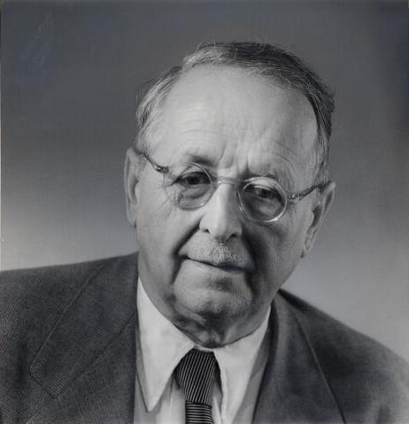
# Hermann Weyl
**First published Wed Sep 2, 2009; substantive revision Sat Jun 8, 2024**

Hermann Weyl was a great and versatile mathematician of the 20ᵗʰ century. His work had a vast range, encompassing analysis, algebra, number theory, topology, differential geometry, spacetime theory, quantum mechanics, and the foundations of mathematics. His scientific writing is informed by a rare literary and artistic sensibility—in his words, “Expression and shape mean almost more to me than knowledge itself”. He was unusual among scientists and mathematicians of his time in being attracted to idealist philosophy: his idealist leanings can be seen particularly in his work on the foundations of mathematics. In his youth, Kant’s doctrines made a great impression on him; later he was stirred both by Fichte’s metaphysical idealism and by Husserlian phenomenology. Although Weyl came to question the certainties claimed by idealism, he cleaved always to the primacy of intuition he had first learned from Kant, and to its expression by Fichte as the “inner light” of individual consciousness.

## 1. Life and Achievements

Hermann Weyl was born on 9 November 1885 in the small town of Elmshorn near Hamburg. In 1904 he entered Göttingen University, where his teachers included Hilbert, Klein and Minkowski. Weyl was particularly impressed with Hilbert’s lectures on number theory and resolved to study everything he had written. Hilbert’s work on integral equations became the focus of Weyl’s (1908) doctoral dissertation, written under Hilbert’s direction. In this and in subsequent papers Weyl made important contributions to the theory of self-adjoint operators. Virtually all of Weyl’s many publications during his stay in Göttingen until 1913 dealt with integral equations and their applications.

After Weyl’s (1910b) habilitation, he became a Privatdozent and was thereby entitled to give lectures at the University of Göttingen. Weyl chose to lecture on Riemann’s theory of algebraic functions during the winter semester of 1911–12. These lectures became the basis of Weyl’s (1913) first book *Die Idee der Riemannschen Fläche* (*The Concept of a Riemann Surface*). This work, in which function theory, geometry and topology are unified, constitutes the first modern and comprehensive treatment of Riemann surfaces. The work also contains the first construction of an abstract manifold. Emphasizing that the `points of the manifold’ can be quite arbitrary, Weyl based his definition of a general two-dimensional manifold or surface on an extension of the neighbourhood axioms that Hilbert (1902) had proposed for the definition of a plane. The work is indicative of Weyl’s exceptional gift for harmoniously uniting into a coherent whole a patchwork of distinct mathematical fields.

In 1913 Weyl was offered, and accepted, a professorship at the Eidgenössische Technische Hochschule—ETH (Swiss Federal Institute of Technology)—in Zürich. Weyl’s years in Zürich were extraordinarily productive and resulted in some of his finest work, especially in the foundations of mathematics and physics. When he arrived in Zürich in the fall of 1913, Einstein and Grossmann were struggling to overcome a difficulty in their effort to provide a coherent mathematical formulation of the general theory of relativity. Like Hilbert, Weyl appreciated the importance of a close relationship between mathematics and physics. It was therefore only natural that Weyl should become interested in Einstein’s theory and the potential mathematical challenges it might offer. Following the outbreak of the First World War, however, in May 1915 Weyl was called up for military service. But Weyl’s academic career was interrupted only briefly, since in 1916 he was exempted from military duties for reasons of health. In the meantime Einstein had accepted an offer from Berlin and had left Zürich in 1914. Einstein’s departure had weakened the theoretical physics program at the ETH and (as reported by Frei and Stammbach (1992, 26) the administration hoped that Weyl’s presence would alleviate the situation. But Weyl needed no external prompting to work in, and to teach, theoretical physics: his interest in the subject in general and, above all, in the theory of relativity, gave him more than sufficient motivation in that regard. Weyl decided to lecture on the general theory of relativity in the summer semester of 1917, and these lectures became the basis of his famous book *Raum-Zeit-Materie* (*Space-Time-Matter*) of 1918.

During 1917–24, Weyl directed his energies equally to the development of the mathematical and philosophical foundations of relativity theory, and to the broader foundations of mathematics. It is in these two areas that his philosophical erudition, nourished from his youth, manifests itself most clearly. The year 1918, the same year in which *Space-Time-Matter* appeared, also saw the publication of *Das Kontinuum* (*The Continuum*), a work in which Weyl constructs a new foundation for mathematical analysis free of what he had come to see as fatal flaws in the set-theoretic formulation of Cantor and Dedekind. Soon afterwards Weyl embraced Brouwer’s mathematical intuitionism; in the early 1920s he published a number of papers elaborating on and defending the intuitionistic standpoint in the foundations of mathematics.

It was also during the first years of the 1920s that Weyl came to appreciate the power and utility of group theory, initially in connection with his work on the solution to the Riemann-Helmholtz-Lie problem of space. Weyl analyzed this problem, the *Raumproblem*, in a series of articles and lectures during the period 1921–23. Weyl (1949b, 400) noted that his interest in the philosophical foundations of the general theory of relativity had motivated his analysis of the representations and invariants of the continuous groups:

> I can say that the wish to understand what really is the mathematical substance behind the formal apparatus of relativity theory led me to the study of the representations and invariants of groups; and my experience in this regard is probably not unique.

This newly acquired appreciation of group theory led Weyl to what he himself considered his greatest work in mathematics, a general theory of the representations and invariants of the classical Lie groups (Weyl 1924a, 1924f, 1925, 1926a, 1926b, 1926c). Later Weyl (1939) wrote a book, *The Classical Groups: Their Invariants and Representations*, in which he returned to the theory of invariants and representations of semisimple Lie groups. In this work he realized his ambition “to derive the decisive results for the most important of these groups by direct algebraic construction, in particular for the full group of all non-singular linear transformations and for the orthogonal group.”

Weyl applied his work in group theory and his earlier work in analysis and spectral theory to the new theory of quantum mechanics. Weyl’s mathematical analysis of the foundations of quantum mechanics showed that regularities in a physical theory are most fruitfully understood in terms of symmetry groups. Weyl’s (1928) book *Gruppentheorie und Quantenmechanik* (*Group Theory and Quantum Mechanics*) deals not only with the theory of quantum mechanics but also with relativistic quantum electrodynamics. In this work Weyl also presented a very early analysis of discrete symmetries which later stimulated Dirac to predict the existence of the positron and the antiproton.

During his years in Zürich Weyl received, and turned down, numerous offers of professorships by other universities—including an invitation in 1923 to become Felix Klein’s successor at Göttingen. It was only in 1930 that he finally accepted the call to become Hilbert’s successor there. His second stay in Göttingen was to be brief. Repelled by Nazism, “deeply revolted,” as he later wrote, “by the shame which this regime had brought to the German name,” he left Germany in 1933 to accept an offer of permanent membership of the newly founded Institute for Advanced Study in Princeton. Before his departure for Princeton he published *The Open World* (1932); his tenure there saw the publication of *Mind and Nature* (1934), the aforementioned *The Classical Groups* (1939), *Algebraic Theory of Numbers* (1940), *Meromorphic Functions and Analytic Curves* (1943), *Philosophy of Mathematics and Natural Science* (1949; an enlarged English version of a 1927 work *Philosophie der Mathematik und Naturwissenschaften*), and *Symmetry* (1952). In 1951 he formally retired from the Institute, remaining as an emeritus member until his death, spending half his time there and half in Zürich. He died in Zürich suddenly, of a heart attack, on 9 December 1955.

## 2. Metaphysics

Weyl was first and foremost a mathematician, and certainly not a “professional” philosopher. But as a German intellectual of his time it was natural for him to regard philosophy as a pursuit to be taken seriously. In Weyl’s case, unusually even for a German mathematician, it was idealist philosophy that from the beginning played a significant role in his thought. Kant, Husserl, Fichte, and, later, Leibniz, were at various stages major influences on Weyl’s philosophical thinking. As a schoolboy Weyl had been impressed by Kant’s “Critique of Pure Reason.” He was especially taken with Kant’s doctrine that space and time are not inherent in the objects of the world, existing as such and independently of our awareness, but are, rather, forms of our intuition As he reports in Insight and Reflection, (Weyl 1955), his youthful enthusiasm for Kant crumbled soon after he entered Göttingen University in 1904. There he read Hilbert’s Foundations of Geometry, a tour-de-force of the axiomatic method, in comparison to which Kant’s “bondage to Euclidean geometry” now appeared to him naïve. After this philosophical reverse he lapsed into an indifferent positivism for a while. But in 1912 he found a new and exciting source of philosophical enlightenment in Husserl’s phenomenology.[^note-1] It was also at about this time that Fichte’s metaphysical idealism came to “capture his imagination.” Although Weyl later questioned idealist philosophy, and became dissatisfied with phenomenology, he remained faithful throughout his life to the primacy of intuition that he had first learned from Kant, and to the irreducibility of individual consciousness that had been confirmed in his view by Fichte and Husserl.

Weyl never provided a systematic account of his philosophical views, and sorting out his overall philosophical position is no easy matter. Despite the importance of intuition and individual consciousness in Weyl’s philosophical outlook, it would nevertheless be inexact to describe his outlook as being that of a “pure” idealist, since certain “realist” touches seem also to be present, in his approach to physics, at least. His metaphysics appears to rest on three elements, the first two of which may be considered “idealist”, and the third “realist”: these are, respectively, the Ego or “I”, the (Conscious) Other or “Thou”, and the external or “objective” world.

It is the first of these constituents, the Ego, to which Weyl ascribes primacy. Indeed, in Weyl’s words,

> The world exists only as met with by an ego, as one appearing to a consciousness; the consciousness in this function does not belong to the world, but stands out against the being as the sphere of vision, of meaning, of image, or however else one may call it. (Weyl 1934, 1)

The Ego alone has direct access to the given, that is, to the raw materials of the existent which are presented to consciousness with an immediacy at once inescapable and irreducible. The Ego is singular in that, from its own standpoint, it is unique. But in an act of self-reflection, through grasping (in Weyl’s words) “what I am for myself”, the Ego comes to recognize that it has a *function*, namely as “conscious-existing carrier of the world of phenomena.” It is then but a short step for the Ego to transcend its singularity through the act of defining an “ego” to be an entity performing that same function *for itself*. That is, an ego is precisely what I am for myself (in other words, what the Ego is for itself)—again a “conscious-existing carrier of the world of phenomena”—and yet *other* than myself. “Thou” is the term the Ego uses to address, and so to identify, an ego in this sense. “Thou” is thus the Ego generalized, the Ego refracted through itself. The Ego grasps that it exists within a world of Thous, that is, within a world of other Egos similar to itself. While the Ego has, of necessity, no direct access to any Thou, it can, through analogy and empathy, grasp what it is to be Thou, a conscious being like oneself. By that very fact the Ego recognizes in the Thou the same luminosity it sees in itself.

The relationship of the Ego with the external world, the realm of “objective” reality, is of an entirely different nature. There is no analogy that the Ego can draw—as it can with the Thou—between itself and the external world, since that world (presumably) lacks consciousness. The external world is radically other, and opaque to the Ego[^note-2]. Like Kant’s noumenal realm, the external world is outside the immediacy of consciousness; it is, in a word, *transcendent*. Since this transcendent world is not directly accessible to the Ego, as far as the latter is concerned the existence of that world must arise through *postulation*, “a matter of metaphysics, not a judgment but an act of acknowledgment or belief.”[^note-3] Indeed, according to Weyl, it is not strictly necessary for the Ego to postulate the existence of such a world, even given the existence of a world of Thous:

For as long as I do not proceed beyond what is given, or, more exactly, what is given at the moment, there is no need for the substructure of an objective world. Even if I include memory and in principle acknowledge it as valid testimony, if I furthermore accept as data the contents of the consciousness of others on equal terms with my own, thus opening myself to the mystery of intersubjective communication, I would still not have to proceed as we actually do, but might ask instead for the ‘transformations’ which mediate between the images of the several consciousnesses. Such a presentation would fit in with Leibniz’s monadology. (Weyl 1949, 117.)

But once the existence of the transcendent world is postulated, its opacity to the Ego can be partly overcome by constructing a representation of it through the use of *symbols*, the procedure called by Weyl *symbolic construction*, (or *constructive cognition)*[^note-4] and which he regarded as the cornerstone of scientific explanation. He outlines the process as follows (Weyl 1934, 53):

1. Upon that which is given, certain reactions are performed by which the given is in general brought together with other elements capable of being varied arbitrarily. If the results to be read from these reactions are found to be independent of the variable auxiliary elements they are then introduced as attributes inherent in the things themselves (even if we do not actually perform those reactions on which their meaning rests, but only believe in the possibility of their being performed).
2. By the introduction of symbols, the judgements are split up and a part of the manipulations is made independent of the given and its duration by being shifted onto the representing symbols which are time resisting and simultaneously serve the purpose of preservation and communication. Thereby the unrestricted handling of notions arises in counterpoint to their application, ideas in a relatively independent manner confront reality.
3. Symbols are not produced simply “according to demand” wherever they correspond to actual occurrences, but they are embedded into an ordered manifold of possibilities created by free construction and open towards infinity. Only in this way may we contrive to predict the future, for the future is not given actually.

Weyl’s procedure thus amounts to the following. In step 1, a given configuration is subjected to variation. One then identifies those features of the configuration that remain unchanged under the variation—the *invariant* features; these are in turn, through a process of reification, deemed to be properties of an unchanging substrate—the “things themselves”. It is precisely the invariance of such features that renders them (as well as the “things themselves”) capable of being represented by the “time resisting” symbols Weyl introduces in step 2. As (written) symbols these are communicable without temporal distortion and can be subjected to unrestricted manipulation without degradation. It is the flexibility conferred thereby which enables the use of symbols to be conformable with reality. Nevertheless (step 3) symbols are not haphazardly created in response to immediate stimuli; they are introduced, rather, in a structured, yet freely chosen manner which reflects the idea of an underlying order—the “one real world”—about which not everything is, or can be, known—it is, like the future, “open towards infinity”. Weyl observes that the reification implicit in the procedure of symbolic construction leads inevitably to its iteration, for “the transition from step to step is made necessary by the fact that the objects at one step reveal themselves as manifestations of a higher reality, the reality of the next step” (Weyl (1934), 32–33). But in the end “systematic scientific explanation will finally reverse the order: first it will erect its symbolical world by itself, without any reference, then, skipping all intermediate steps, try to describe which symbolical configurations lead to which data of consciousness” (*ibid*.). In this way the symbolic world becomes (mistakenly) identified with the transcendent world.

It is symbolic construction which, in Weyl’s vision, allows us access to the “objective” world presumed to underpin our immediate perceptions; indeed, Weyl holds that the objective world, being beyond the grasp (the “lighted circle”) of intuition, can *only* be presented to us in symbolic form[^note-5]. We can see a double dependence on the Ego in Weyl’s idea of symbolic construction to get hold of an objective world beyond the mental. For not only is that world “constructed” by the Ego, but the materials of construction, the symbols themselves, as signs intended to convey meaning, have no independent existence beyond their graspability by a consciousness. By their very nature these symbols cannot point directly to an external world (even given an unshakable belief in the existence of that world) lying beyond consciousness. Weyl’s metaphysical triad thus reduces to what might be called a *polarized dualism*, with the mental (I, Thou) as the primary, independent pole and objective reality as a secondary, dependent pole[^note-6].

In Weyl’s view mathematics simply lies – as it did for Brouwer – within the Ego’s “lighted circle of intuition” and so is, in principle at least, completely presentable to that intuition. But the nature of physics is more complicated. To the extent that physics is linked to the transcendent world of objective reality, it cannot arise as the direct object of intuition, but must, like the transcendent world itself, be presented in symbolic form; more exactly, as the result of a process of symbolic construction. It is this which, in Weyl’s vision, allows us access to to the "objective" world presumed to underpin our immediate perceptions.

Weyl’s conviction that the objective world can only be presented to us through symbolic construction may serve to explain his apparently untroubled attitude towards the highly counterintuitive nature of quantum theory. Indeed, the claims of numerous physicists that the quantum microworld is accessible to us only through abstract mathematical description provides a vindication of Weyl’s thesis that objective reality cannot be grasped directly, but only through the mediation of symbols.

In his later years Weyl attempted to enlarge his metaphysical triad (I, Thou, objective world) to a tetrad, by a process of completion, as it were, to embrace the “godhead that lives in impenetrable silence”, the objective counterpart of the Ego, which had been suggested to him by his study of Eckhart. But this effort was to remain uncompleted.

During his long philosophical voyage Weyl stopped at a number of ports of call: in his youth, Kantianism and positivism; then Husserlian phenomenological idealism; later Brouwerian intuitionism and finally a kind of theological existentialism. But apart from his brief flirtation with positivism (itself, as he says, the result of a disenchantment with Kant’s “bondage to Euclidean geometry”), Weyl’s philosophical orientation remained in its essence idealist (even granting the significant realist elements mentioned above). Nevertheless, while he continued to acknowledge the importance of phenomenology, his remarks in *Insight and Reflection* indicate that he came to regard Husserl’s doctrine as lacking in two essential respects: first, it failed to give due recognition to the (construction of) transcendent external world, with which Weyl, in his capacity as a natural scientist, was concerned; secondly, and perhaps in Weyl’s view even more seriously, it failed to engage with the enigma of selfhood: the fact that I am the person I am. Grappling with the first problem led Weyl to identify symbolic construction as providing sole access to objective reality, a position which brought him close to Cassirer in certain respects; while the second problem seems to have led him to existentialism and even, through his reading of Eckhart, to a kind of religious mysticism.

## 3. Work in the foundations and philosophy of mathematics

Towards the end of his *Address on the Unity of Knowledge*, delivered at the 1954 Columbia University bicentennial celebrations, Weyl enumerates what he considers to be the essential constituents of knowledge. At the top of his list[^note-7] comes

> …intuition, mind’s ordinary act of seeing what is given to it. (Weyl 1954, 629)

In particular Weyl held to the view that intuition, or *insight*—rather than *proof*—furnishes the ultimate foundation of *mathematical* knowledge. Thus in his *Das Kontinuum* of 1918 he says:

> In the Preface to Dedekind (1888) we read that “In science, whatever is provable must not be believed without proof.” This remark is certainly characteristic of the way most mathematicians think. Nevertheless, it is a preposterous principle. As if such an indirect concatenation of grounds, call it a proof though we may, can awaken any “belief” apart from assuring ourselves through immediate insight that each individual step is correct. In all cases, this process of confirmation—and not the proof—remains the ultimate source from which knowledge derives its authority; it is the “experience of truth”. (Weyl 1987, 119)

Weyl’s idealism naturally inclined him to the view that the ultimate basis of his own subject, mathematics, must be found in the intuitively given as opposed to the transcendent. Nevertheless, he recognized that it would be unreasonable to require all mathematical knowledge to possess intuitive immediacy. In *Das Kontinuum*, for example, he says:

> The states of affairs with which mathematics deals are, apart from the very simplest ones, so complicated that it is practically impossible to bring them into full givenness in consciousness and in this way to grasp them completely. (*Ibid*., 17)

Nevertheless, Weyl felt that this fact, inescapable as it might be, could not justify extending the bounds of mathematics to embrace notions, such as the actual infinite, which cannot be given fully in intuition even in principle. He held, rather, that such extensions of mathematics into the transcendent are warranted only by the fact that mathematics plays an indispensable role in the physical sciences, in which intuitive evidence is necessarily transcended. As he says in The Open World[^note-8]:

> … if mathematics is taken by itself, one should restrict oneself with Brouwer to the intuitively cognizable truths … nothing compels us to go farther. But in the natural sciences we are in contact with a sphere which is impervious to intuitive evidence; here cognition necessarily becomes symbolical construction. Hence we need no longer demand that when mathematics is taken into the process of theoretical construction in physics it should be possible to set apart the mathematical element as a special domain in which all judgments are intuitively certain; from this higher standpoint which makes the whole of science appear as one unit, I consider Hilbert to be right. (Weyl 1932, 82).

In *Consistency in Mathematics* (1929), Weyl characterized the mathematical method as

> the a priori construction of the possible in opposition to the a posteriori description of what is actually given.[^note-9]

The problem of identifying the limits on constructing “the possible” in this sense occupied Weyl a great deal. He was particularly concerned with the concept of the mathematical *infinite*, which he believed to elude “construction” in the naive set-theoretical sense [^note-10]. Again to quote a passage from *Das Kontinuum:*

> No one can describe an infinite set other than by indicating properties characteristic of the elements of the set…. The notion that a set is a “gathering” brought together by infinitely many individual arbitrary acts of selection, assembled and then surveyed as a whole by consciousness, is nonsensical; “inexhaustibility” is essential to the infinite. (Weyl 1987, 23)

But still, as Weyl attests towards the end of *The Open World*, “the demand for totality and the metaphysical belief in reality inevitably compel the mind to represent the infinite as closed being by symbolical construction”. The conception of the completed infinite, even if nonsensical, is inescapable.

### 3.1 *Das Kontinuum*

Another mathematical “possible” to which Weyl gave a great deal of thought is the *continuum*. During the period 1918–1921 he wrestled with the problem of providing the mathematical continuum—the real number line—with a logically sound formulation. Weyl had become increasingly critical of the principles underlying the set-theoretic construction of the mathematical continuum. He had come to believe that the whole set-theoretical approach involved vicious circles[^note-11] to such an extent that, as he says, “every cell (so to speak) of this mighty organism is permeated by contradiction.” In *Das Kontinuum* he tries to overcome this by providing analysis with a *predicative* formulation—not, as Russell and Whitehead had attempted, by introducing a hierarchy of logically ramified types, which Weyl seems to have regarded as excessively complicated—but rather by confining the comprehension principle to formulas whose bound variables range over just the initial given entities (numbers). Accordingly he restricts analysis to what can be done in terms of natural numbers with the aid of three basic logical operations, together with the operation of substitution and the process of “iteration”, i.e., primitive recursion. Weyl recognized that the effect of this restriction would be to render unprovable many of the central results of classical analysis—e.g., Dirichlet’s principle that any bounded set of real numbers has a least upper bound[^note-12]—but he was prepared to accept this as part of the price that must be paid for the security of mathematics.

As Weyl saw it, there is an unbridgeable gap between intuitively given continua (e.g. those of space, time and motion) on the one hand, and the “discrete” exact concepts of mathematics (e.g. that of natural number[^note-13]) on the other. The presence of this chasm meant that the construction of the mathematical continuum could not simply be “read off” from intuition. It followed, in Weyl’s view, that the mathematical continuum must be treated as if it were an element of the transcendent realm, and so, in the end, justified in the same way as a physical theory. It was not enough that the mathematical theory be *consistent*; it must also be *reasonable*.

*Das Kontinuum* embodies Weyl’s attempt at formulating a theory of the continuum which satisfies the first, and, as far as possible, the second, of these requirements. In the following passages from this work he acknowledges the difficulty of the task:

> … the conceptual world of mathematics is so foreign to what the intuitive continuum presents to us that the demand for coincidence between the two must be dismissed as absurd. (Weyl 1987, 108)
>
> … the continuity given to us immediately by intuition (in the flow of time and of motion) has yet to be grasped mathematically as a totality of discrete “stages” in accordance with that part of its content which can be conceptualized in an exact way. (*Ibid*., 24)[^note-14]
>
> Exact time- or space-points are not the ultimate, underlying atomic elements of the duration or extension given to us in experience. On the contrary, only reason, which thoroughly penetrates what is experientially given, is able to grasp these exact ideas. And only in the arithmetico- analytic concept of the real number belonging to the purely formal sphere do these ideas crystallize into full definiteness. (*Ibid*., 94)
>
> When our experience has turned into a real process in a real world and our phenomenal time has spread itself out over this world and assumed a cosmic dimension, we are not satisfied with replacing the continuum by the exact concept of the real number, in spite of the essential and undeniable inexactness arising from what is given. (*Ibid*., 93)

As these quotations show, Weyl had come to accept that it was in principle impossible to furnish the continuum as presented to intuition with an exact mathematical formulation : so, with reluctance, he lowered his sights. In *Das Kontinuum* his goal was, first and foremost, to establish the *consistency* of the mathematical theory of the continuum by putting the *arithmetical* notion of real number on a firm logical basis. Once this had been achieved, he would then proceed to show that this theory is *reasonable* by employing it as the foundation for a plausible account of continuous process in the objective physical world.[^note-15]

In §6 of *Das Kontinuum* Weyl presents his conclusions as to the relationship between the intuitive and mathematical continua. He poses the question: Does the mathematical framework he has erected provide an adequate representation of physical or temporal continuity as it is *actually experienced*? In posing this question we can see the continuing influence of Husserl and phenomenological doctrine. Weyl begins his investigation by noting that, according to his theory, if one asks whether a given function is continuous, the answer is not fixed once and for all, but is, rather, dependent on the extent of the domain of real numbers which have been defined up to the point at which the question is posed. Thus the continuity of a function must always remain *provisional*; the possibility always exists that a function deemed continuous *now* may, with the emergence of “new” real numbers, turn out to be discontinuous *in the future*. [^note-16]

To reveal the discrepancy between this formal account of continuity based on real numbers and the properties of an intuitively given continuum, Weyl next considers the experience of seeing a pencil lying on a table before him throughout a certain time interval. The position of the pencil during this interval may be taken as a function of the time, and Weyl takes it as a fact of observation that during the time interval in question this function is continuous and that its values fall within a definite range. And so, he says,

> This observation entitles me to assert that during a certain period this pencil was on the table; and even if my right to do so is not absolute, it is nevertheless reasonable and well-grounded. It is obviously absurd to suppose that this right can be undermined by “an expansion of our principles of definition”—as if new moments of time, overlooked by my intuition could be added to this interval, moments in which the pencil was, perhaps, in the vicinity of Sirius or who knows where. If the temporal continuum can be represented by a variable which “ranges over” the real numbers, then it appears to be determined thereby how narrowly or widely we must understand the concept “real number” and the decision about this must not be entrusted to logical deliberations over principles of definition and the like. (Weyl 1987, 88)

To drive the point home, Weyl focuses attention on the fundamental continuum of *immediately given phenomenal time*, that is, as he characterizes it,

> … to that constant form of my experiences of consciousness by virtue of which they appear to me to flow by successively. (By “experiences” I mean what I experience, exactly as I experience it. I do not mean real psychical or even physical processes which occur in a definite psychic-somatic individual, belong to a real world, and, perhaps, correspond to the direct experiences.) (*Ibid*., 88)

In order to correlate mathematical concepts with phenomenal time in this sense Weyl grants the possibility of introducing a rigidly punctate “now” and of identifying and exhibiting the resulting temporal points. On the collection of these temporal points is defined the relation of *earlier than* as well as a congruence relation of *equality of temporal intervals*, the basic constituents of a simple mathematical theory of time. Now Weyl observes that the discrepancy between phenomenal time and the concept of real number would vanish if the following pair of conditions could be shown to be satisfied:

1. The immediate expression of the intuitive finding that during a certain period I saw the pencil lying there were construed in such a way that the phrase “during a certain period” was replaced by “in every temporal point which falls within a certain time span OE”. [Weyl goes on to say parenthetically here that he admits “that this no longer reproduces what is intuitively present, but one will have to let it pass, *if it is really legitimate to dissolve a period into temporal points*.”)
2. If $P$ is a temporal point, then the domain of rational numbers to which $l$ belongs if and only if there is a time point $L$ earlier than $P$ such that $$ OL = l{.}OE $$ can be constructed arithmetically in pure number theory on the basis of our principles of definition, and is therefore a real number in our sense. (*Ibid*., 89)

Condition 2 means that, if we take the time span $OE$ as a unit, then each temporal point $P$ is correlated with a definite real number. In an addendum Weyl also stipulates the converse.

But can temporal intuition itself provide evidence for the truth or falsity of these two conditions? Weyl thinks not. In fact, he states quite categorically that

> … everything we are demanding here is obvious nonsense: to these questions, the intuition of time provides no answer—just as a man makes no reply to questions which clearly are addressed to him by mistake and, therefore, are unintelligible when addressed to him. (*Ibid*., 90)

The grounds for this assertion are by no means immediately evident, but one gathers from the passages following it that Weyl regards the experienced *continuous flow* of phenomenal time as constituting an insuperable barrier to the whole enterprise of representing the continuum as experienced in terms of individual points, and even to the characterization of “individual temporal point” itself. As he says,

> The view of a flow consisting of points and, therefore, also dissolving into points turns out to be mistaken: precisely what eludes us is the nature of the continuity, the flowing from point to point; in other words, the secret of how the continually enduring present can continually slip away into the receding past. Each one of us, at every moment, directly experiences the true character of this temporal continuity. But, because of the genuine primitiveness of phenomenal time, we cannot put our experiences into words. So we shall content ourselves with the following description. What I am conscious of is for me both a being-now and, in its essence, something which, with its temporal position, slips away. In this way there arises the persisting factual extent, something ever new which endures and changes in consciousness. (*Ibid*., 91–92)

Weyl sums up what he thinks can be affirmed about “objectively presented time”—by which he presumably means “phenomenal time described in an objective manner”—in the following two assertions, which he claims apply equally, mutatis mutandis, to every intuitively given continuum, in particular, to the continuum of spatial extension. (*Ibid*., 92):

1. An individual point in it is non-independent, i.e., is pure nothingness when taken by itself, and exists only as a “point of transition” (which, of course, can in no way be understood mathematically);
2. It is due to the essence of time (and not to contingent imperfections in our medium) that a fixed temporal point cannot be exhibited in any way, that always only an approximate, never an exact determination is possible.

The fact that single points in a true continuum “cannot be exhibited” arises, Weyl asserts, from the fact that they are not genuine individuals and so cannot be characterized by their properties. In the physical world they are never defined absolutely, but only in terms of a coordinate system, which, in an arresting metaphor, Weyl describes as “the unavoidable residue of the eradication of the ego.” This metaphor, which Weyl was to employ more than once[^note-17], again reflects the continuing influence of phenomenological doctrine in his thinking : here, the thesis that the existent is given in the first instance as the contents of a consciousness.

### 3.2 Weyl and Brouwerian Intuitionism

By 1919 Weyl had come to embrace Brouwer’s views on the intuitive continuum. Given the idealism that always animated Weyl’s thought, this is not surprising, since Brouwer assigned the thinking subject a central position in the creation of the mathematical world[^note-18].

In his early thinking Brouwer had held that that the continuum is presented to intuition as a whole, and that it is impossible to construct all its points as individuals. But later he radically transformed the concept of “point”, endowing points with sufficient fluidity to enable them to serve as generators of a “true” continuum. This fluidity was achieved by admitting as “points”, not only fully defined discrete numbers such as 1/9, $e$, and the like—which have, so to speak, already achieved “being”—but also “numbers” which are in a perpetual state of “becoming” in that the entries in their decimal (or dyadic) expansions are the result of free acts of choice by a subject operating throughout an indefinitely extended time. The resulting choice sequences cannot be conceived as finished, completed objects: at any moment only an initial segment is known. Thus Brouwer obtained the mathematical continuum in a manner compatible with his belief in the primordial intuition of time—that is, as an unfinished, in fact unfinishable entity in a perpetual state of growth, a “medium of free development”. In Brouwer’s vision, the mathematical continuum is indeed “constructed”, not, however, by initially shattering, as did Cantor and Dedekind, an intuitive continuum into isolated points, but rather by assembling it from a complex of continually changing overlapping parts.

Brouwer’s impact looms large in Weyl’s 1921 paper, On the New Foundational Crisis of Mathematics. Here Weyl identifies two distinct views of the continuum: “atomistic” or “discrete”; and “continuous”. In the first of these the continuum is composed of individual real numbers which are well-defined and can be sharply distinguished. Weyl describes his earlier attempt at reconstructing analysis in Das Kontinuum as atomistic in this sense:

> Existential questions concerning real numbers only become meaningful if we analyze the concept of real number in this extensionally determining and delimiting manner. Through this conceptual restriction, an ensemble of individual points is, so to speak, picked out from the fluid paste of the continuum. The continuum is broken up into isolated elements, and the flowing-into-each other of its parts is replaced by certain conceptual relations between these elements, based on the “larger-smaller” relationship. This is why I speak of the *atomistic* conception of the continuum. (Weyl 1921, 91)

By this time Weyl had repudiated atomistic theories of the continuum, including that of Das Kontinuum.[^note-19] While intuitive considerations, together with Brouwer’s influence, must certainly have fuelled Weyl’s rejection of such theories, it also had a logical basis. For Weyl had come to regard as meaningless the formal procedure—employed in Das Kontinuum—of negating universal and existential statements concerning real numbers conceived as developing sequences or as sets of rationals. This had the effect of undermining the whole basis on which his theory had been erected, and at the same time rendered impossible the very formulation of a “law of excluded middle” for such statements. Thus Weyl found himself espousing a position[^note-20] considerably more radical than that of Brouwer, for whom negations of quantified statements had a perfectly clear constructive meaning, under which the law of excluded middle is simply not generally affirmable.

Of existential statements Weyl says:

> An existential statement—e.g., “there is an even number”—is not a judgement in the proper sense at all, which asserts a state of affairs; existential states of affairs are the empty invention of logicians. (Weyl [1921], 97)

Weyl termed such pseudostatements “judgment abstracts”, likening them, with typical literary flair, to “a piece of paper which announces the presence of a treasure, without divulging its location.” Universal statements, although possessing greater substance than existential ones, are still mere intimations of judgments, “judgment instructions”, for which Weyl provides the following metaphorical description:

> If knowledge be compared to a fruit and the realization of that knowledge to the consumption of the fruit, then a universal statement is to be compared to a hard shell filled with fruit. It is, obviously, of some value, however, not as a shell by itself, but only for its content of fruit. It is of no use to me as long as I do not open it and actually take out a fruit and eat it. (*Ibid*., 98)

Above and beyond the claims of logic, Weyl welcomed Brouwer’s construction of the continuum by means of sequences generated by free acts of choice, thus identifying it as a “medium of free Becoming” which “does not dissolve into a set of real numbers as finished entities”. Weyl felt that Brouwer, through his doctrine of Intuitionism[^note-21], had come closer than anyone else to bridging that “unbridgeable chasm” between the intuitive and mathematical continua. In particular, he found compelling the fact that the Brouwerian continuum is not the union of two disjoint nonempty parts—that it is, in a word, indecomposable. “A genuine continuum,” Weyl says, “cannot be divided into separate fragments.”[^note-22] In later publications he expresses this more colourfully by quoting Anaxagoras to the effect that a continuum “defies the chopping off of its parts with a hatchet.”

Weyl also agreed with Brouwer that all functions everywhere defined on a continuum are continuous, but here certain subtle differences of viewpoint emerge. Weyl contends that what mathematicians had taken to be discontinuous functions actually consist of several continuous functions defined on separated continua. In Weyl’s view, for example, the “discontinuous” function defined by $f(x) = 0$ for $x \lt 0$ and $f(x) = 1$ for $x \ge 0$ in fact consists of the *two* functions with constant values and 1 respectively defined on the separated continua $\{x: x \lt 0\}$ and $\{x: x \ge 0\}$. (The union of these two continua fails to be the whole of the real continuum because of the failure of the law of excluded middle: it is not the case that, for be any real number $x$, either $x \lt 0$ or $x \ge 0$.) Brouwer, on the other hand, had not dismissed the possibility that discontinuous functions could be defined on proper parts of a continuum, and still seems to have been searching for an appropriate way of formulating this idea.[^note-23] In particular, at that time Brouwer would probably have been inclined to regard the above function $f$ as a genuinely discontinuous function defined on a proper part of the real continuum. For Weyl, it seems to have been a self-evident fact that all functions defined on a continuum are continuous, but this is because Weyl confines attention to functions which turn out to be continuous by definition. Brouwer’s concept of function is less restrictive than Weyl’s and it is by no means immediately evident that such functions must always be continuous.

Weyl defined real functions as mappings correlating each interval in the choice sequence determining the argument with an interval in the choice sequence determining the value “interval by interval” as it were, the idea being that approximations to the input of the function should lead effectively to corresponding approximations to the input. Such functions are continuous by definition. Brouwer, in contrast, considers real functions as correlating choice sequences with choice sequences, and the continuity of these is by no means obvious. The fact that Weyl refused to grant (free) choice sequences—whose identity is in no way predetermined—sufficient individuality to admit them as arguments of functions betokens a commitment to the conception of the continuum as a “medium of free Becoming” even deeper, perhaps, than that of Brouwer.

There thus being only minor differences between Weyl’s and Brouwer’s accounts of the continuum, Weyl accordingly abandoned his earlier attempt at the reconstruction of analysis, and joined Brouwer. He explains:

> I tried to find solid ground in the impending state of dissolution of the State of analysis (which is in preparation, although still only recognized by few)without forsaking the order on which it is founded, by carrying out its fundamental principle purely and honestly. And I believe I was successful—as far as this is possible. For *this order is itself untenable*, as I have now convinced myself, and Brouwer—that is the revolution!… It would have been wonderful had the old dispute led to the conclusion that the atomistic conception as well as the continuous one can be carried through. Instead the latter triumphs for good over the former. It is Brouwer to whom we owe the new solution of the continuum problem. History has destroyed again from within the provisional solution of Galilei and the founders of the differential and the integral calculus. (Weyl 1921, 98–99)

Weyl’s initial enthusiasm for intuitionism seems later to have waned. This may have been due to a growing belief on his part that the mathematical sacrifices demanded by adherence to intuitionistic doctrine (e.g., the abandonment of the least upper bound principle, and other important results of classical analysis) would prove to be intolerable to practicing mathematicians. Witness this passage from *Philosophy of Mathematics and Natural Science*:

> Mathematics with Brouwer gains its highest intuitive clarity. He succeeds in developing the beginnings of analysis in a natural manner, all the time preserving the contact with intuition much more closely than had been done before. It cannot be denied, however, that in advancing to higher and more general theories the inapplicability of the simple laws of classical logic eventually results in an almost unbearable awkwardness. And the mathematician watches with pain the greater part of his towering edifice which he believed to be built of concrete blocks dissolve into mist before his eyes. (Weyl [1949], 54)

Nevertheless, it is likely that Weyl remained convinced to the end of his days that intuitionism, despite its technical “awkwardness”, came closest, of all mathematical approaches, to capturing the essence of the continuum.

### 3.3 Weyl and Hilbert

Weyl’s espousal of the intuitionistic standpoint in the foundations of mathematics in 1920–21 inevitably led to friction with his old mentor Hilbert. Hilbert’s conviction had long been that there were in principle no limitations on the possibility of a full scientific understanding of the natural world, and, analogously, in the case of mathematics, that once a problem was posed with the required precision, it was, at least in principle, soluble. In 1904 he was moved to respond to Emil du Bois-Reymond’s famous declaration concerning the limits of science, ignoramus et ignorabimus (“we are ignorant and we shall remain ignorant”):

> We hear within us the perpetual call. There is the problem. Seek the solution. You can find it by pure reason, for in mathematics there is no ignorabimus.[^note-24]

Hilbert was unalterably opposed to any restriction of mathematics “by decree”, an obstacle he had come up against in the early stages of his career in the form of Leopold Kronecker’s (the influential 19ᵗʰ century German mathematician) anathematization of all mathematics venturing beyond the finite. In Brouwer’s intuitionistic program—with its draconian restrictions on what was admissible in mathematical argument, in particular, its rejection of the law of excluded middle, “pure” existence proofs, and virtually the whole of Cantorian set theory—Hilbert saw the return of Kroneckerian constaints on mathematics (and also, perhaps, a trace of du Bois-Reymond’s “ignorabimus”) against which he had struggled for so long. Small wonder, then, that Hilbert was upset when Weyl joined the Brouwerian camp.[^note-25]

Hilbert’s response was to develop an entirely new approach to the foundations of mathematics with the ultimate goal of establishing beyond doubt the consistency of the whole of classical mathematics, including arithmetic, analysis, and Cantorian set theory. With the attainment of that goal, classical mathematics would be placed securely beyond the destructive reach of the intuitionists. The core of Hilbert’s program was the translation of the whole apparatus of classical mathematical demonstration into a simple, finitistic framework (which he called “metamathematics”) involving nothing more, in principle, than the straightforward manipulation of symbols, taken in a purely formal sense, and devoid of further meaning.[^note-26] Within metamathematics itself, Hilbert imposed a standard of demonstrative evidence stricter even than that demanded by the intuitionists, a form of finitism rivalling (ironically) that of Kronecker. The demonstration of the consistency of classical mathematics was then to be achieved by showing, within the constraints of strict finitistic evidence insisted on by Hilbert, that the formal metamathematical counterpart of a classical proof in that system can never lead to an assertion evidently false, such as $0 = 1$.

Hilbert’s program rested on the insight that, *au fond*, the only part of mathematics whose reliability is entirely beyond question is the *finitistic*, or *concrete* part: in particular, finite manipulation of surveyable domains of distinct objects including mathematical symbols presented as marks on paper. Mathematical propositions referring only to concrete objects in this sense Hilbert called *real*, *concrete*, or *contentual* propositions, and all other mathematical propositions he distinguished as possessing an *ideal*, or *abstract* character. (Thus, for example, $2 + 2 = 4$ would count as a real proposition, while *there exists an odd perfect number* would count as an ideal one.) Hilbert viewed ideal propositions as akin to the ideal lines and points “at infinity” of projective geometry. Just as the use of these does not violate any truths of the “concrete” geometry of the usual Cartesian plane, so he hoped to show that the use of ideal propositions—even those of Cantorian set theory—would never lead to falsehoods among the real propositions, that, in other words, such use *would never contradict any self-evident fact about concrete objects*. Establishing this by strictly concrete, and so unimpeachable means was thus the central aim of Hilbert’s program. Hilbert may be seen to have followed Kant in attempting to ground mathematics on the apprehension of spatiotemporal configurations; but Hilbert restricted these configurations to concrete signs (such as inscriptions on paper). Hilbert regarded consistency as the touchstone of existence, and so for him the important thing was the fact that no inconsistencies can arise within the realm of concrete signs, since correct descriptions of concrete objects are always mutually compatible. In particular, within the realm of concrete signs, actual infinity cannot generate inconsistencies since, again along with Kant, he held that this concept cannot correspond to any concrete object. Hilbert’s view seems accordingly to have been that the formal soundness of mathematics issues ultimately, not from a *logical* source, but from a *concrete* one[^note-27], in much the same way as the consistency of truly reported empirical statements is guaranteed by the concreteness of the external world[^note-28].

Weyl soon grasped the significance of Hilbert’s program, and came to acknowledge its “immense significance and scope”[^note-29]. Whether that program could be successfully carried out was, of course, still an open question. But independently of this issue Weyl was concerned about what he saw as the loss of content resulting from Hilbert’s thoroughgoing formalization of mathematics. “Without doubt,” Weyl warns, “if mathematics is to remain a serious cultural concern, then some *sense* must be attached to Hilbert’s game of formulae.” Weyl thought that this sense could only be supplied by “fusing” mathematics and physics so that “the mathematical concepts of number, function, etc. (or Hilbert’s symbols) generally partake in the theoretical construction of reality in the same way as the concepts of energy, gravitation, electron, etc.”[^note-30] Indeed, in Weyl’s view, “it is the function of mathematics to be at the service of the natural sciences”. But still:

> The propositions of theoretical physics… lack that feature which Brouwer demands of the propositions of mathematics, namely, that each should carry within itself its own intuitively comprehensible meaning…. Rather, what is tested by confronting theoretical physics with experience is the system as a whole. It seems that we have to differentiate between phenomenal knowledge or insight—such as is expressed in the statement: “This leaf (given to me in a present act of perception) has this green color (given to me in this same perception)”—and theoretical construction. Knowledge furnishes truth, its organ is “seeing” in the widest sense. Though subject to error, it is essentially definitive and unalterable. Theoretical construction seems to be bound only to one strictly formulable rational principle, concordance, which in mathematics, where the domain of sense data remains untouched, reduces to consistency; its organ is creative imagination. (Weyl 1949, 61–62)

Weyl points out that, just as in theoretical physics, Hilbert’s account of mathematics “already… goes beyond the bounds of intuitively ascertainable states of affairs through… ideal assumptions.” (Weyl 1927, 484.) If Hilbert’s realm of contentual or “real” propositions—the domain of metamathematics—corresponds to that part of the world directly accessible to what Weyl terms “insight” or “phenomenal knowledge”, then “serious” mathematics—the mathematics that practicing mathematicians are actually engaged in doing—corresponds to Hilbert’s realm of “ideal” propositions. Weyl regarded this realm as the counterpart of the domain generated by “symbolic construction”, the transcendent world focussed on by theoretical physics. Hence his memorable characterization:

> The set-theoretical approach is the stage of naive realism which is unaware of the transition from the given to the transcendent. Brouwer represents idealism, by demanding the reduction of all truth to the intuitively given. In [Hilbert’s] formalism, finally, consciousness makes the attempt to “jump over its own shadow”, to leave behind the stuff of the given, to represent the transcendent—but, how could it be otherwise?, only through the symbol. (Weyl 1949, 65–66)

In Weyl’s eyes, Hilbert’s approach embodied the “symbolic representation of the transcendent, which demands to be satisfied”, and so he regarded its emergence as a natural development. But by 1927 Weyl saw Hilbert’s doctrine as beginning to prevail over intuitionism, and in this an adumbration of *“a decisive defeat of the philosophical attitude of pure phenomenology*, which thus proves to be insufficient for the understanding of creative science even in the area of cognition that is most primal and most readily open to evidence—mathematics.”[^note-31] Since by this time Weyl had become convinced that “creative science” must *necessarily* transcend what is phenomenologically given, he had presumably already accepted that pure phenomenology is incapable of accounting for theoretical physics, let alone the whole of existence. But it must have been painful for him to concede the analogous claim in the case of *mathematics*. In 1932, he asserts: “If mathematics is taken by itself, one should restrict oneself with Brouwer to the intuitively cognizable truths … nothing compels us to go farther.” If mathematics could be “taken by itself”, then there would be no need for it to justify its practices by resorting to “symbolic construction”, to employ symbols which in themselves “signify nothing”—nothing, at least, accessible to intuition. But, unlike Brouwer, Weyl seems finally to have come to terms with the idea that mathematics could not simply be “taken by itself”, that it has a larger role to play in the world beyond its service as a paradigm, however pure, of subjective certainty.

The later impact of Gödel’s incompleteness theorems on Hilbert’s program led Weyl to remark in 1949:[^note-32]

> The ultimate foundations and the ultimate meaning of mathematics remain an open problem; we do not know in what direction it will find its solution, nor even whether a final objective answer can be expected at all. “Mathematizing” may well be a creative activity of man, like music, the products of which not only in form but also in substance defy complete objective rationalization. The undecisive outcome of Hilbert’s bold enterprise cannot fail to affect the philosophical interpretation. (Weyl 1949, 219)

The fact that “Gödel has left us little hope that a formalism wide enough to encompass classical mathematics will be supported by a proof of consistency” seems to have led Weyl to take a renewed interest in “axiomatic systems developed before Hilbert without such ambitious dreams”, for example Zermelo’s set theory, Russell’s and Whitehead’s ramified type theory and Hilbert’s own axiom systems for geometry (as well, possibly, as Weyl’s own system in *Das Kontinuum*, which he modestly fails to mention). In one of his last papers, *Axiomatic Versus Constructive Procedures in Mathematics*, written sometime after 1953, he saw the battle between Hilbertian formalism and Brouwerian intuitionism in which he had participated in the 1920s as having given way to a “dextrous blending” of the axiomatic approach to mathematics championed by Bourbaki and the algebraists (themselves mathematical descendants of Hilbert) with constructive procedures associated with geometry and topology.

It seems appropriate to conclude this account of Weyl’s work in the foundations and philosophy of mathematics by allowing the man himself to have the last word:

> This history should make one thing clear: we are less certain than ever about the ultimate foundations of (logic and) mathematics; like everybody and everything in the world today, we have our “crisis”. We have had it for nearly fifty years. Outwardly it does not seem to hamper our daily work, and yet I for one confess that it has had a considerable practical influence on my mathematical life: it directed my interests to fields I considered relatively “safe”, and it has been a constant drain on my enthusiasm and determination with which I pursued my research work. The experience is probably shared by other mathematicians who are not indifferent to what their scientific endeavours mean in the contexts of man’s whole caring and knowing, suffering and creative existence in the world. (Weyl 1946, 13)

## 4. Contributions to the Foundations of Physics

### 4.1 Spacetime Geometries and Weyl’s Unified Field Theory

Weyl’s clarification of the role of coordinates, invariance or symmetry principles, his important concept of gauge invariance, his group-theoretic results concerning the uniqueness of the Pythagorean form of the metric, his generalization of Levi-Civita’s concept of parallelism, his development of the geometry of paths, his discovery of the causal-inertial method which prepared the way to empirically determine the spacetime metric in a non-circular, non-conventional manner, his deep analysis of the concept of motion and the role of Mach’s Principle, are but a few examples of his important contributions to the philosophical and mathematical foundations of modern spacetime theory.

Weyl’s book, *Raum-Zeit-Materie*, beautifully exemplifies the fruitful and harmonious interplay of mathematics, physics and philosophy. Here Weyl aims at a mathematical and philosophical elucidation of the problem of space and time in general. In the preface to the great classical work of 1923, the fifth German edition, after mentioning the importance of mathematics to his work, Weyl says:

> Despite this, the book does not disavow its basic, philosophical orientation: its central focus is *conceptual analysis*; physics provides the experiential basis, mathematics the sharp tools. In this new edition, this tendency has been further strengthened; although the growth of speculation was trimmed, the supporting foundational ideas were more intuitively, more carefully and more completely developed and analyzed.

#### 4.1.1 Weyl’s metric-independent construction of the symmetric linear connection

Extending and abstracting from Gauss’s treatment of curved surfaces in Euclidian space, Riemann constructed an infinitesimal geometry of $n$-dimensional manifolds. The coordinate assignments $x^{k}(p)\ [k \in \{1, \ldots ,n\}$] of the points $p$ in such an $n$-dimensional Riemannian manifold are quite arbitrary, subject only to the requirement of arbitrary differential coordinate transformations.[^note-33] Riemann’s assumption that in an infinitesimal neighbourhood of a point, Euclidean geometry and hence Pythagoras’s theorem holds, finds its formal expression in Riemann’s equation

$$\tag{1} ds^2 = \sum_{i,j} g_{ij}(x^{k}(p))dx^{i}dx^{j}\ [\text{where } g_{ij}(x^{k}(p)) = g_{ji}(x^{k}(p))] $$

for the square of the length $ds$ of an infinitesimal line element that leads from the point $p = x(p) = (x^{1}(p), \ldots ,x^{n}(p))$ to an arbitrary infinitely near point $p' = x(p') = (x^{1}(p) + dx^{1}(p), \ldots ,x^{n}(p) + dx^{n}(p))$.

The assumption that Euclidean geometry holds in the infinitesimally small means that the $dx^{i}(p)$ transform *linearly* under arbitrary coordinate transformations. Using the *Einstein summation* *convention*[^note-34], equation (1) can simply be written as

$$\tag{2} ds^{2} = g_{ij}(x^{k}(p))dx^{i}dx^{j}. $$

Riemann assumed the validity of the Pythagorean metric only in the infinitely small. Riemannian geometry is essentially a geometry of infinitely near points and conforms to the requirement that all laws are to be formulated as *field* laws. Field laws are *close-action-laws* which relate the field magnitudes only to infinitesimally neighbouring points in space.[^note-35] The value of some field magnitude at each point depends only on the values of other field magnitudes in the infinitesimal neighbourhoods of the corresponding points. The field magnitudes consist of partial derivatives of position functions at some point, and this requires the knowledge of the behavior of the position functions only with respect to the neighbourhood of that point[^note-36] To construct a field law, only the behavior of the world in the infinitesimally small is required.[^note-37]

Riemann’s ideas were brought to a concrete realization fifty years later in Einstein’s general theory of relativity. The basic idea underlying the general theory of relativity was Einstein’s recognition that the metric field, which has such powerful real effects on matter, cannot be a rigid once and for all given geometric structure of the spacetime, but must itself be something real, that not only has effects on matter, but is in turn also affected by matter. Riemann had already suggested that analogous to the electromagnetic field, the metric field reciprocally interacts with matter. Einstein came to this idea of reciprocity between matter and field independently of Riemann, and in the context of his theory of general relativity, applied this principle of reciprocity to four dimensional spacetime. Thus Einstein could adopt Riemann’s infinitesimal geometry with the important difference: given the causal requirements of Einstein’s theory of special relativity, Riemann’s quadratic form is not positive definite but indefinite; it has signature 1.[^note-38] Weyl (1922a) says:

> All our considerations until now were based on the assumption, that the metric structure of space is something that is fixed and given. Riemann already pointed to another possibility which was realized through General Relativity. The metrical structure of the extensive medium of the external world is a field of physical reality, which is causally dependent on the state of matter.

And in another place Weyl (1918b) remarks:

> The metric is not a property of the world [spacetime] in itself, rather spacetime as a form of appearance is a completely formless four-dimensional continuum in the sense of analysis situs, but the metric expresses something real, something which exists in the world, which exerts through centrifugal and gravitational forces physical effects on matter, and whose state is conversely conditioned through the distribution and nature of matter.

After Einstein applied Riemannian geometry to his theory of general relativity, Riemannian geometry became the focus of intense research. In particular, G. Ricci and T. Levi-Civita’s so-called *Absolute Differential Calculus* developed and clarified the Riemannian notions of an *affine connection* and *covariant differentiation*. The decisive step in this development, however, was T. Levi-Civita’s discovery in 1917 of the concept of *infinitesimal parallel vector displacement*, and the fact that such parallel vector displacement is uniquely determined by the metric field of Riemannian geometry. Levi-Civita’s construction of infinitesimal parallel transport on a manifold required the process of embedding the manifold into a flat higher-dimensional metric space. In 1918, Weyl generalized Levi-Civita’s concept of parallel transport by means of an *intrinsic* construction that does not require the process of such an embedding, and is therefore independent of a metric. Weyl’s intrinsic construction results in a *metric-independent, symmetric linear connection*. Weyl simply referred to the latter as *affine* *connection*.[^note-39]

Weyl defines what he means by an *affine connection* in the following way: A point $p$ on the manifold $M$ is affinely connected with its immediate neighborhood, if and only of for every tangent vector $v_{p}$ at $p$, a tangent vector $v_{q}$ at $q$ is determined to which the tangent vector $v_{p}$ gives rise under parallel displacement from $p$ to the infinitesimally neighboring point $q$. This definition merely says that a manifold is affinely connected if it admits the process of infinitesimal parallel displacement of a vector.

Weyl’s next definition characterizes the *essential nature* of infinitesimal parallel displacement. The definition says that at any arbitrary point of the manifold there exists a *geodesic coordinate system* such that the components of any vector at that point are not altered by an infinitesimal parallel displacement with respect to it. This is a geometrical way of expressing Einstein’s requirement that the gravitational field can always be made to vanish locally. According to Weyl (1923b, 115), it characterizes the *nature* of an affine connection on the manifold. A manifold which is an affine manifold is homogeneous in this sense. Moreover, manifolds do not exist whose affine structure is of a different *nature*.

The transport of a tangent vector $v_{p}$ at $p$ to an infinitesimally nearby point $q$ results in the tangent vector $v_{q}$ at $q$, namely,

$$\tag{3} v_{q} = v_{p} + dv_{p}. $$

This infinitesimal tangent vector transport Weyl defines as *infinitesimal parallel displacement* if and only if there exists a coordinate system $\overline{x}$, called a *geodesic coordinate system* for the neighborhood of $p$, relative to which the transported tangent vector $\overline{v}_{q}$ at $q$ possesses the same components as the original tangent vector $\overline{v}_{p}$ at $p$; that is,

$$\tag{4} \overline{v}^{\,i}_q - \overline{v}^{\,i}_p = d\overline{v}^{\,i}_p = 0. $$

*Figure 1:*

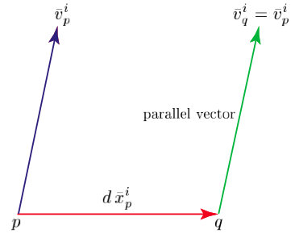

Figure 1: Parallel transport in a geodesic coordinate system $\overline{x}$

For an arbitrary coordinate system $x$ the components $dv^{\,i}_p$ vanish whenever $v^{\,i}_p$ or $dx^{\,i}_p$ vanish. Consequently, $dv^{\,i}_p$ is *bi-linear* in $v^{\,i}_p$ and $dx^{\,i}_p$; that is,

$$\tag{5} dv^{\,i}_p = -\Gamma^{\,i}_{jk}(x^i(p))v^{\,i}_p dx^{\,k}_p, $$

where, in the case of four dimensions, the $4^{3} = 64$ coefficients $\Gamma^{\,i}_{jk} (x^{i}(p))$ are coordinate functions, that is, functions of $x^{i}(p)$ $(i = 1, \ldots, 4)$, and the minus sign is introduced to agree with convention.

*Figure 2:*

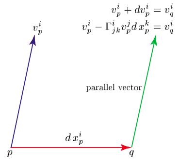

Figure 2: Parallel transport in an arbitrary coordinate system $x$

It is important to understand that there is no intrinsic notion of infinitesimal parallel displacement on a differentiable manifold. A notion of “parallelism” is not something that a manifold would possess merely by virtue of being a smooth manifold; additional structure has to be introduced which resides on the manifold and which permits the notion of infinitesimal parallelism. A manifold is an “affine manifold” $(M, \Gamma)$ if in addition to its manifold structure (differential topological structure) it is also endowed with an affine structure $\Gamma$ that assigns to each of its points 64 coefficients $\Gamma^{i}_{jk} (x^{i}(p))$ satisfying the symmetry condition $\Gamma^{i}_{jk} (x^{i}(p)) = \Gamma^{i}_{kj} (x^{i}(p))$.

An $n$-dimensional manifold $M$, which is an affinely connected manifold, Weyl (1918b) interprets physically as an $n$-dimensional world (spacetime) filled with a gravitational field. Weyl says, “…the affine connection appears in physics as the *gravitational field*…” Since there exists at each spacetime point a geodesic coordinate system in which the components $\Gamma^{i}_{jk}$ of the symmetric linear connection vanish, the gravitational field can be made to vanish at each point of the manifold.

The *classical theory of physical geometry*, developed by Helmholtz, Poincaré and Hilbert, regarded the concept of “metric congruence” as the only basic relation of geometry, and constructed physical geometry from this one notion alone in terms of the relative positions and displacements of physical congruence standards. Although Einstein’s general theory of relativity championed a *dynamical view of spacetime geometry* that is very different from the *classical theory of physical geometry*, Einstein initially approached the problem of the structure of spacetime from the metrical point of view. It was Weyl (1923b) who emphasized and developed the metric-independent construction of the symmetric linear connection and who pointed out the rationale for doing so. In both the non-relativistic and relativistic contexts, it is the symmetric linear connection, and not the metric, which plays the essential role in the formulation of all physical laws that are expressed in terms of differential equations. It is the symmetric linear connection that relates the state of a system at a spacetime point to the states at neighboring spacetime events and enters into the differentials of the corresponding magnitudes. In both Newtonian physics and the theory of general relativity, all dynamical laws presuppose the projective and affine structure and hence the Law of Inertia. In fact, the whole of tensor analysis with its covariant derivatives is based on the affine concept of infinitesimal *parallel displacement* and *not* on the metric.

Weyl’s metric independent construction not only led to a deeper understanding of the mathematical characterization of gravity, it also prepared the way for new constructions and generalizations in differential geometry and the general theory of relativity. In particular, it led to

1. The development of the *geometry of paths*, first introduced by Weyl in 1918.
2. Weyl’s discovery of the *causal-inertial method* which prepared the way to empirically determine the spacetime metric in a non-circular, non-conventional manner.
3. Weyl’s generalization of Riemannian geometry in his attempt to unify gravity and electromagnetism.
4. Weyl’s introduction of the concept of gauge in the context of his attempt to unify gravity and electromagnetism.

For more detail on Weyl’s metric independent construction of the affine connection (linear symmetric connection), see [the supplement](weyl.supplement.md).

#### 4.1.2 Projective Geometry or the Geometry of Paths

Weyl’s metric-independent construction of the affine structure led to the development of differential *projective* geometries or the *geometries of paths.* The interest in projective geometry is in the *paths*, that is, in the continuous set of points of the *image set of curves*, rather than in the possible parameter descriptions of curves. A curve has one degree of freedom; it depends on one parameter, and its image set or path is a one-dimensional continuous set of points of the manifold. One represents a *curve* on a manifold $M$ as a smooth map (i.e., $C^{\infty})$ $\gamma$ from some open interval $I = (-\varepsilon, \varepsilon)$ of the real line $\mathbb{R}$ into $M$.

*Figure 3:*

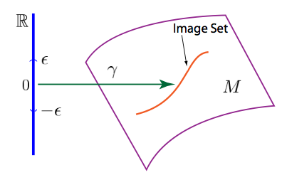

Figure 3: A curve on the manifold $M$ is the smooth map $\gamma : I \subset \mathbb{R} \rightarrow M$

It is important to understand that what one means by a “curve” is the map (the parametric description) itself, and *not* the set of its image points, the path. Consequently, two curves are mathematically considered to be different curves if they are given by different maps (different parameter descriptions), *even if their image set, that is, their path, is the same*. If we change a curve’s parameter description we change the curve but not its image set (its path), the points it passes through. A path is therefore sometimes defined as an equivalence class of curves under arbitrary parameter transformations. Hence, projective geometry may be defined as an equivalence class of affine geometries.

A geodesic curve in *flat space* is a straight line. Its tangent at one point is parallel to the tangent at previous or subsequent points. A straight line in Euclidean space is the only curve that parallel-transports its own tangent vector. This notion of parallel transport of the tangent vector also characterizes geodesic curves in *curved space*. That is, a curve $\gamma$ in curved space, which parallel-transports its own tangent vector along all of its points, is called a *geodesic* curve. Given a manifold with an affine structure and some arbitrary local coordinate system, the coordinate functions (components) $\gamma^{i}$ of a geodesic curve $\gamma$ satisfy the second-order non-linear differential equations

$$\tag{6} \frac{d^2\gamma^i}{ds^2} + \Gamma^{i}_{jk} \frac{d\gamma^j}{ds} \frac{d\gamma^k}{ds} = 0. $$

One may characterize the *projective geometry* $\Pi$ on an affine manifold either in terms of an equivalence class of geodesic curves under arbitrary parameter diffeomorphisms[^note-40], thereby eliminating all the parameter descriptions and hence all possible notions of distance along the curves satisfying (6),[^note-41] or one may take the process of *autoparallelism of directions* as fundamental in defining a projective structure.

*Figure 4:*

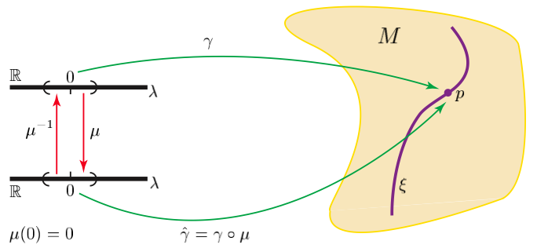

Figure 4: A path $\xi$ is an equivalence class [$\gamma$] of curves under all parameter diffeomorphisms $\mu: \mathbb{R} \rightarrow \mathbb{R}; \lambda \mapsto \mu(\lambda)$

Weyl took the latter approach. According to Weyl, the infinitesimal process of parallel displacements of vectors contains, as a special case, the infinitesimal displacement of a *direction* into its own *direction*. Such an infinitesimal autoparallelism of *directions* is characteristic of the projective structure of an affinely connected manifold.

**Infinitesimal Autoparallelism of a Direction:** An *infinitesimal autoparallelism of a direction* $R$ at an arbitrary point $p$ consists in the parallel displacement of $R$ at $p$ to a neighbouring point $p'$ which lies in the direction $R$ at $p$.

A curve is geodesic if and only if its *tangent direction* $R$ experiences infinitesimal autoparallelism when moved along all the points of the curve. This characterization of a geodesic curve constitutes an abstraction from affine geometry. Through this abstraction, a geodesic curve is definable exclusively in terms of autoparallelism of tangent *directions*, and not tangent *vectors*. Roughly speaking, an affine geometry is essentially a projective geometry with the notion of distance defined along the curves. By eliminating all possible notions of distance along curves, or equivalently, all the parameter descriptions of the curves, one abstracts the projective geometry form affine geometry.

As mentioned above, a projective geometry $\Pi$ may be defined as an equivalence class of affine geometries, that is, an equivalence class of *projectively related* affine connections [$\Gamma$]. Weyl presented the details of his approach to projective geometry, which uses the notion of *autoparallelism of direction*, in a set of lectures delivered in Barcelona and Madrid in the spring of 1922 (Weyl (1923a); see also Weyl (1921c)). Weyl began with the following necessary and sufficient condition for the invariance of the projective structure $\Pi$ under a transformation $\Gamma \rightarrow \overline{\Gamma}$ of the affine structure:

**Projective Transformation:** A transformation $\Gamma \rightarrow \overline{\Gamma}$ preserves the projective structure $\Pi$ of a manifold with an affine structure $\Gamma$, and is called a *projective transformation*, if and only if

$$\tag{7} (\overline{\Gamma} - \Gamma)^i_{jk} v^{\,j}v^{\,k} \propto v^{\,i}, $$

where $v^{\,i}$ is an arbitrary vector.

Weyl’s definition says that a change in the affine structure of the manifold $M$ preserves the projective structure $\Pi$ of $M$ if the vectors $v^{i}_{q}$ and $\overline{v}^{i}_{q}$ at $q$ that result from the vector $v^{i}_{p}$ at $p$ by parallel transport under $\Gamma$ and $\overline{\Gamma}$ respectively, differ at most in length but not in direction.[^note-42]

A spacetime manifold $M$ is a “projective manifold” (M, $\Pi)$, if in addition to its manifold structure (differential topological structure), it is also endowed with a projective structure $\Pi$ that assigns to each of its manifold points 64 coefficients $\Pi^{\,i}_{jk} x^{i}(p))$ satisfying certain symmetry conditions.[^note-43] These projective coefficients characterize the equivalence class [$\Gamma$] of projectively equivalent connections, that is, connections equivalent under the *projective transformation* (7).

In physical spacetime the projective structure has an immediate intuitive significance according to Weyl. The real world is a non-empty spacetime filled with an inertial-gravitational field, which Weyl calls the *guiding field* $(F$*ührungsfeld*)[^note-44]. It is an indubitable fact, according to Weyl (1923a, 13), that a body which is let free in a certain spacetime direction (time-like direction) carries out a uniquely determined natural motion from which it can only be diverted through an external force. The process of autoparallelism of direction appears, thus, as the tendency of persistence of the spacetime direction of a free particle whose motion is governed by, what Weyl calls, the *guiding field* $(F$*ührungsfeld*). This natural motion occurs on the basis of an effective infinitesimal tendency of persistence, that parallelly displaces the spacetime direction $R$ of a body at an arbitrary point $p$ on its trajectory to a neighbouring point $p'$ that lies in the direction $R$ at $p$.

If external forces exert themselves on a body, then a motion results which is determined through the conflict between the tendency of persistence due to the guiding field and the force. The tendency of persistence of the guiding field is a type of constraining guidance, that the inertial-gravitational field exerts on every body. Weyl (1923b, 219) says:

> Galilei’s inertial law shows, that there exists a type of constraining guidance in the *world* [spacetime] that imposes on a body that is let free in some definite world direction a unique natural motion from which it can only be diverted through external forces; this occurs on the basis of an effective infinitesimal tendency of persistence from point to point, that *auto-parallelly* transfers the world direction $r$ of the body at an arbitrary point $P$ to an infinitesimally close neighboring point $P'$, that lies in the direction $r$ at $P$.

#### 4.1.3 Conformal Geometry, Weyl Geometry, and Weyl’s Unified Field Theory

Shortly after the completion of the general theory of relativity in 1915, Einstein, Weyl, and others began to work on a unified field theory. It was natural to assume at that time[^note-45] that this task would only involve the unification of gravity and electromagnetism. In Einstein’s geometrization of gravity, the Newtonian gravitational potential, and the Newtonian gravitational force, are respectively replaced by the components of the metric tensor $g_{ij}(x)$, and the components of the symmetric linear connection $\Gamma^{i}_{jk}(x)$. In the general theory of relativity the gravitational field is thus accounted for in terms of the curvature of spacetime, but the electromagnetic field remains completely unrelated to the spacetime geometry. Einstein’s mathematical formulation of his theory of general relativity does not, however, provide room for the geometrization of the other long range force field, the electromagnetic field.[^note-46] It was therefore natural to ask whether nature’s only two long range fields of force have a common origin. Consequently, it was quite natural to suggest that the electromagnetic field might also be ascribed to some property of spacetime, instead of being merely something embedded in spacetime. Since, however, the components $g_{ij}(x)$ of the metric tensor are already sufficiently determined by Einstein’s field equations, this would require setting up a more general differential geometry than the one which underlies Einstein’s theory, in order to make room for incorporating electromagnetism into spacetime geometry. Such a generalized differential geometry would describe both long range forces, and a new theory based on this geometry would constitute a unified field theory of electromagnetism and gravitation.

In 1918, Weyl proposed such a theory. In Weyl (1918a, 1919a), and in the third edition (1920) of *Raum-Zeit-Materie*, Weyl presented his ingenious attempt to unify gravitation and electromagnetism by constructing a gauge-invariant geometry (see below), or what he called a *purely infinitesimal ‘metric’ geometry*. Since the conformal structure $C$ (see below) of spacetime does not determine a unique symmetric linear connection $\Gamma$ but only an equivalence class $K = [\Gamma]$ of *conformally equivalent symmetric linear connections*, Weyl was able to show that this degree of freedom in a conformal structure of spacetime provides just enough room for the geometrization of the electromagnetic potentials. The resulting geometry, called a *Weyl geometry*, is an intermediate geometric structure that lies between the conformal and Riemannian structures.

The metric tensor field that is locally described by

$$\tag{8} ds^{2} = g_{ij}(x(p))dx^{i}dx^{j}, $$

is characteristic of a Riemannian geometry. That geometry requires of the symmetric linear connection $\Gamma$ that the infinitesimal parallel transport of a vector always preserves the length of the vector. Therefore, the metric field in Riemannian geometry determines a unique symmetric linear connection, a “metric connection” that satisfies the length-preserving condition of parallel transport. This means that the metric field, locally represented by (8), is invariant under parallel transport. The coefficients of this unique symmetric linear *metric* connection are given by

$$\tag{9} \Gamma^i_{jk} = \frac{1}{2} g^{ir}(g_{rj,k} + g_{kr,j} - g_{jk,r}). $$

If $v_{p}$ is a vector at $p \in M$, its length

$$\tag{10} \lvert v_p \rvert^2 = g_{ij}(x(p))v^{\,i}_p v^{\,j}_p. $$

Moreover, the angle between two vectors $v_{p}$ and $w_{p}$ at $p\in M$ is given by

$$\tag{11} \cos \theta = \frac{g_{ij}(x(p))v^{\,i}_p w^{\,j}_p}{\lvert v_p \rvert \lvert w_p \rvert}. $$

While in Riemannian geometry the parallel transport of length is *path independent*, that is, it is possible to compare the lengths of any two vectors, even if they are located at two finitely different points, a vector suffers a *path-dependent* change in *direction* under parallel transport; that is, it is not possible to define the angle between two vectors, located at different points, in a path-independent way. Consequently, the angle between two vectors at a given point is invariant under parallel transport if and only if both vectors are transported *along the same path*. In particular, a vector which is carried around a closed circuit by a continual parallel displacement back to the starting point, will have the same length, but will not in general return to its initial direction.

*Figure 5:*

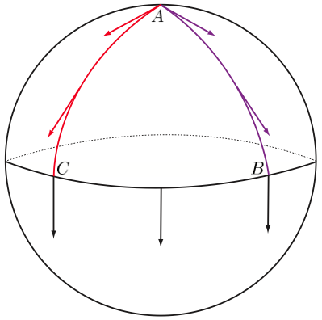

Figure 5: The parallel transport of a vector by a two-dimensional creature, from $A \rightarrow B \rightarrow C \rightarrow A$ around a geodesic triangle on a two-dimensional surface $S^{2}$, ends up pointing in a different direction upon returning to $A$.

For a closed loop which circumscribes an infinitesimally small portion of space, the rotation of the vector per unit area constitutes the measure of the local curvature of space. Consequently, whether or not finite parallel displacement of direction is *integrable*, that is, path-independent, depends on whether or not the curvature tensor vanishes.

According to Weyl, Riemannian geometry, is not a pure or genuine *infinitesimal* differential (metric) geometry, since it permits the comparison of length at a finite distance. In his seminal 1918 paper entitled *Gravitation und Elektrizität* (*Gravitation and Electricity*) Weyl (1918a) says:

> However, in the Riemannian geometry described above, there remains a last distant-geometric [ferngeometrisches] element—without any sound reason, as far as I can see; the only cause of this appears to be the development of Riemannian geometry from the theory of surfaces. The metric permits the comparison of length of two vectors not only at the same point, but also at any arbitrarily separated points. *A true near-geometry (Nahegeometrie), however, may recognize only a principle of transferring a length at a point to an infinitesimal neighbouring point*, and then it is no more reasonable to assume that the transfer of length from a point to a finitely distant point is integrable, then it was to assume that the transfer of direction is integrable.

Weyl wanted a metric geometry which would not permit *distance comparison of length* between two vectors located at finitely different points. In a *pure infinitesimal geometry*, Weyl argued, if attention is restricted to a single point of the manifold, then some standard of length or *gauge* must be chosen arbitrarily before the lengths of vectors can be determined. Therefore, all that is intrinsic to the notion of a pure infinitesimal metric differential geometry is the ability to determine the *ratios of the lengths* of any two vectors and the angle between any two vectors, *at a point*. And because we can determine the angle between any two vectors at a point, such a pure *infinitesimal* metric manifold must have at least a *conformal* structure $C$.[^note-47]

The defining characteristic of a conformal spacetime structure is given by the equation

$$\tag{12} 0 = ds^2 = g_{ij}(x(p))dx^i dx^{\,j}, $$

which determines the light cone at $p$. A gauge transformation of the metric is a map

$$ g_{ij}(x(p)) \rightarrow \lambda(x(p))g_{ij}(x(p)) = \overline{g}_{ij}(x(p)), $$

which preserves the metric up to a positive and smooth but otherwise arbitrary scalar factor or gauge function $\lambda(x(p))$. In the case of a pseudo-Riemannian structure such a gauge transformation leaves the light cones unaltered. The angle between two vectors at $p$ is given by (11). Clearly, the gauge transformation $\overline{g}_{ij}(x(p)) = \lambda(x(p))g_{ij}(x(p))$ is angle preserving, that is, conformal. Two metrics which are related by a conformal gauge transformation are called *conformally equivalent.* A conformal structure does not determine the length of any one vector at a point. Only the relative lengths, the ratio of lengths, of any two vectors $\bfrac{\lvert v_p \rvert}{\lvert w_p \rvert}$ is determined.

Weyl exploited these features of the conformal structure, and suggested that given a conformal structure, a *gauge* could be chosen at each point in a smooth but otherwise arbitrary manner, such that the metric (8) at any point of the manifold is conventional or undetermined to the extent that the metric

$$\tag{13} d\overline{s}^2 = \lambda(x(p))g_{ij}(x(p))dx^{i}dx^{\,j} $$

is equally valid.

However, a conformal structure by itself does not determine a unique symmetric linear connection; it only determines an equivalence class of conformally equivalent connections $K = [\Gamma]$, namely, connections which preserve the conformal structure $C$ during parallel transport. The difference between any two conformally equivalent symmetric linear connections $\overline{\Gamma}^{\,i}_{jk}$, $\Gamma^i_{jk} \in [\Gamma]$ is given by

$$\tag{14} \overline{\Gamma}^{\,i}_{jk} - \Gamma^i_{jk} = \frac{1}{2}(\delta^{\,i}_j \theta_k + \delta^{\,i}_k \theta_j - g_{jk}g^{ir}\theta_{r}), $$

where

$$\tag{15} \theta_{j}(x(p))dx^{\,j} $$

is an arbitrary one-form field.

Since the conformal structure determines only an equivalence class of conformally equivalent symmetric linear connections $K = [\Gamma]$, the affine connection in this type of geometry is not uniquely determined, and the parallel transport of vectors is not generally well defined. Moreover, the ratio of the lengths of two vectors located at different points is not determined even in a path-dependent way. According to Weyl, it is a fundamental principle of infinitesimal geometry that the metric structure on a manifold $M$ determines a unique affine structure on $M$. As was pointed out earlier, this principle is satisfied in Riemannian geometry where the metric determines a unique symmetric linear connection, namely, the metric connection according to (9). Evidently this fundamental principle of infinitesimal geometry is not satisfied for a structure which is merely a conformal structure, since the conformal structure only determines an equivalence class of conformally equivalent symmetric connections. Weyl showed that besides the conformal structure an additional structure is required in order to determine a unique symmetric linear connection from the equivalence class $K = [\Gamma]$ of conformally equivalent symmetric linear connections. Weyl showed that this additional structure is provided by the *length connection* or *gauge field* $A_{j}$ that governs the *congruent displacement of lengths*. Weyl called this additional structure the “metric connection” on a manifold; however, we shall use the term “length connection” instead, in order to avoid confusion with the modern usage of the term “metric connection”, which today denotes the symmetric linear connection that is uniquely determined by a Riemannian metric tensor according to (9).

**Weyl’s Length Connection:** A point $p$ is *length connected* with its infinitesimal neighborhood, if and only if for every length at $p$, there is determined at every point $q$ infinitesimally close to $p$ a length to which the length at $p$ gives rise when it is *congruently* displaced from $p$ to $q$.

This definition merely says that a manifold is “length connected” if it admits the process of infinitesimal congruent displacement of length. The only condition imposed on the concept of congruent displacement of length is the following:

**Congruent Displacement of Length:** With respect to a choice of gauge for a neighborhood of $p$, the transport of a length $l_{p}$ at $p$ to an infinitesimally neighboring point $q$ constitutes a *congruent* displacement if and only if there exists a choice of gauge for the neighborhood of $p$ relative to which the transported length $\overline{l}_{q}$ has the same value as $\overline{l}_{p}$; that is

$$\tag{16} \overline{l}_q - \overline{l}_p = d\overline{l}_p = 0. $$

Weyl called such a gauge at $p$ a *geodesic gauge* at $p$.[^note-48] Weyl’s proof of the following theorem closely parallels the proof of theorem A.3 in [the supplement on Weyl’s metric independent construction of the affine connection.](weyl.supplement.md)

**Theorem 4.1:** If for every point $p$ in a neighborhood $U$ of $M$, there exists a choice of gauge such that the change in an arbitrary length at $p$ under congruent displacement to an infinitesimally near point $q$ is given by

$$\tag{17} d\overline{l}_p = 0, $$

then locally with respect to any other choice of gauge,

$$\tag{18} dl = -lA_j(x(p))dx^{\,j}, $$

and conversely.

Making use of

$$\begin{align} dv^{\,i}_p &= -\Gamma^i_{jk}(x(p))v^{\,j}_pdx^k \\ l_p &= g_{ij}(x(p))v^{\,i}_p v^{\,j}_p \\ dl_p &= -l_p A_j x(p)dx^{\,j}, \end{align}$$

Weyl (1923a, 124–125) shows that the conformal structure supplemented with the structure of a *length connection* or *gauge field* $A_{j}(x)$ singles out a unique connection from the equivalence class $K = [\Gamma]$ of conformally equivalent connections.[^note-49] This unique connection, which is called the *Weyl connection*, is given by

$$\begin{align} \Gamma^{\,i}_{jk} &= \frac{1}{2}g^{ir}(g_{rj,k} + g_{kr,j} - g_{jk,r}) +\frac{1}{2} g^{ir}(g_{rj}A_{k} + g_{kr}A_{j} - g_{jk}A_{r}) \\ \tag{19} &= \frac{1}{2}g^{ir}(g_{rj,k} + g_{kr,j} - g_{jk,r}) +\frac{1}{2}(\delta^{\,i}_j A_{k} + \delta^{\,i}_k A_{j} - g_{jk}g^{ir}A_{r}), \end{align}$$

which is analogous to (14). The first term of the Weyl connection is identical to the metric connection (9) of Riemannian geometry, whereas the second term represents what is new in a Weyl geometry. The Weyl connection is invariant under the gauge transformation

$$\begin{align} \overline{g}_{ij}(x) &= e^{\theta(x)}g_{ij}(x) \\ \tag{20} \overline{A}_j(x) &= A_j(x) - \partial_j \theta(x), \end{align}$$

where the gauge function is $\lambda(x) = e^{\theta(x)}$. Thus, a conformal structure plus *length connection* or *gauge field* $A_{j}(x)$ determines a *Weyl geometry* equipped with a unique *Weyl connection*. Therefore, the fundamental principle of infinitesimal geometry also holds in a Weyl geometry; that is, the metric structure of a Weyl geometry determines a unique affine connection, namely, the Weyl connection.

In Weyl’s physical interpretation of his purely infinitesimal metric geometry (Weyl geometry), the gauge field $A_{j}(x)$ is identified with the electromagnetic four potential, and the electromagnetic field tensor is given by

$$\tag{21} F_{jk}(x) = \partial_{j} A_{k}(x) - \partial_{k} A_{j}(x). $$

A spacetime that is formally characterizable as a Weyl geometry, would not only have a *curvature of direction* (*Richtungskrümmung*) but would also have a *curvature of length* (*Streckenkrümmung*). Because of the latter property the formal characterization of the congruent displacement of length would be non-integrable, that is, path-dependent, in a Weyl geometry.

*Figure 6:*

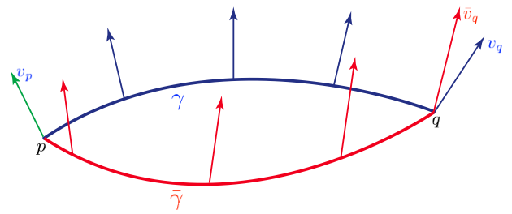

Figure 6: In a Weyl geometry parallel displacement of a vector along different paths not only changes its direction but also its length

Suppose physical spacetime corresponds to a Weyl geometry. Then two identical clocks $A$ and $B$ at an event $p$ with a common unit of time, that is, a timelike vector of given length $l_{p}$, which are separated and moved along different world lines to an event $q$, will not only differ with respect to the elapsed time (first clock effect (i.e., relativistic effect)), but in general the clocks will differ with respect to their common unit of time (rate of ticking) at $q$ (second clock effect). That is, congruent time displacement in a Weyl geometry is such that two congruent time intervals at $p$ will not in general be congruent at $q$, when congruently displaced in parallel along different world lines from $p$ to $q$, that is, $l^{A}_{q} \ne l^{B}_{q}$. This means that a twin who travels to a distant star and then returns to earth would not only discover that the other twin on earth had aged much more, but also that all the clocks on earth tick at a different rate. Hence, in the presence of a non-vanishing electromagnetic field $F_{jk}(x)$ the clock rates will not in general be the same; that is, there will be a second clock effect in addition to the relativistic effect (first clock effect). Thus, $l^{A}_{q} = l^{B}_{q}$ if and only if the curl of $A_{j}(x)$ vanishes, that is, if and only if the electromagnetic field tensor $F_{jk}(x)$ vanishes, namely,

$$ F_{jk}(x) = \partial_{j} A_{k}(x) - \partial_{k} A_{j}(x) = 0. $$

In that case the second term of the Weyl connection vanishes and (19) reduces to the metric connection (9) of Riemannian geometry.

In a Weyl geometry there are no ideal absolute “meter sticks” or “clocks”. For example, the rate at which any clock measures time is a function of its history. However, as Einstein pointed out in a *Nachtrag* (addendum) to Weyl (1918a), it is precisely this situation which suggests that Weyl’s geometry conflicts with experience. In Weyl’s geometry, the frequency of the spectral lines of atomic clocks would depend on the location and past histories of the atoms. But experience indicates otherwise. The spectral lines are well-defined and sharp; they appear to be independent of an atom’s history. Atomic clocks define units of time, and experience shows they are integrably transported. Thus, if we assume that the atomic time and the gravitational standard time are identical, and that the gravitational standard time is determined by the Weyl geometry, then the electromagnetic field tensor is zero. But if that is the case, then a Weyl geometry reduces to the standard Riemannian geometry that underlies general relativity, since the vanishing of Weyl’s *Streckenkrümmung* (*length curvature*) is necessary and sufficient for the existence of a Riemannian metric $g_{ij}$.

When quantum theory was developed a few years later it became clear that Weyl’s theory was in conflict with experience in an even more fundamental way since there is a direct relation between clock rates and masses of particles in quantum theory. A particle with a certain rest mass $m$ possesses a natural frequency which is a function of its rest mass, the speed of light $c$, and Planck’s constant $h$. This means that in a Weyl geometry not only clocks would depend on their histories but also the masses of particles. For example, if two protons have different histories then they would also have different masses in a Weyl geometry. But this violates the quantum mechanical principle that particles of the same kind—in this case, protons—have to be exactly identical.

However, in 1918 it was still possible for Weyl to defend his theory in the following way. In response to Einstein’s criticism Weyl noted that atoms, clocks and meter sticks are complex objects whose real behavior in arbitrary gravitational and electromagnetic fields can only be inferred from a dynamical theory of matter. Since no detailed and reliable dynamical models were available at that time, Weyl could argue that there is no reason to assume that, for example, clock rates are correctly modelled by the length of a timelike vector. Weyl (1919a, 67) said:

> At first glance it might be surprising that according to the purely close-action geometry, length transfer is non-integrable in the presence of an electromagnetic field. Does this not clearly contradict the behaviour of rigid bodies and clocks? The behaviour of these measurement instruments, however, is a physical process whose course is determined by natural laws and as such has nothing to do with the ideal process of ‘congruent displacement of spacetime distance’ that we employ in the mathematical construction of the spacetime geometry. The connection between the metric field and the behaviour of rigid rods and clocks is already very unclear in the theory of Special Relativity if one does not restrict oneself to quasi-stationary motion. Although these instruments play an indispensable role in praxis as indicators of the metric field, (for this purpose, simpler processes would be preferable, for example, the propagation of light waves), it is clearly incorrect to *define* the metric field through the data that are directly obtained from these instruments.

Weyl elaborated this idea by suggesting that the dynamical nature of such time keeping systems was such that they continually *adapt* to the spacetime structure in such a way that their rates remain constant. He distinguished between quantities that remain constant as a consequence of such *dynamical adjustment*, and quantities that remain constant by *persistence* because they are isolated and undisturbed. He argued that all quantities that maintain a perfect constancy probably do so as a result of *dynamical adjustment*. Weyl (1921a, 261) expressed these ideas in the following way:

> What is the cause of this discrepancy between the idea of congruent transfer and the behaviour of measuring-rods and clocks? I differentiate between the determination of a magnitude in Nature by “persistence” (*Beharrung*) and by “adjustment” (*Einstellung*). I shall make the difference clear by the following illustration: We can give to the axis of a rotating top any arbitrary direction in space. This arbitrary original direction then determines for all time the direction of the axis of the top when left to itself, by means of a *tendency of persistence* which operates from moment to moment; the axis experiences at every instant a parallel displacement. The exact opposite is the case for a magnetic needle in a magnetic field. Its direction is determined at each instant independently of the condition of the system at other instants by the fact that, in virtue of its constitution, the system *adjusts* itself in an unequivocally determined manner to the field in which it is situated. *A priori* we have no ground for assuming as integrable a transfer which results purely from the tendency of persistence. …Thus, although, for example, Maxwell’s equations demand the conservational equation $de\,/\,dt =0$ for the charge $e$ of an electron, we are unable to understand from this fact why an electron, even after an indefinitely long time, always possesses an unaltered charge, and why the same charge $e$ is associated with all electrons. This circumstance shows that the charge is not determined by persistence, but by adjustment, and that there can exist only *one* state of equilibrium of the negative electricity, to which the corpuscle adjusts itself afresh at every instant. For the same reason we can conclude the same thing for the spectral lines of atoms. The one thing common to atoms emitting the same frequency is their constitution, and not the agreement of their frequencies on the occasion of an encounter in the distant past. Similarly, the length of a measuring-rod is obviously determined by adjustment, for I could not give *this* measuring-rod in *this* field-position any other length arbitrarily (say double or treble length) in place of the length which it now possesses, in the manner in which I can at will pre-determine its direction. The theoretical possibility of a determination of length by adjustment is given as a consequence of the *world-curvature*, which arises from the metrical field according to a complicated mathematical law. As a result of its constitution, the measuring-rod assumes a length which possesses this or that value, *in relation to the radius of curvature of the field*.

Weyl’s response to Einstein’s criticism that a Weyl geometry conflicts with experience, took advantage of the fact that the underlying dynamical laws of matter which govern clocks and rigid rods, were not known at that time. Weyl could thus argue that it is at least *theoretically* possible that there exists an underlying dynamics of matter, such that a Weyl geometry, according to which length transfer is non-integrable, nonetheless coheres with *observable* experience, according to which length transfer *appears* to be integrable. However, as was clearly pointed out by Wolfgang Pauli, Weyl’s plausible defence comes at a cost.[^note-50] Pauli (1921/1958, 196) argued that Weyl’s defence of his theory deprives it of its inherent convincing power from a physical point of view.

> Weyl’s present attitude to this problem is the following: *The ideal process of the congruent transference of world lengths … has nothing to do with the real behaviour of measuring rods and clocks; the metric field must not be defined by means of information taken from these measuring instruments.* In this case the quantities $g_{ik}$ and $\varphi_{i}$ are, be definition, no longer observable, in contrast to the line elements of Einstein’s theory. This relinquishment seems to have very serious consequences. While there now no longer exists a direct contradiction with experiment, the theory appears nevertheless to have been robbed of its inherent convincing power, from a physical point of view. For instance, the connexion between electromagnetism and world metric is not now essentially physical, but purely formal. For there is no longer an immediate connection between the electromagnetic phenomena and the behaviour of measuring rods and clocks. There is only an interrelation between the former and the ideal process which is mathematically defined as congruent transference of vectors. Besides, there exists only formal, and not physical, evidence for a connection between world metric and electricity.[^note-51]

Pauli concluded his critical assessment of Weyl’s theory with the following statement:

> *Summarizing, we can say that Weyl’s theory has not succeeded in getting any nearer to solving the problem of the structure of matter.* As will be argued in more detail … there is, on the contrary, something to be said for the view that a solution of this problem cannot at all be found in this way.

It should be noted, however, that Weyl’s defence of his theory implicitly addresses an important methodological consideration concerning the relation between theory and evidence. As Pauli puts it above, according to Weyl “*the metric field must not be defined by means of information taken from these measuring* *instruments* [rigid rods and ideal clocks]”. That is, Weyl rejects Einstein’s *operational* standpoint which gives *operational significance* to the metric field in terms of the *observable* behaviour of ideal rigid rods and ideal clocks.[^note-52] Unlike light propagation and freely falling (spherically symmetric, neutral) particles, rigid rods and ideal clocks are relativistically ill defined probative systems, and are thus unsuitable for the determination of the inherent structures of spacetime postulated by the theory of relativity. Weyl (1918a) clearly recognized this when he said in response to Einstein’s critique “because of the problematic behaviour of yardsticks and clocks I have in my book *Space-Time-Matter* restricted myself for the specific measurement of the $g_{ik}$, exclusively to the observation of the arrival of light signals.” It is interesting to note parenthetically that in the first edition of his book Weyl thought that it was possible to have an intrinsic method of comparing the lengths of arbitrary spacetime intervals with an interval between two fiducial spacetime events, by using light signals only. It was Lorentz who pointed out to Weyl that not only the world lines of light rays but also the world lines of material bodies are required for an intrinsic method of comparing lengths. Not only did Weyl correct this mistake in subsequent editions, but already in 1921, Weyl (1921c) discovered the causal-inertial method for determining the spacetime metric (see §4.3) by proving an important theorem that shows that the spacetime metric is already fully determined by the inertial and causal structure of spacetime. Weyl (1949a, 103) remarks “… therefore mensuration need not depend on clocks and rigid bodies but … light signals and mass points moving under the influence of inertia alone will suffice.” It is clear that Weyl regarded the use of clocks and rigid rods as an undesirable makeshift within the context of the special and general theory. Since neither spatial nor temporal intervals are invariants of spacetime, the invariant spacetime interval $ds$ cannot be directly ascertained by means of standard clocks and rigid rods. In addition, the latter presuppose quantum theoretical principles for their justification and therefore lie outside the relativistic framework because the laws which govern their physical processes are not known.[^note-53]

Weyl (1929c, 233) abandoned his unified field theory only with the advent of the quantum theory of the electron. He did so because in that theory a different kind of gauge invariance associated with Dirac’s theory of the electron was discovered, which more adequately accounted for the conservation of electric charge. Weyl’s contributions to quantum mechanics, and his construction of a new principle of gauge invariance, are discussed in §4.5.3.[^note-54]

Weyl’s unified field theory was revived by Dirac (1973) in a slightly modified form, which incorporated a real scalar field $\beta(x)$. Dirac also argued that the time intervals measured by atomic clocks need not be identified with the lengths of timelike vectors in the Weyl geometry.[^note-55]

### 4.2 The Riemann-Helmholtz-Lie Problem of Space

Prior to the works of Gauss, Grassmann and Riemann, the study of geometry tended to emphasize the employment of empirical intuitions and images of the three dimensional physical space. Physical space was thought of as having definite metrical attributes. The task of the geometer was to take physical mensuration devices in that space and work with them.

Under the influence of Gauss and Grassmann, Riemann’s great philosophical contribution consisted in the demonstration that, unlike the case of a discrete manifold, where the determination of a set necessarily implies the determination of its quantity or cardinal number, in the case of a continuous manifold, the concept of such a manifold and of its continuity properties, can be separated form its metrical structure. Using modern terminology, Riemann separated a manifold’s local differential topological structure from its metrical structure. Thus Riemann’s separation thesis gave rise to the *space problem*, or as Weyl called it, *das Raumproblem*: how can metric relations be determined on a continuous manifold $M$?[^note-56]

A metric manifold is a manifold on which a distance function $f : M \times M \rightarrow \mathbb{R}$ is defined. Such a distance function must satisfy the following minimal conditions: for all $p, q, r \in M$,

1. $f(p, q) \ge 0$, and if $f(p,q) = 0$, then $p = q$,
2. $f(p, q) = f(q,p)$, (symmetry)
3. $f(p, q) + f(q,r) \ge f(p,r)$ (triangle inequality).

In his famous inaugural lecture at Göttingen, entitled *Über die Hypothesen, welche der Geometrie zu* *Grunde liegen* (*About the hypotheses which lie at the basis of geometry*), Riemann (1854) examined how metric relations can be determined on a continuous manifold; that is, what specific form $f : M \times M \rightarrow \mathbb{R}$ should have. Consider the coordinates $x^{i}(p)$ and $x^{i} (p) + dx^{i} (p)$ of two neighboring points $p, q \in M$. The measure of the distance $ds = f(p,q)$ must be some function $F_{p}$ at $p$ of the differential increments $dx^{i}(p)$; that is,

$$\tag{22} ds = F_{p}(dx^{1}(p), \ldots ,dx^{n}(p)). $$

Riemann states that $F_{p}$ should satisfy the following requirements:

**Functional Homogeneity:** If $\lambda \gt 0$ and $ds = F_{p}(dx(p))$, then

$$\tag{23} \lambda ds = \lambda F_{p}(dx(p)) = F_{p}(\lambda dx(p)). $$

**Sign Invariance:** A change in sign of the differentials should leave the value of $ds$ invariant.

Sign invariance is satisfied by every positive homogeneous function of degree $2m$ $(m = 1, 2, 3, \ldots)$. In the simple case $m = 1$, and the length element $ds$ is the square root of a homogeneous function of second degree, which can be expressed in the standard form

$$\tag{24} ds = \left[ \sum_{i=1}^n (dx^{\,i}(p))^{2} \right]^{\bfrac{1}{2}}. $$

That is, at each point of $M$ there exists a coordinate system (defined up to an element of the orthogonal group $O(n)$ in which the square root of the homogeneous function of second degree can be expressed in the above standard form. Riemann’s well-known general expression for the measure of length at $p \in M$ with respect to an arbitrary coordinate system is given by

$$\tag{25} ds^{2} = g_{ij}(x(p))dx^{i}(p)dx^{\,j}(p), $$

where the components of the metric tensor satisfy the symmetry condition $g_{ij} = g_{ji}$.

The assumption that $ds^{2} = F^{2}_{p}$ is a quadratic differential form is not only the simplest one, but also the preferred one for other important reasons. Riemann himself was well aware of other possibilities; for example, the possibility that $ds$ could be the 4th root of a homogeneous polynomial of 4th order in the differentials. But Riemann restricted himself to the special case $m = 1$ because he was pressed for time and because he wanted to give specific geometric interpretations of his results. As Weyl points out Riemann’s own answer to the space problem is inadequate since Riemann’s mathematical justification for the restriction to the Pythagorean case are not very compelling. The first satisfactory justification of the Pythagorean form of the Riemannian metric, although limited in scope because it presupposed the full homogeneity of Euclidean space, was provided by the investigations of Hermann von Helmholtz. Helmholtz diverged from Riemann’s analytic approach and made use merely of the fundamental concept of geometry, namely, the concept of *congruent mapping*, and characterized the geometric structure of space by requiring of space the full homogeneity of Euclidean space. His analysis was thereby restricted to the cases of constant positive, zero, or negative curvature. Abstracting from our experience of the movement of rigid bodies, Helmholtz was able to mathematically derive Riemann’s distance formula from a number of axioms about rigid body motion in space. Helmholtz (1868) argued that Riemann’s hypothesis that the metric structure of space is determined locally by a quadratic differential form, is really a consequence of the facts (*Tatsachen*) of rigid-body motion.

Considering the general case of $n$ dimensions, and using Lie groups and Lie algebras, Sophus Lie, (Lie (1886/1935, 1890a,b)), later developed and improved Helmholtz’s justification. However, the Helmholtz-Lie treatment of, and solution to, the problem of space, lost its relevance with the arrival of Einstein’s theory of general relativity. As Weyl (1922b) points out, instead of a three-dimensional continuum we must now consider a four-dimensional continuum, the metric of which is not *positive definite* but is given instead by an *indefinite* quadratic form. In addition, Helmholtz’s presupposition of metric homogeneity no longer holds, since we are now dealing with an inhomogeneous metric field that causally depends on the distribution of matter. Consequently, Weyl provided a reformulation of the space problem that is compatible with the causal and metric structures postulated by the theory of general relativity. But Weyl went further. Such a reformulation should not only incorporate Riemann’s *infinitesimal* standpoint, as required by Einstein’s general theory, it should also cohere with Weyl’s requirements of a **pure** *infinitesimal geometry* developed earlier in the context of Weyl’s construction of a unified field theory.

More precisely, Weyl generalized the so-called *Riemann-Helmholtz-Lie* problem of space in two ways: First, he allowed for *indefinite metrics* in order to encompass the general theory of relativity. Secondly, he considered metrics with variable gauge $\lambda(x(p))$ together with an associated *length connection*, in order to obtain a *purely* infinitesimal geometry. Thus each member of a general class of geometries under consideration is locally determined relative to a choice of variable gauge by two structural fields (Strukturfelder): (1) a possibly indefinite *Finsler* metric field[^note-57] $F_{p}(dx)$, and (2) a *length connection* that is determined by a 1-form field $\theta_{i}dx^{i}$. Weyl’s task was to prove:

> If the geometry satisfies the *Postulate of Freedom*, (the nature of space imposes no restrictions on admissible metrical relations), and determines a unique, symmetric, linear connection $\Gamma$, then the Finsler metric field $F_{p}(dx)$ must be a Riemannian metric field of some signature.[^note-58]

In a Riemannian space the concept of parallel displacement is defined by two conditions:

1. The components of a vector remain unchanged during an infinitesimal parallel displacement in a suitably chosen coordinate system (geodesic coordinate).[^note-59] This condition is satisfied if $$\begin{matrix} dv^{\,i}_{p} = - \Gamma^{i}_{jk} v^{\,j}_{p} dx^{k}_{p} & \text{and} & \Gamma^{i}_{jk} = \Gamma^{i}_{kj}\,. \end{matrix}$$
2. The length of a vector remains unchanged during an infinitesimal parallel displacement.

It follows from these conditions that a Riemannian space possesses a definite symmetric linear connection—a symmetric linear *metric* connection[^note-60]—which is uniquely determined by the Pythagorean-Riemannian metric. Weyl calls this:

**The Fundamental Postulate of Riemannian Geometry:** Among the *possible* systems of parallel displacements of a vector to infinitely near points, that is among the *possible* sets of symmetric linear connection coefficients, there exists one and only one set, and hence one and only one system of parallel displacement, which is *length preserving*.

In his lectures[^note-61] on the mathematical analysis of the problem of space delivered in 1922 at Barcelona and Madrid, Weyl sketched a proof demonstrating that the following is also true:

**Uniqueness of the Pythagorean-Riemannian Metric:** Among all the possible infinitesimal metrics that can be put on a differentiable manifold, the Pythagorean-Riemannian metric is the only type of metric that uniquely determines a symmetric linear connection.

Weyl begins his proof with two natural assumptions. First, the *nature* of the metric should be coordinate independent. If $ds$ is given by an expression $F_{p}(dx^{1}, \ldots ,dx^{n})$ with respect to a given system of coordinates, then with respect to another system of coordinates, $ds$ is given by a function that is related to $F_{p}(dx^{1}, \ldots ,dx^{n})$ by a linear, homogeneous transformation of its arguments $dx^{i}$. Second, it is reasonable to assume that the *nature* of the metric is the same everywhere, in the sense that at every point of the manifold, and with respect to every coordinate system for a neighborhood of the point in question, $ds$ is represented by an element of the equivalence class $[F]$ of functions generated by any one such function, say $F_{p}(dx^{1}, \ldots ,dx^{n})$, by all linear, homogeneous transformations of its arguments $dx^{i}$.

For the case in which $F_{p}$ is Pythagorean in form, namely the square root of a positive-definite quadratic form, there exists just one possible equivalence class [$F$], because every function that is the square root of a positive-definite quadratic form can be transformed to the standard expression

$$\tag{26} F = \left[(dx^{1})^{2} + \cdots + (dx^{n})^{2}\right]^{\bfrac{1}{2}} $$

by means of a linear, homogeneous transformation.

To every possible equivalence class [$F$] of homogeneous functions, there corresponds a *type* of metrical space. The Pythagorean-Riemannian space, for which $F^{2}_{p} = (dx^{1})^{2} + \cdots + (dx^{n})^{2}$, is one among several types of possible metrical spaces. The problem, therefore, is to single out the equivalence class $[F]$, where $F$ corresponds to $F^{2}_{p} = (dx^{1})^{2} + \cdots + (dx^{n})^{2}$, from the other possibilities, and to provide arguments for this preference.

By the term ‘metric’ Weyl means *any* infinitesimal *distance function* $F_{p} \in [F]$, where the equivalence class $[F]$ represents a *type* of metric structure or metric field. Any such type of metric field structure has a microsymmetry group $G_{p}$ at each $p \in M$.

**Definition 4.1 (Microsymmetry Group)** A microsymmetry of a structural field (Strukturfeld) at a point $p \in M$ is a local diffeomorphism that takes $p \in M$ into $p$ and preserves the structural field at $p \in M$. The microsymmetry group of a field at $p \in M$ is the group of its microsymmetries at $p \in M$ under the operation of composition.

A microsymmetry group $G_{p}$, at $p \in M$, of a metric structure, is a set of invertible, linear maps of the tangent space $T(M_{p})$ onto itself, which preserve the infinitesimal distance function at $p \in M$. For every $p \in M, G_{p}$ is isomorphic to one and the same abstract group.

For a Riemannian type of metric structure the congruent linear maps of the tangent space T$(M_{p})$ onto itself form a group $G_{p}$ which is isomorphic to the orthogonal group $O(n)$. The Pythagorean-Riemannian metric at $p$ is therefore determined through the concrete realization of the *orthogonal* group at $p$ which leaves the fundamental quadratic differential form at $p$ invariant. Thus the Pythagorean-Riemannian *type* of metric is characterized by the abstract microsymmetry group $O(n)$. For a metric which is not of the Pythagorean-Riemannian metric type, the abstract microsymmetry group $G_{p}$ will be different from $O(n)$ and will be some other subgroup of $GL(n)$. At each point of the manifold the microsymmetry group will be a concrete realization of this subgroup of $GL(n)$. Weyl now states what he calls

**The Postulate of Freedom:** If only the *nature* (of whatever type) of the metric is specified, that is, if only the corresponding abstract microsymmetry group $G_{p}$ is specified, and the metric in question is otherwise left arbitrary, then the *mutual orientations* of the corresponding microsymmetry groups at different points are also left arbitrary.

Weyl emphasizes that the *Postulate of Freedom* provides the general framework for a concise formulation of

**The Hypothesis of Dynamical Geometry:** Whatever the nature or type of the metric may be—provided it is the same everywhere—the variations in the *mutual orientations* of the concrete microsymmetry groups from point to point are causally determined by the material content that fills space.

In contrast with Helmholtz’s analysis, which presupposes the homogeneity of space, the *Postulate of Freedom* allows for the possibility of replacing Helmholtz’s homogeneity requirement with the possibility of subjecting the metric field to arbitrary, infinitesimal change. *To assert this dynamical possibility does not require that the nature of the metric be specified*.

Next, Weyl points out that what has been provided so far is merely an explication of the concepts *metric*, *length* *connection* and *symmetric linear connection*. Some claim which goes beyond conceptual analysis has to be made, according to Weyl, in order to prove that among the various types of possible metrical structures that can be put on a differentiable manifold representing physical space, the Pythagorean-Riemannian form is unique. Weyl suggests the following hypothesis:

**Weyl’s Hypothesis:** Whatever determination the essentially free length connection at some point $p$ of the manifold may realize with the points in its infinitesimal neighborhood, there always exists among the possible systems of parallel displacements of the tangent space $T(M_{p})$, one and only one, which is at the same time a system of infinitesimal *congruent transport*.

Weyl shows that this hypothesis does in fact single out metrics of the Pythagorean-Riemannian type by proving the following theorem:

**Theorem 4.2** If a specific length connection is such that it determines a unique symmetric linear connection, then the metric must be of the Pythagorean-Riemannian form (for some signature).

Thus the *Postulate of Freedom* and *Weyl’s Hypothesis* together entail the existence, at each $p \in M$, of a non-degenerate quadratic form that is unique up to a choice of gauge at $p \in M$, and that is invariant under the action of the microsymmetry group $G_{p}$ that is isomorphic to an orthogonal group of some signature.

This formulation suggests, according to Weyl, an intuitive contrast between Euclidean ‘distance-geometry’ and the ‘*near*-geometry’ (*Nahegeometrie*) or ‘*field*-geometry’ of Riemann. Weyl (1949a, 88) compared Euclidean ‘distance-geometry’ to a crystal “built up from uniform unchangeable atoms in the rigid and unchangeable arrangement of a lattice”, and the latter [Riemannian *field-geometry*] to a liquid, “consisting of the same indiscernible unchangeable atoms, whose arrangement and orientation, however, are mobile and yielding to forces acting upon them.”

The *nature* of the metric field, that is the *nature* of the metric everywhere, is the same and is, therefore, absolutely determined. It reflects according to Weyl, the *a priori* structure of space or spacetime. In contrast, what is *posteriori*, that is, accidental and capable of continuous change being causally dependent on the material content that fills space, are the mutual *orientations* of the metrics at different points. Hence, the demarcation between the $a$ *priori* and the *a posteriori* has shifted, according to Weyl: Euclidean geometry is still preserved for the infinitesimal neighborhood of any given point, but the coordinate system in which the metrical law assumes the standard form $ds^{2} =\sum^{n}_{i=1}(dx^{i})^{2}$ is in general different from place to place.

Weyl’s *a priori* and *a posteriori* distinction must not be confused with Kant’s distinction. Weyl (1949a, 134) remarks: “In the case of physical space it is possible to counterdistinguish aprioristic and aposterioristic features in a certain objective sense without, like Kant, referring to their cognitive source or their cognitive character.” Weyl makes the same remark in (Weyl, 1922b, 266).[^note-62] See also the discussion in §4.5.8.

In the context of his group-theoretical analysis, Weyl (1922b, p. 266) makes the following interesting and important statement:

> I remark from an epistemological point of view: it is not correct to say that space or the world [spacetime] is in itself, prior to any material content, merely a formless continuous manifold in the sense of analysis situs; the *nature* of the metric [its infinitesimal Pythagorean-Riemannian character] is characteristic of space in itself, only the mutual orientation of the metrics at the various points is contingent, a posteriori and dependent on the material content.

Within the context of general relativity, empty spacetime is impossible, if ‘empty’ is understood to mean not merely empty of all *matter* but also empty of all *fields*. At another place, Weyl (1949a, Engl. edn, 172) says:

> Geometry unites organically with the field theory; space is not opposed to things (as it is in substance theory) like an empty vessel into which they are placed and which endows them with far-geometrical relationships. No empty space exists here; the assumption that the field omits a portion of the space is absurd.

According to Weyl, the metric field does not cease to exist in a world devoid of matter but is in a state of rest: As a *rest* field it would possess the property of *metric homogeneity*; the mutual *orientations* of the *orthogonal* groups characterizing the Pythagorean-Riemannian nature of the metric everywhere would not differ from point to point. *This means that in a matter-empty universe the metric is fixed. Consequently, the set of congruence relations on spacetime is uniquely determined.* Since the metric uniquely determines the symmetric linear connection, the homogeneous *metric* field (rest field) determines an *integrable* affine structure. Therefore, a flat Minkowski spacetime consistent with the complete absence of matter is endowed with an *integrable connection* and thus determines all (hypothetical) free motions. According to Weyl, there exists in the absence of matter a homogeneous metric field, a structural field (*Strukturfeld*), which has the character of a *rest* field, and which constitutes an all pervasive background that cannot be eliminated. The structure of this *rest* field determines the *extension* of the spacetime congruence relations and determines Lorentz invariance. The *rest* field possesses no net energy and makes no contribution to curvature.

The contrast with Helmholtz and Lie is this: both of them require homogeneity and isotropy for physical space. From a general Riemannian standpoint, the latter characteristics are valid only for a matter-empty universe. Such a universe is flat and Euclidean, whereas a universe that contains matter is *inhomogeneous, anisotropic and of variable curvature*.

It is important to note here that the validity of Weyl’s assertion that the metric field does not cease to exist but is in a state of rest, has its source in the mathematical fact that the metric field is a $G$-structure. A $G$-structure may be flat or non-flat; but a $G$-structure can never vanish. Consequently, geometric fields characterizable as $G$-structures, such as the projective, conformal, affine and metric structures, do not vanish.[^note-63]

### 4.3 Weyl’s Causal-Inertial Method for determining the Spacetime Metric

#### 4.3.1 Weyl’s Field Ontology of Spacetime Geometry

Riemann searched for the most general type of an $n$-dimensional manifold. On this manifold, Euclidean geometry turns out to be a special case resulting from a certain form of the metric. Weyl takes this general structure, the manifold structure, which has certain continuity and order properties, as basic, but leaves the determination of the other geometrical structures, such as the projective, conformal, affine and metric structures, open. The metrical axioms are no longer dictated, as they were for Kant, by pure intuition. According to Weyl (1949a, 87), for Riemann the metric is not, as it was for Kant, “part of the static homogeneous form of phenomena, but of their ever changing material content”. Weyl (1931a, 338) says:

> We differentiate now between the amorphous continuum and its metrical structure. The first has retained its *a priori* character,[^note-64] … whereas the structural field [Strukturfeld] is completely subjected to the power-play of the world; being a real entity, Einstein prefers to call it the ether.

There is no indication in Riemann’s work on gravitation and electromagnetism that would indicate that he anticipated the conceptual revolution underlying Einstein’s theory. However, Weyl’s interpretation of Riemann’s work suggests that Riemann foresaw something like its possibility in the following sense:

> By formally separating the post-topological structures such as the affine, projective, conformal and metric structures from the manifold, so that these structures are no longer rigidly tied to it, Riemann deprived them of their formal geometric rigidity and, on the basis of his infinitesimal geometric standpoint or “near-geometry”, allowed for the possibility of interpreting them as mathematical representations of flexible, dynamical physical structural fields [Strukturfelder] on the manifold of spacetime, geometrical fields that reciprocally interact with matter.

Riemann’s separation thesis together with his adoption of the infinitesimal standpoint, were prerequisite steps for the development of differential geometry as the mathematics of differentiable geometric fields on manifolds. When interpreted physically, these mathematical structures or geometrical fields correspond, as Weyl says, to physical structural fields (Strukturfelder). Analogous to the electromagnetic field, these structural fields act on matter and are in turn acted on by matter. Weyl (1931a, 337) remarks:

> I now come to the crucial idea of the theory of General Relativity. *Whatever exerts as powerful and real effects as does the metric structure of the world, cannot be a rigid, once and for all, fixed geometrical structure of the world, but must itself be something real which not only exerts effects on matter but which in turn suffers them through matter.* Riemann already suggested for space the idea that the structural field, like the electromagnetic field, reciprocally interacts with matter.

Weyl (1931a, 338) continues:

> We already explained with the example of inertia, that the structural field [Strukturfeld] must, as a close-action [Nahewirkung], be understood infinitesimally. How this can occur with the metric structure of space, Riemann abstracted from Gauss’s theory of curved surfaces.

The various geometrical fields are not “intrinsic” to the manifold structure of spacetime. The manifold represents an amorphous four-dimensional differentiable continuum in the sense of *analysis situs* and has no properties besides those that fall under the concept of a manifold.

The amorphous four-dimensional differentiable manifold possesses a high degree of symmetry. Because of its homogeneity, all points are alike; there are no objective geometric properties that enable one to distinguish one point from another. This full homogeneity or symmetry of space must be described by its group of *automorphisms*, the one-to-one mappings of the point field onto itself which leave all relations of objective significance between points undisturbed. If a geometric object $F$, that is a point set with a definite relational structure is given, then those automorphisms of space that leave $F$ invariant, constitute a group and this group describes exactly the symmetry which $F$ possesses. For instance, to use an example by Weyl (1938b) (see also Weyl (1949a, 72–73) and Weyl (1952)), if $R(p_{1},p_{2},p_{3})$ is a ternary relation that asserts $p_{1},p_{2},p_{3}$ lie on a straight line, then we require that any three points, satisfying this relation $R$, are mapped by an automorphism into three other points $p_{1}',p_{2}',p_{3}'$, fulfilling the same relation.[^note-65]

The group of automorphisms of the $n$-dimensional number space contains only the identity map, since all numbers of $\mathbb{R}^{n}$ are distinct individuals. It is essentially for this reason that the real numbers are used for coordinate descriptions. Whereas the continuum of real numbers consists of individuals, the continua of space, time, and spacetime are homogeneous. Spacetime points do not admit of an absolute characterization; they can be distinguished, according to Weyl, only by “a demonstrative act, by pointing and saying here-now”.

In a little book entitled *Riemanns geometrische Ideen, ihre Auswirkung und ihre Verknüpfung mit der Gruppentheorie*, published posthumously in 1988, Weyl (1988, 4–5) makes this interesting comment:

> Coordinates are introduced on the Mf [manifold] in the most direct way through the mapping onto the number space, in such a way, that all coordinates, which arise through one-to-one continuous transformations, are equally possible. With this the coordinate concept breaks loose from all special constructions to which it was bound earlier in geometry. In the language of relativity this means: The coordinates are not measured, their values are not read off from real measuring rods which react in a definite way to physical fields and the metrical structure, rather they are a priori placed in the world arbitrarily, in order to characterize those physical fields including the metric structure numerically. The metric structure becomes through this, so to speak, freed from space; it becomes an existing field within the remaining structure-less space. Through this, space as form of appearance contrasts more clearly with its real content: The content is measured after the form is arbitrarily related to coordinates.

By mapping a given spacetime homeomorphically onto the real number space, providing through the arbitrariness of the mapping, what Weyl calls, a qualitatively non-differentiated field of free possibilities—the continuum of all possible coincidences—we represent spacetime points by their coordinates corresponding to some coordinate system. The four-dimensional arithmetical space can be utilized as a four-dimensional schema for the localization of events of all possible “here-nows”.

Physical dynamical quantities in spacetime, such as the geometrical structural fields on the four-dimensional spacetime continuum, are describable as functions of a variable point which ranges over the four-dimensional number space $\mathbb{R}^{4}$. Instead of thinking of the spacetime points as real substantival entities, and any talk of fields as just a convenient way of describing geometrical relations between points, one thinks of the geometrical fields such as the projective, conformal causal, affine and metric fields, as real physical entities with dynamical properties, such as energy, momentum and angular momentum, and the field points as mere mathematical abstractions. Spacetime is not a medium in the sense of the old ether concept. No ether in that sense exists here. Just as the electromagnetic fields are not states of a medium but constitute independent realities which are not reducible to anything else, so, according to Weyl, the geometrical fields are independent irreducible physical fields.[^note-66]

A class of geometric structural fields of a given type is characterized by a particular Lie group. A geometric structural field belonging to a given class has a microsymmetry group (see definition 4.1) at each point $p \in M$ which is isomorphic to the Lie group that is characteristic of the class. In relativity theory, this microsymmetry group is isomorphic to the Lorentz group and leaves invariant a pseudo-Riemannian metric of Lorentzian signature.

The different types of geometric, structural fields may be represented from a modern mathematical point of view as cross sections of appropriate fiber bundles over the manifold $M$; that is, the amorphous manifold $M$ has associated with it various geometric fields in terms of a mapping of a certain kind (called a cross section) from the manifold $M$ to the corresponding bundle space over $M$.[^note-67] In particular, Einstein’s general theory of relativity postulates a physical field, the metrical field, which, mathematically speaking, may be characterized as a cross section of the bundle of non-degenerate, second-order, symmetric, covariant tensors of Lorentz signature over $M$. Weyl (1931a, 336) says of this world structure:

> However this structure is to be exactly and completely described and whatever its inner ground might be, all laws of nature show that it constitutes the most decisive influence on the evolution of physical events: the behavior of rigid bodies and clocks is almost exclusively determined through the metric structure, as is the pattern of the motion of a force-free mass point and the propagation of a light source. And only through these effects on the concrete natural processes can we recognize this structure.

The views of Weyl are diametrically opposed to geometrical conventionalism and some forms of relationalism. According to Weyl, we *discover* through the behavior of physical phenomena an already determined metrical structure of spacetime. The metrical relations of physical objects are determined by a physical field, the metric field, which is represented by the second rank metric tensor field. Contrary to geometric conventionalism, spacetime geometry is not about rigid rods, ideal clocks, light rays or freely falling particles, except in the derivative sense of providing information about the physically real metric field which, according to Weyl, is as physically real as is the electromagnetic field, and which determines and explains the metrical behavior of congruence standards under transport. The metrical field has physical *and* metrical significance, and the metrical significance does not consist in the mere articulation of relations obtaining between, say, rigid rods or ideal clocks.

The special and general, as well as the non-relativistic spacetime theories postulate various structural constraints which events are held to satisfy. When interpreted physically, these mathematical structures or constraints correspond to physical structural fields (*Strukturfelder*). Analogous to the electromagnetic field, these structural fields act on matter and are, within the context of the general theory of relativity, in turn acted on by matter. An $n$-dimensional manifold $M$ whose sole properties are those that fall under the concept of a manifold, Weyl (1918b) physically interprets as an $n$-dimensional empty world, that is, a world empty of both matter and fields. On the other hand, an $n$-dimensional manifold $M$ that is an affinely connected manifold, Weyl physically interprets as an $n$-dimensional world filled with a gravitational field, and an $n$-dimensional manifold $M$ endowed with a projective structure represents an $n$-dimensional non-empty world filled with an inertial-gravitational field, or what Weyl calls the *guiding field Führungsfeld*). In a similar vein, an $n$-dimensional manifold $M$ that possesses a conformal structure of Lorentz type, represents a non-empty $n$-dimensional world filled with a causal field. Finally, an $n$-dimensional manifold $M$ endowed with a metrical structure may be interpreted physically as an $n$-dimensional non-empty world filled with a metric field.

#### 4.3.2 The Causal and Inertial Field uniquely determine the Metric

The mathematical model of physical spacetime is the four-dimensional pseudo-Riemannian manifold. Weyl (1921c) distinguished between two primitive substructures of that model: the *conformal* and *projective* structures and showed that the conformal structure, modelling the *causal field* governing light propagation, and the projective structure, modelling the inertial or *guiding field* governing all free (fall) motions, uniquely determine the metric. That is, Weyl (1921c) proved

**Theorem 4.3** The projective and conformal structure of a metric space determine the metric uniquely.

A metric $g$ on a manifold determines a first-order conformal structure on the manifold, namely, an equivalence class of conformally related metrics

$$\tag{27} [g] = \{\overline{g} \mid \overline{g} = e^{\theta} g \}. $$

A metric $g$ also uniquely determines a symmetric linear connection $\Gamma$ on the manifold. Under a conformal transformation

$$\tag{28} g \rightarrow e^{\theta} g = \overline{g}, $$

the change of the components of the symmetric linear connection is given by (14), that is,

$$\tag{29} \Gamma^{i}_{jk} \rightarrow \overline{\Gamma}^{i}_{jk} = \Gamma^{i}_{jk} + \frac{1}{2}(\delta^{i}_{j}\theta_{k} + \delta^{i}_{k}\theta_{j} - g_{jk}g^{ir}\theta_{r}). $$

Thus the set of all arbitrary conformal transformations of the metric induces an equivalence class $K$ of conformally related symmetric linear connections. This equivalence class $K$ constitutes a second-order conformal structure on the manifold and the difference between any two connections in the equivalence class is given by (29). Weyl shows that a conformal transformation (29) preserves the projective structure and hence is a projective transformation (that is, a conformal transformation which also satisfies (7)), if and only if $\theta_{j} = 0$, in which case the conformal and projective structures are compatible. Weyl remarks after the proof:

> If it is possible for us, in the real world, to discern causal propagation, and in particular light propagation, and if moreover, we are able to recognize and observe as such the motion of free mass points which follow the guiding field, then we are able to read off the metric field from this alone, without reliance on clocks and rigid rods.

Elsewhere, Weyl (1949a, 103) says:

> As a matter of fact it can be shown that the metrical structure of the world is already fully determined by its inertial and causal structure, that therefore mensuration need not depend on clocks and rigid bodies but that light signals and mass points moving under the influence of inertia alone will suffice.

The use of clocks and rigid rods is, within the context of either theory, an undesirable makeshift for two reasons. First, since neither spatial nor temporal intervals are invariants of the four-dimensional spacetime of the special theory of relativity and the general theory of relativity, the invariant spacetime interval $ds$ cannot be directly ascertained by means of standard clocks and rigid rods. Second, the concepts of a rigid body and a periodic system (such as pendulums or atomic clocks) are not fundamental or theoretically self-sufficient, but involve assumptions that presuppose quantum theoretical principles for their justification and thus lie outside the present conceptual relativistic framework. Therefore, methodological and ontological considerations decidedly favor Weyl’s causal-inertial method for determining the spacetime metric.

From the physical point of view, Weyl emphasized the roles of light propagation and free (fall) motion in revealing the conformal-causal and the projective structures respectively. However, from the mathematical point of view, Weyl did not use these two structures directly in order to derive from them and their compatibility relation, the metric field. Rather, Weyl regarded the metric and affine structures as fundamental and showed that the conformal and the projective structures respectively arise from those structures by mathematical abstraction.

*Figure 7:*

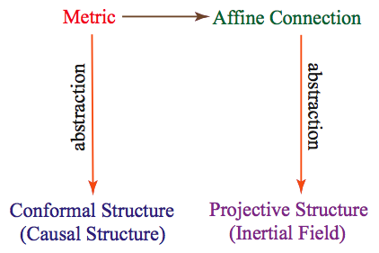

Figure 7: Weyl took the metric and affines structures as fundamental and showed that the conformal and projective structures respectively arise from them by mathematical abstraction.

#### 4.3.3 The Ehlers, Pirani, Schild Construction of the Causal-Inertial Method

Ehlers et al. (1972) generalized Weyl’s causal-inertial method by deriving the metric field *directly* from the conformal and projective fields and derived a unique pseudo-Riemannian spacetime metric solely as a consequence of a set of natural, physically well-motivated, constructive, “geometry-free” axioms concerning the incidence and differential properties of light propagation and free (fall) motion. Ehlers, Pirani and Schild adopt Reichenbach’s (1924) term, *constructive axiomatics* to describe the nature of their approach. The “geometry-free” axioms are propositions about a few general qualitative assumptions concerning free (fall) motion and light propagation that can be verified directly through experience in a way that does not presuppose the full blown edifice of the general theory of relativity. From these axioms, the theoretical basis of the theory is reconstructed step by step.

The constructive axiomatic approach to spacetime structure is roughly this:

1. **Primitive Notions.** The constructive axiomatic approach is based on a triple of sets $$ \langle M, \mathcal{P}, \mathcal{L}\rangle $$ of objects corresponding respectively to the notions of *events, particle paths* and *light rays*, which are taken as primitive. The set $M$ of events is assumed to have a Hausdorff topology with a countable basis in order to state local axioms through the use of such terms as “neighborhood”. Members of the sets $\mathcal{P} = \{P, Q, P_{1}, Q_{1}, \ldots \}$ and $\mathcal{L} = \{ L, N, L_{1}, N_{1}, \ldots \}$ are subsets of $M$ that represent the possible or actual paths of massive particles and light rays in spacetime.
2. **Differential Structure.** The differential structure is not presupposed; rather through the first few axioms a differential-manifold structure is introduced on the set of events $M$ that is sufficient for the localization of events by means of local coordinates, such as radar coordinates. Once $M$ is given a differential-manifold structure through the introduction of local radar coordinates by means of particles and light rays (such that any two radar coordinates are smoothly related to one another), one can do calculus on $M$ and one may speak of tangent and direction spaces. It is important to emphasize that the members of $\mathcal{P}$ represent possible or actual paths of *arbitrary* massive particles that may have some internal structure such as higher order gravitational and electromagnetic multipole moments and that may therefore interact in complicated ways with various physical fields. In order to constructively establish the projective structure of spacetime, it is necessary to single out a subset of $\mathcal{P}$, namely $\mathcal{P}_{f}$, the set of possible or actual paths of spherically symmetric, electrically neutral particles (that is, the world lines of freely falling particles). However, the set $\mathcal{P}_{f} \subset \mathcal{P}$, can be properly characterized only after a coordinate system (differential structure) is available. *Consequently, one must employ* arbitrary *particles in the statement of those axioms that lead to the local differential structure of spacetime.*
3. **Second-Order Conformal Structure.** The *Law of Causality* asserts the existence of a unique first-order conformal structure on spacetime (27), that is, a field of infinitesimal light cones. Only null one-directions are determined. Therefore no special choice of parameters along light rays is determined by this structure. The first-order conformal structure can be measured using only the local differential-topological structure. Moreover, by a purely mathematical process involving only differentiation, the first-order conformal structure determines a second-order conformal structure, namely, an equivalence class $K$ of conformally related symmetric linear connections.
4. **Projective Structure.** The motions of freely falling particles governed by the guiding field reveal the geodesics of spacetime, that is, the geodesics corresponding to an equivalence class $\Pi$ of projectively equivalent symmetric linear connections. Only geodesic one-directions are determined, that is, no special choice of parameters is involved in characterizing free fall motion.
5. **Compatibility between the Conformal and Projective Structures.** That the conformal and projective structures are compatible is suggested by high energy experiments, according to Ehlers, Pirani and Schild: “A massive particle $(m \gt 0)$, though always slower than a photon, can be made to chase a photon arbitrarily closely.” Ehlers, Pirani and Schild therefore assume an axiom of compatibility between the conformal and projective structures, and this leads to a *Weyl space*: If the projective and conformal structures are compatible, then the intersection $$ \Pi \cap K = \Gamma\ \text{ (Weyl connection)} $$ of the equivalence class $K$ of conformally equivalent symmetric linear connections, and the equivalence class $\Pi$ of projectively equivalent symmetric linear connections, contains a unique symmetric linear connection, a *Weyl connection*. Thus light propagation and free (fall) motion reveal on spacetime a unique Weyl connection which determines the parallel transport of vectors, preserving their timelike, null or spacelike character, and for any pair of non-null vectors, the Weyl connection leaves invariant the ratio of their lengths and the angle between them, provided the vectors are transported along the same path.
6. **Pseudo-Riemannian Metric.** Since length transfer is non-integrable (i.e., path-dependent) in a Weyl space, a Weyl geometry reduces to a pseudo-Riemannian geometry if and only if Weyl’s *length-curvature* (*Streckenkrümmung*) tensor equals zero, in which case the length of a vector is path-independent under parallel transport, and there exists no second clock effect.

#### 4.3.4 The Philosophical Significance of the Causal-Inertial Method

Can it be argued that Ehlers, Pirani and Schild’s generalization of Weyl’s causal-inertial method for determining the spacetime metric constitutes a convention-free, and – in relevant respects – theory-independent body of evidence that can adjudicate between spacetime geometries, and hence between spacetime theories that postulate them? As Weyl showed, we can empirically determine the metric field, provided certain epistemic conditions are satisfied, that is, provided we can measure the conformal-causal structure, and provided “we are able to recognize and observe as such the motion of free mass points which follow the guiding field.” Criticisms of Ehlers, Pirani and Schild’s constructive axiomatics suggest that the causal-inertial method is not convention-free and that it is ineffective epistemologically in providing a possible solution to the controversy between geometrical realism and conventionalism in favor of realism. Basically, all of the charges laid against Ehlers, Pirani and Schild’s constructive axiomatics concentrate on the roles which massive particles play in their construction. One of the constructive axioms employed by Ehlers, Pirani and Schild, the projective axiom, is a statement of the infinitesimal version of the Law of Inertia, the law of free (fall) motion which contains Newton’s first law of motion as a special case in the absence of gravitation. Since Ehlers, Pirani and Schild do not provide an independent, non-circular criterion by which to characterize free (fall) motion, their approach has been charged with circularity by philosophers such as Grünbaum (1973), Salmon (1977), Sklar (1977) and Winnie (1977).

The problem is a familiar one; how to introduce a class of preferred motions, that is, how to characterize that particular path structure that would govern the motions of free particles $\mathcal{P}_{f}$, that is, neutral, spherically symmetric, non-rotating test bodies, while avoiding the circularity problem surrounding the notion of a *free particle*: The only way of knowing when no forces act on a body is by observing that it moves as a free particle along the geodesics of spacetime. But how, without already knowing the geodesics or the projective structure of spacetime is it possible to determine which particles are free and which are not? And to determine the projective structure of spacetime it is necessary to use free particles.

Coleman and Korté (1980) have addressed these and related difficulties by providing a non-conventional procedure for the empirical determination of the projective structure.[^note-68]

It is worth emphasizing that Weyl’s approach to differential geometry, in which the affine, projective and conformal structures are treated in their own right rather than as mere aspects of the metric, was instrumental for his discovery of the non-circular and non-conventional geodesic method for the empirical determination of the spacetimet metric. The old notion of a ‘geodesic path’ had its inception in the context of classical *metrical* geometry and ‘geodesicity’ was characterized in terms of *extremal* paths of curves, which presupposed a metric. It was Weyl’s metric-independent construction of the symmetric linear connection that led him to introduce the geometry of paths and the metric-independent characterization of a *geodesic* path in terms of the process of autoparallelism of its tangent direction.

### 4.4 The Laws of Motion, Mach’s Principle, and Weyl’s Cosmological Postulate

Weyl provided a general conceptual/mathematical clarification of the concept of motion that applies to any spacetime theory that is based on a differential manifold. In particular, Weyl’s penetrating analysis shows that Einstein’s understanding of the role and significance of Mach’s Principle for the general theory of relativity and cosmology is actually inconsistent with the basic principles of general relativity.

Weyl’s major contribution to cosmology is known as “Weyl’s Hypothesis”. The name was coined by Weyl (1926d) himself in an article in the *Encyclopedia of* *Britannica*.[^note-69] According to Weyl’s Postulate, the worldlines of all galaxies are non-intersecting diverging geodesics that have a common origin in the distant past. From this system of worldlines Weyl derived a common cosmic time. On the basis of his postulate, Weyl (1923c, Appendix III) was also the first to show that there is an approximately *linear* relation between the redshift of galactic spectra and distance. Weyl had basically discovered *Hubble’s Law* six years prior to Hubble’s formulation of it in 1929. Another contribution to cosmology is Weyl’s (1919b) spherically symmetric static exact solution to Einstein’s linearized[^note-70] field equations.

#### 4.4.1 The Laws of Motion and Mach’s Principle

There are essentially two ways to understand Mach’s Principle: (1) Mach’s Principle rejects the absolute character of the inertial structure of spacetime, and (2) Mach’s Principle rejects the inertial structure of spacetime *per se*. Version (2) might be characterized as *Leibnizian relativity* or *body relationalism*; that is, one understands by relative motion the motion of *bodies* with respect only to other observable *bodies* or observable *bodily* reference frames. The relative motion of a body with respect to absolute space or to the inertial structure of space (Newton) or spacetime is ruled out on epistemological and/or metaphysical grounds.

In the context of his general theory of relativity, what Einstein is objecting to in Newtonian Mechanics, and by implication, the theory of special relativity, is the *absolute* character of the inertial structure; he is not asserting its *fictitious* character. That is, the general theory of relativity incorporates Mach’s Principle as expressed in version (1) by treating the inertial structure as dynamical and not as absolute.

However, Einstein also tried to extend and generalize the special theory of relativity by incorporating version (2) of Mach’s Principle into the general theory of relativity. Einstein was deeply influenced by Mach’s empiricist programme and accepted Mach’s insistence on the primacy of observable facts of experience: *only observable facts of experience may be invoked to account for the phenomena of motion*. As a consequence, Einstein restricted the concept of relative motions to relative motions between bodies. Newton thought that the plane of Foucault’s pendulum remains aligned with respect to absolute space. Since the fixed stars are at rest with respect to absolute space the plane of Foucault’s pendulum remains aligned to them as well, and rotates relative to the earth. But according to Einstein, Newton’s intermediary notion of absolute space is as questionable as it is unnecessary in explaining the behaviour of Foucault’s pendulum. Not absolute space, but the actually existing masses of the fixed stars of the whole cosmos guide the plane of Foucault’s pendulum.

Einstein (1916) argued that the general theory of relativity removes from the special theory of relativity and Newton’s theory an inherent epistemological defect. The latter is brought to light by Mach’s paradox, namely, Einstein’s example of two fluid bodies, $A$ and $B$, which are in constant *relative* rotation about a common axis. With regard to the extent to which each of the spheres bulges at its equator, infinitely many different states are possible although the relative rotation of the two bodies is the same in every case. Einstein considered the case in which $A$ is a sphere and $B$ is an oblate spheroid. The paradox consists in the fact that there is no readily discernible reason that accounts for the fact that one of the bodies bulges and the other does not. According to Einstein, an epistemological satisfactory solution to this paradox must be based on ‘an observable fact of experience’. Einstein wanted to implement a Leibnizian-Machian *relational* conception of motion according to which all motion is to be interpreted as the motion of some bodies in relation to other bodies. Einstein wished to extend the body-relative concept of uniform inertial motion to the concept of a body-relative accelerated motion.

#### 4.4.2 Weyl’s Critique of Einstein’s Machian Ideas

Weyl was very critical of Einstein’s attempt to incorporate version (2) of Mach’s Principle into the theory of general relativity and relativistic cosmology because he considered the Leibnizian-Machian *relational* conception of motion—according to which all motion is to be interpreted as the motion of some bodies in relation to other bodies—to be an incoherent notion within the context of the general theory of relativity.

In a paper entitled *Massenträgheit und Kosmos. Ein Dialog* [*Inertial Mass and Cosmos. A Dialogue*] Weyl (1924b) articulates his overall position on the concept of motion and the role of Mach’s Principle in general relativity and cosmology.[^note-71] Weyl defines Mach’s Principle as follows:

**M (Mach’s Principle):** The inertia of a body is determined through the interaction of all the masses in the universe.

Weyl (1924b) then makes the observation that the *kinematic principle of relative motion* is by itself without any content, unless one also makes the additional physical causal assumption that

**C (Physical Causality):** All events or processes are uniquely causally determined through matter, that is, through charge, mass and the state of motion of the elementary particles of matter.[^note-72]

The underlying motivation for assumption $\mathbf{C}$ of physical causality is essentially Mach’s empiricist programme, namely, Mach’s insistence on the *primacy of observable facts of experience*. Addressing Einstein’s formulation of Mach’s paradox, Weyl (1924b) says: Only if we conjoin the *kinematic principle of relative motion* with the physical assumption $\mathbf{C}$ does it appear groundless or impossible on the basis of the kinematic principle that in the absence of any external forces a stationary body of fluid has the form of a sphere “at rest”, while on the other hand it has the form of a “rotating” flattened ellipsoid. Weyl rejects principle $\mathbf{C}$ of physical causality because he denies the feasibility of $\mathbf{M}$ (Mach’s Principle), as defined above, on $a$ *priori*[^note-73] grounds. According to Weyl (1924b)

**A:** The concept of relative motion of several isolated bodies with respect to each other is as untenable according to the theory of general relativity as is the concept of absolute motion of a single body.

Weyl notes that what we seem to observe as the rotation of the stars, is in reality not the rotation of the stars themselves but the rotation of the “star compass” [Sternenkompass] which consists of light signals from the stars that meet our eyes at our present location from a certain direction. It is crucial, Weyl reminds us, to be cognisant of the existence of the metric field between the stars and our eyes. This metric field determines the propagation of light, and, like the electromagnetic field, it is capable of change and variation. Weyl (1924b) says that “the metric field is no less important for the direction in which I see the star then is the location of the star itself.” How is it possible, Weyl asks, to compare within the context of the general theory of relativity, the state of motions of two separate bodies? Of course, Weyl notes, prior to the general theory of relativity, during Mach’s time, one could rely on a rigid frame of reference such as the earth, and indefinitely extend such a frame throughout space. One could then postulate the relative motion of the stars with respect to this frame. However, under the hands of Einstein the coordinate system has lost its rigidity to such a degree, that it can always “cling to the motion of all bodies simultaneously”; that is, whatever the motions of the bodies are, there exists a coordinate system such that all bodies are at rest with respect to that coordinate system. Weyl then clarifies and illustrates the above with the plasticine example,[^note-74] which Weyl (1949a, 105) elsewhere describes as follows:

> Incidentally, without a world structure the concept of relative motion of several bodies has, as the postulate of general relativity shows, no more foundation than the concept of absolute motion of a single body. Let us imagine the four-dimensional world as a mass of plasticine traversed by individual fibers, the world lines of the material particles. Except for the condition that no two world lines intersect, their pattern may be arbitrarily given. The plasticine can then be continuously deformed so that not only one but all fibers become vertical straight lines. Thus no solution of the problem is possible as long as in adherence to the tendencies of Huyghens and Mach one disregards the structure of the world. But once the inertial structure of the world is accepted as the cause for the dynamical inequivalence of motions, we recognize clearly why the situation appeared so unsatisfactory. … Hence the solution is attained as soon as we dare to *acknowledge the inertial structure as a real thing that not only exerts effects upon matter but in* *turn suffers such effects.*

*Figure 8:*

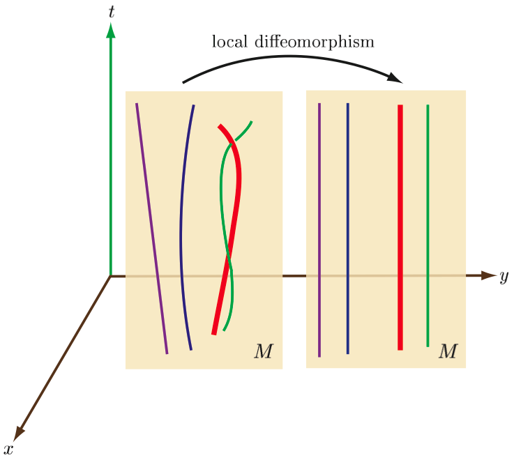

Figure 8: Weyl’s plasticine example

Applying these considerations to the fixed stars and assuming that it is possible that the (conformal) metrical field which determines the cones of light propagation (light cones) at each point of the plasticine, is carried along by the continuous transformation of the plasticine, then both the earth and the fixed stars will be at rest with respect to the plasticine’s coordinate system. Yet despite this the “star compass” is rotating with respect to the earth, exactly as we observe!

Employing the concept of the microsymmetry group (definition 4.1), Coleman and Korté (1982) have analyzed Weyl’s plasticine example in the following way: Consider a space-time manifold equipped only with a differentiable structure, the plasticine of Weyl’s example. Then our spacetime does not have an affine, conformal, projective or metric structure defined on it. In such a world it is possible do define curves and paths; however, there are no preferred curves or paths. Since there is only the differentiable structure, one may apply any diffeomorphism; that is, *all* diffeomorphisms preserve this structure; consequently, in the absence of a post-differential-topological structure, the microsymmetry group at any event $p$ is an infinite-parameter group isomorphic to the group of all invertible formal power series in four variables. If there is no post-differentiable topological geometric field in the neighbourhood of a point, then all of these infinite parameters may be chosen freely within rather broad limits. Clearly then, given an infinite number of parameters, one can, as Weyl says, straighten out an arbitrary pattern of world lines (fibers) in the neighbourhood of any event. Now suppose that there exists a post-differentiable topological geometric field, namely, the projective structure at any event of spacetime. Then the microsymmetry group that preserves that structure is a 20-parameter Lie group (see Coleman and Korté (1981)). Thus instead of an infinity of degrees of freedom, only twenty degrees of freedom may be used to actively deform the neighbouring region of spacetime. The fact that only a finite number of parameter are available prevents an arbitrary realignment of the worldlines of material bodies in the neighbourhood of any given event.

Other post-differential topological geometrical field structures are similarly restrictive. For example, the microsymmetry group of the conformal structure, which determines the causal structure of spacetime, permits 7 degrees of freedom (6 Lorentz transformations and a dilatation), and permits four more degrees of freedom in second order. Consequently, the existence of the conformal metrical field which determines at each point the cones of light propagation would prevent an arbitrary realignment of light-like fibers, that is, it would be impossible to realign the earth and the fixed stars such that both are at rest with the coordinate system of the plasticine.

Weyl’s plasticine example shows that the Leibnizian-Machian view of relative motion, namely the view according to which all motion must be defined as motion relative to bodies, is self-defeating in the general theory of relativity. The fact that a stationary, homogeneous elastic sphere will, when set in rotation, bulge at the equator and flatten at the poles is, according to Weyl (1924b), to be accounted for in the following way. The complete physical system consisting of both the body and the local inertial-gravitational field is not the same in the two situations. The cause of the effect is the state of motion of the body *with respect to* the local inertial-gravitational field, the guiding field, and is not, indeed as Weyl’s plasticine example shows, cannot be the state of motion of the body relative to other bodies. To attribute the effect as Einstein and Mach did to the rotation of the body with respect to the other *bodies* in the universe is, according to Weyl, to endorse a remnant of the unjustified monopoly of the older body ontology, namely, the sovereign right of material bodies to play the role of physically real and acceptable causal agents.[^note-75]

#### 4.4.3 Coordinate Transformation Laws of Acceleration

Weyl’s view that there must be an *inertial structure field* on spacetime, which governs material bodies in *free* *motion*, follows from the mathematical nature of the coordinate-transformation laws for acceleration. In a world equipped with only a differential structure, it is possible to do calculus; one can define curves and paths and differentiate, etc. However, as was already pointed out, in such a world, the world of Weyl’s plasticine example, there would be no preferred curves or paths. Consequently, *the motion of material bodies would not be predictable*. However, experience overwhelmingly indicates that the acceleration of a massive body cannot be freely chosen. In particular, consider a simple type of particle, a monopole (unstructured) particle. Experience overwhelmingly tells us that such a particle is characterized by the fact that at any event on its world line, its velocity at that event is sufficient to determine its acceleration at that event. Predictability of motion, therefore, entails that corresponding to every type of massive monopole, there exists a geometric structure field, or what Weyl calls a *Strukturfeld* that governs the motion of that type of particle. The basic reason which explains this brute fact of experience is a simple mathematical fact about how the acceleration of bodies transforms under a coordinate transformation. Moreover, this simple mathematical fact, involving no more than the basic techniques of partial differentiation, holds in all relativistic, non-relativistic, curved or flat, dynamic or non-dynamic spacetime theories that are based on a local differential topological structure, the minimal structure required for the possibility of assigning arbitrary local coordinates on a differential manifold.

**Transformation law for acceleration:** The transformation law for acceleration is linear, but is *not* homogeneous in the acceleration variable.

As an example consider the transformation laws for the 4-velocity and the 4-acceleration. Recall that a *curve* in the four-dimensional spacetime manifold $M$ is a map $\gamma : \mathbb{R} \rightarrow M$. For convenience we restrict our attention to those curves which satisfy $\gamma(0) = p$. If we set $\gamma^{i} = x^{i} \circ \gamma(0)$, then the components of the 4-velocity and 4-acceleration at $p \in M$ are respectively given by

$$\tag{30} \gamma^i_1 =_{def} \frac{d}{dt}\gamma^i(0), $$ $$\tag{31} \gamma^i_2 =_{def} \frac{d^2}{dt^2}\gamma^i(0), $$

The transformation laws of the 4-velocity components $\gamma^{i}_{1}$ and of the 4-acceleration components $\gamma^{i}_{2}$ under a change of coordinate chart from $(U,x)_{p}$ to $(\overline{U}, \overline{x})_p$, follow from their pointwise definition. From

$$ \overline{\gamma}^i(t) = \overline{X}^i(\gamma^i(t)), $$

where $\overline{X}^{i} = \overline{x}^i \circ x^{- 1}$, one obtains the transformation law for the 4-velocity and the 4-acceleration respectively:

$$\begin{align} \tag{32} \overline{\gamma}^i_1 &= \overline{X}^i_j \gamma^{\,j}_1 \\ \tag{33} \overline{\gamma}^i_2 &= \overline{X}^i_j \gamma^{\,j}_2 + \overline{X}^i_{jk} \gamma^{\,j}_1 \gamma^k_1. \end{align}$$

The $\overline{X}^{i}_{j}$ and $\overline{X}^{i}_{jk}$ denote the first and second partial derivatives of $\overline{X}^{i}(x^{i})$ at $x^{i} (p)$, namely,

$$ \frac{\partial \overline{x}^i}{\partial x^{j}} \text{ and } \frac{\partial \overline{x}^i}{\partial x^{j} \partial x^{k} } $$

The expression $\overline{X}^{i}_{jk}\gamma^{\,j}_{1}\gamma^{k}_{1}$ in equation (33) represents the inhomogeneous term of the transformation of the 4-acceleration. The inhomogeneity of the transformation law entails that a 4-acceleration that is zero with respect to one coordinate system is not zero with respect to another coordinate system. This means that there does not exist a unique standard of zero 4-acceleration that is intrinsic to the differential topological structure of spacetime. Moreover, even the difference of the 4-accelerations of two bodies at the same spacetime point has no absolute meaning, unless their 4-velocities happen to be the same. This shows that while the differential topological structure of spacetime gives us sufficient structure to do calculus and to derive the transformation laws for 4-velocities and 4-accelerations by way of simple differentiation, it does not provide sufficient structure with which to determine a standard of zero 4-acceleration. Therefore, as Weyl repeatedly emphasized, no solution to the problem of motion is possible, unless “we dare to *acknowledge the inertial structure as a real thing that not only exerts effects upon matter but in turn suffers such effects*”. In other words there must exist a structure in addition to the differential topological structure in the form of a geometric structure field, or in Weyl’s words, *geometrisches Strukturfeld*, which constitutes the inertial structure of spacetime, and which provides the standard of zero 4-acceleration. Since this field provides the standard of zero 4-acceleration we can call it a geodesic 4-acceleration field, or simply, geodesic acceleration field. A particle in *free motion* is one that is exclusively governed by this geodesic acceleration field.

An acceleration field, geodesic or non-geodesic, can be constructed in the following way. Since the terms that are independent of the 4-acceleration depend on both the spacetime location and on the corresponding 4-velocity of the particle, it is necessary to specify a *geometric field standard* for zero 4-acceleration that also depends on those independent variables.

The transformation law for a 4-acceleration field can be obtained from (33) by replacing $\overline{\gamma}^{i}_{2}$ by $\overline{A}^{i}_{2}(\overline{x}^{i},\overline{\gamma}^{i}_{1})$ and $\gamma^{j}_{2}$ by $A^{j}_{2}(x^{i}, \gamma^{i}_{1}$) to yield

$$ \overline{A}^{i}_{2}(\overline{x}^{i}, \overline{\gamma}^{i}_{1}) = \overline{X}^{i}_{j} A^{j}_{2}(x^{i},\gamma^{i}_{1}) + \overline{X}^{i}_{jk}\gamma^{j}_{1}\gamma^{k}_{1}. $$

The important special case for which the function $A^{i}_{2}(x^{i}, \gamma^{i}_{1})$ is a geodesic 4-acceleration field corresponds to the affine structure of spacetime. For this special case the function $A^{i}_{2}(x^{i}, \gamma^{i}_{1}$) is denoted by $\Gamma^{i}_{2}(x^{i}, \gamma^{i}_{1}$) and is given by

$$ \Gamma^{i}_{2}(x^{i},\gamma^{i}_{1}) = -\Gamma^{i}_{jk}(x^{i},\gamma^{i}_{1}) \gamma^{j}_{1}\gamma^{k}_{1}. $$

The familiar transformation law for the affine structure (geodesic 4-acceleration field) is then given by

$$\tag{34} \overline{\Gamma}^{i}_{2}(\overline{x}^{1},\overline{\gamma}^{i}_{1}) = \overline{X}^{i}_{j}\Gamma^{j}_{2}(x^{i},\gamma^{i}_{1}) +\overline{X}^{i}_{jk}\gamma^{j}_{1}\gamma^{k}_{1}. $$

Note that the inhomogeneous term $\overline{X}^{i}_{jk}\gamma^{j}_{1}\gamma^{k}_{1}$ of the geodesic 4-acceleration field is identical to the inhomogeneous term of the transformation law (33) for the 4-acceleration of body motion. The differences

$$\tag{35} \overline{\gamma}^{i}_{2} - \overline{\Gamma}^{i}_{2}(\overline{x}^{i}, \overline{\gamma}^{i}_{1}) = \overline{X}^{i}_{j}(\gamma^{j}_{2} - \Gamma^{j}_{2}(x^{i},\gamma^{i}_{1})) $$

then transform linearly and homogeneously; consequently, the vanishing or non-vanishing of body accelerations relative to the standard of zero acceleration provided by the geodesic 4-acceleration field (the affine structure), is coordinate independent. That is, the 4-accelerations of bodies and the corresponding 4-forces, are tensorial quantities in concordance with experience.

The above argument for the necessity of geometric fields also holds for 3-velocity and 3-acceleration, denoted respectively by $\xi^{\alpha}_{1}$ and $\xi^{\alpha}_{2}$. The transformation law for the 3-acceleration is much more complicated than that of the 4-acceleration. However, analogous to the case of 4-acceleration, the transformation law of 3-acceleration is linear and is inhomogeneous in the 3-acceleration variable $\xi^{\alpha}_{2}$. Consequently, there does not exist a unique standard of zero 3-acceleration that is intrinsic to the differential topological structure of spacetime. The standard of zero 3-acceleration must be provided by a geodesic 3-acceleration field or geodesic directing field, or what Weyl calls the guiding field. The guiding field is also referred to as the projective structure of spacetime and is denoted by $\Pi^{\alpha}_{2}(x^{i}, \xi^{\alpha}_{1}$). It is a function of spacetime location and the 3-velocity, both variables of which are independent of the 3-acceleration, as is required. Since the transformation law of the projective structure $\Pi^{\alpha}_{2}(x^{i}, \xi^{\alpha}_{1}$) has the same inhomogeneous form as the 3-acceleration $\xi^{\alpha}_{2}$, the difference

$$\tag{36} \xi^{\alpha}_{2} - \Pi^{\alpha}_{2}(x^{i}, \xi^{\alpha}_{1}) $$

also transforms linearly and homogeneously.

The components $\gamma^{i}_{2}$ and $\xi^{\alpha}_{2}$ of the 4-acceleration and 3-acceleration can be thought of as the dynamic descriptors of a material body. On the other hand, the components $\Gamma^{i}_{2}(x^{i},\gamma^{i}_{1}$) and $\Pi^{\alpha}_{2}(x^{i}, \xi^{\alpha}_{1}$) of the geodesic acceleration field, and the geodesic directing field, respectively, are *field* quantities. The differences

$$\tag{37} \gamma^{i}_{2} - \Gamma^{i}_{2}(x^{i},\gamma^{i}_{1}) $$

and

$$\tag{38} \xi^{\alpha}_{2} -\Pi^{\alpha}_{2}(x^{i}, \xi^{\alpha}_{1}) $$

denote the components of a coordinate independent *field-body* *relation*.[^note-76]

Weyl (1924b) remarks:

> We have known since Galileo and Newton, that the motion of a body involves an inherent struggle between inertia and force. According to the old view, the inertial tendency of persistence, the “guidance”, which gives a body its natural inertial motion, is based on a formal geometric structure of the spacetime (uniform motion in a straight line) which resides once and for all in spacetime independently of any natural processes. This assumption Einstein rejects; because whatever exerts as powerful effects as inertia—for example, in opposition to the molecular forces of two colliding trains it rips apart their freight cars—must be something real which itself suffers effect from matter. Moreover, Einstein recognized that the guiding field’s variability and dependence on matter is revealed in gravitational effects. Therefore, the dualism between guidance and force is maintained; but
>
> **(G)** *Guidance is a physical field, like the electromagnetic field, which stands in mutual interaction* *with matter. Gravitation belongs to the guiding field and not to force.* Only thus is it possible to explain the equivalence between inertial and gravitational mass.

To move from the old conception to the new conception (G) means, according to Weyl (1924b)

> *to replace the geometric difference between uniform and accelerated motion with the dynamic difference between guidance and force.* Opponents of Einstein asked the question: Since the church tower receives a jolt in its motion relative to the train just as the train receives a jolt in its motion relative to the church tower, why does the train become a wreckage and not the church tower which it passes? Common sense would answer: because the train is ripped out of the pathway of the guiding field, but the church tower is not. … As long as one ignores the guiding field one can neither speak of absolute nor of relative motion; only if one gives due consideration to the guiding field does the concept of motion acquire content. The theory of relativity, correctly understood, does not eliminate absolute motion in favour of relative motion, rather it eliminates the kinematic concept of motion and replaces it with a dynamic one. The worldview for which Galileo fought is not undermined by it [relativity]; to the contrary, it is more concretely interpreted.

#### 4.4.4 Weyl’s Field-Body Relationist Ontology and Newton’s Laws of Motion

It is now possible to provide a reformulation of Newton’s laws of motion which explicitly takes account of Weyl’s field-body-relationalist spacetime ontology, and his analysis of the concept of motion. The law of inertia is an empirically verifiable statement[^note-77] which says

> **The Law of Inertia:** There exists on spacetime a unique projective structure $\Pi_{2}$ or equivalently, a unique geodesic directing field $\Pi_{2}$.

*Free motion* is defined with reference to the projective structure $\Pi_{2}$ as follows:

> **Definition of Free Motion:** A possible or actual material body is in a state of free motion during any part of its history just in case its motion is exclusively governed by the geodesic directing field (projective structure), that is, just in case the corresponding segment of its world path is a solution path of the differential equation determined by the unique projective structure of spacetime.

Newton’s second law of motion may be reformulated as follows:

> **The Law of Motion:** With respect to any coordinate system, the world line path of a possible or actual material body satisfies an equation of the form
>
> $$ m(\xi^{\alpha}_{2} - \Pi^{\alpha}_{2}(x^{i}, \xi^{\alpha}_{1})) = F^{\alpha}(x^{i},\xi^{\alpha}_{1}), $$
>
> where $m$ is a scalar constant characteristic of the material body called its inertial mass, and $F^{\alpha}(x^{i},\xi^{\alpha}_{1}$) is the 3-force acting on the body.

To emphasize, the Law of Inertia and the Law of Motion, as formulated above, apply to *all*, relativistic or non-relativistic, curved or flat, dynamic or non-dynamic, spacetime theories. The reason for the general character of these laws consists in the fact that they require for their formulation only the local differential topological structure of spacetime, a structure which is common to all spacetime theories. In addition, as was noted earlier in §4.2, the affine and projective spacetime structures are G-structures. Consequently, they may be flat or non-flat; *but they can never vanish*. In theories prior to the advent of general relativity, the affine and projective structures were flat. It was common practice, however, to use coordinate systems that were *adapted* to these flat G-structures. And since in such adapted coordinate systems the components of the affine and projective structures vanish, it was difficult to recognize and to appreciate the existence of these structures, and their important role in providing a coherent account of motion.

#### 4.4.5 Mie’s Pure Field Theory, Weyl’s ‘Agens Theory’ and Wormhole Theory of Matter

We saw that Weyl forcefully advocated a *field-body ontological dualism*, according to which matter and the guiding field are independent physical realities that causally interact with each other: matter uniquely generates the various states of the guiding field, and the guiding field in turn acts on matter.

Weyl did not always subscribe to this ontological dualist position. For a short period, from 1918 to 1920, he advocated a *pure field theory of matter* , developed in 1912 by Gustav Mie, in the context of Einstein’s special theory of relativity:

**Pure Field Theory of Matter:** The physical field has an independent reality that is not reducible to matter; rather, the physical field is constitutive of all matter in the sense that the mass (quantity of matter) of a material particle, such as an electron, consists of a large field energy that is concentrated in a very small region of spacetime.

Mie’s theory of matter is akin to the traditional *geometric view* of matter: matter is *passive* and *pure* *extension*. Weyl (1921b) remarks that he adopted the standpoint of the classical pure field theory of matter in the first three editions of Weyl (1923b) because of its beauty and unity, but then gave it up. Weyl (1931a) points out in the Rouse Ball Lecture that since the theory of general relativity geometrized a physical entity, the gravitational field, it was natural to try to *geometrize the whole of physics*. Prior to the advent of quantum physics one was justified in regarding gravitation and electromagnetism as the only basic entities of nature and to seek their unification by geometrizing both. One could hope, following the example of Gustav Mie, to construct elementary material particles as *knots of energy* in the gravitational-electromagnetic field, that is, tiny demarcated regions in which the field magnitudes attain very high values.

Already in a letter to Felix Klein,[^note-78] toward the end of 1920, Weyl indicated that he had finally freed himself completely from Mie’s theory of matter. It now appeared to him that the classical field theory of matter is not the key to reality. In the Rouse Ball Lecture Weyl adduces two reasons for this.

First, due to quantum mechanics, there are, in addition to electromagnetic waves, *matter waves* (*Materiewellen*) represented by Schrödinger’s wave function $\psi$. And Pauli and Dirac recognized that $\psi$ is not a scalar but a magnitude with several components. Thus, from the point of view of the classical field theory of matter not two but three entities would have to be unified. Moreover, given the transformation properties of the wave function, Weyl says it is certain that the magnitude $\psi$ cannot be reduced to gravitation or electromagnetism. Weyl saw clearly, that this *geometric view* of matter or physics—which to a certain extent had also motivated his earlier construction and manner of presentation of a *pure infinitesimal geometry*—was untenable in light of the new developments in atomic physics.

The second reason, Weyl says, consists in the radical new interpretation of the wave function, which replaces the concept of intensity with that of probability. It is only through such a statistical interpretation that the corpuscular and atomistic aspect of nature is properly recognized. Instead of a *geometric* treatment of the classical field theory of matter, the new quantum theory called for a *statistical* treatment of matter.[^note-79] Already in 1920, Weyl (1920) addressed the relationship between *causal* and *statistical* approaches to physics.[^note-80]

The theory of general relativity, as well as early developments in atomic physics, clearly tell us, Weyl (1921b) suggests, that matter uniquely determines the field, and that there exist deeper underlying physical laws with which modern physics, such as quantum theory, is concerned, which specify “how the field is affected by matter”. That is, experience tells us that matter plays the role of a *causal agent* which uniquely determines the field, and which therefore has an independent physical reality that cannot be reduced to the field on which it acts. Weyl (1921b, 1924e) refers to his theory of matter as the *Agenstheorie der Materie* (literally, *agent-theory of matter*):

**Matter-Field Dualism (Weyl’s Agens Theory of Matter):** Matter and field are independent physical realities that causally interact with each other: matter uniquely generates the various states of the field, and the field in turn acts on matter. To excite the field is the essential primary function of matter. The field’s function is to respond to the action of matter and is thus secondary. The secondary role of the field is to transmit effects (from body to body) caused by matter, thereby in return affecting matter.

The view, that *matter uniquely determines the field*, was a necessary postulate of an opposing ontological standpoint, according to Weyl. The postulate essentially says that *Matter is the only thing which is genuinely real*. According to this ontological view, held to a certain degree by the younger Einstein and others who advocated a form of Machian empiricism, the field is relegated to play the role of a feeble extensive medium which transmits effects from body to body.[^note-81] According to this opposing ontological view, the field laws, that is, certain implicit differential connections between the various possible states of the field, on the basis of which the field alone is capable of transmitting effects caused by matter, can essentially have no more significance for reality than the laws of geometry could, according to earlier views. But as we saw earlier, Weyl held that no satisfactory solution can be given to the problem of motion as long as we adhere to the Einstein-Machian empiricist position that relegates the field to the role of a feeble extensive medium, and which does not acknowledge that the guiding field is physically real. However, from the standpoint of Weyl’s *agens theory of matter*, a satisfactory answer to Mach’s paradox can be given: the reason why a stationary, homogeneous elastic sphere will bulge at the equator and flatten at the poles, when set in rotation, is due to the fact that the complete physical system consisting of both the body *and* the guiding field, differs in the rotating case from the stationary one. The local guiding field is the real cause of the inertial forces.

Weyl lists two reasons in support for his agens theory of matter. First, the agens theory of matter is the only theory which coheres with the basic experiences of life and physics: matter generates the field and all our actions ultimately involve matter. For example, only through matter can we change the field. Secondly, in order to understand the fact of the existence of charged material particles, we have two possibilities: either we follow Mie and adopt a pure field theory of matter, or we elevate the ontological status of matter and regard it as a *real* singularity of the field and not merely as a high concentration of field energy in a tiny region of spacetime. Since Mie’s approach is necessarily limited to the framework of the theory of special relativity, and since there is no room in the general theory of relativity for a generalization and modification of the classical field laws, as envisaged by Mie in the context of the special theory of relativity, Weyl adopted the second possibility. He was motivated to do so by his recognition that the field equation of an electron at rest contains a finite mass term $m$ that appears to have nothing to do with the energy of the associated field. Weyl’s subsequent analysis of mass in terms of electromagnetic field energy provided a definition of mass and a derivation of the basic equations of mechanics, and led Weyl to the invention of the topological idea of *wormholes* in spacetime. Weyl did not use the term ‘wormholes’; it was John Wheeler who later coined the term ‘wormhole’ in 1957. Weyl spoke of *one-dimensional tubes* instead. “Inside” these tubes no space exists, and their boundaries are, analogous to infinite distance, inaccessible; they do not belong to the field. In a chapter entitled “Hermann Weyl and the Unity of Knowledge” Wheeler (1994) says,

> Another insight Weyl gave us on the nature of electricity is topological in character and dates from 1924. We still do not know how to assess it properly or how to fit it into the scheme of physics, although with each passing decade it receives more attention. The idea is simple. Wormholes thread through space as air channels through Swiss cheese. Electricity is not electricity. Electricity is electric lines of force trapped in the topology of space.

#### 4.4.6 Relativistic Cosmology and Weyl’s Postulate

A year after Einstein (1916) had established the field equations of his new general theory of relativity, Einstein (1917) applied his theory for the first time to cosmology. In doing so, Einstein made several assumptions:

**Cosmological Principle:** Like Newton, Einstein assumed that the universe is *homogeneous* and *isotropic* in its distribution of matter.

**Static Universe:** Einstein assumed, as did Newton and most cosmologists at that time, that the universe is static on the large scale.

**Mach’s Principle:** Einstein believed that the metric field is completely determined through the masses of bodies. The metric field is determined through the energy-momentum tensor of the field equations.

The *cosmological principle* continuous to play an important role in cosmological modelling to this day. However, Einstein’s second assumption that the universe is static was in conflict with his field equations, which permitted models of the universe that were homogeneous and isotropic, but *not static*. In this regard, Einstein’s difficulties were essentially the same that Newton had faced: A static Newtonian model involving an infinite container with an infinite number of stars was unstable; that is, local regions would collapse under gravity. Because Einstein was committed to Mach’s Principle he faced a problem concerning the *boundary conditions* for *infinite* space containing *finite* amount of matter.[^note-82] Einstein recognized that it was impossible to choose boundary conditions such that the ten potentials of the metric $g_{ij}$ are completely determined by the energy-momentum tensor $T_{ij}$, as required by Mach’s Principle. That is, the boundary conditions “flat at infinity” entail a *global inertial frame* that is tied to *empty flat space at infinity*, and hence is unrelated to the mass-energy content of space, contrary to Mach’s Principle, according to which *only* mass-energy can influence inertia.

Einstein thought that he could solve the difficulties of an unstable non-static universe with boundary conditions at infinity that do not satisfy Mach’s Principle, by introducing the cosmological term $\Lambda$ into his field equations. He showed that for positive values of the cosmological constant, his modified field equation admitted a solution for a static[^note-83] universe in which space is curved, unbounded and finite; that is, space is a hyper surface of a *sphere in four* *dimensions*. Einstein’s spatially closed universe is often referred to as Einstein’s “cylinder” world: with two of the spatial dimensions suppressed, the model universe can be pictured as a cylinder where the radius $A$ represents the space and the axis the time coordinate.

*Figure 9:*

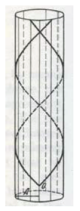

Figure 9: Einstein Universe

According to Einstein’s Machian convictions, since inertia is determined only by matter, there can be no inertial structure or field in the absence of matter. Consequently, it is impossible, Einstein conjectured, to find a solution to the field equations—that is, to determine the metric $g_{ij}$—if the energy-momentum tensor $T_{ij}$ representing the mass-energy content of the universe is zero. The non-existence of ‘vacuum solutions’ for a static universe demonstrated, Einstein thought, that Mach’s Principle had been successfully incorporated into his theory of general relativity. Einstein also believed that his solution was unique because of the assumptions of isotropy and homogeneity.[^note-84]

However, Einstein was mistaken. In 1917, the Dutch astronomer Willem de Sitter published another solution to Einstein’s field equations containing the cosmological constant. De Sitter’s solution showed that Einstein’s solution is not a unique solution of his field equations. In addition, since de Sitter’s universe is empty it provided a direct counter-example to Einstein’s hope that Mach’s Principle had been successfully incorporated into his theory.[^note-85]

There are cosmologists who, like Einstein, are favourably disposed towards some version of Mach’s Principle, and who believe that the local laws, which are satisfied by various physical fields, are determined by the large scale structure of the universe. On the other hand, there are those cosmologists who, like Weyl, take a conservative approach; they take empirically confirmed *local* laws and investigate what these laws might imply about the universe as a whole. Our understanding of the large scale structure of the universe, Weyl emphasized, must be based on theories and principles which are verified locally. Einstein’s general theory is a *local* field theory; like electromagnetism, it is a *close action* *theory*.[^note-86] Weyl (1924b) says:

> It appears to me that one can grasp the concrete physical content of the theory of relativity without taking a position regarding the causal relationship between the masses of the universe and inertia.

And, referring to (G), (see citation at the end of §4.4.3), which says that “*Guidance is a physical field, like the electromagnetic field, which stands in mutual interaction with matter. Gravitation belongs to the guiding field and not to force*”, Weyl (1924b) says:

> What I have so far presented and briefly formulated in the two sentences of G, that alone impacts on physics and underlies the actual individual investigations of problems of the theory of relativity. Mach’s Principle, according to which the fixed stars intervene with mysterious power in earthly events, goes far beyond this [G] and is until now pure speculation; it merely has cosmological significance and does not become important for natural science until astronomical observations reach the totality of the cosmos [Weltganze], and not merely one island of stars [Sterneninsel]. We could leave the question unanswered if I did not have to admit that it is tempting to construct, on the basis of the theory of relativity, a picture of the totality of the cosmos.

Weyl’s claim is that because general relativity is an inherently *local* field theory, its validity and soundness is essentially independent of global cosmological considerations. However, if we wish to introduce such global considerations into our local physics, then we can do so only on the basis of additional assumptions, such as, for example, the Cosmological Principle, already mentioned. In 1923 Weyl (1923b, §39) introduced another cosmological assumption, namely, the so-called *Weyl Postulate*. De Sitter’s solution and the new astronomical discoveries in the early 1920’s, which suggested that the universe is not static but expanding, led to a drastic change in thinking about the nature of the universe and an increased scepticism towards Einstein’s model of a static universe. In 1923, Weyl (1923b, §39) notes in the fifth edition of *Raum Zeit Materie*, that despite its attractiveness, Einstein’s cosmology suffers from serious defects. Weyl begins by pointing out that spectroscopic results indicate that the stars have an age. Weyl continued,

> all our experiences about the distribution of stars show that the present state of the starry sky has nothing to do with a “*statistical final state*.” The small velocities of the stars is due to a common origin rather than some equilibrium; incidentally, it appears, based on observation, that the more distant configurations are from each other, the greater the velocities on average. Instead of uniform distribution of matter, astronomical facts lead rather to the view that individual clouds of stars glide by in vast empty space.

Weyl further points out that de Sitter showed that Einstein’s cosmological equations of gravity have “a very simple regular solution” and that an empty spacetime, namely, “a metrically homogeneous spacetime of non-vanishing curvature,” is compatible with these equations after all. Weyl says that de Sitter’s solution, which on the whole is not static, forces us to abandon our predilection for a static universe.

The Einstein and the de Sitter universe are both spacetimes with two separate fringes, the infinitely remote past and the infinitely remote future. Dropping two of its spatial dimensions we imagine Einstein’s universe as the surface of a straight cylinder of a certain radius and de Sitter’s universe as a one sheeted hyperboloid. Both surfaces are surfaces of infinite extent in both directions. Both the Einstein universe and the de Sitter universe spread from the eternal past to the eternal future. However, unlike de Sitter’s universe, in Einstein’s universe “the metrical relations are such that the light cone issuing from a world point is folded back upon itself an infinite number of times. An observer should therefore see infinitely many images of a star, showing him the star in states between which an eon has elapsed, the time needed by the light to travel around the sphere of the world.” Weyl (1930) says:

> … I start from de Sitter’s solution: the world, according to its metric constitution, has the character of a four-dimensional “sphere” (hyperboloid)
>
> $$\tag{39} x^{2}_{1} + x^{2}_{2} + x^{2}_{3} + x^{2}_{4} - x^{2}_{5} = a^{2} $$
>
> in a five-dimensional quasi-euclidean space, with the line element
>
> $$\tag{40} ds^{2} = dx^{2}_{1} + dx^{2}_{2} + dx^{2}_{3} + dx^{2}_{4} - dx^{2}_{5}. $$
>
> The sphere has the same degree of metric homogeneity as the world of the special theory of relativity, which can be conceived as a four-dimensional “plane” in the same space. The plane, however, has only one connected infinitely distant “seam,” while it is the most prominent topological property of the sphere to be endowed with two—the infinitely distant past and the infinitely distant future. In this sense one may say that space is closed in de Sitter’s solution. On the other hand, however, it is distinguished from the well-known Einstein solution, which is based on a homogeneous distribution of mass, by the fact that the null cone of future belonging to a world-point does not overlap with itself; in this causal sense, the de Sitter space is open.

On this hyperboloid, a single star (nebula or galaxy, in later contexts) $A$, also called “observer” by Weyl, traces a geodesic world line, and from each point of the star’s world line a light cone opens into the future and fills a region $D$, which Weyl calls the *domain of influence of the star.* In de Sitter’s cosmology this domain of influence covers only half of the hyperboloid and Weyl suggests that it is reasonable to assume that this half of the hyperboloid corresponds to the real world.

*Figure 10:*

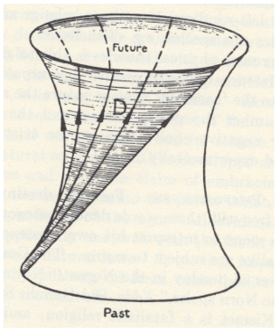

Figure 10: De Sitter’s hyperboloid with domain of influence $D$ covering half of the hyperboloid and world lines of stars.

There are innumerable stars or geodesics, according to Weyl, that have the same domain of influence as the arbitrarily chosen star $A$; they form, he says, a *system that has been causally interconnected since eternity.* Such a system of causally interconnected stars Weyl describes as stars of a common origin that lies in an infinitely remote past. The sheaf of world-lines of such a system of stars converges, in the direction of the infinitely remote past, on an infinitely small part of the total extent of the hyperboloid, and diverges in the direction of the future on an ever increasing extent of the hyperboloid. Weyl’s choice of singling out a particular sheaf of non-intersecting timelike geodesics as constituting the cosmological substratum is the content of Weyl’s Postulate. Weyl (1923b, 295) says:

> The hypothesis is suggestive, that all the celestial bodies which we know belong to such a single system; this would explain the small velocities of the stars as a consequence of their common origin.

The transition from a static to a dynamic universe opens up the possibility of a disorderly universe where galaxies could collide, that is, their world lines might intersect. Roughly speaking, Weyl’s Postulate states that the actual universe is an orderly universe. It says that the world lines of the galaxies form a 3-sheaf of non-intersecting[^note-87] geodesics orthogonal to layers of spacelike hypersurfaces.

*Figure 11:*

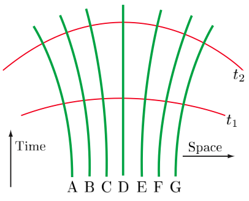

Figure 11: Weyl’s Postulate

Since the relative velocities of matter is small in each collection of galaxies extending over an astronomical neighbourhood, one can approximate a “smeared-out” motion of the galaxies and introduce a *substratum* or *fluid* which fills space and in which the galaxies move like “fundamental particles”.[^note-88] Weyl’s postulate says that observers associated with this smeared-out motion constitute a privileged class of observers of the universe. Since geodesics do not intersect, according to Weyl’s Postulate, there exist one and only one geodesic which passes through each spacetime point. Consequently, matter possesses a unique velocity at any spacetime point. Therefore, the fluid may be regarded as a *perfect fluid*; and this is the essential content of Weyl’s Postulate.

Since the geodesics of the galaxies are orthogonal to a layer of spacelike hypersrfaces according to Weyl’s Postulate, one can introduce coordinates $(x^{0}, x^{1}, x^{2}, x^{3})$ such that the spacelike hypersurfaces are given by $x^{0} =$ constant, and the spacelike coordinates $x^{\alpha}$ $(\alpha = 1, 2, 3)$ are constant along the geodesics of each galaxy. Therefore, the spacelike coordinates $x^{\alpha}$ are *co-moving* coordinates along the geodesics of each galaxy. The orthogonality condition permits a choice of the time coordinate $x^{0}$ such that the metric or line element has the form

$$\begin{align} ds^{2} &= (dx^{0})^{2} - g_{\alpha \beta}dx^{\alpha}dx^{\beta} \\ \tag{41} &= c^{2}dt^{2} - g_{\alpha \beta}dx^{\alpha}dx^{\beta}, \end{align}$$

where $ct = x^{0}, x^{0}$ is called the *cosmic time*, and $t$ is the *proper time* of any galaxy. The spacelike hypsersurfaces are therefore the surfaces of simultaneity with respect to the cosmic time $x^{0}$. The Cosmological Principle in turn tells us that these hypersurfaces of simultaneity are homogeneous and isotropic.

Independently, Robertson and Walker, were subsequently able to give a precise mathematical derivation of the most general metric by assuming Weyl’s Postulate and the Cosmological Principle.

#### 4.4.7 Discovering Hubble’s Law

Weyl’s introduction of his Postulate made it possible for him to provide the first satisfactory treatment of the cosmological redshift. Consider a light source, say a star $A$, which emits monochromatic light that travels along null geodesics $L, L',\ldots$ to an observer $O$. Let $s$ be the proper time of the light source, and let $\sigma$ be the proper time of the observer $O$. Then to every point $s$ on the world line of the light source $A$ there corresponds a point on the world line of the observer $O$, namely, $\sigma = \sigma(s)$.

*Figure 12:*

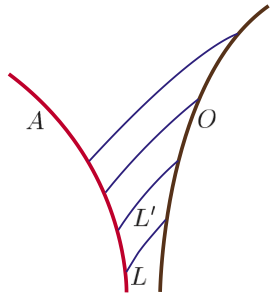

Figure 12: A body or star $A$ emits monochromatic light which travels along null geodesics $L, L',\ldots$ to an observer $O$.

Consequently, if one of the generators of the light cone issuing from $A$’s world line at $A$’s proper time $s_{0}$—the null geodesic $L$—reaches observer $O$ at the observer’s proper time $\sigma(s_{0})$, then

$$\tag{42} d\sigma = \left.\frac{d\sigma(s)}{ds}\right|_{s_0} ds. $$

Therefore, the frequency $\nu_{A}$ of the light that would be measured by some hypothetical observer on $A$ is related to the frequency $\nu_{O}$ measured on $O$ by

$$\tag{43} \frac{\nu_{O}}{\nu_{A}} = \frac{d\sigma(s)}{ds}. $$

According to Weyl (1923c) this relationship holds in arbitrary spacetimes and for arbitrary motions of source and observer. Weyl (1923b, Anhang III) then applied this relationship to de Sitter’s world and showed, to lowest order, that the redshift is *linear* in distance; that is, Weyl theoretically derived, what was later called *Hubble’s redshift law*. Using Slipher’s redshift data Weyl estimated a *Hubble constant* six years prior to Hubble. Weyl (1923b, Anhang III) remarks:

> It is noteworthy that neither the elementary nor Einstein’s cosmology lead to such a redshift. Of course, one cannot claim today, that our explanation hits the right mark, especially since the views about the nature and distance of the spiral nebulae are still very much in need of further clarification.

In 1933 Weyl gave a lecture in Göttingen in which Weyl (1934b) recalls

> According to the Doppler effect the receding motion of the stars is revealed in a redshift of their spectral lines which is proportional to distance. In this form, where De Sitter’s solution of the gravitational equation is augmented by an assumption concerning the undisturbed motion of the stars, I had predicted the redshift in the year 1923.

### 4.5 Quantum Mechanics and Quantum Field Theory

#### 4.5.1 Group Theory

During the period 1925–1926 Weyl published a sequence of groundbreaking papers (Weyl (1925, 1926a,b,c)) in which he presented a general theory of the representations and invariants of the classical Lie groups. In these celebrated papers Weyl drew together I. Schur’s work on invariants and representations of the $n$-dimensional rotation group, and É. Cartan’s work on semisimple Lie algebras. In doing so, Weyl utilized different fields of mathematics such as, tensor algebra, invariant theory, Riemann surfaces and Hilbert’s theory of integral equations. Weyl himself considered these papers his greatest work in mathematics.

The central role that group theoretic techniques played in Weyl’s analysis of spacetime was one of several factors which led Weyl to his general theory of the representations and invariants of the classical Lie groups. It was in the context of Weyl’s investigation of the space-problem (see §4.2) that Weyl came to appreciate the value of group theory for investigating the mathematical and philosophical foundations of physical theories in general, and for dealing with fundamental questions motivated by the general theory of relativity, in particular.

A motivation of quite another sort, which led Weyl to his general representation theory, was provided by Study when he attacked Weyl specifically, as well as other unnamed individuals, by accusing them “of having neglected a rich cultural domain (namely, the theory of invariants), indeed of having completely ignored it”.[^note-89] Weyl (1924c) replied immediately providing a new foundation for the theory of invariants of the special linear groups $SL(n, \mathbb{C})$ and its most important subgroups, the special orthogonal group $SO(n, \mathbb{C})$ and the special symplectic group $SSp(\bfrac{n}{2}, \mathbb{C})$ (for $n$ even) based on algebraic identities due to Capelli. In a footnote, Weyl (1924c) sarcastically informed Study that “even if he [Weyl] had been as well versed as Study in the theory of invariants, he would not have used the symbolic method in his book *Raum, Zeit, Materie* and even with the last breath of his life would not have mentioned the algebraic completeness theorem for invariant theory”. Weyl’s point was that in the context of his book *Raum-Zeit-Materie*, the kernel-index method of tensor analysis is more appropriate than the methods of the theory of algebraic invariants.[^note-90]

While this account of events leading up to Weyl’s groundbreaking papers on group theory seems reasonable enough, Hawkins (2000) has suggested a fuller account, which brings into focus Weyl’s deep philosophical interest in the mathematical foundations of the theory of general relativity by drawing attention to Weyl (1924d) on tensor symmetries, which, according to Hawkins, played an important role in redirecting Weyl’s research interests toward pure mathematics.[^note-91] Weyl (1949b, 400) himself noted that his interest in the philosophical foundations of the general theory of relativity motivated his analysis of the representations and invariants of the continuous groups: “I can say that the wish to understand what really is the mathematical substance behind the formal apparatus of relativity theory led me to the study of representations and invariants of groups; and my experience in this regard is probably not unique”. Weyl’s paper (Weyl (1924a)), and the first chapter Weyl (1925) of his celebrated papers on representation theory, have the same title: “The group theoretic foundation of the tensor calculus”. Hawkins (1998) says, Weyl

> had obtained through the theory of groups, and in particular through the theory of group representations—as augmented by his own contributions—what he felt was a proper mathematical understanding of tensors, tensor symmetries, and the reason they represent the source of all linear quantities that might arise in mathematics or physics. Once again, he had come to appreciate the importance of the theory of groups—and now especially the theory of group representation—for gaining insight into mathematical questions suggested by relativity theory. Unlike his work on the space problem …Weyl now found himself drawing upon far more than the rudiments of group theory. … And of course Cartan[^note-92] had showed that the space problem could also be resolved with the aid of results about representations. In short, the representation theory of groups had proved itself to be a powerful tool for answering the sort of mathematical questions that grew out of Weyl’s involvement with relativity theory.

Somewhat later, Weyl (1939) wrote a book, entitled *The Classical Groups, Their Invariants and Representations*, in which he returned to the theory of invariants and representations of the semisimple Lie groups. In this work, he satisfied his ambition “to derive the decisive results for the most important of these groups by direct algebraic construction, in particular for the full group of all non-singular linear transformations and for the orthogonal group”. He intentionally restricted the discussion of the general theory and devoted most of the book to the derivation of specific results for the general linear, the special linear, the orthogonal and the symplectic groups.[^note-93]

#### 4.5.2 Weyl’s philosophical critique of Cartan’s approach to geometry

As far back as the 1920s, the great French mathematician and geometer Élie Cartan had recognized that the notions of *parallelism* and *affine connection* admit of an important generalization in the sense that (1) the spaces for which the notion of infinitesimal parallel transport is defined need not be the tangent spaces that intrinsically arise from the differential structure of a Riemannian manifold $M$ at each of its points; rather, the spaces are general spaces that are not intrinsically tied to the differential manifold structure of $M$, and (2) relevant groups operate on these general spaces directly and not on the manifold $M$, and therefore groups play a dominant and independent role.

Weyl (1938a) published a critical review of Cartan’s (1937) book in which Cartan further developed his notion of *moving frames* (“repères mobiles”) and *generalized spaces* (“espaces généralisés”). However, Weyl (1988) expressed some of his reservations to Cartan’s approach as early as 1925; and four years later Weyl (1929e) presented a more detailed critique.

Cartan’s approach to differential geometry is in response to the fact that Euclidean geometry was generalized in two ways resulting in essentially two incompatible approaches to geometry.[^note-94] The first generalization occurred with the discovery of non-Euclidean geometries and with Klein’s (1921) subsequent Erlanger program in 1872, which provided a coherent group theoretical framework for the various non-Euclidean geometries. The second generalization of Euclidean geometry occurred when Riemann (1854) discovered Riemannian geometry.

The two generalizations of Euclidean geometry essentially constitute incompatible approaches to applied geometry. In particular, while Klein’s Erlanger program provides an appropriate group theoretical framework for Einstein’s theory of special relativity, it is Riemannian geometry, and not Klein’s group theoretic approach, which provides the appropriate underlying geometric framework for Einstein’s theory of general relativity. As Cartan observes:

> General relativity threw into physics and philosophy the antagonism that existed between the two principle directors of geometry, Riemann and Klein. The space-times of classical mechanics and of special relativity are of the type of Klein, those of general relativity are of the type of Riemann.[^note-95]

Cartan eliminated the incompatibility between the two approaches by synthesizing Riemannian geometry and Klein’s Erlanger program through a further generalization of both, resulting in what Cartan called, *generalized spaces* (or *generalized geometries*).

In his Erlanger program, Klein provided a unified approach to the various “global” geometries by showing that each of the geometries is characterized by a particular group of transformations: Euclidean geometry is characterized by the group of translations and rotations in the plane; the geometry of the sphere $S^{2}$ is characterized by the orthogonal group $O(3)$; and the geometry of the hyperbolic plane is characterized by the pseudo-orthogonal group $O(1, 2)$. In Klein’s approach each geometry is a (connected) manifold endowed with a group of automorphisms, that is, a Lie group $G$ of “motions” that acts *transitively* on the manifold, such that two figures are regarded as congruent if and only if there exists an element of the appropriate Lie group $G$ that transforms one of the figures into the other. A generalized geometry in Klein’s sense shifts the emphasis from the underlying manifold or space to the group. Thus a Klein geometry (space) consists of, (1) a smooth manifold, (2) a Lie group $G$ (the principal group of the geometry), and (3) a transitive action of $G$ on the manifold. Besides being “global”, a Klein geometry (space) is completely homogeneous in the sense that its points cannot be distinguished on the basis of geometric relations because the transitive group action preserves such relations.

As Weyl (1949b) describes it, Klein’s approach to the various “global” geometries is very suited to Einstein’s theory of special relativity:

> According to Einstein’s special relativity theory the four-dimensional world of the spacetime points is a Klein space characterized by a definite group $\Gamma$; and that group is the … group of Euclidean similarities—with one very important difference however. The orthogonal transformations, i.e., the homogeneous linear transformations which leave
>
> $$ x^{2}_{1} + x^{2}_{2} + x^{2}_{3} + x^{2}_{4} $$
>
> unchanged have to be replaced by the Lorentz transformations leaving
>
> $$ x^{2}_{1} + x^{2}_{2} + x^{2}_{3} - x^{2}_{4} $$
>
> invariant.

However, with the advent of Einstein’s general theory of relativity the emphasis shifted from *global* homogeneous geometric structures to *local* inhomogeneous structures. Whereas Klein spaces are global and fully homogeneous, the Riemannian metric structure underlying Einstein’s general theory is local and inhomogeneous. A general Riemannian space admits of no isometry other than the identity.

Referring to Cartan (1923a), Weyl (1929e) says that Cartan’s generalization of Klein geometries consists in adapting Klein’s Erlanger program to infinitesimal geometry by applying Klein’s Erlanger program to the tangent plane rather than to the manifold itself.[^note-96]

> Cartan developed a general scheme of infinitesimal geometry in which Klein’s notions were applied to the tangent plane and not to the $n$-dimensional manifold $M$ itself.

*Figure 13:*

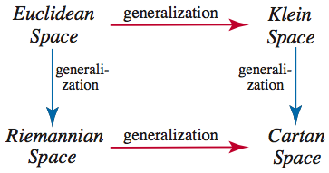

Figure 13: Cartan’s generalization

Figure 13 above, adapted from Sharpe (1997), may help in clarifying the discussion. The generalization of Euclidean geometry to a Riemannian space (the left vertical blue arrow) says:

1. A general Riemannian space approximates Euclidean space only locally; that is, at each point $p \in M$ there exists a **tangent space** $T(M_{p})$ *that arises intrinsically from the underlying differential structure of* $M$.
2. In addition, a Riemannian space is inhomogeneous through the introduction of curvature.

Analogously, Cartan’s generalization of a Klein space to a Cartan space (the right vertical blue arrow) says:

1. Cartan’s generalized space $\Sigma(M)$ approximates a Klein space only locally; that is, at each point $p \in M$ there exists a **“Tangent Space”**, that is, a Klein space $\Sigma(M_{p})$. Note that a Klein space $\Sigma(M_{p})$ is itself a generalized space (in the sense of Cartan) with zero curvature; it possesses perfect homogeneity.
2. In addition, Cartan’s generalized space $\Sigma(M)$ is inhomogeneous by the introduction of curvature.

*Figure 14:*

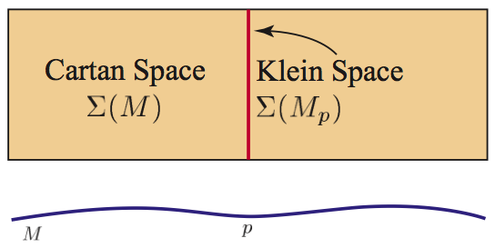

Figure 14: Cartan’s generalized space

Cartan’s generalized space $\Sigma$(M) is the space of all **“Tangent Spaces”** (i.e., all Klein spaces $\Sigma(M_{p}))$ and contains a mixture of homogeneous and inhomogeneous spaces (see figure 14).

Finally, Cartan’s generalization of Riemannian space (lower horizontal red arrow) (figure 13) turns on the recognition that the **“Tangent Space”** in Cartan’s sense is not the same, or need not be the same, as the ordinary **tangent space** that arises naturally from the underlying differential structure of a Riemannian manifold. Cartan’s **“Tangent Space”** $\Sigma(M_{p})$ at $p \in M$ denotes what is known as a *fiber* in modern fiber bundle language, where the manifold $M$ is called the *base space* of the fiber bundle.

In Weyl (1929e, 1988) and to a lesser extent in Weyl (1938a), Weyl objected to Cartan’s approach by noting that Cartan’s **“Tangent Space”**, namely the Klein space $\Sigma(M_{p})$ associated with each point of the manifold $M$, does not arise intrinsically from the differential structure of the manifold the way the ordinary tangent vector space does. Weyl therefore noted that it is necessary to impose certain non-intrinsic embedding conditions on $\Sigma(M_{p})$ that specify how the **“Tangent Space”** $\Sigma(M_{p})$ is associated with each point of the manifold $M$. Paraphrasing Weyl, the situation is as follows: We assume that we can associate a copy $\Sigma(M_{p})$ of a given Klein space with each point $p$ of the manifold $M$ and that the displacement of the Klein space $\Sigma(M_{p})$ at $p \in M$ to the Klein space $\Sigma(M_{p'})$ associated with an infinitely nearby point $p'\in M$, constitutes an isomorphic representation of $\Sigma(M_{p})$ on $\Sigma(M_{p'})$ by means of an infinitesimal action of the group $G$. In choosing an admissible frame of reference $f$ for each Klein space $\Sigma(M_{p})$, their points are represented by *normal* coordinates $\xi$. Any two frames $f,f'$ are related by a group element $s \in G$, and a succession of transformations $f \rightarrow f'$ and $f' \rightarrow f''$ by $s \in G$ and $t \in G$ respectively, relates $f$ and $f''$ by the group composition $t \circ s \in G$.

Nothing so far has been said about how specifically the **“Tangent Space”** $\Sigma(M_{p})$ is connected to the manifold. Since $\Sigma(M_{p})$ is supposed to be a generalization of the ordinary tangent space which arises intrinsically from the local differential structure of $M$, Weyl suggests that certain embedding conditions have to be imposed on the *normal* coordinates $\xi$ of the Klein space $\Sigma(M_{p})$.

**Embedding Condition 1:** We must first designate a point as the center of $\Sigma(M_{p})$ and then require that they coincide or cover the point $p \in M$. This leads, Weyl says, to a restriction in the choice of a *normal coordinate system* $\xi$ on $\Sigma(M_{p})$. And because $G$ acts transitively, a normal coordinate system $\xi$ on $\Sigma(M_{p})$ can be chosen such that the normal coordinates $\xi$ vanish at the center, that is, $\xi^{1} = \xi^{2} = \cdots = 0$. The group $G$ is therefore restricted to the subgroup $G_{0}$ of all representations of $G$ which leave the center invariant.

**Embedding Condition 2:** The notion of a tangent plane also requires that there is a one-to-one linear mapping between the line elements of $\Sigma(M_{p})$ starting from 0, with the line elements of $M$ starting from $p$. This means that the number of dimension of the Klein space $\Sigma(M_{p})$ has the same number of dimension as the manifold $M$.

**Embedding Condition 3:** The infinitesimal displacement $\Sigma(M_{p}) \rightarrow \Sigma(M_{p'})$ will carry an infinitesimal vector at the center of $\Sigma(M_{p})$, which is in one-to-one correspondence with a vector at $p \in M$, to the center of $\Sigma(M_{p'})$.

No further conditions need be imposed according to Weyl. If we displace $\Sigma(M_{p})$ by successive steps around a curve $\gamma$ back to the point $p \in M$ then the final position of $\Sigma(M_{p})$ is obtained from its original poition or orientation by a certain automorphism $\Sigma(M_{p}) \rightarrow \Sigma(M_{p})$. This automorphism is Cartan’s generalization of Riemann’s concept of curvature along the curve $\gamma$ on $M$.

According to Weyl, the **“Tangent Space”** $\Sigma(M_{p})$ is not uniquely determined by the differential structure of $M$. If $G$ were the affine group, Weyl says, then the conditions above would fully specify the *normal* coordinate system $\xi^{\alpha}$ on $\Sigma(M_{p})$ as a function of the chosen local coordinates $x^{i}$ on $M$. Since this is not the case if $G$ is a more extensive group than the affine group, Weyl concludes that the **“Tangent Space”** $\Sigma(M_{p})$ “is not as yet uniquely determined by the nature of $M$, and so long as this is not accomplished we can not say that Cartan’s theory deals only with the manifold $M$.” Weyl adds:

> Conversely, the tangent plane in $p$ in the ordinary sense, that is, the linear manifold of line elements in $p$, is a centered affine space; its group $G$ is not a matter of convention. This has always appeared to me to be a deficiency of the theory ….

The reader may wish to consult Ryckman (2005, 171–173), who argues “that a philosophical contention, indeed, phenomenological one, underlies the stated mathematical reasons that kept him [Weyl] for a number of years from concurring with Cartan’s ”moving frame“ approach to differential geometry”.

In 1949 Weyl explicitly acknowledged and praised Cartan’s approach. Unlike his earlier critical remarks, he now considered it to be a virtue that the frame of reference in $\Sigma(M_{p})$ is independent of the choice of coordinates on $M$. Weyl (1949b) says of the traditional approach and Cartan’s new approach to geometry:

> Hence we have here before us the natural general basis on which that notion rests. The infinitesimal trend in geometry initiated by Gauss’ theory of curved surfaces now merges with that other line of thought that culminated in Klein’s Erlanger program.
>
> It is not advisable to bind the frame of reference in $\Sigma_{p}$ to the coordinates $x^{i}$ covering the neighborhood of $p$ in $M$. In this respect the old treatment of affinely connected manifolds is misleading. … [I]n the modern development of infinitesimal geometry in the large, where it combines with topology and the associated Klein spaces appear under the name of fibres, it has been found best to keep the *répères*, the frames of the fibre spaces, independent of the coordinates of the underlying manifold.

Moreover, in 1949, Weyl also emphasizes that it is necessary to employ Cartan’s method if one wishes to fit Dirac’s theory of the electron into general relativity. Weyl (1949b) says:

> When one tries to fit Dirac’s theory of the electron into general relativity, it becomes imperative to adopt the Cartan method. For Dirac’s four $\psi$-components are relative to a Cartesian (or rather a Lorentz) frame. One knows how they transform under transition from one Lorentz frame to another (spin representation of the Lorentz group); but this law of transformation is of such a nature that it cannot be extended to arbitrary linear transformations mediating between affine frames.

Weyl is here referring to his three important papers, which appeared in 1929—the same year in which he had published his detailed critique of Cartan’s method—in which he investigates the adaptation of Dirac’s theory of the special relativistic electron to the theory of general relativity, and where he develops the *tetrad* or *Vierbein* formalism for the representation of *local* two-component spinor structures on Lorentz manifolds.

#### 4.5.3 Weyl’s New Gauge Principle and Dirac’s Special Relativistic Electron

Only a year after Pauli’s review article in 1921, in which Pauli had argued that Weyl’s defence of his unified field theory deprives it of its inherent convincing power from a physical point of view, Schrödinger (1922) suggested the possibility that Weyl’s 1918 gauge theory could suitably be employed in the quantum mechanical description of the electron.[^note-97] Similar proposals were subsequently made by Fock (1926) and London (1927).

With the advent of the quantum theory of the electron around 1927/28 Weyl abandoned his gauge theory of 1918. He did so because in the new quantum theory a different kind of gauge invariance associated with Dirac’s theory of the electron was discovered which, as had been suggested by Fock (1926) and London (1927), more adequately accounted for the conservation of electric charge.[^note-98] Why did Weyl hold on to his gauge theory for almost a decade despite a preponderance of compelling empirical arguments that were mounted against it by Einstein, Pauli and others?[^note-99] In one of Weyl’s (1918/1998) last letters to Einstein concerning his unified field theory, Weyl made it clear that *it was mathematics and not physics* that was the driving force behind his unified field theory.[^note-100]

> Incidentally, you must not believe that it was because of physics that I introduced the linear differential form d$\varphi$ in addition to the quadratic form. I wanted rather to eliminate this “inconsistency” which always has been a bone of contention to me.[^note-101] And then, to my surprise, I realized that it looked as if it might explain electricity. You clap your hands above your head and shout: But physics is not made this way!

As London (1927, 376–377) remarks, one must admire Weyl’s immense courage in developing his gauge invariant interpretation of electromagnetism and holding on to it on the mere basis of purely formal considerations. London observes that the principle of equivalence of inertial and gravitational mass, which prompted Einstein to provide a geometrical interpretation of gravity, was at least a physical fact underlying gravitational theory. In contrast, an analogous fact was not known in the theory of electricity; consequently, it would seem that there was no compelling physical reason to think that rigid rods and ideal clocks would be under the universal influence of the electromagnetic field. To the contrary, London says, experience strongly suggests that atomic clocks exhibit sharp spectral lines that are unaffected by their history in the presence of a magnetic field, contrary to Weyl’s non-integrability assumption. London concludes, that in the face of such elementary empirical facts it must have been an unusually clear metaphysical conviction which prevented Weyl from abandoning his idea that nature ought to make use of the beautiful geometrical possibilities that a pure infinitesimal geometry offers.

In 1950 Weyl wrote in the preface to the first American printing of the fourth edition of “Space – Time – Matter”:

> In the last two of its 36 sections, my book describes an attempt to attain this goal by a new principle which I called gauge invariance (Eichinvarianz). This attempt has failed. There holds, as we know now, a principle of gauge invariance in nature; but it does not connect the electromagnetic potentials $\varphi_{i}$, as I had assumed, with Einstein’s $g_{ik}$, but ties them to the four components of the wave field $\psi$ by which Schrödinger and Dirac taught us to represent the electron. … Of course one could not have guessed this before the “electronic field” $\psi$ was discovered by quantum mechanics!

In 1955, shortly before his death, Weyl wrote an addendum[^note-102] to his 1918 paper *Gravitation und Elektrizität*, in which he looks back at his early attempt to find a unified field theory and explains why he reinterpreted his gauge theory of 1918, a decade later.

> This work stands at the beginning of attempts to construct a “unified field theory” which subsequently were continued by many, it seems to me, without decisive results. As is known, the problem relentlessly occupied Einstein in particular, until his end. … The strongest argument for my theory appeared to be that gauge invariance corresponds to the principle of the conservation of electric charge just as coordinate invariance corresponds to the conservation theorem of energy-impulse. Later, quantum theory introduced the Schrödinger-Dirac potential $\psi$ of the electron-positron field; the latter revealed an experimentally based principle of gauge invariance which guaranteed the conservation of charge and which connected the $\psi$ with the electromagnetic potentials $\varphi_{i}$ in the same way that my speculative theory had connected the gravitational potentials $g_{ik}$ with $\varphi_{i}$, where, in addition, the $\varphi_{i}$ are measured in known atomic rather than unknown cosmological units. I have no doubts that the principle of gauge invariance finds its correct place here and not, as I believed in 1918, in the interaction of electromagnetism and gravity.

By the late 1920s Weyl’s methodological approach to gauge theory underwent an “empirical turn”. In contrast to $a$ *priori* geometrical reasoning, which guided his early unification attempts—Weyl calls it a “speculative theory” in the above citation—by 1928/1929 Weyl emphasized *experimentally-based principles* which underlie gauge invariance.[^note-103]

In early 1928 P. A. M. Dirac provided the first physically compelling theoretical account of the dynamics of an electron in the presence of an electric field. The components $\psi^{i} (x)$ of Dirac’s four-component wave function or *spinor field* in Minkowski space, $\psi(x) = (\psi^{1}(x), \psi^{2}(x), \psi^{3}(x), \psi^{4}(x))$, are complex-valued functions that satisfy Dirac’s first-order partial differential equation and provide probabilistic information about the electron’s dynamical behaviour, such as angular momentum and location. Prior to the appearance of *spinor fields* $\psi$ in Dirac’s equation, it was generally thought that scalars, vectors and tensors provided an adequate system of mathematical objects that would allow one to provide a mathematical description of reality independently of the choice of coordinates or reference frames.[^note-104] For example, spin zero particles $(\pi$ mesons, $\alpha$ particles) could be described by means of scalars; spin 1 particles (deuterons) by vectors, and spin 2 particles (hypothetical gravitons) by tensors. However, the most frequently occurring particles in Nature are electrons, protons, and neutrons. They are spin $\bfrac{1}{2}$ particles, called *fermions* that are properly described by mathematical objects called *spinors*, which are neither scalars, vectors or tensors.[^note-105] Weyl referred to the $\psi(x)$ in Dirac’s equation as the “Dirac quantity” and von Neumann called it the “$\psi(x)$-vector”. Both von Neumann and Weyl, and others, immediately recognized that Dirac had introduced something that was new in theoretical physics. v. Neumann (1928, 876) remarks:

> … $\psi$ does by no means have the relativistic transformation properties of a common four-vector. … The case of a quantity with four components that is not a four-vector is a case which has never occurred in relativity theory; the Dirac $\psi$-vector is the first example of this type.

(Weyl (1929c)) notes that the spinor representation of the orthogonal group $O(1, 3)$ cannot be extended to a representation of the general linear group $GL(n)$, $n = 4$, with the consequence that it is necessary to employ the *Vierbein*, *tetrad* or Lorentz-structure formulation of the theory of general relativity in order to incorporate Dirac’s spinor fields $\psi(x)$:

> The tensor calculus is not the proper mathematical instrument to use in translating the quantum-theoretic equations of the electron over into the *general theory of relativity.* Vectors and terms [tensors] are so constituted that the law which defines the transformation of their components from one Cartesian set of axes to another can be extended to the most general linear transformation, to an affine set of axes. That is not the case for quantity $\psi$, however; this kind of quantity belongs to a representation of the rotation group which cannot be extended to the affine group. Consequently we cannot introduce components of $\psi$ relative to an arbitrary coordinate system in general relativity as we can for the electromagnetic potential and field strengths. We must rather describe the metric at a point $p$ by local Cartesian axes $e(a)$ instead of by the $g_{pq}$. The wave field has definite components $\psi^{+}_{1}, \psi^{+}_{2}, \psi^{-}_{1}, \psi^{-}_{2}$ relative to such axes, and we know how they transform on transition to any other Cartesian axes in $p$.

Impressed by the initial success of Dirac’s equation of the spinning electron within the special relativistic context, Weyl adapted Dirac’s special relativistic theory of the electron to the general theory of relativity in three groundbreaking papers (Weyl (1929b,c,d)). A complete exposition of this formalism is presented in (Weyl (1929b)). O’Raifeartaigh (1997) says of this paper:

> Although not fully appreciated at the time, Weyl’s 1929 paper has turned out to be one of the seminal papers of the century, both from the philosophical and from the technical point of view.

In this ground braking paper, as well as in (Weyl (1929c,d)), Weyl explicitly abandons his earlier attempt to unify electromagnetism with the theory of general relativity. In his early attempt he associated the electromagnetic vector potential $A_{j}(x)$ with the additional connection coefficients that arise when a conformal structure is reduced to a Weyl structure (see §4.1). The important concept of gauge invariance, however, is preserved in his 1929 paper. Rather than associating gauge transformations with the scale or gauge of the spacetime metric tensor, Weyl now associates gauge transformations with the phase of the Dirac spinor field $\psi$ that represents matter. In the introduction of (Weyl (1929b)), which presents in detail the new formalism, Weyl describes his reinterpretation of the gauge principle as follows:

> The Dirac field-equations for $\psi$ together with the Maxwell equations for the four potentials $f_{p}$ of the electromagnetic field have an invariance property which, from a formal point of view, is similar to the one that I called gauge invariance in my theory of gravitation and electromagnetism of 1918; the equations remain invariant when one makes the simultaneous replacements
>
> $$\begin{array}{ccc} \psi \text{ by } e^{i\lambda}\psi & \text{and} & f_p \text{ by } f_p - \dfrac{\partial\lambda}{\partial x^p}, \end{array}$$
>
> where $\lambda$ is understood to be an arbitrary function of position in the four-dimensional world. Here the factor $\bfrac{e}{ch}$, where $- e$ is the charge of the electron, $c$ is the speed of light, and $\bfrac{h}{\pi}$ is the quantum of action, has been absorbed in $f_{p}$. The connection of this “gauge invariance” to the conservation of electric charge remains untouched. But an essential difference, which is significant for the correspondence to experience, is that the exponent of the factor multiplying $\psi$ is not real but purely imaginary. $\psi$ now assumes the role that $ds$ played in Einstein’s old theory. It seems to me that this new principle of gauge invariance, which follows not from speculation but from experiment, compellingly indicates that *the electromagnetic field is a necessary accompanying phenomenon, not of gravitation, but of the material wave field represented by* $\psi$. Since gauge invariance includes an arbitrary function $\lambda$ it has the character of “general” relativity and can naturally only be understood in that context.

Weyl then introduces his two-component spinor theory in Minkowski space. Since one of his aims is to adapt Dirac’s theory to the curved spacetime of general relativity, Weyl develops a theory of *local* spinor structures for curved spacetime.[^note-106] He achieves this by providing a systematic formulation of *local* tetrads or Vierbeins (orthonormal basis vectors). Orthonormal frames had already been introduced as early as 1900 by Levi-Civita and Ricci. Somewhat later, Cartan had shown the usefulness of employing local orthonormal-basis vector fields, the so-called “moving frames” in his investigation of Riemannian geometry in the 1920s. In addition, Einstein (1928) had used tetrads or Vierbeins in his attempt to unify gravitation and electricity by resorting to *distant parallelism* with *torsion*. In Einstein’s theory, the effects of gravity and electromagnetism are associated with a specialized torsion of spacetime rather than with the curvature of spacetime. Since the curvature vanishes everywhere, distant parallelism is a feature of Einstein’s theory. However, distant parallelism appeared to Weyl to be quite unnatural from the viewpoint of Riemannian geometry. Weyl expressed his criticism in all three papers (Weyl (1929b,c,d)) and he contrasted the way in which Vierbeins are employed in his own work with the way they were used by Einstein. In the introduction Weyl (1929b) says:

> I prefer not to believe in distant parallelism for a number of reasons. First, my mathematical attitude resists accepting such an artificial geometry; it is difficult for me to understand the force that would keep the local tetrads at different points and in rotated positions in a rigid relationship. There are, I believe, two important physical reasons as well. In particular, by loosening the rigid relationship between the tetrads at different points, the gauge factor $e^{i\lambda}$, which remains arbitrary with respect to the quantity $\psi$, changes from a constant to an arbitrary function of spacetime location; that is, only through the loosening of the rigidity does the actual gauge invariance become understandable. Secondly, the possibility to rotate the tetrads at different points independently from each other, is as we shall see, equivalent to the symmetry of the energy-momentum tensor or with the validity of its conservation law.

Every tetrad uniquely determines the pseudo-Riemannian spacetime metric $g_{ij}$. However, the converse does not hold since the tetrad has 16 independent components whereas the spacetime metric, $g_{ij} = g_{ji}$, has only 10 independent components. The extra 6 degrees of freedom of the tetrads that are not determined by the metric may be represented by the elements of a 6-parameter internal Lorentz group. That is, the local tetrads are determined by the spacetime metric up to local Lorentz transformations. The tetrad formalism made it possible, therefore, for Weyl to derive, as a special case of Noether’s second theorem[^note-107], the energy-momentum conservation laws for general coordinate transformations and the internal Lorentz transformations of the tetrads. Moreover, Weyl had always emphasized the strong analogy between gravitation and electricity. The tetrad formalism and the conservation laws both made explicit and supported this analogy.

Weyl introduced the final section of his seminal 1929 paper saying “We now come to the critical part of the theory”, and presented a derivation of electromagnetism from the new gauge principle. The initial step in Weyl’s derivation exploits the intrinsic gauge freedom of his two-component theory of spinors for Minkowski space, namely

$$ \psi(x) \rightarrow e^{i\lambda}\psi(x), $$

where the gauge factor is a constant. Since Weyl wished to adapt his theory to the curved spacetime of general relativity, the above phase transformation must be generalized to accommodate *local* tetrads. That is, each spacetime point has its own tetrad and therefore its own point-dependent gauge factor. The phase transformation is thus given by

$$ \psi(x) \rightarrow e^{i\lambda(x)}\psi(x), $$

where the $\lambda(x)$ is a function of spacetime. Weyl says:

> We come now to the critical part of the theory. In my view the origin and the necessity for the electromagnetic field lie in the following justification. The components $\psi_{1},\psi_{2}$ are, in fact, not uniquely determined by the tetrad but only to the extent that they can still be multiplied by an arbitrary “gauge-factor” $e^{i\lambda}$ of absolute value 1. The transformation of the $\psi$ induced by a rotation of the tetrad is determined only up to such a factor. In the special theory of relativity one must regard this gauge factor as a constant, since we have here only a single point-independent tetrad. This is different in the general theory of relativity. Every point has its own tetrad, and hence its own arbitrary gauge factor, because the gauge factor necessarily becomes an arbitrary function of position through the removal of the rigid connection between tetrads at different points.

Today, the concept of gauge invariance plays a central role in theoretical physics. Not until 1954 did Yang and Mills (1954) generalize Weyl’s electromagnetic gauge concept to the case of the non-Abelian group $O(3)$.[^note-108] Although Weyl’s reinterpretation of gauge invariance had been preceded by suggestions from London and Fock, it was Weyl, according to O’Raifeartaigh and Straumann (2000),

> who emphasized the role of gauge invariance as a *symmetry principle* from which electromagnetism can be derived. It took several decades until the importance of this symmetry principle—in its generalized form to non-Abelian gauge groups developed by Yang, Mills, and others—also became fruitful for a description of the weak and strong interactions. The mathematics of the non-Abelian generalization of Weyl’s 1929 paper would have been an easy task for a mathematician of his rank, but at the time there was no motivation for this from the physics side.

It is interesting in this context to consider the following remarks by Yang. Referring to Einstein’s objection to Weyl’s 1918 gauge theory, Yang (1986, 18) asked, “what has happened to Einstein’s original objection after quantum mechanics inserted an $-i$ into the scale factor and made it into a phase factor?” Yang continuous:

> Apparently no one had, after 1929, relooked at Einstein’s objection until I did in 1983. The result is interesting and deserves perhaps to be a footnote in the history of science: Let us take Einstein’s Gedankenexperiment …. When the two clocks come back, because of the insertion of the factor $-i$, they would not have different scales but different phases. That would not influence their rates of time-keeping. Therefore, Einstein’s original objection disappears. But you can ask a further question: Can one measure their phase difference? Well, to measure a phase difference one must do an interference experiment. Nobody knows how to do an interference experiment with big objects like clocks. However, one can do interference experiments with electrons. So let us change Einstein’s Gedankenexperiment to one of bringing electrons back along two different paths and ask: Can one measure the phase difference? The answer is yes. That was in fact a most important development in 1959 and 1960 when Aharonov and Bohm realized—completely independently of Weyl—that electromagnetism has some meaning which was not understood before.[^note-109]

We end the discussion on Weyl’s gauge theory by quoting the following remarks by Dyson (1983).

> A more recent example of a great discovery in mathematical physics was the idea of a gauge field, invented by Hermann Weyl in 1918. This idea has taken only 50 years to find its place as one of the basic concepts of modern particle physics. Quantum chromodynamics, the most fashionable theory of the particle physicists in 1981, is conceptually little more than a synthesis of Lie’s group-algebras with Weyl’s gauge fields. The history of Weyl’s discovery is quite unlike the history of Lie groups and Grassmann algebras. Weyl was neither obscure nor unrecognized, and he was working in 1918 in the most fashionable area of physics, the newborn theory of general relativity. He invented gauge fields as a solution of the fashionable problem of unifying gravitation with electromagnetism. For a few months gauge fields were at the height of fashion. Then it was discovered by Weyl and others that they did not do what was expected of them. Gauge fields were in fact no good for the purpose for which Weyl invented them. They quickly became unfashionable and were almost forgotten. But then, very gradually over the next fifty years, it became clear that gauge fields were important in a quite different context, in the theory of quantum electrodynamics and its extensions leading up to the recent development of quantum chromodynamics. The decisive step in the rehabilitation of gauge fields was taken by our Princeton colleague Frank Yang and his student Bob Mills in 1954, one year before Hermann Weyl’s death [Yang and Mills, 1954]. There is no evidence that Weyl ever knew or cared what Yang and Mills had done with his brain child.
>
> So the story of gauge fields is full of ironies. A fashionable idea, invented for a purpose which turns out to be ephemeral, survives a long period of obscurity and emerges finally as a corner-stone of physics.[^note-110]

#### 4.5.4 Weyl’s two-component Neutrino theory

It is remarkable that Weyl’s (1929b) two-component spinor formalism led him to anticipate the existence of particles that violate conservation of parity, that is, left-right symmetry. In 1929 left-right symmetry was taken for granted and considered a basic fact of all the laws of Nature. Weyl formulated the four-component Dirac spinor $\psi$ in terms of a two-component left-handed Weyl spinor $\psi_{L}$ and a two-component right-handed Weyl spinor $\psi_{R}$:

$$\begin{align} \psi &= (\psi^{1}, \psi^{2}, \psi^{3}, \psi^{4})^{T} \\ &= (\psi^{1}_{L}, \psi^{2}_{L}, \psi^{1}_{R}, \psi^{2}_{R})^{T} \\ &= (\psi_L, \psi_R)^T \end{align}$$

The four-component Dirac spinor, formulated in terms of the two Weyl spinors

$$ \psi = \left[\matrix{\psi_L \\ \psi_R}\right] $$

preserves parity; it applies to all massive spin $\bfrac{1}{2}$ particles (fermions) and all massive fermions are known to obey parity conservation. However, a single Weyl spinor, either $\psi_{L}$ or $\psi_{R}$, does not preserve parity. Weyl noted that instead of the four-component Dirac spinor “two components suffice if the requirement of left-right symmetry (parity) is dropped”. A little later he added, “the restriction 2 removes the equivalence of left and right. It is only the fact that left-right symmetry actually appears in Nature that forces us to introduce a second pair of $\psi$-components”. Weyl’s two-spinor version of the Dirac equation is a *coupled* system of equations requiring both Weyl spinors $\psi_{L}$ and $\psi_{R}$ in order to preserve parity. Weyl considerd massless particles in his two-spinor version of the Dirac equation. In this case, the equations of the two-spinor version of Dirac’s equation *decouple*, yielding an equation for $\psi_{L}$ and for $\psi_{R}$. These equations are independent of each other, and the equation for the 2-component left-handed Weyl spinor $\psi_{L}$ is called *Weyl’s equation*; it is applicable to the massless particle called the *neutrino*[^note-111], a spin $\bfrac{1}{2}$ particle, that was discovered in 1956. Yang (1986, 12) remarks

> Now I come to another piece of work of Weyl’s which dates back to 1929, and is called Weyl’s two-component neutrino theory. He invented this theory in 1929 in one of his very important articles … as a mathematical possibility satisfying most of the requirements of physics. But it was rejected by him and by subsequent physicists because it did not satisfy left-right symmetry. With the realisation that left-right symmetry was not exactly right in 1957 it became clear that this theory of Weyl’s should immediately be re-looked at. So it was and later it was verified theoretically and experimentally that this theory gave, in fact, the correct description of the neutrino.[^note-112]

#### 4.5.5 The Theory of Groups and Quantum Mechanics

During the interval from 1924–26, in which Weyl was intensely occupied with the pure mathematics of Lie groups, the essentials of the formal apparatus of the new revolutionary theory of quantum mechanics had been completed by Heisenberg, Schrödinger and others. As if to make up for lost time, Weyl immediately returned from pure mathematics to theoretical physics, and applied his new group theoretical results to quantum mechanics. As Yang (1986, 9, 10) describes it,

> In the midst of Weyl’s profound research on Lie groups there occurred a great revolution in physics, namely the development of quantum mechanics. We shall perhaps never know Weyl’s initial reaction to this development, but he soon got into the act and studied the mathematical structure of the new mechanics. There resulted a paper of 1927 and later a book, this book together with Wigner’s articles and *Gruppen Theorie und Ihre Anwendung auf die Quanten Mechanik der Atome* were instrumental in introducing group theory into the very language of quantum mechanics.

Mehra and Rechenberg (2000, 482) note in this context: “Actually, we have mentioned in previous volumes Weyl’s early reactions to both matrix mechanics (in 1925) and wave mechanics (in early 1926), and they were very enthusiastic. Therefore, we have to assume quite firmly that it was only his deep involvement with the last stages of his work on the theory of semisimple continuous groups that prevented Weyl ‘to get in the act’ immediately.”

Weyl was particularly well positioned to handle some of the mathematical and foundational problems of the new theory of quantum mechanics. Almost every aspect of his mathematical expertise, in particular, his recent work on group theory and his very early work on the theory of singular differential-integral equations (1908–1911), provided him with the precise tools for solving many of the concrete problems posed by the new theory: the theory of Hilbert space, singular differential equations, eigenfunction expansions, the symmetric group, and unitary representations of Lie groups.

Weyl’s (1927) paper, referred to by Yang above, is entitled *Quantenmechanik und Gruppentheorie* (*Quantum Mechanics and Group Theory*). In it, Weyl provides an analysis of the foundations of quantum mechanics and he emphasizes the fundamental role Lie groups play in that theory.[^note-113] Weyl begins the paper by raising two questions: (1) how do I arrive at the self-adjoint operators, which represent a given quantity of a physical system whose constitution is known, and (2), what is the physical interpretation of these operators and which physical consequences can be derived from them? Weyl suggests that while the second question has been answered by von Neumann, the first question has not yet received a satisfactory answer, and Weyl proposes to provide one with the help of group theory.

In a way, Weyl’s 1927 paper was programmatic in character; nearly all the topics of that paper were taken up again a year later in his famous book (Weyl (1928)) entitled *Gruppentheorie und Quantenmechanik* (*The Theory of Groups and Quantum Mechanics*). The book emerged from the lecture notes taken by a student named F. Bohnenblust of Weyl’s lectures given in Zürich during the winter semester 1927–28. A revised edition of that book appeared in 1931. In the preface to the first edition Weyl says:

> Another time I venture on stage with a book that belongs only half to my professional field of mathematics, the other half to physics. The external reason is not very different from that which led some time ago to the origin of the book *Raum Zeit Materie*. In the winter term 1927/28 Zürich was suddenly deprived of all theoretical physics by the simultaneous departures of Debye and Schrödinger. I tried to fill the gap by changing an already announced lecture course on group theory into one on group theory and quantum mechanics.
> …
> Since I have for some years been deeply occupied with the theory of the representation of continuous groups, it appeared to me at this point to be a fitting and useful project, to provide an organically coherent account of the knowledge in this field won by mathematicians, on such a scale and in such a form, that is suitable for the requirements of quantum physics.

Weyl’s book is one of the first textbooks on the new theory of quantum mechanics. As Weyl indicates in the preface it was necessary for him to include a short account of the foundation of quantum theory in order to be able to show how the theory of groups finds its application in that theory. If the book fulfils its purpose, Weyl suggests, then the reader should be able to learn from it the essentials of both the theory of groups and quantum theory. Weyl’s aim was to explain the mathematics to the physicists and the physics to the mathematicians. However, as Yang (1986, 10) points out, referring to Weyl’s book:

> Weyl was a mathematician and a philosopher. He liked to deal with concepts and the connection between them. His book was very famous, and was recognized as profound. Almost every theoretical physicist born before 1935 has a copy of it on his bookshelves. But very few read it: Most are not accustomed to Weyl’s concentration on the structural aspects of physics and feel uncomfortable with his emphasis on concepts. The book was just too abstract for most physicists.

Weyl’s book (Weyl (1931b, 2 edn)) is remarkably complete for such an early work and covers many topics. Chapters I and III are mainly concerned with preliminary mathematical concepts. The first chapter provides an account of the theory of finite dimensional Hilbert spaces and the third chapter is an exposition of the unitary representation theory of finite groups and compact Lie groups. Chapter II is entitled *Quantum Theory*; it is the earliest systematic and comprehensive account of the new quantum theory. Chapter IV, entitled *Application of the Theory of Groups to Quantum Mechanics*, is divided into four parts. In part A, entitled *The Rotation Group*, Weyl provides a systematic explanatory account of the theory of atomic spectra in terms of the unitary representation theory of the rotation group, followed by a discussion of the selection and intensity rules. Part B is entitled *The Lorentz Group*. After discussing the spin of the electron and its role in accounting for the anomalous Zeeman effect, Weyl presents Dirac’s theory of the relativistic quantum mechanics of the electron and develops in detail the theory of an electron in a spherically symmetric field, including an analysis of the fine structure of the spectrum. In part C, entitled *The Permutation Group*, Weyl applies the Pauli exclusion principle to explicate the periodic table of the elements. Next, Weyl develops the second quantization of the Maxwell and Dirac fields required for the analysis of many body relativistic systems. Weyl noted in the preface to the second edition that his treatment is in accordance with the recent work of Heisenberg and Pauli. It is now customary to include such a topic under the heading of relativistic quantum field theory. The final part of Chapter IV, part D, is entitled *Quantum* *Kinematics*; it provides an exposition of part II of Weyl’s (1927) paper, mentioned earlier. Chapter V, entitled *The Symmetric Permutation Group and the Algebra of Symmetric Transformations*, is for the most part pure mathematics. It is widely regraded to be the most difficult part of the Weyl’s book.

Overall, Weyl’s treatment is quite modern except for the confusion regarding the positive electron (anti-electron) that at that time was identified with the proton rather than with the positron, which was discovered a few years later. Weyl was quite concerned about the identification of the proton with the positive electron because his analysis of the discrete symmetries $\mathbf{C}, \mathbf{P}, \mathbf{T}$ and $\mathbf{CPT}$ led him to conclude that the mass of the positive electron should equal the mass of the electron.[^note-114]

#### 4.5.6 Weyl’s Early Discussion of the Discrete Symmetries $\mathbf{C}, \mathbf{P}, \mathbf{T}$ and $\mathbf{CPT}$

Weyl (1931b, 2 edn) analyzed Dirac’s relativistic theory of the electron (Dirac (1928a,b)). Although this theory correctly accounted for the spin of the electron, there was however a problem because in addition to the positive-energy levels, Dirac’s theory predicted the existence of an equal number of negative-energy levels. Dirac (1930) reinterpreted the theory by assuming that all of the negative-energy levels were normally occupied. The Pauli Exclusion Principle, which asserts that it is impossible for two electrons to occupy the same quantum state, would prevent an electron with positive energy from falling into a negative- energy state. Dirac’s theory also predicted that one of the negative-energy electrons could be raised to a state of positive energy, thereby creating a ‘hole’ or unoccupied negative-energy state. Such a hole would behave like a particle with a positive energy and a positive charge, that is, like a positive electron.

Because the only fundamental particles that were known to exist at that time were the electron and the proton, one was justifiably reluctant to postulate the existence of new particles that had not yet been observed experimentally; consequently, it was suggested that the positive electron should be identified with the proton. However, Weyl was quite concerned about the identification of the proton with the anti-electron. In the preface to the second German edition of his book *Gruppentheorie und Quantenmechanik*, Weyl (1928, 2 edn, 1931, VII) wrote

> The problem of the proton and the electron is discussed in connection with the symmetry properties of the quantum laws with respect to the interchange of right and left, past and future, and positive and negative electricity. At present no acceptable solution is in sight; I fear, that in the context of this problem, the clouds are rolling together to form a new, serious crisis in quantum physics.

Weyl had good reasons for his concern. He analyzed the invariance of the Maxwell-Dirac equations under the discrete symmetries that correspond to the transformations now called $\mathbf{C}, \mathbf{P}, \mathbf{T}$ and $\mathbf{CPT}$ both for the case of relativistic quantum mechanics and for the case of relativistic quantum field theory, and concluded in both cases that the mass of the anti-electron should be the same as the mass of the electron. That the mass of the proton was so different from the mass of the electron, therefore, appeared to Weyl to constitute a new serious crisis in physics.

In a lecture presented at the Centenary for Hermann Weyl held at the ETH in Zürich, Yang (1986, 10) says of the above quote from Weyl’s preface to the second edition of *Gruppentheorie und Quantenmechanik*:

> This was a most remarkable passage in retrospect. The symmetry that he mentioned here, of physical laws with respect to the interchange of right and left, had been introduced by Weyl and Wigner independently into quantum physics. It was called parity conservation, denoted by the symbol $P$. The symmetry between the past and future was something that was not well understood in 1930. It was understood later by Wigner, was called time reversal invariance, and was denoted by the symbol $T$. The symmetry with respect to positive and negative electricity was later called charge conjugation invariance $C$. It is a symmetry of physical laws when you change positive and negative signs of electricity. Nobody, to my knowledge, absolutely nobody in the year 1930, was in any way suspecting that these symmetries were related in any manner. I will come back to this matter later. What had prompted Weyl in 1930 to write the above passage is a great mystery to me.

It would seem that Yang’s comment is misleading since it suggests that Weyl did not have a good reason for his remark. In fact, however, Weyl’s statement was firmly based on a detailed analysis of the discrete symmetries $\mathbf{C}, \mathbf{P}, \mathbf{T}$ and $\mathbf{CPT}$. Coleman and Korté (2001) have shown in detail that Weyl’s treatment of these symmetries is the *same* as that used today except for the fact that the symmetry $\mathbf{T}$ is treated by Weyl as linear and unitary, rather than as antilinear and antiunitary. Weyl had presented in 1931 a complete analysis, in the context of the quantized Maxwell-Dirac field equations, of the discrete symmetries that are now called $\mathbf{C}, \mathbf{P}, \mathbf{T}$ and $\mathbf{CPT}$. His transformations $\mathbf{C}$ and $\mathbf{P}$ are the same as those used today. His transformations $\mathbf{T}$ and $\mathbf{CPT}$ are also very close to those used today except that Weyl’s transformations were linear and unitary rather than antilinear and antiunitary. Moreover, Weyl drew two very important conclusions from his analysis of these discrete symmetries. First, Weyl announced that the important question of the arrow of time had been solved because the field equations were not invariant under his time-reversal transformation $\mathbf{T}$. Second, Weyl pointed out that the invariance of the field equations under his charge-conjugation transformation $\mathbf{C}$ implied that the mass of the ‘anti-electron’ is necessarily the same as that of the electron; moreover, Weyl’s result is the primary reason that Dirac (1931, 61) abandoned the assignment of the proton to the role of the anti-electron. Many years later Dirac (1977, 145) recalled:

> Well, what was I to do with these holes? The best I could think of was that maybe the mass was not the same as the mass of the electron. After all, my primitive theory did ignore the Coulomb forces between the electrons. I did not know how to bring those into the picture, and it could be that in some obscure way these Coulomb forces would give rise to a difference in the masses.
>
> Of course, it is very hard to understand how this difference could be so big. We wanted the mass of the proton to be nearly 2000 times the mass of the electron, an enormous difference, and it was very hard to understand how it could be connected with just a sort of perturbation effect coming from Coulomb forces between the electrons.
>
> However, I did not want to abandon my theory altogether, and so I put it forward as a theory of electrons and protons. Of course I was very soon attacked on this question of the holes having different masses from the original electrons. I think the most definite attack came from Weyl, who pointed out that mathematically the holes would have to have the same mass as the electrons, and that came to be the accepted view.

At another place Dirac (1971, 52–55) remarks:

> But still, I thought there might be something in the basic idea and so I published it as a theory of electrons and protons, and left it quite unexplained how the protons could have such a different mass from the electrons.
>
> This idea was seized upon by Herman [sic] Weyl. He said boldly that the holes had to have the same mass as the electrons. Now Weyl was a mathematician. He was not a physicist at all. He was just concerned with the mathematical consequences of an idea, working out what can be deduced from the various symmetries. And this mathematical approach led directly to the conclusion that the holes would have to have the same mass as the electrons. Weyl just published a blunt statement that the holes must have the same mass as the electrons and did not make any comments on the physical implications of this assertion. Perhaps he did not really care what the physical implications were. He was just concerned with achieving consistent mathematics.

Dirac’s characterization of Weyl’s unconcern for physics seems unfair in light of Weyl’s own statement in the preface of the second edition of his book, cited earlier, where he expresses the fear “that in the context of this problem, the clouds are rolling together to form a new, serious crisis in quantum physics”; Weyl did care about the physics.

Weyl’s analysis did have a significant impact on the development of the Maxwell-Dirac theory; however, as Coleman and Korté (2001) have argued, Weyl’s early analysis of the transformations $\mathbf{C}, \mathbf{P}, \mathbf{T}$ and $\mathbf{CPT}$ was, for the most part, lost to subsequent researchers and had to be essentially re-invented. However, it should be noted in this context that Schwinger (1988, 107–129) was greatly influenced by Weyl’s book. Schwinger makes particular reference to Weyl’s work on the discrete symmetries and says that this work “… was the starting point of my own considerations concerning the connection between spin and statistics, which culminated in what is now referred to as the TCP—or some permutation thereof—theorem”.

#### 4.5.7 Weyl’s Philosophical Views about Quantum Mechanics

Weyl analyzed the foundations of both the general theory of relativity and the theory of quantum mechanics. For both theories, he provided a coherent exposition of the mathematical structure of the theory, elegant characterizations of the entities and laws postulated by the theory and a lucid account of how these postulates explain the most significant, more directly observable, lower-level phenomena. In both cases, he was also concerned with the constructive aspects of the theory, that is, with the extent to which the higher-level postulates of the theory are necessary.

There is no doubt that with regard to the general theory of relativity, Weyl held strong philosophical views. Some of these views are couched in a phenomenological language and reveal Husserl’s influence on Weyl. Ryckman’s (2005) study *The Reign of Relativity* provides an extensive account of Weyl’s orientation to Husserl’s phenomenology. On the other hand, many of Weyl’s philosophical views are couched in an unequivocal empiricist-realist language. For example, Weyl rejected Poincaré’s geometrical conventionalism and forcefully argued that the spacetime metric field is physically real, that it is a physically real structural field (Strukturfeld), which is determined by the physically real causal (conformal) structure and the physically real inertial (projective) structure or guiding field (Führungsfeld) of spacetime. He was not deterred in putting forward such ontological claims about the metric structure of spacetime despite the fact that a complete epistemologically satisfactory solution to the measurement problem for the spacetime metric field was not then available. In the same manner, Weyl forcefully advanced a field-body-relationalist ontology of spacetime structure. He argued that a Leibnizian or Einstein-Machian form of relationalism that is based on a pure body ontology, is not tenable, indeed is incoherent within the context of general relativity, and he presented a *reductio* argument, the plasticine example, to underscore the necessity of the existence of a physically real guiding field in addition to the existence of bodies.

However, in contrast to Weyl’s many philosophical views with regard to spacetime theories, Weyl’s philosophical positions regarding the status of quantum mechanics, while not absent, are not as transparent. There are passages, such as the following ((Weyl, 1931b, 2 edn, 44), which argue for the reality of photons.

> The intensity of the monochromatic radiation that is used to generate the photoelectric effect has no influence on the speed with which the electrons are ejected from the metal but affects only the frequency of this process. Even with intensities so weak that on the classical theory hours would be required before the electromagnetic energy passing through a given atom would attain to an amount equal to that of a photon, the effect begins immediately, the points at which it occurs being distributed irregularly over the entire metal plate. This fact is a proof of the existence of light quanta that is no less meaningful than the flashes of light on the scintillation screen are for the corpuscular-discontinuous nature of $\alpha$-rays.

On the other hand, Weyl’s (1931b) discussion of the problem of ‘directional quantization’ in the old quantum theory and of the way that this problem is ‘resolved’ in the new quantum theory appears to have a distinctly instrumentalist flavour. In a number of places, he describes the essence of the dilemma posed by quantum mechanics with a dispassionate precision. Consider, for example, the following (Weyl, 1931b, 2 edn, 67):

> Natural science has a constructive character. The phenomena with which it deals are not independent manifestations or qualities which can be read off from nature, but can only be determined by means of an indirect method, through interaction with other bodies. Their implicit definition is bound up with definite natural laws which underlie the interactions. Consider, for example, the introduction of the Galilean concept of mass which essentially comes down to the following indirect definition: “Each body possesses a momentum, that is, a vector $m\overline{v}$ which has the same direction as its velocity $\overline{v}$—the scalar factor $m$ is called its mass. The law of momentum holds, according to which the sum of the momenta before a reaction between several bodies is the same as the sum of their momenta after the reaction.” By applying this law to the observed collision phenomena, one obtains data for the determination of the relative masses. The scientific consensus was, however, that such *constructive phenomena can nevertheless be attributed to the things themselves* even if the manipulations, which alone can lead to their recognition, are not being carried out. *In Quantum Theory we encounter a fundamental limitation to this epistemological position of the constructive natural science.*

It is difficult for many people to accept quantum mechanics as an ultimate theory without at the same time giving up some form of realism and adopting something like an instrumentalist view of the theory. It is clear that Weyl was fully aware of this state of affairs, and yet in all of his published work, he refrained from making any bold statements of his views on the fundamental questions about quantum reality. He did not vigorously participate in the debate between Einstein and Schrödinger and the Copenhagen School nor did he offer decisive views concerning, for example, the *Einstein, Podolsky, Rosen* thought experiment or *Schrödinger’s Cat*. Since Weyl held strong philosophical views within the context of the general theory of relativity, it is therefore only natural that one might have expected him to take a stand with respect to Schrödinger’s cat and whether or not one should be fully satisfied with a theory according to which the cat is neither alive or dead but is in a superposition of these two states.

The reason for Weyl’s seeming reticence concerning the ontological/epistemological questions about quantum reality was already hinted at in note 5 of §2, where it was suggested that Weyl was not especially bothered by the counterintuitive nature of quantum mechanics because he held the view that “objective reality cannot be grasped directly, but only through the use of symbols”. Although Weyl (1948, 1949a, 1953) did express his philosophical views about quantum theory, he did so cautiously. Weyl (1949a, 263) summarizes some of the features of quantum mechanics that he considered of “paramount philosophical significance”: the measurement problem, the incompatibility of quantum physics with classical logic, quantum causality, the non-local nature of quantum mechanics, the *Leibniz-Pauli Exclusion* *Principle*[^note-115], and the irreducible probabilistic nature of quantum mechanics. At the end of the summary Weyl remarks:

> It must be admitted that the meaning of quantum physics, in spite of all its achievements, is not yet clarified as thoroughly as, for instance, the ideas underlying relativity theory. The relation of reality and observation is the central problem. We seem to need a deeper epistemological analysis of what constitutes an experiment, a measurement, and what sort of language is used to communicate its result.

#### 4.5.8 Science as Symbolic Construction

According to Weyl (1948, 295), both the theory of general relativity and quantum mechanics force upon us the realization that “instead of a real spatio-temporal material being what remains for us is only a construction in pure symbols”. If it is necessary, Weyl (1948, 302) says, that our scientific grasp of an objective world must not depend on sense qualities, because of their inherent subjective nature, then it is for the same reason necessary to eliminate space and time. And Descartes gave us the means to do this with his discovery of analytic geometry.

As Weyl (1953, 529) observes, when Newton explained the experienced world through the movements of solid particles in space, he rejected sense qualities for the construction of the objective world, but he held on to, and used an intuitively given objective space for the construction of a real world that lies behind the appearances. It was Leibniz who recognized the phenomenal character (Phenomenalität) of space and time as consisting in the mere ordering of phenomena; however, space and time themselves do not have an independent reality.

It is the freely created pure numbers, that is, pure symbols, according to Weyl, which serve as coordinates, and which provide the material with which to symbolically construct the objective world. In symbolically constructing the objective world we are forced to replace space and time through a pure arithmetical construct. Instead of spacetime points, $n$-tuples of pure numbers corresponding to a given coordinate system are used. Weyl (1948, 303) says:

> … the laws of physics are viewed as arithmetic laws between numerical values of variable magnitudes, in which spatial points and moments of time are represented through their numerical coordinates. Magnitudes such as the temperature of a body or the field strength of an electric field, which have at each spacetime point a definite value, appear as functions of four variables, the spacetime coordinates $x, y, z, t$.

In systematic theorizing we construct a *formal scaffold* that consists of mere symbols, according to Weyl (1948, 311), without explaining initially what the symbols for mass, charge, field strength, etc., mean; and only toward the end do we describe how the symbolic structure connects directly with experience.

> It is certain, that on the symbolic side, not space and time but four independent variables $x, y, z, t$ appear; one speaks of space, as one does of sounds and colours, only on the side of conscious experience. A monochromatic light signal … has now become a mathematical formula in which a certain symbol $F$, called electromagnetic field strength, is expressed as a pure arithmetically constructed function of four other symbols $x, y, z, t$, called spacetime coordinates.

At another place Weyl (1949a, 113) says:

> Intuitive space and intuitive time are thus hardly the adequate medium in which physics is to construct the external world. No less than the sense qualities must the intuitions of space and time be relinquished as its building material; they must be replaced by a four-dimensional continuum in the abstract arithmetical sense.

Weyl’s point is that while space and time exist within the realm of conscious experience, or, according to Kant, as $a$ *priori* forms underlying all of our conscious experiences, they are unsuited as elements with which to construct the objective world and must be replaced by means of a purely arithmetical symbolic representation. All that we are left with, according to Weyl, is symbolic construction. If this still needed any confirmation, Weyl (1948, 313) says, it was provided by the theory of relativity and quantum theory.[^note-116] For ease of reference we repeat a citation of Weyl (1988, 4–5) in §4.3.1:

> Coordinates are introduced on the Mf [manifold] in the most direct way through the mapping onto the number space, in such a way, that all coordinates, which arise through one-to-one continuous transformations, are equally possible. *With this the coordinate concept breaks loose from all special constructions to which it was bound earlier in geometry. In the language of relativity this means: The coordinates are not* measured, *their values are not read off from real measuring rods which react in a definite way to physical fields and the metrical structure, rather they are a priori placed in the world arbitrarily, in order to characterize those physical fields including the metric structure numerically.* The metric structure becomes through this, so to speak, freed from space; it becomes an existing field within the remaining structure-less space. Through this, space as form of appearance contrasts more clearly with its real content: The content is measured after the form is arbitrarily related to coordinates.[^note-117]

The last two sentences in the above quote suggest that, (a) Weyl embraces something close to Kant’s position, according to which space and time are “*a priori* forms of appearances”, or that (b) Weyl adheres to a position called *spacetime substantivalism*, according to which, in addition to body and fields and their relations, there also exists a ‘container’, the spacetime manifold, and this manifold, its points and the manifold differential-topological relations are physically real. However, this interpretation would contradict Weyl’s basic thesis that in the symbolic construction of the objective world we are left with nothing but symbolic arithmetic functional relations. Weyl’s phrases, do not denote either a physically real container or something like Kant’s *a priori* form of intuition. They merely denote a *conceptual* or *formal scaffolding*, a *logical space*, as it were, whose points are represented by purely *formal* coordinates $(n$-tuple of pure numbers). It is such a formal space which is employed by the theorist in the initial stages of constructing an objective world. To emphasize, in modelling the objective world the theorist begins by constructing a *formal scaffold* which consists of mere symbols and formal coordinates, without explaining initially what the symbols for mass, charge, field strength, etc., mean; only toward the end does the theorist describe how the symbolic structure connects directly with experience ((Weyl, 1948, 311)).

The four-dimensional space-time continuum must be replaced by a four-dimensional coordinate space $\mathbb{R}^{4}$. However, the sheer arbitrariness with which we assign coordinates does not affect the objective relations and features of the world itself. To the contrary, it is only *relative* to a symbolic construction or modelling by means of an assignment of coordinates that the state of the world, its relations and properties, can be *objectively* determined by means of distinct, reproducible symbols. While our immediate experiences are *subjective* and *absolute*, our symbolic construction of the *objective* world is of necessity *relative*. Weyl (1949a, 116) says:

> Whoever desires the absolute must take the subjectivity and egocentricity into the bargain; whoever feels drawn toward the objective faces the problem of relativity.

Weyl (1949a, 75) notes, “The objectification, by elimination of the ego and its immediate life of intuition, does not fully succeed, and the coordinate system remains as the necessary residue of the ego-extinction.” However, this residue of ego involvement is subsequently rendered harmless through the principle of *invariance*. The transition from one admissible coordinate system to another can be mathematically described, and the natural laws and *measurable quantities* must be *invariant* under such transformations. This, Weyl (1948, 336) says, constitutes the *general principle of relativity*. Weyl (1949a, 104) says:

> … Only such relations will have objective meaning as are independent of the mapping chosen and therefore remain invariant under deformations of the map. Such a relation is, for instance, the intersection of two world lines. If we wish to characterize a special mapping or a special class of mappings, we must do so in terms of the real physical events and of the structure revealed in them. That is the content of the *postulate of general relativity*. According to the *special theory of relativity*, it is possible in particular to construct a map of the world such that (1) the world line of each mass point which is subject to no external forces appears as a straight line, and (2) the light cone issuing from an arbitrary world point is represented by a circular cone with vertical axis and a vertex angle of 90°. In this theory the inertial and causal structure and hence also the metrical structure of the world have the character of rigidity, they are absolutely fixed once and for all. It is impossible objectively, without resorting to individual exhibition, to make a narrower selection from among the ‘normal mappings’ satisfying the above conditions (1) and (2).

Weyl (1949a, 115) provides an illustration, which shows how a measurement by observer $B$ of the angular distance $\delta$ between two stars $\Sigma$ and $\Sigma^{*}$ can be constructed in the four-dimensional number space, and can be expressed as an *invariant*.[^note-118]

*Figure 15:*

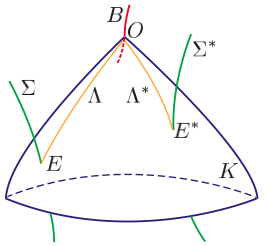

Figure 15: Measurement of the angular distance $\delta$ by an observer $B$ between two stars

In figure 15 the stars and observer are represented by their world lines, and the past light cone $K$ issuing from the observation event $O$ intersects the world lines of the stars $\Sigma$ and $\Sigma^{*}$ in $E$ and $E^{*}$ respectively. The light rays emitted at $E$ and $E^{*}$, which arrive at the observation event $O$, are null geodesics laying on the past light cone and are respectively denoted by $\Lambda$ and $\Lambda^{*}$. This construction of the numerical quantity of the angle $\delta$ observed by $B$ at $O$, which is describable in the form of purely arithmetical relations, is invariant under arbitrary coordinate transformations and constitutes an objective fact of the world.[^note-119]

On the other hand, the angles between two stars determine the *objectively* indescribable *subjective* experience of the observer. Moreover, Weyl says, “there is no difference in our experiences to which there does not correspond a difference in the underlying objective situation.” And that difference is itself invariant under arbitrary coordinate transformations. In other words, an observer’s subjective experiences *supervene* on the invariant relationships and structures of a symbolically constructed objective world.

Perhaps no statement captures the contrast between the objective-symbolic and the subjective-intuitive more vividly then Weyl’s famous statement

> The objective world simply $is$, it does not *happen*. Only to the gaze of my consciousness, crawling upward along the life line of my body, does a section of this world come to life as a fleeting image in space which continuously changes in time.[^note-120]

## References（引用注释）

> 原文参考文献已转为脚注引用：文内“作者-年份”引用组后附 [^key] 标记，完整条目见本文末脚注定义。

### Primary Sources

| [1908] | “Singuläre Integralgleichungen mit besonderer Berücksichtigung des Fourierschen Integraltheorems”. Dissertation, Göttingen. GA I, 1–87, [1]. |
| --- | --- |
| [1910a] | “Über die Definitionen der mathematischen Grundbegriffe”. *Mathematisch-naturwissenschaftliche Blätter*, 7: 93–95 and 109–113. GA I, 298–304, [9]. |
| [1910b] | “Über gewöhnliche Differentialgleichungen mit Singularitäten und die zugehörigen Entwicklungen willkürlicher Funktionen”. *Mathematische Annalen*, 68:220–269. GA I, 248–297, [8]. |
| [1913] | *Die Idee der Riemannschen Fläche*. B. G. Teubner, Leipzig, 1 edition. 2 edn, B. G. Teubner, Leipzig, 1923; Reprint of 2 edn, Chelsea Co., New York, 1951; 3 edn, revised, B. G. Teubner, Leipzig, 1955. English translation of 3 edn, *The Concept of a Riemann Surface*, Addison-Wesley, 1964. Dover edition 2009. |
| [1918a] | “Gravitation und Elektrizität”. *Sitzungsberichte der Königlich Preußischen Akademie der Wissenschaften zu Berlin*, pages 465–480. GA II, 29–42, [31]. |
| [1918b] | “Reine Infinitesimalgeometrie”. *Mathematische Zeitschrift*, 2:384–411. GA II, 1–28, [30]. |
| [1918c] | *Das Kontinuum*. Veit & Co., Leipzig, Reprinted 1987. 2 edn, de Gryter & Co., Berlin, 1932. English translation: *The Continuum: A Critical Examination of the Foundation of Analysis*, translated by Stephen Pollard and Thomas Bole, Thomas Jefferson University Press: 1987. Corrected re-publication, Dover 1994. |
| [1918d] | “Letter to Einstein, Zürich, 10 December”. In Robert Schulmann, A. J. Kox, Michel Janssen, and József Illy, editors, *The Collected Papers of Albert Einstein: The Berlin Years: Correspondence, 1914–1918*, volume 8, Part B. Princeton University Press, 1918/1998. |
| [1919a] | “Eine neue Erweiterung der Relativitätstheorie”. *Annalen der Physik*, 59:101–133. GA II, 55–87, [34]. |
| [1919b] | “Über die statischen kugelsymmetrischen Lösungen von Einsteins “kosmologischen” Gravitationsgleichungen”. *Physikalische Zeitschrift*, 20:31–34. GA II, 51–54, [33]. |
| [1920] | “Das Verhältnis der kausalen zur statistischen Betrachtungsweise in der Physik”. *Schweizerische Medizinische Wochenschrift*, 50:737–741. GA II, 113–122, [38]. |
| [1921a] | “Electricity and gravitation”. *Nature*, 106:800–802. GA II, 260–262, [48]. |
| [1921b] | “Feld und Materie”. *Annalen der Physik*, 65:541–563. GA II, 237–259, [47]. |
| [1921c] | “Zur Infinitesimalgeometrie: Einordnung der projektiven und konformen Auffassung”. *Nachrichten der Königlichen Gesellschaft der Wissenschaften zu Göttingen; Mathematisch-physikalische Klasse*, pages 99–112. GA II, 195–207, [43]. |
| [1921] | “Über die neue Grundlagenkrise der Mathematik”. *Mathematische Zeitschrift*, 10:39–79, Reprinted 1998. GA II, 143–180, [41]. Reprinted by Wissenschaftliche Buchgesellschaft, Darmstadt, 1965. English translation *On the New Foundational Crisis in Mathematics* in Mancosu (1998), 86–122. |
| [1922a] | “Das Raumproblem”. *Jahresbericht der Deutschen Mathematikervereinigung*, 31:205–221. GA II, 328–344, [53]. |
| [1922b] | “Die Einzigartigkeit der Pythagoreischen Maßbestimmung”. *Mathematische Zeitschrift*, 12:114–146. GA II, 263–295, [49]. |
| [1923a] | *Mathematische Analyse Des Raumproblems*. J. Springer, Berlin. |
| [1923b] | *Raum, Zeit, Materie*. J. Springer, Berlin. 3 edn, essentially revised, J. Springer, Berlin 1919; 4 edn, essentially revised, J. Springer, Berlin 1921; 5 edn, revised, J. Springer, Berlin, 1923; 7 edn, edited (with notes) by J. Ehlers, Springer, Berlin 1988; *Temps, espace, matière* (from the 4th German edn), A. Blanchard, Paris, 1922; *Space, Time, Matter*, (from the 4th German edn), Methuen, London, 1922. |
| [1923c] | “Zur allgemeinen Relativitätstheorie”. *Physikalische Zeitschrift*, 24:230–232. GA II, 375–377, [56]. |
| [1924a] | “Das gruppentheoretische Fundament der Tensorrechnung”. *Nachrichten der Gesellschaft der Wissenschaften zu Göttingen. Mathematisch-physikalische Klasse*, pages 218–224. GA II, 461–467, [62]. |
| [1924b] | “Massenträgheit und Kosmos. Ein Dialog”. *Die Naturwissenschaften*, 12:197–204. GA II, 478–485, [65]. |
| [1924c] | “Randbemerkungen zu Hauptproblemen der Mathematik”. *Mathematische Zeitschrift*, 20:131–150. GA II, 433–452, [60]. |
| [1924d] | “Über die Symmetrie der Tensoren und die Tragwite der symbolischen Methode in der Invariantentheorie”. *Rendiconti del Circolo Matematico di Palermo*, pages 29–36. GA II, 468–475, [63]. |
| [1924e] | “Was ist Materie?” *Die Naturwissenschaften*, 12:561–568, 585–593, and 604–611. GA II, 486–510, [66]. Reprinted by J. Springer, Berlin, 1924 and Wissenschaftliche Buchgesellschaft, Darmstadt, 1963. |
| [1924f] | “Zur Theorie der Darstellung der einfachen kontinuierlichen Gruppen”. (Aus einem Schreiben an Herrn I. Schur). *Sitzungsberichte der Preußischen Akademie der Wissenschaften zu Berlin*, pages 338–345. GA II, 453–460, [61]. |
| [1925a] | “Theorie der Darstellung kontinuierlicher halbeinfacher Gruppen durch lineare Transformationen I”. *Mathematische Zeitschrift*, 23:271–309. GA II, 543–579, [68]. |
| [1925b] | “Die heutige Erkenntnislage in der Mathematik”. *Symposion*, 1:1–32, Reprinted 1998. GA II, 511–542, [67]. English translation *On the Current Epistemological Situation in Mathematics*, in Mancosu (1998), 123–142. |
| [1926a] | “Theorie der Darstellung kontinuierlicher halbeinfacher Gruppen durch lineare Transformationen II”. *Mathematische Zeitschrift*, 24:328–376. GA II, 580–605, [68]. |
| [1926b] | “Theorie der Darstellung kontinuierlicher halbeinfacher Gruppen durch lineare Transformationen III”. *Mathematische Zeitschrift*, 24:377–395. GA II, 606–645, [68]. |
| [1926c] | “Theorie der Darstellung kontinuierlicher halbeinfacher Gruppen durch lineare Transformationen (Nachtrag)”. *Mathematische Zeitschrift*, 24:789–791. GA II, 645–647, [68]. |
| [1926d] | “Universe, modern conceptions of”. In *The Encyclopedia Britannica*, pages 908–911. 13 edition. |
| [1927] | “Quantenmechanik und Gruppentheorie”. *Zeitschrift für Physik*, 46:1–46. GA III, 90–135, [75]. |
| [1928a] | *Gruppentheorie und Quantenmechanik*. S. Hirzel, Leipzig. |
| [1928b] | “Diskussionsbemerkungen zu dem zweiten Hilbertschen Vortrag über die Grundlagen der Mathematik”. *Abhandlungen aus dem mathematischen Seminar der Hamburgischen Universität*, 6:86–88, Reprinted 1967. GA III, 147–149, [77]. English translation *Comments on Hilbert’s second lecture on the foundations of mathematics* in van Heijenoort (1967), 480–484. |
| [1929a] | “Consistency in mathematics”. *The Rice Institute Pamphlet*, 16:245–265. GA III, 150–170, [78]. |
| [1929b] | “Elektron und Gravitation”. *Zeitschrift für Physik*, 56:330–352. GA III, 245–267, [85]. |
| [1929c] | “Gravitation and the electron”. *The Rice Institute Pamphlet*, 16:280–295. GA III, 229–244, [84]. |
| [1929d] | “Gravitation and the electron”. *Proceedings of the National Academy of Sciences of the United States of America*, 15:323–334. GA III, 217–228, [83]. |
| [1929e] | “On the foundations of infinitesimal geometry”. *Bulletin of the American Mathematical Society*, 35:716–725. Reprinted in Weyl (1968). |
| [1930] | “Redshift and relativistic cosmology”. *The London, Edinburgh and Dublin philosophical Magazine and Journal of Science*, 9:936–943. GA III, 300–307, [89]. |
| [1931a] | “Geometrie und Physik”. *Die Naturwissenschaften*, 19:49–58. GA III, 336–345, [93]. |
| [1931b] | *Gruppentheorie und Quantenmechanik*. S. Hirzel, Leipzig. (a) 2nd reworked edition, S. Hirzel, Leipzig 1931. (b) English translation: The Theory of groups and quantum mechanics, Dutten, New York, 1932. (c) Reprinting of (b): Dover Publications, New York, 1949. |
| [1932] | *The Open World: Three Lectures on the Metaphysical Implications of Science*. Yale University Press. |
| [1934a] | *Mind and Nature*. University of Pennsylvania Press. |
| [1934b] | “Universum und Atom”. *Die Naturwissenschaften*, 22:145–149. GA III, 420–424, [101]. |
| [1938a] | “Cartan on groups and differential geometry”. *Bulletin of the American Mathematical Society*, 44:598–601. |
| [1938b] | Symmetry. *Journal of the Washington Academy of Sciences*, 28:253–271. GA III, 592–610, [111]. |
| [1939] | *The classical groups, their invariants and representations*. Princeton University Press; Oxford University Press; H. Milford, London. 2 edn, Princeton University Press; Oxford University Press; H. Milford, London, 1946. |
| [1946] | “Mathematics and logic. A brief survey serving as a preface to a review of ‘The Philosophy of Bertrand Russell’”. *The American Mathematical Monthly*, 53:2–13. GA IV, 268–279, [138]. |
| [1948] | “Wissenschaft als symbolische Konstruktion des Menschen”. *Eranos-Jahrbuch*, pages 375–431. GA IV, 289–345, [142]. |
| [1949a] | *Philosophy of Mathematics and Natural Science*. Princeton University Press, 1 edition. 2 edn, Princeton University Press, 1950. 2009 edition, with a new introduction by Frank Wilczek. An expanded English version of *Philosophie der Mathematik und Naturwissenschaft*, München, Leibniz Verlag, 1927. |
| [1949b] | “Relativity theory as a stimulus in mathematical research”. *Proceedings of the American Philosophical Society*, 93: 535–541. GA IV, 394–400, [147]. |
| [1950] | *Space-Time-Matter*. Dover, New York. English translation of the 4th edition (1921) of *Raum-Zeit-Materie* by Henry L. Brose. |
| [1952] | *Symmetry*. Princeton University Press, Princeton. |
| [1953] | “Über den Symbolismus der Mathematik und mathematischen Physik”. *Studium generale*, 6:219–238. GA IV, 527–536, [156]. |
| [1954a] | “Address on the unity of knowledge”. GA IV, 623–649, [165]. Address delivered at the Bicentennial Conference of Columbia University. |
| [1954b] | “Erkenntnis und Besinnung (Ein Lebensrückblick)”. *Studia Philosophica*, 1954/1955. GA IV, 631–649, [166]. A talk given at the University of Lausanne, May 1954. English translation *Insight and Reflection* in T. L. Saaty and F. J. Weyl, eds., *The Spirit and Uses of the Mathematical Sciences*, 281–301, New York, McGraw-Hill, 1955. |
| [1968] | *Gesammelte Abhandlungen*, volume I–IV. Springer Verlag, Berlin. Edited by K. Chandrasekharan. |
| [1985] | “Axiomatic versus constructive procedures in mathematics”. *The Mathematical Intelligencer*, 7(4):12–17. A posthumous publication, edited by Tito Tonietti. |
| [1988] | *Riemanns geometrische Ideen, ihre Auswirkung und ihre Verknüpfung mit der Gruppentheorie*. Springer-Verlag. Posthumous publication; edited by K. Chandrasekharan. |
| [2009] | *Mind and Nature: Selected Writings on Philosophy, Mathematics and Physics*. Princeton University Press. Edited and with an introduction by Peter Pesic. |
| [2012] | *Levels of Infinity: Selected Writings on Mathematics and Philosophy*. Dover Publications. Translated and edited with an introduction by Peter Pesic. |
| [2017] | *Symmetrie*. Springer. Translated from English by Lulu Bechtolsheim. Supplemented with Weyl (2017a), and commentaries by Domenico Giulini, Erhard Scholz and Klaus Volkert. |
| [2017a] | *Similarity and congruence: a chapter in the epistemology of science*. Nachlass H. Weyl, ETH Bibliotheck. In Weyl (2017). Springer. |

### Secondary Sources

## Academic Tools

> |   | [How to cite this entry](https://plato.stanford.edu/cgi-bin/encyclopedia/archinfo.cgi?entry=weyl). |
> | --- | --- |
> |   | [Preview the PDF version of this entry](https://leibniz.stanford.edu/friends/preview/weyl/) at the [Friends of the SEP Society](https://leibniz.stanford.edu/friends/). |
> |   | [Look up topics and thinkers related to this entry](https://www.inphoproject.org/entity?sep=weyl&redirect=True) at the Internet Philosophy Ontology Project (InPhO). |
> |   | [Enhanced bibliography for this entry](http://philpapers.org/sep/weyl/) at [PhilPapers](http://philpapers.org/), with links to its database. |

## Other Internet Resources

[Please contact the author with suggestions.]

## Related Entries

Brentano, Franz | Brouwer, Luitzen Egbertus Jan | consciousness | continuity and infinitesimals | cosmology: methodological debates in the 1930s and 1940s | Einstein, Albert: philosophy of science | Fichte, Johann Gottlieb | general relativity: early philosophical interpretations of | geometry: epistemology of | geometry: in the 19th century | Gödel, Kurt | Hilbert, David: program in the foundations of mathematics | Husserl, Edmund | Kant, Immanuel: views on space and time | Leibniz, Gottfried Wilhelm: philosophy of physics | Mach, Ernst | mathematics, philosophy of: intuitionism | mathematics: constructive | Newton, Isaac: views on space, time, and motion | Poincaré, Henri | quantum mechanics | quantum mechanics: Copenhagen interpretation of | quantum mechanics: modal interpretations of | quantum theory: and mathematical rigor | quantum theory: identity and individuality in | quantum theory: philosophical issues in | quantum theory: quantum field theory | quantum theory: quantum logic and probability theory | quantum theory: the Einstein-Podolsky-Rosen argument in | Schlick, Moritz | space and time: absolute and relational space and motion, post-Newtonian theories | space and time: inertial frames | space and time: the hole argument

### Acknowledgments

We would like to thank Thomas Ryckman for his invaluable comments and suggestions for this entry.

## Notes（原文脚注）

[^note-1]: Husserl was a professor at Göttingen during Weyl’s student days there, and Weyl attended his lectures. But it was his wife Helene, who later came to Göttingen to study with Husserl, who seems to have sparked Weyl’s interest in phenomenology.

[^note-2]: In particular, while there is compelling evidence that the continued existence of the Ego (one’s consciousness) is dependent on facts about the external world, for instance, the continuing biochemical activity of one’s brain, that dependency cannot be taken as a *primary* datum for the Ego.

[^note-3]: As Weyl observed in 1925,

> If phenomenal insight is referred to as *knowledge*, then the theoretical one is based on *belief*—the belief in the reality of the own I and that of others, or belief in reality of the external world, or belief in the reality of God. If the organ of the former is “seeing” in the widest sense, so the organ of theory is “creativity” (Weyl 1925, 140).

[^note-4]: In a late paper Weyl offers the natural numbers “by which we count objects” as “the simplest, and in a certain sense most profound, example of symbolic construction.” He continues:

> The most natural symbols for them are strokes, one put after the other, |, ||, |||, … . The objects may disperse, “melt, thaw and resolve themselves into dew,” but we thus can keep the record of their number. What is more, we can by a constructive process decide for two numbers represented through symbols which one is the larger, namely by checking one symbol against the other, stroke by stroke. This process reveals differences not manifest in direct observation, which in most cases is incapable of distinguishing even between such low numbers as 21 and 22. We are so familiar with these miracles which the number symbols perform that we no longer wonder at them. But this is only the prelude to the mathematical step proper. We do not leave it to chance which numbers we actually meet by counting this or that concrete set of objects, but we generate the open sequence of *all possible* numbers which starts with 1 (or 0 = nothing) and proceeds by adding to any number symbol $n$ one more stroke, whereby it changes into the following number $n + 1$. *Being* is thus projected onto the background of the *possible*, more precisely onto a manifold of possibilities which unfolds by iterating the same step again and again and remains open into infinity. (Weyl 1985, 12–13.)

[^note-5]: It is perhaps for this reason that, unlike Einstein, for example, Weyl does not seem to have been especially troubled by the highly counterintuitive nature of quantum theory. Indeed, the conviction of numerous physicists that the quantum microworld is accessible to us only through abstract mathematical description serves as an excellent illustration of Weyl’s thesis that objective reality cannot be grasped directly, but only through the use of symbols.

For Weyl the link between mathematics and natural science established through symbolic construction was certainly very strong, as is attested by his observations in his [1985] on G. H. Hardy’s *A Mathematician’s Apology* (Hardy 1967)[^hardy-1967]. Introducing it as a “charming little book”, he continues:

> For us today the idea that the Gods from whom we wrestled the secret of knowledge by symbolic construction will revenge our *hubris* has taken on a quite concrete form. For who can close his eyes against the menace of our own self-destruction by science? The alarming fact is that the rapid progress of scientific knowledge is not paralleled by a corresponding growth of man’s moral strength and responsibility, which have hardly changed since historical times. I think it is futile to claim with Hardy for mathematics an exceptional and relatively innocent position in this regard. He maintains that mathematics is a useless science, and this means, he says, that it can contribute directly neither to the exploitation of our fellow-men nor to their extermination. However the power of science rests on the combination of experiment, i.e., observation under freely chosen conditions and *symbolic construction*, and the latter is its mathematical aspect. Thus if science is found guilty, mathematics cannot evade the verdict.

[^note-6]: In *Insight and Reflection* (also in *Philosophy of Mathematics and Natural Science*) Weyl uses a geometric analogy to illustrate his metaphysical scheme. In this analogy, objects, subjects, and the appearance of an object to a subject are correlated respectively with *points on a plane, (barycentric) coordinate systems in the plane,* and *coordinates of a point* *with respect to a such a coordinate system.* Here a coordinate system $S$ consists of the vertices of a fixed nondegenerate triangle $T$; each point $p$ in the plane determined by $T$ is assigned a triple of numbers summing to 1—its *barycentric coordinates* relative to $S$—representing the magnitudes of masses of total weight 1 which, placed at the vertices of $T$, have centre of gravity at $p$. Thus objects, i.e. points, and subjects i.e., coordinate systems or triples of points belong to the same “sphere of reality.” On the other hand, the *appearances* of an object to a subject, i.e., triples of numbers, lie, Weyl asserts, in a different sphere, that of *numbers*. These *number-appearances,* as Weyl calls them, correspond to the experiences of a subject, or of pure consciousness.

From the standpoint of naïve realism the points (objects) simply exist as such, but Weyl indicates the possibility of constructing geometry (which under the analogy corresponds to external reality) solely in terms of number-appearances, so representing the world in terms of the experiences of pure consciousness, that is, from the standpoint of idealism. Thus suppose that we are given a coordinate system $S$. Regarded as a subject or “consciousness”, from its perspective a point or object now corresponds to what was originally an appearance of an object, that is, a triple of numbers summing to 1; and, analogously, any coordinate system $S'$ (that is, another subject or “consciousness”) corresponds to three such triples determined by the vertices of a nondegenerate triangle. Each point or object $p$ may now be *identified* with its coordinates relative to $S$. The coordinates of $p$ relative to any other coordinate system $S'$ can be determined by a straightforward algebraic transformation: these coordinates represent the *appearance* of the object corresponding to $p$ to the subject represented by $S'$. Now these coordinates will, in general, *differ* from those assigned to $p$ by our given coordinate system $S$, and will in fact coincide for all $p$ if and only if $S'$ is what is termed by Weyl the *absolute* coordinate system consisting of the three triples $(1,0,0)$, $(0,1,0)$, $(0,0,1)$, that is, the coordinate system which corresponds to $S$ itself. Thus, for this coordinate system, “object” and “appearance” coincide, which leads Weyl to term it the *Absolute I*.

Weyl points out that this argument takes place entirely within the realm of numbers, that is, for the purposes of the analogy, the *immanent consciousness*. In order to do justice to the claim of objectivity that all “I”s are equivalent, he suggests that only such numerical relations are to be declared of interest as remain unchanged under passage from an “absolute” to an arbitrary coordinate system, that is, those which are invariant under arbitrary linear coordinate transformations. According to Weyl, “this analogy makes it understandable why the unique sense-giving I, when viewed objectively, i.e., from the standpoint of invariance, can appear as just one subject among many of its kind.”

At this point Weyl adds an intriguing parenthetical observation:

> Incidentally, a number of Husserl’s theses become demonstrably false when translated into the context of the analogy—something which, it appears to me, gives serious cause for suspecting them.

Unfortunately, we are not told precisely which of Husserl’s theses are the “suspect” ones.

Weyl goes on to emphasize:

> Beyond this, it is expected of me that I recognize the other I—the *you*—not only by observing in my thought the abstract norm of invariance or objectivity, but absolutely: you are *for you*, once again, what *I* am for *myself*: not just an existing but a conscious carrier of the world of appearances.

This recognition of the *Thou*, according to Weyl, can be presented within his geometric analogy only if it is furnished with a purely *axiomatic* formulation. In taking this step Weyl sees a third viewpoint emerging in addition to that of realism and idealism, namely, a *transcendentalism* which “postulates a transcendental reality but is satisfied with modelling it in symbols.”

[^note-7]: The others, in order, are: *understanding and expression; thinking the possible*; and finally, in science, *the construction of symbols or measuring devices*.

[^note-8]: See also the section on Weyl and Hilbert below.

[^note-9]: It is also worth quoting one of Weyl’s last, bittersweet observations on mathematics, from his (1985):

> Mathematics has been called the science of the infinite. Indeed, the mathematician invents finite constructions by which questions are decided that by their very nature refer to the infinite. That is his glory. Kierkegaard once said religion deals with what concerns man unconditionally. In contrast (but with equal exaggeration) one may say that mathematics deals with the things which are of no concern to man at all. Mathematics has the inhuman quality of starlight, brilliant and sharp, but cold. But it seems an irony of creation that man’s mind knows how to handle things the better the farther removed they are from the center of his existence. Thus we are cleverest where knowledge matters least.

[^note-10]: Nevertheless, Weyl seems to have been initially attracted to set theory—at least in the axiomatic formulation Zermelo provided for it in 1908. As emphasized by Feferman [2000], Weyl [1910] anticipates Fraenkel’s and Skolem’s later identification of Zermelo’s “definite property” with “property definable within the language of set theory”.

[^note-11]: In this respect Weyl’s views were close to those of Poincaré, and also, to some extent, those of Russell.

[^note-12]: In this connection it is of interest to note that on 9 February 1918 Weyl and George Pólya made a bet in Zürich in the presence of twelve witnesses (all of whom were mathematicians) that “within 20 years, Pólya, or a majority of leading mathematicians, will come to recognize the falsity of the least upper bound property.” When the bet was eventually called, everyone—with the single exception of Gödel—agreed that Pólya had won.

[^note-13]: Weyl shared with many mathematicians the conviction that the concept of natural number is the *fons et origo* of mathematics. For example, in [1921] we read:

> The starting point of mathematics is the sequence of natural numbers, that is, the law… which from nothing generates the first number, and from every generated number generates the next following one; a process never returning to a number that has already occurred. If we want to capture numbers for our intuition, we must distinguish them symbolically by means of qualitative signs…. One can say that, in a mathematical examination of Reality, an attempt is made to represent the world—which is given to consciousness in its more general form of a penetration of *Being* and *Essence* (of the “this” and “so”)—in the absoluteness of pure Being. That is why there is a profound truth in the Pythagorean doctrine that any being as such is based on number.

[^note-14]: It is worth pointing out that Brentano, in his *On What is Continuous* of 1914, had drawn the similar conclusion that the continuum concept is derived from primitive sensible intuition and indeed that “all our sensible intuitions present us with that which is continuous.” This led him to regard the constructions of the continuum of Dedekind, Cantor, and their successors as “fictions”.

[^note-15]: The connection between mathematics and physics was of course of paramount importance for Weyl. His seminal work on relativity theory, *Space-Time-Matter,* was published in the same year (1918) as *Das Kontinuum*; the two works reveal subtle affinities.

[^note-16]: This fact would seem to indicate that in Weyl’s theory the domain of definition of a function is not unambiguously determined by the function, so that the continuity of such a “function” may vary with its domain of definition. (This would be a natural consequence of Weyl’s definition of a function as a certain kind of relation.) A simple but striking example of this phenomenon is provided in classical analysis by the function $f$ which takes value 1 at each rational number, and at each irrational number. Considered as a function defined on the rational numbers, $f$ is constant and so continuous; as a function defined on the real numbers, $f$ fails to be continuous anywhere.

[^note-17]: E.g. in Weyl [1950], 8 and [1949], 123

[^note-18]: However there were marked differences between Weyl’s and Brouwer’s philosophical attitudes. Brouwer’s philosophy amounted virtually to solipsism, while Weyl still seems to have cleaved to phenomenology, at least up to 1928. And from what Weyl reveals about his later philosophical development, it is clear that it carried him even further away from Brouwer. (For an analysis of the relationship between intuitionism and phenomenology in Weyl’s thought, see Mancosu and Ryckman [2002].)

[^note-19]: Nevertheless, there is reason to think that Weyl continued to regard the predicative approach underlying *Das Kontinuum* as being of genuine value. If indeed this is the case, then Weyl’s belief was correct, since *Das Kontinuum* is now viewed as the initial stage in the emergence of predicative mathematics, which has undergone a rapid development since the 1960s (see Feferman [1988], [2000]).

[^note-20]: Weyl’s contention is strikingly similar to (and may have had an influence on) Hilbert’s later assertion that “contentual” statements are, from the finitist standpoint, incapable of being negated. See, e.g., Hilbert [1926], 378.

[^note-21]: For my remarks on Weyl’s relationship with Intuitionism I have drawn on the illuminating paper van Dalen [1995].

[^note-22]: Here is Weyl enlarging on the issue in 1921:

> …if we pick out a specific point, say, $x = 0$, on the number line $C$ (i.e., on the variable range of a real variable $x)$, then one cannot, under any circumstance, claim that every point either coincides with it or is disjoint from it. The point $x = 0$ thus does not at all split the continuum $C$ into two parts $C^{-}: x \lt 0$ and C$^{+}: x \gt 0$, in the sense that C would consist of the union of C$^{- }$, C$^{+}$ and the one point 0 …. If this appears offensive to present-day mathematicians with their atomistic thought habits, it was in earlier times a self-evident view held by everyone: Within a continuum, one can very well generate subcontinua by introducing boundaries; yet it is irrational to claim that the total continuum is made up of the boundaries and the subcontinua. The point is, *a genuine continuum* is something connected in itself, and *it cannot be divided into separate fragments*; this conflicts with its nature. (Weyl 1921, 111.)

[^note-23]: Brouwer established the continuity of functions fully defined on a continuum in 1904, but did not publish a definitive account until 1927. In that account he also considers the possibility of partially defined functions.

[^note-24]: Quoted in Reid [1986], 72. And over Hilbert’s grave in Göttingen is inscribed: *Wir müssen wissen / Wir werden wissen* (“We must know / We shall know.”) (*Ibid.,* 220.)

[^note-25]: In 1922, Hilbert declared:

> What Weyl and Brouwer do comes to the same thing as following in the footsteps of Kronecker! They seek to save mathematics by throwing overboard all which is troublesome… They would chop up and mangle the science. If we would follow such a reform as the one they suggest, we would run the risk of losing a great part of our valuable treasures! (Reid 1986, 155)[^reid-1986].
>
> I believe that, just as little as Kronecker was unable to get rid of the irrational numbers…just as little will Weyl and Brouwer be able to succeed. Brouwer is not, as Weyl believes, the Revolution—only the repetition of an attempted Putsch, in its day, more sharply undertaken yet failing utterly, and now, with the State armed and strengthened, doomed from the start! (*Ibid*., 157.)

[^note-26]: It is this aspect of Hilbert’s program which led, somewhat inappropriately, to its becoming termed “formalism”. It should be emphasized that Hilbert was *not* claiming that (classical) mathematics *itself* was meaningless, only that the formal system representing it was to be so regarded.

[^note-27]: This is borne out by the following quotation from Hilbert [1927]:

> No more than any other science can mathematics be founded on logic alone; rather, as a condition for the use of logical inferences and the performance of logical operations, something must already be given to us in our faculty of representation, certain extralogical concrete objects that are intuitively present as immediate experience prior to all thought. If logical inference is to be reliable, it must be possible to survey these objects completely in all their parts, and the fact that they occur, that they differ from one another, and that they follow each other, or are concatenated, is immediately given intuitively, together with the objects, as something that can neither be reduced to anything else, nor requires reduction. This is the basic philosophical position that I regard as requisite for mathematics and, in general, for all scientific thinking, understanding, and communication. And in mathematics, in particular, what we consider is the concrete signs themselves, whose shape, according to the conception we have adopted, is immediately clear and recognizable. This is the very least that must be presupposed, no scientific thinker can dispense with it, and therefore everyone must maintain it, consciously or not.

[^note-28]: Underlying this guarantee, of course, is the further assumption that there are no “contradictions in nature”.

[^note-29]: Weyl [1927], 483. Indeed, in his [1946], Weyl remarks that had it not been for Gödel’s demonstration in 1931 that Hilbert’s program could not be successfully carried out, “it is likely that mathematicians would have accepted Hilbert’s approach.”

[^note-30]: Weyl [1925], 140. Weyl [1949] contains a similar observation:

> A truly realistic mathematics should be conceived, in line with physics, as a branch of the construction of the one real world, and should adopt the same sober and cautious attitude toward hypothetic extensions of its foundations as is exhibited by physics.(231).

[^note-31]: Weyl [1927], 484. Mancosu and Ryckman (2002) show that Weyl had already begun to retreat from intuitionism because of what he saw as its incapability of supporting natural science, in particular the theoretical physics which was of paramount importance for him.

[^note-32]: Weyl also observes (*ibid*., 61):

> But whatever the ultimate value of Hilbert’s program, his bold enterprise can claim one merit: it has disclosed to us the highly complicated and ticklish logical structure of mathematics, its maze of back-connections, which result in circles of which it cannot be gathered at a first glance whether they might not lead to blatant contradictions.

[^note-33]: If one is interested in the entire extension of an $n$-dimensional Riemannian space, then a finite or infinite number of partially overlapping coordinate patches are needed to cover the $n$-dimensional Riemannian manifold in its entirety. However, this is of little concern if the focus is on infinitesimal neighbourhoods of points.

[^note-34]: The *Einstein summation convention* says: whenever a lower (upper) index is repeated as an upper (lower) index, it is understood to imply summation over the index from 1 to $n$, the dimension of the manifold or space. The index $k$ in equations (1) and (2) is said to be *free* and in the current context takes on any value from 1 to $n$. The repeated indices $i$ and $j$ are *bound* or *dummy* indices because they can be replaced by any other index not already in use as a bound index.

[^note-35]: The German term for ‘close-action’ is ‘*Nahewirkung*’.

[^note-36]: For a detailed analysis of Weyl’s concept of ‘neighbourhood’ (Umgebung) and his different employment of it in mathematics, physics, and discussions of the subjective-intersubjective, continues-discrete distinctions, see Sieroka (2010, 2019).

[^note-37]: The electric action in Faraday’s interaction model is not regarded as somehow reaching across the finite spatial separation of two charged particles. Rather, one understands the interaction as an *infinitesimal* interaction between the charged body and its surrounding field. A charged body “*feels*” a force because it is in *contact* with its surrounding field; that is, each charged body “feels” the field of the other as a *local* force. Just as Faraday’s field interpretation of electric phenomena may be contrasted with action-at-a-distance interpretations, so Riemann’s *infinitesimal geometric standpoint* may be contrasted with *distance-geometry*, such as, Euclidean and ordinary non-Euclidean geometry.

Hermann von Helmholtz considered the *homogeneity postulate* required for the free mobility of rigid body motion to be a necessary pre-condition for the very possibility of geometrical knowledge. Abstracting from our experience of the movement of rigid bodies, Helmholtz was able to mathematically derive Riemann’s distance formula (2). The difference between Euclidean and *ordinary* non-Euclidean geometry “in the large” consists only in the discarding of the axiom of parallelism. By requiring the *homogeneity postulate* underlying the free mobility of ideal rigid bodies, Helmholtz thereby limited his considerations to Euclidean and *ordinary* non-Euclidean geometries.

Riemann thought that Helmholtz’s homogeneity postulate for rigid body motion, and the Euclidean and ordinary non-Euclidean geometries entailed by it, may not hold strictly but only approximately. With remarkable foresight, Riemann considered the possibility that rigid body motion may break down, and approached the problem of physical geometry from a much more general basis, which includes Euclidean and ordinary non-Euclidean geometry as a limiting case. Indeed from the standpoint of modern physics the existence of rigid bodies and rigid body motion is not a fundamental self-evident requirement anymore, but only a special property that obtains in a definite limiting case of the physics of classical mechanics and geometry. Helmholtz’s reasoning only shows that the possibility of this limiting case entails the Riemannian metric. Riemann adopted the same principles in geometry as did Faraday and Maxwell before him in electromagnetism, namely, to understand the world from its behavior in the infinitely small. Riemann thereby introduced into the study of geometry the notion of *geometric fields* and foresaw the possibility of a dynamical geometry which not only acts on matter but is in turn affected by matter. See Scholz (1992) on Riemann’s vision of a new approach to Geometry.

[^note-38]: Any vector space with a metric tensor has an orthonormal basis in which the metric has the canonical form

$$ \diag(- 1, \ldots ,- 1, 1, \ldots , 1). $$

The sum of these diagonal elements, that is, the trace of the canonical form, is called the *signature* of the metric. If the metric is *positive-definite*, then its canonical form is $\diag(1, 1, \ldots , 1)$. A metric that is not positive-definite, is called *indefinite*. The metric of Einstein’s theory of special relativity is indefinite and has signature $+2$ or $- 2$ corresponding respectively to the traces of the canonical form $\diag(- 1, 1, 1, 1)$ or $\diag(- 1,- 1,- 1, 1)$. Positive-definite metrics are called *Riemannian*, whereas the indefinite metric of relativity theory is called *Lorentzian* or *Pseudo-Riemannian*.

[^note-39]: The concept of infinitesimal parallel vector displacement is essential for doing calculus on manifolds. In an unstructured smooth continuum or manifold, in Weyl’s words “a completely formless four-dimensional continuum in the sense of analysis situs,” there are very few calculus-based operations available. Apart from the limited application of the *exterior derivative* of a differential form, such an amorphous manifold does not have enough structure with which to define a general notion of differentiation. To be able to differentiate vector or tensor fields in order to determine how such fields change as they move from point to point over the manifold, requires some means by which to *compare* the geometric relations or objects at *different* infinitesimally nearby points on the manifold. That is, a general notion of the “derivative” is required which is defined independently of any particular coordinate choice that labels the points of the manifold in some local coordinate neighbourhood.

This problem is relatively simple in a Euclidean space because such a space satisfies two conditions: it admits global Cartesian coordinates and a path-independent *distant* parallelism of vectors. Because of the latter condition a Euclidean space is an *affine* space; it is a vector space in which no point is singled out as the origin. If in a Euclidean space a set of basis vectors is attached to a point $O$ as origin, then it is possible to describe the space with respect to any other point $O'$ as the origin, by taking as a basis at $O'$ those vectors which are parallel to the basis vectors at $O$. Consequently, in the $n$-dimensional Euclidean space $\mathbb{R}^{n}$ the notion of a derivative is readily available. Let $v$ be a vector field in $\mathbb{R}^{n}$ defined along a curve $x = x(t)$. The derivative of this vector field is another vector field $dv\,/\,dt$ along the curve, defined, as usual by

$$\tag{63} v\,'(t) = \frac{dv(t)}{dt} = \lim_{h \rightarrow 0} \frac{[v(t+h)-v(t)]}{h}. $$

It is clear that one is comparing a vector at one point, $x(t)$, with another vector at the second point, $x(t + h)$. This comparison is possible because $\mathbb{R}^{n}$, being an affine space, allows us to parallel translate a vector at a given point to any other point in $\mathbb{R}^{n}$. But this definition of the derivative cannot be carried over directly to a vector or tensor field defined over a general manifold. In such a situation, tangent vectors, or more generally, tensors at two different points $x^{i}$ and $x^{i} + dx^{i}$, obey different transformation laws; consequently, their difference is not a tensor. Tensorial quantities, such as vectors and other entities, can be algebraically combined and manipulated only when they are located at the same point on the manifold. If it is possible, however, to compare two tangent vectors which are located at two infinitesimally nearby points, *at one of the two points*, by means of an *appropriate* notion of infinitesimal parallel displacement of one tangent vector to the location of the other, then we can determine their difference; and their difference will itself be a vector, and therefore a tensorial quantity, provided the process of infinitesimal parallel transport employed, is coordinate independent. See for example (Frankel, 1997, 236)[^frankel-1997].

[^note-40]: Let $M$ and $N$ be manifolds. If $f : M \rightarrow N$ is $C^{\infty}$, one-to-one, onto, and has $C^{\infty}$ inverse, then $f$ is called a *diffeomorphism* and $M$ and $N$ are said to be *diffeomorphic*. Diffeomorphic manifolds have identical manifold structures. In the current context, $M$ and $N$ are replaced by $\mathbb{R}$. For further discussion of the notion of a diffeomorphism, see §4.4.2.

[^note-41]: This approach was taken mainly in the United States under the leadership of Thomas (1925), Veblen and Thomas (1926).

[^note-42]: Weyl then proved the following theorem:

A transformation $\Gamma \rightarrow \overline{\Gamma}$ is a projective transformation if and only if

$$ \Gamma^{i}_{jk} \rightarrow \overline{\Gamma}^{i}_{jk} = \Gamma^{i}_{jk} + \delta^{i}_{j}\varphi_{k} + \delta^{i}_{k}\varphi_{j} $$

where $\varphi_{k}$ is some covariant vector field.

[^note-43]: The projective coefficients satisfy $\Pi^{\,j}_{jk}(x^{i}(p)) = 0$ and $\Pi^{i}_{jk}(x^{i}(p)) = \Pi^{i}_{kj}(x^{i}(p))$.

[^note-44]: Weyl’s notion of the *Führungsfeld* is extensively discussed in §§4.3.2–4.4.4.

[^note-45]: When quantum mechanics emerged around middle of the 1920’s and quantum field theory took center stage shortly thereafter, new particles and forces were discovered.

[^note-46]: One of the distinguishing features of long-range forces is that their magnitudinal increases or decreases is inversely proportional to the square of the distance between the interacting bodies. Short-range forces, on the other hand, increase or decrease exponentially.

[^note-47]: Many commentators – eg., Ryckman (2005, chapter 6, and 2020) – have argued and emphasized that Husserl’s phenomenology was a decisive factor that led Weyl to his construction of a pure infinitesimal geometry. Other commentators disagree. Drawing on Scholz (2001, 97), McCoy (2022) argues that it was the Göttingen mathematical—physics tradition, in particular Riemann — its key figure, which played a central role in Weyl’s construction of a pure infinitesimal geometry. Afriat (2009, 2019) argues that Weyl’s theory of gravitation and electricity derives from ‘mathematical justice’, namely, the equal rights of direction and length. As Weyl observes (see above citation), if it is not reasonable to assume integrability for the transfer of direction, then it is likewise not reasonable, aside from historical considerations, to make the integrability assumption in the case of length–transfer.

One might in this context also recur to Hans Reichenbach’s (1938, 1968) (see also Schickore and Steinle (2006)) important distinction between “the context of discovery ” and “the context of justification.” While Husserl’s phenomenology may well have played a role in Weyl’s discovery of a pure infinitesimal geometry and gauge invariance, it does not follow that it also played a role in Weyl’s justification of them. In subsequent scientific publications, including his reply to Einstein’s critique, Weyl’s justification of his unification attempt adduces only mathematical and physical, and not phenomenological reasons. It is not unreasonable to suggest, therefore, that Weyl, or for that matter any other competent mathematician or physicist, would have discovered a pure infinitesimal geometry and gauge theory, without any knowledge of or exposure to Husserl’s phenmenology.

It is interesting to note that aesthetic reasons also played a justificatory role for Weyl. In his obituary of Weyl, Freeman Dyson (1956) says that Weyl once said to him, half jokingly, “My work always tried to unite the true with the beautiful; but when I had to choose one or the other, I usually chose the beautiful.” Subrahmanyan Chandrasekhar (1987, 66) tells us that he once inquired of Dyson

> whether Weyl had given an example of his having sacrificed truth for beauty. I learned that the example which Weyl gave was his gauge theory of gravitation … Apparently, Weyl became convinced that this theory was not true as a theory of gravitation; but still it was so beautiful that he did not wish to abandon it and so he kept it alive for the sake of its beauty. But much later, it did turn out that Weyl’s instinct was right after all, when the formalism of gauge invariance was incorporated into quantum electrodynamics.
>
> Another example which Weyl did not mention, but to which Dyson drew attention, is Weyl’s two-component relativistic wave equation of the neutrino. Weyl discovered this equation and the physicists ignored it for some thirty years because it violated parity invariance. And again, it turned out that Weyl’s instincts were right.

[^note-48]: Note the structural similarity between this analysis and Weyl’s analysis of the notion of an affine connection and parallel displacement.

[^note-49]: Weyl’s proof is quite elementary involving appropriate substitutions and index manipulations.

[^note-50]: In 1921, at the age of 21 years, Pauli wrote a review of the whole literature on relativity, which was published in the *Encyklopädie der mathematischen Wissenschaften*.

[^note-51]: Note that Pauli (and also Weyl (see below)) denotes the electromagnetic four potential as $\varphi_{i}$, instead of $A_{j}$.

[^note-52]: It is useful in this context to recall Einstein’s (1954) distinction between *principle* theories and *constructive* theories. The aim of a constructive theory, such as, for example, the kinetic theory of gases, is to reduce a wide class of diverse complex physical processes to simpler ones. On the other hand, a principle theories, such as, for example, the special and the general theories of relativity, postulate abstract structural constraints which events are held to satisfy. In order to exhibit the physical basis for the structural constraints, which a principle theory postulates certain events must satisfy, such structures contained in the mathematical model of the theory should have a link to physical experience. It must therefore be possible, at least in principle, to relate those structural constraints to experience in a way that is consistent with the theory. As Bohr and Rosenfeld (1933, 1950) suggest, any principle theory should satisfy the basic requirement of a *proper* or *complete* theory. According to Marzke and Wheeler (1964), Bohr and Rosenfeld “have stressed that every proper theory should provide in and by itself its own means for defining the quantities with which it deals. According to this principle, classical general relativity should admit to calibrations of space and time that are altogether free of any reference to the quantum of action.” That is, completeness requires that there is a link to physical experience of the various structures inherent in the mathematical model of a principle theory of spacetime, and that this link is realizable, by means of relatively simple physical probative systems which are themselves well defined within the classical spacetime theory, and which therefore can provide within the classical framework, at least in principle, epistemic access to the relevant structures postulated by the spacetime theory.

[^note-53]: For a discussion of some of the methodological/epistemological issues in this context see Ryckman (1994, 1996, 2003). See also Kerszberg (2007).

[^note-54]: For more information on Weyl’s unified field theory and the history of gauge theory see Brading (2002), Cao (1997), Jackson and Okun (2001), Mielke and Hehl (1988), O’Raifeartaigh and Straumann (2000), O’Raifeartaigh (1997), Ryckman (2005, 2009), Scholz (1999a, 2001, 2004), Straumann (2001), Vizgin (1994).

[^note-55]: An interesting brief account of this is given in Kragh (1990, 239–241).

[^note-56]: For an informative discussion of Weyl's evolving views on the Problem of Space see Scholz (2001, 2004, 2019). Also see Biagioli (2019)’s informative historical discussion of Weyl’s Problem of Space by relating it to the views of Hermann von Helmholtz, Felix Klein and Moritz Schlick.

[^note-57]: In a *Finsler geometry* the general definition of the length of a vector is not necessarily given in the form of the square root of a quadratic form (symmetric bilinear form) as in the Riemannian case. That is, a Finsler geometry is a Riemannian geometry without this quadratic restriction. As we saw earlier, Riemann had already implicitly introduced a Finsler metric structure by introducing a metric structure in a general space based on the arc element

$$\begin{align} ds &= F[x^{1}(p),\ldots,x^{n}(p); dx^{1}(p), \ldots, dx^{n}(p)] \\ &=_{def} F[x(p); dx(p)] \\ &=_{def} F_{p}(dx), \end{align}$$

where $ds = F[x(p);dx(p)] = F_{p}(dx)$, known as the *Finsler function* or *Finsler metric field*, is a smooth, non-negative function in the 2n variables, and is zero only when $dx(p) = 0$. Moreover, Riemann also required $ds = F[x(p); dx(p)] = F_{p}(dx)$ to be homogeneous of degree 1 in the $dx(p)$s, that is,

$$\begin{align} \lvert \lambda \rvert ds &= \lvert \lambda \rvert F[x(p); dx(p)] \\ &= F[x(p); \lambda dx(p)] \\ &= F_p(\lambda dx), \lambda \in \mathbb{R}. \end{align}$$

For the case of positive-definite Finsler metrics, it is customary to work with the function $F_{p}$ that determines the infinitesimal length interval $ds$; however, for some purposes, it is more natural to work with the Finsler function $F^{2}_{p}$ that determines $ds^{2}$, particularly in the case of indefinite metrics.

[^note-58]: It should be noted that this characterization of Weyl’s problem of space is based on Coleman and Korté (2001), which differs radically from the commonly held view that can be found in, for example, Scheibe (1957, 1988), Laugwitz (1958) and Scholz (1999b, 2001). Coleman and Korté (2001) have argued that the commonly held view of Weyl’s problem of space had its origin in the work of Cartan, who got his understanding of what Weyl was doing from the French translation of the fourth edition of Weyl’s book *Raum-Zeit-Materie*. A detailed account of the commonly held view, together with an argument in favour of the view that Weyl’s problem of space was really concerned only with Finsler metrics, and that Cartan invented a different problem of space, which was concerned with $G$-structures instead, is given in §4.6, and §4.7 of Coleman and Korté (2001).

It is interesting to note in this context that according to a recent article by Chern (1996), virtually all of the important theorems pertaining to Riemannian geometry have been extended to the setting of general Finsler metrics, and that Riemannian geometry, therefore, should be regarded merely as a special case of Finsler geometry.

See also the discussion by Ryckman (2005, 154–158) on Weyl’s *Raumproblem*.

[^note-59]: See §4.1.1.

[^note-60]: See §4.1.3, equation (9).

[^note-61]: The lectures were published in (Weyl (1923a)) together with a long appendix in which Weyl gave the details of an improved proof. For a discussion of the development of one of Weyl’s major texts and the local and international political and social background to Weyl’s lectures, see Roca-Rosell (2019).

[^note-62]: See also Eckes (2018) and Stemeroff (2024) on Weyl’s epistemology and his use of the apriori-aposteriori distinction.

[^note-63]: See §4.5.2.

[^note-64]: The ‘*a priori*’ here does not refer to the Kantian *a priori* (subjective) form of experience. For a clarification of this see §4.5.8.

[^note-65]: For an informative discussion of the concepts of automorphism, similarity, and congruence in Weyl, see Scholz (2017, 2018), and other commentaries in Weyl (2017), such as Volkert (2017, 2017a) on the history of mathematical symmetry, and a commentary on Weyl’s text on symmetry; and Giulini (2017) on the meaning and aspects of the physical notion of symmetry.

Weyl (2017) also includes an hitherto unpublished essay by Weyl (2017a), entitled “Similarity and congruence: a chapter in the epistemology of science.”

[^note-66]: See however §4.4.5.

[^note-67]: For example a vector field on $M$ is characterized by a cross section $\sigma$ of the tangent space $T(M)$; that is, $\sigma: M \rightarrow T(M)$, such that $\pi \circ \sigma = id_{M}$, where $\pi : T(M) \rightarrow M$ is the projection.

[^note-68]: Using the jet and jet-bundle formalism of Ehresmann (1951a,b,c, 1952a,b, 1983), they first formulate quite general path structures which are not defined at the outset in terms of *geodesic* paths and which require for their description only the local differential topological structure. They then prove a number of theorems, which generalizes a result proved by Ehlers and Köhler (1977). The theorems serve as necessary and sufficient criteria for singling out free (fall) motion and involve only local differential topological concepts and are coordinate and frame independent. They also show that the theorems are epistemically effective in that they can be employed as *empirical* criteria for singling out free (fall) motion at a level of testing that requires no more structure than is needed for introducing arbitrary physical local coordinates (local differential topology). Coleman and Korté argue that their results establish that the projective axioms concerning free (fall) motion in Ehlers, Pirani and Schild’s constructive axiomatics is *epistemically decidable* in a non-circular, non-conventional way.

[^note-69]: Weyl’s Hypothesis is also referred to in the literature as ‘Weyl’s Postulate’ or ‘Weyl’s Principle’.

[^note-70]: Einstein’s field equations for the metric tensor in matter-free regions are not linear. That is, the linear combination of two solutions to the field equations is not necessarily a solution. The gravitational field of a body can do work and therefore contains energy, and since it contains energy it must possess mass, which in turn creates an additional gravitational field. Consequently, the gravitational field *itself* contributes to its own source. This means that the gravitational field produced by two bodies is not simply the sum of the separate fields but also involves contributions from their interaction. Thus in providing solutions to *linearized* field equations the gravitational effects are simply considered as additive, thereby ignoring the effects which the gravitational field has on its own source.

[^note-71]: Weyl discusses the problem of motion in many other places, especially (Weyl, 1923b, 5 edn).

[^note-72]: Emphasis added.

[^note-73]: It would seem that Weyl intends a relativised or conditional ‘*a priori*’ in this context: if certain features or principles of the general theory of relativity are true, then Mach’s principle can be rejected on logical grounds alone.

[^note-74]: Bernard (2019) suggests that there exist different formulations of the plasticine example in Weyl’s writings that reflect his evolving views concerning the relationship between the metric and matter.

[^note-75]: Among the many discussions of the problem of motion and the meaning of Mach’s Principle the reader may wish to consult (Barbour and Pfister (1995), Barbour (2001), Brown (2005), DiSalle (2006)).

[^note-76]: Sklar (1974, 229–233) has suggested that the problem of absolute acceleration arises because we tend to think of acceleration as a *dyadic* relation: something accelerates either with respect to some observable or unobservable entity. Sklar suggests that there is an alternative way to think of absolute acceleration, which, if adopted by the relationalist, will avoid the traditional relationalist difficulties concerning absolute acceleration. He proposes that we think of acceleration as a *monadic* relation so that “the expression ‘$A$ is absolutely accelerated’ is a complete assertion, as is, for example, ‘$A$ is red’….” It should be clear from the foregoing, however, that Sklar’s suggestion is incoherent within the context of GTR. The inhomogeneity of the transformation law of the 3-acceleration entails that an acceleration that is zero with respect to one coordinate system is not zero with respect to another coordinate system. Consequently, absolute nonacceleration conceived of as a monadic property is not a well defined concept because it is not a coordinate independent notion. A monadic property which can be transformed away by means of a passive coordinate transformation can hardly represent a brute, inexplicable fact about the world. However, the difference $\xi^{\alpha}_{2} - \Pi^{\alpha}_{2}(x^{i}, \xi^{\alpha}_{1})$ transforms linearly and homogeneously; consequently, the vanishing or non-vanishing of these *field-body relations* is coordinate independent.

[^note-77]: Thus formulated, the law of inertia is an empirical law. It is falsifiable, for if there exist at least two sets of particles each of which is governed by a distinct *geodesic* directing field $\Pi_{2}$ and $\Pi'_{2}$, then particles belonging to the two distinct directing-field sets may be identified and in turn may be used to measure in any chosen local neighbourhood of spacetime the two distinct projective structures. This discovery procedure is a non-circular, coordinate and frame independent epistemically effective procedure which makes use of a purely local differential topological criterion for geodesicity. (See Coleman and Korté (1980, 1982, 1984, 1987, 1989, 1990))

[^note-78]: See, (Scholz, 2001, 83)[^scholz-2001][^scholz-2001-2] and (Sigurdsson, 1991, 204)[^sigurdsson-1991].

[^note-79]: See also Sieroka (2006) who looks in this context at the influence of Fichte on Weyl.

[^note-80]: See Sigurdsson (1991, 2001).

[^note-81]: Einstein later came down on the side of field theory “as a program”. See for example Einstein’s discussion of the field/matter dualism in Einstein and Infeld (1938, 255–59) and Einstein (1949).

[^note-82]: Since Einstein’s nonlinear field equations are partial differential equations, the ten potentials of the metric $g_{ij}$ are not determined by the field equations without a specification of the boundary conditions at infinity.

[^note-83]: The density of matter was uniform, its random velocities zero.

[^note-84]: Accounts of the historical and technical developments of cosmology are provided by (Bondi (1960), Fock (1964), Kerszberg (1989), Kragh (1996), Misner et al. (1973), Narlikar (2002), North (1965), Weinberg (1972)).

[^note-85]: Like the Einstein universe, de Sitter’s universe was *assumed* to be static. However, unlike Einstein’s universe, it contained no matter. It is tempting to reject de Sitter’s solution on the grounds that de Sitter’s universe is empty. Consequently, the initial interest in de Sitter’s solution focused primarily on Einstein’s mistaken claim that his field equations do not permit vacuum solutions. However, de Sitter’s universe has some other interesting properties which subsequently came to be appreciated because of new astronomical discoveries in the early 1920’s that suggested that the universe is not static, but expanding. This engendered an interest to find a cosmological model of such a universe. Because de Sitter’s relativistic model provided the only alternative to Einstein’s model, it aroused new interest and was reexamined in light of these astronomical discoveries. It was realized that mathematically placing hypothetical particles into de Sitter’s empty spacetime—particles that have no mass and do not influence the spacetime geometry—they accelerate away from each other. This means that while de Sitter’s universe is empty from a dynamic point of view, kinematically it is non-static, it is expanding. Moreover, although de Sitter’s specific coordinate representation of the metric of his solution might lead one to think that his universe is static, there exists another set of coordinates with respect to which the metric of de Sitter’s universe assumes an explicitly dynamical form. According to Eddington (1933, 46): “The situation has been summed up in the statement that Einstein’s universe contains matter but no motion and de Sitter’s contains motion but no matter.”

[^note-86]: A very detailed discussion of Weyl’s contributions to cosmology is provided by Kerszberg (1989).

[^note-87]: Except at a singular point in the infinitely remote past and possibly in the distant future.

[^note-88]: Known as *smooth-fluid approximation* this procedure is often used to go from a discrete distribution to a continuum-density distribution of particles.

[^note-89]: As reported by Weyl (1924c) in footnote 1 of the cited work.

[^note-90]: Although Weyl did mention the incident again much later in an article Weyl (1949b) concerning *Relativity as a Stimulus* *in Mathematical Research*, he was probably not too perturbed by Study’s rebuke since Study was in the habit of attacking just about everybody. Nevertheless, there is no doubt that his attention was drawn to the theory of invariants of groups, the full analysis of which requires the theory of group representations.

[^note-91]: See also Goodman (2008).

[^note-92]: As was mentioned in (§4.2), Cartan obtained his understanding of Weyl’s Raumproblem from the French translation of the fourth edition of Weyl’s (1923b) book. Thus Cartan did not have before him Weyl’s simplified and improved proof which Weyl (1923a, Appendix 12) published in the spring of 1923. Soon after, Cartan (1922, 1923b) wrote two papers on the subject. It is clear from these papers that Cartan adopted a $G$-structure (metric) view of Weyl’s analysis; that is, Cartan analyzed Weyl’s space problem on the basis moving frames and differential forms. Cartan formulated the crucial theorem in this context for any volume-preserving subgroup of $GL(n)$. Weyl (1923a, Appendix 12, 88) said, referring to (Cartan (1922)):

> A quite different proof has been given by E. Cartan …; it rests on the earlier, general and deep investigations by Cartan on the theory of continuous groups in which he succeeded in solving quite generally the problem of the presentation of all abstract groups … and of their realization by means of infinitesimal, linear operations. … *He needs only to select from the groups presented by him those which satisfy my requirements.*

Weyl then points out that his own proof is more direct and elementary than Cartan’s proof, which, according to Weyl, required an extensive detour involving the theory of semisimple Lie algebras.

> In contrast to Cartan’s proof mine does not take the detour of the investigation of abstract groups. It is based on the classical theory of the individual linear mapping which goes back to Weierstrass.

[^note-93]: Weyl’s deep and wide ranging contributions to group theory and analysis — including his subsequent group theoretical application to quantum mechanics (Weyl 1928a) — and their influences on modern developments, are discussed in Tent, Katrin ed. (2008). The volume also contains an interesting paper entitled “Emmy Noether and Hermann Weyl.”

[^note-94]: See Sharpe (1997, iv).

[^note-95]: As cited by Norton (1999).

[^note-96]: Cartan’s generalization of Klein geometries thereby founded the theory of group or $G$-structures.

[^note-97]: For a discussion of Schrödinger’s paper see Yang (1987). For an interesting observation concerning the historical context of Schrödinger’s paper see Raman and Forman (1969).

[^note-98]: On Weyl’s reaction to any of these proposals to reinterpret his 1918 gauge invariance see (Scholz, 2004, 185)[^scholz-2004]. A good discussion of the history of Weyl’s new gauge principle can be found in Jackson and Okun (2001).

[^note-99]: It should be noted, however, that there were other prominent scientists such as, for example, Sommerfeld, Eddington, and Plank whose initial reaction to Weyl’s unified field theory was very positive.

[^note-100]: Ryckman (2003, 61) correctly points out, “Weyl did not start out with the objective of unifying graviation and electromagentism, but sought to remedy a perceived blemish in Riemannian ‘infinitesimal’ geometry. The resulting ‘unification’ was, as it were, serendipitous.”

[^note-101]: The inconsistency Weyl is referring to concerns that fact that ordinary Riemannian geometry is not a genuine infinitesimal geometry because while directions of vectors can be compared only locally, the lengths of vectors can be compared non-locally, that is, globally.

[^note-102]: The addendum was written for *Selecta Hermann Weyl* dedicated to Weyl on his 70th birthday and is also reprinted in the collected works with the original paper *Gravitation und Elektrizität*.

[^note-103]: For an interesting discussion of Weyl’s *empirical turn* in his methodological approach to gauge theory, see Scholz (2005).

[^note-104]: As Kragh (1990, 64) describes it:

> Dirac’s theory of the electron had a revolutionary effect on quantum physics. It was as though the relativistic equation had a life of its own, full of surprises and subtleties undreamed of by Dirac when he worked it out. During the next couple of years, these aspects were uncovered. The mathematics of the equation was explored by von Neumann, Van der Waerden, Fock, Weyl, and others, and the most important result of this work was the spinor analysis, which built upon a generalization of the properties of the Dirac matrices. Dirac had not worried about the mathematical nature of his four-component quantities; at first, it took the mathematical physicists by surprise to learn that the quantities were neither four-vectors nor tensors.

[^note-105]: One may think of spinors as two-component vectors that change sign under a $2\pi$ rotation. Thus to get back to the initial state requires a $4\pi$ rotation. Misner et al. (1973, 1148–49) provide a vivid illustration of a spinorial transformation. See also Penrose (2004).

[^note-106]: Much later in collaboration with R. Brauer, Brauer and Weyl (1935) developed the theory of spinors for $n$-dimensions.

[^note-107]: Noether (1918) published a paper that is now famously associated with ‘Noether’s theorem’. Brading (2002) has drawn attention to the fact that the so-called Noether theorem is one of two theorems proved in the 1918 paper and concerns *global* symmetries, whereas the lesser known second theorem pertains to *local* symmetries. Brading also shows that Weyl pioneered the use of Noether’s second theorem already in the third and later editions of *Raum-Zeit-Materie* and in Weyl (1918a), by connecting conservation of electric charge with local gauge symmetry. Moreover, Brading points out that “[i]n his 1929 paper ‘Electron and Gravitation’ Weyl follows exactly the same general strategy as in his 1918 work, applying it to his new unified theory of matter and electromagnetism (as opposed to the 1918 unified theory of gravity and electromagnetism)”. See also Brading and Brown (2003).

[^note-108]: Noting Weyl’s strong association of gauge invariance with relativity theory in Weyl’s 1929 paper, Yang (1986) remarks: “Twenty years later, when Mills and I worked on non-Abelian gauge fields, our motivation was completely divorced from general relativity and we did not appreciate that gauge fields and general relativity are somehow related. Only in the late 1960’s did I recognize the structural similarity mathematically of non-Abelian gauge fields with general relativity and understand that they both were *connections* mathematically.”

[^note-109]: For an elementary account of gauge theory and its history, including a discussion of the Aharonov-Bohm effect in this context, see (Moriyasu, 1983, 18, 55)[^moriyasu-1983].

[^note-110]: See also a 2020 collection of papers entitled *One Hundred Years of Gauge Theory*, edited by Silvia De Bianchi and Claus Kiefer. The papers “Hermann Weyl’s Space-Time Geometry and the Origin of Gauge Theory 100 Years Ago” by Norbert Straumann, and “Gauging the Spacetime Metric—Looking Back and Forth a Century Later” by Erhard Scholz, are particularly noteworthy in this context.

[^note-111]: There is now some evidence that most, if not all, neutrinos have mass. However, since their mass is small enough setting $m = 0$ provides a reasonable approximation in describing their behaviour.

[^note-112]: For an interesting recent discussion of some of the historical developments surrounding Weyl’s neutrino theory, see De Bianchi, Silvia (2018).

For more details on Dirac’s equation, spinor’s and parity, see Zee (2003).

[^note-113]: The first part of the paper deals with the physical interpretation of the representation of physical magnitudes by Hermitean forms on Hilbert space. The second part of the paper is a group-theoretical analysis of quantum kinematics and deals with the nature and interpretation of canonical variables. In the third and final part of the paper, Weyl treats the dynamical problem from the viewpoint of a one parameter group of unitary transformations in system space generated by the Hamiltonian operator of the system. Weyl then notes that the formalism of quantum mechanics that he has just presented is not compatible with the special theory of relativity and that a general solution of this problem is not at hand.

[^note-114]: Authoritative discussions of Weyl’s seminal work may be found in (Mackey (1988), Schwinger (1988), Speiser (1988). See also Scholz (2006) for a penetrating historical analysis group theory played in the development of quantum mechanics.

[^note-115]: Weyl (1928, 1931b, 1949a) suggested that Pauli’s Exclusion Principle vindicates the contingent truth of *Leibniz’s Principle* *of the Identity of Indiscernibles* for fermions. Roughly speaking, since no two electrons, or more generally, no two fermions may occupy the same quantum state, they cannot have all the same monadic state-dependent properties. Therefore, although numerically distinct, they are not indescernibles. The reader my wish to consult a recent review article on this topic by Muller and Saunders (2008) and its many references to the literature concerning the problem of identical particles.

[^note-116]: How did the theory of relativity force us to recognize that in physics in general, and in general relativity in particular, space and time “must be replaced by a four-dimensional continuum in the abstract arithmetical sense”? To clarify this, it helps to distinguish between three types of coordinate systems: *formal*, *theoretic* and *physical* . See Coleman and Korté (1994a, 1995, 1995a) and Korté (2006).

*Formal* coordinates are purely abstract, mathematical coordinates that are used by the theorist to model the contents of the world, the dynamics and interactions of the various physical entities of the world and the physical procedures used to measure and survey the world. Typically, it is stated that an $n$-dimensional, differentiable manifold $M$ is a Hausdorff, topological space equipped with an atlas, that is, a family $\{(U_{\alpha},x_{\alpha})\}$ of charts, such that the open neighbourhoods $U_{\alpha}$ cover $M$. The maps $x_{\alpha} : U_{\alpha} \rightarrow x_{\alpha\vdash}(U_{\alpha}) \subseteq \mathbb{R}^{n}$ are homeomorphisms, and whenever $U_{\alpha} \cap U_{\beta}\ne\varnothing$, the coordinate transformation maps

$$ x_{\beta} \circ x^{- 1}_{\alpha}: x_{\alpha\vdash}(U_{\alpha} \cap U_{\beta}) \rightarrow x_{\beta\vdash}(U_{\alpha} \cap U_{\beta}) $$

are $C^{k}$ for $1 \lt k \lt \infty,$ $C^{\infty}$ or $C^{\omega}$. The coordinate charts $(U_{\alpha},x_{\alpha})$ are formal.

*Theoretical* coordinates, also called, *adapted* coordinates, are determined by some fundamental entity, typically the geometric structure of the world that is postulated by the theory. For example, in Galilean models of spacetime, the spatial geometry is typically introduced by stipulating the existence of a system of spatial coordinates $(x, y, z)$ with respect to which the metric is given by $ds^{2} = dx^{2} + dy^{2} + dz^{2}$. These coordinates are determined up to a Euclidean transformation by a fundamental element of the theory, the spatial metric, and are hence linked to the metrical structure postulated by the theory. Similarly in the special theory of relativity, it is assumed that a system of coordinates $(t,x,y,z)$ exists with respect to which the spacetime metric is given by $ds^{2} = -dt^{2} + d\overline{r} \cdot d\overline{r}$. These coordinates are likewise *theoretic* and are determined up to a Poincaré transformation by the fact that they are adapted to a fundamental element of the theory, the spacetime metric.

A *physical* coordinate system is one that makes use of various physical entities, bodies and fields, to assign coordinates to physical events. It is this kind of coordinate system that is used by a *physical observer* to track material bodies and to measure various physical fields such as the electromagnetic field and the spacetime-metric field. An example of a physical coordinate chart is the radar tracking system that may be found at every major airport. A physical atlas for a region surrounding the earth is provided by the Global Positioning System.

In the context of the theory of general relativity the metric is not an absolute structure with convenient global symmetries; rather, the metric is a dynamical entity that is coupled to the energy-momentum density of matter and other fields. The best we can do is to adapt to a micro-neighborhood by employing a normal coordinate system at a given point. In the absence of symmetry, extended bodies adapted to the geometry cannot exist. Therefore, neither *theoretic* nor *physical* coordinate systems can be introduced early in the presentation of the theory of general relativity, that is, prior to the introduction of purely *formal* coordinates, even with the aid of *ad hoc* assumptions; because the circumstances that permitted *ad hoc* assumptions in earlier spacetime theories are simply not available in the case of the theory of general relativity. Since the geometric structure in the general theory of relativity is part of the dynamical problem, the *theoretic* and *physical* coordinate systems are also part of the dynamical problem. The relation between the physical coordinates and the geometric structure in general relativity is described by a complicated system of functions $g_{ij}(x^{i})$. The corresponding relationship in classical mechanics is described by a small number of constants; for example, $g_{\alpha \beta}(x^{\alpha}) = \delta_{\alpha \beta}$ for the spatial metric. In particular, the description of physical coordinate systems in the theory of general relativity requires that many other physical entities, including the spacetime metric, the electromagnetic field, the world lines of material bodies and their equation-of-motion structures, have to be introduced and analyzed first. Clearly, such a description and analysis of *these* physical entities must be carried out with respect to a purely mathematical or *formal* system of coordinates, because *theoretic* and *physical* coordinates are not yet part of the model.

The use of purely *formal* coordinates was not seen as necessary in early spacetime theories because one assumed that the geometric structures were flat and/or homogeneous. These assumptions then permitted the use of *theoretic* and *physical* coordinates that are adapted to the geometric structures. Nevertheless, and this is Weyl’s point, in the absence of such *ad hoc* assumptions, such as for example, Newtons absolute space and time, neither *theoretic* nor *physical* coordinate systems can be introduced prior to the introduction of purely *formal* coordinates, even in spacetime theories preceding the theory of general relativity.

[^note-117]: Emphasis added. Weyl emphasized throughout his writings the importance of non-metrical coordinates. It is interesting to cite a remark by Einstein (1949, 67) in this context:

> Why were another seven years required for the construction of the general theory of relativity? The main reason lies in the fact that it is not so easy to free oneself from the idea that co-ordinates must have an immediate metrical meaning.

[^note-118]: A similar construction occurs in Weyl’s theoretical derivation of *Hubble’s redshift law*. See §4.4.7.

[^note-119]: For more details see the discussion by Ehlers (1988) on Weyl’s contributions to the theory of measurement in general relativity and cosmology. Referring to earlier and even some later literature on general relativity, Ehlers remarks,

> one finds a great deal of uncertainty concerning the question of how the “mathematical formalism” of the theory is to be related to observations and measurements. In particular, it was often maintained that special coordinate systems are necessary in order to describe measurements. This unsatisfactory state of affairs was in essence overcome by Weyl. In several typical cases he explained that the interpretation of Einstein’s theory is, in fact, unambiguous, and he showed how *measurable quantities* can and should be expressed as *invariants*. To obtain such expressions, Weyl always constructs an idealized spacetime model of the physical process constituting the measurements, thus extending to the general theory Minkowski’s point of view that (classical) *physics is spacetime geometry*.

[^note-120]: (Weyl, 1949a, 116). In his intellectual autobiography Carnap (1963, 37–38) recalls that Einstein was seriously worried about the problem of the Now.

> He [Einstein] explained that the experience of the Now means something special for man, something essentially different from the past and the future, but that this important difference does not and cannot occur within physics. That this experience cannot be grasped by science seemed to him a matter of painful but inevitable resignation. I remarked that all that occurs objectively can be described in science; on the one hand the temporal sequence of events is described in physics; and, on the other hand, the peculiarities of man’s experiences with respect to time, including his different attitude towards past, present and future, can be described and (in principle) explained in psychology. But Einstein thought that these scientific descriptions cannot possibly satisfy our human needs; that there is something essential about the Now which is just outside of the realm of science. We both agreed that this was not a question of a defect for which science could be blamed, as Bergson thought. … I definitely had the impression that Einstein’s thinking on this point involved a lack of distinction between experience and knowledge. Since science in principle can say all that can be said, there is no unanswerable question left. But though there is no theoretical question left, there is still the common human emotional experience, which is sometimes disturbing for special psychological reasons.

[^afriat-2009]: Afriat, A. 2009. *How Weyl stumbled across electricity while pursuing mathematical justice*. “Studies in History and Philosophy of Modern Physics”. 40:20–29.

[^afriat-2019]: Afriat, A. 2019. “Logic of Gauge”. In Bernard, J. and Lobo, C. (2019).

[^alunni-2019]: Alunni, C. 2019. “Hermann Weyl chez Gaston Bachelard”. In Bernard, J. and Lobo, C. eds. 2019.

[^barbour-1995]: Barbour, J. and Pfister, H. (eds.). 1995. *Mach’s Principle: From Newton’s Bucket to Quantum Gravity*, volume 6 of *Einstein Studies*. Birkäuser, Basel.

[^barbour-2001]: Barbour, J. 2001. *The Discovery of Dynamics*. Oxford University Press, New York.

[^becker-1973]: Becker, O. 1973. *Beiträge zur phänomenologischen Begründung der Geometrie und ihrer physikalischen Anwendung*. Max Niemeyer Verlag, Tübingen.

[^bell-2000]: Bell, J. L. 2000. “Hermann Weyl on intuition and the continuum,” *Philosophia Mathematica*, 8: 259–273.

[^bell-2004]: Bell, J. L. 2004. “Hermann Weyl’s later philosophical views: his divergence from Husserl,” In Feist [2004a], 173–185.

[^bernard-2018]: Bernard, J. 2018. “Riemann’s and Helmholtz-Lie’s problems of space from Weyl’s relativistic perspective”. *Studies in History and Philosophy of Science Part B: Studies in History and Philosophy of Modern Physics*. 61(2018): 68-79.

[^bernard-2019]: Bernard, J. 2019. “The Plasticine Ball Argument”. In Bernard, J. and Lobo, C. eds. 2019.

[^bernard-2019-2]: Bernard, J. and Lobo, C. (eds.) 2019. *Weyl and the Problem of Space*. Studies in History and Philosophy of Science 49. Springer.

[^biagioli-2019]: Biagioli, F. 2019. “Intuition and Construction in Weyl’s Analysis of the Problem of Space”. In Bernard, J. and Lobo, C. eds. 2019.

[^bohr-1933]: Bohr, N. and Rosenfeld. L. 1933. “Zur Frage der Messbarkeit der elektromagnetischen Feldgrössen”. *Kgl. Danske Videnshab. Selskb, Mat.-Phys. Medd*, 12(8).

[^bohr-1950]: Bohr, N. and Rosenfeld, L. 1950. “Field and charge measurements in qunatum electrodynamics”. *Phys. Rev.*, 78:794–798.

[^boi-2019]: Boi, L. 2019. “H. Weyl’s Deep Insights into the Mathematical and Physical Worlds: His Important Contribution to the Philosophy of Space, Time and Matter”. In Bernard, J. and Lobo, C. eds. 2019.

[^bondi-1960]: Bondi, H. 1960. *Cosmology*. Cambridge University Press, London.

[^brading-2002]: Brading, K. A. 2002. “Which symmetry? Noether, Weyl, and the conservation of charge”. *Studies in the History and Philosophy of Modern Physics*, 33:3–22.

[^brading-2003]: Brading, K. and Brown, H. R. 2003. “Symmetries and Noether’s theorems”. In Katherine Brading and Elena Castellani, editors, *Symmetries in Physics: Philosophical Reflections*, chapter 5, pages 89–109. Cambridge University Press.

[^brauer-1935]: Brauer, R. and Weyl, H. 1935. “Spinors in $n$ dimensions”. *American Journal of Mathematics*, 57:425–449.

[^brown-2005]: Brown, H. R. 2005. *Physical Relativity: Space-time Structure from a Dynamical Perspective*. Clarendon Press, Oxford, New York.

[^cao-1997]: Cao, T. N. 1997. *Conceptual Developments of Twentieth Century Field Theories*. Cambridge University Press, Cambridge.

[^carnap-1963]: Carnap, R. 1963. “Intellectual autobiography”. In Paul Arthur Schilpp, editor, *The Philosophy of Rudolf Carnap*, volume XI of *The Library of Living Philosophers*, pages 1–84. Open Court, La Salle, Illinois.

[^cartan-1922]: Cartan, E. 1922. “Sur un théorème fondamental de M. H. Weyl dan la théorie de l’espace métrique”. *Comptes Rendus de l’Academie des Sciences*, 175:82–85. Reprinted in (Cartan, 1952–1955, 3.1, 629–632).

[^cartan-1923a]: Cartan, E, 1923a. “Sur les variétés à connexion affine et la théorie de la relativité générallisée”. *Annales de l’ École Normale Supérieure*, 40:325–412. Reprinted in (Cartan, 1952–1955, 3.1, 659–746).

[^cartan-1923b]: Cartan, E. 1923b. “Sur un théorème fondamental de M. H. Weyl”. *Journal de Mathématique*, II(2):167–192. Reprinted in (Cartan, 1952–1955, 3.1, 633–658).

[^cartan-1937]: Cartan, E. 1937. *La théorie des groupes finis et continus et la géométrie différentielle traitées par la méthode du repère mobile*. Cahiers scientifiques 18. Gauthier-Villars, Paris.

[^cartan-1952]: Cartan, E. 1952–1955. *Oeuvres Complètes*, volume 1–3. Gauthiers-Villars, Paris.

[^catren-2018]: Catren, Gabriel. 2018. “Klein-Weyl’s program and the ontology of gauge and quantum systems”. *Studies in History and Philosophy of Science Part B: Studies in History and Philosophy of Modern Physics*. 61(2018): 25-40.

[^catren-2020]: Catren, Gabriel. 2020. “Homotopic Identities and the Limits of the Interpretation of Gauge Symmetries as Descriptive Redundancy”. In De Bianchi, Silvia and Kiefer, Claus. 2020. eds. *One Hundred Years of Gauge Theory: Past, Present and Future Perspectives.*

[^chandrasekharan-1986]: Chandrasekharan, K. 1986. ed. *Hermann Weyl 1885 —1985*–Centenary lectures delivered by C.N. Yang, R. Penrose, A. Borel at the ETH Z ürich. Springer Verlag.

[^chandrasekhar-1987]: Chandrasekhar, S. 1987. *Truth and Beauty*. The University of Chicago Press

[^chern-1996]: Chern, Shiing-Shen. 1996. “Finsler geometry is just Riemannian geometry without the quadratic restriction”. *Notices of the American Mathematical Society*, 43(9):959–963, September.

[^coleman-1980]: Coleman, R.A. and Korté, H. 1980. “Jet bundles and path structures”. *Journal of Mathematical Physics*, 21(6):1340–1351.

[^coleman-1981]: Coleman, R.A. and Korté, H. 1981. “Spacetime G-structures and their prolongations”. *Journal of Mathematical Physics*, 22 (11):2598–2611.

[^coleman-1982]: Coleman, R.A. and Korté, H. 1982. “The status and meaning of the laws of inertia”. In *The Proceedings of the Biennial Meeting of the Philosophy of Science Association*, pages 257–274, Philadelphia.

[^coleman-1984]: Coleman, R.A. and Korté, H. 1984. “Constraints on the nature of inertial motion arising from the universality of free fall and the conformal causal structure of spacetime”. *Journal of Mathematical Physics*, 25(12):3513–3526.

[^coleman-1987]: Coleman, R.A. and Korté, H. 1987. “Any physical, monopole, equation-of-motion structure uniquely determines a projective inertial structure and an $(n - 1)$-force”. *Journal of Mathematical Physics*, 28(7):1492–1498.

[^coleman-1989]: Coleman, R.A. and Korté, H. 1989. “All directing fields that are polynomial in the $(n - 1)$-velocity are geodesic”. *Journal of Mathematical Physics*, 30(5):1030–1033.

[^coleman-1990]: Coleman, R.A. and Korté, H. 1990. “Harmonic analysis of directing fields”. *Journal of Mathematical Physics*, 31(1):127–130.

[^coleman-1993]: Coleman, R.A. and Korté, H. 1993. “Why Fundamental Structures are of First or Second Order”. *Journal of Mathematical Physics*. 35(4):1803–1818.

[^coleman-1994]: Coleman, R.A. and Korté, H. 1994. “Constructive Realism”. In Majer, U. and Schmidt, H. J. eds. *Semantical Aspects of Spacetime Theories*. 67–81.

[^coleman-1994a]: Coleman, R.A. and Korté, H. 1994a. “A Semantic Analysis of Model and Symmetry Diffeomorphisms”. In Majer, U. and Schmidt, H.J. eds. *Semantical Aspects of Spacetime Theories*. 83–94.

[^coleman-1995]: Coleman, R.A. and Korté, H. 1995. “A new semantics for the epistemology of geometry I: Modeling spacetime structure”. *Erkenntnis*, 42:141–160.

[^coleman-1995a]: Coleman, R.A. and Korté, H. 1995a. “A new semantics for the epistemology of geometry II: Epistemological Completeness of Newton —Galilei and Einstein—Maxwell Theory”. *Erkenntnis*, 42:161–180.

[^coleman-2001]: Coleman, R.A. and Korté, H. 2001. “Hermann Weyl: Mathematician, Physicist, Philosopher”. In Erhard Scholz, editor, *Hermann Weyl’s Raum – Zeit – Materie and a General Introduction to His Scientific Work*, volume 30 of *Deutsche Mathematiker-Vereinigung Seminar*, pages 161–386. Birkhäuser, Basel.

[^da-1997]: Da Silva, J. J. 1997. “Husserl’s phenomenology and Weyl’s predicativism,” *Synthese*, 110: 277–296.

[^da-2019]: Da Silva, J. J. 2019. “Husserl and Weyl on the Constitution of Space”. In Bernard, J. and Lobo, C. eds. 2019.

[^de-2018]: De Bianchi, Silvia, 2018, “Rethinking Antiparticles. Hermann Weyl's Contribution to Neutrino Physics”. *Studies in History and Philosophy of Science Part B: Studies in History and Philosophy of Modern Physics*. 61: 68-79.

[^de-2018-2]: De Bianchi, Silvia and Catren, Gabriel. 2018. “Introduction to the special issue Hermann Weyl and the philosophy of the ‘New Physics’”. *Studies in History and Philosophy of Science Part B: Studies in History and Philosophy of Modern Physics*. 61(2018): 1-5.

[^de-2019]: De Bianchi, Silvia. 2019. “From the Problem of Space to the Epistemology of Science: Hermann Weyl’s Reflection on the Dimensionality of the World”. 2019. In Bernard, J. and Lobo, C. eds. 2019.

[^de-2020]: De Bianchi, Silvia, and Kiefer, Claus. 2020. (eds). *One Hundred Years of Gauge Theory: Past, Present and Future Perspectives*. Fundamental Theories of Physics 199. Springer.

[^de-2020-2]: De Bianchi, Silvia. 2020. “Weyl’s Raum-Zeit-Materie and the Philosophy of Science”. In De Bianchi, Silvia and Kiefer, Claus. 2020. eds. *One Hundred Years of Gauge Theory: Past, Present and Future Perspectives.*

[^de-2020-3]: De Haro, Sebastian. 2020. “On Empirical Equivalence and Duality”. In De Bianchi, Silvia and Kiefer, Claus. 2020. eds. *One Hundred Years of Gauge Theory: Past, Present and Future Perspectives.*

[^demopoulos-2006]: Demopoulos, W. and Pitowsky, I. eds. 2006. *Physical Theory and its Interpretation*. Springer.

[^dieks-2020]: Dieks, Dennis. 2020. “Reichenbach, Weyl, Philosophy and Gauge”. In De Bianchi, Silvia and Kiefer, Claus. 2020. eds. *One Hundred Years of Gauge Theory: Past, Present and Future Perspectives.*

[^dirac-1928a]: Dirac, P. 1928a. “The quantum theory of the electron I”. *Proceedings of the Royal Society (London) A*, 117:610–624, February.

[^dirac-1928b]: Dirac, P. 1928b. “The quantum theory of the electron II”. *Proceedings of the Royal Society (London) A*, 118:351–361, March.

[^dirac-1930]: Dirac, P. 1930. “A theory of electrons and protons”. *Proceedings of the Royal Society (London) A*, 126:360–365, January.

[^dirac-1931]: Dirac, P. 1931. “Quantised singularities in the electromagnetic field”. *Proceedings of the Royal Society (London) A*, 133: 60–72, September.

[^dirac-1973]: Dirac, P. 1973. “Long range forces and broken symmetries”. *Proceedings of the Royal Society*, 333A:403–418.

[^dirac-1977]: Dirac, P. 1977. “Recollections of an exciting era”. In C. Weiner, editor, *History of Twentieth Century Physics*, volume LVII of *Proceedings of the International School of Physics “Enrico Fermi”*, pages 109–146. Italian Physical Society, Academic Press. The summer school on the history of twentieth century of physics took place from July 31 to August 12.

[^dirac-1971]: Dirac, P. 1971. *The Development of Quantum Theory*. (J. Robert Oppenheimer Memorial Prize Acceptance Speech) Gordon and Breach Science Publishers, New York.

[^disalle-2006]: DiSalle, Robert. 2006. *Understanding Space-Time: The Philosophical Development of Physics from Newton to Einstein*. Cambridge University Press, Cambridge.

[^dyson-1956]: Dyson, F. J. 1956. Obituary of Weyl. *Nature*. 177:457–458

[^dyson-1983]: Dyson, F. J. 1983. “Unfashionable Pursuits”. *The Mathematical Intelligencer*, 5: 47–54.

[^eckes-2018]: Eckes, C. 2018. “Weyl’s Philosophy of Physics: From Apriorism to Holism (1918)–1927”. *Philosophia Scientiæ*. 22(2):163–184.

[^eddington-1933]: Eddington, A. 1933. *The Expanding Universe*. Cambridge University Press, Cambridge.

[^ehlers-1972]: Ehlers, J., Pirani, R. A. E., and Schild, A. 1972. “The geometry of free fall and light propagation”. In L. O’ Raifeartaigh, editor, *General Relativity, Papers in Honour of J. L. Synge*, pages 64–84. Clarendon Press, Oxford.

[^ehlers-1977]: Ehlers, J. and Köhler, E. 1977. “Path structures on manifolds”. *The Journal of Mathematical Physics*, 18(10):2014–2018.

[^ehlers-1988]: Ehlers, J. 1988. “Hermann Weyl’s contributions to the general theory of relativity”. In Wolfgang Deppert and Kurt Hübner, editors, *Exact Sciences and Their Philosophical Foundations: Exakte Wissenschaften und ihre philosophische Grundlegung. Vorträge des internationalen Hermann-Weyl-Kongresses*, pages 83–105. Peter Lang Verlag, Frankfurt/M - Bern.

[^ehresmann-1951a]: Ehresmann, C. 1951a. “Les prolongements d’ une variété différentiable I”. *Comptes rendus des séances de l’ Académie des Sciences*, 233:598–600. Reprinted in (Ehresmann, 1983, pp. 343–345).

[^ehresmann-1951b]: Ehresmann, C. 1951b. “Les prolongements d’ une variété différentiable II”. *Comptes rendus des séances de l’ Académie des Sciences*, 233:777–779. Reprinted in (Ehresmann, 1983, pp. 346–348).

[^ehresmann-1951c]: Ehresmann, C. 1951c. Les prolongements d’ une variété différentiable III. *Comptes rendus des séances de l’ Académie des Sciences*, 233:1081–1083. Reprinted in (Ehresmann, 1983, pp. 349–351).

[^ehresmann-1952a]: Ehresmann, C. 1952a. “Les prolongements d’ une variété différentiable IV”. *Comptes rendus des séances de l’ Académie des Sciences*, 234:1028–1030. Reprinted in (Ehresmann, 1983, pp. 355–357).

[^ehresmann-1952b]: Ehresmann, C. 1952b. “Les prolongements d’ une variété différentiable V”. *Comptes rendus des séances de l’ Académie des Sciences*, 234:1424–1425. Reprinted in (Ehresmann, 1983, pp. 358–360).

[^ehresmann-1983]: Ehresmann, C. 1983. “Charles Ehresmann œuvres complètes et commentées”. In A. C. Ehresmann, editor, *Topologie Algébrique et Géométrie Différentielle*, number Suppléments #1 et #2 of Vol. 24 in Cahiers de Topologie et Géométrie Différentielle. Evrard, Amiens.

[^einstein-1916]: Einstein, A. 1916. “Die Grundlage der allgemeinen Relativitätstheorie”. *Annalen der Physik*, 49(7):769–822. English translation “The Foundation of the General Theory of Relativity” in Lorentz et al. (1952).

[^einstein-1917]: Einstein, A. 1917. “Kosmologische Betrachtungen zur allgemeinen Relativitätstheorie”. *Königlich Preußische Akademie der Wissenschaften*, pages 142–152, February.

[^einstein-1949]: Einstein, A. 1949. “Autobiographical notes”. In P. A. Schilpp, editor, *Albert Einstein: Philosopher-Scientist*, volume 7 of *The Library of Living Philosophers*, pages 1–96. Open Court, La Salle, 3 edition. 1970 edition.

[^einstein-1928]: Einstein, A. 1928. “Riemann-Geometrie mit Aufrechterhaltung des Begriffes des Fernparallelismus”. *Sitzungsberichte der Preussischen Akademie der Wissenschaften, Physikalisch-Mathematische Klasse*, 7:217–221.

[^einstein-1954]: Einstein, A. 1954. “What is the theory of relativity”. In *Ideas and Opinions*, pages 227–232. Bonanza Books, New York.

[^einstein-1938]: Einstein, A. and Infeld, L. 1938. *The Evolution of Physics*. Simon & Schuster, New York.

[^ewald-1996]: Ewald, W. 1996. *From Kant to Hilbert: A Source Book in the Foundations of Mathematics*, Volume 2, Oxford: Clarendon Press.

[^feferman-1988]: Feferman, S., 1988. “Weyl vindicated: *Das Kontinuum* 70 years later,” in *Temi e prospettive della logica e della filosofia della scienza contemporanee*, I, Bologna (1988), 59–93. Reprinted in Feferman, S. *In the Light of Logic*, Oxford University Press, New York (1998), 249–283.

[^feferman-2000]: Feferman, S. 2000. “The significance of Hermann Weyl’s *Das Kontinuum*,” in Hendricks *et al*, (eds.), *Proof Theory*, Dordrecht: Kluwer.

[^feist-2002]: Feist, R., 2002. “Weyl’s appropriation of Husserl’s and Poincaré’s thought,” *Synthese*, 132: 273–301.

[^feist-2004a]: Feist, R. (ed.), 2004a. *Husserl and the Sciences*, University of Ottawa Press.

[^feist-2004b]: Feist, R. 2004b. “Husserl and Weyl: phenomenology, mathematics, and physics,” In Feist [2004a], 153–172.

[^fock-1964]: Fock, V. 1964. *The Theory of Space, Time and Gravitation*. The MacMillan Company, New York.

[^fock-1926]: Fock, V. 1926. “Über die invariante Form der Wellen-und Bewegungsgleichungen für einen geladenen Massepunkt”. *Zeitschrift für Physik*, 39:226–232.

[^folina-2008]: Folina, J. 2008. “Intuition between the analytic-continental divide: Hermann Weyl’s philosophy of the continuum,” *Philosophia Mathematica*, 16: 25–55.

[^frankel-1997]: Frankel, T. 1997. *The Geometry of Physics*. Cambridge University Press.

[^frei-1992]: Frei, G. and Stammbach, U. 1992. *H. Weyl und die Mathematik an der ETH Zürich 1913–1930*. Birkhäuser Verlag, Basel.

[^giulini-2017]: Giulini, Domenico. 2017. “Bedeutung und Aspekte des physikalischen Symmetriebegriffs”. In Weyl (2017).

[^goodman-2008]: Goodman, R. 2008. “Harmonic analysis on compact symmetric spaces: the legacy of Elie Cartan and Hermann Weyl”. In Katrin Tent, editor, *Groups and Analysis*, volume 354 of *London Mathematical Society Lecture Note Series*, chapter 1, pages 1–23. Cambridge, Cambridge.

[^grünbaum-1973]: Grünbaum, A. 1973. *Philosophical Problems of Space and Time*, volume XII of *Boston Studies in the Philosophy of Science*. Reidel, Dordrecht, 2 edition.

[^hardy-1967]: Hardy, G.H. 1967. *A Mathematician’s Apology*. Cambridge University Press.

[^hawkins-1998]: Hawkins, T. 1998. “From general relativity to group representations: the background to Weyl’s papers of 1925–26”. *Société Mathématique de France*, pages 69–100.

[^hawkins-2000]: Hawkins, T. 2000. *Emergence of the Theory of Lie Groups*. Sources and Studies in the History of Mathematics and Physical Sciences. Springer.

[^hehl-2020]: Hehl, Friedrich W. and Obukhov, Yuri. 2020. “Conservation of Energy-Momentum of Matter as the Basis for the Gauge Theory of Gravitation”. In De Bianchi, Silvia and Kiefer, Claus. 2020. eds. *One Hundred Years of Gauge Theory: Past, Present and Future Perspectives.*

[^hilbert-1902]: Hilbert, D. 1902. “Über die Grundlagen der Geometrie”. *Math. Ann.*, 56:381–422.

[^hilbert-1922]: Hilbert, D. 1922. “The new grounding of mathematics: first report,” translated from German original in Ewald [1996], 1117–1134.

[^hilbert-1926]: Hilbert, D. 1926/1967. “Über das Unendliche”. *Mathematische Annalen* 95, 161–190. English translation “On the Infinite.” in van Heijenoort [1981], 369–392.

[^hilbert-1927]: Hilbert, D. 1927/1967. “Die Grundlagen der Mathematik”. English translation *The Foundations of Mathematics* in van Heijenoort (1967), 464–479.

[^husserl-1931]: Husserl, E. 1931. *Ideas: General Introduction to Pure Phenomenology*, Tr. W.R. Boyce Gibson. New York: Collier Books. Fourth Printing, 1972.

[^jackson-2001]: Jackson, J.D. and Okun, L.B. 2001. “Historical roots of gauge invariance”. *Reviews of Modern Physics*, 73:663–680.

[^kerszberg-1989]: Kerszberg, P. 1989. *The Invented Universe: The Einstein-De Sitter Controversy (1916–17) and the Rise of Relativistic Cosmology*. Clarendon Press, Oxford.

[^kerszberg-2007]: Kerszberg, P. 2007. “Perseverance and adjustment: On Weyl’s phenomenological philosophy of nature”. In Luciano Boi, Pierre Kerszberg, and Frédéric Patras, editors, *Rediscovering Phenomenology: Phenomenological Essays of Mathematical Beings, Physical Reality, Perception and Conscioussness*, pages 173–194. Springer, Dordrecht.

[^kerszberg-2019]: Kerszberg, P. 2019.“The Scientific Implications of Epistemology: Weyl and Husserl”. In Bernard, J. and Lobo, C. eds. 2019.

[^kiefer-2020]: Kiefer, Claus. 2020. “Space, Time, Matter in Quantum Gravity”. In De Bianchi, Silvia and Kiefer, Claus. 2020. eds. *One Hundred Years of Gauge Theory: Past, Present and Future Perspectives.*

[^klein-1872]: Klein, Felix 1872/1921. “Vergleichende Betrachtungen über neuere geometrische Forschungen”. In R. Fricke and A. Ostrowski, editors, *Felix Klein Gesammelte Mathematische Abhandlungen*, volume 1. Springer, Berlin. (This is Klein’s inauguration paper upon his appointment to a professorship at Erlangen in 1872; it was originally published in 1872). [[Available online](http://math.ucr.edu/home/baez/erlangen/)].

[^korté-2006]: Korté, H. 2006. “Einstein’s Hole Argument and Weyl’s Field—Body Relationalism”. In Demoupolos, W. and Pitowsky, I. eds. *Physical Theory and its Interpretation*. Springer.

[^kragh-1990]: Kragh, Helge. 1990. *Dirac A Scientific Biography*. Cambridge University Press.

[^kragh-1996]: Kragh, Helge. 1996. *Cosmology and Controversy: The Historical Development of Two Theories of the Universe*. Princeton University Press, Princeton, New Jersey.

[^laugwitz-1958]: Laugwitz, Detlef. 1958. “Über eine Vermutung von Hermann Weyl zum Raumproblem”. *Archiv der Mathematik*, IX:128–133.

[^lie-1886]: Lie, S. 1886/1935. “Bemerkungen zu v. Helmholtzs Arbeit: Ueber die Tatsachen, die der Geometrie zu Grunde liegen”. In *Lie, Gesammelte Abhandlungen*, volume II, pages 374–379. Teubner, Leipzig. Originally published in *Berichte über die Abhandlungen der Kgl. Sächsischen Gesellschaft der Wissenschaften in Leipzig, Math.-Phys. Klasse*, Supplement, abgeliefert am 21.2.1887, pp. 337–342.

[^lie-1890a]: Lie, S. 1890a. “Über die Grundlagen der Geometrie (Erste Abhandlung)”. *Berichte über d. Verh. d. Sächsischen Gesell. der Wiss., math.-phys. Klasse*, pages 284–321.

[^lie-1890b]: Lie, S. 1890b. “Über die Grundlagen der Geometrie (Zweite Abhandlung)”. *Berichte über d. Verh. d. Sächsischen Gesell. der Wiss.*, pages 355–418.

[^lobo-2019]: Lobo, C. 2019. “Le résidu philosophique du problème de l’espace chez Weyl et Husserl”. In Bernard, J. and Lobo, C. eds. 2019.

[^london-1927]: London, Fritz 1927. “Quantenmechanische Deutung der Theorie von Weyl”. *Zeitschrift für Physik*, 42:375–389.

[^lorentz-1923]: Lorentz, H.A., Einstein, A., Minkowski, H., and Weyl, H. 1923/1952. *The Principle of Relativity: A Collection of Original Memoirs on the Special and General Theory of Relativity*. Dover Publications, Inc., New York, 1952. Translated from the third and enlarged German edition of 1923 “Das Relativitätsprinzip, eine Sammlung von Abhandlungen” (Leibzig: Teubner) by W. Perrett and G. B. Jeffrey.

[^mackey-1988]: Mackey, G.W. 1988. “Hermann Weyl and the application of group theory to quantum mechanics”. In Wolfgang Deppert and Kurt Hübner, editors, *Exact Sciences and Their Philosophical Foundations: Exakte Wissenschaften und ihre philosophische Grundlegung. Vorträge des internationalen Hermann-Weyl-Kongresses*, pages 131–159. Peter Lang Verlag, Frankfurt/M - Bern.

[^majer-1994]: Majer, U. and Schmidt, H.J. 1994 eds. *Semantical Aspects of Spacetime Theories*. Wissenschaftsverlag.

[^mancosu-1998]: Mancosu, P., 1998. *From Brouwer to Hilbert: The Debate on the Foundations of Mathematics in the 1920s*, Oxford: Clarendon Press.

[^mancosu-2002]: Mancosu, P. and Ryckman, T. 2002. “Mathematics and phenomenology: the correspondence between O. Becker and H. Weyl”. *Philosophia Mathematica* 3, 10:130–202.

[^marzke-1964]: Marzke, R.F. and Wheeler, J.A. 1964. “Gravitation as geometry, I: The geometry of space-time and the geometrical standard meter”. In Hong-Yee Chiu and W. F. Hoffmann, editors, *Gravitation and Relativity*, pages 40–64. Benjamin, Amsterdam.

[^mccoy-2022]: McCoy, C. D. 2022. “The Constitution of Weyl's Pure Infinitesimal World Geometry”. *Hopos.* 12(1) 189–208.

[^mehra-2000]: Mehra, J. and Rechenberg, H. 2000. *The Historical Development of Quantum Theory*, volume 6, Part 1. Springer.

[^mielke-1988]: Mielke, E. and Hehl, F. 1988. “Die Entwickelung der Eichtheorien: Marginalien zu deren Wissenschaftsgeschichte”. In *Exact Sciences and Their Philosophical Foundations: Exakte Wissenschaften und ihre philosophische Grundlegung. Vorträge des internationalen Hermann-Weyl-Kongresses*, pages 191–231. Peter Lang Verlag, Frankfurt/M - Bern.

[^misner-1973]: Misner, C.W., Thorne, K.S. and Wheeler, J.A. 1973. *Gravitation*. W. H. Freeman, San Francisco.

[^moriyasu-1983]: Moriyasu, K. 1983. *An Elementary Primer For Gauge Theory*. World Scientific, Singapore.

[^muller-2008]: Muller, F.A. and Saunders, Simon. 2008. “Discerning fermions”. *British Journal for the Philosophy of Science*, 59:499–548.

[^narlikar-2002]: Narlikar, Jayant Vishnu. 2002 . *An Introduction to Cosmology*. Cambridge, Cambridge, 3 edition.

[^noether-1918]: Noether, Emmy. 1918. “Invariante Variationsprobleme”. *Nachrichten der Königlichen Gesellschaft der Wissenschaften zu Göttingen; Mathematisch-physikalische Klasse*, pages 235–257.

[^north-1965]: North, J.D. 1965. *The Measure of the Universe*. Dover Publications, New York.

[^norton-1999]: Norton, John D., 1999. “Geometries in collision: Einstein, Klein and Riemann”. In Jeremy J. Gray, editor, *The Symbolic Universe; Geometry and Physics 1890–1930*. Oxford University Press.

[^o’raifeartaigh-2000]: O’Raifeartaigh, L. and Straumann, N. 2000. “Gauge theory: origins and modern developments”. *Rev. Mod. Phys.*, 72(1).

[^o’raifeartaigh-1997]: O’Raifeartaigh, Lochlainn 1997.. *The Dawning of Gauge Theory*. Princeton Series in Physics. Princeton University Press, Princeton.

[^pauli-1921]: Pauli, W. 1921/1958. *Relativitätstheorie*, volume 19 of *Encyklopädie der mathematischen Wissenschaften*. B. G. Teubner, Leipzig. English translation; 1958 Pergamon Press, Ltd.

[^penrose-2004]: Penrose, Roger. 2004. *Hermann Weyl’s neighborhood*. Vintage, London.

[^pesic-2013]: Pesic, Peter. 2013. “Hermann Weyl’s neighborhood”. *Studies in History and Philosophy of Science*, 44, 150–153.

[^pradelle-2019]: Pradelle, D. 2019. “Entre phénoménologie et intuitionnisme: la définition du continu”. In Bernard, J. and Lobo, C. eds. 2019.

[^raman-1969]: Raman, V.V. and Forman, P. 1969. “Why was it Schrödinger who developed de Broglie’s Ideas?” In Russell McCormmach, editor, *Historical Studies in the Physical Sciences*, pages 291–314.. University of Pennsylvania Press.

[^reichenbach-1924]: Reichenbach, Hans. 1924. *Axiomatik der relativistischen Raum-Zeit-Lehre*. Vieweg, Braunschweig. Reprinted in *Hans Reichenbach Gesammelte Werke*, volume 3, edited by Andreas Kamlah and Maria Reichenbach.

[^reichenbach-1938]: Reichenbach, H. 1938. *Experience and Prediction*. University of Chicago Press.

[^reichenbach-1968]: Reichenbach, H. 1968. *The Rise of Scientific Philosophy*. University of California Press.

[^reid-1986]: Reid, C. 1986. *Hilbert-Courant*. New York: Springer-Verlag.

[^riemann-1854]: Riemann, Bernhard. 1854. “Ueber die Hypothesen, welche der Geometrie zu Grunde liegen”. *Abhandlungen der Königlichen Gesellschaft der Wissenschaften zu Göttingen*, 13. Reproduced in Riemann (1953).

[^riemann-1876]: Riemann, Bernhard. 1876/1953. *Gesammelte Mathematische Werke*. Dover, New York, 2 edition. Edited by Heinrich Weber with the assistance of Richard Dedekind; with a supplement edited by M. Noether and W. Wirtinger and with a new introduction by Professor Hans Lewy.

[^roca-rosell-2019]: Roca-Rosell, Antoni. 2019. “Internationalization of Scientific Activity in Spain in the Interwar Period”, in Bernard, J. and Lobo, C. (eds.) 2019. *Weyl and the Problem of Space*. Springer.

[^rovelli-2020]: Rovelli, Carlo. 2020. “Gauge Is More Than Mathematical Redundancy”. In De Bianchi, Silvia and Kiefer, Claus. 2020. eds. *One Hundred Years of Gauge Theory: Past, Present and Future Perspectives.*

[^ryckman-1994]: Ryckman, Thomas. 1994. “Weyl, Reichenbach and the epistemology of geometry”. *Studies in the History and Philosophy of Modern Physics*, 25:831–870.

[^ryckman-1996]: Ryckman, Thomas. 1996. “Einstein agonists: Weyl and Reichenbach on geometry and the general theory of relativivty”. In Ronald N. Giere and Alan W. Richardson, editors, *Origins of Logical Empiricism*, volume XVI of *Minnesota Studies in the Philosophy of Science*, pages 165–209. University of Minnesota Press.

[^ryckman-2003]: Ryckman, Thomas. 2003. “The philosophical roots of the gauge principle: Weyl and transcendental phenomenological idealism”. In Katherine Brading and Elena Castellani, editors, *Symmetries in Physics: Philosophical Reflections*. Cambridge.

[^ryckman-2005]: Ryckman, Thomas. 2005. *The Reign of Relativity: Philosophy in Physics 1915–1925*. Oxford Studies in Philosophy of Science. Oxford University Press.

[^ryckman-2009]: Ryckman, Thomas. 2009. “Hermann Weyl and “First Philosophy”: Constituting gauge invariance”. In Michel Bitbol, Pierre Kerszberg, and Jean Petitot, editors, *Constituting Objectivity: Transcendental Perspectives on Modern Physics*, The Western Ontario Series in Philosophy of Science, pages 281–298. Springer.

[^ryckman-2020]: Ryckman, Thomas. 2020. “Hermann Weyl, the Gauge Principle, and Symbolic Construction from the ‘Purely Infinitesimal’”. In De Bianchi, Silvia and Kiefer, Claus. 2020. eds. *One Hundred Years of Gauge Theory: Past, Present and Future Perspectives.*

[^salmon-1977]: Salmon, Wesley C. 1977. “The curvature of physical space”. In J. Earman, C. N. Glymour, and J. J. Stachel, editors, *Foundations of Space-Time Theories*, volume VIII of *Minnesota Studies in the Philosophy of Science*, pages 281–302. University of Minnesota Press, Minneapolis.

[^scheibe-1957]: Scheibe, Erhard. 1957 . “Über das Weylsche Raumproblem”. *Journal für Mathematik*, 197(3/4):162–207. (Dissertation Göttingen 1955).

[^scheibe-1988]: Scheibe, Erhard. 1988. “Hermann Weyl and the nature of spacetime”. In Wolfgang Deppert and Kurt Hübner, editors, *Exact Sciences and Their Philosophical Foundations: Exakte Wissenschaften und ihre philosophische Grundlegung. Vorträge des internationalen Hermann-Weyl-Kongresses*, pages 61–82. Peter Lang Verlag, Frankfurt/M - Bern.

[^schickore-2006]: Schickore, J. and Steinle, F. 2006. *Revisiting Discovery and Justification*. Springer.

[^scholz-1992]: Scholz, Erhard. 1992. “Riemann’s vision of a new approach to geometry”. In D. Flament L. Boi and J.-M. Salanskis, editors, *1830–1930: A Century of Geometry*, volume 402 of *Lecture Notes in Physics*, pages 22–34. Springer Verlag, Berlin.

[^scholz-1999a]: Scholz, Erhard. 1999a. “The concept of manifold”. In I. M. James, ed. *History of Topology*. Elsevier Science B. V., chapter 2, 25–64.

[^scholz-1999b]: Scholz, Erhard. 1999b. “Weyl and the theory of connections”. In Jeremy Gray, ed. *The Symbolical Universe*. Oxford University Press. 260–284.

[^scholz-2001]: Scholz, Erhard. 2001. (ed). *Hermann Weyl’s Raum – Zeit – Materie and a General Introduction to His Scientific Work*. DMV Seminar 30. Birkäuser, Basel.

[^scholz-2001-2]: Scholz, Erhard. 2001. “Weyl’s infinitesimalgeometrie, 1917–1925”. In Erhard Scholz, editor, *Hermann Weyl’s Raum – Zeit – Materie and a General Introduction to His Scientific Work*, pages 48–104. Birkäuser, Basel.

[^scholz-2004]: Scholz, Erhard. 2004. “Hermann Weyl’s Analysis of the “Problem of Space” and the Origin of Gauge Structures”. *Science in Context*, 17:165–197.

[^scholz-2005]: Scholz, Erhard. 2005. “Local spinor structures in V. Fock’s and H. Weyl’s work on the Dirac equation (1929)”. In Joseph Kouneiher, Philippe Nabonnand, and Jean-Jacques Szczeciniarz, editors, *Géométrie au XXe siècle, 1930–2000: histoire et horizons*, pages 284–301. Presses internationales Polytechnique.

[^scholz-2006]: Scholz, Erhard. 2006. “Introducing groups into quantum theory (1926–1930)”. *Historia Mathematica*, 33(4):440–490, November.

[^scholz-2017]: Scholz, Erhard. 2017. “Kommentar zum vorangehenden Text “Similarity and congruence”” in Weyl (2017).

[^scholz-2018]: Scholz, Erhard. 2018. “Weyl’s search for a difference between “physical” and “mathematical” automorphisms”. *Studies in History and Philosophy of Science Part B: Studies in History and Philosophy of Modern Physics*, 61 (2018): 57–67.

[^scholz-2019]: Scholz, Erhard. 2019. “The Changing Faces of the Problem of Space in the Work of Hermann Weyl”. In Bernard, J. and Lobo, C. eds. 2019.

[^scholze-2020]: Scholze, Erhard. 2020. “Gauging the Spacetime Metric—Looking Back and Forth a Century Later ”. In De Bianchi, Silvia and Kiefer, Claus. 2020. eds. *One Hundred Years of Gauge Theory: Past, Present and Future Perspectives.*

[^schrödinger-1922]: Schrödinger, Erwin. 1922. “Über eine bemerkenswerte Eigenschaft der Quantenbahnen eines einzelnen Elektrons”. *Zeitschrift für Physik*, 12:13–23.

[^schücker-2020]: Schücker, Thomas. 2020. “The Gauge Theoretical Underpinnings of General Relativity”. In De Bianchi, Silvia and Kiefer, Claus. 2020. eds. *One Hundred Years of Gauge Theory: Past, Present and Future Perspectives.*

[^schwinger-1988]: Schwinger, Julian. 1988. “Hermann Weyl and quantum kinematics”. In Wolfgang Deppert and Kurt Hübner, editors, *Exact Sciences and Their Philosophical Foundations: Exakte Wissenschaften und ihre philosophische Grundlegung. Vorträge des internationalen Hermann-Weyl-Kongresses*, pages 107–129. Peter Lang Verlag, Frankfurt/M - Bern.

[^sharpe-1997]: Sharpe, R.W. 1997. *Differential Geometry; Cartan’s Generalization of Klein’s Erlangen Program*. Graduate Texts in Mathematics. Springer Verlag.

[^sieroka-2006]: Sieroka, N. 2006. “Weyl’s ‘agens theory’ of matter and the Zurich Fichte”. *Studies in History and Philosophy of Science*, 38: 84–107.

[^sieroka-2010]: Sieroka, N. 2010. *Umgebungen – Symbolischer Konstruktivismus im Anschluss an Hermann Weyl und Fritz Medicus*. Chronos Verlag, Zürich.

[^sieroka-2018]: Sieroka, Norman. 2018. “Theoretical construction in physics — The role of Leibniz for Weyl’s ‘Philosophie der Mathematik und Naturwissenschaft’”. *Studies in History and Philosophy of Science Part B: Studies in History and Philosophy of Modern Physics*. 61(2018): 6-17.

[^sieroka-2019]: Sieroka, N. 2019. *Neighbourhoods and Intersubjectivity*. In Bernard, J. and Lobo, C. eds. 2019.

[^sigurdsson-1991]: Sigurdsson, Skúli. 1991. *Hermann Weyl, Mathematics and Physics, 1900–1927*. Ph.D., Harvard University, Cambridge, Massachusetts. Department of the History of Science.

[^sigurdsson-2001]: Sigurdsson, Skúli. 2001. “Journeys in spacetime”. In Erhard Scholz, editor, *Hermann Weyl’s Raum – Zeit – Materie and a General Introduction to His Scientific Work*, volume 30 of *Deutsche Mathematiker-Vereinigung Seminar*, pages 15–47. Birkhäuser, Basel.

[^sklar-1974]: Sklar, L. 1974. *Space, Time, and Spacetime*. University of California Press, Berkeley.

[^sklar-1977]: Sklar, L. 1977. “Facts, conventions and assumptions”. In J. Earman, C. N. Glymour, and J. J. Stachel, editors, *Foundations of Space-Time Theories*, volume VIII of *Minnesota Studies in the Philosophy of Science*, pages 206–274. University of Minnesota Press, Minneapolis.

[^speiser-1988]: Speiser, David. 1988. “Gruppentheorie und Quantenmechanik: the book and its position in Weyl’s work”. In Wolfgang Deppert and Kurt Hübner, editors, *Exact Sciences and Their Philosophical Foundations: Exakte Wissenschaften und ihre philosophische Grundlegung. Vorträge des internationalen Hermann-Weyl-Kongresses*, pages 161–189. Peter Lang Verlag, Frankfurt/M - Bern.

[^steinwachs-2020]: Steinwachs, Christian F. 2020. “Higgs Field in Cosmology”. In De Bianchi, Silvia and Kiefer, Claus. 2020. eds. *One Hundred Years of Gauge Theory: Past, Present and Future Perspectives.*

[^stemeroff-2024]: Stemeroff, N. 2024. “The notorious man–in–the–street: Hermann Weyl and the problem of knowledge”. *Studies in History and Philosophy of Science*. 104(2024):48–60.

[^straumann-2001]: Straumann, Norbert. 2001. “Ursprünge der Eichtheorien”. In Erhard Scholz, editor, *Hermann Weyl’s Raum – Zeit – Materie and a General Introduction to His Scientific Work*, pages 138–155. Birkäuser, Basel.

[^straumann-2020]: Straumann, Norbert. 2020. “Hermann Weyl’s Space-Time Geometry and the Origin of Gauge Theory 100 Years Ago”. In De Bianchi, Silvia and Kiefer, Claus. 2020. eds. *One Hundred Years of Gauge Theory: Past, Present and Future Perspectives.*

[^hooft-2020]: t’ Hooft, Gerard. 2020. “Past and Future of Gauge Theory ”. In De Bianchi, Silvia and Kiefer, Claus. 2020. eds. *One Hundred Years of Gauge Theory: Past, Present and Future Perspectives.*

[^tent-2008]: Tent, Katrin. 2008. (ed). *Groups and Analysis: The legacy of Hermann Weyl*. London Mathematical Society Lecture Note Series 354. Cambridge University Press.

[^thomas-1925]: Thomas, T.Y. 1925. “On the projective and equi-projective geometries of paths”. *Proceedings of the National Academy of Sciences*, 2(4):199–209.

[^tieszen-2000]: Tieszen, R., 2000. “The philosophical background of Weyl’s mathematical constructivism.” *Philosophia Mathematica*, 8: 274–301.

[^timmermans-2019]: Timmermans, B. 2019. “Espace et variété de possibilités chez Hermann Weyl”. In Bernard, J. and Lobo, C. eds. 2019.

[^toader-2018]: Toader, Iulian D. 2018. “‘Above the Slough of Despond’: Weylean invariantism and quantum physics”. *Studies in History and Philosophy of Science Part B: Studies in History and Philosophy of Modern Physics*. 61(2018): 18-24.

[^van-2002]: Van Atten, M., D. Van Dalen, and R. Tieszen. 2002. “The phenomenology and mathematics of the intuitive continuum” *Philosophia Mathematica*, 10: 203–226.

[^van-2019]: Van Atten, M. 2019. “Weyl and Intutionistic Infinitesimals”. In Bernard, J. and Lobo, C. eds. 2019.

[^dalen-1995]: van Dalen, Dirk. 1995. “Hermann Weyl’s intuitionistic mathematics”. *The Bulletin of Symbolic Logic*, 1(2): 145–169.

[^heijenoort-1967]: van Heijenoort, J. (ed). 1967. *From Frege to Gödel, A Source Book in Mathematical Logic, 1879–1931*, Cambridge Massachusetts: Harvard University Press.

[^veblen-1926]: Veblen, O. and Thomas, J. M. 1926. “Projective invariants of the affine geometry of paths”. *Annals of Mathematics*, 27:279–296.

[^vizgin-1994]: Vizgin, V. 1994. *Unified Field Theories in the First Third of the Twentieth Century*. Birkhäuser Verlag, Basel. Translated from the Russian original by J. Barbour.

[^volkert-2017]: Volkert, Klaus. 2017. “Eine kurze Geschichte der mathematischen Symmetrie”. In Weyl (2017).

[^volkert-2017a]: Volkert, Klaus. 2017a. “Kommentare zu den einzelnen Seiten von Weyls *Symmetrie*”. In Weyl (2017).

[^helmholtz-1868]: von Helmholtz, H. 1868. “Über die Thatsachen, die der Geometrie zum Grunde liegen”. *Nachrichten von der Königlichen Gesellschaft der Wissenschaften zu Göttingen*, pages 192–222. Reprinted in Wissenschaftliche Abhandlungen (1883) vol. II, pp. 618–639.

[^neumann-1928]: von Neumann, J. 1928. “Einige Bemerkungen zur Diracschen Theorie des relativistischen Drehelektrons”. *Zeitschrift für Physik*, 48:868–881.

[^weinberg-1972]: Weinberg, Steven 1972. *Gravitation and Cosmology: Principles and Applications of the Geeral Theory of Relativity*. John Wiley & Sons, New York.

[^wheeler-1994]: Wheeler, John A. 1994. *At Home in the Universe*. The American Institute of Physics, New York, 1994.

[^wiltsche-2020]: Wiltsche, Harald A. and Berghofer, Philipp. 2020. (eds). *Phenomenological Approaches to Physics*. Synthese Library 429. Springer.

[^winnie-1977]: Winnie, John A. 1977. “The causal theory of space-time”. In J. Earman, C. N. Glymour, and J. J. Stachel, editors, *Foundations of Space-Time Theories*, volume VIII of *Minnesota Studies in the Philosophy of Science*, pages 134–205. University of Minnesota Press, Minneapolis.

[^yang-1986]: Yang, Chen Ning. 1986. “Hermann Weyl’s Contribution to Physics”. In Chandrasekharan, K. 1986. ed. *Hermann Weyl 1885—1985*.

[^yang-1987]: Yang, Chen Ning. 1987. “Square root of minus one, complex phases and Erwin Schrödinger”. In C. W. Kilmister, editor, *Schrödinger; Centenary celebration of a polymath*, chapter 5, pages 53–64. Cambridge University Press.

[^zee-2003]: Zee, A. 2003. *Quantum Field Theory in a Nutshell*. Princeton University Press.
