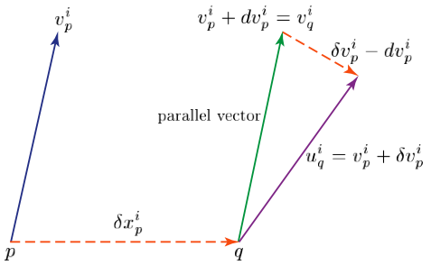
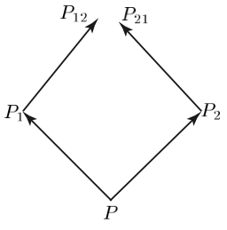

# weyl — supplement（supplement）

> （《weyl》词条补充材料，源：plato.stanford.edu/entries/weyl/supplement.html）

#### Supplement to Hermann Weyl

## Weyl’s metric-independent construction of the symmetric linear connection

Weyl characterizes the notion of a symmetric linear connection as follows:

**Definition A.1 (Affine Connection)** Let $T(M_{p})$ denote the tangent space of $M$ at $p \in M$. A point $p \in M$ is affinely connected with its immediate neighborhood, if and only if for every vector $v_{p} \in T(M_{p})$, a vector at $q$

$$\tag{44} v^{\,i}_{q} \in T(M_{q}) = v^{\,i}_{p} + dv^{\,i}_{p} $$

is determined to which the vector $v_{p} \in T(M_{p})$ gives rise under parallel displacement from $p$ to the infinitesimally neighboring point $q$.

Of the notion of parallel displacement, Weyl requires that it satisfy the following condition.

**Definition A.2 (Parallel Displacement)** The transport of a vector $v_{p} \in T(M_{p})$ to an infinitesimally neighboring point $q \in M$ constitutes a parallel displacement if and only if there exists a coordinate system $\overline{x}^{i}$ (called a *geodesic* coordinate system) for the neighborhood of $p \in M$, relative to which the transported vector $\overline{v}_{q}$ possesses the same components as $\overline{v}_{p}$; that is,

$$\tag{45} \overline{v}^i_q - \overline{v}^i_p = d\overline{v}^i_p = 0. $$

The requirement that there exist a geodesic coordinate system such that (45) is satisfied, characterizes the essential nature of parallel transport.

It is natural to require that for an arbitrary coordinate system the components $dv^{i}_{p}$ in (44) vanish whenever $v^{i}_{p}$ or $dx^{i}_{p}$ vanish. Hence, the simplest assumption that can be made about the components $dv^{i}_{p}$ is that they are linearly dependent on the two vectors $v^{i}_{p}$ and $dx^{i}_{p}$. That is, $dv^{i}_{p}$ must be bilinear in $v^{i}_{p}$ and in $dx^{i}_{p}$; that is,

$$\tag{46} dv^{\,i}_{p} = - \Gamma^{i}_{jk}(x)v^{\,j}_{p}dx^{k}_{p}, $$

where the $n^{3}$ coefficients $\Gamma^{i}_{jk}$(x) are coordinate functions, that is functions of $x^{i}$ $(i = 1, \ldots ,n)$, and the minus sign is introduced to agree with convention.

The $v^{\,j}_{p}$ and $dx^{k}_{p}$ in (46) are vectors, but $dv^{\,i}_{p} = v^{\,i}_{q} - v^{\,i}_{p}$ is not a vector since the vectors $v^{\,i}_{q}$ and $v^{\,i}_{p}$ lie in different tangent planes and cannot be subtracted. Hence the coefficients $\Gamma^{i}_{jk}(x)$ do not constitute a tensor; they conform to a linear but non-homogeneous transformation law. The vector

$$ v^{\,i}_{q} = v^{\,i}_{p} + dv^{\,i}_{p} = v^{\,i}_{p} - \Gamma^{i}_{jk}v^{\,j}_{p}dx^{k}_{p} $$

is called the *parallel displaced vector*.

Weyl (1918b, 1923b) proves the following theorem.

**Theorem A.3** If for every point $p$ in a neighborhood $U$ of $M$, there exists a geodesic coordinate system $\overline{x}$ such that the change in the components of a vector under parallel transport to an infinitesimally near point $q$ is given by

$$\tag{47} d\overline{v}^{\,i}_p = 0, $$

then locally in any other coordinate system $x$,

$$\tag{48} dv^{\,i}_{p} = - \Gamma^{i}_{jk}(x)v^{\,j}_{p}dx^{k}_{p}, $$

where $\Gamma^{i}_{jk}(x) = \Gamma^{i}_{kj}(x)$, and conversely.

The idea of parallel displacement leads immediately to the idea of the *covariant derivative* of a vector field. Consider a vector field $v^{i}(x)$ evaluated at two nearby points $p$ and $q$ with arbitrary coordinates $x^{i}$ and $x^{i} + \delta x^{i}$ respectively. A first-order Taylor expansion yields

$$\tag{49} u^{\,i}_{q} = v^{\,i}_{p}(x + \delta x) = v^{\,i}_{p}(x) + \frac{\partial v^{\,i}}{\partial x^{\,j}} \delta x^{\,j}_p . $$

If we set

$$\tag{50} \frac{\partial v^{\,i}}{\partial x^{\,j}} \delta x^{\,j}_p = \delta v^{\,i}_p(x), $$

then

$$\tag{51} \delta v^{\,i}_{p}(x) = v^{\,i}_{p}(x + \delta x) - v^{\,i}_{p}(x), $$

and

$$\tag{52} u^{\,i}_{q} = v^{\,i}_{p} + \delta v^{\,i}_{p}. $$

The array of derivatives

$$ \frac{\partial v^{\,i}}{\partial x^{\,j}} $$

do not constitute a tensorial entity, because the derivatives are formed by the inadmissible procedure of subtracting the vector $v^{\,i}_{p}(x)$ at $p$ from the vector $u^{\,i}_{q} = v^{\,i}_{p}(x + \delta x)$ at $q$. Their difference $\delta v^{\,i}_{p}(x)$ is not a vector since the vectors lie in the different tangent spaces $T(M_{p})$ and $T(M_{q})$, respectively. Since $\delta x^{\,i}_{p}$ is a vector whereas $\delta v^{\,i}_{p}$ is not, the array of derivatives

$$ \frac{\partial v^{\,i}}{\partial x^{\,j}} $$

in (50) cannot therefore be a tensorial entity. To form a derivative that is tensorial, that is *covariant* or *invariant*, we must subtract from the vector $u^{\,i}_{q} = v^{\,i}_{p} + \delta v^{\,i}_{p}$ not the vector $v^{\,i}_{p}$, but another vector **at** $q$ which “represents” the original vector $v^{\,i}_{p}$ as “unchanged” as we proceed from $p$ to $q$. Such a representative vector at $q$ may be obtained by *parallel transport* of the vector $v^{\,i}_{p}$ to the nearby point $q$, and will be denoted, given an arbitrary coordinate system $x$, by

$$\tag{53} v^{\,i}_{q} = v^{\,i}_{p} + dv^{\,i}_{p}\,. $$

Since $dv^{\,i}_{p}$ is the difference between $v^{\,i}_{p}$ and $v^{\,i}_{q}$, $dv^{\, i}_{p}$ is also not a vector for the for the reasons given above; however, the difference

$$\begin{align} u_{q} - v_{q} &= v^{\,i}_{p} + \delta v^{\,i}_{p} - [v^{\,i}_{p} + dv^{\,i}_{p}] \\ \tag{54} &= \delta v^{\,i}_{p} - dv^{\,i}_{p} \end{align}$$

*is* a vector and is therefore a tensorial entity.

\*Figure 16:\* Covariant differentiation

The covariant derivative can now be defined by the limiting process

$$\begin{align} \nabla_{k}v^{\,i}_{p} &= \lim_{\delta x^{k}_{p} \rightarrow 0} \frac{(v^{\,i}_{p} + \delta v^{\,i}_{p} - v^{\,i}_{p} - dv^{\,i}_{p})}{\delta x^{k}_{p}} \\ \tag{55} &= \lim_{\delta x^{k}_{p} \rightarrow 0} \frac{(\delta v^{\,i}_{p} - dv^{\,i}_{p})}{\delta x^{k}_{p}} \\ &= \frac{\partial v^{\,i}_p}{\partial x^k} + \Gamma^i_{jk} v^{\,j}_{p}. \end{align}$$

In general, one writes the covariant derivative of a vector field $v^{i}$ simply as

$$\tag{56} \nabla_{k}v^{\,i} = \partial_{k}v^{\,i} + \Gamma^{i}_{jk}v^{\,j}. $$

Weyl (1918b, §3.I.B) also provided a more synthetic argument to establish the symmetry of the affine connection. He considers two infinitesimal vectors $\overline{PP}_{1}$ and $\overline{PP}_{2}$ at a point $P$. The vector $\overline{PP}_{1}$ under parallel transport along $\overline{PP}_{2}$ goes into $\overline{P_{2}P}_{21}$. Similarly, the vector $\overline{PP}_{2}$ under parallel transport along $\overline{PP}_{1}$ goes into $\overline{P_{1}P}_{12}$. These relationships are illustrated in figure 17.

\*Figure 17:\* Symmetry of Parallel Transport

The condition imposed on parallel transport is that the four vectors $\overline{PP}_{1}$, $\overline{P_{1}P}_{12}$, $\overline{PP}_{2}$ and $\overline{P_{2}P}_{21}$ form a closed parallelogram; that is, the points $P_{12}$ and $P_{21}$ coincide. It follows that

$$\tag{57} \overline{PP}_{1} + \overline{P_{1}P}_{12} = \overline{PP}_{2} + \overline{P_{2}P}_{21}. $$

Denote the coordinates of $\overline{PP}_{1}$ and $\overline{PP}_{2}$ by $dx^{i}$ and $\delta x^{i}$, respectively. The coordinates of $\overline{P_{2}P}_{21}$ and $\overline{P_{1}P}_{12}$ are respectively denoted by $dx^{i} + \delta dx^{i}$ and $\delta x^{i} + d\delta x^{i}.$ Substitution into (57) yields

$$\tag{58} dx^{i} + \delta x^{i} + d\delta x^{i} = \delta x^{i} + dx^{i} + \delta dx^{i}, $$

or

$$\tag{59} d\delta x^{i} = \delta dx^{i}. $$

From the assumption that the vectors transform linearly, one has

$$\tag{60} \begin{matrix} \delta dx^{i} = - \delta \gamma^{i}_{r}dx^{r} & \text{and} & d\delta x^{i} = - d\gamma^{i}_{r}\delta x^{r} \end{matrix}$$

From the assumption that the infinitesimal transformation coefficients $\delta \gamma^{i}_{r}$ and $d\gamma^{i}_{r}$ are of the same order as the corresponding differentials $\delta x^{i}$ and $dx^{i}$, one obtains

$$\tag{61} \begin{matrix} \delta \gamma^{i}_{r} = \Gamma^{i}_{rs}\delta x^{s} & \text{and} & d\gamma^{i}_{r} = \Gamma^{i}_{rs}dx^{s}. \end{matrix}$$

Substitution of (60) and (61) into (59) yields

$$\tag{62} \Gamma^{i}_{jk} = \Gamma^{i}_{kj} $$
