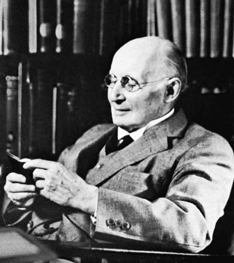

# Alfred North Whitehead

*Desmet, Ronald, Irvine, Andrew David*

 Photo by Richard Carver Wood
# Alfred North Whitehead
**First published Tue May 21, 1996; substantive revision Thu Nov 10, 2022**

Alfred North Whitehead (1861–1947) was a British mathematician and philosopher best known for his work in mathematical logic and the philosophy of science. In collaboration with Bertrand Russell, he co-authored the landmark three-volume *Principia Mathematica* (1910, 1912, 1913). Later, he was instrumental in pioneering the approach to metaphysics now known as process philosophy.

Although there are important continuities throughout his career, Whitehead’s intellectual life is often divided into three main periods. The first corresponds roughly to his time at Cambridge from 1884 to 1910. It was during these years that he worked primarily on issues in mathematics and logic. It was also during this time that he collaborated with Russell. The second main period, from 1910 to 1924, corresponds roughly to his time at London. During these years Whitehead concentrated mainly on issues in physics, the philosophy of science, and the philosophy of education. The third main period corresponds roughly to his time at Harvard from 1924 onward. It was during this time that he worked primarily on issues in metaphysics.

## 1. Life and Works

The son of an Anglican clergyman, Whitehead graduated from Cambridge in 1884 and was elected a Fellow of Trinity College that same year. His marriage to Evelyn Wade six years later was largely a happy one and together they had a daughter (Jessie) and two sons (North and Eric). After moving to London, Whitehead served as president of the Aristotelian Society from 1922 to 1923. After moving to Harvard, he was elected to the British Academy in 1931. His moves to both London and Harvard were prompted in part by institutional regulations requiring mandatory retirement, although his resignation from Cambridge was also done partly in protest over how the University had chosen to discipline Andrew Forsyth, a friend and colleague whose affair with a married woman had become something of a local scandal.

In addition to Russell, Whitehead influenced many other students who became equally or more famous than their teacher, examiner or supervisor himself. For example: mathematicians G. H. Hardy and J. E. Littlewood; mathematical physicists Edmund Whittaker, Arthur Eddington, and James Jeans; economist J. M. Keynes; and philosophers Susanne Langer, Nelson Goodman, and Willard van Orman Quine. Whitehead did not, however, inspire any school of thought during his lifetime, and most of his students distanced themselves from parts of his teachings that they considered anachronistic. For example: Whitehead’s conviction that pure mathematics and applied mathematics should not be separated, but cross-fertilize each other, was not shared by Hardy, but seen as a remnant of the fading mixed mathematics tradition; after the birth of the theories of relativity and quantum physics, Whitehead’s method of abstracting some of the basic concepts of mathematical physics from common experiences seemed antiquated compared to Eddington’s method of world building, which aimed at constructing an experiment matching world from mathematical building blocks; when, due to Whitehead’s judgment as one of the examiners, Keynes had to rewrite his fellowship dissertation, Keynes raged against Whitehead, claiming that Whitehead had not bothered to try to understand Keynes’ novel approach to probability; and Whitehead’s main philosophical doctrine—that the world is composed of deeply interdependent processes and events, rather than mostly independent material things or objects—turned out to be largely the opposite of Russell’s doctrine of logical atomism, and his metaphysics was dispelled by the logical positivists from their dream land of pure scientific philosophy.

Despite the fact that he did not inspire any school of thought during his life, his influence on contemporaries was significant. The late Associate Justice of the United States Supreme Court, Felix Frankfurter, wrote:

> From knowledge gained through the years of the personalities who in our day have affected American university life, I have for some time been convinced that no single figure has had such a pervasive influence as the late Professor Alfred North Whitehead. (*New York Times,* January 8, 1948)

Moreover, Whitehead’s philosophical views posthumously inspired the movement of process philosophy and theology, and today Whitehead’s ideas continue to be felt and are revalued in varying degrees in all of the main areas in which he worked. One of the most important factors in recent Whitehead scholarship is the gradual publishing of volumes of *The Edinburgh Critical Edition of the Complete Works of Alfred North Whitehead*. Two volumes of *The Harvard Lectures of Alfred North Whitehead*, mainly containing student notes of lectures and seminars given by Whitehead at Harvard from September 1924 until May 1927, have already been published by Edinburgh University Press in 2017 and 2021 respectively (see the Primary Literature section of the Bibliography below), and four more volumes are on their way. Their publication is a stimulus for Whitehead researchers all over the world, as is clear from the 2020 book edited by Brian Henning and Joseph Petek, *Whitehead at Harvard, 1924–1925*.

A short chronology of the major events in Whitehead’s life is below.

| 1861 | Born February 15 in Ramsgate, Isle of Thanet, Kent, England. |
| --- | --- |
| 1880 | Enters Trinity College, Cambridge, with a scholarship in mathematics. |
| 1884 | Elected to the Apostles, the elite discussion club founded by Tennyson in the 1820s; graduates with a B.A. in Mathematics; elected a Fellow in Mathematics at Trinity. |
| 1890 | Meets Russell; marries Evelyn Wade. |
| 1903 | Elected a Fellow of the Royal Society as a result of his work on universal algebra, symbolic logic, and the foundations of mathematics. |
| 1910 | Resigns from Cambridge and moves to London. |
| 1911 | Appointed Lecturer at University College London. |
| 1912 | Elected President of both the South-Eastern Mathematical Association and the London branch of the Mathematical Association for the year 1913. |
| 1914 | Appointed Professor of Applied Mathematics at the Imperial College of Science and Technology. |
| 1915 | Elected President of the Mathematical Association for the two-year period 1915–1917. |
| 1921 | Meets Albert Einstein. |
| 1922 | Elected President of the Aristotelian Society for the one-year period 1922–1923. |
| 1924 | Appointed Professor of Philosophy at Harvard University. |
| 1931 | Elected a Fellow of the British Academy. |
| 1937 | Retires from Harvard. |
| 1945 | Awarded Order of Merit. |
| 1947 | Dies December 30 in Cambridge, Massachusetts, USA. |

More detailed information about Whitehead’s life can be found in the comprehensive two-volume biography *A.N. Whitehead: The Man and His Work* (1985, 1990) by Victor Lowe and J.B. Schneewind. Paul Schilpp’s *The Philosophy of Alfred North Whitehead* (1941) also includes a short autobiographical essay, in addition to providing a comprehensive critical overview of Whitehead’s thought and a detailed bibliography of his writings.

Other helpful introductions to Whitehead’s work include Victor Lowe’s *Understanding Whitehead* (1962), Stephen Franklin’s *Speaking from the Depths* (1990), Thomas Hosinski’s *Stubborn Fact and Creative Advance* (1993), Elizabeth Kraus’ *The Metaphysics of Experience* (1998), Robert Mesle’s *Process-Relational Philosophy* (2008), John Cobb’s *Whitehead Word Book* (2015) and Jay McDaniel’s *What is Process Thought?* (2021). Recommendable for the more advanced Whitehead student are Ivor Leclerc’s *Whitehead’s Metaphysics* (1958), Wolfe Mays’ *The Philosophy of Whitehead* (1959), Donald Sherburne’s *A Whiteheadian Aesthetics* (1961), Charles Hartshorne’s *Whitehead’s Philosophy* (1972), Lewis Ford’s *The Emergence of Whitehead’s Metaphysics* (1984), George Lucas’ *The Rehabilitation of Whitehead* (1989), David Griffin’s *Whitehead’s Radically Different Postmodern Philosophy* (2007), Steven Shaviro’s *Without Criteria* (2009), Isabelle Stengers’ *Thinking with Whitehead* (2011), and Didier Debaise’s *Speculative Empiricism: Revisiting Whitehead* (2017a). For a chronology of Whitehead’s major publications, readers are encouraged to consult the Primary Literature section of the Bibliography below.

## 2. Mathematics and Logic

Whitehead began his academic career at Trinity College, Cambridge where, starting in 1884, he taught for a quarter of a century. In 1890, Russell arrived as a student and during the 1890s the two men came into regular contact with one another. According to Russell,

> Whitehead was extraordinarily perfect as a teacher. He took a personal interest in those with whom he had to deal and knew both their strong and their weak points. He would elicit from a pupil the best of which a pupil was capable. He was never repressive, or sarcastic, or superior, or any of the things that inferior teachers like to be. I think that in all the abler young men with whom he came in contact he inspired, as he did in me, a very real and lasting affection. (1956: 104)

By the early 1900s, both Whitehead and Russell had completed books on the foundations of mathematics. Whitehead’s 1898 *A Treatise on Universal Algebra* had resulted in his election to the Royal Society. Russell’s 1903 *The Principles of Mathematics* had expanded on several themes initially developed by Whitehead. Russell’s book also represented a decisive break from the neo-Kantian approach to mathematics Russell had developed six years earlier in his *Essay on the Foundations of Geometry*. Since the research for a proposed second volume of Russell’s *Principles* overlapped considerably with Whitehead’s own research for a planned second volume of his *Universal Algebra*, the two men began collaboration on what eventually would become *Principia Mathematica* (1910, 1912, 1913). According to Whitehead, they initially expected the research to take about a year to complete. In the end, they worked together on the project for a decade.

According to Whitehead—inspired by Hermann Grassmann—mathematics is the study of pattern:

> mathematics is concerned with the investigation of patterns of connectedness, in abstraction from the particular relata and the particular modes of connection. (1933 [1967: 153])

In his *Treatise on Universal Algebra*, Whitehead took a generalized algebra—called ‘universal algebra’—to be the most appropriate tool for this study or investigation, but after meeting Giuseppe Peano during the section devoted to logic at the First International Congress of Philosophy in 1900, Whitehead and Russell became aware of the potential of symbolic logic to become the most appropriate tool to rigorously study mathematical patterns.

With the help of Whitehead, Russell extended Peano’s symbolic logic in order to be able to deal with all types of relations and, consequently, with all the patterns of relatedness that mathematicians study. In his *Principles of Mathematics*, Russell gave an account of the resulting new symbolic logic of classes and relations—called ‘mathematical logic’—as well as an outline of how to reconstruct all existing mathematics by means of this logic. After that, instead of only being a driving force behind the scenes, Whitehead became the public co-author of Russell of the actual and rigorous reconstruction of mathematics from logic. Russell often presented this reconstruction—giving rise to the publication of the three *Principia Mathematica* volumes—as the reduction of mathematics to logic, both *qua* definitions and *qua* proofs. And since the 1920s, following Rudolf Carnap, Whitehead and Russell’s project as well as similar reduction-to-logic projects, including the earlier project of Gottlob Frege, are classified under the header of ‘logicism’.

However, Sébastian Gandon has highlighted in his 2012 study *Russell’s Unknown Logicism* that Russell and Whitehead’s logicism project differed in at least one important respect from Frege’s logicism project. Frege adhered to a radical universalism, and wanted the mathematical content to be entirely determined from within the logical system. Russell and Whitehead, however, took into account the consensus, or took a stance in the ongoing discussions among mathematicians, with respect to the constitutive features of the already existing, ‘pre-logicized’ branches of mathematics, and then evaluated for each branch which of several possible types of relations were best suited to logically reconstruct it, while safeguarding its topic-specific features. Contrary to Frege, Whitehead and Russell tempered their urge for universalism to take into account the topic-specificity of the various mathematical branches, and as a working mathematician, Whitehead was well positioned to compare the pre-logicized mathematics with its reconstruction in the logical system.

For Russell, the logicism project originated from the dream of a rock-solid mathematics, no longer governed by Kantian intuition, but by logical rigor. Hence, the discovery of a devastating paradox—later called ‘Russell’s paradox’—at the heart of mathematical logic was a serious blow for Russell, and kicked off his search for a theory to prevent paradox. He actually came up with several theories, but retained the ramified theory of types in *Principia Mathematica*. Moreover, the ‘logicizing’ of arithmetic required extra-logical patchwork: the axioms of reducibility, infinity, and choice. None of this patchwork could ultimately satisfy Russell. His original dream evaporated and, looking back later in life, he wrote: “The splendid certainty which I had always hoped to find in mathematics was lost in a bewildering maze” (1959: 157).

Whitehead originally conceived of the logicism project as an improvement upon his algebraic project. Indeed, Whitehead’s transition from the solitary *Universal Algebra* project to the joint *Principia Mathematica* project was a transition from universal algebra to mathematical logic as the most appropriate symbolic language to embody mathematical patterns. It entailed a generalization from the embodiment of absolutely abstract patterns by means of algebraic forms of variables to their embodiment by means of propositional functions of real variables. Hardy was quite right in his review of the first volume of *Principia Mathematica* when he wrote: “mathematics, one may say, is the science of propositional functions” (quoted by Grattan-Guinness 1991: 173)[^grattan-guinness-1991].

Whitehead saw mathematical logic as a tool to guide the mathematician’s essential activities of intuiting, articulating, and applying patterns, and he did not aim at replacing mathematical intuition (pattern recognition) with logical rigor. In the latter respect, Whitehead, from the start, was more like Henri Poincaré than Russell (cf. Desmet 2016a)[^desmet-2016a]. Consequently, the discovery of paradox at the heart of mathematical logic was less of a blow to Whitehead than to Russell and, later in life, now and again, Whitehead simply reversed the Russellian order of generality and importance, writing that “symbolic logic” only represents “a minute fragment” of the possibilities of “the algebraic method” (1947 [1968: 129]).

For a more detailed account of the genesis of *Principia Mathematica* and Whitehead’s place in the philosophy of mathematics, cf. Smith 1953, Code 1985, Grattan-Guinness 2000 and 2002, Irvine 2009, Bostock 2010, Desmet 2010, N. Griffin et al. 2011, N. Griffin & Linsky 2013.

Following the completion of *Principia,* Whitehead and Russell began to go their separate ways (cf. Ramsden Eames 1989, Desmet & Weber 2010, Desmet & Rusu 2012)[^desmet-2010][^desmet-2012][^desmet-2010-2][^ramsden-1989]. Perhaps inevitably, Russell’s anti-war activities and Whitehead’s loss of his youngest son during World War I led to something of a split between the two men. Nevertheless, the two remained on relatively good terms for the rest of their lives. To his credit, Russell comments in his *Autobiography* that when it came to their political differences, Whitehead

> was more tolerant than I was, and it was much more my fault than his that these differences caused a diminution in the closeness of our friendship. (1956: 100)

## 3. Physics

Even with the publication of its three volumes, *Principia Mathematica* was incomplete. For example, the logical reconstruction of the various branches of geometry still needed to be completed and published. In fact, it was Whitehead’s task to do so by producing a fourth *Principia Mathematica* volume. However, this volume never saw the light of day. What Whitehead did publish were his repeated attempts to logically reconstruct the geometry of space and time, hence extending the logicism project from pure mathematics to applied mathematics or, put differently, from mathematics to physics—an extension which Russell greeted with enthusiasm and saw as an important step in the deployment of his new philosophical method of logical analysis.

At first, Whitehead focused on the geometry of space.

When Whitehead and Russell logicized the concept of number, their starting point was our intuition of equinumerous classes of individuals—for example, our recognition that the class of dwarfs in the fairy tale of Snow White (Doc, Grumpy, Happy, Sleepy, Bashful, Sneezy, Dopey) and the class of days in a week (from Monday to Sunday) have ‘something’ in common, namely, the something we call ‘seven.’ Then they logically defined (i) classes C and C′ to be equinumerous when there is a one-to-one relation that correlates each of the members of C with one member of C′, and (ii) the number of a class C as the class of all the classes that are equinumerous with C.

When Whitehead logicized the space of physics, his starting point was our intuition of spatial volumes and of how one volume may contain (or extend over) another, giving rise to the (mereo)logical relation of containment (or extension) in the class of volumes, and to the concept of converging series of volumes—think, for example, of a series of Russian dolls, one contained in the other, but idealized to ever smaller dolls. Whitehead made all this rigorous and then, crudely put, defined the points from which to further construct the geometry of space.

There is a striking resemblance between Whitehead’s construction of points and the construction of real numbers by Georg Cantor, who had been one of Whitehead and Russell’s main sources of inspiration next to Peano. Indeed, Whitehead defined points as equivalence classes of converging series of volumes, and Cantor defined real numbers as equivalence classes of converging series of rational numbers. Moreover, because Whitehead’s basic geometrical entities of geometry are not (as in Euclid) extensionless points but volumes, Whitehead can be seen as one of the fathers of point-free geometry; and because Whitehead’s basic geometrical relation is the mereological (or part-whole) relation of extension, he can also be seen as one of the founders of mereology (and even, when we take into account his later work on this topic in part IV of *Process and Reality*, of mereotopology).

“Last night”, Whitehead wrote to Russell on 3 September 1911,

> the idea suddenly flashed on me that time could be treated in exactly the same way as I have now got space (which is a picture of beauty, by the bye). (Unpublished letter kept in The Bertrand Russell Archives at McMaster University)

Shortly after, Whitehead must have learned about Einstein’s Special Theory of Relativity (STR) because in a letter to Wildon Carr on 10 July 1912, Russell suggested to the Honorary Secretary of the Aristotelian Society that Whitehead possibly might deliver a paper on the principle of relativity, and added: “I know he has been going into the subject”. Anyhow, in the early years of the second decade of the twentieth century, Whitehead’s interest shifted from the logical reconstruction of the Euclidean space of classical physics to the logical reconstruction of the Minkowskian space-time of the STR.

A first step to go from space to space-time was the replacement of (our intuition of) spatial volumes with (our intuition of) spatio-temporal regions (or events) as the basis of the construction (so that, for example, a point of space-time could be defined as an equivalence class of converging spatio-temporal regions). However, whereas Whitehead had constructed the Euclidean distance based on our intuition of cases of spatial congruence (for example, of two parallel straight line segments being equally long), he now struggled to construct the Minkowskian metric in terms of a concept of spatio-temporal congruence, based on a kind of merger of our intuition of cases of spatial congruence and our intuition of cases of temporal congruence (for example, of two candles taking equally long to burn out).

So, as a second step, Whitehead introduced a second relation in the class of spatio-temporal regions next to the relation of extension, namely, the relation of cogredience, based on our intuition of rest or motion. Whitehead’s use of this relation gave rise to a constant *k*, which allowed him to merge spatial and temporal congruence, and which appeared in his formula for the metric of space-time. When Whitehead equated *k* with *c*² (the square of the speed of light) his metric became equal to the Minkowskian metric.

Whitehead’s most detailed account of this reconstruction of the Minkowskian space-time of the STR was given in his 1919 book, *An Enquiry concerning the Principles of Natural Knowledge*, but he also offered a less technical account in his 1920 book, *The Concept of Nature*.

Whitehead first learned about Einstein’s General Theory of Relativity (GTR) in 1916. He admired Einstein’s new mathematical theory of gravitation, but rejected Einstein’s explanation of gravitation for not being coherent with some of our basic intuitions. Einstein explained the gravitational motion of a free mass-particle in the neighborhood of a heavy mass as due to the curvature of space-time caused by this mass. According to Whitehead, the theoretical concept of a contingently curved space-time does not cohere with our measurement practices; they are based on the essential uniformity of the texture of our spatial and temporal intuition.

In general, Whitehead opposed the modern scientist’s attitude of dropping the requirement of coherence with our basic intuitions, and he revolted against the issuing bifurcation of nature into the world of science and that of intuition. In particular, as Einstein’s critic, he set out to give an alternative rendering of the GTR—an alternative that passed not only what Whitehead called “the narrow gauge”, which tests a theory’s empirical adequacy, but also what he called “the broad gauge”, which tests its coherence with our basic intuitions.

In 1920, first in a newspaper article (reprinted in *Essays in Science and Philosophy*), and then in a lecture (published as Chapter VIII of *Concept of Nature*), Whitehead made public an outline of his alternative to Einstein’s GTR. In 1921, Whitehead had the opportunity to discuss matters with Einstein himself. And finally, in 1922, Whitehead published a book with a more detailed account of his alternative theory of gravitation (ATG)—*The Principle of Relativity*.

According to Whitehead, the Maxwell-Lorentz theory of electrodynamics (unlike Einstein’s GTR) could be conceived as coherent with our basic intuitions—even in its four-dimensional format, namely, by elaborating Minkowski’s electromagnetic worldview. Hence, Whitehead developed his ATG in close analogy with the theory of electrodynamics. He replaced Einstein’s geometric explanation with an electrodynamics-like explanation. Whitehead explained the gravitational motion of a free mass-particle as due to a field action determined by retarded wave-potentials propagating in a uniform space-time from the source masses to the free mass-particle.

It is important to stress that Whitehead had no intention of improving the predictive content of Einstein’s GTR, only the explanatory content. However, Whitehead’s replacement of Einstein’s explanation with an alternative explanation entailed a replacement of Einstein’s formulae with alternative formulae; and these different formulae implied different predictions. So it would be incorrect to say that Whitehead’s ATG is empirically equivalent to Einstein’s GTR. What can be claimed, however, is that for a long time Whitehead’s theory was experimentally indistinguishable from Einstein’s theory.

In fact, like Einstein’s GTR, Whitehead’s ATG leads to Newton’s theory of gravitation as a first approximation. Also (as shown by Eddington in 1924 and J. L. Synge in 1952)[^eddington-1924][^synge-1952] Einstein’s and Whitehead’s theories of gravitation lead to an identical solution for the problem of determining the gravitational field of a single, static, and spherically symmetric body—the Schwarzschild solution. This implies, for example, that Einstein’s GTR and Whitehead’s ATG lead to the exact same predictions not only with respect to the precession of the perihelion of Mercury and the bending of starlight in the gravitational field of the sun (as already shown by Whitehead in 1922 and William Temple in 1924)[^temple-1924] but also with respect to the red-shift of the spectral lines of light emitted by atoms in the gravitational field of the sun (contrary to Whitehead’s own conclusion in 1922, which was based on a highly schematized and soon outdated model of the molecule). Moreover (as shown by R. J. Russell and Christoph Wassermann in 1986 and published in 2004)[^russell-2004] Einstein’s and Whitehead’s theories of gravitation also lead to an identical solution for the problem of determining the gravitational field of a single, rotating, and axially symmetric body—the Kerr solution.

Einstein’s and Whitehead’s predictions become different, however, when considering more than one body. Indeed, Einstein’s equation of gravitation is non-linear while Whitehead’s is linear; and this divergence *qua* mathematics implies a divergence *qua* predictions in the case of two or more bodies. For example (as shown by G. L. Clark in 1954)[^clark-1954] the two theories lead to different predictions with respect to the motion of double stars. The predictive divergence in the case of two bodies, however, is quite small, and until recently experimental techniques were not sufficiently refined to confirm either Einstein’s predictions or Whitehead’s, for example, with respect to double stars. In 2008, based on a precise timing of the pulsar B1913+16 in the Hulse-Taylor binary system, Einstein’s predictions with respect to the motion of double stars were confirmed, and Whitehead’s refuted (by Gary Gibbons and Clifford Will). The important fact from the viewpoint of the philosophy of science is not that, since the 1970s, now and again, a physicist rose to claim the experimental refutation of Whitehead’s ATG, but that for decades it was experimentally indistinguishable from Einstein’s GTR, hence refuting two modern dogmas. First, that theory choice is solely based on empirical facts. Clearly, next to facts, values—especially aesthetic values—are at play as well. Second, that the history of science is a succession of victories over the army of our misleading intuitions, each success of science must be interpreted as a defeat of intuition, and a truth cannot be scientific unless it hurts human intuition. Surely, we can be scientific without taming the authority of our intuition and without engaging in the disastrous race to disenchant nature and humankind.

For a more detailed account of Whitehead’s involvement with Einstein’s STR and GTR, cf. Palter 1960, Von Ranke 1997, Herstein 2006 and Desmet 2011, 2016b, and 2016c.

In 1925, in one of his Lowell lectures (published as Chapter VIII of *Science and the Modern World*), Whitehead made public a popular outline of his alternative to Bohr’s solar system view of material atoms, but he never published a more detailed and technical account of this alternative quantum theory (AQT). Whitehead called his AQT, ‘the theory of primates.’ In it, primates are not apes, of course, but standing (or stationary) electromagnetic waves (or vibrations). These waves are different from the traveling electromagnetic waves *outside* atoms. They are not light waves, but standing waves of charge density *inside* atoms, in fact, *constituting* atoms.

Whitehead was up to date with respect to the old quantum mechanics of Planck, Einstein and Bohr. He was as familiar with Jeans’ *Report on Radiation and the Quantum-Theory* (1914) as with Eddington’s *Report on the Relativity Theory of Gravitation* (1918). And prior to his departure to Harvard, on 12 July 1924, Whitehead chaired a symposium—“The Quantum Theory: How far does it modify the mathematical, the physical, and the psychological concepts of continuity?”—which was part of a joint session of the Aristotelian Society and the Mind Society. Unfortunately, he did not himself deliver a lecture at that symposium, and the most technical account of his AQT can be found in the student notes of lectures Whitehead gave at Harvard, especially in the fall semester of the academic year 1924–1925. Whitehead’s lectures, however, were not clear-cut presentations, but instances of philosophy in the making. Moreover, his philosophy students lacked the necessary knowledge of mathematical physics to fully comprehend Whitehead when he talked physics. Consequently, the student notes of Whitehead’s Harvard lectures dealing with quantum theory are low quality notes. Ronny Desmet, however, has made a first attempt to correct some of the mistakes and to reconstruct Whitehead’s AQT in his 2020 paper, “Whitehead’s Highly Speculative Lectures on Quantum Theory” (Henning & Petek 2020: 154–181)[^henning-2020], and in his 2022 paper, “Whitehead’s 1925 View of Function and Time” (to be published).

In his AQT, Whitehead conceived of all electrons and protons as compositions of standing electromagnetic waves of charge density, which he called ‘primates’ or ‘primordial elements.’ In *Science and the Modern World*, Whitehead wrote: “We shall conceive each primordial element as a vibratory ebb and flow of an underlying energy, or activity” (1925 [1967: 35]). When a material atom emits energy, one of its composing standing electromagnetic waves is transformed into a travelling electromagnetic wave, that is, into light. The energy emitted by an atom is the energy of the emitted light, and the action of the emitted light is the product of its energy and its period (which is the inverse of its frequency). Experiment had revealed that the amounts of energy and action of atomic light emission do not form a continuous, but a discrete spectrum; they are quantized physical variables. In fact, a smallest amount of action exists, the quantum of action, given by Planck’s constant, and all measured amounts of action of atomic light emission are integer multiples of this quantum of action. Whitehead conceived of electrons and protons as composed of standing electromagnetic waves of which the action is also always a multiple of the quantum of action. And as he conceived of the atomic energy emission as a transformation of these standing into traveling electromagnetic waves, it became clear to him that this emission actually involves the decay of a primate, and that the loss of the primate’s quantized energy and action explains why the emitted light has similarly quantized energy and action.

Contrary to his ATG, Whitehead’s AQT soon became obsolete. Experiments revealed that there are more elementary particles than electrons and protons. And, of course, the new quantum mechanics (of Schrödinger, Heisenberg, Dirac, Pauli, and many others) emerged. As Whitehead focused on philosophy when at Harvard, his knowledge of physics began to be out of date. His own theory, however, showed some similarities with the new quantum mechanics. Whitehead’s standing electromagnetic waves, in a sense, foreshadowed Schrödinger’s wave mechanics. And whereas the discovery of the quantum of action was the “physicist’s nightmare” (Whitehead 2021:93), Whitehead was happy with the increasing importance of the notion of ‘action’ in physics. Action is an activity through time, and hence confirms Whitehead’s idea that processes, and not instantaneous configurations of inactive masses, are fundamental in nature. Moreover, since there is a minimum quantum of action, Whitehead interpreted the equation, action equals the product of energy and period (which is a duration), by saying: “concentration of time increases energy” (2021: 93). This statement of Whitehead, in a sense, foreshadowed Heisenberg’s uncertainty principle with respect to energy and time, which was formulated two years later. As his AQT thus foreshadowed the new quantum mechanics in two respects, one wonders what he thought of this new theory when it emerged. Charles Hartshorne wrote that Whitehead definitely saw “Heisenberg’s famous article of 1927 on the Uncertainty Principle” (2010: 28). Hartshorne was sure about this, because it was he himself who showed it to Whitehead. But there is (as yet) no evidence that Whitehead seriously studied this paper in particular, or the new quantum mechanics in general.

Whitehead said to his students: “A definite creative act is looked on as handing over to physics the ultimate unit” (2021: 41), where the ultimate unit is Planck’s constant, or, in other words, the quantum of action. Clearly, Whitehead thought of the quantum of action as an abstract aspect of his ultimate metaphysical building blocks, his elementary creative acts or ‘actual occasions,’ and his AQT, like the Maxwell-Lorentz theory of electrodynamics and Whitehead’s ATG, were still at the back of his mind when he developed his metaphysics at Harvard. This may well be the reason why his metaphysics—his process philosophy—has been conceived by many authors as an interesting framework to ontologically interpret the mathematical formalism of quantum mechanics. And even authors who are not directly inspired by Whitehead, often come up with interpretations of quantum mechanics that are strikingly Whiteheadian. A good and recent example is Carlo Rovelli’s relational interpretation. Rovelli writes:

> In the world described by quantum mechanics there is no reality except in the relations between physical systems. It isn’t things that enter into relations but, rather, relations that ground the notion of “thing”. The world of quantum mechanics is not a world of objects: it is a world of events. Things are built by the happenings of elementary events: as the philosopher Nelson Goodman wrote in the 1950s, in a beautiful phrase, “An object is a monotonous process.” A stone is a vibration of quanta that maintains its structure for a while, just as a marine wave maintains its identity for a while before melting again into the sea. … We, like waves and like all objects, are a flux of events; we are processes, for a brief time monotonous … (2017: 115–116)

And Rovelli adds that in the speculative world of quantum gravity:

> There is no longer space which *contains* the world, and no longer time *during the course of which* events occur. There are elementary processes … continuously interact[ing] with each other. Just as a calm and clear Alpine lake is made up of a rapid dance of a myriad of minuscule water molecules, the illusion of being surrounded by continuous space and time is the product of a long-sighted vision of a dense swarming of elementary processes. (2017: 158)

## 4. Philosophy of Science

Whitehead’s reconstruction of the space-time of the STR and his ATG make clear (i) that his main methodological requirement in the philosophy of science is that physical theories should cohere with our intuitions of the relatedness of nature (of the relations of extension, congruence, cogredience, causality, etc.), and (ii) that his paradigm of what a theory of physics should be like is the Maxwell-Lorentz theory of electrodynamics. And indeed, in his philosophy of science, Whitehead rejects David Hume’s “sensationalist empiricism” (1929c [1985: 57]) and Isaac Newton’s “scientific materialism” (1925 [1967: 17]). Instead Whitehead promotes (i) a radical empiricist methodology, which relies on our perception, not only of sense data (colors, sounds, smells, etc.) but also of a manifold of natural relations, and (ii) an electrodynamics-like worldview, in which the fundamental concepts are no longer simply located substances or bits of matter, but internally related processes and events.

“Modern physical science”, Whitehead wrote,

> is the issue of a coordinated effort, sustained for more than three centuries, to understand those activities of Nature by reason of which the transitions of sense-perception occur. (1934 [2011: 65])

But according to Whitehead, Hume’s sensationalist empiricism has undermined the idea that our perception can reveal those activities, and Newton’s scientific materialism has failed to render his formulae of motion and gravitation intelligible.

Whitehead was dissatisfied with Hume’s reduction of perception to sense perception because, as Hume discovered, pure sense perception reveals a succession of spatial patterns of impressions of color, sound, smell, etc. (a procession of forms of sense data), but it does not reveal any causal relatedness to interpret it (any form of process to render it intelligible). In fact, all “relatedness of nature”, and not only its causal relatedness, was “demolished by Hume’s youthful skepticism” (1922 [2004: 13]) and conceived as the outcome of mere psychological association. Whitehead wrote:

> Sense-perception, for all its practical importance, is very superficial in its disclosure of the nature of things. … My quarrel with [Hume] concerns [his] exclusive stress upon sense-perception for the provision of data respecting Nature. Sense-perception does not provide the data in terms of which we interpret it. (1934 [2011: 21])

Whitehead was also dissatisfied with Newton’s scientific materialism,

> which presupposes the ultimate fact of an irreducible brute matter, or material, spread through space in a flux of configurations. In itself such a material is senseless, valueless, purposeless. It just does what it does do, following a fixed routine imposed by external relations which do not spring from the nature of its being. (1925 [1967: 17])

Whitehead rejected Newton’s conception of nature as the succession of instants of spatial distribution of bits of matter for two reasons. First: the concept of a “durationless” instant, “without reference to any other instant”, renders unintelligible the concepts of “velocity at an instant” and “momentum at an instant” as well as the equations of motion involving these concepts (1934 [2011: 47]). Second: the concept of self-sufficient and isolated bits of matter, having “the property of simple location in space and time” (1925 [1967: 49]), cannot “give the slightest warrant for the law of gravitation” that Newton postulated (1934 [2011: 34]). Whitehead wrote:

> Newton’s methodology for physics was an overwhelming success. But the forces which he introduced left Nature still without meaning or value. In the essence of a material body—in its mass, motion, and shape—there was no reason for the law of gravitation. (1934 [2011: 23])
>
> There is merely a formula for succession. But there is an absence of understandable causation for that formula for that succession. (1934 [2011: 53–54])

“Combining Newton and Hume”, Whitehead summarized,

> we obtain a barren concept, namely, a field of perception devoid of any data for its own interpretation, and a system of interpretation devoid of any reason for the concurrence of its factors. (1934 [2011: 25])

“Two conclusions”, Whitehead wrote,

> are now abundantly clear. One is that sense-perception omits any discrimination of the fundamental activities within Nature. … The second conclusion is the failure of science to endow its formulae for activity with any meaning. (1934 [2011: 65])

The views of Newton and Hume, Whitehead continued, are “gravely defective. They are right as far as they go. But they omit … our intuitive modes of understanding” (1934 [2011: 26]).

In Whitehead’s eyes, however, the development of Maxwell’s theory of electromagnetism constituted an antidote to Newton’s scientific materialism, for it led him to conceive the whole universe as “a field of force—or, in other words, a field of incessant activity” (1934 [2011: 27]). The theory of electromagnetism served Whitehead to overcome Newton’s “fallacy of simple location” (1925 [1967: 49]), that is, the conception of nature as a universe of self-sufficient isolated bits of matter. Indeed, we cannot say of an electromagnetic event that it is

> here in space, and here in time, or here in space-time, in a perfectly definite sense which does not require for its explanation any reference to other regions of space-time. (1925 [1967: 49])

The theory of electromagnetism “involves the entire abandonment of the notion that simple location is the primary way in which things are involved in space-time” because it reveals that, “in a certain sense, everything is everywhere at all times” (1925 [1967: 91]). “Long ago”, Whitehead wrote, Faraday already remarked “that in a sense an electric charge is everywhere”, and:

> the modification of the electromagnetic field at every point of space at each instant owing to the past history of each electron is another way of stating the same fact. (1920 [1986: 148])

The lesson that Whitehead learned from the theory of electromagnetism is unambiguous:

> The fundamental concepts are activity and process. … The notion of self-sufficient isolation is not exemplified in modern physics. There are no essentially self-contained activities within limited regions. … Nature is a theatre for the interrelations of activities. All things change, the activities and their interrelations. … In the place of the procession of [spatial] forms (of externally related bits of matter, modern physics) has substituted the notion of the forms of process. It has thus swept away space and matter, and has substituted the study of the internal relations within a complex state of activity. (1934 [2011: 35–36])

But overcoming Newton was insufficient for Whitehead because Hume “has even robbed us of reason for believing that the past gives any ground for expectation of the future” (1934 [2011: 65]). According to Whitehead,

> science conceived as resting on mere sense-perception, with no other sources of observation, is bankrupt, so far as concerns its claims to self-sufficiency. (1934 [2011: 66])

In fact, science conceived as restricting itself to the sensationalist methodology can find neither efficient nor final causality. It “can find no creativity in Nature; it finds mere rules of succession” (1934 [2011: 66]). “The reason for this blindness”, according to Whitehead, “lies in the fact that such science only deals with half of the evidence provided by human experience” (1934 [2011: 66]).

Contrary to Hume, Whitehead held that it is untrue to state that our perception, in which sense perception is only one factor, discloses no causal relatedness. Inspired by the radical empiricism of William James and Henri Bergson, Whitehead gave a new analysis of perception. According to Whitehead, our perception is a symbolic interplay of two pure modes of perception, pure sense perception (which Whitehead ultimately called “perception in the mode of presentational immediacy”), and a more basic perception of causal relatedness (which he called “perception in the mode of causal efficacy”). According to Whitehead, taking into account the whole of our perception instead of only pure sense perception, that is, all perceptual data instead of only Hume’s sense data, implies also taking into account the other half of the evidence, namely, our intuitions of the relatedness of nature, of “the togetherness of things”. He added:

> the togetherness of things involves some doctrine of mutual immanence. In some sense or other … each happening is a factor in the nature of every other happening. (1934 [2011: 87])

Hume demolished the relatedness of nature; Whitehead restored it, founded the “doctrine of causation … on the doctrine of immanence”, and wrote: “Each occasion presupposes the antecedent world as active in its own nature. … This is the doctrine of causation” (1934 [2011: 88–89]).

Whitehead also noticed that, in a sense, physicists are even more reductionist than Hume. In practice they rely on sense data, but in theory they abstract from most of the data of our five senses (sight, hearing, smell, taste, and touch) to focus on the colorless, soundless, odorless, and tasteless mathematical aspects of nature. Consequently, in a worldview inspired not by the actual practices of physicists, but by their theoretical speculations, nature—methodologically stripped from its ‘tertiary’ qualities (esthetical, ethical, and religious values)—is further reduced to the scientific world of ‘primary’ qualities (mathematical quantities and interconnections such as the amplitude, length, and frequency of mathematical waves), and this scientific world is bifurcated from the world of ‘secondary’ qualities (colors, sounds, smells, etc.). Moreover, the former world is supposed, ultimately, to fully explain the latter world (so that, for example, colors end up as being nothing more than electromagnetic wave-frequencies).

Whitehead spoke of the “bifurcation of nature into two systems of reality” (1920 [1986: 30]) to denote the strategy—originating with Galileo, Descartes, Boyle and Locke—of bifurcating nature into the essential reality of primary qualities and the non-essential reality of “psychic additions” or secondary qualities, ultimately to be explained away in terms of primary qualities. Whitehead sided with Berkeley in arguing that the primary/secondary distinction is not tenable (1920 [1986: 43–44]), that all qualities are “in the same boat, to sink or swim together” (1920 [1986: 148]), and that, for example,

> the red glow of the sunset should be as much part of nature as are the molecules and electric waves by which men of science would explain the phenomenon. (1920 [1986: 29])

Whitehead described the philosophical outcome of the bifurcation of nature as follows:

> The primary qualities are the essential qualities of substances whose spatio-temporal relationships constitute nature. … The occurrences of nature are in some way apprehended by minds … But the mind in apprehending also experiences sensations which, properly speaking, are qualities of the mind alone. These sensations are projected by the mind so as to clothe appropriate bodies in external nature. Thus the bodies are perceived as with qualities which in reality do not belong to them, qualities which in fact are purely the offspring of the mind. Thus nature gets credit which should in truth be reserved for ourselves: the rose for its scent: the nightingale for his song: and the sun for his radiance. The poets are entirely mistaken. They should address their lyrics to themselves, and should turn them into odes of self-congratulation on the excellency of the human mind. Nature is a dull affair, soundless, scentless, colourless; merely the hurrying of material, endlessly, meaninglessly. (1925 [1967: 54])

“The enormous success of the scientific abstractions”, Whitehead wrote, “has foisted onto philosophy the task of accepting them as the most concrete rendering of fact” and, he added:

> Thereby, modern philosophy has been ruined. It has oscillated in a complex manner between three extremes. There are the dualists, who accept matter and mind as on an equal basis, and the two varieties of monists, those who put mind inside matter, and those who put matter inside mind. But this juggling with abstractions can never overcome the inherent confusion introduced by the ascription of misplaced concreteness to the scientific scheme. (1925 [1967: 55])

Whitehead’s alternative is fighting “the Fallacy of Misplaced Concreteness”—the “error of mistaking the abstract for the concrete”—because “this fallacy is the occasion of great confusion in philosophy” (1925 [1967: 51]). The fallacy of misplaced concreteness is committed each time abstractions are taken as concrete facts, and “more concrete facts” are expressed “under the guise of very abstract logical constructions” (1925 [1967: 50–51]). This fallacy lies at the root of the modern philosophical confusions of scientific materialism and progressive bifurcation of nature. Indeed, the notion of simple location in Newton’s scientific materialism is an instance of the fallacy of misplaced concreteness—it mistakes the abstraction of in essence unrelated bits of matter as the most concrete reality from which to explain the relatedness of nature. And the bifurcating idea that secondary qualities should be explained in terms of primary qualities is also an instance of this fallacy—it mistakes the mathematical abstractions of physics as the most concrete and so-called primary reality from which to explain the so-called secondary reality of colors, sounds, etc.

In light of the rise of electrodynamics, relativity, and quantum mechanics, Whitehead challenged scientific materialism and the bifurcation of nature “as being entirely unsuited to the scientific situation at which we have now arrived”, and he clearly outlined the mission of philosophy as he saw it:

> I hold that philosophy is the critic of abstractions. Its function is the double one, first of harmonising them by assigning to them their right relative status as abstractions, and secondly of completing them by direct comparison with more concrete intuitions of the universe, and thereby promoting the formation of more complete schemes of thought. It is in respect to this comparison that the testimony of great poets is of such importance. Their survival is evidence that they express deep intuitions of mankind penetrating into what is universal in concrete fact. Philosophy is not one among the sciences with its own little scheme of abstractions which it works away at perfecting and improving. It is the survey of the sciences, with the special object of their harmony, and of their completion. It brings to this task, not only the evidence of the separate sciences, but also its own appeal to concrete experience. (1925 [1967: 87])

For more details on Whitehead’s philosophy of science, cf. Hammerschmidt 1947, Lawrence 1956, Bright 1958, Palter 1960, Mays 1977, Fitzgerald 1979, Plamondon 1979, Eastman & Keeton (eds) 2004, Bostock 2010, Athern 2011, Deroo & Leclercq (eds) 2011, Henning et al. (eds) 2013, Segall 2013, McHenry 2015, Desmet 2016d, Eastman & Epperson & Griffin (eds) 2016, Eastman 2020, Lestienne 2020.

## 5. Philosophy of Education

While in London, Whitehead became involved in many practical aspects of tertiary education, serving as President of the Mathematical Association, Dean of the Faculty of Science and Chairman of the Academic Council of the Senate at the University of London, Chairman of the Delegacy for Goldsmiths’ College, and several other administrative posts. Many of his essays about education date from this time and appear in his book, *The Aims of Education and Other Essays* (1929a).

At its core, Whitehead’s philosophy of education emphasizes the idea that a good life is most profitably thought of as an educated or civilized life, two terms which Whitehead often uses interchangeably. As we think, we live. Thus it is only as we improve our thoughts that we improve our lives. The result, says Whitehead, is that “There is only one subject matter for education, and that is Life in all its manifestations” (1929a: 10). This view in turn has corollaries for both the content of education and its method of delivery.

(a) With regard to delivery, Whitehead emphasizes the importance of remembering that a “pupil’s mind is a growing organism … it is not a box to be ruthlessly packed with alien ideas” (1929a: 47). Instead, it is the purpose of education to stimulate and guide each student’s self-development. It is not the job of the educator simply to insert into his students’ minds little chunks of knowledge.

Whitehead conceives of the student’s educational process of self-development as an organic and cyclic process in which each cycle consists of three stages: first the stage of romance, then the stage of precision, and finally, the stage of generalization. The first stage is all about “free exploration, initiated by wonder”, the second about the disciplined “acquirement of technique and detailed knowledge”, and the third about “the free application of what has been learned” (Lowe 1990: 61)[^lowe-1990]. These stages, continually recurring in cycles, determine what Whitehead calls “The Rhythm of Education” (cf. 1929a: 24–44). In the context of mathematics, Whitehead’s three stages can be conceived of as the stage of undisciplined intuition, the stage of logical reasoning, and the stage of logically guided intuition. By skipping stage one, and never arriving at stage three, bad math teachers deny students the major motivation to love mathematics: the joy of pattern recognition.

That education does not involve inserting into the student’s mind little chunks of knowledge is clear from the description of culture that Whitehead offers as the opening of the first and title essay of *The Aims of Education*:

> Culture is activity of thought, and receptiveness of beauty and humane feeling. Scraps of information have nothing to do with it. (1929a: 1)

On the contrary, Whitehead writes,

> we must beware of what I call ‘inert ideas’—that is to say, ideas that are merely received into the mind without being utilized, or tested, or thrown into fresh combinations, (1929a: 1–2)

and he holds that “education is the acquisition of the art of the [interconnection and] utilization of knowledge” (1929a: 6), and that ideas remain disconnected and non-utilized unless they are related

> to that stream, compounded of sense perceptions, feelings, hopes, desires, and of mental activities adjusting thought to thought, which forms our life. (1929a: 4)

This point—the point where Whitehead links the art of education to the stream of experience that forms our life—is the meeting point of Whitehead’s philosophy of education with his philosophy of experience, which is also called: ‘process philosophy.’

According to Whitehead’s process philosophy, the stream of experience that forms our life consists of occasions of experience, each of which is a synthesis of many feelings having objective content (what is felt) and subjective form (how it is felt); also, the synthesis of feelings is not primarily controlled by their objective content, but by their subjective form. According to Whitehead’s philosophy of education, the attempt to educate a person by merely focusing on objective content—on inert ideas, scraps of information, bare knowledge—while disregarding the subjective form or emotional pattern of that person’s experience can never be successful. The art of education has to take into account the subjective receptiveness and appreciation of beauty and human greatness, the subjective emotions of interest, joy and adventure, and “the ultimate motive power” (1929a: 62), that is, the sense of importance, values and possibilities (cf.1929a: 45–65).

(b) With regard to content, Whitehead holds that any adequate education must include a literary component, a scientific component, and a technical component.

According to Whitehead:

> Any serious fundamental change in the intellectual outlook of human society must necessarily be followed by an educational revolution. (1929a: 116)

In particular, the scientific revolution and the fundamental changes it entailed in the seventeenth and subsequent centuries have been followed by an educational revolution that was still ongoing in the twentieth century. In 1912, Whitehead wrote:

> We are, in fact, in the midst of an educational revolution caused by the dying away of the classical impulse which has dominated European thought since the time of the Renaissance. … What I mean is the loss of that sustained reference to classical literature for the sake of finding in it the expression of our best thoughts on all subjects. … There are three fundamental changes … Science now enters into the very texture of our thoughts … Again, mechanical inventions, which are the product of science, by altering the material possibilities of life, have transformed our industrial system, and thus have changed the very structure of Society. Finally, the idea of the World now means to us the whole round world of human affairs, from the revolutions of China to those of Peru. … The total result of these changes is that the supreme merit of immediate relevance to the full compass of modern life has been lost to classical literature. (1947 [1968: 175–176])

Whitehead listed the scientific and industrial revolutions as well as globalization as the major causes for the educational reforms of the nineteenth and twentieth century. These fundamental changes indeed implied new standards for what counts as genuine knowledge. However, together with these new standards emerged a romantic anxiety—the anxiety that the new standards of genuine knowledge, education, and living might impoverish human experience and damage both individual and social wellbeing. Hence arose the bifurcation of culture into the culture of “natural scientists” and the culture of “literary intellectuals” (cf. Snow 1959)[^snow-1959], and the many associated debates in the context of various educational reforms—for example, the 1880s debate in Victorian England, when Whitehead was a Cambridge student, between T. H. Huxley, an outspoken champion of science, defending the claims of modern scientific education, and Matthew Arnold, a leading man of letters, defending the claims of classical literary education.

As for Whitehead, in whom the scientific and the romantic spirit merged, one cannot say that he sided with either Huxley or Arnold. He took his distance from those who, motivated by the idea that the sciences embody the ultimate modes of thought, sided with Huxley, but also from those who, motivated by conservatism, that is, by an anachronistic longing for a highly educated upper class and an elitist horror of educational democratization, sided with Arnold (cf. 1947 [1968: 23–24]). Next to not taking a stance in the debate on which is the ultimate mode of thought, the scientific or the literary, hence rejecting the antithesis between scientific and literary education, Whitehead also rejected the antithesis between thought and action (cf. 1947 [1968: 172]) and hence, between a liberal, that is, mainly intellectual and theoretical, education, and a technical, that is, mainly manual and practical, education (cf. 1929a: 66–92). In other words, according to Whitehead, we can identify three instead of two cultures but, moreover, we must refrain from promoting any one of these three at the expense of the other two. He writes:

> My point is, that no course of study can claim any position of ideal completeness. Nor are the omitted factors of subordinate importance. The insistence in the Platonic culture on disinterested intellectual appreciation is a psychological error. Action and our implication in the transition of events amid the inevitable bond of cause to effect are fundamental. An education which strives to divorce intellectual or aesthetic life from these fundamental facts carries with it the decadence of civilisation. (1929a: 73)
>
> Disinterested scientific curiosity is a passion for an ordered intellectual vision of the connection of events. But the … intervention of action even in abstract science is often overlooked. No man of science wants merely to know. He acquires knowledge to appease his passion for discovery. He does not discover in order to know, he knows in order to discover. The pleasure which art and sciences can give to toil is the enjoyment which arises from successfully directed intention. (1929a: 74)
>
> The antithesis between a technical and a liberal education is fallacious. There can be no technical education which is not liberal, and no liberal education which is not technical: that is, no education which does not import both technique and intellectual vision. (1929a: 74)
>
> There are three main methods which are required in a national system of education, namely, the literary curriculum, the scientific curriculum, the technical curriculum. But each of these curricula should include the other two … each of these sides … should be illuminated by the others. (1929a: 75)

For more details and an extensive bibliography on Whitehead’s philosophy of education, cf. Part VI of Volume 1 of the *Handbook of Whiteheadian Process Thought* (Weber & Desmond 2008: 185–214)[^weber-2008]. For some recent Whiteheadian contributions to *Educating for an Ecological Civilization*, see Ford & Rowe (eds.) 2017.

## 6. Metaphysics

Facing mandatory retirement in London, and upon being offered an appointment at Harvard, Whitehead moved to the United States in 1924. Given his prior training in mathematics, it was sometimes joked that the first philosophy lectures he ever attended were those he himself delivered in his new role as Professor of Philosophy. As Russell comments, “In England, Whitehead was regarded only as a mathematician, and it was left to America to discover him as a philosopher” (1956: 100).

A year after his arrival, he delivered Harvard’s prestigious Lowell Lectures. The lectures formed the basis for *Science and the Modern World* (1926). The 1927/28 Gifford Lectures at the University of Edinburgh followed shortly afterwards and resulted in the publication of Whitehead’s most comprehensive (but difficult to penetrate) metaphysical work, *Process and Reality* (1929c). And in the Preface of the third major work composing his mature metaphysical system, *Adventures of Ideas* (1933), Whitehead stated:

> The three books—*Science and The Modern World, Process and Reality, Adventures of Ideas*—are an endeavor to express a way of understanding the nature of things, and to point out how that way of understanding is illustrated by … human experience. Each book can be read separately; but they supplement each other’s omissions or compressions. (1933 [1967: vii])

Whitehead’s philosophy of science “has nothing to do with ethics or theology or the theory of aesthetics” (1922 [2004: 4]). Whitehead in his London writings was “excluding any reference to moral or aesthetic values”, even though he was already aware that “the values of nature are perhaps the key to the metaphysical synthesis of existence” (1920 [1986: 5]). Whitehead’s metaphysics, on the contrary, not only take into account science, but also art, morals and religion. Whitehead in his Harvard writings did not exclude anything, but aimed at a “synoptic vision” (1929c [1985: 5]) to which values are indeed the key.

In his earlier philosophy of science, Whitehead revolted against the bifurcation of nature into the worlds of primary and secondary qualities, and he promoted the harmonization of the abstractions of mathematical physics with those of Hume’s sensationalist empiricism, as well as the inclusion of more concrete intuitions offered by our perception—our intuitions of causality, extension, cogredience, congruence, color, sound, smell, etc. Closely linked to this completion of the scientific scheme of thought, Whitehead developed a new scientific ontology and a new theory of perception. His scientific ontology is one of internally related events (instead of merely externally related bits of matter). His theory of perception (cf. *Symbolism: its Meaning and Effect*) holds that our perception is always perception in the mixed mode of symbolic reference, which usually involves a symbolic reference of what is given in the pure mode of presentational immediacy to what is given in the pure mode of causal efficacy:

> symbolic reference, though in complex human experience it works both ways, is chiefly to be thought of as the elucidation of percepta in the mode of causal efficacy by … percepta in the mode of presentational immediacy. (1929c [1985: 178])

According to Whitehead, the failure to lay due emphasis on the perceptual mode of causal efficacy implies the danger of reducing the scientific method to Hume’s sensationalist empiricism, and ultimately lies at the basis of the Humean failure to acknowledge the relatedness of nature, especially the causal relatedness of nature. Indeed, “the notion of causation arose because mankind lives amid experiences in the mode of causal efficacy” (1929c [1985: 175]). According to Whitehead, “symbolic reference is the interpretative element in human experience” (1929c [1985: 173]), and “the failure to lay due emphasis on symbolic reference … has reduced the notion of ‘meaning’ to a mystery” (1929c [1985: 168]), and ultimately lies at the basis of Newton’s failure to give meaning to his formulae of motion and gravitation.

In his later metaphysics, Whitehead revolted against the bifurcation of the world into the objective world of facts (as studied by science, even a completed science, and one not limited to physics, but stretching from physics to biology to psychology) and the subjective world of values (aesthetic, ethic, and religious), and he promoted the harmonization of the abstractions of science with those of art, morals, and religion, as well as the inclusion of more concrete intuitions offered by our experience—stretching from our mathematical and physical intuitions to our poetic and mystic intuitions. Closely linked to this completion of the metaphysical scheme of thought (cf. Part I of *Process and Reality*), Whitehead refined his earlier ontology, and generalized his earlier theory of perception into a theory of feelings. Whitehead’s ultimate ontology—the ontology of ‘the philosophy of organism’ or ‘process philosophy’—is one of internally related organism-like elementary processes (called ‘actual occasions’ or ‘actual entities’) in terms of which he could understand both lifeless nature and nature alive, both matter and mind, both science and religion—“Philosophy”, Whitehead even writes, “attains its chief importance by fusing the two, namely, religion and science, into one rational scheme of thought” (1929c [1985: 15]). His theory of feelings (cf. part III of *Process and Reality*) claims that not only our perception, but our experience in general is a stream of elementary processes of concrescence (growing together) of many feelings into one—“the many become one, and are increased with one” (1929c [1985: 21])—and that the process of concrescence is not primarily driven by the objective content of the feelings involved (their factuality), but by their subjective form (their valuation, cf. 1929c [1985: 240]).

Whitehead’s ontology cannot be disjoined from his theory of feelings. The actual occasions ontologically constituting our experience *are* the elementary processes of concrescence of feelings constituting the stream of our experience, and they throw light on the *what* and the *how* of all actual occasions, including those that constitute lifeless material things. This amounts to the panexperientialist claim that the intrinsically related elementary constituents of all things in the universe, from stones to human beings, are experiential. Whitehead writes: “each actual entity is a throb of experience” (1929c [1985: 190]) and “apart from the experiences of subjects there is nothing, nothing, nothing, bare nothingness” (1929c [1985: 167])—an outrageous claim according to some, even when it is made clear that panexperientialism is not the same as panpsychism, because “consciousness presupposes experience, and not experience consciousness” (1929c [1985: 53]).

The relational event ontology that Whitehead developed in his London period might serve to develop a relational interpretation of quantum mechanics, such as Rovelli’s (cf. supra) or one of the many proposed by Whitehead scholars (cf. Stapp 1993 and 2007, Malin 2001, Hättich 2004, Epperson 2004, Epperson & Zafiris 2013)[^epperson-2004][^epperson-2013][^hättich-2004][^malin-2001][^stapp-1993][^stapp-2007]. But then this ontology has to take into account the fact that quantum mechanics suggests that reality is not only relational, but also granular (the results of measuring its changes do not form continuous spectra, but spectra of discrete quanta) and indeterminist (physicists cannot predetermine the result of a measurement; they can only calculate for each of the relevant discrete quanta, that is, for each of the possible results of the measurement, the probability that it becomes the actual result).

In Whitehead’s London writings, there is no “atomic structure” of events (1920 [1986: 59]). The events constituting the passage of nature, and underlying the abstraction of a continuous space-time, were continuous events. In his first academic year at Harvard, however, Whitehead changed his mind. Henceforth he conceived of the passage of nature as atomic, as constituted by atomic events. In *The Emergence of Whitehead’s Metaphysics: 1925–1929*, Lewis Ford had already given an account of the change in Whitehead’s thought from continuous to atomic becoming in the spring of 1925 (1984: 51–65). In “From Physics to Philosophy, and from Continuity to Atomicity” (Henning & Petek 2020: 132–153)[^henning-2020], Ronny Desmet confirmed Ford’s account by means of a close reading of *The Harvard Lectures of Alfred North Whitehead 1924–1925*. Moreover, Desmet made clear that the main reason for Whitehead’s change of mind was not the rise of quantum mechanics, nor the fact that the atomicity of becoming provided a solution to Zeno’s paradox of becoming, nor even that it was needed to include contingency and freedom in his philosophy. The main raison was that this atomicity prevented his philosophy to contradict our immediate experience of the irreversibility of time. But no matter its reason, the introduction of the atomicity of becoming in Whitehead’s philosophy implied the granularity and indeterminism of reality that are needed, next to its relationality, to develop a feasible interpretation of quantum mechanics within the frame of this philosophy.

In Whitehead’s *Process and Reality*, “the mysterious quanta of energy have made their appearance” (1929c [1985: 78]), “the ultimate metaphysical truth is atomism” (1929c [1985: 35]), and events are seen as networks (or ‘societies’) of elementary and atomic events, called ‘actual occasions’ or ‘actual entities.’ Whitehead writes:

> I shall use the term ‘event’ in the more general sense of a nexus of actual occasions … An actual occasion is the limiting type of an event with only one member. (1929c [1985: 73])

Each actual occasion determines a quantum of extension—“the atomized quantum of extension correlative to the actual entity” (1929c [1985: 73])—and it is by means of the relation of extensive connection in the class of the regions constituted by these quanta that Whitehead attempted to improve upon his earlier construction of space-time (cf. Part IV of *Process and Reality*).

The atomicity of events in quantum mechanics dovetails with the atomicity of the stream of experience as conceived by William James, hence reinforcing Whitehead’s claim that each actual entity is an elementary process of experience. Whitehead writes:

> The authority of William James can be quoted in support of this conclusion. He writes: “Either your experience is of no content, of no change, or it is of a perceptible amount of content or change. Your acquaintance with reality grows literally by buds or drops of perception. Intellectually and on reflection you can divide these into components, but as immediately given, they come totally or not at all”. (1929c [1985: 68])

Whitehead’s conclusion reads: “actual entities are drops of experience, complex and interdependent” (1929c [1985: 18]), and he expresses that reality grows by drops, which together form the extensive continuum, by writing: “extensiveness becomes, but ‘becoming is not itself extensive”, and “there is a becoming of continuity, but no continuity of becoming” (1929c [1985: 35]).

In Whitehead’s London writings, he aims at logically reconstructing Einstein’s STR and GTR, which are both deterministic theories of physics, and his notion of causality (that each occasion presupposes the antecedent world as active in its own nature) does not seem to leave much room for any creative self-determination. In his Harvard writings, however, Whitehead considers deterministic interaction as an abstract limit in *some* circumstances of the creative interaction that governs the becoming of actual entities in *all* circumstances, and he makes clear that his notion of causality includes both determination by the antecedent world (efficient causation of past actual occasions) and self-determination (final causation by the actual occasion in the process of becoming). Whitehead writes:

> An actual entity is at once the product of the efficient past, and is also, in Spinoza’s phrase, *causa sui*. Every philosophy recognizes, in some form or other, this factor of self-causation. (1929a: 150)

Again: “Self-realization is the ultimate fact of facts. An actuality is self-realizing, and whatever is self-realizing is an actuality” (1929a: 222).

Introducing indeterminism also means introducing potentiality next to actuality, and indeed, Whitehead introduces pure potentials, also called ‘eternal objects,’ next to actual occasions:

> The eternal objects are the pure potentials of the universe, and the actual entities differ from each other in their realization of potentials. (1929c [1985: 149])

Eternal objects can qualify (characterize) the objective content and the subjective form of the feelings that constitute actual entities. Eternal objects of the *objective* species are pure mathematical patterns: “Eternal objects of the objective species are the mathematical Platonic forms” (1929c [1985: 291]). An eternal object of the objective species can only qualify the objective content of a feeling, and “never be an element in the definiteness of a subjective form” (idem). Eternal objects of the *subjective* species, on the other hand, include sense data and values.

> A member of the subjective species is, in its primary character, an element in the definiteness of the subjective form of a feeling. It is a determinate way in which a feeling can feel. (idem)

But it can also become an eternal object contributing to the definiteness of the objective content of a feeling, for example, when a smelly feeling gives rise to a feeling of that smell, or when an emotionally red feeling is felt by another feeling, and red, an element of the subjective form of the first feeling, becomes an element of the objective content of the second feeling.

Whitehead’s concept of self-determination cannot be disjoined from his idea that each actual entity is an elementary process of experience, and hence, according to Whitehead, it is relevant both at the lower level of indeterminist physical interactions and at the higher level of free human interactions. Indeed, each actual entity is a concrescence of feelings of the antecedent world, which do not only have objective content, but also subjective form, and as this concrescence is not only determined by the objective content (by *what* is felt), but also by the subjective form (by *how* it is felt), it is not only determined by the antecedent world that is felt, but also by *how* it is felt. In other words, each actual entity has to take into account its past, but that past only conditions and does not completely determine *how* the actual entity will take it into account, and “*how* an actual entity *becomes* constitutes *what* that actual entity *is*” (1929c [1985: 23]).

How does this relate to eternal objects? *How* an actual entity takes into account its antecedent world involves “the realization of eternal objects [or pure potentials] in the constitution of the actual entity in question” (1929c [1985: 149]), and this is partly decided by the actual entity itself. In fact, “*actuality* is the decision amid *potentiality*” (1929c [1985: 43]). Another way of stating the same is that “the subjective form … has the character of a valuation” and

> according as the valuation is a ‘valuation up’ or ‘a valuation down,’ the importance of the eternal object [or pure potentials] is enhanced, or attenuated. (1929c [1985: 240–241])

According to Whitehead, self-determination gives rise to the probabilistic laws of science as well as human freedom. We cannot decide what the causes are of our present moment of experience, but—to a certain extent—we can decide how we take them into account. In other words, we cannot change what happens to us, but we can choose how we take it. Because our inner life is constituted not only by what we feel, but also by how we feel what we feel, not only by objective content, but also by subjective form, Whitehead argues that outer compulsion and efficient causation do not have the last word in our becoming; inner self-determination and final causation do.

Whitehead completes his metaphysics by introducing God (cf. Part V of *Process and Reality*) as one of the elements to further understand self-determination (and that it does not result in chaos or mere repetition, but promotes order and novelty) and final causation (and that it ultimately aims at “intensity of feeling” (1929c [1985: 27]) or “depth of satisfaction” (1929c [1985: 105])). According to Whitehead: “God is the organ of novelty” and order (1929c [1985: 67]);

> Apart from the intervention of God, there could be nothing new in the world, and no order in the world. The course of creation would be a dead level of ineffectiveness, with all balance and intensity progressively excluded by the cross currents of incompatibility; (1929c [1985: 247])

and “God’s purpose in the creative advance is the evocation of intensities” (1929c [1985: 105]). Actually, this last quote from *Process and Reality* is the equivalent of an earlier quote from *Religion in the Making*—“The purpose of God is the attainment of value in the world” (1926b [1996: 100])—and a later quote from *Adventures of Ideas*—“The teleology of the Universe is directed to the production of Beauty” (1933 [1967: 265]). Each actual occasion does not only feel its antecedent world (its past), but God as well, and it is the feeling of God which constitutes the initial aim for the actual occasion’s becoming—“His [God’s] tenderness is directed towards each actual occasion, as it arises” (1929c [1985: 105]). Again, however, the actual occasion is “finally responsible for the decision by which any lure for feeling is admitted to efficiency” (1929c [1985: 88]), even if that lure is divine. In other words, each actual occasion is “conditioned, though not determined, by an initial subjective aim supplied by the ground of all order and originality” (1929c [1985: 108]).

For more details on Whitehead’s metaphysics, cf. the books listed in section 1 as well as Emmet 1932, Johnson 1952, Eisendrath 1971, Lango 1972, Connelly 1981, Ross 1983, Ford 1984, Nobo 1986, McHenry 1992, Jones 1998, Basile 2009, Nordsieck 2015, Debaise 2017b, Dombrowski 2017, Stengers 2020, and Raud 2021.

## 7. Religion

As Whitehead’s process philosophy gave rise to the movement of process theology, most philosophers think that his take on religion was merely positive. This commonplace is wrong. Whitehead wrote:

> Religion is by no means necessarily good. It may be very evil. (1926 [1996: 17])
>
> In considering religion, we should not be obsessed by the idea of its necessary goodness. This is a dangerous delusion. (1926 [1996: 18])
>
> Indeed history, down to the present day, is a melancholy record of the horrors which can attend religion: human sacrifice, and in particular, the slaughter of children, cannibalism, sensual orgies, abject superstition, hatred as between races, the maintenance of degrading customs, hysteria, bigotry, can all be laid at its charge. Religion is the last refuge of human savagery. The uncritical association of religion with goodness is directly negatived by plain facts. (1926 [1996: 37])

This being said, Whitehead didn’t hold that religion is *merely* negative. To him, religion can be “positive or negative, good or bad” (1926 [1996: 17]). So after highlighting that the necessary goodness of religion is a dangerous delusion in *Religion in the Making*, Whitehead abruptly adds: “The point to notice is its transcendent importance” (1926 [1996: 18]). In *Science and the Modern World*, Whitehead expresses this transcendent importance of religion as follows:

> Religion is the vision of something which stands beyond, behind, and within, the passing flux of immediate things; something which is real, and yet waiting to be realized; something which is a remote possibility, and yet the greatest of present facts; something that gives meaning to all that passes, and yet eludes all apprehension; something whose possession is the final good, and yet is beyond all reach; something which is the ultimate ideal, and the hopeless quest. (1925 [1967: 191–192])

And after pointing out that religion is the last refuge of human savagery in *Religion in the Making*, Whitehead abruptly adds: “Religion can be, and has been, the main instrument for progress” (1926 [1996: 37–38]). In *Science and the Modern World* this message reads:

> Religion has emerged into human experience mixed with the crudest fantasies of barbaric imagination. Gradually, slowly, steadily the vision recurs in history under nobler form and with clearer expression. It is the one element in human experience which persistently shows an upward trend. It fades and then recurs. But when it renews its force, it recurs with an added richness and purity of content. The fact of the religious vision, and its history of persistent expansion, is our one ground for optimism. (1925 [1967: 192])

With respect to the relationship between science and religion, Whitehead’s view clearly differs from Stephen Jay Gould’s view that religion and science do not overlap. Gould wrote:

> The lack of conflict between science and religion arises from a lack of overlap between their respective domains of professional expertise—science in the empirical constitution of the universe, and religion in the search for proper ethical values and the spiritual meaning of our lives. (1997)

Whitehead, on the contrary, wrote: “You cannot shelter theology from science, or science from theology” (1926 [1996: 79]). And: “The *conflict* between science and religion is what naturally occurs in our minds when we think of this subject” (1926 [1967: 181]).

However, Whitehead did not agree with those who hold that the ideal solution of the science-religion conflict is the complete annihilation of religion. Whitehead, on the contrary, held that we should aim at the integration of science and religion, and turn the impoverishing opposition between the two into an enriching contrast. According to Whitehead, both religion and science are important, and he wrote:

> When we consider what religion is for mankind, and what science is, it is no exaggeration to say that the future course of history depends upon the decision of this generation as to the relation between them. (1925 [1967: 181])

Whitehead never sided with those who, in the name of science, oppose religion with a misplaced and dehumanizing rhetoric of disenchantment, nor with those who, in the name of religion, oppose science with a misplaced and dehumanizing exaltation of existent religious dogmas, codes of behavior, institutions, rituals, etc. As Whitehead wrote: “There is the hysteria of depreciation, and there is the opposite hysteria which dehumanizes in order to exalt” (1927 [1985: 91]). Whitehead, on the contrary, urged both scientific and religious leaders to observe “the utmost toleration of variety of opinion” (1925 [1967: 187]) as well as the following advice:

> Every age produces people with clear logical intellects, and with the most praiseworthy grip of the importance of some sphere of human experience, who have elaborated, or inherited, a scheme of thought which exactly fits those experiences which claim their interest. Such people are apt resolutely to ignore, or to explain away, all evidence which confuses their scheme with contradictory instances. What they cannot fit in is for them nonsense. An unflinching determination to take the whole evidence into account is the only method of preservation against the fluctuating extremes of fashionable opinion. This advice seems so easy, and is in fact so difficult to follow (1925 [1967: 187]).

Whitehead’s advice of taking the whole evidence into account implies taking the inner life of religion into account and not only its external life:

> Life is an internal fact for its own sake, before it is an external fact relating itself to others. The conduct of external life is conditioned by environment, but it receives its final quality, on which its worth depends, from the internal life which is the self-realization of existence. Religion is the art and the theory of the internal life of man, so far as it depends on the man himself and on what is permanent in the nature of things.
>
> This doctrine is the direct negation of the theory that religion is primarily a social fact. Social facts are of great importance to religion, because there is no such thing as absolutely independent existence. You cannot abstract society from man; most psychology is herd-psychology. But all collective emotions leave untouched the awful ultimate fact, which is the human being, consciously alone with itself, for its own sake.
>
> Religion is what the individual does with his own solitariness. (1926 [1996: 15–16])

Whitehead’s advice also implies the challenge to continually reshape the outer life of religion in accord with the scientific developments, while remaining faithful to its inner life. When taking into account science, religion runs the risk of collapsing. Indeed, while reshaping its outer life, religion can only avoid implosion by remaining faithful to its inner life. “Religions commit suicide”, according to Whitehead, when do they not find “their inspirations … in the primary expressions of the intuitions of the finest types of religious lives” (1926 [1996: 144]). And he writes:

> Religion, therefore, while in the framing of dogmas it must admit modifications from the complete circle of our knowledge, still brings its own contribution of immediate experience. (1926 [1996: 79–80])

On the other hand, when religion shelters itself from the complete circle of knowledge, it also faces “decay” and, Whitehead adds, “the Church will perish unless it opens its window” (1926 [1996: 146]). So there really is no alternative. But that does not render the task at hand any easier.

Whitehead lists two necessary, but not sufficient, requirements for religious leaders to reshape, again and again, the outer expressions of their inner experiences: First, they should stop exaggerating the importance of the outer life of religion. Whitehead writes:

> Collective enthusiasms, revivals, institutions, churches, rituals, bibles, codes of behavior, are the trappings of religion, its passing forms. They may be useful, or harmful; they may be authoritatively ordained, or merely temporary expedients. But the end of religion is beyond all this. (1926 [1996: 17])

Secondly, they should learn from scientists how to deal with continual revision. Whitehead writes:

> When Darwin or Einstein proclaim theories which modify our ideas, it is a triumph for science. We do not go about saying that there is another defeat for science, because its old ideas have been abandoned. We know that another step of scientific insight has been gained.
>
> Religion will not regain its old power until it can face change in the same spirit as does science. Its principles may be eternal, but the expression of those principles requires continual development. This evolution of religion is in the main a disengagement of its own proper ideas in terms of the imaginative picture of the world entertained in previous ages. Such a release from the bonds of imperfect science is all to the good. (1925 [1967: 188–189])

In this respect, Whitehead offers the following example:

> The clash between religion and science, which has relegated the earth to the position of a second-rate planet attached to a second-rate sun, has been greatly to the benefit of the spirituality of religion by dispersing [a number of] medieval fancies. (1925 [1967: 190])

On the other hand, Whitehead is well aware that religion more often fails than succeeds in this respect, and he writes, for example, that both

> Christianity and Buddhism … have suffered from the rise of … science, because neither of them had … the requisite flexibility of adaptation. (1926 [1996: 146])

If the condition of mutual tolerance is satisfied, then, according to Whitehead: “A clash of doctrines is not a disaster—it is an opportunity” (1925 [1967: 186]). In other words, if this condition is satisfied, then the clash between religion and science is an opportunity on the path toward their integration or, as Whitehead puts it:

> The clash is a sign that there are wider truths and finer perspectives within which a reconciliation of a deeper religion and a more subtle science will be found. (1925 [1967: 185])

According to Whitehead, the task of philosophy is “to absorb into one system all sources of experience” (1926 [1996: 149]), including the intuitions at the basis of both science and religion, and in *Religion in the Making*, he expresses the basic religious intuition as follows:

> There is a quality of life which lies always beyond the mere fact of life; and when we include the quality in the fact, there is still omitted the quality of the quality. It is not true that the finer quality is the direct associate of obvious happiness or obvious pleasure. Religion is the direct apprehension that, beyond such happiness and such pleasure remains the function of what is actual and passing, that it contributes its quality as an immortal fact to the order which informs the world. (1926 [1996: 80])

The first aspect of this dual intuition that “our existence is more than a succession of bare facts” (idem) is that the quality or value of each of the successive occasions of life derives from a finer quality or value, which lies beyond the mere facts of life, and even beyond obvious happiness and pleasure, namely, the finer quality or value of which life is informed by God. The second aspect is that each of the successive occasions of life contributes its quality or value as an immortal fact to God.

In *Process and Reality*, Whitehead absorbed this dual religious intuition in terms of the bipolar—primordial and consequent—nature of God.

God viewed as primordial does not determine the becoming of each actual occasion, but conditions it (cf. supra—the initial subjective aim). He does not force, but tenderly persuades each actual occasion to actualize—from “the absolute wealth of potentiality” (1929c [1985: 343)—value-potentials relevant for that particular becoming. “God”, according to Whitehead, “is the poet of the world, with tender patience leading it by his vision of truth, beauty, and goodness” (1929c [1985: 346]).

“The ultimate evil in the temporal world”, Whitehead writes,

> lies in the fact that the past fades, that time is a “perpetual perishing.” … In the temporal world, it is the empirical fact that process entails loss. (1929c [1985: 340])

In other words, from a merely factual point of view, “human life is a flash of occasional enjoyments lighting up a mass of pain and misery, a bagatelle of transient experience” (1925 [1967: 192]). According to Whitehead, however, this is not the whole story. On 8 April 1928, while preparing the Gifford Lectures that became *Process and Reality*, Whitehead wrote to Rosalind Greene:

> I am working at my Giffords. The problem of problems which bothers me, is the real transitoriness of things—and yet!!—I am equally convinced that the great side of things is weaving something ageless and immortal: something in which personalities retain the wonder of their radiance—and the fluff sinks into utter triviality. But I cannot express it at all—no system of words seems up to the job. (Unpublished letter archived by the Whitehead Research Project)

Whitehead’s attempt to express it in *Process and Reality* reads:

> There is another side to the nature of God which cannot be omitted. … God, as well as being primordial, is also consequent … God is dipolar. (1929c [1985: 345])
>
> The consequent nature of God is his judgment on the world. He saves the world as it passes into the immediacy of his own life. It is the judgment of a tenderness which loses nothing that can be saved. (1929c [1985: 346])
>
> The consequent nature of God is the fluent world become ‘everlasting’ … in God. (1929c [1985: 347])

Whitehead’s dual description of God as *tender* persuader and *tender* savior reveals his affinity with “the Galilean origin of Christianity” (1929c [1985: 343]). Indeed, his

> theistic philosophy … does not emphasize the ruling Caesar, or the ruthless moralist, or the unmoved mover. It dwells upon the tender elements in the world, which slowly and in quietness operate by love. (idem)

One of the major reasons why Whitehead’s process philosophy is popular among theologians, and gave rise to process theology, is the fact that it helps to overcome the doctrine of an omnipotent God creating everything out of nothing. This *creatio ex nihilo* doctrine implies God’s responsibility for everything that is evil, and also that God is the only ultimate reality. In other words, it prevents the reconciliation of divine love and human suffering as well as the reconciliation of the various religious traditions, for example, theistic Christianity and nontheistic Buddhism. In yet other words, the *creatio ex nihilo* doctrine is a stumbling block for theologians involved in theodicy or interreligious dialogue. Contrary to it, Whitehead’s process philosophy holds that there are three ultimate (but inseparable) aspects of total reality: God (the divine actual entity), the world (the universe of all finite actual occasions), and the creativity (the twofold power to exert efficient and final causation) that God and all finite actual occasions embody. The distinction between God and creativity (that God is not the only instance of creativity) implies that there is no God with the power completely to determine the becoming of all actual occasions in the world—they are instances of creativity too. In this sense, God is not omnipotent, but can be conceived as “the fellow-sufferer who understands” (1929c [1985: 351]). Moreover, the Whiteheadian doctrine of three ultimates—the one supreme being or God, the many finite beings or the cosmos, and being itself or creativity—also implies a religious pluralism that holds that the different kinds of religious experience are (not experiences of the same ultimate reality, but) diverse modes of experiencing diverse ultimate aspects of the totality of reality. For example:

> One of these [three ultimates], corresponding with what Whitehead calls “creativity”, has been called “Emptiness” (“*Sunyata*”) or “Dharmakaya” by Buddhists, “Nirguna Brahman” by Advaita Vedantists, “the Godhead” by Meister Eckhart, and “Being Itself” by Heidegger and Tillich (among others). It is the *formless* ultimate reality. The other ultimate, corresponding with what Whitehead calls “God”, is not Being Itself but the *Supreme* Being. It is in-formed and the source of forms (such as truth, beauty, and justice). It has been called “Amida Buddha”, “Sambhogakaya”, “Saguna Brahman”, “Ishvara”, “Yaweh”, “Christ”, and “Allah”. (D. Griffin 2005: 47)[^griffin-2005]
>
> [Some] forms of Taoism and many primal religions, including Native American religions […] regard the cosmos as sacred. By recognizing the cosmos as a third ultimate, we are able to see that these cosmic religions are also oriented toward something truly ultimate in the nature of things. (D. Griffin 2005: 49)[^griffin-2005]

The religious pluralism implication of Whitehead’s doctrine of three ultimates has been drawn most clearly by John Cobb. In “John Cobb’s Whiteheadian Complementary Pluralism”, David Griffin writes:

> Cobb’s view that the totality of reality contains three ultimates, along with the recognition that a particular tradition could concentrate on one, two, or even all three of them, gives us a basis for understanding a wide variety of religious experiences as genuine responses to something that is really there to be experienced. “When we understand global religious experience and thought in this way”, Cobb emphasizes, “it is easier to view the contributions of diverse traditions as complementary”. (D. Griffin 2005: 51)[^griffin-2005]

## 8. Whitehead’s Influence

Whitehead’s key philosophical concept—the internal relatedness of occasions of experience—distanced him from the idols of logical positivism. Indeed, his reliance on our intuition of the extensive relatedness of events (and hence, of the space-time metric) was at variance with both Poincaré’s conventionalism and Einstein’s interpretation of relativity: his reliance on our intuition of the causal relatedness of events, and of both the efficient and the final aspects of causation, was an insult to the anti-metaphysical dogmas of Hume and Russell; his method of causal explanation was also an antipode of Ernst Mach’s method of economic description; his philosophical affinity with James and Bergson as well as his endeavor to harmonize science and religion made him liable to the Russellian charge of anti-intellectualism; and his genuine modesty and aversion to public controversy made him invisible at the philosophical firmament dominated by the brilliance of Ludwig Wittgenstein.

At first—because of Whitehead’s *Principia Mathematica* collaboration with Russell as well as his application of mathematical logic to abstract the basic concepts of physics—logical positivists and analytic philosophers admired Whitehead. But when Whitehead published *Science and the Modern World*, the difference between Whitehead’s thought and theirs became obvious, and they grew progressively more dissatisfied over the direction in which Whitehead was moving. Susan Stebbing of the Cambridge school of analysis is only one of many examples that could be evoked here (cf. Chapman 2013: 43–49)[^chapman-2013], and in order to find a more positive reception of Whitehead’s philosophical work, one has to turn to opponents of analytic philosophy such as Robin George Collingwood (for example, Collingwood 1945)[^collingwood-1945]. The differences with logical positivism and analytic philosophy, however, should not lead philosophers to neglect the affinities of Whitehead’s thought with these philosophical currents (cf. Shields 2003, Desmet & Weber 2010, Desmet & Rusu 2012, Riffert 2012)[^desmet-2010][^desmet-2012][^desmet-2010-2][^riffert-2012][^shields-2003].

Despite signs of interest in Whitehead by a number of famous philosophers—for example, Hannah Arendt, Maurice Merleau-Ponty and Gilles Deleuze—it is fair to say that Whitehead’s process philosophy would most likely have entered oblivion if the Chicago Divinity School and the Claremont School of Theology had not shown a major interest in it. In other words, not philosophers but theologians saved Whitehead’s process philosophy from oblivion. For example, Charles Hartshorne, who taught at the University of Chicago from 1928 to 1955, where he was a dominant intellectual force in the Divinity School, has been instrumental in highlighting the importance of Whitehead’s process philosophy, which dovetailed with his own, largely independently developed thought. Hartshorne wrote:

> The century which produced some terrible things produced a scientist scarcely second in genius and character to any that ever lived, Einstein, and a philosopher who, I incline to say, is similarly second to none, unless it be Plato. To make no use of genius of this order is hardly wise; for it is indeed a rarity. A mathematician sensitive to so many of the values in our culture, so imaginative and inventive in his thinking, so eager to learn from the great minds of the past and the present, so free from any narrow partisanship, religious or irreligious, is one person in hundreds of millions. He can be mistaken, but even his mistakes may be more instructive than most other writers’ truth. (2010: 30)

After mentioning a number of other theologians next to Hartshorne as part of “the first wave of … impressive Whitehead-inspired scholars”, Michel Weber—in his Introduction to the two-volume *Handbook of Whiteheadian Process Thought*—writes:

> In the sixties emerged John B. Cobb, Jr. and Shubert M. Ogden. Cobb’s *Christian Natural Theology* remains a landmark in the field. The journal *Process Studies* was created in 1971 by Cobb and Lewis S. Ford; the *Center for Process Studies* was established in 1973 by Cobb and David Ray Griffin in Claremont. The result of these developments was that Whiteheadian process scholarship has acquired, and kept, a fair visibility … (Weber & Desmond 2008: 25)[^weber-2008]

Indeed, inspired mainly by Cobb and Griffin, many other centers, societies, associations, projects and conferences of Whiteheadian process scholarship have seen the light of day all over the world. An important society is the *European Society for Process Thought* with its annual summer schools and its book series, *European Studies in Process Thought*(nine titles). Another active society is the *Deutsche Whitehead Gesellschaft.* Thirty six of today’s most active process centers, however, are located in the People’s Republic of China. They were founded between 2002 and 2018 by *The Institute for Postmodern Development of China*, which also founded the *Cobb Eco-Academy* in 2018, in Zhejiang. The *Beijing Whitehead International Kindergarten* is just one example of Chinese involvement with Whitehead.

Out of Belgium, Michel Weber has created in 2001 the *Whitehead Psychology Nexus* and the *Chromatiques whiteheadiennes* scholarly societies, and he has been the driving force behind several book series, including the series published by Weber’s own publishing company, Les éditions Chromatika (forty four titles at present), and the *Process Thought Series* published by Ontos Verlag / De Gruyter (twenty seven titles). The already mentioned *Handbook of Whiteheadian Process Thought* is part of the latter book series. In it, 101 internationally renowned Whitehead scholars give an impressive overview of the 2008 status of their research findings in an enormous variety of domains (cf. Armour 2010)[^armour-2010]. Missing in the *Handbook*, however, are most Whitehead scholars reading Whitehead through Deleuzian glasses—especially Isabelle Stengers, whose 2011 book, *Thinking with Whitehead*, cannot be ignored. *The Lure of Whitehead*, edited by Nicholas Gaskill and A. J. Nocek in 2014, can largely remedy that shortcoming. Important for Whitehead scholarship, is the fact that the *Handbook* is in the process of being transformed into an online Whitehead encyclopedia, which will contain additional entries, and of which the entries will be kept up to date. This is being done by the *Whitehead Research Project*, that is, by the people responsible for editing and publishing the book series, *Contemporary Whitehead Studies* (fifteen titles), and *The Edinburgh Critical Edition of the Complete Works of Alfred North Whitehead*, of which two volumes of *The Harvard Lectures of Alfred North Whitehead* have already seen the light of day. The *Whitehead Research Project* website also refers to a *Whitehead Reading Group*, contains a *Research Blog*, and provides access to the *Whitehead Research Library*, which holds a wealth of mostly unpublished materials, such as letters from and to Whitehead (cf. Whitehead Research Project [OIR]).

The oldest Whiteheadian book series is the *SUNY Series in Constructive Postmodern Thought* (thirty two titles), and the two most recent series are published by the Process Century Press (cf. Process Century Press [OIR]). The most recent title in its *Theological Exploration Series* (nine titles) is *James & Whitehead on Life after Death* by David Griffin (2022), and in the Series Preface of its successful *Toward Ecological Civilization Series* (twenty two titles), John Cobb writes:

> We live in the ending of an age. But the ending of the modern period differs from the ending of previous periods, such as the classical or the medieval. The amazing achievements of modernity make it possible, even likely, that its end will also be the end of civilization, of many species, or even of the human species. At the same time, we are living in an age of new beginnings that give promise of an ecological civilization. Its emergence is marked by a growing sense of urgency and deepening awareness that the changes must go to the roots of what has led to the current threat of catastrophe.
>
> In June 2015, the 10th Whitehead International Conference was held in Claremont, CA. Called “Seizing an Alternative: Toward an Ecological Civilization”, it claimed an organic, relational, integrated, nondual, and processive conceptuality is needed, and that Alfred North Whitehead provides this in a remarkably comprehensive and rigorous way. We proposed that he could be “the philosopher of ecological civilization”. With the help of those who have come to an ecological vision in other ways, the conference explored this Whiteheadian alternative, showing how it can provide the shared vision so urgently needed.

Cobb refers to the tenth *International Whitehead Conference (IWC).* The *IWC*s are sponsored by the *International Process Network*. The *IWC* has been held at locations around the globe since 1981—the 12th one was in 2019, in Brasilia, Brazil, and the 13th one, “Whitehead and the History of Philosophy,” will be in July 2023, in Munich, Germany. The *IWC* is an important venture in global Whiteheadian thought, as key Whiteheadian scholars from a variety of disciplines and countries come together for the continued pursuit of critically engaging a process worldview. Finally, in 2019, the *Cobb Institute—A Community for Process & Practice* was formed, which has, among other interesting initiatives, weekly *John Cobb & Friends*online gatherings to hear presentations from prominent scholars across the world. Recently, for example, Jeremy Lent gave a presentation on his award winning bestseller, *The Web of Meaning—Integrating science and traditional wisdom to find our place in the universe* (2021). The *Cobb & Friends Gatherings YouTube Channel* contains a sample of recordings of these presentations, among which the Lent presentation.

## References（引用注释）

> 原文参考文献已转为脚注引用：文内“作者-年份”引用组后附 [^key] 标记，完整条目见本文末脚注定义。

### Primary Literature

### Secondary Literature

## Academic Tools

> |   | [How to cite this entry](https://plato.stanford.edu/cgi-bin/encyclopedia/archinfo.cgi?entry=whitehead). |
> | --- | --- |
> |   | [Preview the PDF version of this entry](https://leibniz.stanford.edu/friends/preview/whitehead/) at the [Friends of the SEP Society](https://leibniz.stanford.edu/friends/). |
> |   | [Look up topics and thinkers related to this entry](https://www.inphoproject.org/entity?sep=whitehead&redirect=True) at the Internet Philosophy Ontology Project (InPhO). |
> |   | [Enhanced bibliography for this entry](https://philpapers.org/sep/whitehead/) at [PhilPapers](https://philpapers.org/), with links to its database. |

## Other Internet Resources

- [Alfred North Whitehead](https://mathshistory.st-andrews.ac.uk/Biographies/Whitehead/), MacTutor History of Mathematics Archive.
- [Alfred North Whitehead](http://genealogy.math.ndsu.nodak.edu/id.php?id=78732), Mathematics Genealogy Project.
- [Alfred North Whitehead](http://www.gutenberg.org/browse/authors/w#a8283), Project Gutenberg.
- [*Process Studies*](https://www.press.uillinois.edu/journals/ps.html), a peer-reviewed journal.
- [Whitehead Research Project](http://whiteheadresearch.org), the most active research center.
- [Process Century Press](http://www.processcenturypress.com), the most recent publisher of process books.
- [Center for Process Studies](https://ctr4process.org/), the first among process centers, containing links to all other centers.

## Related Entries

Frege, Gottlob | logic: classical | logical atomism: Russell’s | logicism and neologicism | *Principia Mathematica* | process philosophy | Russell, Bertrand | substance

### Acknowledgments

Since 2018, Ronny Desmet has taken over responsibility for updating and maintaining this entry. Thanks are due to Kenneth Blackwell, Fred Kroon, Jim Robinson and several anonymous referees for their helpful comments on earlier versions of this material.

[^armour-2010]: Armour Lesley, 2010, “Looking for Whitehead”, *British Journal for the History of Philosophy*, 18(5): 925–939. doi:10.1080/09608788.2010.524768

[^athern-2011]: Athern, Daniel, 2011, “Physics and Whitehead: An Alternative Approach”, *Process Studies*, 40(1): 80–90. doi:10.5840/process20114014

[^basile-2009]: Basile, Pierfrancesco, 2009, *Leibniz, Whitehead and the Metaphysics of Causation*, London: Palgrave Macmillan. doi:10.1057/9780230242197

[^bostock-2010]: Bostock, David, 2010, “Whitehead and Russell on Points”, *Philosophia Mathematica*, 18(1): 1–52. doi:10.1093/philmat/nkp017

[^bright-1958]: Bright, Laurence, 1958, *Whitehead’s Philosophy of Physics*, London: Sheed and Ward.

[^chapman-2013]: Chapman, Siobhan, 2013, *Susan Stebbing and the Language of Common Sense*, London: Palgrave Macmillan. doi:10.1057/9781137313102

[^clark-1954]: Clark, G. L., 1954, “The Problem of Two Bodies in Whitehead’s Theory”, *Proceedings of the Royal Society of Edinburgh*, Series A (Mathematics & Physics) 64(1): 49–56. doi:10.1017/S0080454100007317

[^cobb-2007]: Cobb, John B., 2007, *A Christian Natural Theology: Based on the Thought of Alfred North Whitehead*, second edition, Louisville, KY: Westminster John Knox Press. First edition 1965.

[^cobb-2015]: –––, 2015, *Whitehead Word Book: A Glossary with Alphabetic Index to Technical Terms in Process and Reality*, Anoka, MN: Process Century Press.

[^code-1985]: Code, Murray, 1985, *Order & Organicism*, Albany, NY: State University of New York Press.

[^collingwood-1945]: Collingwood, Robin George, 1945, *The Idea of Nature*, Oxford: Oxford University Press.

[^connelly-1981]: Connelly, R. J., 1981, *Whitehead vs Hartshorne: Basic Metaphysical Issues*, Washington, DC: University Press of America.

[^debaise-2017a]: Debaise, Didier, 2017a, *Speculative Empiricism: Revisiting Whitehead*, Edinburgh: Edinburgh University Press.

[^debaise-2017b]: –––, 2017b, *Nature as Event: The Lure of the Possible*, Durham and London: Duke University Press.

[^deroo-2011]: Deroo, Emeline & Bruno Leclerc (eds.), 2011, *Special Issue on Whitehead’s Early Work*, *Logique et Analyse*, Nouvelle Série, 54(214).

[^desmet-2010]: Desmet, Ronny, 2010, “*Principia Mathematica* Centenary”, *Process Studies*, 39(2): 225–263. doi:10.5840/process201039223

[^desmet-2011]: –––, 2011, “Putting Whitehead’s theory of gravitation in its historical context”, *Logique et Analyse*, Nouvelle Série, 54(214): 287–315.

[^desmet-2016a]: –––, 2016a, “Poincaré and Whitehead on Intuition and Logic in Mathematics”, *Process Studies Supplements*, Issue 22: 1–61.

[^desmet-2016b]: –––, 2016b, “Out of Season: Evaluating Whitehead’s alternative theory of gravitation by means of the aesthetic criteria induced by Einstein’s general theory of relativity”, *Process Studies Supplements*, Issue 23: 1–140.

[^desmet-2016c]: –––, 2016c, “Aesthetic Comparison of Einstein’s and Whitehead’s Theories of Gravity”, *Process Studies*, 45(1): 33–46. doi:10.5840/process20164512

[^desmet-2016d]: ––– (ed.), 2016d, *Intuition in Mathematics and Physics: A Whiteheadian Approach*, Anoka, MN: Process Century Press.

[^desmet-2020]: –––, 2020, “From Physics to Philosophy, and from Continuity to Atomicity”, in: Henning & Petek, 2020: 132–153.

[^desmet-2020-2]: –––, 2020, “Whitehead’s Highly Speculative Lectures on Quantum Mechanics”, in: Henning & Petek, 2020: 154–181.

[^desmet-2022]: –––, 2022, “Whitehead’s 1925 View of Function and Time”, to be published in *Process Studies*.

[^desmet-2012]: Desmet, Ronny & Bogdan Rusu, 2012, “Whitehead, Russell, and Moore: Three Analytic Philosophers”, *Process Studies*, 41(2): 214–234. doi:10.5840/process201241231

[^desmet-2010-2]: Desmet, Ronny & Michel Weber (eds.), 2010, *Whitehead: The Algebra of Metaphysics*, Louvain-la-Neuve, Belgium: Les Editions Chromatika.

[^dombrowski-2017]: Dombrowski, Daniel A., 2017, *Whitehead’s Religious Thought: From Mechanism to Organism, from Force to Persuasion*, Albany: SUNY Press.

[^eastman-2020]: Eastman, Timothy, 2020, Untying the Gordian Knot: Process, Reality, and Context, Washington, DC: Lexington Books.

[^eastman-2004]: Eastman, Timothy & Hank Keeton (eds.), 2004, *Physics and Whitehead: Quantum, Process and Experience*, Albany, NY: State Univeristy of New York Press.

[^eastman-2016]: Eastman, Timothy & Epperson, Michael & Griffin, David Ray (eds.), 2016, *Physics and Speculative Philosophy: Potentiality in Modern Science*, Berlin: de Gruyter.

[^eddington-1918]: Eddington, Arthur, 1918 [2006], *Report on the Relativity Theory of Gravitation*, London: Fleetway Press. Reprinted New York: Dover Publications, 2006. [[Eddington 1918 available online](http://archive.org/details/reportontherelat028829mbp)]

[^eddington-1924]: –––, 1924, “Comparison of Whitehead’s and Einstein’s Formulae”, *Nature*, 113(2832): 192. doi:10.1038/113192a0

[^eisendrath-1971]: Eisendrath, Craig, 1971, *The Unifying Moment: The Psychological Philosophy of William James and Alfred North Whitehead*, Cambridge, MA: Harvard University Press.

[^emmet-1932]: Emmet, Dorothy, 1932, *Whitehead’s Philosophy of Organism*, London: Macmillan.

[^epperson-2004]: Epperson, Michael, 2004, *Quantum Mechanics and the Philosophy of Alfred North Whitehead*, New York: Fordham University Press.

[^epperson-2013]: Epperson, Michael & Elias Zafiris, 2013, *Foundations of Relational Realism*, Lanham, MD: Lexington Books.

[^fitzgerald-1979]: Fitzgerald, Janet, 1979, *Alfred North Whitehead’s Early Philosophy of Space and Time*, Washington. DC: University Press of America.

[^ford-1984]: Ford, Lewis, 1984, *The Emergence of Whitehead’s Metaphysics: 1925–1929*, Albany, NY: State University of New York Press.

[^ford-2017]: Ford, Marcus & Stephen Rowe (eds.), 2017, *Educating for an Ecological Civilization: Interdisciplinary, Experiential, and Relational Learning*, Anoka, MN: Process Century Press.

[^franklin-1990]: Franklin, Stephen T., 1990, *Speaking from the Depths*, Grand Rapids, MI: W.B. Eerdmans Publishing Co.

[^gandon-2012]: Gandon, Sébastien, 2012, *Russell’s Unknown Logicism: A Study in the History and Philosophy of Mathematics*, London: Palgrave Macmillan. doi:10.1057/9781137024657

[^gaskill-2014]: Gaskill, Nicholas & A.J. Nocek (eds.), 2014, *The Lure of Whitehead*, Minneapolis, MN: University of Minnesota Press.

[^gibbons-2008]: Gibbons, Gary & Clifford M. Will, 2008, “On the Multiple Deaths of Whitehead’s Theory of Gravity”, *Studies in History and Philosophy of Modern Physics*, 39(1): 41–61. doi:10.1016/j.shpsb.2007.04.004

[^gould-1997]: Gould, Stephen Jay, 1997, “Nonoverlapping Magisteria”, *Natural History*, 106(March): 16–22. [[Gould 1997 available online](http://www.stephenjaygould.org/library/gould_noma.html)]

[^grattan-guinness-1991]: Grattan-Guinness, Ivor, 1991, “Russell and G.H. Hardy: A Study of Their Relationship”, *Journal of the Bertrand Russell Archives*, 11(2): 165–79. doi:10.15173/russell.v11i2.1806

[^grattan-guinness-2000]: –––, 2000, *The Search for Mathematical Roots, 1870–1940*, Princeton, NJ: Princeton University Press.

[^grattan-guinness-2002]: –––, 2002, “Algebras, Projective Geometry, Mathematical Logic, and Constructing the World: Intersections in the Philosophy of Mathematics of A. N. Whitehead”, *Historia Mathematica*, 29(4): 427–462. doi:10.1006/hmat.2002.2356

[^griffin-2005]: Griffin, David Ray (ed.), 2005, *Deep Religious Pluralism*, Louisville, KY: Westminster John Knox Press.

[^griffin-2007]: –––, 2007, *Whitehead’s Radically Different Postmodern Philosophy*, Albany, NY: State University of New York Press.

[^griffin-2020]: –––, 2020, *James & Whitehead on Life after Death*, Albany, Anoka, MN: Process Century Press.

[^griffin-2013]: Griffin, Nicholas & Bernard Linsky (eds.), 2013, *Principia Mathematica at 100*, Hamilton, ON: Bertrand Russell Research Center.

[^griffin-2011]: Griffin, Nicholas, Bernard Linsky & Kenneth Blackwell (eds.), 2011, *The Palgrave Centenary Companion to Principia Mathematica*, London: Palgrave Macmillan. doi:10.1057/9781137344632

[^hammerschmidt-1947]: Hammerschmidt, William, 1947, *Whitehead’s Philosophy of Time*, New York: King’s Crown Press.

[^hartshorne-1972]: Hartshorne, Charles, 1972, *Whitehead’s Philosophy: Selected Essays, 1935–1970*, Lincoln, NE: University of Nebraska Press.

[^hartshorne-2010]: –––, 2010, “Whitehead in Historical Context”, in Charles Hartshorne & W. Creighton Peden, *Whitehead’s View of Reality*, UK: Cambrige Scholar Publishing, 7–30.

[^hättich-2004]: Hättich, Frank, 2004, *Quantum Processes: A Whiteheadian Interpretation of Quantum Field Theory*, Münster: Agenda Verlag.

[^henning-2013]: Henning, Brian & Adam Scarfe & Dorian Sagan (eds.), 2013, *Beyond Mechanism*, Lanham: Lexington Books.

[^henning-2020]: Henning, Brian & Joseph Petek (eds.), 2020, *Whitehead at Harvard*, 1924–1925, Edingburgh: Edingburgh University Press.

[^herstein-2006]: Herstein, Gary, 2006, *Whitehead and the Measurement Problem of Cosmology*, Frankfurt: Ontos Verlag.

[^hosinski-1993]: Hosinski, Thomas E., 1993, *Stubborn Fact and Creative Advance: An Introduction to the Metaphysics of Alfred North Whitehead*, Lanham: Rowman & Littlefield Publishers Inc.

[^irvine-2009]: Irvine, A. D. (ed.), 2009, *Philosophy of Mathematics*, Amsterdam: Elsevier/North Holland.

[^jeans-1914]: Jeans, James, 1914, *Report on Radiation and the Quantum-Theory*, London: “The Electrician” Printing & Publishing Co.

[^johnson-1952]: Johnson, A. H., 1952, *Whitehead’s Theory of Reality*, Boston: Beacon Press.

[^jones-1998]: Jones, Judith, 1998, *Intensity: An Essay in Whiteheadian Ontology*, Nashville, TN: Vanderbilt University Press.

[^kraus-1998]: Kraus, Elizabeth, 1998, *The Metaphysics of Experience: A Companion to Whitehead’s Process and Reality*, New York: Fordham University Press.

[^lango-1972]: Lango, J. W., 1972, *Whitehead’s Ontology*, Albany, NY: State University of New York Press.

[^lawrence-1956]: Lawrence, N. M., 1956, *Whitehead’s Philosophical Development*, Berkeley: University of California Press.

[^leclerc-1958]: Leclerc, Ivor, 1958, *Whitehead’s Metaphysics: An Introductory Exposition*, London: Allen and Unvin; New York: Macmillan.

[^lent-2021]: Lent, Jeremy, 2021, *The Web of Meaning—Integrating science and traditional wisdom to find our place in the universe*, Canada: New Society Publishers.

[^lestienne-2020]: Lestienne, Rémy, 2020, *Whitehead, Philosophe du Temps*, Paris: CNRS éditions.

[^lowe-1962]: Lowe, Victor, 1962, *Understanding Whitehead*, Baltimore: The John Hopkins Press.

[^lowe-1985]: –––, 1985, *Alfred North Whitehead: The Man and His Work, Volume I: 1861–1910*, Baltimore: The John Hopkins University Press.

[^lowe-1990]: –––, 1990, *Alfred North Whitehead: The Man and His Work; Volume II: 1910–1947*, J.B. Schneewind (ed.), Baltimore and London: The John Hopkins University Press.

[^lucas-1989]: Lucas, G. R., 1989, *The Rehabilitation of Whitehead*, Albany, NY: State University of New York, 1989.

[^malin-2001]: Malin, Shimon, 2001, *Nature Loves to Hide: Quantum Physics and the Nature of Reality, a Western Perspective*, Oxford: Oxford University Press.

[^mcdaniel-2021]: McDaniel, Jay, 2021, *Process Thought? Seven Answers to Seven Questions*, Anoka, MN: Process Century Press.

[^mchenry-1992]: McHenry, Leemon, 1992, *Whitehead and Bradley: A Comparative Analysis*, Albany, NY: State University of New York Press.

[^mchenry-2015]: –––, 2015, *The Event Universe: The Revisionary Metaphysics of Alfred North Whitehead*, Edinburgh: Edinburgh University Press.

[^mays-1959]: Mays, Wolfe, 1959, *The Philosophy of Whitehead*, London: Allen and Unwin.

[^mays-1977]: –––, 1977, *Whitehead’s Philosophy of Science and Metaphysics*, The Hague: Martinus Nijhoff.

[^mesle-2008]: Mesle, Robert, 2008, *Process-Relational Philosophy: An Introduction to Alfred North Whitehead*, Conshohocken, PA: Templeton Foundation Press.

[^nobo-1986]: Nobo, Jorge Luis, 1986, *Whitehead’s Metaphysics of Extension and Solidarity*, Albany, NY: State University of New York Press.

[^nordsieck-2015]: Nordsieck, Viola, 2015, *Formen der Wirklichkeit und der Erfahrung: Henri Berson, Ernst Cassirer und Alfred North Whitehead*, Freiburg / München: Verlag Karl Alber.

[^palter-1960]: Palter, R. M., 1960, *Whitehead’s Philosophy of Science*, Chicago: The University of Chicago Press.

[^plamondon-1979]: Plamondon, Ann L., 1979, *Whitehead’s Organic Philosophy of Science*, Albany, NY: State University of New York Press.

[^ramsden-1989]: Ramsden Eames, Elizabeth, 1989, *Bertrand Russell’s Dialogue with His Contemporaries*, Carbondale, IL: South Illinois University Press.

[^riffert-2012]: Riffert, Franz, 2012, “Analytic Philosophy, Whitehead, and Theory Construction”, *Process Studies*, 41(2): 235–260. doi:10.5840/process201241232

[^ross-1983]: Ross, S. D., 1983, *Perspective in Whitehead’s Metaphysics*, Albany, NY: State University of New York Press.

[^raud-2021]: Raud, Rein, 2021, *Being in Flux: A Post-Anthropocentric Ontology of the Self*, Cambridge, UK: Polity Press.

[^rovelli-2017]: Rovelli, Carlo, 2017, *Reality is not what it seems: The journey to quantum gravity*, UK: Penguin Books.

[^russell-1897]: Russell, Bertrand, 1897 [1956], *Essay on the Foundations of Geometry*, New York: Dover Publications.

[^russell-1903]: –––, 1903, *The Principles of Mathematics*, Cambridge: Cambridge University Press.

[^russell-1948]: –––, 1948, “Whitehead and Principia Mathematica”, *Mind*, 57(226): 137–138. doi:10.1093/mind/LVII.226.137

[^russell-1956]: –––, 1956, “Alfred North Whitehead”, in *Portraits from Memory*, New York: Simon and Schuster, 99–104.

[^russell-1959]: –––, 1959, *My Philosophical Development*, London: George Allan and Unwin.

[^russell-1967]: –––, 1967, *The Autobiography of Bertrand Russell, Volume 1*, London: George Allan and Unwin.

[^russell-2004]: Russell, Robert John & Christoph Wassermann, 2004, “A Generalized Whiteheadian Theory of Gravity: The Kerr Solution”, *Process Studies Supplement*, Issue 6.

[^schilpp-1941]: Schilpp, Paul (ed.), 1941, *The Philosophy of Alfred North Whitehead*, La Salle: Open Court.

[^segall-2013]: Segall, Matthew, 2013, *Physics of the World-Soul: The Relevance of Alfred North Whitehead’s Philosophy of Organism to Contemporary Scientific Cosmology*, UK: Amazon.

[^shaviro-2009]: Shaviro, Steven, 2009, *Without Criteria: Kant, Whitehead, Deleuze, and Aesthetics*, Cambridge, Massachusetts: MIT Press.

[^sherburne-1961]: Sherburne, Donald W., 1961, *A Whiteheadian Aesthetics*, New Haven: Yale University Press.

[^shields-2003]: Shields, G. W. (ed.), 2003, *Process and Analysis: Whitehead, Hartshorne, and the Analytic Tradition*, Albany, NY: State University of New York Press.

[^smith-1953]: Smith, Raymond, 1953, *Whitehead’s Concept of Logic*, Westminster: The Newman Press.

[^snow-1959]: Snow, C.P., 1959, *The Two Cultures and the Scientific Revolution*, (Rede Lecture, 1959), Cambridge: Cambridge University Press.

[^stapp-1993]: Stapp, Henry, 1993, *Mind, Matter, and Quantum Mechanics*, Berlin: Springer Verlag.

[^stapp-2007]: –––, 2007, *Mindful Universe: Quantum Mechanics and the Participating Observer*, Berlin: Springer Verlag.

[^stengers-2011]: Stengers, Isabelle, 2011, *Thinking with Whitehead*, Cambridge, MA: Harvard University Press.

[^stengers-2020]: –––, 2020, *Réactiver le Sens Commun: Lecture de Whitehead en temps de débâcle*, Paris: La Découverte.

[^synge-1952]: Synge, J.L., 1952, “Orbits and rays in the gravitational field of a finite sphere according to the theory of A. N. Whitehead”, *Proceedings of the Royal Society of London*, Series A 211(1106): 303–319. doi:10.1098/rspa.1952.0044

[^temple-1924]: Temple, George, 1924, “Central Orbits in Relativistic Dynamics treated by the Hamilton-Jacobi Method”, *Philosophical Magazine*, Series 6, 48(284): 277–292. doi:10.1080/14786442408634491

[^von-1997]: Von Ranke, Oliver, 1997, *Whiteheads Relativitätstheorie*, Regensburg: Roderer Verlag.

[^weber-2008]: Weber, Michel & Will Desmond (eds.), 2008, *Handbook of Whiteheadian Process Thought*, 2 volumes, Frankfurt: Ontos Verlag.
