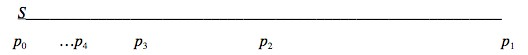
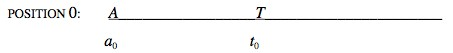
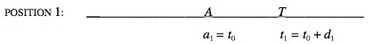
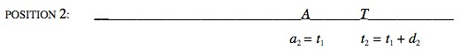

# Zeno of Elea
**First published Wed Jan 9, 2008; substantive revision Mon May 12, 2025**

*Palmer, John*

Zeno of Elea, 5th c. B.C.E. thinker, is known exclusively for propounding a number of ingenious paradoxes. The most famous of these purport to show that motion is impossible by bringing to light apparent or latent contradictions in ordinary assumptions regarding its occurrence. Zeno also argued against the commonsense assumption that there are many things by showing in various ways how it, too, leads to contradiction. We may never know just what led Zeno to develop his famous paradoxes. While it is typically said that he aimed to defend the paradoxical monism of his Eleatic mentor, Parmenides, the Platonic evidence on which this view has resided ultimately fails to support it. Since Zeno’s arguments in fact tend to problematize the application of quantitative conceptions to physical bodies and to spatial expanses as ordinarily conceived, the paradoxes may have originated in reflection upon Pythagorean efforts to apply mathematical notions to the natural world. Zeno’s paradoxes have had a lasting impact through the attempts, from Aristotle down to the present day, to respond to the problems they raise. Since the subject of this article is Zeno himself, it undertakes to provide an historically accurate overview of his own thought, rather than an account of how philosophers, mathematicians, and physicists have responded to his provocative arguments.

## 1. Life and Writings

The dramatic occasion of Plato’s dialogue, *Parmenides*, is a visit to Athens by the eminent philosopher Parmenides and Zeno, his younger associate, to attend the festival of the Great Panathenaea. Plato describes Parmenides as about sixty-five years old, Zeno as nearly forty, and Socrates, with whom they converse, as “quite young then,” which is normally taken to mean about twenty. Given that Socrates was a little past seventy when executed by the Athenians in 399 B.C.E., this description suggests that Zeno was born about 490 B.C.E. He would appear to have been active in Magna Graecia, that is, the Greek-speaking regions of southern Italy, during the mid-fifth century B.C.E. There is otherwise little credible information about the circumstances of his life. Diogenes Laertius’s brief “Life of Zeno” (D.L. 9.25–9) is largely taken up with stitching together conflicting reports of his involvement in a brave plot to overthrow one of the local tyrants, but how much truth these reports contain cannot be determined. Although Diogenes also says that Zeno so loved his native Elea that he had no interest in immigrating to Athens, this report is not inconsistent with his having spent some time there; and Plutarch’s report that Pericles heard Zeno expounding on the nature of things in the manner of Parmenides (Plu. *Pericles* 4.5) suggests that Zeno may indeed have visited Athens and read his famous book, as Plato’s *Parmenides* implies, to a group of intellectually keen Athenians. Vivid evidence of the cultural impact of Zeno’s arguments is to be found in the interior of a red-figure drinking cup (Rome, Mus. Villa Giulia, inv. 3591) discovered in the Etrurian city of Falerii and dated to the mid-fifth century B.C.E. It depicts a heroic figure racing nimbly ahead of a large tortoise and has every appearance of being the first known “response” to the Achilles paradox.

Plato’s *Parmenides* depicts Socrates going as a young man to hear Zeno reading from the famous book he has brought to Athens for the first time. Parmenides himself and some others, including Pythodorus (the dramatic source of Plato’s report) are portrayed as entering toward the end of the reading so that they hear only a little of Zeno’s recitation. Plato then presents an exchange between Socrates and Zeno, the first part of which is as follows:

> Once Socrates had heard it, he asked Zeno to read the first hypothesis of the first argument again, and, after it was read, he said: “What do you mean by this, Zeno? ‘If the things that are are many, that then they must be both like and unlike, but this is impossible. For neither can unlike things be like, nor like things unlike’? Is this not what you say?” “Yes,” said Zeno. “Then if it is impossible both for things unlike to be like and for like things to be unlike, then it’s also impossible for there to be many things? For if there were many things, they would incur impossibilities. So is this what your arguments intend, nothing other than to maintain forcibly, contrary to everything normally said, that there are not many things? And do you think that each of your arguments is a proof of this very point, so that you consider yourself to be furnishing just as many proofs that there are not many things as the arguments you have written? Is this what you say, or do I not understand correctly?” “Not at all,” said Zeno, “but you have understood perfectly well what the treatise as a whole intends” (Pl. *Prm*. 127d6–128a3).

While the dialogue’s scenario, and thus this exchange, are clearly fictional, this passage is nonetheless normally taken as indicating that Zeno composed a single treatise comprising numerous arguments, cast in the form of antinomies, all purporting to demonstrate the untenability of the commonsense presumption that there are many things.

While the later tradition unreliably ascribes other works to Zeno, there is some interesting evidence in the commentary on the *Parmenides* by the Athenian Neoplatonist Proclus (5th c. C.E.) that he was familiar with a work transmitted under Zeno’s name containing forty arguments or *logoi* (Procl. *in Prm*. 694, 17–18 Steel). Much of what Proclus says about Zeno in his commentary simply recasts what is already present in the above exchange, but this comment that this work of Zeno’s contained forty arguments, taken with certain other things he says, suggests that Proclus had access to a work with some sort of Zenonian pedigree, a work known to earlier commentators as well (as evidenced by Procl. *in Prm*. 630.26ff., especially 631.25–632.3). If there was a work available in later antiquity entitled *The Forty Arguments of Zeno*, it is however unlikely to have been a fair replica of any original treatise of Zeno’s. In the first place, some of Proclus’ apparent references to this work suggest that it fathered upon Zeno arguments akin to some of those in Parmenides’ own elaborate dialectical exercise later in the *Parmenides*. Furthermore, Aristotle implies that people were reworking Zeno’s arguments soon after they were first propounded. In *Physics* 8.8, after giving a basic reconstruction of the so-called Stadium paradox (see below, sect. 2.2.1) recalling its presentation in *Physics* 6.9, Aristotle then notes that some propound the same argument in a different way; the alternative reconstruction he then describes (Arist. *Ph*. 8.8, 263ᵃ7–11) is in effect a new version of the original argument.

Returning to the *Parmenides* passage, it should also be noted that Socrates’ description of Zeno’s book, which Plato has Zeno endorse, indicates that its arguments had a certain structure and purpose. Specifically, the passage indicates that all Zeno’s arguments opposed the common-sense assumption that there are many things. It might also suggest that these arguments took the form of antinomies like the one Socrates specifically cites, so that the general pattern of Zeno’s argumentation would have been: if there are many things, these must be both *F* and not-*F*; but things cannot be both *F* and not-*F*; therefore, it cannot be the case that there are many things. Although this description has inspired some to attempt to accommodate the extant paradoxes (of motion, plurality, and place) within a unified architecture that would have provided the plan for Zeno’s original book, if in fact he wrote only one, none of these attempts have proved convincing. Since Plato’s description is in a number of respects difficult to square with what we know from other sources of Zeno’s actual arguments, one should be wary of making it the basis for hypotheses regarding the book’s plan of organization. For one thing, the paradoxes of motion reported by Aristotle do not evidently target the assumption that there are many things, nor do they take the form of antinomies. Moreover, only one of the arguments against plurality elsewhere reported, the antinomy of limited and unlimited, conforms to the pattern of argumentation exemplified in the antinomy of like and unlike described by Plato’s Socrates (see below, 2.1.1). The remaining argument, the antinomy of large and small (see 2.1.2), purports to show not only that the assumption that there are many things leads to an apparent contradiction, but, rather more ambitiously, it purports to reduce each of the contradictory consequences to absurdity. Plato does not actually state, of course, that all Zeno’s arguments took the form of antinomies. In the end, if the characterization of Zeno’s treatise by Plato’s Socrates in the passage above is not quite accurate, there remains no more plausible view from antiquity regarding the general thrust of his arguments, to the extent that there may have been a single one. One can, moreover, easily broaden Socrates’ specification of the target to encompass the arguments against motion and place by changing it to the slightly more complex thesis that there are many things that move from place to place. Socrates might easily have been taking it for granted that, for Zeno, such motion goes along automatically with plurality. What we know of Zeno’s arguments certainly accords with the notion that they were meant to challenge ordinary assumptions about plurality and motion. His arguments are quite literally “para-doxes”—from the Greek *para* (“contrary to” or “against”) and *doxa* (“belief” or “opinion”)—arguments for conclusions contrary to what people ordinarily believe. What more there might be to say about Zeno’s purposes will be discussed below, after presentation of what we know of his actual arguments.

## 2. The Extant Paradoxes

The task of reconstructing Zeno’s arguments is sometimes insufficiently distinguished from the task of developing responses to them. How one reconstructs Zeno’s reasoning certainly determines to some extent what will constitute an effective response. The danger is that one’s idea of how to formulate an effective response may affect one’s reconstruction of Zeno’s actual reasoning, particularly if one imports into his arguments concepts more developed or precise than the ones with which he was actually operating. In some cases, as with the one called the Achilles, the paradox’s power derives to a significant extent from the very simplicity of the notions it deploys. The reconstructions provided here therefore aim to preserve something of the manner of Zeno’s own argumentation as we know it from verbatim quotation of at least portions of some of the preserved paradoxes. More formal reconstructions are possible and available. As already noted, at least one effort at improving Zeno’s argumentation was already known to Aristotle. But such efforts can come at the cost of historical accuracy, which is the primary goal of this article. How it might be possible to improve Zeno’s arguments will be left to others. Since it is also essential to appreciate just how much (or how little) we know of Zeno’s arguments, the primary evidence for each major argument is presented along with a reconstruction.

### 2.1 The Arguments Against Plurality

#### 2.1.1 The Antinomy of Limited and Unlimited

In his commentary on book 1 of Aristotle’s *Physics*, the Alexandrian Neoplatonist Simplicius (6th c. C.E.) quotes verbatim Zeno’s argument that if there are many things, they are limited and unlimited, as follows: “If there are many things, it is necessary that they be just so many as they are and neither greater than themselves nor fewer. But if they are just as many as they are, they will be limited. If there are many things, the things that are are unlimited; for there are always others between these entities, and again others between those. And thus the things that are are unlimited” (Zeno fr. 3 DK, i.e., Simp. *in Ph*. 140.29–33 Diels). This is the only Zenonian antinomy that has the appearance of being preserved in its entirety.

The argument here may be reconstructed as follows. Its overall structure is: If there are many things, then there must be finitely many things; and if there are many things, then there must be infinitely many things. The assumption that there are many things is thus supposed to have been shown to lead to contradiction, namely, that things are both finitely and infinitely many. The particular argument for the first arm of the antinomy seems to be simply: If there are many things, then they must be just so many as they are. If the many things are just so many as they are, they must be finitely many. Therefore, if there are many things, then there must be finitely many things. Simplicius somewhat loosely describes the antinomy’s second arm as demonstrating numerical infinity through dichotomy (Simp. *in Ph*. 140.33–4). In fact, the argument depends on a postulate specifying a necessary condition upon two things being distinct, rather than on division *per se*, and it may be reconstructed as follows: If there are many things, they must be distinct, that is, separate from one another. Postulate: Any two things will be distinct or separate from one another only if there is some other thing between them. Two representative things, *x*₁ and *x*₂, will be distinct only if there is some other thing, *x*₃, between them. In turn, *x*₁ and *x*₃ will be distinct only if there is some other thing, *x*₄, between them. Since the postulate can be repeatedly applied in this manner unlimited times, between any two distinct things there will be limitlessly many other things. Therefore, if there are many things, then there must be limitlessly many things.

#### 2.1.2 The Antinomy of Large and Small

In the same stretch of his commentary on Aristotle’s *Physics*, Simplicius reports at length one of Zeno’s numerous arguments designed to show how the claim that there are many things leads to contradiction. “One of these,” Simplicius says, “is the argument in which he demonstrates that if there are many things, they are both large and small: so large as to be unlimited in magnitude, and so small as to have no magnitude. Indeed, in this argument he shows that what has neither magnitude nor thickness nor bulk would not even exist. ‘For if’, he says, ‘it were added to another entity, it would not make it any larger; for since it is of no magnitude, when it is added, there cannot be any increase in magnitude. And so what was added would just be nothing. But if when it is taken away the other thing will be no smaller, and again when it is added the other thing will not increase, it is clear that what was added and what was taken away was nothing’” (Zeno fr. 2 DK = Simp. *in Ph*. 139.7–15). After thus quoting this portion of the argument, Simplicius continues: “Zeno says this because each of the many things has magnitude and is infinite [reading *apeiron* instead of ms. *apeirôn*], given that something is always in front of whatever is taken, in virtue of infinite division; this he shows after first demonstrating that none have magnitude on the grounds that each of the many is the same as itself and one” (Simp. *in Ph*. 139.16–19). Soon after this, Simplicius records the argument for unlimited magnitude he has alluded to in the first part of the passage just quoted, as follows: “Infinity in respect of magnitude he earlier proves in the same way. For having first shown that, if what is does not have magnitude, it would not even exist, he continues: ‘But if it is, each must have some magnitude and thickness, and one part of it must extend away from another. And the same account applies to the part out ahead. For that part too will have magnitude and will have part of it out ahead. Indeed, it is the same to say this once as always to keep saying it; for no such part of it will be last, nor will one part not be related to another. Thus if there are many things, they must be both small and large, so small as to have no magnitude, and so large as to be unlimited’” (Zeno fr. 1 DK, = Simp. *in Ph*. 140.34–141.8).

Simplicius only alludes to Zeno’s argument for smallness, without setting it out: he says that Zeno derived the conclusion that “none have magnitude on the grounds that each of the many is the same as itself and one.” Although this is not much to go on, the argument may plausibly be reconstructed as follows. Each of the many is the same as itself and one. Whatever has magnitude can be divided into distinguishable parts; whatever has distinguishable parts is not everywhere the same as itself; thus, whatever has magnitude is not everywhere, and so is not genuinely, the same as itself. Whatever is not the same as itself is not genuinely one. Thus, whatever has magnitude is not genuinely one. Therefore, each of the many has no magnitude. The basic assumption here is that to be “the same as itself” is what it means for something to be “one” in the strict sense Zeno envisages, whereas any magnitude, which will have distinguishable parts in virtue of being spatially extended, will fail to be strictly one and self-identical.

The evidence in Simplicius indicates that Zeno then transitioned to the antinomy’s other arm, the unlimited largeness of things, via the following lemma: since what has no magnitude would be nothing, each of the many must have some magnitude. Simplicius’s report of how Zeno specifically argued for the second arm’s conclusion, that each of the many is of unlimited magnitude, pertains primarily to its apparent sub-argument for the interim conclusion that each thing has limitlessly many parts, which ran as follows. Each of the many has some magnitude and thickness (from the lemma). Whatever has some magnitude and thickness will have (distinguishable) parts, so that each of the many will have parts. If *x* is one of the many, then *x* will have parts. Since each of these parts of *x* has some magnitude and thickness, each of these parts will have its own parts, and these parts will in turn have parts of their own, and so on, and so on, without limit. Thus each of the many will have a limitless number of parts. Whether or not Zeno then made explicit how the antinomy’s final conclusion followed from this, here is a plausible reconstruction of the rest of the reasoning was presumably supposed to go: Every part of each thing has some magnitude; the magnitude of any object is equal to the sum of the magnitudes of its parts; and the sum of limitlessly many parts of some magnitude is a limitless magnitude. Therefore, the magnitude of each of the many is limitless.

Taken as a whole, then, this elaborate *tour de force* of an argument purports to have shown that, if there are many things, each of them must have simultaneously no magnitude and unlimited magnitude.

### 2.2 The Paradoxes of Motion

Aristotle is most concerned with Zeno in *Physics* 6, the book devoted to the theory of the continuum. In *Physics* 6.9, Aristotle states that Zeno had four arguments concerning motion that are difficult to resolve, gives a summary paraphrase of each, and offers his own analysis. The ancient commentators on this chapter provide little additional information. Thus reconstruction of these famous arguments rests almost exclusively on Aristotle’s incomplete presentation. Note that Aristotle’s remarks leave open the possibility that there were other Zenonian arguments against motion that he deemed less difficult to resolve. More importantly, Aristotle’s presentation gives no indication of how these four arguments might have functioned within the kind of dialectical scheme indicated by Plato’s *Parmenides*.

#### 2.2.1 The Stadium, or The Dichotomy

“First,” Aristotle says, “there is the argument about its being impossible to move because what moves must reach the half-way point earlier than the end” (*Ph*. 6.9, 239ᵇ11–13). He says no more about this argument here but alludes to his earlier discussion of it in *Physics* 6.2, where, after arguing that both time and magnitude are continuous, he asserts: “Therefore the argument of Zeno falsely presumes that it is not possible to traverse or make contact with unlimited things individually in a limited time” (233ᵃ21–3). Subsequently, in *Physics* 8.8, he again raises the question of how to respond “to those posing the question of Zeno’s argument, if one must always pass through the half-way point, and these are unlimited, and it is impossible to traverse things unlimited” (263ᵃ4–6), and he proceeds to offer what he claims is a more adequate solution than the one presented in *Physics* 6.2. The argument Aristotle is alluding to in these passages gets its name from his mention in *Topics* 8.8 of “Zeno’s argument that it is not possible to move or to traverse the stadium” as a prime example of an argument opposed to common belief yet difficult to resolve (160ᵇ7–9).

The following reconstruction attempts to remain true to this evidence and thus to capture something of how Zeno may originally have argued. For anyone (*S*) to traverse the finite distance across a stadium from *p*₀ to *p*₁ within a limited amount of time, *S* must first reach the point half way between *p*₀ and *p*₁, namely *p*₂.

Before *S* reaches *p*₂, *S* must first reach the point half way between *p*₀ and *p*₂, namely *p*₃. Again, before *S* reaches *p*₃, *S* must first reach the point half way between *p*₀ and *p*₃, namely *p*₄. There is a half way point again to be reached between *p*₀ and *p*₄. In fact, there is always another half way point that must be reached before reaching any given half way point, so that the number of half way points that must be reached between any *p*ₙ and any *p*ₙ₋₁ is unlimited. But it is impossible for *S* to reach an unlimited number of half way points within a limited amount of time. Therefore, it is impossible for *S* to traverse the stadium or, indeed, for *S* to move at all; in general, it is impossible to move from one place to another.

#### 2.2.2 The Achilles

Immediately after his brief presentation of the Stadium, Aristotle introduces the most famous of Zeno’s paradoxes of motion, that of Achilles and the Tortoise: “Second is the one called ‘Achilles’: this is that the slowest runner never will be overtaken by the fastest; for it is necessary for the one chasing to come first to where the one fleeing started from, so that it is necessary for the slower runner always to be ahead some” (*Ph*. 6.9, 239ᵇ14–18). Simplicius adds the identification of the slowest runner as the tortoise (*in Ph*. 1014, 5). Aristotle remarks that this argument is merely a variation on the Dichotomy, with the difference that it does not depend on dividing in half the distance taken (*Ph*. 6.9, 239ᵇ18–20), and his analysis, such as it is, emphasizes that this paradox is to be resolved in the same way as the first paradox of motion. Whether this is actually the case is debatable.

If a tortoise starts ahead of Achilles in a race, the tortoise will never be overtaken by Achilles. Let the start of the race be represented as follows:

During the time it takes Achilles to reach the point from which the tortoise started (*t*₀), the tortoise will have progressed some distance (*d*₁) beyond that point, namely to *t*₁, as follows:

Likewise, during the time it then takes Achilles to reach the new point the tortoise has reached (*t*₁), the tortoise will have progressed some new distance (*d*₂) beyond the tortoise’s new starting point, namely to *t*₂, as follows:

The tortoise will again have progressed some further distance (*d*₃) beyond *t*₂, namely to *t*₃, in the time it takes Achilles to move from *a*₂(=*t*₁) to *a*₃(=*t*₂). In fact, during the time it takes Achilles to reach the tortoise’s location at the beginning of that time, the tortoise will always have moved some distance ahead, so that every time Achilles reaches the tortoise’s new starting point, the tortoise will be ahead some. Therefore, the slowest runner in the race, the tortoise, will never be overtaken by the fastest runner, Achilles.

#### 2.2.3 The Arrow

Aristotle’s discussion of the relation of motion and time in *Physics* 6.8 prepares the way for his objection to the Zenonian paradox of motion he mentions at the very beginning of *Physics* 6.9: “Zeno reasons fallaciously; for he says that if every thing always is resting whenever it is against what is equal, and what moves is always in the now, then the moving arrow is motionless” (*Ph*. 6.9, 239ᵇ5–7). Aristotle remarks that Zeno relies on the false supposition that time is composed of indivisible “nows” or instants (ᵇ8–9), a point he soon repeats in identifying the argument purporting to show that “the moving arrow is standing still” as the third of Zeno’s paradoxes of motion (ᵇ30–3). In his *Life of Pyrrho*, Diogenes Laertius reports, “Zeno abolishes motion, saying, ‘What moves moves neither in the place it is nor in a place it is not” (D.L. 9.72 = Zeno B4 DK; cf. Epiphanius, *Against the Heretics* 3.11). This report, which Diels and Kranz took to preserve a genuine fragment of Zeno’s book, appears to suggest how the argument that the moving arrow is at rest may have figured as part of a broader argument against motion. Diogenes, however, is not a particularly good source for Zeno’s arguments: his *Life of Zeno* notes only that he was the first to propound the “Achilles” argument, along with many others (D.L. 9.29). It is just as likely, therefore, that Diogenes’ report depends on an intervening attempt to couch the paradoxes of motion reported by Aristotle in the dilemmatic form Plato indicates was typical of Zenonian argumentation.

Even if Diogenes’ report happens to be reliable, we still must rely on Aristotle in trying to reconstruct the argument that, as in Diogenes’ report, what moves does not move in the place where it is. (We get no indication from him of any argument of Zeno’s to show that what moves does not move where it is not; perhaps that was thought self-evident.) And Aristotle’s evidence in this instance is an even more meager basis for reconstruction than usual. Thus, according to Aristotle, the moving arrow (*A*) is actually standing still. The argument for this conclusion seems to be as follows: What moves is always, throughout the duration of its motion, in the now, that is to say, in one instant of time after another. So, throughout its flight, *A* is in one instant of time after another. At any particular instant during its flight (*t*), *A* occupies a place exactly equivalent to its length, that is, *A* is “against what is equal.” But whatever is against what is equal is resting. So *A* is resting at *t*. But *t* is no different than the other instants during *A*‘s flight, so that what is the case with *A* at *t* is the case with *A* at every other instant of its flight. Thus *A* is resting at every instant of its flight, and this amounts to the moving arrow always being motionless or standing still.

#### 2.2.4 The Moving Rows

“Fourth,” Aristotle says, “is the one about the things in the stadium moving from opposite directions, being of equal bulk, alongside things of equal size, with some moving from the end of the stadium and some from the middle, at equal speed, in which case he supposes it turns out that half the time is equal to its double” (*Ph*. 6.9, 239ᵇ33–240ᵃ1).

Aristotle’s ensuing discussion of what he takes to be Zeno’s mistakes is based on an *exempli gratia* scenario normally taken as a basis for reconstruction, as it is here. “For example,” Aristotle says, “let the resting equal masses be those marked AA, let those marked BB be beginning from the middle, being equal in number and size to these, and let those marked CC be beginning from the end, being equal in number and size to these, and moving at the same speed as the *B*s” (Arist. *Ph*. 6.9, 240ᵃ4–8).

*Diagram 1*

| <table class="centered cell-center"> <tr> <td colspan="2">A A A A</td></tr> <tr class="cell-left"> <td>B B B B</td> <td>&rarr;</td></tr> <tr class="cell-right"> <td>&larr;</td> <td>C C C C</td> </tr> </table> Diagram 1 |   | <table class="centered cell-center fw"> <tr> <td>A A A A</td></tr> <tr> <td>B B B B</td></tr> <tr> <td>C C C C</td></tr> </table> Diagram 2 |
| --- | --- | --- |

Diagram 1 represents a plausible way of understanding what Aristotle envisages as the starting position in Zeno’s paradox, even though his description of this position is somewhat underdetermined. Aristotle continues: “It follows that the leading B and the leading C are at the end at the same time, once they move past one another” (240ᵃ9–10). This description suggests a final position as represented in Diagram 2. Since we have no other indication of how Zeno himself thought he could derive the conclusion Aristotle reports, that “half the time is equal to its double,” from the description of this situation, we have to rely on Aristotle for this as well: “It follows,” Aristotle says, “that the [leading] C has gone past all [the Bs], while the [leading] B has gone past half [the As], so that the time is half; for each of the two is alongside each other for an equal amount of time. But it also follows that the leading B has gone past all the Cs; for the leading C and the leading B will be at the opposite ends at the same time, because both are alongside the As for an equal time” (204ᵃ10–17). Apparently, Zeno somehow meant to infer from the fact that the leading B moves past two As in the same time it moves past all four Cs that half the time is equal to its double. The challenge is to develop from this less than startling fact anything more than a facile appearance of paradox. Since it is stressed that all the bodies are of the same size and that the moving bodies move at the same speed, Zeno would appear to have relied on some such postulate as that a body in motion proceeding at constant speed will move past bodies of the same size in the same amount of time. He could have argued that in the time it takes all the Cs to move past all the Bs, the leading B moves past two As or goes two lengths, and the leading B also moves past four Cs or goes four lengths. According to the postulate, then, the time the leading B travels must be the same as half the time it travels. Unfortunately, the evidence for this particular paradox does not enable us to determine just how Zeno may in fact have argued. Aristotle thinks the argument depends upon a transparent falsehood, and one must therefore keep in mind, if it seems he was right, that Aristotle’s presentation and reconstruction may itself be colored by his desire to bear out his accusation.

### 2.3 Other Paradoxes

Aristotle also gestures toward two additional ingenious arguments by Zeno, versions of which were also known to Simplicius.

#### 2.3.1 The Millet Seed

“Zeno’s argument is not correct, that any portion of millet seed whatsoever makes a sound” (Arist. *Ph*. 7.5, 250ᵃ20–1). The version of this argument known to Simplicius represents Zeno as engaged in a fictional argument with Protagoras, wherein he makes the point that if a large number of millet seeds makes a sound (for example, when poured out in a heap), then one seed or even one ten-thousandth of a seed should also make its own sound (for example, in that process) (Simp. *in Ph*. 1108.18–28). Aristotle’s report is too slight a basis for reconstructing how Zeno may in fact have argued, and Simplicius is evidently reporting some later reworking. The evidence nonetheless suggests that Zeno anticipated reasoning related to that of the sorites paradox, apparently invented more than a century later.

#### 2.3.2 A Paradox of Place

Toward the end of the introduction to his analysis of place, Aristotle notes that “Zeno’s difficulty requires some explanation; for if every thing that is is in a place, it is clear that there will also be a place of the place, and so on to infinity” (Arist. *Ph*. 4.1, 209ᵃ23–5). His subsequent statement of the problem is even briefer but adds one key point: “Zeno raises the problem that, if place is something, it will be in something” (Arist. *Ph*. 4.3, 210ᵇ22–3; cf. Eudemus fr. 78 Wehrli, [Arist.] *De Melisso Xenophane Gorgia* 979ᵇ23–7, Simp. *in Ph*. 562, 3–6). Zeno would appear to have argued as follows. Everything that is is in something, namely a place. If a place is something, then it too must be in something, namely some further place. If this second place is something, it must be in yet another place; and the same reasoning applies to this and each successive place *ad infinitum*. Thus, if there is such a thing as place, there must be limitless places everywhere, which is absurd. Therefore, there is no such thing as place. This argument could well have formed part of a more elaborate argument against the view that there are many things, such as that if there are many things, they must be somewhere, i.e. in some place; but there is no such thing as place and thus no place for the many to be; therefore, there are not many things. This is, however, only speculation.

## 3. Zeno’s Purposes

The commonly found claim that Zeno aimed to defend the paradoxical monism of his Eleatic mentor, Parmenides, is based upon the speculations by the young Socrates of Plato’s *Parmenides* on Zeno’s ulterior motives. After the portion of the exchange between Socrates and Zeno quoted above (sect. 1), Socrates turns to Parmenides and says:

> In a way, he has written the same thing as you, but he’s changed it around to try to fool us into thinking that he’s saying something different. For you say in the verses you’ve composed that the all is one, and you do a fine and good job of providing proofs of this. He, on the other hand, says there are not many things, and he too provides numerous and powerful proofs. Given that one says “one” and the other “not many,” and that each speaks in this way so as to appear to have said none of the same things, when you are in fact saying virtually the same thing, what you’ve said seems said in a way that’s beyond the powers of the rest of us. (Pl. *Prm*. 128a6–b6)

Socrates virtually accuses Zeno of having plotted with Parmenides to conceal the fundamental identity of their conclusions. With so many readers of Plato accustomed to taking Socrates as his mouthpiece in the dialogues, it is not surprising that this passage has served as the foundation for the common view of Zeno as Parmenidean legatee and defender, by his own special means, of Eleatic orthodoxy. Unfortunately, this use of the Platonic evidence is unjustifiably selective, even prejudicial, in the weight it accords the words put in Socrates’ mouth. Plato immediately has Zeno disabuse Socrates of his suspicions about the book’s ulterior purpose.

Zeno this time replies that Socrates has not altogether grasped the truth about his book. First, he says, the book had nothing like the pretensions Socrates has ascribed to it (*Prm*. 128c2–5). Zeno is made to explain his actual motivation as follows:

> The treatise is in truth a sort of support for Parmenides’ doctrine against those attempting to ridicule it on the ground that, if one is, the doctrine suffers many ridiculous consequences that contradict it. This treatise, therefore, argues against those who say the many are, and it pays them back with the same results and worse, intending to demonstrate that their hypothesis “if many are” suffers even more ridiculous consequences than the hypothesis of there being one, if one pursues the issue sufficiently. (Pl. *Prm*. 128c6–d6)

Zeno’s account of how he defended Parmenides against those who ridiculed him is designed to correct Socrates’ mistaken impression that Zeno was basically just arguing for the same thing as Parmenides, that the all is one. Zeno is portrayed as trying to correct this mistaken view of his purposes as born of a superficial understanding of Parmenides’ doctrine. Zeno’s arguments against plurality will seem to entail Parmenides’ doctrine only if his thesis, “one is” (*hen esti*), is taken to mean that only one thing exists. However, the elaborate examination of this very thesis, “one is” (*hen esti*), by Parmenides himself in the latter part of the dialogue shows that Plato thinks it is not to be understood in any such trivial sense. For not only does Parmenides end up examining the relation of his One to other things, which would have been impossible if his doctrine entailed their non-existence, but the relation other things have to the One actually proves responsible in a way for their existence. Zeno cannot be supposing that his arguments against plurality entailed the doctrine of Parmenides when that doctrine is represented in this same dialogue by Parmenides himself as something altogether more involved than the simple thesis that only one thing exists. Nevertheless, Zeno’s description of the persons who attempted to ridicule Parmenides is perfectly compatible with *their* having understood the thesis, “one is” (*hen esti*), as an assertion that only one thing exists. Zeno’s arguments constitute an *indirect* defense of Parmenides—“a sort of support” (*boêtheia tis*, 128c6)—because they do nothing to disabuse his detractors of their superficial understanding of his doctrine. Instead, as Zeno says, he tried to show that the assumption that there are many things has consequences every bit as unpalatable as those Parmenides’ critics suppose his position has (cf. Procl. *in Prm*. 619.15–21). Thus, while Zeno accepts Socrates’ point that his own arguments aim to show that there are not many things, he corrects Socrates’ impression that, in arguing this point, he was just saying the same thing as Parmenides in a different form.

The evidence of Plato’s *Parmenides*, then, does not license the conventional view that Zeno’s arguments against plurality and motion were intended to support the strict monism of Parmenides. Claims to the contrary have rested upon selective and prejudicial use of this evidence due to the tendency to privilege Socrates’ remarks on Zeno’s purposes over Zeno’s own qualifications and corrections of that analysis. What Plato actually suggests is that Zeno aimed to show those whose superficial understanding of Parmenides had led them to charge him with flying in the face of common sense, that common sense views concerning unity and plurality are themselves riddled with latent contradictions. Such is, essentially, the judgment of Jonathan Barnes: “Zeno was not a systematic Eleatic solemnly defending Parmenides against philosophical attack by a profound and interconnected set of reductive argumentations. Many men had mocked Parmenides: Zeno mocked the mockers. His *logoi* were designed to reveal the inanities and ineptitudes inherent in the ordinary belief in a plural world; he wanted to startle, to amaze, to disconcert. He did not have the serious metaphysical purpose of supporting an Eleatic monism” (Barnes 1982, 236)[^barnes-1982]. However, whether the historical Zeno was actually involved in anything like the dialectical context Plato envisages for him must remain uncertain. Even if there were already in Zeno’s day individuals who mistook Parmenides’ position for the thesis that only one thing exists, the idea that Zeno’s arguments were motivated by a desire to respond to such individuals in kind is as historically unverifiable as the claim Plato puts in his mouth that his book was stolen and circulated before he could decide for himself whether to make his arguments public (Pl. *Prm*. 128d7–e1).

Nevertheless, just as Socrates’ initial remark that Zeno’s arguments were all designed to show that there are not in fact many things remains basically plausible, so there are elements in Zeno’s account of his own purposes that have the ring of historical truth and that square well with other evidence. Plato has Zeno continue his second response to Socrates (quoted above) by saying, “It was written by me in such a contentious spirit when I was still young. … You are mistaken in this regard, then, Socrates, that you suppose it was written, not under the influence of youthful contentiousness, but under that of a more mature ambition” (Pl. *Prm*. 128d6–e3). The point is repeatedly made that Zeno’s book was written in a spirit of youthful contentiousness or “love of victory” (*philonikia*, *Prm*. 128d7, e2). The more mature Zeno seems a little embarrassed by the combative manner evident in the arguments of his younger days, as well he might since that spirit would have come to be seen as typical of the eristic controversialists who sprang up in the sophistic era. Plato gives yet another nod to the idea that Zeno was a forerunner of eristic contentiousness when he has him say that his book “contradicts (*antilegei*) those who say the many are” (*Prm*. 128d2–3). This suggestion that Zeno was a practitioner of what came to be known as “antilogic,” or the art of contradiction, is consistent with Plato’s representation of him in other dialogues as something of a sophist. In the *Alcibiades*, Socrates reports that Pythodorus and Callias each paid Zeno a hundred minae to become clever and skilled in argument (*Alc*. 119a3–6; cf. *Prm*. 126b–c). Teaching for payment is of course one hallmark of the professional educators who styled themselves experts in wisdom. That Plato saw Zeno as a practitioner of the specific brand of argument known as antilogic is evidenced by the *Phaedrus*’s famous description of him as the “Eleatic Palamedes” for his ability to make the same things appear to his audience both like and unlike, one and many, moving and at rest (*Phdr*. 261d6–8). Again, at the beginning of the *Sophist*, when Theodorus introduces the Eleatic Visitor as an associate of Parmenides and Zeno and their followers, Socrates expresses concern that the Visitor may be “some god of refutation” until Theodorus reassures him that the Visitor is more moderate than those who spend their time in eristic and competitive disputation (*Sph*. 216a–b). Plato’s references thus consistently connect Zeno with the rise of eristic disputation, and it is perfectly plausible that his arguments against plurality and motion would have been well-known examples of making the weaker case seem the stronger.

The portrait of Zeno and his tactics that emerges from Plato’s references makes it seem natural that Aristotle, in one of his lost dialogues, entitled *Sophist*, spoke of Zeno as the inventor of dialectic (D.L. 8.57; cf. 9.25; S.E. *M*. 7.7). Precisely what Aristotle meant by this remains a matter of speculation, given that Aristotle also attributes the invention of dialectic to Socrates (Arist. *Metaph*. M.4, 1078ᵇ25–30) and to Plato (*Metaph*. A.6, 987ᵇ31–3); he says he himself invented the *theory* of it (*SE* 34, 183ᵇ34–184ᵇ8). There is also the question of whether Aristotle viewed Zeno’s arguments as more eristic than properly dialectical. The difference, according to Aristotle, is that dialectical arguments proceed from *endoxa* or “views held by everyone or by most people or by the wise, that is, by all, most, or the especially famous and respected of the wise,” whereas eristic arguments proceed from what only seem to be, or what seems to follow from, *endoxa* (*Top*. 1.1, 100ᵃ29–30, ᵇ22–5). Aristotle clearly believes that some of Zeno’s assumptions have only a specious plausibility (see *Top*. 8.8, 160ᵇ7–9, *SE* 24, 279ᵇ17–21, *Ph*. 1.2, 233ᵃ21–31, *Metaph*. B.4.1001ᵇ13–16), so that they would by Aristotle’s own criteria be examples of eristic rather than properly dialectical arguments. For Aristotle, then, Zeno was a controversialist and paradox-monger, whose arguments were nevertheless both sophisticated enough to qualify him as the inventor of dialectic and were important for forcing clarification of concepts fundamental to natural science. Aristotle’s view of Zeno thus seems largely in accordance with Plato’s portrayal of him as a master of the art of contradiction.

Should we then think of Zeno as a sophist? Certainly Isocrates, the rhetorician and contemporary of Plato, did not hesitate to lump Gorgias, Zeno, and Melissus together as among the other “sophists” flourishing in the era of Protagoras and all producing tedious treatises advocating the most outrageous claims (Isoc. *Hel*. [*Orat*. 10] 2–3). While there are difficulties in giving precise definition to the term “sophist,” one feature common to those normally classed as such that Zeno lacks is an interest in the interrogation of cultural norms and values. Zeno’s influence, however, on the great sophists who were his contemporaries and, more generally, on the techniques of argumentation promulgated among the sophists seems undeniable. Protagoras’ development of the techniques of antilogic, rooted in his claim that there are two opposed arguments on every matter (D.L. 9.51), seems likely to have been inspired by Zeno’s novel forms of argumentation as well as by his advocacy of the most counter-intuitive of theses. Zeno’s influence is especially clear, moreover, in Gorgias’ treatise, “On Nature, or On What Is Not,” both in its penchant for argumentation via antithesis and *reductio* and in its use of premises drawn straight from Zeno himself (see [Arist.] *MXG* 979ᵃ23, ᵇ25, ᵇ37). It is even possible that the famous circle of contemporary intellectuals the great Athenian statesman Pericles gathered around himself provided a major conduit for Zeno’s impact on the first generation of sophists. Plutarch, at any rate, records that “Pericles heard Zeno of Elea discoursing on nature in the manner of Parmenides, and practicing a kind of skill in cross-examination and in driving one’s opponent into a corner by means of contradictory argument” (Plu. *Per*. 4.5). The skill Plutarch attributes to Zeno, still evident in the fragmentary remains of his arguments, is just the kind of skill in argument manifested in a great deal of sophistic practice. Although doubts have been raised about the reliability of Plutarch’s report that Zeno, like Damon and Anaxagoras, was one of the many contemporary intellectuals whose company was avidly pursued by Pericles, there is little that seriously tells against it. Thus George Kerferd has argued both that the patronage of Pericles and his keen interest in the intellectual developments of his day must have been critically important to the sophistic movement and that Zeno’s paradoxes were a profound influence on the development of the sophistic method of antilogic, which he sees as “perhaps the most characteristic feature of the thought of the whole period” (Kerferd 1981, 18–23, 59ff., 85)[^kerferd-1981].

The evidence surveyed here suggests that Zeno’s paradoxes were designed as provocative challenges to the common-sense view that our world is populated by numerous things that move from place to place. His apparent demonstrations of how the common-sense view is fraught with contradiction made him an influential precursor of sophistic antilogic and eristic disputation. It is not surprising that someone like Isocrates should have viewed Zeno as a sophist to be classed with Protagoras and Gorgias. To ask whether Zeno was in fact a sophist, a practitioner of antilogic, an eristic controversialist, or a proper dialectician is to some extent inappropriate, for these designations all acquired their normal meaning and range of application only after Zeno’s time. While he perhaps does not fit exactly into any of these categories, still his development of sophisticated methods of argumentation to produce apparent proofs of the evidently false conclusions that motion is impossible and that there are not in fact many things made it quite natural for Plato, Aristotle, Isocrates, and others to refer to him under all these labels.

It is remarkable that, while many of the responses to Zeno’s paradoxes, and even some modern formulations of the paradoxes themselves, depend on advanced mathematical techniques, Zeno’s original arguments do not themselves appear to have involved any particularly complicated mathematics. Several of the paradoxes involve no specifically mathematical notions at all. The Achilles is perhaps the best example since it employs only very ordinary notions, such as getting to where another has started from. The other extant arguments for the most part deploy similarly prosaic notions: being somewhere or being in a place, being in motion, moving past something else, getting halfway there, being of some size, having parts, being one, being like, being the same, and so on. Where Zeno seems to have leapt ahead of earlier thinkers is in deploying specifically quantitative concepts, most notably quantitative concepts of limit (*peras*) and the lack of limit (*to apeiron*). Earlier Greek thinkers had tended to speak of limitedness and unlimitedness in ways suggesting a qualitative rather than a quantitative notion. While one might suppose that Zeno’s turn to a more strictly quantitative conception of limit and limitlessness could have been inspired by his familiarity with Pythagorean philosophers and mathematicians in Magna Graecia, we can in fact trace the philosophy of limiters and unlimiteds only back as far as Philolaus, a Pythagorean roughly contemporary with Socrates and thus a good deal younger than Zeno.

Whatever may have spurred Zeno’s development of his collection of paradoxes, his arguments quickly achieved a remarkable level of notoriety. They had an immediate impact on Greek physical theory. Zeno’s powerful principle that any spatially extended entity must be limitlessly divisible would profoundly impact the development of the subtle and powerful physical theories of both Anaxagoras, who accepts the principle, and the early atomists, Leucippus and Democritus, who reject it. Zeno’s arguments also had a formative influence on Aristotle’s own theory of the continuum and of continuous motion. More generally, Zeno’s arguments made it necessary for Greek natural philosophers to develop something more than an everyday conception of the composition of material bodies. His arguments, perhaps more than anything else, forced the Greek natural philosophers to develop properly *physical* theories of composition as opposed to the essentially chemical theories of earlier thinkers such as Empedocles. That mathematicians and physicists have worked ever since to develop responses to the more ingenious of his paradoxes is remarkable, though perhaps not surprising, for immunity to his paradoxes might be taken as a condition upon the adequacy of our most basic physical concepts. He may even have offered his collection of paradoxes to provoke deeper consideration of the adequacy of theretofore unexamined notions. If so, it is likewise remarkable that he simultaneously developed forms of argument—most notably, *reductio ad absurdum* by means of antinomical and/or regress arguments—that have ever since been fundamental to philosophical probing of conceptual adequacy.

## References（引用注释）

> 原文参考文献已转为脚注引用：文内“作者-年份”引用组后附 [^key] 标记，完整条目见本文末脚注定义。

### Further Reading

### Primary Sources

#### Zeno of Elea

#### Other Ancient Authors

#### English Translations

### Secondary Literature

## Academic Tools

> |   | [How to cite this entry](https://plato.stanford.edu/cgi-bin/encyclopedia/archinfo.cgi?entry=zeno-elea). |
> | --- | --- |
> |   | [Preview the PDF version of this entry](https://leibniz.stanford.edu/friends/preview/zeno-elea/) at the [Friends of the SEP Society](https://leibniz.stanford.edu/friends/). |
> |   | [Look up topics and thinkers related to this entry](https://www.inphoproject.org/entity?sep=zeno-elea&redirect=True) at the Internet Philosophy Ontology Project (InPhO). |
> |   | [Enhanced bibliography for this entry](https://philpapers.org/sep/zeno-elea/) at [PhilPapers](https://philpapers.org/), with links to its database. |

## Other Internet Resources

[Please contact the author with suggestions.]

## Related Entries

Aristotle | change: and inconsistency | Parmenides | Presocratic Philosophy | Pythagoras | Simplicius | Zeno of Elea: Zeno’s paradoxes

[^references-1980]: References in this bibliography to items prior to 1980 are more selective than those to more recent items. For a nearly exhaustive and annotated listing of Zenonian scholarship down to 1980, consult L. Paquet, M. Roussel, and Y. Lafrance, *Les Présocratiques: Bibliographie analytique (1879–1980)*, Volume 2, Montreal: Bellarmin/Paris: Les Belles Lettres, 1989, pp. 105–32.

[^comprehensive-nd]: Comprehensive accounts of Zeno and his arguments may be found in:

[^barnes-1982]: Barnes, J., *The Presocratic Philosophers*, 2nd edition, London: Routledge & Kegan Paul, 1982. Chapters 12 and 13.

[^caveing-1982]: Caveing, M., *Zénon d’Élée: Prolégomènes aux doctrines du continu. Étude historique et critique des fragments et témoignages*, Paris: J. Vrin, 1982.

[^ferber-1995]: Ferber, R., *Zenons Paradoxien der Bewegung und die Struktur von Raum und Zeit*, 2nd edition, Stuttgart: Franz Steiner, 1995.

[^guthrie-1965]: Guthrie, W. K. C., *A History of Greek Philosophy*, vol. 2: *The Presocratic Tradition from Parmenides to Democritus*, Cambridge: Cambridge University Press, 1965, Part I.B.

[^kirk-1983]: Kirk, G. S., J. E. Raven, and M. Schofield, *The Presocratic Philosophers*, 2nd edition, Cambridge: Cambridge University Press, 1983, Chapter 9.

[^makin-1998]: Makin, S., “Zeno of Elea,” in E. Craig (ed.), *Routledge Encyclopedia of Philosophy*, Volume 9, London and New York: Routledge, 1998, pp. 843–53.

[^mckirahan-1999]: McKirahan, R. D., Jr., “Zeno,” in A. A. Long, ed., *The Cambridge Companion to Early Greek Philosophy*, Cambridge: Cambridge University Press, 1999, pp. 134–58.

[^sainsbury-1995]: Sainsbury, R. M., *Paradoxes*, 2nd edition, Cambridge: Cambridge University Press, 1995, Chapter 1.

[^vlastos-1967]: Vlastos, G., “Zeno of Elea,” in P. Edwards (ed.), *The Encyclopedia of Philosophy*, Volume 8, New York and London: Macmillan, 1967, pp. 369–79. Reprinted in G. Vlastos, *Studies in Greek Philosophy* (Volume 1: *The Presocratics*), D. W. Graham (ed.), Princeton: Princeton University Press, 1993, pp. 241–63.

[^waterfield-2000]: Waterfield, R., *The First Philosophers: The Presocratics and Sophists*, Oxford: Oxford World’s Classics, 2000, pp. 69–81.

[^presocratics-nd]: The long standard collection of the fragments of the Presocratics and sophists, together with testimonia pertaining to their lives and thought, has been:

[^diels-1951]: Diels, H., and W. Kranz, *Die Fragmente der Vorsokratiker* [DK], 6th edition, Berlin: Weidmann, 1951–52.

[^for-nd]: For the English reader, the fragments and testimonia of the Presocratics and sophists are now most usefully presented in:

[^laks-2016]: Laks, A., and Most, G. W., 2016, *Early Greek Philosophy*, 9 vols., Cambridge, MA, and London: Harvard University Press. (Texts pertaining to Zeno in vol. 5, pt. 2, §20.)

[^see-nd]: See also:

[^gemelli-2011]: Gemelli Marciano, M. L., *Die Vorsokratiker*, 3 vols., Berlin: De Gruyter, 2011–13. (Texts pertaining to Zeno in Volume 2, pp. 96–137).

[^graham-2010]: Graham, D. W., *The Texts of Early Greek Philosophy*, 2 vols., Cambridge: Cambridge University Press, 2010. (Texts pertaining to Zeno in Part I, Chapter 7.)

[^palpacelli-2022]: Palpacelli, Lucia, *Zenone di Elea: Frammenti e testimonianze*, Brescia: Scholé, 2022.

[^palpacelli-nd]: The following works also remain useful, despite some outmoded interpretations:

[^lee-1936]: Lee, H. D. P., *Zeno of Elea: A Text with Translation and Notes*, Cambridge: Cambridge University Press, 1936. Reprinted, Amsterdam: Hakkert, 1967.

[^untersteiner-1963]: Untersteiner, M. *Zenone. Testimonianze e frammenti*, Florence: La Nuova Italia, 1963.

[^aristotle-1950]: Aristotle, *Physica*, W. D. Ross (ed.), Oxford: Clarendon Press, 1950.

[^aristotle-1957]: –––, *Metaphysica*, W. Jaeger (ed.), Oxford: Clarendon Press, 1957.

[^aristotle-1958]: –––, *Topica et Sophistici Elenchi*, W. D. Ross (ed.), Oxford: Clarendon Press, 1958.

[^ps-1900]: Ps.-Aristotle, *De Melisso Xenophane Gorgia*, H. Diels (ed.), Berlin: Königliche Akademie der Wissenschaften, 1900.

[^diogenes-1999]: Diogenes Laertius, *Vitae Philosophorum*, M. Marcovich (ed.), Stuttgart and Leipzig: B. G. Teubner, 1999.

[^eudemus-1969]: Eudemus, *Eudemos von Rhodos*, F. Wehrli (ed.), Basel: Schwabe, 1969.

[^isocrates-2003]: Isocrates, *Opera Omnia*, B. G. Mandilaras (ed.), Munich and Leipzig: K.G. Saur, 2003.

[^plato-2001]: Plato, *Alcibiades*, N. Denyer (ed.), Cambridge: Cambridge University Press, 2001.

[^plato-1901]: –––, *Parmenides* and *Phaedrus*, in *Platonis Opera* (Volume 2), J. Burnet (ed.), Oxford: Clarendon Press, 1901.

[^plato-1995]: –––, *Sophistes*, in *Platonis Opera* (Volume 1), E. A. Duke, *et al*. (eds.), Oxford: Clarendon Press, 1995.

[^plutarch-1957]: Plutarch, *Vita Periclis*, in *Plutarchi Vitae parallelae*, C. Lindskog and K. Ziegler (ed.), Leipzig: B. G. Teubner, 1957–1980.

[^proclus-2007]: Proclus, *In Platonis Parmenidem Commentaria* (Volume 1), C. Steel (ed.), Oxford: Clarendon Press, 2007.

[^sextus-1914]: Sextus Empiricus, *Adversus Mathematicos*, in *Sexti Empirici Opera* (Volumes 2–3), H. Mutschmann and J. Mau (eds.), Leipzig: B. G. Teubner, 1914.

[^simplicius-1882]: Simplicius, *In Aristotelis Physicorum Commentaria*, H. Diels (ed.), Berlin: G. Reimer, 1882 and 1895.

[^complete-1984]: *The Complete Works of Aristotle: The Revised Oxford Translation*, J. Barnes (eds.), 2 volumes, Princeton: Princeton University Press, 1984.

[^diogenes-2013]: Diogenes Laertius, *Lives of Eminent Philosophers*, edited and with an introduction by T. Dorandi, Cambridge: Cambridge University Press, 2013; see also *Lives of Eminent Philosophers*, R.D. Hicks (trans.), 2 volumes, Cambridge, MA: Harvard University Press, 1925.

[^isocrates-1945]: Isocrates, III, *Evagoras, Helen, et al*., L. R. Van Hook (trans.), Cambridge, MA: Harvard University Press, 1945.

[^plato-1997]: Plato, *Complete Works*. J. M. Cooper (ed.), Indianapolis: Hackett, 1997.

[^plutarch-1975]: Plutarch, *The Rise and Fall of Athens: Nine Greek Lives by Plutarch*, I. Scott-Kilvert (trans.), Harmondsworth, UK: Penguin, 1975.

[^morrow-1987]: Morrow, G. R., and J. Dillon, *Proclus’ Commentary on Plato’s Parmenides*, Princeton: Princeton University Press, 1987.

[^sextus-1935]: Sextus Empiricus, *Against the Logicians* (Volume I), R.G. Bury (trans.), Cambridge, MA: Harvard University Press, 1935.

[^simplicius-1992]: Simplicius, *On Aristotle’s* Physics *4.1–5, 10–14*, J. O. Urmson (trans.), London: Duckworth, and Ithaca, NY: Cornell University Press, 1992.

[^simplicius-1989]: –––, *On Aristotle* Physics *6*, D. Konstan (trans.), London: Duckworth, and Ithaca, NY: Cornell University Press, 1989.

[^simplicius-1994]: –––, *On Aristotle’s* Physics *7*, C. Hagen (trans.), London: Duckworth, and Ithaca, NY: Cornell University Press, 1994.

[^aristotle-nd]: Aristotle discusses Zeno’s paradoxes at some length in *Physics* VI. His treatment may be usefully approached with the aid of Simplicius’s commentary and that in:

[^ross-1936]: Ross, W. D. (ed.), *Aristotle*: Physics, Oxford: Clarendon Press, 1936.

[^mus-nd]: A plate of the red-figure drinking cup, Mus. Villa Giulia inv. 3591, accompanies:

[^hoffman-2004]: Hoffman, H., 2004, “Zeno’s tortoise,” *Antike Kunst*, 47: 5–9.

[^studies-nd]: Studies of particular paradoxes and of issues bearing upon Zeno’s broader purposes and influence on ancient philosophy include:

[^abraham-1972]: Abraham, W. E., 1972, “The nature of Zeno’s argument against plurality in DK 29 B 1,” *Phronesis*, 17: 40–53.

[^arsenijevic-2008]: Arsenijevic, M., Scepanovic, S, and G.J. Massey, 2008, “A new reconstruction of Zeno’s ‘Flying Arrow’,” *Apeiron*, 41: 1–43.

[^barnes-1981]: Barnes, J. [O. Testudo, pseud.], 1981, “Space for Zeno,” *Deucalion*, 33/34: 131–45.

[^barnes-2011]: Barnes, J., *et al*., 2011, *Eleatica 2008: Zenone e l’infinito* (Volume 2: Eleatica), L. Rossetti and M. Pulpito (eds.), Sankt Augustin: Academia Verlag, 2011.

[^berti-1988]: Berti, E., 1988, “Zenone di Elea, inventore della dialectica?” *La Parola del Passato*, 43: 19–41.

[^bolotin-1993]: Bolotin, D., 1993, “Continuity and infinite divisibility in Aristotle’s physics,” *Ancient Philosophy*, 13: 323–40.

[^booth-1957]: Booth, N. B., 1957, “Were Zeno’s arguments directed against the Pythagoreans?” *Phronesis*, 1: 90–103.

[^booth-1957-2]: –––, 1957, “Were Zeno’s arguments a reply to attacks upon Parmenides?” *Phronesis*, 1: 1–9.

[^bostock-1972]: Bostock, D., 1972, “Aristotle, Zeno and the potential infinite,” *Proceedings of the Aristotelian Society*, 73: 37–53.

[^cataldi-2005]: Cataldi, S., 2005, “Filosofi e politici nell’Atene del V secolo a.C,” in L. Breglia and M. Lupi (eds.), *Da Elea a Samo: Filosofi e politici di fronte all’impero ateniese*, Naples: Arte Tipografice Editrice, pp. 95–150.

[^centrone-1981]: Centrone, B., 1981, “Un’indiretta confutazione aristotelica dell’ ‘Achille’ di Zenone,” *Elenchos*, 2: 273–89.

[^cohoe-2018]: Cohoe, C., 2018, “Why continuous motions cannot be composed of sub-motions: Aristotle on change, rest, and actual and potential middles,” *Apeiron*, 51: 37–71.

[^corbett-1988]: Corbett, S. M., 1988, “Zeno’s ‘Achilles’: A reply to John McKie,” *Philosophy and Phenomenological Research*, 49: 325–31.

[^cordero-1988]: Cordero, N.-L., 1988, “Zénon d’Élée, moniste ou nihiliste?” *La Parola del Passato*, 43: 100–26.

[^curd-1993]: Curd, P. K., 1993, “Eleatic monism in Zeno and Melissus,” *Ancient Philosophy*, 13: 1–22.

[^davey-2007]: Davey, K., 2007, “Aristotle, Zeno, and the stadium paradox,” *History of Philosophy Quarterly*, 24: 127–46.

[^dillon-1986]: Dillon, J., 1986, “Proclus and the forty logoi of Zeno,” *Illinois Classical Studies*, 11: 35–41.

[^eberle-1998]: Eberle, S., 1998, “Das Zeit-Raum-Kontinuum bei Zenon von Elea,” *Philosophisches Jahrbuch*, 105: 85–99.

[^ebert-2001]: Ebert, T., 2001, “Why is Evenus called a philosopher at *Phaedo* 61c?” *The Classical Quarterly*, 51: 423–34.

[^faris-1996]: Faris, J. A., 1996, *The Paradoxes of Zeno*, Aldershot: Avebury.

[^feyerabend-1983]: Feyerabend, P., 1983, “Some observations on Aristotle’s theory of mathematics and of the continuum,” *Midwest Studies in Philosophy*, 8: 67–88.

[^fränkel-1942]: Fränkel, H., 1942, “Zeno of Elea’s attacks on plurality,” *American Journal of Philology* 63: 1–25, 193–206.

[^furley-1967]: Furley, D. J., 1967, *Two Studies in the Greek Atomists*, Princeton: Princeton University Press.

[^glazebrook-2001]: Glazebrook, T., 2001, “Zeno against mathematical physics,” *Journal of the History of Ideas*, 62: 193–210.

[^hasper-2006]: Hasper, P. S., 2006, “Zeno unlimited,” *Oxford Studies in Ancient Philosophy*, 30: 49–85.

[^heinemann-2023]: Heinemann, G., 2023, “Where, when, and why is Zeno’s arrow unmoved? A note on the Zenonian challenge in Aristotle’s *Physics*, Book VI,” *History of Philosophy & Logical Analysis*, 26: 27–31.

[^kerferd-1981]: Kerferd, G., 1981, *The Sophistic Movement*, Cambridge: Cambridge University Press.

[^knorr-1983]: Knorr, W., 1983, “Zeno’s paradoxes still in motion,” *Ancient Philosophy*, 3: 55–66.

[^köhler-2014]: Köhler, G., 2014, *Zenon von Elea: Studien zu den ‘Argumenten gegen die Vielheit’ und zum sogenannten ‘Argument des Orts’*, Berlin/Munich/Boston: Walter De Gruyter.

[^lear-1981]: Lear, J., 1981, “A note on Zeno’s arrow,” *Phronesis*, 26: 91–104.

[^lewis-1999]: Lewis, E., 1999, “The dogmas of indivisibility: On the origins of ancient atomism,” *Proceedings of the Boston Area Colloquium in Ancient Philosophy*,15: 1–21.

[^magidor-2008]: Magidor, O., 2008, “Another note on Zeno’s paradox,” *Phronesis*, 53: 359–72.

[^makin-1982]: Makin, S., 1982, “Zeno on plurality,” *Phronesis*, 27: 223–38.

[^mansfeld-1982]: Mansfeld, Jaap, 1982, “Digging up a paradox: A philological note on Zeno’s stadium,” *Rheinisches Museum für Philologie*, 125: 1–24; reprinted in Mansfeld’s *Studies in the Historiography of Greek Philosophy*, Assen: Van Gorcum, 1990, pp. 319–42.

[^marion-2014]: Marion, M., 2014, “Les arguments de Zénon d’après le Parménide de Platon,” *Dialogue*, 53: 393–434.

[^matson-1988]: Matson, W. T., 1988, “The Zeno of Plato and Tannery vindicated,” *La Parola del Passato*, 43: 312–36.

[^mckie-1987]: McKie, John R., 1987, “The persuasiveness of Zeno’s paradoxes,” *Philosophy and Phenomenological Research*, 47: 631–9.

[^mckirahan-2001]: McKirahan, R., 2001, “Zeno’s dichotomy in Aristotle,” *Philosophical Inquiry*, 23: 1–24.

[^osborne-2001]: Osborne, C., 2001, “Comment mesurer le mouvement dans le vide?: Quelques remarques sur deux paradoxes de Zénon d’Élée,” in P.-M. Morel and J.-F. Pradeau (eds.), *Les anciens savants: Études sur les philosophies préplatoniciennes*, Paris: Vrin, 2001, pp. 157–165.

[^owen-1958]: Owen, G. E. L., 1958, “Zeno and the mathematicians,” *Proceedings of the Aristotelian Society*, 58: 199–222.

[^palmer-1999]: Palmer, J., 1999, *Plato’s Reception of Parmenides*, Oxford: Clarendon Press, Chapter 5.

[^palmer-2009]: –––, 2009, *Parmenides and Presocratic Philosophy*, Oxford and New York: Oxford University Press, Chapter 5.

[^papa-grimaldi-1996]: Papa-Grimaldi, A., 1996, “Why mathematical solutions of Zeno’s paradoxes miss the point: Zeno’s one and many relation and Parmenides’ prohibition,” *Review of Metaphysics*, 50: 299–314.

[^pemberton-2022]: Pemberton, J. M., 2022, “Aristotle’s solution to Zeno’s arrow paradox and its implications,” *Ancient Philosophy Today*, 4: 73–95.

[^peterson-1978]: Peterson, S., 1978, “Zeno’s second argument against plurality,” *Journal of the History of Philosophy*, 16: 261–70.

[^pickering-1978]: Pickering, F. R., 1978, “Aristotle on Zeno on the now,” *Phronesis*, 23: 253–7.

[^prior-1978]: Prior, W. J., 1978, “Zeno’s first argument concerning plurality,” *Archiv für Geschichte der Philosophie*, 60: 247–56.

[^rapp-2005]: Rapp, C., 2005, “Eleatischer Monismus,” In G. Rechenauer (ed.), *Fruhgriechisches Denken*, Göttingen: Vandenhoeck & Ruprecht, pp. 290–315.

[^rapp-2006]: –––, 2006, “Zeno and the Eleatic anti-pluralism,” in M. M. Sassi (ed.), *La costruzione del discorso filosofico nell’età dei Presocratici*, Pisa: Ed. della Normale, pp. 161–82.

[^rosen-2020]: Rosen, J., 2020, “Zeno beach,” *Phronesis*, 65: 467–500.

[^russell-1914]: Russell, B., 1914, “The problem of infinity considered historically,” in B. Russell, *Our Knowledge of the External World*, London: Open Court, pp. 159–88.

[^ryle-1954]: Ryle, G., 1954, “Achilles and the tortoise,” in G. Ryle, *Dilemmas*, Cambridge: Cambridge University Press, 1954, pp. 36–53.

[^sattler-2015]: Sattler, B., 2015, “Time is double the trouble: Zeno’s moving rows,” *Ancient Philosophy*, 35: 1–22.

[^sattler-2019]: –––, 2019, “The labours of Zeno: A supertask indeed?” *Ancient Philosophy Today*, 1: 1–17.

[^sattler-2020]: –––, 2020, *The Concept of Motion in Ancient Greek Thought*, Cambridge: Cambridge University Press. Chap. 3: “Zeno’s Paradoxes of Motion and Plurality.”

[^sedley-1977]: Sedley, D., 1977, “Diodorus Cronus and Hellenistic philosophy,” *The Cambridge Classical Journal* (Proceedings of the Cambridge Philological Society – New Series), 23: 74–120.

[^sedley-2008]: –––, 2008, “Atomism’s Eleatic roots,” in P. Curd and D. W. Graham, *The Oxford Handbook of Presocratic Philosophy*, Oxford and New York: Oxford University Press, pp. 305–32.

[^sedley-2017]: –––, 2017, “Zenonian strategies,” *Oxford Studies in Ancient Philosophy*, 53: 1–32.

[^shamsi-1994]: Shamsi, F. A., 1994, “A note on Aristotle, *Physics* 239b5–7: What exactly was Zeno’s argument of the arrow?” *Ancient Philosophy*, 14: 51–72.

[^solmsen-1971]: Solmsen, F., 1971, “The tradition about Zeno of Elea re-examined,” *Phronesis*, 16: 116–41.

[^sorabji-1983]: Sorabji, R., 1983, *Time, Creation, and the Continuum: Theories in Antiquity and the Early Middle Ages*, London: Duckworth.

[^tarrant-1990]: Tarrant, H., 1990, “More on Zeno’s *Forty Logoi*,” *Illinois Classical Studies*, 15: 23–37.

[^tusi-2018]: Tusi, J., 2018, “Strategies of exegesis of Zeno’s works in Plato and Aristotle,” *Freiburger Zeitschrift für Philosophie und Theologie*, 65: 7–24.

[^vlastos-1965]: Vlastos, G., 1965, “Zeno’s race course. With an appendix on the Achilles,” *Journal of the History of Philosophy*, 4: 95–108.

[^vlastos-1966]: –––, 1966, “A note on Zeno’s arrow,” *Phronesis*, 11: 3–18.

[^vlastos-1971]: –––, 1971, “A Zenonian argument against plurality,” in J. P. Anton and G. L. Kustas (eds.), *Essays in Ancient Greek Philosophy*, Albany: SUNY Press, pp. 119–44.

[^vlastos-1975]: –––, 1975, “Plato’s testimony concerning Zeno of Elea,” *Journal of Hellenic Studies*, 95: 136–62.

[^von-1974]: Von Fritz, K., 1974, “Zeno of Elea in Plato’s *Parmenides*,” in J. L. Heller and J. K. Newman (eds.), *Serta Turyniana: Studies in Greek literature and palaeography in honour of A. Turyn*, Urbana, IL: University of Illinois Press, pp. 329–41.

[^waterlow-1983]: Waterlow, S., 1983, “Instants of motion in Aristotle’s *Physics* VI,” *Archiv für Geschichte der Philosophie*, 65: 128–146.

[^wheeler-1983]: Wheeler, S. C., 1983, “Megarian paradoxes as Eleatic arguments,” *American Philosophical Quarterly*, 20: 287–96.

[^white-1982]: White, M. J., 1982, “Zeno’s arrow, divisible infinitesimals, and Chrysippus,” *Phronesis*, 27: 239–54.

[^white-1992]: –––, 1992, *The Continuous and the Discrete: Ancient Physical Theories from a Contemporary Perspective*, Oxford: Clarendon Press.
