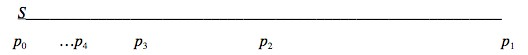
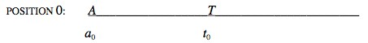
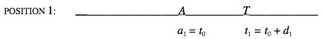
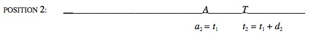

# 爱利亚的芝诺 Zeno of Elea (John Palmer)

*首次发表于 2008 年 1 月 9 日；2025 年 5 月 12 日实质修订。*

爱利亚的芝诺（公元前 5 世纪思想家）为人所知，仅因他提出过一系列精巧的悖论。其中最著名的几个，意在借揭示运动发生之通常假定中显见或潜在的矛盾，表明运动是不可能的；芝诺同样以各种方式表明“存在许多事物”这一常识假定也通向矛盾，从而反对这一假定。究竟是什么促成了芝诺那些著名悖论，我们或许永远无从得知。人们通常说，他意在为其爱利亚学派导师巴门尼德的悖论性一元论辩护，但这一说法所依托的柏拉图证据最终并不足以支撑它。芝诺的论证实际上倾向于使“把量的概念应用于物理物体和通常所构想的空间广延”成为问题。这些悖论可能正源起于对毕达哥拉斯派将数学概念运用于自然世界之努力的反思。自亚里士多德以降直至今天，人们为回应这些悖论所提出的问题而做的种种尝试，令芝诺悖论影响绵延不绝。本文的主题是芝诺本人，故此力求对他的思想给出一幅合乎历史的概览，而非记述哲学家、数学家与物理学家如何回应他那富有挑衅性的论证。

## 1 生平与著作

柏拉图对话《巴门尼德篇》（*Parmenides*）的戏剧性背景，是德高望重的哲学家巴门尼德与其较年轻的追随者芝诺到访雅典、参加大泛雅典娜节。柏拉图笔下的巴门尼德约六十五岁，芝诺将近四十岁，与他们交谈的苏格拉底则“那时相当年轻”——通常理解为约二十岁。鉴于苏格拉底于公元前 399 年被雅典人处死时已年过七旬，这一描述暗示芝诺约生于公元前 490 年。他似乎于公元前五世纪中叶活跃在大希腊，即南意大利的希腊语地区；除此之外，关于其生平境况的可信信息寥寥。第欧根尼·拉尔修的简短《芝诺传》（D.L. 9.25–9）大半篇幅用在拼合互相冲突的报道上：芝诺参与过一桩推翻当地僭主的英勇密谋——但这些报道含几成真相，已无从断定。第欧根尼还说芝诺深爱家乡爱利亚，无意移居雅典；此说与他曾在雅典小住并不冲突。普鲁塔克则报道，伯里克利听过芝诺以巴门尼德的方式讲论万物的本性（Plu. *Pericles* 4.5）。这暗示芝诺可能确实到访雅典，并如《巴门尼德篇》所暗示，向一群求知心切的雅典人宣读过他那部著名的书。芝诺论证之文化冲击力还有一件生动物证。伊特鲁里亚城市法勒里伊出土一只红绘式饮杯（罗马，朱利亚别墅博物馆，藏号 3591），断代为公元前五世纪中叶；杯内描绘一位英雄轻盈地跑在一只大龟前面，看上去极像是对阿基里斯悖论最早的已知“回应”。

柏拉图的《巴门尼德篇》描绘年轻的苏格拉底前去听芝诺宣读他那部首次带到雅典的著名的书。巴门尼德本人和另外几个人——包括皮托多鲁斯（柏拉图报道的戏剧来源）——被描写为在宣读接近尾声时才进来，因而只听到芝诺诵读的一小段。柏拉图接着呈现了苏格拉底与芝诺之间的一段对话，其第一部分如下：

> 苏格拉底听完之后，请芝诺把第一个论证的第一个假设再读一遍；读完之后他问：“芝诺，你这是什么意思？‘如果存在者是多，那么它们必定既相似又不相似，而这是不可能的。因为不相似者不能相似，相似者也不能不相似’？你说的就是这个吗？”“是的，”芝诺说。“那么，既然不相似者不可能相似、相似者也不可能不相似，众多事物是否也就不可能存在？因为若存在许多事物，它们就会陷入种种不可能。所以你的论证所欲坚持的，难道不正是以强力主张——逆一切通常之见——不存在许多事物？你难道不认为自己的每一个论证都是对这一点的证明，因而写下多少个论证，就等于给出了多少个‘不存在许多事物’的证明？我说的对吗，还是我理解错了？”“完全不是，”芝诺说，“你已完全正确地理解了这部论著整体所欲主张的东西”（Pl. *Prm*. 127d6–128a3）。

对话的情节——因而这段对话——显然出自虚构，但这一段落通常仍被理解为表明：芝诺写成了一部单独的论著，内含众多论证，皆以二律背反的形式出现；这些论证全都意在证明“存在许多事物”这一常识预设站不住脚。

后来的传统虽不可靠地把其他著作归于芝诺，雅典的新柏拉图主义者普罗克洛斯（公元 5 世纪）的《巴门尼德篇》评注中却有一处有趣的证据。它表明：普罗克洛斯熟悉一部以芝诺之名流传的著作，内含四十个论证即 *logoi*（Procl. *in Prm*. 694, 17–18 Steel）。普罗克洛斯评注中关于芝诺的话，多半只是改写上引对话已有内容；但他这一评论——芝诺此书包含四十个论证——连同他说的其他几处，暗示他得见一部带有某种芝诺派系谱的著作，更早的注释家们也知道它（Procl. *in Prm*. 630.26ff.，尤其 631.25–632.3 可以为证）。不过，若古代晚期确有一部题为《芝诺的四十论证》的著作行世，它也不太可能是芝诺原初论著的忠实复本。首先，普罗克洛斯对该书的某些表面援引暗示：它把一些与巴门尼德本人在《巴门尼德篇》后文那套精巧辩证操练相类的论证，安到了芝诺头上。此外，亚里士多德暗示，芝诺的论证刚一提出就有人在改作。在《物理学》8.8 里，亚里士多德先按《物理学》6.9 的呈现给出所谓运动场悖论（见下文 2.2.1 节）的一个基本重构，随后指出有人以另一种方式提出同一论证；他接着描述的替代性重构（Arist. *Ph*. 8.8, 263ᵃ7–11）实际上就是原初论证的一个新版本。

回到《巴门尼德篇》那段文字，还应指出：苏格拉底对芝诺之书的描述——柏拉图让芝诺对此表示认可——表明这些论证有一定的结构与目的。具体说来，这一段落表明芝诺的所有论证都反对“存在许多事物”这一常识假定；它也可能暗示，这些论证取苏格拉底特别援引的那种二律背反形式，故芝诺论证的一般模式应当是：如果存在许多事物，它们必定既是 *F* 又不是 *F*；但事物不可能既是 *F* 又不是 *F*；所以，不存在许多事物。这一描述虽促使有人尝试把现存的诸悖论（关于运动、众多与处所）纳入一个统一架构，好充当芝诺原书——如果他确实只写了一部的话——的规划；却没有一个尝试被证明令人信服。既然柏拉图的描述在若干方面难以与我们在其他来源所见芝诺实际论证相吻合，就应当警惕以它为根基去假设该书的组织规划。首先，亚里士多德报道的运动悖论并不明显针对“存在许多事物”的假定，也不取二律背反的形式。其次，别处报道的反对众多的论证中，只有一个——有限与无限的二律背反——符合柏拉图笔下苏格拉底所描述的“相似与不相似”二律背反的论证模式（见下文 2.1.1）。余下那个论证，大与小的二律背反（见 2.1.2），不只意在表明“存在许多事物”的假定导致显见的矛盾，更雄心勃勃地要把每一个矛盾后果都归约到荒谬。当然，柏拉图并未明说芝诺的所有论证都取二律背反形式。归根结底，若上引段落中苏格拉底的刻画并不十分准确，那么就芝诺可能确有一部单独论著而言，古人关于其论证总体趋向的说法中仍没有比这更可信的。再者，只需把苏格拉底指定的靶子稍加放宽，改成略复杂一点的论旨——“存在许多从一处移动到另一处的事物”——便能涵盖反对运动与处所的论证；苏格拉底很可能想当然地认为，对芝诺来说，这种移动与众多自动相伴。我们所知的芝诺论证，确实与如下看法相合：它们意在挑战关于众多与运动的通常假定。这些论证字面上就是“para-doxes”（悖论）——源自希腊语 *para*（“相反于”或“反对”）与 *doxa*（“信念”或“意见”）——即得出与人们通常所信相反之结论的论证。至于芝诺的意图还能说些什么，待下文呈现其实际论证之后再谈。

## 2 现存悖论

重构芝诺论证的任务，有时与发展对它们的回应之任务未被充分区分。如何重构芝诺的推理，当然在某种程度上决定了什么才算有效回应。危险在于：关于如何构造有效回应的想法，可能反过来左右人们对芝诺实际推理的重构——尤其是把比他实际所用更发达、更精确的概念引入其论证之时。在某些情形里——如所谓阿基里斯悖论——悖论的力量在很大程度上恰来自其所用概念的简单。因此，本节重构力求保留芝诺本人论证方式的某些风貌；至少某些悖论有字面引文存世，可供对照。更形式化的重构是可能的，也现成可得。如前所述，改进芝诺论证的努力至少有一种早已为亚里士多德所知；但这类努力可能以牺牲历史准确性为代价，而历史准确性正是本文的首要目标。如何改进芝诺的论证，留待他人。同样要紧的是领会：关于芝诺论证，我们究竟知道多少。故每个主要论证的首要证据都将连同重构一并呈现。

### 2.1 反对众多的论证

#### 2.1.1 有限与无限的二律背反

在亚里士多德《物理学》第一卷的评注里，亚历山大里亚的新柏拉图主义者辛普里丘（公元 6 世纪）逐字引用了芝诺“如果存在许多事物，它们既有限又无限”的论证。“如果存在许多事物，那么它们必定恰好是那么多，既不比自身多，也不比自身少。但如果它们恰好是那么多，它们就会是有限的。如果存在许多事物，存在者就是无限的；因为在这诸存在者之间总有别的东西，而在那些东西之间又有别的。所以存在者是无限的”（Zeno fr. 3 DK，即 Simp. *in Ph*. 140.29–33 Diels）。这是唯一一个看来被完整保存下来的芝诺式二律背反。

这里的论证可重构如下。总体结构是：如果存在许多事物，那么必定有有限多的事物；而如果存在许多事物，那么又必定有无限多的事物。于是，“存在许多事物”这一假定被表明导致矛盾——事物既有限多又无限多。二律背反第一臂的论证看来十分简单：如果存在许多事物，那么它们必定恰好是那么多；如果众多事物恰好是那么多，它们必定有限多；所以，如果存在许多事物，那么必定有有限多的事物。辛普里丘不大严格地把第二臂描述为“通过二分法证明数的无限”（Simp. *in Ph*. 140.33–4）。实际上，该论证依赖的是一条规定“两物相区别之必要条件”的公设，而非分割本身；可重构如下：如果存在许多事物，它们必定相互区别，即彼此分离。公设：任何两个事物，只有当其间有某个别的事物时，才相互区别或分离。任取两个事物 *x*₁ 与 *x*₂，其间须有某个别的事物 *x*₃，二者才相互区别；反过来，*x*₁ 与 *x*₃ 相区别，其间又须有某个别的事物 *x*₄。既然公设可以这样无限次重复应用，任意两个相区别的事物之间，就会有无限多的他物。所以，如果存在许多事物，那么必定有无限多的事物。

#### 2.1.2 大与小的二律背反

在《物理学》评注的同一处，辛普里丘详尽报道了芝诺众多旨在表明“存在许多事物”如何导致矛盾的论证之一。“其中之一，”辛普里丘说，“是他证明如果存在许多事物、它们既大又小的那个论证：大到在大小上无限，小到没有任何大小。的确，他在这个论证中表明，没有大小、没有厚度、没有体积的东西甚至不会存在。‘因为’，他说，‘如果把它加到另一个存在者上，它不会使之变大；既然它没有大小，加上它也不会有任何大小上的增加。这样，被加上的东西就什么都不是。但若把它取走，另一个东西不会变小，加上它时另一个东西也不增大，那么显然，所加之物与所取之物都是无’”（Zeno fr. 2 DK = Simp. *in Ph*. 139.7–15）。引到这里，辛普里丘接着说：“芝诺这样说，是因为众多中的每一个都有大小，而且是无限〔按 *apeiron* 读，而非抄本的 *apeirôn*〕，因为在无限分割之下，无论取到什么，总有东西在前面；这是他在先表明没有任何东西有大小——理由是众多中的每一个都与自身相同且是一——之后证明的”（Simp. *in Ph*. 139.16–19）。此后不久，辛普里丘记录了他在上引段落前半所暗示的无限大小论证：“关于大小上的无限，他先前已用同样方式证明过。因为在先表明‘如果存在者没有大小，它甚至不会存在’之后，他接着说：‘但如果它存在，每一个都必定有某种大小和厚度，且它的一部分必定与另一部分隔开。对在前面伸出的那部分，同样说法也适用：那部分也会有大小，也会有在前面伸出的部分。的确，这话重复一次与不断重复是一样的；因为它的这类部分不会有最后一个，也不会有一部分不与另一部分相关。所以，如果存在许多事物，它们必定既小又大，小到没有任何大小，大到无限’”（Zeno fr. 1 DK，= Simp. *in Ph*. 140.34–141.8）。

辛普里丘只是提及芝诺关于小的论证而未将其写出：他说芝诺推导出“没有任何东西有大小”这一结论，理由是“众多中的每一个都与自身相同且是一”。凭据虽少，该论证仍可合理地重构如下。众多中的每一个都与自身相同且是一。凡有大小者皆可分割为可分辨的部分；凡有可分辨部分者都不是处处与自身相同；故凡有大小者都不是处处与自身相同，从而不是真正地与自身相同。凡不与自身相同者都不是真正地是一。所以，凡有大小者都不是真正地是一。因此，众多中的每一个都没有大小。这里的基本假定是：“与自身相同”就是芝诺所设想的那种严格意义上“是一”的含义；而任何大小——因在空间中广延而必有可分辨的部分——都不会是严格的一和自我同一。

辛普里丘提供的证据表明，芝诺随后经由一条引理过渡到二律背反的另一臂，即事物之无限大：没有大小的东西将是无，故众多中的每一个必有某种大小。至于芝诺具体如何论证第二臂的结论，即每一物都有无限的大小，辛普里丘的报道主要涉及其表面上的一个子论证。该子论证针对“每个事物都有无限多的部分”这一过渡性结论，大体如下：众多中的每一个都有某种大小和厚度（据引理）；凡有某种大小和厚度者都将有（可分辨的）部分，故众多中的每一个都将有部分；如果 *x* 是众多之一，*x* 就将有部分；由于 *x* 的这些部分中的每一个都有某种大小和厚度，每个部分又各有自己的部分，这些部分又轮番有自己的部分，如此推进，没有止境。因此，众多中的每一个都将有无限多的部分。芝诺随后是否明言二律背反的最终结论如何由此得出，已不可考；以下给出剩余推理大概如何展开的合理重构：每个事物的每个部分都有某种大小；任何对象的大小等于其诸部分大小之和；无限多个有大小者之和是无限的大小。所以，众多中每一物的大小都是无限的。

总而言之，这场精心构造的 *tour de force* 式论证意在表明：如果存在许多事物，那么其中每一个都必须同时既没有大小、又具有无限的大小。

### 2.2 运动悖论

亚里士多德在《物理学》第 6 卷——专论连续体的那一卷——最为关注芝诺。在《物理学》6.9 里，他说芝诺有四个关于运动的论证难以解决，对每个给出概要式转述并提出自己的分析。本章的古代注释家们没有提供多少额外信息；因此，这些著名论证的重构几乎全靠亚里士多德不完整的呈现。要注意，亚里士多德的评论留下了这样一种可能：芝诺另有反对运动的论证，只是他觉得较易解决。更要紧的是，亚里士多德的呈现全然未提这四个论证在柏拉图《巴门尼德篇》所示的那种辩证方案中可能起什么作用。

#### 2.2.1 运动场，或二分法

“第一，”亚里士多德说，“是关于运动不可能的论证：运动着的东西必须先到达中点，然后才到终点”（*Ph*. 6.9, 239ᵇ11–13）。他在此未再多说，只提到他早先在《物理学》6.2 的讨论。在那里，他在论证时间与大小皆为连续之后断言：“因此，芝诺的论证错误地预设：不可能在有限的时间内逐个地遍历或接触无限的东西”（233ᵃ21–3）。随后在《物理学》8.8 里，他再次提出如何回应“芝诺论证所提出的问题，即如果必须总是先经过中点，而这些中点又是无限的，就不可能遍历无限的东西”（263ᵃ4–6）。他进而给出自己自称比《物理学》6.2 更充分的解决。这些段落所指的论证得名于《论题篇》8.8 的提及——“芝诺的论证：不可能移动或遍历运动场”——亚里士多德将它列为反对通常信念却又难以解决的论证之首例（160ᵇ7–9）。

下面的重构试图忠实于上述证据，借以捕捉芝诺原本可能如何论证的某种风貌。任何人（*S*）要在有限时间内跑完从 *p*₀ 到 *p*₁ 的一段有限距离，都必须先到达 *p*₀ 与 *p*₁ 的中点，即 *p*₂。

在 *S* 到达 *p*₂ 之前，*S* 必须先到达 *p*₀ 与 *p*₂ 的中点，即 *p*₃；同样，在 *S* 到达 *p*₃ 之前，*S* 必须先到达 *p*₀ 与 *p*₃ 的中点，即 *p*₄；而 *p*₀ 与 *p*₄ 之间又有一个中点有待到达。实际上，任一中点在被到达之前，总有另一个中点必须先行到达，故在任何 *p*ₙ 与任何 *p*ₙ₋₁ 之间，有待到达的中点在数量上无限。可是 *S* 不可能在有限时间内到达无限多个中点。所以，*S* 不可能遍历运动场；简直说，*S* 根本不可能移动——一般而言，不可能从一处移动到另一处。

#### 2.2.2 阿基里斯

简短呈现运动场之后，亚里士多德立即引入芝诺最著名的运动悖论——阿基里斯与龟的悖论：“第二是所谓‘阿基里斯’：这就是说跑得最慢的永远不会被跑得最快的追上；因为追赶者必须先到达被追赶者出发的地方，所以跑得较慢者必定总是在前面一段”（*Ph*. 6.9, 239ᵇ14–18）。辛普里丘补充指明：跑得最慢者就是龟（*in Ph*. 1014, 5）。亚里士多德评论说，这一论证只是二分法的变体，不同处在于它不依赖把走过的距离对半分割（*Ph*. 6.9, 239ᵇ18–20）；他的分析——就其所有而言——强调这一悖论应当与第一个运动悖论以同一方式解决。实际情况是否如此，尚可争论。

若龟在赛跑中起步于阿基里斯前方，龟将永远不会被阿基里斯追上。设赛跑起点如下：

在阿基里斯到达龟的出发点（*t*₀）所用的时间里，龟已越过该点前进一段距离（*d*₁），到达 *t*₁，如下：

同样，在阿基里斯随后到达龟的新地点（*t*₁）所用的时间里，龟又越过其新出发点前进某段新距离（*d*₂），到达 *t*₂，如下：

在阿基里斯从 *a*₂（=*t*₁）移到 *a*₃（=*t*₂）所用的时间里，龟又越过 *t*₂ 前进一段更远的距离（*d*₃），到达 *t*₃。实际上，阿基里斯每次到达龟在该时段开始时的所在地点，龟总会又前移一段距离；于是每当阿基里斯到达龟的新出发点，龟总在前面某处。所以，赛跑中跑得最慢者——龟——永远不会被跑得最快者阿基里斯追上。

#### 2.2.3 飞矢不动

亚里士多德在《物理学》6.8 中对运动与时间关系的讨论，为他反驳芝诺运动悖论铺了路；他在《物理学》6.9 开篇便提到那一悖论：“芝诺推理有误；因为他说，凡事物凡是与等量者相并就总是静止，而运动着的东西总是在现在之中，所以运动着的箭是静止的”（*Ph*. 6.9, 239ᵇ5–7）。亚里士多德评论说，芝诺依赖一个错误假定——时间由不可分的“现在”即瞬间组成（ᵇ8–9）；此点他不久又重复一遍，当时他把意在表明“运动着的箭静止不动”的论证，认定为芝诺运动悖论之第三（ᵇ30–3）。在其《皮浪传》中，第欧根尼·拉尔修报道：“芝诺取消运动，说‘运动者在它所在的地方不动，也不在它不在的地方动’”（D.L. 9.72 = Zeno B4 DK；参见 Epiphanius, *Against the Heretics* 3.11）。这一报道——第尔斯与克兰茨认为它保存了芝诺书中一个真实残篇——似乎提示：运动之箭静止的论证，或曾从属于一个更宽泛的对运动之论证。不过第欧根尼并非芝诺论证的上佳来源：其《芝诺传》只说他是“阿基里斯”论证以及许多其他论证的第一个提出者（D.L. 9.29）。因此还有另一种可能：第欧根尼的说法出自后人的改作——按芝诺论证那种典型两难形式（柏拉图所示），重述亚里士多德笔下的运动悖论。

即便第欧根尼的报道碰巧可靠，重构“运动者不在其所在之处运动”这一论证时，我们仍须依赖亚里士多德——一如第欧根尼的报道所显示的。（芝诺是否有论证表明运动者不在其不在之处运动？亚里士多德未给我们任何提示；也许这被视为不证自明。）而在这个事例上，亚里士多德的证据比通常更单薄，重构愈发困难。按亚里士多德的说法，运动着的箭（*A*）实际上静止。支持这一结论的论证似乎如下：凡运动者在其运动的整个持续期间都在现在之中，即处于一个接一个的时间瞬间之中；故整个飞行期间，*A* 处于一个接一个的时间瞬间之中。在其飞行的任一特定瞬间（*t*），*A* 恰好占据一段与其长度相等的位置，也就是说，*A*“与等量者相并”。但凡与等量者相并者皆静止，故 *A* 在 *t* 静止。而 *t* 与 *A* 飞行期间的其他瞬间并无不同，故 *A* 在 *t* 的情形就是 *A* 在其他每个瞬间的情形。因此，*A* 在其飞行的每个瞬间都静止，而这也就等于说：运动着的箭总是不动或静止的。

#### 2.2.4 运动队列

“第四，”亚里士多德说，“是关于运动场中两列东西从相反方向移动的论证：它们与等大者并排，体积相等，一列从运动场末端出发，另一列从中间出发，速度相等；在此情形下他认为结果是：一半的时间等于它自己的两倍”（*Ph*. 6.9, 239ᵇ33–240ᵃ1）。

亚里士多德随后关于他所认为的芝诺之错误的讨论，基于一个 *exempli gratia* 场景；该场景通常被当作重构的基础，此处亦然。“例如，”亚里士多德说，“设静止的等大物体为标着 AA 的那些。标着 BB 的那些从中间出发，在数目与大小上与这些相等；标着 CC 的那些从末端出发，在数目与大小上与这些相等，并以与 *B* 们相同的速度移动”（Arist. *Ph*. 6.9, 240ᵃ4–8）。

**图 1**

| A A A A |   |   |
| :---: | :---: | :---: |
| B B B B | → |   |
|   | ← | C C C C |

**图 2**

| A A A A |
| :---: |
| B B B B |
| C C C C |

图 1 代表理解亚里士多德所设想的芝诺悖论初始位置的一种合理方式，尽管他对这一位置的描述多少有些不确定。亚里士多德接着说：“于是，领头的 B 与领头的 C 在同一时刻到达末端，一旦它们相互越过”（240ᵃ9–10）。这一描述暗示一个如图 2 所示的最终位置。至于芝诺本人认为如何能从这一情形的描述推出那一结论，我们别无线索；那结论即“一半的时间等于它自己的两倍”，在这件事上同样只得依赖亚里士多德：“于是，”亚里士多德说，“领头的 C 越过了所有〔B 们〕，而领头的 B 越过了一半〔A 们〕，所以时间是一半；因为二者相互并排的时间相等。但同样可以得出，领头的 B 越过了所有 C 们；因为领头的 C 与领头的 B 将在同一时刻到达相反的两端，因为二者与 A 们并排的时间相等”（204ᵃ10–17）。显然，芝诺意欲从“领头的 B 在越过全部四个 C 所用的同一时间里越过两个 A”这一事实推出：一半的时间等于它自己的两倍。挑战在于，从这个并不那么惊人的事实中发展出某种超出表面悖论的东西。原文既然强调所有物体大小相同、运动物体速度相同，芝诺看来依赖了类似下述公设：以恒定速度运动的物体，越过同大小物体所需时间相同。他本可以论证：在全部 C 们越过全部 B 们所用的时间里，领头的 B 越过两个 A，即走了两个长度；而领头的 B 也越过四个 C，即走了四个长度。按该公设，领头的 B 行进所费时间，就必须等于这段时间的一半。遗憾的是，关于这个特定悖论的证据并不能让我们确定芝诺实际上究竟如何论证。亚里士多德认为该论证依赖一个明显的谬误；因此，如果人们觉得他是对的，就必须记住：亚里士多德的呈现与重构本身，可能也被他想要坐实这一指责的愿望所影响。

### 2.3 其他悖论

亚里士多德还顺带提到芝诺另外两个精巧的论证；其某些版本，辛普里丘同样知道。

#### 2.3.1 黍粒

“芝诺的论证不正确，他说无论多么小的一份黍粒都会发出声响”（Arist. *Ph*. 7.5, 250ᵃ20–1）。辛普里丘所知的版本，把芝诺描写成与普罗塔戈拉的一场虚构论辩；其要点是：如果大量黍粒发出声响（例如倾倒成堆时），那么一粒黍、甚至一粒黍的万分之一也应当发出自己的声响（例如在同一过程中）（Simp. *in Ph*. 1108.18–28）。以亚里士多德的报道去重构芝诺实际如何论证，基础实在过于单薄；辛普里丘显然是在报道某个后来的改作。不过这一证据表明，芝诺预见了与堆垛悖论相关的推理——那类悖论显然晚了一个多世纪才被发明出来。

#### 2.3.2 一个处所悖论

在其处所分析导言的结尾处，亚里士多德指出：“芝诺的难题需要一些解释；因为如果每一个存在者都在一个处所中，那么显然也将有一个处所的处所，以至于无穷”（Arist. *Ph*. 4.1, 209ᵃ23–5）。他随后对问题的陈述更简短，但补充了一个关键之点：“芝诺提出难题：如果处所是某种东西，它将在某个东西之中”（Arist. *Ph*. 4.3, 210ᵇ22–3；参见 Eudemus fr. 78 Wehrli, [Arist.] *De Melisso Xenophane Gorgia* 979ᵇ23–7, Simp. *in Ph*. 562, 3–6）。芝诺看来如下论证：每一个存在者都在某个东西之中，即在一个处所中；如果处所是某种东西，它也必须在某个东西之中，即某个进一步的处所中；如果这第二个处所是某种东西，它就必须在又一个处所之中；同样的推理适用于它以及每一个相继的处所，以至无穷。于是，若有处所这样的东西，处处都会有无限处所——这是荒谬的。所以，没有处所这样的东西。这个论证完全可能曾是一个更精巧的反对“存在许多事物”观点之论证的一部分，例如：如果存在许多事物，它们必定在某个地方，即某个处所中；但没有处所这样的东西，众多事物便没有处所可在；所以，不存在许多事物。不过，这只是推测。

## 3 芝诺的意图

人们常说芝诺意在为其爱利亚学派导师巴门尼德的悖论性一元论辩护；这一说法的依据，是柏拉图《巴门尼德篇》中年轻的苏格拉底对芝诺隐秘动机的揣测。在上引苏格拉底与芝诺的对话（第 1 节）之后，苏格拉底转向巴门尼德说：

> 在某种意义上，他写的与你相同，只是换了个说法，想骗我们相信他说的是别的东西。你在你写的诗行中说一切是一，而且出色而漂亮地给出了证明；他则说不存在许多事物，也给出了众多而有力的证明。既然一个说“一”、另一个说“不多”，各自都这样措辞，好显得没说过任何相同的东西，而你们实际说的几乎是同一件事；那么你们所言，看来是以我们其余人达不到的方式说出来的。（Pl. *Prm*. 128a6–b6）

苏格拉底实际上是指控芝诺曾与巴门尼德合谋，隐瞒二人结论的根本同一。柏拉图对话的许多读者习惯于把苏格拉底当作柏拉图的传声筒；于是这一段落成了通行看法的基石——芝诺是巴门尼德学说的继承人，以自己特有的手段为爱利亚正统辩护——这不足为奇。遗憾的是，这样使用柏拉图证据乃是选择性甚至偏袒的。其赋予出自苏格拉底之口的话语的分量毫无根据。柏拉图紧接着就让芝诺消除了苏格拉底对这部书隐秘目的的怀疑。

这一次芝诺回答说，苏格拉底并没有完全把握关于他的书的真相。首先他说，这部书并没有苏格拉底归于它的那种自负（*Prm*. 128c2–5）。柏拉图让芝诺这样解释自己的实际动机：

> 这部论著其实是为巴门尼德的学说提供的某种支援，针对那些试图嘲讽它的人——其理由是，如果一存在，这一学说便遭受许多与它相矛盾的可笑后果。因此，这部论著反驳那些说多存在的人，以相同的结果且更甚者回敬他们；意在表明：只要把问题追得足够远，他们的假设“如果多存在”会遭受比“一存在”的假设更可笑的后果。（Pl. *Prm*. 128c6–d6）

芝诺关于自己如何为巴门尼德辩护、使其免受嘲讽者攻击的说明，意在纠正苏格拉底的错误印象——芝诺基本上只是在论证与巴门尼德相同的东西，一切是一。柏拉图笔下的芝诺试图纠正这种对其意图的误解，并把它归因于对巴门尼德学说的表面理解。只有当芝诺的论旨“一存在”（*hen esti*）被理解为“只有一物存在”时，芝诺反对众多的论证才会显得蕴涵巴门尼德的学说。然而，对话后半部分巴门尼德本人对“一存在”（*hen esti*）这一论旨的细致考察表明，柏拉图认为它不能按任何这种琐碎的意义来理解。巴门尼德最终考察了他的“一”与其他事物的关系——若其学说蕴涵后者不存在，这本来不可能。而且，其他事物与“一”的关系实际上在某种意义上被证明要为它们的存在负责。芝诺不可能设想他反对众多的论证蕴涵巴门尼德的学说，因为在这同一部对话里，巴门尼德本人把那一学说呈现为一个远比“只有一物存在”这一简单论旨复杂的东西。尽管如此，芝诺对那些试图嘲讽巴门尼德之人的描述，与这些人把“一存在”（*hen esti*）理解为“只有一物存在”之断言完全相容。芝诺的论证构成对巴门尼德的 **一种间接辩护**——“某种支援”（*boêtheia tis*, 128c6）——因为这些论证并没有做任何事去消除其诋毁者对巴门尼德学说的表面理解。相反，正如芝诺所说，他试图表明：“存在许多事物”这一假定所引出的后果，与巴门尼德批评者加诸其立场的后果一样令人难堪（参见 Procl. *in Prm*. 619.15–21）。因此，芝诺接受苏格拉底的要点——他自己的论证旨在表明不存在许多事物；但他纠正了苏格拉底的印象：在论证这一点时，他并非只是在以不同形式说与巴门尼德相同的东西。

于是，柏拉图《巴门尼德篇》的证据并不许可那种通行观点：芝诺反对众多与运动的论证意在支持巴门尼德的严格一元论。与之相反的主张，在取用这一证据时既有选择性又有偏袒；其根源在于人们倾向看重苏格拉底关于芝诺意图的评论，而轻视芝诺本人对那一分析的限制与纠正。柏拉图实际提示的是：芝诺意在向这些人表明——他们对巴门尼德的表面理解促使他们指责他公然违抗常识——关于统一与众多的常识观点本身就充满潜在矛盾。这在本质上就是乔纳森·巴恩斯的判断：“芝诺不是一个系统的爱利亚主义者，并不是以一套深刻而相互关联的归约论证来庄严地为巴门尼德抵御哲学攻击。许多人嘲讽过巴门尼德：芝诺嘲讽那些嘲讽者。他的 *logoi* 旨在揭示对复多世界的通常信念中所固有的空洞与笨拙；他想惊吓、想令人惊奇、想使人不安。他没有那种支持爱利亚一元论的严肃形而上学意图”（Barnes 1982, 236）[^barnes-1982]。不过，历史上的芝诺是否真曾参与某种类似柏拉图为他设想的辩证语境的东西，仍须存疑。即便芝诺的时代已有一些人把巴门尼德的立场误认作“只有一物存在”这一论旨，“芝诺的论证出于以牙还牙回应这些人之愿望”这一想法，也一样无从历史验证。柏拉图借他之口说出的那个主张，情形同样如此。那个主张是说：他的书被人偷走并流传，而他还没能自己决定是否公开其论证（Pl. *Prm*. 128d7–e1）。

尽管如此，苏格拉底最初那句话——芝诺的论证全都旨在表明实际上不存在许多事物——基本仍然可信；芝诺关于自己意图的说明中也有一些成分带有历史真相的味道，且与其他证据相合。柏拉图让芝诺继续他对苏格拉底的第二次回答（见上文所引）说：“这部书是我年轻时以这样一种好斗的精神写成的。……那么，苏格拉底，你在这一点上错了：你以为此书并非出于年轻气盛的争胜之心写成，而是出于更成熟的抱负”（Pl. *Prm*. 128d6–e3）。文中反复强调：芝诺的书以年轻气盛的争胜精神即“好胜”（*philonikia*, *Prm*. 128d7, e2）写成。更年长的芝诺对年轻时论证中显露的争胜姿态似乎有点难为情——这也在情理之中：这种精神后来会被视为智术师时代兴起的那类争胜论辩者的典型特征。柏拉图还再次暗示芝诺是争胜论辩的先声：他让芝诺说自己的书“反驳（*antilegei*）那些说多存在的人”（*Prm*. 128d2–3）。这一提示——芝诺是后来所谓“反论术”即对立论证之术的实践者——与柏拉图在其他对话中把他多少当作智者来描绘是一致的。在《阿尔基比亚德篇》中，苏格拉底报道：皮托多鲁斯与卡利阿斯各付给芝诺一百米那，以变得聪明而精于论证（*Alc*. 119a3–6；参见 *Prm*. 126b–c）。收费授业，正是那些自封为智慧专家的职业教师的标志之一。柏拉图视芝诺为反论术这一特定论辩品牌的实践者；证据是《斐德罗篇》那段著名的描述：芝诺被称为“爱利亚的帕拉墨得斯”，因为他有能力使同样的东西在听众面前显得既相似又不相似、既一又多、既动又静（*Phdr*. 261d6–8）。此外，《智者篇》开头，泰奥多洛把来自爱利亚的客人介绍为巴门尼德与芝诺及其追随者的同道。苏格拉底担心这位客人也许是“某个驳斥之神”，直到泰奥多洛向他保证：这位客人比那些把时间花在争胜论辩与竞逐驳难上的人温和得多（*Sph*. 216a–b）。柏拉图的这些指涉一致地把芝诺与争胜论辩的兴起联系起来；他的反对众多与运动的论证，完全可能是“使弱论证显得强”的著名范例。

从柏拉图的指涉中浮现的芝诺形象及其论辩策略，使亚里士多德在其一部佚失对话《智者》中称芝诺为辩证法的发明者，显得顺理成章（D.L. 8.57；参见 9.25；S.E. *M*. 7.7）。但亚里士多德也把辩证法的发明归于苏格拉底（Arist. *Metaph*. M.4, 1078ᵇ25–30）与柏拉图（*Metaph*. A.6, 987ᵇ31–3），并说自己发明的是它的 **理论**（*SE* 34, 183ᵇ34–184ᵇ8），故此语的确切含义仍属猜测。还有一问：亚里士多德是否认为芝诺的论证更多是争胜论辩而非真正辩证？按他的说法，区别在于：辩证论证从公认意见出发，即从“众人或多数人或贤哲所持的看法，也就是全体、多数或最著名受敬重的贤哲的看法”出发；争胜论辩的论证则从貌似公认意见的东西、或貌似由公认意见推出的东西出发（*Top*. 1.1, 100ᵃ29–30, ᵇ22–5）。亚里士多德显然认为芝诺的某些假定只有似是而非的说服力（见 *Top*. 8.8, 160ᵇ7–9, *SE* 24, 279ᵇ17–21, *Ph*. 1.2, 233ᵃ21–31, *Metaph*. B.4.1001ᵇ13–16）；按他自己的标准，这些论证当属争胜论辩而非真正的辩证论证。于是在亚里士多德看来，芝诺是一个论战者与悖论贩子；其论证却精致得足以使他有资格充当辩证法的发明者，并且对迫使自然科学的基本概念得到澄清起了重要作用。亚里士多德的芝诺观因此大体与柏拉图把他描绘为对立论证之术的大师相一致。

那么，我们应当把芝诺看作智者吗？柏拉图的同时代人、修辞学家伊索克拉底，就毫不犹豫地把高尔吉亚、芝诺与麦里梭一并归入普罗塔戈拉时代兴盛的那些“智者”；说他们全都在写冗长论著、鼓吹最骇人听闻的主张（Isoc. *Hel*. [*Orat*. 10] 2–3）。给“智者”一词下一个精确定义虽有困难，但通常归入此类的人物有一个共同特征是芝诺所缺的：对文化规范与价值的探究兴趣。不过，芝诺对其同时代伟大智者的影响——更一般地，对智者中间所传扬的论证技艺的影响——似乎无可否认。普罗塔戈拉对反论术诸技艺的发展，根植于他“每个问题上都有两个相反论证”的主张（D.L. 9.51）；这一发展看来既受芝诺新奇论证形式的启发，也受他对最反直觉论旨之倡导的启发。芝诺的影响在高尔吉亚的论著《论自然，或论非存在》中尤为清晰：既在其经由对立与归谬来论证的癖好之中，也在其径直取自芝诺本人前提的使用之中（见 [Arist.] *MXG* 979ᵃ23, ᵇ25, ᵇ37）。甚至可能，这位伟大雅典政治家伯里克利聚集在身边的当代智者的著名圈子，正是芝诺影响第一代智者的主要渠道。至少普鲁塔克记载：“伯里克利听过爱利亚的芝诺以巴门尼德的方式论自然，并练习一种盘诘的技艺、一种借对立论证把对手逼入角落的技艺”（Plu. *Per*. 4.5）。普鲁塔克归于芝诺的这种技艺——在其论证的残篇遗存中仍清晰可见——正是大量智者实践中所表现的那种论辩技艺。虽有怀疑指向普鲁塔克那则报道的可靠性——芝诺与达蒙、阿那克萨戈拉同属伯里克利热切结交的众多当代智者——但没有严肃的证据真正反对它。因此，乔治·克尔弗德既论证伯里克利的赞助及其对当代思想发展的热切关注必定对智者运动至关重要，又论证芝诺的悖论对智者反论术方法的发展有深刻影响；他把后者视为“或许整个时代思想最具特征的特征”（Kerferd 1981, 18–23, 59ff., 85）[^kerferd-1981]。

这里考察的证据表明，芝诺的悖论被设计为对我们常识观点的挑衅性挑战：我们的世界栖居着许多从一处移到另一处的事物。他对常识观点如何充满矛盾的那些表面上的证明，使他成为智者反论术与争胜论辩的有影响的前驱。伊索克拉底这样的人把芝诺视为与普罗塔戈拉、高尔吉亚同类的智者，并不奇怪。追问芝诺实际上是不是智者、是不是反论术的实践者、是不是争胜论战者或真正的辩证家，某种程度上并不恰当：这些名目要到芝诺之后，才获得其通常含义与应用范围。他或许并不恰好落入其中任何一类；但他发展出精致的论证方法，对“运动是不可能的”“实际上不存在许多事物”这些明显为假的结论给出表面上的证明。正因如此，柏拉图、亚里士多德、伊索克拉底及其他人以所有这些名目称呼他，就显得十分自然。

有一点值得注意：尽管对芝诺悖论的许多回应、甚至悖论本身的一些现代表述都依赖高等数学技巧，芝诺原初论证本身看来并未涉及任何特别复杂的数学。若干悖论根本不涉及专门的数学概念。阿基里斯也许是最好的例子：它只使用非常普通的概念，例如“到达另一个人出发的地方”。其余现存的论证大多使用同样平凡的观念：在某个地方或处于一个处所、在运动、越过别的东西、走到半途、有某种大小、有部分、是一、相似、相同，等等。芝诺看来先于较早思想家之处，在于他使用了专门的量化概念——最突出的是关于限（*peras*）与无定（*to apeiron*）的量化概念。在较早的希腊思想家那里，有限与无限更多提示一种质的而非量的观念。人们或许以为，芝诺对限与无限取更严格的量化理解，可能是受他熟悉大希腊的毕达哥拉斯派哲学家与数学家所启发；但实际上，我们只能把限定者与无限定者的哲学追溯到菲洛劳斯——一个与苏格拉底大致同时、因而比芝诺年轻得多的毕达哥拉斯主义者。

无论是什么促使芝诺发展出他的悖论集，其论证都很快获得非凡的名声，并对希腊物理理论产生了直接影响。芝诺那有力的原则——任何在空间中广延的实体都必须可无限分割——深刻影响了精微而有力的物理理论之发展。阿那克萨戈拉接受这一原则；早期原子论者留基伯与德谟克利特则拒绝它。芝诺的论证也对亚里士多德本人的连续体与连续运动理论有形成性的影响。更一般地说，芝诺的论证使希腊自然哲学家有必要发展出超出日常理解的物质构成观念。他的论证或许比任何别的东西都更有力地迫使希腊自然哲学家发展恰当的 **物理的** 构成理论，以对立于恩培多克勒等较早思想家那本质上属于化学的理论。数学家与物理学家从此一直致力于为其较精巧的悖论发展回应；这值得注意，但也许并不令人惊讶：对我们的最基本物理概念而言，对这些悖论的免疫，或许正可充当概念是否充分的一项检验。他甚至可能正是拿出自己的悖论集，以促使人们更深入地考量那些此前未经审视的观念是否充分。若是如此，同样值得注意的是：他同时发展出的论证形式——最突出者为经由二律背反式和/或倒退论证的归谬法——从此一直是哲学探究概念是否充分的基本手段。

## References（引用注释）

**以下文献从原文照录，不作翻译；中国文献译为中文。**

> 原文参考文献已转为脚注引用：文内“作者-年份”引用组后附 [^key] 标记，完整条目见本文末脚注定义。

### Further Reading

### Primary Sources

#### Zeno of Elea

#### Other Ancient Authors

#### English Translations

### Secondary Literature

[^references-1980]: References in this bibliography to items prior to 1980 are more selective than those to more recent items. For a nearly exhaustive and annotated listing of Zenonian scholarship down to 1980, consult L. Paquet, M. Roussel, and Y. Lafrance, *Les Présocratiques: Bibliographie analytique (1879–1980)*, Volume 2, Montreal: Bellarmin/Paris: Les Belles Lettres, 1989, pp. 105–32.
[^comprehensive-nd]: Comprehensive accounts of Zeno and his arguments may be found in:
[^barnes-1982]: Barnes, J., *The Presocratic Philosophers*, 2nd edition, London: Routledge & Kegan Paul, 1982. Chapters 12 and 13.
[^caveing-1982]: Caveing, M., *Zénon d’Élée: Prolégomènes aux doctrines du continu. Étude historique et critique des fragments et témoignages*, Paris: J. Vrin, 1982.
[^ferber-1995]: Ferber, R., *Zenons Paradoxien der Bewegung und die Struktur von Raum und Zeit*, 2nd edition, Stuttgart: Franz Steiner, 1995.
[^guthrie-1965]: Guthrie, W. K. C., *A History of Greek Philosophy*, vol. 2: *The Presocratic Tradition from Parmenides to Democritus*, Cambridge: Cambridge University Press, 1965, Part I.B.
[^kirk-1983]: Kirk, G. S., J. E. Raven, and M. Schofield, *The Presocratic Philosophers*, 2nd edition, Cambridge: Cambridge University Press, 1983, Chapter 9.
[^makin-1998]: Makin, S., “Zeno of Elea,” in E. Craig (ed.), *Routledge Encyclopedia of Philosophy*, Volume 9, London and New York: Routledge, 1998, pp. 843–53.
[^mckirahan-1999]: McKirahan, R. D., Jr., “Zeno,” in A. A. Long, ed., *The Cambridge Companion to Early Greek Philosophy*, Cambridge: Cambridge University Press, 1999, pp. 134–58.
[^sainsbury-1995]: Sainsbury, R. M., *Paradoxes*, 2nd edition, Cambridge: Cambridge University Press, 1995, Chapter 1.
[^vlastos-1967]: Vlastos, G., “Zeno of Elea,” in P. Edwards (ed.), *The Encyclopedia of Philosophy*, Volume 8, New York and London: Macmillan, 1967, pp. 369–79. Reprinted in G. Vlastos, *Studies in Greek Philosophy* (Volume 1: *The Presocratics*), D. W. Graham (ed.), Princeton: Princeton University Press, 1993, pp. 241–63.
[^waterfield-2000]: Waterfield, R., *The First Philosophers: The Presocratics and Sophists*, Oxford: Oxford World’s Classics, 2000, pp. 69–81.
[^presocratics-nd]: The long standard collection of the fragments of the Presocratics and sophists, together with testimonia pertaining to their lives and thought, has been:
[^diels-1951]: Diels, H., and W. Kranz, *Die Fragmente der Vorsokratiker* [DK], 6th edition, Berlin: Weidmann, 1951–52.
[^for-nd]: For the English reader, the fragments and testimonia of the Presocratics and sophists are now most usefully presented in:
[^laks-2016]: Laks, A., and Most, G. W., 2016, *Early Greek Philosophy*, 9 vols., Cambridge, MA, and London: Harvard University Press. (Texts pertaining to Zeno in vol. 5, pt. 2, §20.)
[^see-nd]: See also:
[^gemelli-2011]: Gemelli Marciano, M. L., *Die Vorsokratiker*, 3 vols., Berlin: De Gruyter, 2011–13. (Texts pertaining to Zeno in Volume 2, pp. 96–137).
[^graham-2010]: Graham, D. W., *The Texts of Early Greek Philosophy*, 2 vols., Cambridge: Cambridge University Press, 2010. (Texts pertaining to Zeno in Part I, Chapter 7.)
[^palpacelli-2022]: Palpacelli, Lucia, *Zenone di Elea: Frammenti e testimonianze*, Brescia: Scholé, 2022.
[^palpacelli-nd]: The following works also remain useful, despite some outmoded interpretations:
[^lee-1936]: Lee, H. D. P., *Zeno of Elea: A Text with Translation and Notes*, Cambridge: Cambridge University Press, 1936. Reprinted, Amsterdam: Hakkert, 1967.
[^untersteiner-1963]: Untersteiner, M. *Zenone. Testimonianze e frammenti*, Florence: La Nuova Italia, 1963.
[^aristotle-1950]: Aristotle, *Physica*, W. D. Ross (ed.), Oxford: Clarendon Press, 1950.
[^aristotle-1957]: –––, *Metaphysica*, W. Jaeger (ed.), Oxford: Clarendon Press, 1957.
[^aristotle-1958]: –––, *Topica et Sophistici Elenchi*, W. D. Ross (ed.), Oxford: Clarendon Press, 1958.
[^ps-1900]: Ps.-Aristotle, *De Melisso Xenophane Gorgia*, H. Diels (ed.), Berlin: Königliche Akademie der Wissenschaften, 1900.
[^diogenes-1999]: Diogenes Laertius, *Vitae Philosophorum*, M. Marcovich (ed.), Stuttgart and Leipzig: B. G. Teubner, 1999.
[^eudemus-1969]: Eudemus, *Eudemos von Rhodos*, F. Wehrli (ed.), Basel: Schwabe, 1969.
[^isocrates-2003]: Isocrates, *Opera Omnia*, B. G. Mandilaras (ed.), Munich and Leipzig: K.G. Saur, 2003.
[^plato-2001]: Plato, *Alcibiades*, N. Denyer (ed.), Cambridge: Cambridge University Press, 2001.
[^plato-1901]: –––, *Parmenides* and *Phaedrus*, in *Platonis Opera* (Volume 2), J. Burnet (ed.), Oxford: Clarendon Press, 1901.
[^plato-1995]: –––, *Sophistes*, in *Platonis Opera* (Volume 1), E. A. Duke, *et al*. (eds.), Oxford: Clarendon Press, 1995.
[^plutarch-1957]: Plutarch, *Vita Periclis*, in *Plutarchi Vitae parallelae*, C. Lindskog and K. Ziegler (ed.), Leipzig: B. G. Teubner, 1957–1980.
[^proclus-2007]: Proclus, *In Platonis Parmenidem Commentaria* (Volume 1), C. Steel (ed.), Oxford: Clarendon Press, 2007.
[^sextus-1914]: Sextus Empiricus, *Adversus Mathematicos*, in *Sexti Empirici Opera* (Volumes 2–3), H. Mutschmann and J. Mau (eds.), Leipzig: B. G. Teubner, 1914.
[^simplicius-1882]: Simplicius, *In Aristotelis Physicorum Commentaria*, H. Diels (ed.), Berlin: G. Reimer, 1882 and 1895.
[^complete-1984]: *The Complete Works of Aristotle: The Revised Oxford Translation*, J. Barnes (eds.), 2 volumes, Princeton: Princeton University Press, 1984.
[^diogenes-2013]: Diogenes Laertius, *Lives of Eminent Philosophers*, edited and with an introduction by T. Dorandi, Cambridge: Cambridge University Press, 2013; see also *Lives of Eminent Philosophers*, R.D. Hicks (trans.), 2 volumes, Cambridge, MA: Harvard University Press, 1925.
[^isocrates-1945]: Isocrates, III, *Evagoras, Helen, et al*., L. R. Van Hook (trans.), Cambridge, MA: Harvard University Press, 1945.
[^plato-1997]: Plato, *Complete Works*. J. M. Cooper (ed.), Indianapolis: Hackett, 1997.
[^plutarch-1975]: Plutarch, *The Rise and Fall of Athens: Nine Greek Lives by Plutarch*, I. Scott-Kilvert (trans.), Harmondsworth, UK: Penguin, 1975.
[^morrow-1987]: Morrow, G. R., and J. Dillon, *Proclus’ Commentary on Plato’s Parmenides*, Princeton: Princeton University Press, 1987.
[^sextus-1935]: Sextus Empiricus, *Against the Logicians* (Volume I), R.G. Bury (trans.), Cambridge, MA: Harvard University Press, 1935.
[^simplicius-1992]: Simplicius, *On Aristotle’s* Physics *4.1–5, 10–14*, J. O. Urmson (trans.), London: Duckworth, and Ithaca, NY: Cornell University Press, 1992.
[^simplicius-1989]: –––, *On Aristotle* Physics *6*, D. Konstan (trans.), London: Duckworth, and Ithaca, NY: Cornell University Press, 1989.
[^simplicius-1994]: –––, *On Aristotle’s* Physics *7*, C. Hagen (trans.), London: Duckworth, and Ithaca, NY: Cornell University Press, 1994.
[^aristotle-nd]: Aristotle discusses Zeno’s paradoxes at some length in *Physics* VI. His treatment may be usefully approached with the aid of Simplicius’s commentary and that in:
[^ross-1936]: Ross, W. D. (ed.), *Aristotle*: Physics, Oxford: Clarendon Press, 1936.
[^mus-nd]: A plate of the red-figure drinking cup, Mus. Villa Giulia inv. 3591, accompanies:
[^hoffman-2004]: Hoffman, H., 2004, “Zeno’s tortoise,” *Antike Kunst*, 47: 5–9.
[^studies-nd]: Studies of particular paradoxes and of issues bearing upon Zeno’s broader purposes and influence on ancient philosophy include:
[^abraham-1972]: Abraham, W. E., 1972, “The nature of Zeno’s argument against plurality in DK 29 B 1,” *Phronesis*, 17: 40–53.
[^arsenijevic-2008]: Arsenijevic, M., Scepanovic, S, and G.J. Massey, 2008, “A new reconstruction of Zeno’s ‘Flying Arrow’,” *Apeiron*, 41: 1–43.
[^barnes-1981]: Barnes, J. [O. Testudo, pseud.], 1981, “Space for Zeno,” *Deucalion*, 33/34: 131–45.
[^barnes-2011]: Barnes, J., *et al*., 2011, *Eleatica 2008: Zenone e l’infinito* (Volume 2: Eleatica), L. Rossetti and M. Pulpito (eds.), Sankt Augustin: Academia Verlag, 2011.
[^berti-1988]: Berti, E., 1988, “Zenone di Elea, inventore della dialectica?” *La Parola del Passato*, 43: 19–41.
[^bolotin-1993]: Bolotin, D., 1993, “Continuity and infinite divisibility in Aristotle’s physics,” *Ancient Philosophy*, 13: 323–40.
[^booth-1957]: Booth, N. B., 1957, “Were Zeno’s arguments directed against the Pythagoreans?” *Phronesis*, 1: 90–103.
[^booth-1957-2]: –––, 1957, “Were Zeno’s arguments a reply to attacks upon Parmenides?” *Phronesis*, 1: 1–9.
[^bostock-1972]: Bostock, D., 1972, “Aristotle, Zeno and the potential infinite,” *Proceedings of the Aristotelian Society*, 73: 37–53.
[^cataldi-2005]: Cataldi, S., 2005, “Filosofi e politici nell’Atene del V secolo a.C,” in L. Breglia and M. Lupi (eds.), *Da Elea a Samo: Filosofi e politici di fronte all’impero ateniese*, Naples: Arte Tipografice Editrice, pp. 95–150.
[^centrone-1981]: Centrone, B., 1981, “Un’indiretta confutazione aristotelica dell’ ‘Achille’ di Zenone,” *Elenchos*, 2: 273–89.
[^cohoe-2018]: Cohoe, C., 2018, “Why continuous motions cannot be composed of sub-motions: Aristotle on change, rest, and actual and potential middles,” *Apeiron*, 51: 37–71.
[^corbett-1988]: Corbett, S. M., 1988, “Zeno’s ‘Achilles’: A reply to John McKie,” *Philosophy and Phenomenological Research*, 49: 325–31.
[^cordero-1988]: Cordero, N.-L., 1988, “Zénon d’Élée, moniste ou nihiliste?” *La Parola del Passato*, 43: 100–26.
[^curd-1993]: Curd, P. K., 1993, “Eleatic monism in Zeno and Melissus,” *Ancient Philosophy*, 13: 1–22.
[^davey-2007]: Davey, K., 2007, “Aristotle, Zeno, and the stadium paradox,” *History of Philosophy Quarterly*, 24: 127–46.
[^dillon-1986]: Dillon, J., 1986, “Proclus and the forty logoi of Zeno,” *Illinois Classical Studies*, 11: 35–41.
[^eberle-1998]: Eberle, S., 1998, “Das Zeit-Raum-Kontinuum bei Zenon von Elea,” *Philosophisches Jahrbuch*, 105: 85–99.
[^ebert-2001]: Ebert, T., 2001, “Why is Evenus called a philosopher at *Phaedo* 61c?” *The Classical Quarterly*, 51: 423–34.
[^faris-1996]: Faris, J. A., 1996, *The Paradoxes of Zeno*, Aldershot: Avebury.
[^feyerabend-1983]: Feyerabend, P., 1983, “Some observations on Aristotle’s theory of mathematics and of the continuum,” *Midwest Studies in Philosophy*, 8: 67–88.
[^fränkel-1942]: Fränkel, H., 1942, “Zeno of Elea’s attacks on plurality,” *American Journal of Philology* 63: 1–25, 193–206.
[^furley-1967]: Furley, D. J., 1967, *Two Studies in the Greek Atomists*, Princeton: Princeton University Press.
[^glazebrook-2001]: Glazebrook, T., 2001, “Zeno against mathematical physics,” *Journal of the History of Ideas*, 62: 193–210.
[^hasper-2006]: Hasper, P. S., 2006, “Zeno unlimited,” *Oxford Studies in Ancient Philosophy*, 30: 49–85.
[^heinemann-2023]: Heinemann, G., 2023, “Where, when, and why is Zeno’s arrow unmoved? A note on the Zenonian challenge in Aristotle’s *Physics*, Book VI,” *History of Philosophy & Logical Analysis*, 26: 27–31.
[^kerferd-1981]: Kerferd, G., 1981, *The Sophistic Movement*, Cambridge: Cambridge University Press.
[^knorr-1983]: Knorr, W., 1983, “Zeno’s paradoxes still in motion,” *Ancient Philosophy*, 3: 55–66.
[^köhler-2014]: Köhler, G., 2014, *Zenon von Elea: Studien zu den ‘Argumenten gegen die Vielheit’ und zum sogenannten ‘Argument des Orts’*, Berlin/Munich/Boston: Walter De Gruyter.
[^lear-1981]: Lear, J., 1981, “A note on Zeno’s arrow,” *Phronesis*, 26: 91–104.
[^lewis-1999]: Lewis, E., 1999, “The dogmas of indivisibility: On the origins of ancient atomism,” *Proceedings of the Boston Area Colloquium in Ancient Philosophy*,15: 1–21.
[^magidor-2008]: Magidor, O., 2008, “Another note on Zeno’s paradox,” *Phronesis*, 53: 359–72.
[^makin-1982]: Makin, S., 1982, “Zeno on plurality,” *Phronesis*, 27: 223–38.
[^mansfeld-1982]: Mansfeld, Jaap, 1982, “Digging up a paradox: A philological note on Zeno’s stadium,” *Rheinisches Museum für Philologie*, 125: 1–24; reprinted in Mansfeld’s *Studies in the Historiography of Greek Philosophy*, Assen: Van Gorcum, 1990, pp. 319–42.
[^marion-2014]: Marion, M., 2014, “Les arguments de Zénon d’après le Parménide de Platon,” *Dialogue*, 53: 393–434.
[^matson-1988]: Matson, W. T., 1988, “The Zeno of Plato and Tannery vindicated,” *La Parola del Passato*, 43: 312–36.
[^mckie-1987]: McKie, John R., 1987, “The persuasiveness of Zeno’s paradoxes,” *Philosophy and Phenomenological Research*, 47: 631–9.
[^mckirahan-2001]: McKirahan, R., 2001, “Zeno’s dichotomy in Aristotle,” *Philosophical Inquiry*, 23: 1–24.
[^osborne-2001]: Osborne, C., 2001, “Comment mesurer le mouvement dans le vide?: Quelques remarques sur deux paradoxes de Zénon d’Élée,” in P.-M. Morel and J.-F. Pradeau (eds.), *Les anciens savants: Études sur les philosophies préplatoniciennes*, Paris: Vrin, 2001, pp. 157–165.
[^owen-1958]: Owen, G. E. L., 1958, “Zeno and the mathematicians,” *Proceedings of the Aristotelian Society*, 58: 199–222.
[^palmer-1999]: Palmer, J., 1999, *Plato’s Reception of Parmenides*, Oxford: Clarendon Press, Chapter 5.
[^palmer-2009]: –––, 2009, *Parmenides and Presocratic Philosophy*, Oxford and New York: Oxford University Press, Chapter 5.
[^papa-grimaldi-1996]: Papa-Grimaldi, A., 1996, “Why mathematical solutions of Zeno’s paradoxes miss the point: Zeno’s one and many relation and Parmenides’ prohibition,” *Review of Metaphysics*, 50: 299–314.
[^pemberton-2022]: Pemberton, J. M., 2022, “Aristotle’s solution to Zeno’s arrow paradox and its implications,” *Ancient Philosophy Today*, 4: 73–95.
[^peterson-1978]: Peterson, S., 1978, “Zeno’s second argument against plurality,” *Journal of the History of Philosophy*, 16: 261–70.
[^pickering-1978]: Pickering, F. R., 1978, “Aristotle on Zeno on the now,” *Phronesis*, 23: 253–7.
[^prior-1978]: Prior, W. J., 1978, “Zeno’s first argument concerning plurality,” *Archiv für Geschichte der Philosophie*, 60: 247–56.
[^rapp-2005]: Rapp, C., 2005, “Eleatischer Monismus,” In G. Rechenauer (ed.), *Fruhgriechisches Denken*, Göttingen: Vandenhoeck & Ruprecht, pp. 290–315.
[^rapp-2006]: –––, 2006, “Zeno and the Eleatic anti-pluralism,” in M. M. Sassi (ed.), *La costruzione del discorso filosofico nell’età dei Presocratici*, Pisa: Ed. della Normale, pp. 161–82.
[^rosen-2020]: Rosen, J., 2020, “Zeno beach,” *Phronesis*, 65: 467–500.
[^russell-1914]: Russell, B., 1914, “The problem of infinity considered historically,” in B. Russell, *Our Knowledge of the External World*, London: Open Court, pp. 159–88.
[^ryle-1954]: Ryle, G., 1954, “Achilles and the tortoise,” in G. Ryle, *Dilemmas*, Cambridge: Cambridge University Press, 1954, pp. 36–53.
[^sattler-2015]: Sattler, B., 2015, “Time is double the trouble: Zeno’s moving rows,” *Ancient Philosophy*, 35: 1–22.
[^sattler-2019]: –––, 2019, “The labours of Zeno: A supertask indeed?” *Ancient Philosophy Today*, 1: 1–17.
[^sattler-2020]: –––, 2020, *The Concept of Motion in Ancient Greek Thought*, Cambridge: Cambridge University Press. Chap. 3: “Zeno’s Paradoxes of Motion and Plurality.”
[^sedley-1977]: Sedley, D., 1977, “Diodorus Cronus and Hellenistic philosophy,” *The Cambridge Classical Journal* (Proceedings of the Cambridge Philological Society – New Series), 23: 74–120.
[^sedley-2008]: –––, 2008, “Atomism’s Eleatic roots,” in P. Curd and D. W. Graham, *The Oxford Handbook of Presocratic Philosophy*, Oxford and New York: Oxford University Press, pp. 305–32.
[^sedley-2017]: –––, 2017, “Zenonian strategies,” *Oxford Studies in Ancient Philosophy*, 53: 1–32.
[^shamsi-1994]: Shamsi, F. A., 1994, “A note on Aristotle, *Physics* 239b5–7: What exactly was Zeno’s argument of the arrow?” *Ancient Philosophy*, 14: 51–72.
[^solmsen-1971]: Solmsen, F., 1971, “The tradition about Zeno of Elea re-examined,” *Phronesis*, 16: 116–41.
[^sorabji-1983]: Sorabji, R., 1983, *Time, Creation, and the Continuum: Theories in Antiquity and the Early Middle Ages*, London: Duckworth.
[^tarrant-1990]: Tarrant, H., 1990, “More on Zeno’s *Forty Logoi*,” *Illinois Classical Studies*, 15: 23–37.
[^tusi-2018]: Tusi, J., 2018, “Strategies of exegesis of Zeno’s works in Plato and Aristotle,” *Freiburger Zeitschrift für Philosophie und Theologie*, 65: 7–24.
[^vlastos-1965]: Vlastos, G., 1965, “Zeno’s race course. With an appendix on the Achilles,” *Journal of the History of Philosophy*, 4: 95–108.
[^vlastos-1966]: –––, 1966, “A note on Zeno’s arrow,” *Phronesis*, 11: 3–18.
[^vlastos-1971]: –––, 1971, “A Zenonian argument against plurality,” in J. P. Anton and G. L. Kustas (eds.), *Essays in Ancient Greek Philosophy*, Albany: SUNY Press, pp. 119–44.
[^vlastos-1975]: –––, 1975, “Plato’s testimony concerning Zeno of Elea,” *Journal of Hellenic Studies*, 95: 136–62.
[^von-1974]: Von Fritz, K., 1974, “Zeno of Elea in Plato’s *Parmenides*,” in J. L. Heller and J. K. Newman (eds.), *Serta Turyniana: Studies in Greek literature and palaeography in honour of A. Turyn*, Urbana, IL: University of Illinois Press, pp. 329–41.
[^waterlow-1983]: Waterlow, S., 1983, “Instants of motion in Aristotle’s *Physics* VI,” *Archiv für Geschichte der Philosophie*, 65: 128–146.
[^wheeler-1983]: Wheeler, S. C., 1983, “Megarian paradoxes as Eleatic arguments,” *American Philosophical Quarterly*, 20: 287–96.
[^white-1982]: White, M. J., 1982, “Zeno’s arrow, divisible infinitesimals, and Chrysippus,” *Phronesis*, 27: 239–54.
[^white-1992]: –––, 1992, *The Continuous and the Discrete: Ancient Physical Theories from a Contemporary Perspective*, Oxford: Clarendon Press.

## 学术工具

* [如何引用本词条](https://plato.stanford.edu/cgi-bin/encyclopedia/archinfo.cgi?entry=zeno-elea)。
* [预览本词条的 PDF 版本](https://leibniz.stanford.edu/friends/preview/zeno-elea/)，见 [SEP 学会之友](https://leibniz.stanford.edu/friends/)。
* 在 [InPhO](https://www.inphoproject.org/entity?sep=zeno-elea&redirect=True) 查找与本词条相关的话题与思想家。
* 在 [PhilPapers](https://philpapers.org/sep/zeno-elea/) 查看本词条的增强文献目录及其数据库链接。

## 其他网络资源

[欢迎向作者提出建议。]

## 相关词条

亚里士多德 | 变化与不一致 | 巴门尼德 | 前苏格拉底哲学 | 毕达哥拉斯 | 辛普利修斯 | 芝诺悖论

**（译注：相关词条的中文站内链接将由管线在对应词条重译完成后统一挂接。）**
