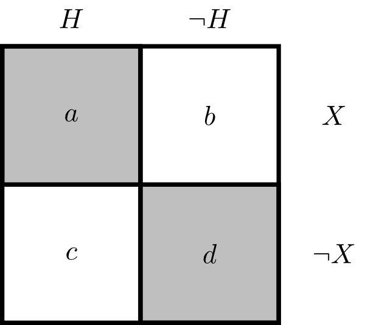
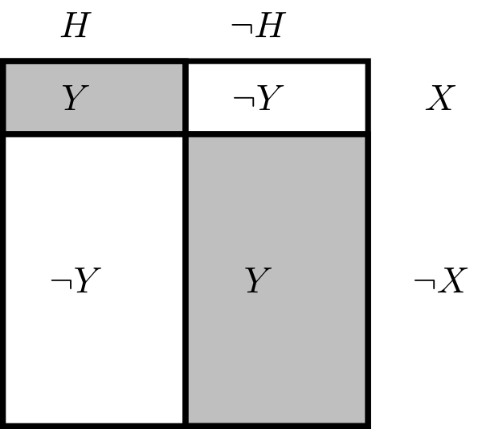

# 非精确概率 Imprecise Probabilities (Seamus Bradley)

> *首次发表于 2014 年 12 月 20 日；2019 年 2 月 19 日实质修订。*

## 1. 引言

概率论一直是一门成果极为丰硕的理论，几乎在每一个科学分支中都有应用。在哲学中，概率论的一些重要应用以贝叶斯主义之名而为人所知；这是一个极为成功的纲领（例如见 Howson and Urbach 2006; Bovens and Hartmann 2003; Talbott 2008）[^bovens-2003][^howson-2006][^talbott-2008]。但概率论似乎把远比应然更为丰富、更为确定的态度归派给信念。对于全球地表平均温度到 2080 年将上升四度以上这一事件，你的理性置信度应当是多少？也许是 0.75？为什么不是 0.75001？为什么不是 0.7497？该事件比掷两次公平硬币至少出现一次正面更可能还是更不可能？似乎有许多事件，我们可以（或许也应当）对之采取不如正统概率论所要求的那样精确的态度。在质疑正统的诸多理由中，坚持用单一实值概率函数表征信念状态，似乎是一种相当不现实的理想化，并且会带来一些颇为棘手的后果，我们将在后文讨论。诚然，人们早已认识到，概率论提供的只是关于信念的一种相当理想化的模型。早在 19 世纪中叶，乔治·布尔（George Boole）就说过：

> 若断言这种期望的强度——即便把它视为一种心灵情感——可以归结为某种数值标准，那将是不合乎哲学的。（Boole 1958 [1854]: 244）[^boole-1958]

出于这些理由以及许多其他理由，人们对 **非精确概率**（Imprecise Probability，IP）模型的兴趣日益增长。宽泛地说，这些模型以某种方式超出了概率论正统的范围。

IP 模型被用于若干领域，包括：

- 统计学（Walley 1991; Ruggeri et al. 2005; Augustin et al. 2014）[^augustin-2014][^ruggeri-2005][^walley-1991]
- 推理心理学（Pfeifer and Kleiter 2007）[^pfeifer-2007]
- 不确定性的语言加工（Wallsten and Budescu 1995）[^wallsten-1995]
- 对歧义与冲突的神经反应（Smithson and Pushkarskaya 2015）[^smithson-2015]
- 哲学（Levi 1980; Joyce 2011; Sturgeon 2008; Kaplan 1983; Kyburg 1983）[^joyce-2011][^kaplan-1983][^kyburg-1983][^levi-1980][^sturgeon-2008]
- 行为经济学（Ellsberg 1961; Camerer and Weber 1992; Smithson and Campbell 2009）[^camerer-1992][^ellsberg-1961][^smithson-2009]
- 数理经济学（Gilboa 1987）[^gilboa-1987]
- 工程学（Ferson and Ginzburg 1996; Ferson and Hajagos 2004; Oberguggenberger 2014）[^ferson-1996][^ferson-2004][^oberguggenberger-2014]
- 计算机科学（Cozman 2000; Cozman and Walley 2005）[^cozman-2000][^cozman-2005]
- 科学计算（Oberkampf and Roy 2010, chapter 13）[^oberkampf-2010]
- 物理学（Suppes and Zanotti 1991; Hartmann and Suppes 2010; Frigg et al. 2014）[^frigg-2014][^hartmann-2010][^suppes-1991]

本文梳理 IP 模型的多种动机，介绍大体属于这一领域的各种形式模型，并讨论这些框架面临的一些未决问题。重点是信念的形式模型。

### 1.1 术语概述

全文采用这样的惯例：讨论一个任意有意图的行动者（intentional agent）的信念，并称其为“你”。IP 的几位重要倡导者（包括 Good 与 Walley）也采用这一惯例。

本文讨论信念的形式模型，因此需要引入一定数量的形式工具。设有一个状态集 *Ω*，它表示世界可能所处的各种方式。有时 *Ω* 被描述为“可能世界”的集合。信念对象——即你所持有信念所关于的东西——可以用世界可能所处方式之集 *Ω* 的子集来表征。我们可以把命题 $X$ 等同于使之成真的状态集，或等同于它在其中成真的可能世界集。如果你对 $X$ 与 $Y$ 持有信念，那么你也对“$X\cap Y$”“$X \cup Y$”与“$\neg X$”持有信念，它们分别表示“$X$ 且 $Y$”“$X$ 或 $Y$”与“并非 $X$”。信念对象的集合是 *Ω* 的幂集；若 *Ω* 是无穷集，则是 *Ω* 的某个子集可测代数。

关于置信度的标准观点是：置信度由实数表征，信念状态由概率函数表征；这是一项规范性要求。概率函数是从信念代数到实数的函数 $p$，且满足：

- $0 = p(\emptyset) \le p(X) \le p(\Omega) = 1$
- 若 $X\cap Y = \emptyset$，则 $p(X\cup Y) = p(X) + p(Y)$

因此，若你的信念状态或信态由 $p$ 表征，则你对 $X$ 的置信度就是 $p$ 赋予 $X$ 的值，即 $p(X)$。

此外，在贝叶斯信念模型中，学习通过 **条件化** 实现。如果你得知命题 $E$（且未得知其他任何东西），那么你学习之后对 $X$ 的信念由 $p(X\mid E) = p(X\cap E)/p(E)$ 给出。

本文的主要关注点是另一条进路：它用概率函数的 **集合** 而非单一概率来表征信念。因此，不是由某个 $p$ 表征你的信念状态，而是由 $P$——一个由这类函数组成的集合——来表征。van Fraassen（1990）[^fraassen-1990] 称之为你的 **表征集**（representor），Levi 称之为 **信度集**（credal set）。后文将讨论解释表征集的各种方式；眼下可以这样理解：你的表征集是一个 **信度委员会**：其中每个概率函数代表委员会一名成员的意见，而委员会集体地表征你的信念。

由这些概念可以定义一些“汇总函数”，它们在非精确概率的讨论中经常使用。人们常常假定，你对命题 $X$ 的置信度由 $P(X) = \{p(X) : p\in P \}$ 表征。本文将采用这一记号惯例，但有一项保留：本文并不认为 $P(X)$ 足以充分表征你对 $X$ 的置信度。你对 $X$ 的 **下包络** 为：$\underline{P}(X)=\inf P(X)$。同样，**上包络** 为 $\overline{P}(X)=\sup P(X)$。二者在如下意义上是彼此的 **共轭**：$\overline{P}(X) = 1 - \underline{P}(\neg X)$。

关于概率集更新的标准假定是：学习 $E$ 之后你对 $X$ 的置信度由 $P(X\mid E) = \{p(X\mid E), p\in P, p(E) > 0\}$ 给出。学习 $E$ 之后的信念状态是 $P(\cdot\mid E) = \{p(\cdot\mid E), p\in P, p(E) > 0\}$。也就是说，由条件概率之集给出。

这里要事先强调：这些汇总函数——$P(\cdot)$、$\underline{P}(\cdot)$ 与 $\overline{P}(\cdot)$——并不能恰当地代表你的信念。这幅图景遗漏了信息。这一问题在后文讨论膨胀时将变得重要。

我们还需要讨论决策，因此将引入一个以赌局表述决策的简单模型。我们可以把有界实值函数 $f$ 视为“赌局”，即从某个集合 *Ω* 到实数的函数。若 *ω* 是真实状态，赌局 $f$ 支付 $f(\omega)$。我们假定，你对这种善的每一新增单位给予相同评价（赌局支付与效用呈线性），并且对风险问题无差别。你对这些赌局的态度，反映你对 *Ω* 中各种可能情形之可能性的态度。也就是说，若 *ω* 发生则赢得很多的赌局，在你认为 *ω* 越可能时就越有吸引力。特别地，考虑命题 $X$ 上的指示函数 $I_X$：若 $X$ 在现实世界为真则输出 $1$，否则输出 $0$。这是一类特殊的赌局，你对它们的态度直接反映你对相应命题的置信度。你认为 $I_X$ 越有价值，就认为 $X$ 越可能。我们称它们为指示赌局。

赌局按其期望值来评价。记 $E_{p}(f)$ 为赌局 $f$ 关于概率 $p$ 的期望值，定义如下：

$$ {E}_p(f) = \sum_{\Omega} p(\omega) f(\omega) $$

$f$ 在状态 *ω* 中价值多大，取决于 $f(\omega)$ 有多大。$f$ 在 *ω* 中的好处有多重要，取决于该状态有多可能，以 $p(\omega)$ 衡量。期望便是这些经概率加权的价值之和。关于期望效用的更多讨论，见 Briggs（2014）[^briggs-2014]。

接着定义 $\mathbf{E}_{P}(f)$ 为 $\mathbf{E}_{P}(f) = \{E_{p}(f) : p\in P \}$。即 $P$ 中各成员的期望值之集。对 $\mathbf{E}_{P}(f)$ 也有与 $P(X)$ 相同的保留：$\mathbf{E}_{P}(f)$ 在多大程度上充分表征你对赌局价值的态度，仍有疑问。在不引起歧义时，本文常省略下标“$P$”。进一步的技术细节见[形式附录](imprecise-probabilities.supplement-formal.md)。

### 1.2 一些重要区分

下文有几组区分十分重要。

IP 理论的一个重要参数，是该理论被设定具有的规范力量。非精确是义务性的，还是仅仅可允许的？它是 **始终** 可允许／义务性的，还是只在某些时候如此？或者，我们可能关心一个纯粹描述性的方案：刻画现实行动者的信度状态，而不关心规范问题。本文很少涉及最后一种可能。

还有助于把信念本身与对信念的引出区分开来，也与其内省通达区分开来。其他态度（价值、效用等）也是如此。你可能持有某些信念，在实践中乃至原则上都无法（精确地）引出。同样，你对自己信念的内省通达可能并不完美。这种不完美可以成为非精确性的一个来源。Bradley（2009）[^bradley-2009] 区分了许多不同的不完美内省来源。这种不完美可能源于你对所涉前景缺乏觉察、推理的有限性、对相关可能情形的无知，或源于你的证据或价值存在冲突（第 240–241 页）。关于不确定性类型的进一步讨论，见 Bradley and Drechsler（2014）。

一组证据有诸多方面可能影响你应当如何回应它。我们可以问证据 **有多少**（证据权重）。可以问证据是否均衡，或是否强烈偏向某个假说而非另一个（证据平衡）。证据可能因 **不完备** 而均衡：证据根本不够。证据也可能因 **冲突** 而均衡：不同证据支持不同假说。我们还可以问，证据告诉我们的东西是 **具体的**——例如硬币偏向正面的程度为 2/3——还是 **不具体的**——例如硬币偏向正面的程度介于 2/3 与 1 之间。这种具体性应区别于证据的模糊性或非确定性：硬币偏向程度 **约为** 2/3，这是模糊但具体的；硬币偏向程度确定地处于 2/3 与 1 之间的某处，这是确定但不具体的。同样，一个信度状态可以是非确定的、模糊的，也可以是不具体的，或二者兼有。确定但不具体的信念状态似乎会比非确定的信念状态更少见。

Isaac Levi（1974, 1985）[^levi-1974][^levi-1985] 区分了“非精确的”信度与“非确定的”信度（这里的引号表示：他使用“非精确”与“非确定”二词的方式，与本文采用的用法并不一致）。其想法是：有两类不同的信念状态，可能都需要转向 IP 的信念表征。在 Levi 的术语中，“非精确的”信念，在本文术语中就是不完美内省或不完美引出的信念；而“非确定的”信念则是（可能）被完美内省、却仍然非确定或不具体（或二者兼有）的信念。Levi 主张，有趣的现象是“非确定的”信度。Walley（1991）[^walley-1991] 也强调，要区分存在“正确”但未知概率的情形与“非确定性”情形。

关于 IP 的解释，还有一个与上述区分交叉的问题。这就是：我们把 $P$ 理解为对你信念的“完全”或“穷尽”表征，还是认为该表征不完备或不穷尽？暂且用下注解释来说。穷尽／非穷尽的区分可以通过下述问题划定：$P$ 是否把握了你下注倾向的 **全部且仅此**，还是 $P$ 只部分地把握了你的下注倾向？Walley 强调这一区分，并认为大多数模型都是非穷尽的。

部分由于 Levi 要求区分“非精确的”信念与“非确定的”信念，有人反对使用“非精确概率”一词。利用上述非确定、不具体与不完美内省信念之间的区分，我们可以在不使用“非精确”一词的情况下，保持 Levi 想要保持分离的各范畴。然后可以把“非精确”用作统称，涵盖所有这些缺乏精确性的情形。这样一来，我们也方便地与大量关于“非精确概率”的形式工作保持一致，该术语被用来涵盖非确定性的情形。这一用法至少可追溯到 Peter Walley 那本影响深远的著作 *Statistical Reasoning with Imprecise Probabilities*（Walley 1991）[^walley-1991]。

所以，“非精确”并不完全恰当，但“概率”也不完全恰当，因为 IP 的形式理论实际上关乎 **预现**（previsions，一种期望），而不只是关乎概率（指示函数的期望）。好在，若把 Imprecise Probability 缩写为“IP”，便可利用一些有用的歧义。

## 2. 动机

我们一般地考察一下，人们可能出于何种动机采用归在 IP 名下的模型。重点将放在理性信念模型上，因为哲学家通常关注这类模型；不过值得注意的是，使用 IP 的统计工作并不限于这一解释。要注意，没有哪位作者赞同这里的所有论证；事实上，一些同情 IP 的作者明确表示，他们认为其中某些论证并不好（例如，Mark Kaplan 不赞同“对描述性实在论的关切意味着应当允许不完备性”这一主张）。

### 2.1 Ellsberg 决策

有许多决策问题的例子，我们在直觉上倾向于违背精确概率论的指令。而且，许多实验受试者似乎确实表达了违反公理的偏好。IP 提供了一种方式，把这些直觉上合理且在实验中观察到的选择表征为理性的。一个经典例子是 **Ellsberg 问题**（Ellsberg 1961）[^ellsberg-1961]。

> 我有一个瓮，里面装有九十个弹珠。三十个是红色的。其余的为蓝色或黄色，比例未知。

考虑这一情形中各种事件的指示赌局。考虑在“抽到红色即赢”（I）的赌局与“抽到蓝色即赢”（II）的赌局之间作选择。你可能偏好 I 而非 II，因为 I 涉及 **风险**，而 II 涉及 **歧义**。若一个前景的结果不确定、但各结果以已知概率出现，则该前景是有风险的。若各结果以未知或仅部分已知的概率出现，则该前景是有歧义的。现在考虑在“抽到的不是蓝色即赢”（III）与“抽到的不是红色即赢”（IV）之间作选择。此时 III 才是有歧义的，而 IV 无歧义但有风险；因此，如果你偏好有风险的前景甚于有歧义的前景，IV 可能显得更好。这样的偏好模式（偏好 I 甚于 II，却偏好 IV 甚于 III）无法被合理化为精确期望效用最大化者的选择。这些赌局汇总于表中。

|   | R | B | Y |
| --- | --- | --- | --- |
| I | 1 | 0 | 0 |
| II | 0 | 1 | 0 |
| III | 1 | 0 | 1 |
| IV | 0 | 1 | 1 |

*表 1：* Ellsberg 赌局。瓮中装有 30 个红色弹珠和 60 个蓝色／黄色弹珠

设红、蓝、黄弹珠的概率分别为 $r$、$b$ 与 $y$。如果你是期望效用最大化者且偏好 I 甚于 II，则 $r > b$；而偏好 IV 甚于 III 意味着 $r+y < y +b$。没有哪组数值能同时满足这两个约束。因此，不存在这样的概率函数：以该概率为信念的期望效用最大化者会按上述方式选择。这种偏好虽然绝非普遍，却是许多实验受试者面对此类例子时的稳健特征（Camerer and Weber 1992; Fox and Tversky 1995）[^camerer-1992][^fox-1995]。一些实验表明，Ellsberg 型偏好模式比通常认为的更少见（Binmore et al. 2012; Voorhoeve et al. 2016）[^binmore-2012][^voorhoeve-2016]。关于歧义态度的更多讨论，见 Trautmann and van der Kuilen（2016）。

非精确概率论者可以这样建模：$P(R)=1/3, P(B)=P(Y)=[0,2/3]$。注意，这种对信念状态的表达遗漏了一些重要细节。例如，对所有 $p\in P$，都有 $p(B)=2/3-p(Y)$。就此处要说明的要点而言，这一细节并不重要。对歧义建模，使我们能够把现实行动者对押注红色的偏好合理化为理性的。要把这一说法充实起来，还需要对决策作更多讨论（见 3.3 节），但其直觉是：对歧义的厌恶解释了为何偏好 I 甚于 II、偏好 IV 甚于 III。

正如 Steele（2007）[^steele-2007] 指出的，上述分析只有在我们处理的是真正非确定或不具体的信念时，才能把 Ellsberg 选择合理化。如果我们处理的是不完美内省的信念，那么表征集里会存在某个 $p$，使理性选择最大化 $E_{p}$。就 Ellsberg 选择而言，不存在这样的 $p$。

这种对 Ellsberg 博弈教训的看法并非没有争议。Al-Najjar 与 Weinstein（2009）对 Ellsberg 偏好的解释提出了另一种看法。他们认为，Ellsberg 选择的独特模式源于行动者用某些启发式来解决决策，而这些启发式假定赔率可以被操纵。在现实生活中，如果有人向你提供赌局，你可能会想：他们必定对你占有某种优势，才值得向你提供这个赌局。这种怀疑态度经过适当建模，可以在一个简单的博弈论精确概率模型中产生 Ellsberg 选择。

### 2.2 不完备性与不可比性

为（精确）概率论辩护的各种论证都假定某种关系是完全的。无论这是对行动的偏好，还是某种“定性概率排序”，该关系都被假定在论域中任意两个元素之间总以某一方向成立。这很难说应当成为一条理性原则，尤其是在严重不确定的情形中。也就是说——以偏好为例——对两个方向都不持有偏好是合理的。这与在选项之间 **无差别** 是重要不同的态度。Mark Kaplan 对此论证如下：

> 无论你是在 $A$ 与 $B$ 之间无差别，还是对 $A$ 与 $B$ 尚未决定，都可以说你不偏好其中任一状态。然而，无差别与未决是不同的。当你在 $A$ 与 $B$ 之间无差别时，你不偏好其中一个，是出于认定二者同等可取。当你尚未决定时，你不偏好其中一个，并非出于这样的认定。（Kaplan 1996: 5）[^kaplan-1996]

对于“不可比性与无差别应当区分”这一主张，有一种标准的 **行为主义** 回应。简言之，该回应认为，这一区分无法从现实行动者的选择行为中推断出来。归根结底，在给定的选择情境中，你必须选择其中一个选项。你选择了哪个，就可以解释为哪个被（弱）偏好。Joyce 对这种诉诸行为主义的做法提出如下批评。

> 有太多值得说的事情，无法在严格行为主义的范围内说出来……基本困难在于：若不诉诸关于行动者心理状态的额外事实，就无法区分行动者行为真正揭示其所欲的情境与并未揭示的情境……更严重的缺陷是，行为主义无法理解对选择行为的 **合理化解释**。（Joyce 1999: 21）[^joyce-1999]

此外，行为主义者无法理解这样一个事实：不可比的善 **对小改进不敏感**。也就是说，如果 $A$ 与 $B$ 是你无所偏好的两种善（例如，对具有非精确概率的命题的赌局），而 $A^+$ 是略好于 $A$ 的善，那么它仍可能与 $B$ 不可比。这使不可比性区别于无差别，因为无差别的“平局”会被小改进打破。因此，“无差别与不可比之间没有行为差异”这一主张是假的。

Kaplan 主张，违反完全性公理不仅可允许，有时甚至是义务性的。

> 我之所以把“你应当采纳一套……（满足偏好公理的）偏好”这一要求斥为虚假精确，理由并非常见的那种。理由不是这一要求在人力上无法满足。因为如果问题仅在于此，那么该要求仍可能作为范导性理想发挥有益作用——人们或许可以正当地援引这一理想，让你像正统贝叶斯主义者所要求的那样去“解决”你的决策问题。我对正统贝叶斯主义要求的抱怨毋宁是：它强加了错误的范导性理想。因为如果你有（这样）一套偏好，你就对每个假说都有了确定的 [$p$] 赋值——于是你并未给予证据应有的地位。（Kaplan 1983: 571）[^kaplan-1983]

他指出，并非你始终都不合理或不可能持有精确信念：若果真如此，精确性倒可以作为范导性理想。精确概率论确实仍起某种范导性理想的作用，但那是 **处于理想化证据位置** 的理想行动者的信念。理想化的证据位置近似于你有一枚已知偏向的硬币的情形。精确概率论者与 IP 倡导者都同意，精确概率论是一种理想化，也是一种范导性理想。然而，他们对其中涉及何种理想化存在分歧。精确概率论者认为，妨碍我们持有精确概率信念的，仅仅是计算能力与内省能力的不足。非精确概率论者则认为，即便在这种意义上理想的行动者，在不处于理想 **证据** 位置时，也可能（甚至 **应当**）无法持有精确概率信念。

至少有些偏好公理并非规范性约束。我们现在可以问：在缺少那些“纯结构的”——非规范的——公理时，能证明什么？这无疑有助于我们把握信念结构真正需要什么。

在两个选项之间不持有偏好，似乎是可允许的。或者，不认为两种可能性中哪一个更可能，似乎是合理的。而这些不作判断的情形，并不等于认为所考虑的两个元素在任何实质意义上 **同等**。话虽如此，精确概率论仍在充当范导性理想。也就是说，精确性仍可能是一个尚未达到（也许无法达到）的目标，它告诉行动者如何改进自己的信度。完全偏好是充分知情的行动者应当具备的。没有完全偏好，标准的表征定理就不成立。然而，对不完备偏好排序的每个 **完全化**——即每个扩展该不完备偏好关系的完全排序——定理都成立。因此，如果我们考虑这样一组概率函数：该不完备偏好的某个完全化由其中每个函数表征，那么就可以认为这组函数表征了与不完备偏好相联系的信念。对每个完全化，我们还得到一个在线性变换下唯一的效用函数。这实质上就是 Kaplan 的立场（见 Kaplan 1983; 1996）[^kaplan-1983]。

Joyce（1999: 102–4）[^joyce-1999] 与 Jeffrey（1984: 138–41）[^jeffrey-1984] 都提出了类似主张。沿着这一思路为比较性信念提供的特别细致论证，可见 Hawthorne（2009）[^hawthorne-2009]。事实上，这一观念有悠久而卓越的历史，至少可追溯到 B.O. Koopman（1940）[^koopman-1940]。I.J. Good（1962）[^good-1962]、Terrence Fine（1973）[^fine-1973] 与 Patrick Suppes（1974）[^suppes-1974] 都讨论过这一思路。Seidenfeld、Schervish 与 Kadane（1995）给出了不满足完全性的偏好的表征定理。（关于非常一般的表征定理，见 Evren and Ok 2011; Pedersen 2014; 以及 Chu and Halpern 2008, 2004）[^chu-2004][^chu-2008][^evren-2011][^pedersen-2014][^pedersen-2014-2]。

### 2.3 证据权重与证据平衡

证据影响信念。Joyce（2005）[^joyce-2005] 提出，证据权重与证据平衡之间存在重要差异。他认为，这是精确概率论者难以处理的区分，且这一区分值得表征。许多思想家都暗示过这一观念，包括 J.M. Keynes、Rudolf Carnap、C.S. Peirce 与 Karl Popper（见 Joyce 2005 中的参考文献；Gärdenfors and Sahlin 1982）[^gärdenfors-1982][^joyce-2005]。① Keynes 对这一直觉的表述如下：②

> 随着我们所能支配的相关证据增加，论证概率的大小可能降低也可能提高，取决于新知识加强的是不利证据还是有利证据；但在两种情形中，似乎都有 **某种东西** 增加了——我们有了更坚实的基础来安放结论。我这样来表达：新证据的加入增加了论证的 **权重**。（Keynes 1921: 78，Keynes 的强调）[^keynes-1921]

考虑抛掷一枚已知公平的硬币。假设你已看过一百次抛掷的结果，其中大约一半是正面。你对这枚硬币将落在正面的置信度应当约为一半。这是一个信念背后有证据权重的情形。

现在考虑另一情形：要抛掷一枚偏向未知的硬币。也就是说，你尚未看到任何关于先前抛掷的数据。在缺乏关于偏向的任何相关信息时，对称性考量可能提示你把正面的机遇视为约为一半。这一意见与上述意见不同。这里没有证据的 **权重**，但也没有任何理由表明你对 $H$ 与 $T$ 的态度应当不同。因此，就 **平衡** 而言，你对二者的信念应当相同。

然而，这两个不同情形被表征为具有相同的概率信念，即 $p(H)=p(T)=0.5$。在公平硬币情形中，这一概率赋值来自表明正面机遇为一半的证据，以及让你的信度与机遇相符的规定（*ceteris paribus*）。相比之下，在未知偏向情形中，人们以不同方式得到同一赋值：你的证据中没有任何东西支持一个命题甚于另一个，于是某种“无差别原则”推理提示它们应被赋予相同信度（关于无差别原则的讨论，见 Hájek 2011）[^hájek-2011]。

如果我们认真对待前面讨论的“歧义厌恶”，那么在“押公平硬币落在正面”与“押未知偏向硬币落在正面”之间作选择时，偏好前者似乎并非不合理。回想 2.1 节 Ellsberg 博弈中对无歧义赌局的偏好。但如果两枚硬币被赋予相同的主观概率，又是什么把这种押公平硬币的偏好合理化了？Joyce 主张，这些信念之间存在值得表征的差异。IP **确实** 表征了这一差异。第一种情形由 $P(H)=\{0.5\}$ 表征，第二种则由 $P(H)=[0,1]$ 捕捉。

Scott Sturgeon 很好地表述了这一点：

> **证据与恰当地基于证据的态度，在性质上必须相匹配**。当证据本质上是清晰的，它保证清晰或精确的态度；当证据本质上是模糊的——大多数时候如此——它最多保证模糊的态度。用一句话说：证据的精确产生态度的精确；证据的非精确产生态度的非精确。（Sturgeon 2008: 159，Sturgeon 的强调）[^sturgeon-2008]

Wheeler（2014）[^wheeler-2014] 批评 Sturgeon 的这一“性质匹配”论题。然而，基于证据本性的 IP 论证只要求证据的性质有时允许（或要求？）非精确信念，而不要求二者的性质始终匹配。相反，Schoenfield（2012）[^schoenfield-2012] 主张证据始终支持精确信度，但出于计算能力有限，不必要求现实行动者持有精确信度。然而，她的论证实际上只支持这一主张：**有时** 非确定性源于证据的复杂性与计算复杂性。她并未论证反对 Levi、Kaplan、Joyce 等人所主张的：存在一些证据情境，它们保证非精确态度。

严格说来，我们在这里看到的只是故事的一半。信念表征在权重与平衡方面 **确实** 存在差异。但这仍然留下一个问题：究竟什么在表征证据权重？信念的哪个方面反映了这一差异？人们可能倾向于把 $\overline{P}(H)-\underline{P}(H)$ 视为 $H$ 的证据权重的度量。Walley（1991）[^walley-1991] 试探性地提出了这一看法。然而，这会把证据冲突的情形弄错。（设想两位同样可靠的证人：一位告诉你硬币偏向正面，另一位说偏向反面。）IP 是否以及如何优于精确概率论，这一问题尚未得到充分回答。不过，IP 研究者已在区分两类情形上取得进展：一类是你的信念恰好具有某些对称性质，另一类是你的信念捕捉了关于信念对象中对称性的证据。后一种区分 **确实** 是标准精确信念模型未能捕捉的（de Cooman and Miranda 2007）[^cooman-2007]。

精确概率论者可以通过指出 **弹性**（resiliency，Skyrms 2011）[^skyrms-2011] 或 **稳定性**（stability，Leitgeb 2014）[^leitgeb-2014] 来回应权重／平衡区分的论证。其想法是：由证据权重决定的概率，在回应新证据时变化得比仅由证据平衡决定的概率更小。也就是说，如果你已看过硬币的一百次抛掷，看到它落在正面不会对你的信念产生多大影响；而如果你尚未看过任何抛掷，看到它落在正面对你的信念影响更大。因此，这一区分在精确概率框架中由条件概率来表征。然而，这一区分无法把押公平硬币的偏好合理化。人们可以发展一种按弹性加权的期望值，并主张这才是你应当最大化的东西，但这与正统概率论的偏离程度不亚于 IP。如果有人发展出这样的理论，那么其优点可以与 IP 型模型的优点相权衡。

另一种可能的精确论回应是：如果许多作为 $H$ 证据的命题被完全相信，或者存在一个（关于 $H$ 的）机遇命题接近被完全相信，那么 $H$ 就有证据权重。这与仅有平衡的情形形成对照：在后者中，很少有为 $H$ 提供证据的命题被完全相信，或者概率分散在若干机遇假说上。上面关于弹性的评论同样适用于此：这样的区分可以作出，但这并不能给我们一个能把歧义厌恶合理化的理论。

膨胀现象（3.1 节）表明，本节提出的这类论证需要更细致的处理与进一步阐发。

### 2.4 悬置判断

你有时处于这样的位置：你的证据似乎既不支持也不反对某个命题的真。按理说，对这样一个命题可以采取的合理态度是悬置判断。

> 当可供我们据以得出结论的信息很少或没有时，我们不能指望推理（无论多么巧妙或周全）揭示出最可能的假说或唯一合理的行动方案。理性的力量有其限度。（Walley 1991: 2）[^walley-1991]

考虑一枚偏向未知的硬币。贝叶斯行动者对下一次抛掷落在正面必须持有精确信念。鉴于关于这枚硬币的信息完全缺乏，似乎更好的做法就是悬置判断。也就是说，最好不要持有任何特定的精确信度。最好避免对这枚硬币下注。但贝叶斯框架中根本没有这样做的余地。概率函数必须输出某个数，而这个数会把某一组特定赌局认可为可取的。

把 $\underline{P}(X)$ 视为表征证据支持 $X$ 的程度。再考虑 $I(X) = 1- (\underline{P}(X) + \underline{P}(\neg X))$。它度量证据对 $X$ 保持沉默的程度。Huber（2009）[^huber-2009][^huber-2009-2] 指出，精确概率论由此可以被理解为主张：没有任何证据会对任何命题保持沉默。也就是说，对所有 $X$ 都有 $I(X)=0$。人永远无法悬置判断。这是看清精确概率论者证据态度之怪异的一个好方式。Huber 是针对 Dempster-Shafer 信念函数提出这一点的（见历史附录第 7 节），但它一般地适用于 IP。

坚定的精确概率论者会回应说，设定 $p(X)=0.5$ **就是** 悬置判断。在抛硬币情形中，这 **就是** 最大程度不表态的信度。更一般地说，悬置判断应当以最大化熵来理解（Jaynes 2003; Williamson 2010: 49–72）[^jaynes-2003][^williamson-2010]。非精确概率论者可以论证：只有当你固守精确概率论的信念表征时，这 **才显得** 是不表态的正确方式。也就是说，最大熵进路在你已承诺用单一精确概率表征信念时才有意义，但若信度集可用，它就失去吸引力。悬置判断是当证据未决定你的信度时所做的事。但对精确概率论者来说，无法标示悬置判断与“有强证据支持概率一半”之间的差异。这又回到了权重／平衡论证。

为把问题说得更鲜明，考虑 Adam Elga 下面这个颇为古怪的例子：

> 一个陌生人在街上走近你，开始从袋子里往外掏东西。他掏出的头三样东西是一支普通大小的牙膏、一只活水母和一支旅行装牙膏。你应当在多大程度上相信他掏出的下一样东西又是一支牙膏？（2010: 1）

在这一情形中，与硬币情形不同，直觉究竟会说什么才是“正确的”精确概率论式悬置判断，实在并不清楚。最大熵方法推荐什么，取决于用来建模该情形的形式语言上一些看似任意的选择。Williamson 很清楚这一语言相对性问题。他主张，语言的选择编码了我们的部分证据。

对这一论证的另一种回应，是采取 William James 对 W.K. Clifford 的回应（Clifford 1901; James 1897）[^clifford-1901][^james-1897]。James 主张，只要你的信念与证据一致，你就可以自由地相信你所愿意相信的。因此，**无需** 悬置判断。于是，精确概率论者做不到悬置判断并不算真正的缺陷。这种态度有时被称为 **认知意志主义**，接近 Bruno de Finetti、Frank Ramsey 等人所主张的那类 **主观主义**。

看来确实有理由采用另一种悬置判断的方法，以便在你的证据很不完备、有歧义或非精确时，允许你避免作出任何下注。如果你的信度是判断赌局可接受性的标准，那么它们应当允许一个赌局的两边都不可接受。精确概率论者做不到这一点，因为若一个赌局有（精确）期望值 $e$，那么押该赌局的另一边（做庄家）的期望值为 $-e$。如果把可接受性理解为非负期望，那么对精确行动者来说，任何赌局至少有一边可接受。这似乎不能令人满意。真正的悬置判断，无疑意味着不愿以任何赔率拿钱去赌一个命题的真。

受著名的“伯特兰悖论”启发，Chandler（2014）[^chandler-2014] 给出了一个简洁论证：精确概率论者无法同时满足关于某个变量悬置判断的两项要求。第一项要求：如果你对某个有界实变量 $X$ 的取值悬置判断，那么在你的认知状态看来，$X$ 的可能取值中同样大小的不同区间应当受到同等对待。第二项要求：如果 $Y$ 本质上描述与 $X$ 相同的量，那么对 $X$ 悬置判断应当蕴含对 $Y$ 悬置判断。现在设想你持有精确概率，并且对 $X$ 悬置判断。按第一项要求，你在 $X$ 的取值上有均匀分布。现在考虑 $Y = 1/X$。$Y$ 本质上描述与 $X$ 相同的量。但 $X$ 上的均匀分布蕴含 $Y$ 上的非均匀分布。所以你对 $Y$ 并未悬置判断。现实中如此相关的变量例子是“云中冰的滞留时间”与“云中冰的降落速率”。二者成反比，却描述气候系统中本质上相同的要素（Stainforth et al. 2007: 2154）[^stainforth-2007]。

因此，精确概率论者无法满足这些关于悬置判断的合理要求。非精确概率论者可以：例如，$X$ 上所有概率函数之集同时满足两项要求。也许还有更具信息量的先验也能表征悬置判断，但眼下只需指出，IP 似乎比精确概率论更能表征悬置判断。Walley（1991）[^walley-1991] 第 5.5 节讨论了 IP 作为处理悬置判断方法的前景。

### 2.5 未知相关性

Haenni 等（2011）通过表明非精确概率如何从精确概率判断中产生，来为它提供动机。也就是说，如果你对 $X$ 有精确概率、对 $Y$ 有精确概率，那么即使不知道 $X$ 与 $Y$ 如何相关，你也可以对 $p(X\cap Y)$ 与 $p(X \cup Y)$ 给出界。这些界给出复合事件可能概率值的区间。

例如，你知道 $p(X \cap Y)$ 以 $p(X)$ 为上界、也以 $p(Y)$ 为上界，因而以 $\min\{p(X),p(Y)\}$ 为上界。如果 $p(X) \gt 0.5$ 且 $p(Y) \gt 0.5$，那么 $X$ 与 $Y$ 必定相交。于是 $p(X\cap Y)$ 以 $p(X)+p(Y)-1$ 为下界。但按定义，$p(X \cap Y)$ 也以 $0$ 为下界。因此我们得到如下结果：如果你知道 $p(X)$ 且知道 $p(Y)$，那么你就知道

$$ \max\{0,p(X)+p(Y)-1\} \le p(X \cap Y) \le \min\{p(X),p(Y)\}. $$

同样，也可以对 $p(X \cup Y)$ 给出界。$p(X\cup Y)$ 不会大于 $X$ 与 $Y$ 不相交时的值，因此以 $p(X)+p(Y)$ 为上界。它也以 $1$ 为上界，因而以这两个表达式的较小者为上界。它还以 $p(X)$ 与 $p(Y)$ 为下界，因而以二者的较大者为下界。综合起来，

$$\max\{p(X),p(Y)\} \le p(X\cup Y) \le \min\{p(X)+p(Y),1\}.$$

这些约束实际上就是 de Finetti 预现基本定理所给出的东西（de Finetti 1990 [1974]: 112; Schervish, Seidenfeld, and Kadane 2008）[^finetti-1990][^schervish-2008]。

因此，如果你的证据约束了你对 $X$ 与 $Y$ 的信念，却对二者的交互作用保持沉默，那么你只能把这些复合事件确定到某些区间。任何特定概率函数的选择，都会在假定 $X$ 与 $Y$ 之间某种特定证据关系时超出证据。也就是说，$p(X)$ 与 $p(X\mid Y)$ 将以一种在你的证据中毫无根据的方式不同。

### 2.6 非概率性机遇

如果客观机遇不是概率，那会怎样？如果我们认可已知客观机遇与信念之间的某种联系——例如直接推断原则或 Lewis 的主要原则（Principal Principle，Lewis 1986）[^lewis-1986]——那么我们可能就有额外理由支持非精确概率论。机遇应当是概率，这似乎是普遍公认的真理，但极少有人为这一“真理”提供论证。例如，Schaffer（2007）[^schaffer-2007] 把遵守概率公理列为扮演“机遇角色”的必要条件之一，却未论证为何应当如此。Joyce 说：“有人主张客观机遇不是概率。这似乎不太可能，但要解释为什么，会让我们离题太远”（2009: 279，注 17）。其他关于机遇的讨论——例如统计力学中的讨论（Loewer 2001; Frigg 2008）[^frigg-2008][^loewer-2001] 或“休谟式机遇”（Lewis 1986, 1994）[^lewis-1986][^lewis-1994]——都把机遇应当是精确且概率性的这一点视为理所当然（Dardashti et al. 2014 是例外）[^dardashti-2014]。显然，把机遇概念用作解释概率论的方式，使事情变得混乱。然而，有一个完全良好的前理论机遇概念：毕竟概率论最初正是为了推理它而发明的。这种前理论机遇似乎仍是我们应当在某种意义上分配信念的东西。而很少有人论证机遇必须始终是概率。如果机遇以某种特定方式是非概率性的，人们或许可以论证你的信度也应当以同样方式是非概率性的。如果机遇与信度具有非概率性的形式结构，机遇—信度协调规范应当采取何种形式，目前仍是一个未决问题。

我想举几个这一观念的例子。首先考虑某种没有极限频率、但频率不断变化且始终停留在某个区间内的物理过程。这会是一个具有机遇性却相当可预测的过程。对这样一个系统，最好的描述也许就是对其相对频率给出界。这类过程已用 IP 模型研究过（Kumar and Fine 1985; Grize and Fine 1987; Fine 1988）[^fine-1988][^grize-1987][^kumar-1985]，并作为信度非精确性的一个潜在来源得到讨论（Hájek and Smithson 2012）[^hájek-2012]。对量子力学事件的某种非标准理解会自然导致上概率模型（Suppes and Zanotti 1991; Hartmann and Suppes 2010）[^hartmann-2010][^suppes-1991]。John Norton 用一个他声称不承认任何合理概率态度的例子，讨论了概率论作为归纳逻辑的限度（Norton 2007, 2008a,b）[^norton-2007][^norton-2008a]。人们或许希望 IP 能提供一种沿 Norton 所勾画路线的归纳逻辑。Norton 本人对这条路线表示怀疑（Norton 2007）[^norton-2007]，尽管 Benétreau-Dupin（2015）[^benétreau-dupin-2015] 已为 IP 作为 Norton 方案的候选系统辩护。最后，关于模糊性的特定看法很可能促使我们重新思考机遇的形式结构（Bradley 2016）[^bradley-2016][^bradley-2016-2]。

### 2.7 群体信念

假设我们希望自己的认识论不仅适用于个体，也适用于“群体行动者”，如委员会、政府、公司等。这类行动者可能由意见不合的成员组成。Levi（1986, 1999）[^levi-1986][^levi-1999] 主张，这种冲突用概率集来表征比用精确概率更好。关于合并或聚合群体成员（概率性）意见的文献很丰富（Genest and Zidek 1986）[^genest-1986]，但聚合的结果不能充分表征群体内部的 **分歧**。某些聚合形式也无法尊重对群体信念的合理约束。例如，如果群体每个成员都同意 $X$ 与 $Y$ 概率独立，那么要求群体信念尊重这一全体一致似乎是合理的。然而，众所周知，线性池化——一种简单而流行的聚合形式——并不尊重这一要求。考虑两个概率函数 $p, q$，满足 $p(X) = p(Y) = 1/3$ 且 $p(X\mid Y)=p(X)$，而 $q(X) = q(Y) = 2/3$ 且 $q(X\mid Y)=q(X)$。考虑取二者的无权平均来聚合：$r = p/2 + q/2$。计算表明 $r(X\cap Y) = 5/18$，而 $r(X)r(Y) = 1/4$，从而证明 $r$ 并不认为 $X$ 与 $Y$ 独立。因此，这种聚合方法不满足上述要求（Kyburg and Pittarelli 1992; Cozman 2012）[^cozman-2012][^kyburg-1992]。关于群体中的判断聚合，见 List and Pettit（2011），尤其是第 2 章。

Elkin 与 Wheeler（2016）主张，解决精确概率论同伴之间的分歧应当涉及非精确概率。Stewart 与 Quintana（2018）主张，非精确聚合方法具有一些精确聚合方法所没有的良好性质。

如果委员会成员的信度 **与** 效用各不相同，那么任何不同于各行动者概率与效用的精确概率—效用对，都无法满足 **帕累托条件**（Seidenfeld, Kadane, and Schervish 1989）[^seidenfeld-1989]。帕累托条件要求群体偏好尊重群体内部的偏好一致。也就是说，如果群体所有成员都偏好 $A$ 甚于 $B$（即每个成员都认为 $A$ 的期望效用高于 $B$），那么（由聚合概率—效用对决定的）聚合偏好应当满足这一偏好。既然这种“共识保持”是对聚合的合理要求，这一结果就表明精确的群体行动者模型有问题。Walley 讨论了一个概率集例子：其中每个概率代表群体一名成员的信念，于是 $P$ 是对每个行动者信念的不完备描述，其意义是：如果 $P$ 的所有成员在某事上一致，那么该事就是每个行动者所相信的。概率集使我们能够表征在判断上 **冲突** 的行动者（Levi 1986, 1999）[^levi-1986][^levi-1999]。

> 理想上理性的行动者可能面临没有最佳选项可用的选择。概率判断中的非确定性以及价值之间未解决的冲突，会导致这样的困境：在选择的时刻，理性行动者承认[可选选择集]中对可用选项的不止一种此类偏好排序是可允许的。（Levi 1999: 510）[^levi-1999]

Levi 还主张，个体行动者也能像群体一样处于冲突之中，因此个体的信度状态也最好由概率集来表征。（Levi 还主张信度状态的 **凸性**，这使他与上述关于独立性的论证发生冲突（见历史附录第 3 节）。）人们不必接受“群体与个体必须以同样方式建模”这一主张，也能从这一观念中得到启发。只需接受：个体可以以这样一种方式 **冲突**，以致其信念状态——或信念与价值状态——的合理表征是函数集。Bradley（2009）[^bradley-2009] 把这类集合的成员称为“化身”（avatars）。这提示我们把个体的信度集解释为由她的化身组成的 **信度委员会**。这一表征集解释来自 Joyce（2011）[^joyce-2011]，尽管 Joyce 将其归功于 Adam Elga。这个委员会表征你所能拥有的、与证据一致的全部可能先验概率。每个信度委员会成员都是完全有主张的 James 式意志主义者。委员会作为一个整体，则是 Clifford 式的客观主义者。

## 3. 关于 IP 的哲学问题

本节汇集文献中针对 IP 指出的一些问题。

### 3.1 膨胀

考虑两个逻辑上无关的命题 $H$ 与 $X$。现在看图 1 所示这个简单模型的四种“状态描述”。于是 $a=H\cap X$，依此类推。现在定义 $Y=a \cup d$。或者，考虑三个以下述方式相联系的命题：$Y$ 被定义为“$H$ 当且仅当 $X$”。

*图 1：* 依 Seidenfeld（1994）[^seidenfeld-1994] 的关系图；$Y$ 为阴影区域

进一步设想 $p(H\mid X) = p(H) = 1/2$。除逻辑与概率论所要求的关系外，这些命题之间没有其他关系。容易验证，上述约束要求 $p(Y) = 1/2$。然而，$X$ 的概率不受约束。

设想你获得了上述信息，并把你的表征集取为满足这些约束的全部概率函数之集。Roger White 对“你如何可能获得关于如此相关且如此受约束的命题的信息”提出了一个直观解释（White 2010）[^white-2010]。White 的谜题是这样的。我有一个命题 $X$，你对它一无所知。我在一枚公平硬币的 **正面** 写上 $X$ 与 $\neg X$ 中为真的那一个。我把硬币涂掉，使你看不出哪一面是正面。然后我抛硬币，它落下时 $X$ 那一面朝上。$H$ 是“硬币正面朝上”这一命题。$Y$ 是“硬币写着‘$X$’的那一面朝上”这一命题。

设想你有一个使你确信 $X$ 的精确先验（这与上述约束相容，因为 $X$ 本来不受约束）。此时看到 $X$ 朝上，应当成为硬币正面朝上的证据。游戏设定使得这些看似无关的证据实例 **能够** 携带信息。同样，对 $X$ 非常有信心，会使 $Y$ 成为 $H$ 的极好证据。反之，如果你确信 $X$ 为假，$Y$ 就会是 $H$ 为假的铁证。因此，$p(H\mid Y)$ 似乎与对 $X$ 的先验信念成正比（确实，这可以相当容易地证明）。鉴于事件之间的联系方式，观察朝上的是 $X$ 还是 $\neg X$，是一个了解 $H$ 是否朝上的噪声信道。

现在回到最初的非精确情形，考虑对 $X$ 持有非精确信念意味着什么。除其他事项外，它意味着认为 $X$ 很可能，是可能的。你的信念状态容许：$X$ 是这样的命题——如果你知道 $X$ 究竟是什么命题，你会认为它很可能。在这种情形中，$Y$ 会是 $H$ 的良好证据。注意，在这种情形中，得知硬币以 $\neg X$ 朝上落下——称之为 $Y'$——同样会成为反对 $H$ 的良好证据。同样，$X$ 也可能是你会赋予极低信度的命题，于是 $Y$ 会成为 **反对** $H$ 的证据。

由于你对 $X$ 处于无知状态，你的表征集包含这样一些概率：它们把 $Y$ 视为 $H$ 的良好证据；也包含这样一些概率：它们把 $Y$ 视为 $\neg H$ 的良好证据。因此，尽管 $P(H)=\{1/2\}$，却有 $P(H\mid Y) = [0,1]$。这一现象——后验比先验更宽——被称为膨胀。数学文献已对这种现象作了透彻研究（Walley 1991; Seidenfeld and Wasserman 1993; Herron, Seidenfeld, and Wasserman 1994; Pedersen and Wheeler 2014）[^herron-1994][^pedersen-2014][^pedersen-2014-2][^seidenfeld-1994][^seidenfeld-1993][^walley-1991][^wheeler-2014]。Levi 与 Seidenfeld 在 Good（1967）[^good-1967] 之后向 Good 报告了一个膨胀例子。Good 在其后续论文中提到了这一对应关系（Good 1974）[^good-1974]。哲学界近来对膨胀的兴趣，由 White 的论文引发（White 2010）[^white-2010]。

White 认为膨胀是个问题，因为学习 $Y$ **似乎** 与 $H$ 无关。也就是说，由于你对 $X$ 无知，得知硬币是否以 $X$ 朝上落下，似乎不能告诉你任何关于硬币是否正面朝上的信息。主张你对 $H$ 的信念在得知 $Y$ 后应当从 $1/2$ **膨胀** 到 $[0,1]$，似乎很奇怪。感觉这应当与 $H$ 无关。然而，只有当 $p(X)=1/2$ 时，$Y$ 才真正与 $H$ 无关。你可能对 $X$ 持有的任何其他精确信念，都会使 $Y$ 影响你对 $H$ 的后验信念。图 2 展示了关于 $X$ 有多可能的某一特定信念的情形；即某个特定的 $p\in P$。水平线可以上下移动，取决于我们所关注的委员会成员对 $X$ 的信念。只有当对 $X$ 的先验也是一半时，$p(H\mid Y)$ 才是一半。然而，非精确概率论者会考虑 **$Y$ 可能影响对 $H$ 的信念的所有方式**。

*图 2：* 信度委员会的一名成员（依 Joyce（2011）[^joyce-2011]）

考虑一组行动者，他们在上述硬币情形中各自持有精确信度，但对 $X$ 的先验各不相同。他们起初对 $H$ 的先验都是一半。学习 $Y$ 之后，这些行动者关于 $H$ 的后验意见会因各自不同的更新倾向而不同。群体信念会发生膨胀。然而，群体中没有哪个行动者做了任何不合理的事。如果我们接受 Levi 的建议——个体也能像群体一样处于冲突之中——那么个体行动者的信念似乎也能像群体一样发生膨胀。

膨胀有两个明显问题。第一，看似无关的证据会产生移动信念的效果；第二，学习某些证据会使你的信念区间变宽。上述评论针对的是第一个问题。Pedersen 与 Wheeler（2014）[^wheeler-2014] 也着眼于缓解这一忧虑。现在转向第二个忧虑。

即使我们接受膨胀是非精确概率论者必须面对的现实，它仍然 **怪异**。即使接受上述全部论证，说你对 $H$ 的信念发生了膨胀——**无论你学到什么**——似乎仍然很奇怪。也就是说，无论你学到 $Y$ 还是 $Y'$，你对 $H$ 的后验信念看起来都一样：$[0,1]$。或者，它显示出的怪异之处也许是：你最初的置信度是精确的。

Hart 与 Titelbaum（2015）提出，膨胀之所以显得奇怪，是因为对双条件句作条件化（毕竟上述例子中你所做的正是这件事）即使在精确情形中也不直观。是否所有膨胀情形都能以这种方式解释掉，仍有待观察。Gong 与 Meng（2017）同样把膨胀视为统计推断设定不当的问题，而非 IP 本身的问题。

除了这种表面上的怪异，White 还提出了一种具体方式，说明受制于膨胀是认知论有缺陷的标志。White 提出，膨胀例子表明非精确概率违反了 **反思原则**（Reflection Principle，van Fraassen 1984）[^fraassen-1984]。论证如下：

> 既然你现在知道，无论你学到 $Y$ 还是学到 $Y'$，你对 $H$ 的信度都将是 $[0,1]$（而且你必定会学到其中之一），那么你当前对 $H$ 的信度也应当是 $[0,1]$。

其一般想法是：你应当把自己的信度设定为你预期未来信度会是什么。更具体地说，你对 $X$ 的信度，应当是你未来可能对 $X$ 持有的信度在你可能学到的各种东西上的期望。既然在这个例子中，无论你学到什么，你对 $H$ 的信度都相同，那么你也应当把它作为先验信度。你的先验应当满足 $P(H) = [0,1]$。因此，一开始就对 $H$ 持有精确先验信度是不理性的。这就是从反思原则反对膨胀的论证。然而，你的先验 $P$ 并不完全精确。考虑 $P(H \cap Y)$。也就是说，对合取的先验信念是非精确的。因此，所谓膨胀与反思原则的问题，并不像“你的精确信念变成非精确的”那么简单。问题在于“你 **对 $H$ 的** 精确信念变成非精确的”；或者更确切地说，你 **由 $P(H)$ 所表征的** 对 $H$ 的精确信念变成非精确的。

反思原则的问题更为基本。在这个情形中，反思原则究竟对非精确概率论者要求什么？显然，每个信度委员会成员的先验信度，都是其在可能未来证据上的期望（这是概率论的一个定理）。但人们觉得，**整个信度状态** 不知怎的并不以该原则所要求的方式对反思敏感。每个 $p\in P$ 都满足该原则，但问题中棘手的对称性合谋使 $P$ 整体违反该原则。如果我们把 $P(H)$ 视为信念状态那一部分的充分表征，情况看起来就是如此。但如前所述，这并不是理解信度状态的恰当方式。注意，虽然学习 $Y$ 与学习 $Y'$ 都会促使状态修正为“对 $H$ 的后验信念由 $[0,1]$ 区间表征”的状态，但 **作为概率集** 的信度状态并不相同。把学习 $Y$ 后的状态称为 $P'$，学习 $Y'$ 后的状态称为 $P''$。于是 $P' = \{p(\cdot \mid Y), p\in P\}$，$P'' = \{p(\cdot\mid Y'), p\in P\}$。虽然 $P'(H) = P''(H)$ 为真，但作为概率集 $P' \neq P''$，因为若 $p\in P'$ 则 $p(Y) = 1$，而若 $p\in P''$ 则 $p(Y) = 0$。因此，我们应当从膨胀中吸取的一个教训是：非精确信念由 **函数集** 表征，而非由集合值函数表征（另见 Joyce 2011; Topey 2012; Bradley and Steele 2014b）[^bradley-2014b][^joyce-2011][^topey-2012]。

因此，膨胀也许可以被驯服或合理化，反思原则的问题也可以被缓解。但膨胀仍提出一个谜题：在精确语境中，我们有一个漂亮的结果——由 Good（1967）[^good-1967] 给出——它大致是说，学习新信息具有正的期望价值。信息具有正价值。这一结果在某种程度上被膨胀削弱。Bradley 与 Steele（2016）提出，在某种意义上，Good 的结果在 IP 设定中可以部分挽救。

膨胀的例子似乎削弱了先前的主张：非精确概率使你能够表征证据权重与证据平衡的差异（见 2.3 节）：学习 $Y$ 似乎产生一种会被视为代表 **更少证据** 的信念，因为它更分散。之所以如此，是因为膨胀情形中的先验信度之所以精确，并非凭借证据权重，而是凭借前面讨论的对称性。我们不能把区间 $[\underline{P}(X), \overline{P}(X)]$ 的狭窄作为证据权重的刻画，因为区间可能因并非积累了大量证据的其他原因而狭窄。因此，我先前关于权重／平衡的评论不应被读作主张：非精确概率总能表征权重／平衡区分。真实的情况是：**存在** 一些情形，非精确概率能以影响决策的方式表征这一区分。这个问题远未解决，还需就这一主题做更多工作。

### 3.2 信念惰性

设想有两个仍在考虑的假说 $H_1$ 与 $H_2$。你不知道它们有多可能，但它们互斥且穷尽。然后你获得某些证据 $E$。一些简单的概率论表明，对每个 $p\in P$ 都有如下关系（令 $p_i = p(E\mid H_i)$，$i=1,2$）。

$$\begin{align} p(H_1\mid E) & = {{p(E\mid H_1)p(H_1)} \over {p_1 p(H_1) +p_2 p(H_2)}} \\ & = {{p_1 p(H_1)} \over {p_2 + (p_1 - p_2) p(H_1)}}\\ \end{align}$$

如果你对 $H_1$ 的先验是 **空洞的**——若 $P(H_1) = [0,1]$——那么上述方程表明你的后验也是空洞的。也就是说，若 $p(H_1) = 0$ 则 $p(H_1\mid E) = 0$；同样，$p(H_1) = 1 = p(H_1\mid E)$；又因为上述方程右边是 $p(H_1)$ 的连续函数，所以对每个 $r\in [0,1]$，都存在某个 $p(H_1)$ 使 $p(H_1\mid E) = r$。于是 $P(H_1\mid E)=[0,1]$。

看来非精确概率论者无法从空洞先验中学习。这一信念惰性问题至少可追溯到 Levi（1980）[^levi-1980] 第 13 章。Walley 也讨论了这个问题，但似乎不为所动：他说空洞后验概率不过是采纳空洞先验的结果：

> 空洞预现确实是相当平凡的模型。这对“完全无知”模型似乎是恰当的，因为完全无知是一种相当平凡的不确定状态。另一方面，尽管这些模型具有理论重要性，却不能指望它们在实际问题中很有用。例如，如果用空洞预现来建模关于某个统计参数的先验信念，它们会产生空洞的后验预现……然而，接近空洞、对先验信念作出近乎最小主张的先验预现，可以导致合理的后验预现。（Walley 1991: 93）[^walley-1991]

Joyce（2011）[^joyce-2011] 与 Rinard（2013）[^rinard-2013] 都讨论过这个问题。Rinard 的解决办法是主张：这表明空洞先验从来不是合法的信念状态；或者说，我们始终只需用非空洞先验来建模你的信念，即便这些先验是对你信念状态的不完备描述。这类似 Walley 的“非穷尽”信念表征。Vallinder（2018）[^vallinder-2018] 提出，信念惰性问题相当普遍。Castro 与 Hart（即出）利用信念惰性的迫近危险，来反对我所谓的 IP “客观主义”解释。

这一问题的另一种解决办法（受 Wilson 2001 与 Cattaneo 2008; 2014 启发）[^cattaneo-2008][^wilson-2001] 是修改更新规则，把那些对证据赋予极小似然的极端先验从表征集里剔除。要把这一点精确化并说明该回应究竟如何进行，还需做更多工作。

### 3.3 决策

信念模型的一项重要用途，是作为理性决策理论的一部分。IP 也不例外。然而，用非精确概率作决策存在一些问题。

简言之，IP 决策的问题在于：你的信度委员会可能对最佳行动方案意见不一；一旦如此，你应当如何行动就不清楚了（回想 1.1 节的定义）。设想对一枚偏向未知的硬币下注。考虑关于正面与反面的指示赌局。两个赌局的非精确期望都是 $[0,1]$。你应当如何比较这些期望？这两个赌局不可比。（如果硬币例子看起来有过多可利用的对称性，可以考虑对 Elga 从袋中掏出牙膏还是水母作单位赌局。）Williamson 主张，这种不可比导致决策瘫痪，并凸显了该认识论的缺陷（2010: 70）。然而，如果 IP 的动机之一正是要能够表征前景之间的这种不相容性（见 2.2 节），这一论证似乎就未抓住要点！IP 所蕴含的选项不可通约性不是缺陷，而是特征。用非精确概率作决策的讨论，见 Seidenfeld（2004）[^seidenfeld-2004]、Troffaes（2007）[^troffaes-2007]、Seidenfeld, Schervish, and Kadane（2010）、Bradley（2015）[^bradley-2015]、Williams（2014）[^williams-2014]、Huntley, Hable, and Troffaes（2014）[^troffaes-2014]。

当必须作一连串决策时，IP 面临更严重的忧虑。经济学中有丰富文献讨论不按正统期望效用最大化者行事的行动者的决策序列（Seidenfeld 1988; 1994; Machina 1989; Al-Najjar and Weinstein 2009 及其中的参考文献）[^al-najjar-2009][^machina-1989][^seidenfeld-1988]。Elga（2010）[^elga-2010] 的论文 *Subjective Probabilities Should Be Sharp* 发表后，这一话题再次引起哲学家注意；该文用一个简单决策例子凸显了问题，尽管 Hammond（1988）[^hammond-1988] 中已出现一个非常相似的例子，与 Seidenfeld 对 Levi 决策规则“E-可容许性”的讨论相关（Seidenfeld 1988）[^seidenfeld-1988]。

该问题的一个版本如下。有人将先后向你提供两个关于偏向未知硬币的赌局 $A$ 与 $B$。赌局支付如下：

- $A$：若硬币落在正面则输 10，否则赢 15
- $B$：若硬币落在正面则赢 15，否则输 10

如果我们假定你的信念由 $P(H)=[0,1]$ 表征，那么这两个赌局的期望为 $[-10,15]$。拒绝每个赌局的期望为 0。因此，就你的信念而言，接受与拒绝 $A$ 不可比。$B$ 同样如此。问题在于，拒绝 **两个** 赌局似乎不理性，因为接受两个赌局能保证得到 5。Elga 论证，没有任何非精确概率决策规则能排除拒绝两个赌局。他进而论证，这表明非精确概率是糟糕的认识论。两个论证都不成立。Chandler（2014）[^chandler-2014] 与 Sahlin、Weirich（2014）都指出，某类非精确决策规则确实使拒绝两个赌局不被允许；Elga 已在其论文的勘误中承认这一点。Bradley 与 Steele（2014a）主张，使拒绝两个赌局仅为可允许的决策规则，是作非精确决策的合法方式。他们还指出，Chandler 以及 Sahlin、Weirich 所主张的规则在其他决策问题中会有反直觉后果。

Moss（2015）[^moss-2015] 把 Elga 式 IP 决策问题与道德困境联系起来，并借助这一类比解释 Elga 问题中相互冲突的直觉。Sud（2014）[^sud-2014] 与 Rinard（2015）[^rinard-2015] 也都提出了非精确概率的替代决策理论。Bradley（2019）[^bradley-2019] 主张，这三种理论都难以容纳上文讨论的 Ellsberg 决策的一个版本。

即使 Elga 的论证成立，且不存在好的非精确决策规则，那也不能表明 IP 是错误的信息念模型。我们希望能够在各种事情上表征悬置判断，包括在若干选项的相对优劣上。这种不可通约性不可避免地给序列决策带来一些问题（例如见 Broome 2000）[^broome-2000]，但这并不构成反对该认识论的论证。正如 Bradley 与 Steele 所指出的，Elga 的论证——如果有效——经 **相应调整**（mutatis mutandis）后可以用来论证不存在不可通约的善，而这似乎过强。

### 3.4 解释 IP

非精确概率并非一种彻底全新的理论。它只是针对歧义情境对既有信念模型作轻微修改。你的信度常常足够精确，而你可用的行动会如此这般，以致你的行事多多少少 **仿佛** 你是严格贝叶斯主义者。人们可以把非精确概率类比为“相对论”，把严格贝叶斯主义类比为“牛顿力学”：除最极端的情形外，二者几乎无法区分。这一类比还可以更深入：在两种情形中，理论在正常情况下都“经验上不可区分”，但都在某些概念方面有根本差异。具体说，牛顿力学／广义相对论中绝对空间的作用；严格／非精确概率论情形中如何建模无知。Howson（2012）[^howson-2012] 在信念建模与科学建模之间作了类似类比。二者都要求对目标系统保持某种忠实，但在每种情形中，忠实都必须与简单性、计算可处理性等各种理论德性相权衡。同样，Hosni（2014）[^hosni-2014] 主张，何种信念模型恰当，多少取决于语境。当然，有一个重要的不类比之处：信念模型被设定为既描述又 **规范**，而科学中的模型通常只须发挥描述作用。Walley（1991）[^walley-1991] 讨论了类似观点，但一般对这种解释持怀疑态度。

#### 3.4.1 信念是什么？

对概率演算的一种标准解释是：概率表征“置信度”或“信度”。这大体上就是迄今所考虑的概念。但置信度是什么？对于置信度的表征实际上表征了什么，有若干种阐释方式。

对置信度最直接的理解之一，是用行动者的极限下注意愿来解释信度。这一观念可追溯到 Ramsey（1926）[^ramsey-1926] 与 de Finetti（1964, 1990 [1974]）。其想法是：你对 $X$ 的信度为 *α*，当且仅当 *α* 是使你在下列赌局之间无差别的值：

- 若 $X$ 则赢 $1-\alpha$，否则输 *α*
- 若 $X$ 则输 $1-\alpha$，否则赢 *α*

这就是“下注解释”。荷兰赌论证背后的解释正是它：这种信念解释使赌商与信念之间的联系足够强，足以支持荷兰赌定理的主张：**信念** 必须是概率性的。事实上，Williamson 因 IP 无法给出这种下注解释而对它提出异议（2010: 68–72）。他主张，尽管有 Smith 与 Walley 的贡献（见[形式附录](imprecise-probabilities.supplement-formal.md)），单值下注解释作为一种信度标准仍有意义，而单边下注解释则不然。其想法是：除非赌局在你看来赔率极有利，否则你可以拒绝所有赌局。这种行为并不说明你的信度。然而，**如果你必须给出一个单一数值**，那么这个数值就告诉我们一些关于你认知状态的东西。这一想法有其道理，但必须与另一忧虑相权衡：**强迫** 行动者持有这样的单一数值，会系统性地错误表征其认知状态。正如 Kaplan 所说

> 仅仅因为你在为 [$p(X)$] 选择一个确定值的 **强制** 下指定了 $0.8$，几乎不意味着你有 **理由** 选择 $0.8$。简言之，正统贝叶斯主义者犯了提倡虚假精确的错误。（Kaplan 1983: 569，Kaplan 的强调）[^kaplan-1983]

一种相关的信度解释，是把信度理解为对行动者行动倾向的表征。这种解释把信度视为这样一个函数：你被引出的偏好与观察到的行动，可以相对于该概率函数被表征为期望效用最大化者的偏好与行动（Briggs 2014: 2.2 节）[^briggs-2014]。你的信度 **就是** 那个把你表征为理性行动者的函数。对精确概率论来说，“理性行动者”意味着“期望效用最大化者”。对非精确概率论来说，理性行动者必定意味着稍有不同的东西。这类想法的一个稍精细版本，是把信度理解为偏好结构中由表征定理中的概率函数所表征的那个成分。回想关于不完备性的讨论（2.2 节）。IP 把你表征为在所有 $p \in P$ 之间冲突的行动者：除非这些 $p$ 一致认为 $X$ 优于 $Y$ 或反之，否则你认为它们不可比。表征定理实际证明了什么，尚有争议（见 Zynda 2000; Hájek 2008; Meacham and Weisberg 2011）[^hájek-2008][^meacham-2011][^zynda-2000]。

人们可能认为，信度是在建模头脑中某种心理或心理学量。信念强度是一个真实的心理学量，信度应当度量的正是它。与上述观点不同，这种信度解释不容易操作化。这种对信念强度的理解似乎还使信度远离其在理解决策中的作用。上述 **行为主义** 观点把信念在决策中的作用视为核心，甚至视为信念是什么的定义。这种心理学解释似乎把信念与决策分离。是否存在这种稳定的神经结构，也有争议（Fumagalli 2013; Smithson and Pushkarskaya 2015）[^fumagalli-2013][^smithson-2015]。

行为主义观点与心理学观点之间的一种折中说法是：信念 **部分地** 由其决策作用来刻画。这为信念在断言、推理与推断等其他事情中发挥重要作用留出空间。因此，“置信度是什么？”这一问题的答案是：“置信度就是那些在决策语境、断言行为、推理与推断中发挥归派给信念之作用的心理因素。”这一刻画留有空间，把信度理解为度量某种与行动、断言等有因果联系的心理量。这是一种关于信念是什么的功能主义解读。Eriksson 与 Hájek（2007）主张，“置信度”应当直接作为认识论中的原始概念。上述刻画置信度的尝试，则补足了置信度所发挥作用的图景。

#### 3.4.2 对 $X$ 的信念是什么？

现在我们对信念模型应当做什么有了更好的想法。但信念模型的哪一部分表征信念状态的哪一部分？首先要说，$P(X)$ **不是** 对 $X$ 的信念的充分表征。也就是说，信度集进路的价值之一，是它能捕捉某些命题之间的非逻辑关系，而专注于例如相关联的概率值集会丢失这些关系。例如，考虑抛掷一枚偏向未知的硬币。$P(H)=P(T)=[0,1]$，但这未能表征一个重要事实：对所有 $p\in P$，$p(H)=1-p(T)$。或者：第一次抛掷得到正面，至少与连续两次抛掷都得到正面一样可能。这些未被“值集”观点捕捉的事实，可以在推理与决策中发挥重要作用。

$P(X)$ 对某些目的而言可能是 **足够好** 的信念表征。例如在 Ellsberg 博弈中，这些概率值集（及其相关期望集）足以把非概率偏好合理化。表征需要多好，取决于它将被用于什么。把太阳表示为质点，对基本轨道计算是足够好的表征；但如果你研究日冕物质抛射、太阳耀斑或其他依赖太阳内部动力学细节的现象，它显然不够。

### 3.5 无穷倒退

非精确概率是一门源于我们作为推理行动者的局限、以及我们证据基础之局限的理论。只要我们拥有更好的证据，单一概率函数就够了。但既然我们的证据薄弱，就必须使用集合。在某种意义上，精确概率论也是如此。只要我们知晓真理，就可以用真值赋值函数、或直接用一组被完全相信的句子来表征信念。但既然有些真理我们不知道，就必须用概率来表征我们居间的信心。确实，非精确概率论者也面临同样的问题。假定我们知道哪组概率最好地表征证据，这合理吗？也许我们应当有一组概率集……模糊性理论也有类似问题（Sorensen 2012）[^sorensen-2012]。我们反对为置信度设定精确值，那为什么满足于具有精确边界的集合值信念？这就是把“高阶模糊性”问题改写为非精确概率论的问题。为什么概率集是阻止倒退的正确层次？为什么不是集合的集合？为什么不是二阶概率？为什么不是单一概率函数？Williamson（2014）[^williamson-2014] 提出这一点，并主张单一精确概率才是从“不确定性自动扶梯”上下来的正确层次。Williamson 提倡信念的下注解释，而他这里的论证预设了该解释。但这一点仍值得处理：对于信念是什么的特定解释，何种层次的不确定性才是恰当的。对上面建议的 **功能主义** 解释来说，这多少是一个实用主义选择。我们让这一倒退继续得越远，处理这些表征信念的对象就越困难。所以，不要走得超过所需。

上文已看到一些论证，表明 IP 在表征悬置判断、证据权重与平衡的差异等方面确实优于精确概率论。因此，我们 **至少** 必须沿不确定性自动扶梯走到这一步。但为了实用，我们不必走得更远，尽管存在分层贝叶斯模型，可以给我们一个定义良好的高阶信念模型理论。这归根结底是一个实用主义论证。现实的人类信念状态，很可能是极其复杂的神经模式，伴随各种复杂性、交互性、自反性与模糊性。我们是在 **建模** 信念，因此关键在于选择复杂度恰当的模型。如果你计算地球上炮弹的轨迹，可以放心忽略月亮对炮弹的引力影响。同样，有些语境适合简单的信念模型：也许你的信念状态只是某种语言的一组句子，或者只是一个单一概率函数。然而，如果你在建模潮汐，就必须考虑月亮的引力影响：模型需要更复杂。这表明，严重不确定下的充分信念模型可能需要超越单一概率范式。但实用主义论证说，我们只应走到所需之处。所以，虽然你需要建模月亮才能把潮汐算对，但模型里没有金星也无妨。这与前面提到的信念模型恰当性的语境性质相关。如果有人试图为信念本体论提供 **完整** 的形式刻画，那么这些倒退忧虑就会显著更难避免。

设想我们有一个定义在（一阶）概率集 $P$ 上的二阶概率 *μ*。我们就可以通过 $p^*(X) = \sum_P \mu(p)p(X)$ 把不确定性归约为单一函数（若 $P$ 有限；为简单起见，本文只讨论这一情形）。现在，如果决策中使用的是 $p^*(X)$，那么我们就谈不上有真正的 IP 模型，它既不能把 Ellsberg 选择合理化，也不能产生不可比性。如果 *μ* 还有某种替代用途，一种允许不可比并合理化 Ellsberg 选择的用途，那么它或许是信度集的真正对手，但它与正统理论的偏离程度同样不亚于 IP。

Gärdenfors 与 Sahlin 的 **不可靠概率**（Unreliable Probabilities）模型用一个“可靠性指数”丰富了基本 IP 进路（见[历史附录](imprecise-probabilities.supplement-historical.md)）。Lyon（2017）[^lyon-2017] 以另一种方式丰富标准 IP 图景：他添加了一个享有特权的“最佳猜测”概率。这一修改使被引出的 IP 估计能更好地聚合。如何最好地解释这样的模型，仍是一个未决问题。无疑还有其他丰富的 IP 模型。

### 3.6 什么构成良好的非精确信念？

如我们所见，某些结构性质是理性信念的必要条件。这些性质究竟是什么，取决于你的观点。然而，还有其他评估信念的方式。强烈地相信真事物、强烈地相信假事物的否定，似乎是信念的良好特征。对精确信度情形，我们可以把这一点精确化。关于“评分规则”有大量文献：这些方法衡量概率相对于世界实际状态有多好（Brier 1950; Savage 1971; Joyce 2009; Pettigrew 2011）[^brier-1950][^joyce-2009][^pettigrew-2011][^savage-1971]。它们是给定世界真实状态时衡量概率有多好的数值方法。

然而，对非精确概率情形，情况看起来不妙。没有任何实值评分规则能对非精确概率具有 **严格正当**（strictly proper）这一可取性质（Seidenfeld, Schervish, and Kadane 2012）[^seidenfeld-2012]。Schoenfield（2017）[^schoenfield-2017] 给出了该结果的一个简单版本。既然严格正当是评分规则的可取性质（Bröcker and Smith 2007; Joyce 2009; Pettigrew 2011）[^bröcker-2007][^joyce-2009][^pettigrew-2011]，这一缺陷是严重的。因此，需要进一步工作来发展一套有充分根据的非精确概率评估理论。Mayo-Wilson 与 Wheeler（2016）提供了该证明的一个更简洁版本，并提出一种比严格正当更弱的性质，非精确概率评分规则可以满足。Carr（2015）[^carr-2015] 与 Konek（即出）都提出了推进非精确评分规则的积极建议。Levinstein（即出）提出，该问题实际上只对确定地非精确的信度出现，而对非确定信度不出现。

## 4. 总结

非精确概率提供了一种理性信念模型，它去除了正统精确概率进路所要求的某些理想化。人们已提出许多支持这一转向的动机，也讨论了许多关于 IP 的观点。与 IP 相关的若干哲学问题仍未解决，这很可能在未来多年里都是一个丰富的研究领域。

## 参考文献

> 原文参考文献已转为脚注引用：文内“作者-年份”引用组后附 [^key] 标记，完整条目见本文末脚注定义。

## 学术工具

* [如何引用本词条](https://plato.stanford.edu/cgi-bin/encyclopedia/archinfo.cgi?entry=imprecise-probabilities)。
* [预览本词条的 PDF 版本](https://leibniz.stanford.edu/friends/preview/imprecise-probabilities/)，见 [SEP 学会之友](https://leibniz.stanford.edu/friends/)。
* 在 [InPhO](https://www.inphoproject.org/entity?sep=imprecise-probabilities&redirect=True) 查找与本词条相关的话题与思想家。
* 在 [PhilPapers](https://philpapers.org/sep/imprecise-probabilities/) 查看本词条的增强文献目录及其数据库链接。

## 其他网络资源

- Bradley, Seamus, 2013, “[Weak rationality and imprecise choice](http://www.lse.ac.uk/CPNSS/research/currentResearchProjects/ChoiceGroup/PDF_files/bradleyS-ImpreciseChoice.pdf)”，LSE 选择小组工作论文。
- Cozman, Fabio, [An Informal Introduction to the Theory of Sets of Probabilities](http://www.cs.cmu.edu/~qbayes/Tutorial/)
- [SIPTA: the Society for Imprecise Probability, Theory and Applications](http://www.sipta.org/)
- [PhilPapers category Imprecise Credences](http://philpapers.org/browse/imprecise-credences)

## 相关词条

信念的形式表征 | 认知规范的认知效用论证 | 认识论：贝叶斯 | 概率的解释 | 规范理性选择：期望效用 | 统计学哲学 | 模糊性

### 致谢

感谢 Teddy Seidenfeld、Greg Wheeler、Paul Pedersen、Aidan Lyon、Catrin Campbell-Moore、Stephan Hartmann、ANU 概率哲学读书小组，以及一位匿名审稿人对本文各稿提出的有益评论。

## 脚注

[^al-najjar-2009]: Al-Najjar, Nabil I., and Jonathan Weinstein, 2009, “The Ambiguity Aversion Literature: A Critical Assessment”, *Economics and Philosophy*, 25: 249–284.

[^augustin-2014]: Augustin, Thomas, Frank P.A. Coolen, Gert de Cooman, and Matthias C.M. Troffaes (eds), 2014, *Introduction to Imprecise Probabilities*, John Wiley and Sons. New York.

[^benétreau-dupin-2015]: Benétreau-Dupin, Yann, 2015, “The Bayesian who knew too much”, *Synthese*, 192:5 1527–1542.

[^binmore-2012]: Binmore, Ken and Lisa Stewart and Alex Voorhoeve, 2012, “How much ambiguity aversion? Finding indifferences between Ellsberg’s risk and ambiguous bets”, *Journal of Risk and Uncertainty*, 45: 215–238.

[^blackwell-1954]: Blackwell, D., and M. A. Girschick, 1954, *Theory of Games and Statistical Decisions*, Wiley. New York.

[^boole-1958]: Boole, George. 1958 [1854], *The Laws of Thought*, Dover. New York.

[^bovens-2003]: Bovens, Luc, and Stephan Hartmann, 2003, *Bayesian epistemology*, Oxford University Press. Oxford.

[^bradley-2009]: Bradley, Richard, 2009, “Revising Incomplete Attitudes”, *Synthese*, 171: 235–256.

[^bradley-2017]: –––, 2017, *Decision theory with a human face* Cambridge University Press. Cambridge.

[^bradley-2014]: Bradley, Richard, and Mareile Drechsler, 2014, “Types of Uncertainty”, *Erkenntnis*. 79: 1225–1248.

[^bradley-2015]: Bradley, Seamus, 2015, “How to choose among choice functions”, *Proceedings of the Ninth International Symposium on Imprecise Probability: Theories and Applications*, 57–66 URL = <[http://www.sipta.org/isipta15/data/paper/9.pdf](http://www.sipta.org/isipta15/data/paper/9.pdf)>.

[^bradley-2016]: –––, 2016, “Vague chance?”, *Ergo*, 3:20

[^bradley-2019]: –––, 2019, “A counterexample to three imprecise decision theories”, *Theoria*, 85:1 18–30

[^bradley-2014a]: Bradley, Seamus, and Katie Steele, 2014a, “Should Subjective Probabilities be Sharp?” *Episteme*, 11: 277–289.

[^bradley-2014b]: –––, 2014b, “Uncertainty, Learning and the ‘Problem’ of Dilation”, *Erkenntnis*. 79: 1287–1303.

[^bradley-2016-2]: –––, 2016, “Can free evidence be bad? Value of information for the imprecise probabilist”, *Philosophy of Science*, 83:1 1–28

[^brady-2012]: Brady, Michael and Rogério Arthmar, 2012, “Keynes, Boole and the interval approach to probability”, *History of Economic Ideas*, 20:3 65–84.

[^brier-1950]: Brier, Glenn, 1950, “Verification of Forecasts Expressed in Terms of Probability”, *Monthly Weather Review*, 78: 1–3.

[^briggs-2014]: Briggs, R.A., 2014, “Normative Theories of Rational Choice: Expected Utility”, *The Stanford Encyclopedia of Philosophy*, (Fall 2014 Edition), Edward N. Zalta (ed.), URL = <[https://plato.stanford.edu/archives/fall2014/entries/rationality-normative-utility/](https://plato.stanford.edu/archives/fall2014/entries/rationality-normative-utility/)>.

[^broome-2000]: Broome, John, 2000, “Incommensurable Values”, in *Well-Being and Morality: Essays in Honour of James Griffin*, R. Crisp and B. Hooker (eds), 21–38, Clarendon Press. Oxford.

[^bröcker-2007]: Bröcker, Jochen, and Leonard A. Smith, 2007, “Scoring Probabilistic Forecasts; On the Importance of Being Proper”, *Weather and Forecasting*, 22: 382–388.

[^camerer-1992]: Camerer, Colin, and Martin Weber, 1992, “Recent Developments in Modeling Preferences: Uncertainty and Ambiguity”, *Journal of Risk and Uncertainty*, 5: 325–370.

[^carr-2015]: Carr, Jennifer, 2015 “Chancy accuracy and imprecise credence”, *Philosophical Topics* 29 67–81.

[^castro-nd]: Castro, Clinton and Casey Hart, forthcoming, “The imprecise impermissivists dilemma”, *Synthese*.

[^cattaneo-2008]: Cattaneo, Marco, 2008, “Fuzzy Probabilities based on the Likelihood Function”, in *Soft Methods for Handling Variability and Imprecision*, D. Dubois, M. A. Lubiano, H. Prade, M. A. Gil, P. Grzegorzewski, and O. Hryniewicz (eds), 43–50, Springer.

[^cattaneo-2014]: –––, 2014, “A Continuous Updating Rule for Imprecise Probabilities”, in *Information Processing and Management of Uncertainty in Knowledge Based Systems*, Anne Laurent, Oliver Strauss, Bernadette Bouchon-Meunier, and Ronald R. Yager (eds), 426–435, Springer.

[^chandler-2014]: Chandler, Jacob, 2014, “Subjective Probabilities Need Not Be Sharp”, *Erkenntnis*. 79: 1273–1286.

[^chu-2004]: Chu, Francis, and Joseph Y. Halpern, 2004, “Great expectations. Part II: Generalized expected utility as a universal decision rule”, *Artificial Intelligence*, 159: 207–230.

[^chu-2008]: –––, 2008, “Great expectations. Part I: On the customizability of General Expected Utility”, *Theory and Decision*, 64: 1–36.

[^clifford-1901]: Clifford, William Kingdom, 1901, “The Ethics of Belief”, in *Lectures and Essays*, Leslie Stephen and Frederick Pollock (eds), 2:161–205, 3ʳᵈ Edition, Macmillan. London.

[^cooman-2007]: de Cooman, Gert, and Enrique Miranda, 2007, “Symmetry of models versus models of symmetry”, in *Probability and Inference: Essays in Honor of Henry E. Kyburg Jnr.*, William Harper and Gregory Wheeler (eds), 67–149, Kings College Publications.

[^cozman-2000]: Cozman, Fabio, 2000, “Credal Networks”, *Artificial Intelligence*, 120: 199–233.

[^cozman-2012]: –––, 2012, “Sets of probability distributions, independence and convexity”, *Synthese*, 186: 577–600.

[^cozman-2005]: Cozman, Fabio, and Peter Walley, 2005, “Graphoid properties of epistemic irrelevance and independence”, *Annals of Mathematics and Artificial Intelligence*, 45: 173–195.

[^dardashti-2014]: Dardashti, Radin, Luke Glynn, Karim Thébault, and Mathias Frisch, 2014, “Unsharp Humean chances in statistical physics: a reply to Beisbart”, in *New Directions in the Philosophy of Science*, Maria Carla Galavotti, Dennis Dieks, Wenceslao J. Gonzalez, Stephan Hartmann, Thomas Uebel, and Marcel Weber (eds), 531–542, Springer. Dordrecht.

[^elga-2010]: Elga, Adam, 2010, “Subjective Probabilities should be Sharp”, *Philosophers’ Imprint*, 10.

[^elkin-2016]: Elkin, Lee and Gregory Wheeler, 2016 “Resolving peer disagreements through imprecise probabilities”, *Noûs*, 52:2 260–278.

[^ellsberg-1961]: Ellsberg, Daniel, 1961, “Risk, ambiguity and the Savage axioms”, *Quarterly Journal of Economics*, 75: 643–696.

[^eriksson-2007]: Eriksson, Lena, and Alan Hájek, 2007, “What Are Degrees of Belief?” *Studia Logica*, 86: 183–213.

[^evren-2011]: Evren, Özgür, and Efe Ok, 2011, “On the multi-utility representation of preference relations”, *Journal of Mathematical Economics*, 47: 554–563.

[^ferson-1996]: Ferson, Scott and Lev R. Ginzburg,1996, “Different methods are needed to propagate ignorance and variability”, *Reliability Engineering and System Safety*, 54 133–144.

[^ferson-2004]: Ferson, Scott and Janos G. Hajagos, 2004, “Arithmetic with uncertain numbers: Rigorous and (often) best possible answers”, *Reliability Engineering and System Safety*, 85 135–152.

[^fine-1973]: Fine, Terrence L., 1973, *Theories of Probability: An Examination of Foundations*, Academic Press. New York.

[^fine-1988]: –––, 1988, “Lower Probability Models for Uncertainty and Nondeterministic Processes”, *Journal of Statistical Planning and Inference*, 20: 389–411.

[^finetti-1964]: de Finetti, Bruno, 1964, “Foresight: Its Logical Laws, Its Subjective Sources”, in *Studies in Subjective Probability Studies in Subjective Probability*, Henry E. Kyburg and Howard E. Smokler (eds), 97–158, Wiley. New York.

[^finetti-1990]: –––, 1990 [1974], *Theory of Probability*, Wiley Classics Library, Vol. 1, Wiley. New York.

[^fox-1995]: Fox, Craig R., and Amos Tversky, 1995, “Ambiguity aversion and comparative ignorance”, *Quarterly Journal of Economics*, 110: 585–603.

[^fraassen-1984]: van Fraassen, Bas, 1984, “Belief and the Will”, *Journal of Philosophy*, 81: 235–256.

[^fraassen-1990]: –––, 1990, “Figures in a Probability Landscape”, in *Truth or Consequences*, Michael Dunn and Anil Gupta (eds), 345–356, Springer. Dordrecht.

[^frigg-2008]: Frigg, Roman, 2008, “Humean chance in Boltzmannian statistical mechanics”, *Philosophy of Science*, 75: 670–681.

[^frigg-2014]: Frigg, Roman, Seamus Bradley, Hailiang Du, and Leonard A. Smith, 2014, “Laplace’s Demon and the Adventures of his Apprentices”, *Philosophy of Science*, 81: 31–59.

[^fumagalli-2013]: Fumagalli, Roberto, 2013, “The Futile Search for True Utility”, *Economics and Philosophy*, 29: 325–347.

[^gärdenfors-1979]: Gärdenfors, Peter, 1979, “Forecasts, Decisions and Uncertain Probabilities”, *Erkenntnis*, 14: 159–181.

[^gärdenfors-1982]: Gärdenfors, Peter, and Nils-Eric Sahlin, 1982, “Unreliable probabilities, risk taking and decision making”, *Synthese*, 53: 361–386.

[^genest-1986]: Genest, Christian, and James V. Zidek, 1986, “Combining Probability Distributions: A Critique and Annotated Bibliography”, *Statistical Science*, 1: 114–135.

[^gilboa-1987]: Gilboa, Itzhak, 1987, “Expected Utility with Purely Subjective Non-additive Probabilities”, *Journal of Mathematical Economics*, 16: 65–88.

[^glymour-1980]: Glymour, Clark, 1980, “Why I am not a Bayesian”, in *Theory and Evidence*, 63–93. Princeton University Press. Princeton.

[^gong-2017]: Gong, Ruobin and Xiao-Li Meng, 2017 “Judicious judgment meets unsettling update: dilation, sure loss and Simpson’s paradox”, URL = <[https://arxiv.org/abs/1712.08946](https://arxiv.org/abs/1712.08946)>.

[^good-1962]: Good, Irving John, 1962, “Subjective probability as the measure of a non-measurable set”, in *Logic, Methodology and Philosophy of Science: Proceedings of the 1960 International Congress*, 319–329.

[^good-1967]: –––, 1967, “On the principle of total evidence”, *British Journal for the Philosophy of Science*, 17: 319–321.

[^good-1974]: –––, 1974, “A little learning can be dangerous”, *British Journal for the Philosophy of Science*, 25: 340–342.

[^good-1983]: –––, 1983 [1971], “Twenty-Seven principles of rationality”, in *Good Thinking: The Foundations of Probability and its Applications Good Thinking: The Foundations of Probability and its Applications*, 15–19. University of Minnesota Press. Minnesota.

[^grize-1987]: Grize, Yves L., and Terrence L. Fine, 1987, “Continuous Lower Probability-Based Models for Stationary Processes with Bounded and Divergent Time Averages”, *The Annals of Probability*, 15: 783–803.

[^haenni-2009]: Haenni, Rolf, 2009, “Non-additive degrees of belief”, in Huber and Schmidt-Petri 2009: 121–160.

[^haenni-2011]: Haenni, Rolf, Jan-Willem Romeijn, Gregory Wheeler, and Jon Williamson, 2011, *Probabilistic Logic and Probabilistic Networks*, Synthese Library. Dordrecht.

[^hájek-2003]: Hájek, Alan, 2003, “What conditional probabilities could not be”, *Synthese*, 137: 273–323.

[^hájek-2008]: –––, 2008, “Arguments for—or against—probabilism?” *British Journal for the Philosophy of Science*, 59: 793–819.

[^hájek-2011]: –––, 2011, “Interpretations of Probability”, *The Stanford Encyclopedia of Philosophy* (Winter 2012 Edition), Edward N. Zalta (ed.), URL = <[https://plato.stanford.edu/archives/win2012/entries/probability-interpret/](https://plato.stanford.edu/archives/win2012/entries/probability-interpret/)>.

[^hájek-2012]: Hájek, Alan, and Michael Smithson, 2012, “Rationality and Indeterminate Probabilities”, *Synthese*, 187: 33–48.

[^halpern-2003]: Halpern, Joseph Y., 2003, *Reasoning about uncertainty*, MIT press. Cambridge.

[^hammond-1988]: Hammond, Peter, 1988, “Orderly Decision Theory”, *Economics and Philosophy*, 4: 292–297.

[^harsanyi-1955]: Harsanyi, John, 1955, “Cardinal welfare, individualistic ethics and interpersonal comparisons of utility”, *Journal of Political Economy*, 63: 309–321.

[^hart-2015]: Hart. Casey and Michael Titelbaum, 2015 “Intuitive dilation?”, *Thought*, 4 252–262.

[^hartmann-2010]: Hartmann, Stephan, and Patrick Suppes, 2010, “Entanglement, Upper Probabilities and Decoherence in Quantum Mechanics”, in *EPSA Philosophical Issues in the Sciences: Launch of the European Philosophy of Science Association*, Mauricio Suárez, Mauro Dorato, and Miklós Rédei (eds), 93–103, Springer.

[^hawthorne-2009]: Hawthorne, James, 2009, “The Lockean Thesis and the Logic of Belief”, in Huber and Schmidt-Petri 2009: 49–74.

[^herron-1994]: Herron, Timothy, Teddy Seidenfeld, and Larry Wasserman, 1994, “The Extent of Dilation of Sets of Probabilities and the Asymptotics of Robust Bayesian Inference”, in *PSA: Proceedings of the Biennial Meeting of the Philosophy of Science Association*, 250–259.

[^hill-2013]: Hill, Brian, 2013, “Confidence and decision”, *Games and Economic Behavior*, 82 675–692.

[^hosni-2014]: Hosni, Hykel, 2014, “Towards a Bayesian theory of second order uncertainty: Lessons from non-standard logics”, in *David Makinson on classical methods for non-classical problems*, Sven Ove Hansson (ed.), 195–221, Springer. Dordrecht.

[^howson-2012]: Howson, Colin, 2012, “Modelling Uncertain Inference”, *Synthese*, 186: 475–492.

[^howson-2006]: Howson, Colin, and Peter Urbach, 2006, *Scientific Reasoning: the Bayesian Approach*, 3ʳᵈ edition, Open Court. Chicago.

[^huber-2009]: Huber, Franz, 2009, “Belief and Degrees of Belief”, in Huber and Schmidt-Petri 2009: 1–33.

[^huber-2014]: –––, 2014, “Formal Representations of Belief”, *Stanford Encyclopedia of Philosophy* (Spring 2014 Edition), E. N. Zalta (ed.), URL = <[https://plato.stanford.edu/archives/spr2014/entries/formal-belief/](https://plato.stanford.edu/archives/spr2014/entries/formal-belief/)>.

[^huber-2009-2]: Huber, Franz and Cristoph Schmidt-Petri (eds), 2009, *Degrees of Belief*, Springer. Dordrecht.

[^huntley-2014]: Huntley, Nathan, Robert Hable, and Matthias Troffaes, 2014, “Decision making”, in Augustin et al. 2014: 190–206.

[^james-1897]: James, William, 1897, “The Will to Believe”, in *The Will to Believe and other essays in popular philosophy*, 1–31. Longmans, Green and Co. New York.

[^jaynes-2003]: Jaynes, Edwin T., 2003, *Probability Theory: The Logic of Science*, Cambridge University Press. Cambridge.

[^jeffrey-1983]: Jeffrey, Richard, 1983, *The Logic of Decision*, 2ⁿᵈ edition. University of Chicago Press. Chicago.

[^jeffrey-1984]: –––, 1984, “Bayesianism with a Human Face”, in *Testing Scientific Theories*, John Earman (ed.), 133–156, University of Minnesota Press. Minnesota.

[^jeffrey-1987]: –––, 1987, “Indefinite Probability Judgment: A Reply to Levi”, *Philosophy of Science*, 54: 586–591.

[^joyce-1999]: Joyce, James M., 1999, *The Foundations of Causal Decision Theory*, *Cambridge studies in probability, induction and decision theory*, Cambridge University Press. Cambridge.

[^joyce-2005]: –––, 2005, “How Probabilities Reflect Evidence”, *Philosophical Perspectives*, 19: 153–178.

[^joyce-2009]: –––, 2009, “Accuracy and Coherence: Prospects for an Alethic Epistemology of Partial Belief”, in Huber and Schmidt-Petri 2009: 263–297.

[^joyce-2011]: –––, 2011, “A Defense of Imprecise Credence in Inference and Decision”, *Philosophical Perspectives*, 24: 281–323.

[^kadane-1999]: Kadane, Joseph B., Mark J. Schervish, and Teddy Seidenfeld, 1999, *Rethinking the Foundations of Statistics*, Cambridge University Press. Cambridge.

[^kaplan-1983]: Kaplan, Mark, 1983, “Decision theory as philosophy”, *Philosophy of Science*, 50: 549–577.

[^kaplan-1996]: –––, 1996, *Decision Theory as Philosophy*, Cambridge University Press. Cambridge.

[^keynes-1921]: Keynes, J. M., 1921, *A Treatise on Probability*, Macmillan. London.

[^konek-nd]: Konek, Jason, forthcoming “Epistemic conservativity and imprecise credence”, *Philosophy and Phenomenological Research*

[^koopman-1940]: Koopman, B. O., 1940, “The Bases of Probability”, *Bulletin of the American Mathematical Society*, 46: 763–774.

[^kumar-1985]: Kumar, Anurag, and Terrence L. Fine, 1985, “Stationary Lower Probabilities and Unstable Averages”, *Zeitschrift für Wahrscheinlichkeitstheorie und verwandte Gebiete*, 69: 1–17.

[^kyburg-1983]: Kyburg, Henry E., 1983, “Rational belief”, *The Brain and Behavioural Sciences*, 6: 231–273.

[^kyburg-1987]: –––, 1987, “Bayesian and non-Bayesian evidential updating”, *Artificial Intelligence*, 31: 271–293.

[^kyburg-2003]: –––, 2003, “Are there degrees of belief?” *Journal of Applied Logic*: 139–149.

[^kyburg-1992]: Kyburg, Henry E., and Michael Pittarelli, 1992, *Set-based Bayesianism*.

[^kyburg-2001]: Kyburg, Henry E., and Choh Man Teng, 2001, *Uncertain Inference*, Cambridge University Press. Cambridge.

[^leitgeb-2014]: Leitgeb, Hannes, 2014, “The stability theory of belief”, *The Philosophical Review*, 123: 131–171.

[^levi-1974]: Levi, Isaac, 1974, “On Indeterminate probabilities”, *Journal of Philosophy*, 71: 391–418.

[^levi-1980]: –––, 1980, *The Enterprise of Knowledge*, The MIT Press. Cambridge.

[^levi-1982]: –––, 1982, “Ignorance, Probability and Rational Choice”, *Synthese*, 53: 387–417.

[^levi-1985]: –––, 1985, “Imprecision and Indeterminacy in Probability Judgment”, *Philosophy of Science*, 52: 390–409.

[^levi-1986]: –––, 1986, *Hard Choices: decision making under unresolved conflict*, Cambridge University Press. Cambridge.

[^levi-1999]: –––, 1999, “Value commitments, value conflict and the separability of belief and value”, *Philosophy of Science*, 66: 509–533.

[^levinstein-nd]: Levinstein, Ben, forthcoming, “Imprecise epistemic values and imprecise credences”, *Australasian Journal of Philosophy*.

[^lewis-1986]: Lewis, David, 1986, “A Subjectivist’s Guide to Objective Chance (and postscript)”, in *Philosophical Papers II*, 83–132. Oxford University Press. Oxford.

[^lewis-1994]: –––, 1994, “Humean Supervenience Debugged”, *Mind*, 103: 473–490.

[^list-2011]: List, Christian, and Philip Pettit, 2011, *Group Agency*, Oxford University Press. Oxford.

[^loewer-2001]: Loewer, B., 2001, “Determinism and chance”, *Studies in the History and Philosophy of Modern Physics*, 32: 609–620.

[^lyon-2017]: Lyon, Aidan, 2017, “Vague Credences”, *Synthese*, 194:10 3931–3954.

[^machina-1989]: Machina, Mark J., 1989, “Dynamic Consistency and Non-Expected Utility Models of Choice Under Uncertainty”, *Journal of Economic Literature*, 27: 1622–1668.

[^mayo-wilson-2016]: Mayo-Wilson, Conor and Gregory Wheeler, 2016, “Scoring imprecise credences: a mildly immodest proposal”, *Philosophy and Phenomenological Research*, 93:1 55–78.

[^meacham-2011]: Meacham, Christopher, and Jonathan Weisberg, 2011, “Representation Theorems and the Foundations of Decision Theory”, *Australasian Journal of Philosophy*, 89: 641–663.

[^miranda-2008]: Miranda, Enrique, 2008, “A survey of the theory of coherent lower previsions”, *International Journal of Approcimate Reasoning*, 48: 628–658.

[^miranda-2014]: Miranda, Enrique, and Gert de Cooman, 2014, “Lower previsions”, in Augustin et al. 2014, pp. 28–55.

[^moss-2015]: Moss, Sarah, 2015, “Credal Dilemmas”, *Noûs*, 49:4 665–683.

[^norton-2007]: Norton, John, 2007, “Probability disassembled”, *British Journal for the Philosophy of Science*, 58: 141–171.

[^norton-2008a]: –––, 2008a, “Ignorance and Indifference”, *Philosophy of Science*, 75: 45–68.

[^norton-2008b]: –––, 2008b, “The dome: An Unexpectedly Simple Failure of Determinism”, *Philosophy of Science*, 75: 786–798.

[^oberguggenberger-2014]: Oberguggenberger, Michael, 2014, “Engineering”, in Augustin et al. 2014: 291–304.

[^oberkampf-2010]: Oberkampf, William and Christopher Roy, 2010 *Verification and Validation in Scientific Computing*, Cambridge University Press. Cambridge.

[^pedersen-2014]: Pedersen, Arthur Paul, 2014, “Comparative Expectations”, *Studia Logica*. 102: 811–848.

[^pedersen-2014-2]: Pedersen, Arthur Paul, and Gregory Wheeler, 2014, “Demystifying Dilation”, *Erkenntnis*.79: 1305–1342.

[^pettigrew-2011]: Pettigrew, Richard, 2011, “Epistemic Utility Arguments for Probabilism”, *The Stanford Encyclopedia of Philosophy* (Winter 2011 Edition), Edward N. Zalta (ed.), URL = <[https://plato.stanford.edu/archives/win2011/entries/epistemic-utility/](https://plato.stanford.edu/archives/win2011/entries/epistemic-utility/)>.

[^pfeifer-2007]: Pfeifer, Niki, and Gernot D. Kleiter, 2007, “Human reasoning with imprecise probabilities: Modus ponens and denying the antecedent”, *Proceedings of the 5th International Symposium on Imprecise Probability: Theory and Application*: 347–356.

[^quaeghebeur-2014]: Quaeghebeur, Erik, 2014, “Desirability”, in Augustin et al. 2014: 1–27.

[^ramsey-1926]: Ramsey, F. P., 1926, “Truth and Probability”, in *The Foundations of Mathematics and other Logical Essays*, 156–198. Routledge. London.

[^rinard-2013]: Rinard, Susanna, 2013, “Against Radical Credal Imprecision”, *Thought*, 2: 157–165.

[^rinard-2015]: –––, 2015, “A decision theory for imprecise probabilities”, *Philosophers’ Imprint*, 15 1–16.

[^ruggeri-2005]: Ruggeri, Fabrizio, David Ríos and Jacinto Martín, 2005, “Robust Bayesian analysis”, *Handbook of Statistics*, 25 623–667, Elsevier. Amsterdam

[^sahlin-2014]: Sahlin, Nils-Eric, and Paul Weirich, 2014, “Unsharp Sharpness”, *Theoria*, 80: 100–103.

[^savage-1972]: Savage, Leonard J., 1972 [1954], *The Foundations of Statistics*, 2nd edition, Dover. New York.

[^savage-1971]: –––, 1971, “Elicitation of Personal Probabilities and Expectation”, *Journal of the American Statistical Association*, 66: 783–801.

[^schaffer-2007]: Schaffer, Jonathan, 2007, “Deterministic Chance?” *British Journal for the Philosophy of Science*, 58: 114–140.

[^schervish-2008]: Schervish, Mark J., Teddy Seidenfeld, and Joseph B. Kadane, 2008, “The fundamental theorems of prevision and asset pricing”, *International Journal of Approximate Reasoning*, 49: 148–158.

[^schoenfield-2012]: Schoenfield, Miriam, 2012, “Chilling out on epistemic rationality”, *Philosophical Studies*, 158: 197–219.

[^schoenfield-2017]: –––, 2017, “The accuracy and rationality of imprecise credence”, *Noûs*, 51:4 667–685.

[^seidenfeld-1988]: Seidenfeld, Teddy, 1988, “Decision theory without ‘independence’ or without ‘ordering’. What’s the difference?” *Economics and Philosophy*: 267–290.

[^seidenfeld-1994]: –––, 1994, “When normal and extensive form decisions differ”, *Logic, Methodology and Philosophy of Science*, IX: 451–463.

[^seidenfeld-2004]: –––, 2004, “A contrast between two decision rules for use with (convex) sets of probabilities: Gamma-maximin versus E-admissibility”, *Synthese*, 140: 69–88.

[^seidenfeld-1989]: Seidenfeld, Teddy, Joseph B. Kadane, and Mark J. Schervish, 1989, “On the shared preferences of two Bayesian decision makers”, *The Journal of Philosophy*, 86: 225–244.

[^seidenfeld-1995]: Seidenfeld, Teddy, Mark J. Schervish, and Joseph B. Kadane, 1995, “A Representation of Partially Ordered Preferences”, *Annals of Statistics*, 23: 2168–2217.

[^seidenfeld-2010]: –––, 2010, “Coherent choice functions under uncertainty”, *Synthese*, 172: 157–176.

[^seidenfeld-2012]: –––, 2012, “Forecasting with imprecise probabilities”, *International Journal of Approximate Reasoning*, 53: 1248–1261.

[^seidenfeld-1993]: Seidenfeld, Teddy, and Larry Wasserman, 1993, “Dilation for sets of probabilities”, *Annals of Statistics*, 21: 1139–1154.

[^skyrms-2011]: Skyrms, Brian, 2011, “Resiliency, Propensities and Causal Necessity”, in *Philosophy of Probability: Contemporary Readings*, Antony Eagle (ed.), 529–536, Routledge. London.

[^smith-1961]: Smith, Cedric A.B, 1961, “Consistency in Statistical Inference and Decision”, *Journal of the Royal Statistical Society. Series B (Methodological)*, 23: 1–37.

[^smithson-2009]: Smithson, Michael, and Paul D. Campbell, 2009, “Buying and Selling Prices under Risk, Ambiguity and Conflict”, *Proceedings of the 6th International Symposium on Imprecise Probability: Theory and Application*.

[^smithson-2015]: Smithson, Michael, and Helen Pushkarskaya, 2015, “Ignorance and the Brain: Are there Distinct Kinds of Unknowns?” in *Routledge International Handbook of Ignorance Studies*, Matthias Gross and Linsey McGoey (eds), Routledge.

[^sorensen-2012]: Sorensen, Roy, 2012, “Vagueness”, *The Stanford Encyclopedia of Philosophy* (Winter 2013 Edition), Edward N. Zalta (ed.), URL = <[https://plato.stanford.edu/archives/win2013/entries/vagueness/](https://plato.stanford.edu/archives/win2013/entries/vagueness/)>.

[^stainforth-2007]: Stainforth, David A., Miles R. Allen, E. R. Tredger, and Leonard A. Smith, 2007, “Confidence uncertainty and decision-support relevance in climate models”, *Philosophical Transactions of the Royal Society*, 365: 2145–2161.

[^steele-2007]: Steele, Katie, 2007, “Distinguishing indeterminate belief from ‘risk averse’ preference”, *Synthese*, 158: 189–205.

[^stewart-2018]: Stewart, Rush T. and Ignacio Ojea Quintana, 2018 “Probabilistic opinion pooling with imprecise probabilities”, *Journal of Philosophical Logic*, 47:1 17–45.

[^sturgeon-2008]: Sturgeon, Scott, 2008, “Reason and the grain of belief”, *Noûs*, 42: 139–165.

[^sud-2014]: Sud, Rohan, 2014, “A forward looking decision rule for imprecise credences”, *Philosophical Studies*, 167 119–139.

[^suppes-1974]: Suppes, Patrick, 1974, “The Measurement of Belief”, *Journal of the Royal Statistical Society B*, 36: 160–191.

[^suppes-1991]: Suppes, Patrick, and Mario Zanotti, 1991, “Existence of Hidden Variables Having Only Upper Probability”, *Foundations of Physics*, 21: 1479–1499.

[^talbott-2008]: Talbott, William, 2008, “Bayesian Epistemology”, *The Stanford Encyclopedia of Philosophy* (Fall 2013 Edition), Edward N. Zalta (ed.), URL = <[https://plato.stanford.edu/archives/fall2013/entries/epistemology-bayesian/](https://plato.stanford.edu/archives/fall2013/entries/epistemology-bayesian/)>.

[^topey-2012]: Topey, Brett, 2012, “Coin flips, credences and the Reflection Principle”, *Analysis*, 72: 478–488.

[^trautmann-2016]: Trautmann, Stefan and Guijs van der Kuilen, 2016 “Ambiguity Attitudes”, *Blackwell Handbook of Judgement and Decision-Making*, 89–116.

[^troffaes-2007]: Troffaes, Matthias, 2007, “Decision Making under Uncertainty using Imprecise Probabilities”, *International Journal of Approximate Reasoning*, 45: 17–29.

[^troffaes-2014]: Troffaes, Matthias, and Gert de Cooman, 2014, *Lower Previsions*, Wiley. New York.

[^vallinder-2018]: Vallinder, Aron, 2018 “Imprecise Bayesianism and global belief inertia”, *British Journal for the Philosophy of Science*, 69:4 1205–1230.

[^vicig-2007]: Vicig, Paolo, Marco Zaffalon, and Fabio G. Cozman, 2007, “Notes on ‘Notes on conditional previsions’”, *International Journal of Approximate Reasoning*, 44: 358–365.

[^vicig-2012]: Vicig, Paolo, and Teddy Seidenfeld, 2012, “Bruno de Finetti and imprecision: Imprecise Probability Does not Exist!” *International Journal of Approximate Reasoning*, 53: 1115–1123.

[^voorhoeve-2016]: Voorhoeve, Alex, Ken Binmore, Arnaldur Stefansson and Lisa Stewart,2016 “Ambiguity attitudes, framing and consistency”, *Theory and Decision*, 81:3 313–337.

[^walley-1991]: Walley, Peter, 1991, *Statistical Reasoning with Imprecise Probabilities*, *Monographs on Statistics and Applied Probability*, Vol. 42. Chapman and Hall. London.

[^walley-1982]: Walley, Peter, and Terrence L. Fine, 1982, “Towards a frequentist theory of upper and lower probability”, *The Annals of Statistics*, 10: 741–761.

[^wallsten-1995]: Wallsten, Thomas, and David V. Budescu, 1995, “A review of human linguistic probability processing: General principles and empirical evidence”, *The Knowledge Engineering Review*, 10: 43–62.

[^weatherson-2002]: Weatherson, Brian, 2002, “Keynes, uncertainty and interest rates”, *Cambridge Journal of Economics*: 47–62.

[^weichselberger-2000]: Weichselberger, Kurt, 2000, “The theory of interval-probability as a unifying concept for uncertainty”, *International Journal of Approximate Reasoning*, 24: 149–170.

[^wheeler-2014]: Wheeler, Gregory, 2014, “Character matching and the Locke pocket of belief”, in *Epistemology, Context and Formalism*, Franck Lihoreau and Manuel Rebuschi (eds), 185–194, Synthese Library. Dordrecht.

[^wheeler-2011]: Wheeler, Gregory, and Jon Williamson, 2011, “Evidential Probability and Objective Bayesian Epistemology”, in *Philosophy of Statistics*, Prasanta S. Bandyopadhyay and Malcom Forster (eds), 307–332, North-Holland. Amsterdam.

[^white-2010]: White, Roger, 2010, “Evidential Symmetry and Mushy Credence”, in *Oxford Studies in Epistemology*, T. Szabo Gendler and J. Hawthorne (eds), 161–186, Oxford University Press.

[^williams-2014]: Williams, J. Robert G., 2014, “Decision-making under indeterminacy”, *Philosophers’ Imprint*, 14: 1–34.

[^williams-1976]: Williams, P. M., 1976, “Indeterminate Probabilities”, in *Formal Methods in the Methodology of Empirical Sciences*, Marian Przelęcki, Klemens Szaniawski, and Ryszard Wójcicki (eds), 229–246, D. Reidel Publishing Company.

[^williams-2007]: –––, 2007, “Notes on conditional previsions”, *International Journal of Approximate Reasoning*, 44: 366–383.

[^williamson-2010]: Williamson, Jon, 2010, *In Defense of Objective Bayesianism*, Oxford University Press. Oxford.

[^williamson-2014]: –––, 2014, “How uncertain do we need to be?” *Erkenntnis*. 79: 1249–1271.

[^wilson-2001]: Wilson, Nic, 2001, “Modified upper and lower probabilities based on imprecise likelihoods”, in *Proceedings of the 2nd International Symposium on Imprecise Probabilities and their Applications*.

[^zynda-2000]: Zynda, Lyle, 2000, “Representation Theorems and Realism about Degrees of Belief”, *Philosophy of Science*, 67: 45–69.

## 译者注释

① 上游原文 §2.3 首段作 “C.S. Pierce”，系 C.S. Peirce（皮尔士）之误；译文按正确读法呈现。

② 上游原文 §2.3 Keynes 引块作 “saying than an accession”，系 “saying that an accession” 之误；译文按正确读法呈现。
