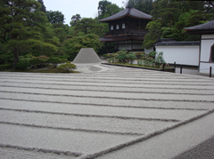
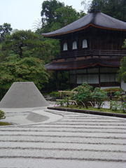
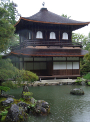
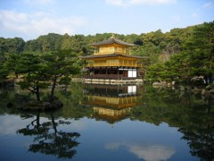
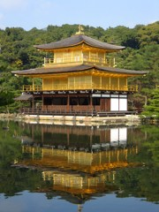
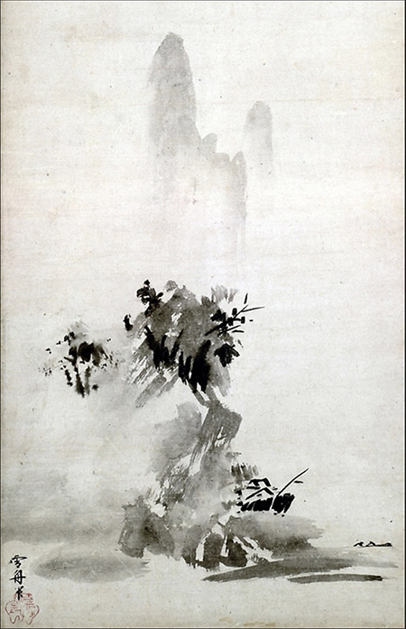

# 日本美学 Japanese Aesthetics (Graham Parkes、Adam Loughnane)

> *首次发表于 2005 年 12 月 12 日；实质修订于 2023 年 12 月 6 日。*

尽管日本人创造伟大艺术并书写艺术已历许多世纪，其中包括可追溯千年的丰富诗学传统，但日本与西方“美学”相对应的哲学学科，直到 19 世纪才起步。考察这一传统中产生的最重要美学观念，是纵观这一更广阔领域的良法；这些观念都出现在美学作为学科正式确立之前：即物哀（物の哀れ／mono no aware，事物的情致）、侘（侘び，朴素而严峻之美）、寂（さび，古拙的锈色）、幽玄（神秘的深邃）、意气（いき，洗练的风格）与切（きれ，切断）。（最后一个词读作两个等重音节，kee-reh。某些元音上的长音符号表示该元音发音长度为两倍。使用人名时，顺序遵循日本惯例：先姓后名。）

## 1. 引言

关于日本文化传统，有两点初步观察与艺术相关。第一，古典日本哲学把实在理解为恒常的 **变化**，或用佛教的说法，**无常**。呈现于感官的流变世界是唯一的实在：并不存在某种稳定不变的“柏拉图式”领域，高踞其上或隐于其后。日本的艺术传统上一直反映这种根本的无常——有时哀叹，但更多是庆祝。无常（mujō）的观念，也许最有力地表达在 13 世纪禅宗大师道元的著作与言说中——他可以说是日本最深刻的哲学家；但更晚的僧人吉田兼好在《徒然草》（Tsurezuregusa，1332）中也对此有精妙表达，该书闪耀着美学洞见：

> 无论你多么年轻、多么强壮，死亡降临的时刻总比你预想的更早。你能活到今天，已是非同寻常的奇迹；你以为自己还有哪怕片刻的喘息吗？（Keene, 120）

在日本佛教传统中，对存在根本状况的觉察并不导致虚无主义的绝望，反而召唤人在当下积极活动，并感激又获得了一刻生命。

第二点观察是：日本的艺术往往与儒家修身实践紧密相连，其证据是它们常被称为“道（生活方式）”：茶道（chadō，即饮茶之道）、书道（shodō，即书写之道），等等。由于中国的士大夫被期望精通“六艺”——礼、乐、书、数、射、御——日本的文化与艺术往往比西方传统更紧密地与智识和心灵生活相连。

直到今天，在日本，学者除具备相应智识能力外，还常是优秀书法家与有造诣的诗人，这并不罕见。

## 2. 物哀：事物的情致

物哀一语的含义复杂，且随时间而变化，但它基本指“事物”（mono）的“情致”（aware），这种情致源于事物的短暂。在 8 世纪日本诗歌经典选集《万叶集》中，aware 之感通常由鸟或其他动物哀婉的鸣叫引发。它在世界第一部小说、紫式部 11 世纪初的《源氏物语》（Genji monogatari）中也扮演重要角色。稍晚的《平家物语》（Heike monogatari）以这些著名句子开篇，清楚显示无常是物哀之感的基础：

> 祇园精舍的钟声，回荡着万物的无常；沙罗花的颜色，昭示着盛者必衰的道理。骄者不长久，犹如春夜一梦；强者终将败亡，恰似风前尘土。（McCullough 1988）[^mccullough-1988]

兼好关于无常与美之联系的文字如下：“倘若人从不似化野的露珠般消逝，从不似鸟部山的烟霭般散尽，事物又怎会具有打动人心的力量！人生最可贵的，正是它的无常。”（Keene, 7）对无常的接受与庆祝超越了病态的伤感，使人得以充分享受生活：

> 人怎能不每日为活着的喜悦而欢欣？愚人忘却这种喜悦，劳碌地追逐别的乐趣；忘却自己拥有的财富，却为贪求新的财富而冒生命之险。然而欲望永不满足。活着时他们不欢欣于生，面对死亡时却又畏惧死亡——还有什么比这更不合情理？（Keene, 79）

我们若不欢欣于生，便无法体会那些与我们共处的事物的情致。对我们大多数人而言，其中一些事物虽无常，却会比我们存续更久。尤其当它们曾被爱过，便会成为令人伤感之物：“想到一个人熟悉的物件对他的死亡无动于衷，却在他身后长久留存，令人悲哀。”（Keene, 30）

著名文学理论家本居宣长通过研究《源氏物语》，把物哀观念推到文学理论的前沿；他的研究表明，这一现象是《源氏物语》的中心主题。他主张更宽泛地理解物哀，认为它关乎对存在的情感与感受维度的深切敏感。紫式部成就的伟大之处，在于她能在写作中刻画具有深切物哀之感的人物，使读者能在此情感中与他们共鸣。

小津安二郎常被视为最具“日本性”的日本电影导演，他的电影是一系列传达物哀的练习。Stanley Cavell 的观察——“电影让我们回到并延展了最初对物体的迷恋，对它们内在而固定的生命的迷恋”——完全适用于小津；他常常通过呈现物件的面孔而非演员的面孔来表达情感。一只花瓶立在铺着榻榻米的房间角落，房中一位父亲和女儿正在睡觉；两位父亲凝视“枯山水”庭园中的岩石，姿态与石形相呼应；一面镜子映出刚刚出嫁离家的女儿的缺席——所有这些意象，都像最伟大演员脸上的表情一样有力地表达事物的情致。

在当代日本，物哀最常被引用的例子是对樱花的传统喜爱，其表现是每年大批人群外出赏樱（并在樱花树下野餐）。日本樱花的花本身并不比梨树或苹果树的花更美：它们更受珍视是因为其短暂，因为它们通常在初绽后一周内便开始飘落。正是其美的易逝，唤起观者心中怅惘的物哀之感。

## 3. 侘：朴素而严峻之美

在前述《徒然草》中，兼好问道：“我们赏樱，难道只在花开满枝之时？赏月，难道只在万里无云之夜？”（Keene, 115）若对佛教徒而言，根本状况是无常，那么只把永恒流变中的某些时刻尊为圆满，或许意味着拒绝接受这一根本状况。兼好接着说：“雨中望月，放下帘子而不觉春之流逝——这些更令人深深感动。将开未开的花枝，或落花满地的庭园，更值得我们赞叹。”这是侘（wabi）——含蓄之美——观念的一例；这一观念最初在诗歌中得到辨识与赞美。但侘的观念最充分的发展，是在茶道艺术与禅的语境中。

在《南方录》（Nampōroku，1690）——一部记录茶道大师千利休言说的书——中，我们读到：“在小[茶]室中，每一件器具都宜略有不足。有人稍见器物有损便不喜欢；这种态度表明完全缺乏理解。”（Hirota, 226）按侘的美学，带有细微瑕疵的器具，往往比表面完美的器具更受珍视；破损或开裂的器具，只要修补得当，也比完好者更受珍视。侘的美学并不意味苦行，而是意味节制，正如《南方录》中这段话所示：“小室茶会的膳食，应仅一汤两三菜；酒也应适量。为侘茶会精心备办食物，是不合适的。”（Hirota, 227）

《禅茶录》（Zencharoku，1828）中有一节论侘的著名文字，开篇说这不过是“持守[佛教]戒律”而已（Hirota, 274）。作者接着说：

> 侘意味着：即使身处困窘，也不生艰难之念。即使匮乏，也不为贫乏所动。即使遭遇失败，也不因不公而郁结。你若觉得困窘令人拘束，若哀叹匮乏如同剥夺，若抱怨事物安排不善——这便不是侘。（Hirota, 275）

茶道以茶室与器具的优雅简朴，体现了这种生活态度；它与任何认为美必须伴随壮丽与奢华的想法相抵触。

侘在空无中达到严峻的顶点——空无是佛教中一个核心而普遍的观念。在随笔《阴翳礼赞》（1933）中，伟大小说家谷崎润一郎（1886–1965）这样谈论传统日本茶室中壁龛（床之间）之美：

> 一片空无的空间以素木与素墙隔出，引入其中的光线在空无里形成幽暗的阴影。此外别无他物。然而，当我们凝视横梁之后、花瓶四周、搁架之下积聚的黑暗，尽管我们完全知道那不过是阴影，却仍不禁感到：在这小小一隅空气中，笼罩着完全而彻底的寂静；在这黑暗里，主宰着不变不动的宁静。（Tanizaki, 20）

一个简单的结构，却别具意味、引人遐想，一处富有深切哲学深度的场所。一个从房间中切出的空间，它切断直射光，从而开启一个新世界：这些手法在日本建筑传统中发展得独具特色。（关于“切”，见下文第 7 节。）

> 这正是我们祖先的天才之处：他们切断射入这片空无的光线，赋予由此形成的阴影世界一种任何壁画或装饰都无法比拟的神秘或深度。手法看似简单，却绝非轻易达成。

与其在墙上添加某种艺术性的东西，不如把墙本身减去，将它退入壁龛。然后让空无充满光与影的游戏。

京都的银阁寺（Ginkakuji，即“银阁之寺”）有一处地方，堪称日本茶道起源地之一。银阁（15 世纪晚期）是寂之乐的谦逊纪念碑，而旁边的观月台与银沙滩（约晚 200 年）则是侘的典范。后两者构成日本特有“枯山水”庭园风格的一个不寻常版本（见下文第 7 节）。这些极为抽象的造型（竟出自 17 世纪！）最好在满月之夜从银阁二楼观赏；那时沙粒在月光下泛银，条纹宛如静止海面上的波浪。

  

[银阁寺银沙滩与观月台的大图](japanese-aesthetics.ginkakuji.md)

## 4. 利休的茶道与侘的平等化美学

在日本历史上，很少有艺术家比千利休（1522–1591）更令人敬畏，也很少有一种美学运动比他对茶道的演绎——侘茶（Wabicha）——更具变革性。利休被公认为日本首屈一指的茶道大师，但他的美学家角色远不止于此。作为造诣深厚的画家与诗人、插花实践者、出色的书法家与庭园艺术家，利休后来成为一位有影响力的政府显贵，就文化与艺术事务向幕府进言。通过无数发明与创新，他所创造——有人说他所完善——的美学世界，其影响远超茶道本身的边界：它为日本人的身份与公民性开掘出新的前景，开创新的社会美德、关于人类存在与宗教救赎的原创愿景，并最终为平等开启新的可能（Suzuki 278–9）——这一切都植根于侘的美学。

利休的声誉逐渐盖过其前辈，但他的美学创新属于一个诞生于港口城市堺的谱系：其中包括茶道大师村田珠光（1423–1502）及其弟子武野绍鸥（1502–1555），二人都是禅宗信徒，后者后来成为利休的导师。两位先驱都开始开创茶道美学，为利休日后的精炼奠定基础；二人也都运用新的美学策略，旨在把侘的美学融入茶道（Ludwig, 387–390；Sen Sōshitsu, 123–157）。

利休的侘茶区别于其导师茶会之处，在于它化解了 16 世纪茶道实践与更广阔的日本文化世界中相互竞争的美学暗流之间的张力（Slusser 55–57）。在侘茶出现之前，中世茶道日益朝两个方向极化。书院（Shoin）风格在权贵富丽的宅邸中铺陈财富的炫耀。在此环境中，最受珍视的茶具（名物，meibutsu）是从中国输入的稀有珍贵器物，其美学价值主要取决于它们能多好地展示主人的富裕与权力，遂使书院茶成为一种有意非平等的仪式。

书院风格的炫耀，在所谓“婆娑罗”（basara）态度中得到进一步强化；这种态度以斗茶（tōcha）与奢华的茶会（chayoriai）为特征，旨在盛大展示财富。正当书院风格盛行之际，茶道世界同时朝相反方向发展，形成一种称为草庵（Sōan）风格的仪式；这种美学推崇朴素与贫寒，而非奢华与富裕。草庵风格以所谓“草庵”取代贵族的大厅与数十乃至数百宾客的聚会，把农夫与隐士的世界审美化，追求在狭小无饰的草庵中聚会的亲密感，通常只有寥寥数位宾客。珠光与绍鸥是这种风格的先驱之一，而利休继承的正是作为“草庵”理想的茶道，并最终将其磨砺至完美。

16 世纪日本的第二种极化文化倾向，跨越书院与草庵的分野，是武士与宗教两种美学感受之间的张力。利休的侘茶通过融合武士聚会与禅寺中培养的元素，化解了这一张力。他的茶道避免与宗教性或军国主义任何一方排他地结盟，并运用侘的美学注入一种平等主义，以平衡两个领域内根深蒂固的等级区分，把侘重新塑造为“对实在的非等级觉察”（Hirota 95）。

在军事与寺院的领域之外，16 世纪日本的民众深深分层，从顶端的武士一直到最底层的农民、佃农与商人。这些区分是绝对的，向上流动到更高社会阶层几乎不可想象。然而，利休运用侘的美学挑战社会分层（Sen Sōshitsu 182–183）。在他的侘茶中，所有茶会参与者都被视为平等，他的美学创新把这一原则具体化，确保它不只是一项高远理想。在归于他名下的《南方录》（1690）中，他声称在茶室中“世俗等级被置诸不顾”。

利休的美学决定，受一种对农耕生活贫寒存在的尊崇所引导：对山中隐士严格节用的尊崇，对贫苦农夫质朴无饰的尊崇。因此他偏爱粗糙未加砍削的材料，这意味着茶庵的墙壁与木料保持原始未完成状态，稻草与泥巴清晰可见。昂贵的中国瓷器、象牙花瓶与茶勺，被当地生产的竹制品取代。色彩鲜艳的花几乎完全被排除，一种“无偶像的”仪式随之出现，其特征是茶庵内与周围庭园中没有图像。

在利休采用的众多建筑创新中，最平等主义的是茶室的几项设计，它们使茶客在身体上不可能表达其社会地位或权力。躙口（nijiriguchi，大致可译为“匍匐而入之处”）是宾客唯一的入口（此前的数寄屋另有一个供贵族与权贵使用的大入口）。这个仅约 60 厘米 × 60 厘米（2 英尺 × 2 英尺）的小洞口，实现了侘茶的两个平等化目标（Sōshitsu Sen 182–183）。首先，武士无法携带两把武士刀进入，而武士刀通常是其社会等级顶端地位最显眼的标志。（利休在茶庵屋檐下、躙口旁设置了一个刀挂（katanakake）。）其次，洞口的大小意味着富有的贵族与廷臣无法戴着过大的高帽通过。因此，一旦进入利休狭小的数寄屋，通常用来展示与维持僵硬社会等级的任何标记都不再留存。甚至提及社会身份的谈话或修辞、对职业的指涉、展示财富的物品，或使权力合法化的关联，都被严格禁止。

侘茶美学的另一个维度强化了平等主义理想，那就是利休对本土的拥抱。他反对输入昂贵中国茶具的潮流，转而倡导反映繁华都市中心之外农耕生活的本土制作器物。在利休的众多创新中，最著名的——因体现侘的精髓而闻名——是一种全新陶艺风格乐烧（Raku，楽焼）的创立。利休延请当地陶工长次郎（Sasaki “Raku” Chōjirō）为体现侘美学的茶具赋予形式。与高度精致的中国瓷器相对，乐烧是质朴的陶器，实用、无饰，形状与完成往往不对称、不完美——它颂扬谦卑存在的优雅，是一首献给当地隐士与农夫的颂歌。烧制与干燥技术得到发展，以便让大气、自然与重力在陶土加热继而冷却的过程中自行表达。这种美学唤起的，是附近使用手边材料劳作的僧人或农夫，而非从海外输入珍宝的世俗贵族。与侘的精神相一致，乐烧器物因其展现贫寒存在的简单之美而受珍视，强调匮乏而非奢华的美学。因此，乐烧发挥了拉平等级的作用，使此前围绕茶道的排他性物质文化更具平等主义。

另一项限制财富标志的重要创新，涉及挂轴（Kakemono）设计与重心的转变。挂轴原本是边缘性的物件，利休却提升它，按平等主义理想重新校准其美学，并把它安置为茶庵与整个茶会的中心（Hirota, 217–218）。利休不仅把挂轴提升到茶会的美学前沿（这一角色此前由书院的茶入占据），还把挂轴美学从昂贵而排他的中国版本转移开。在利休的赞助下，挂轴首次委托当地禅宗书法家与画家创作。

尽管他的干预或许成功挑战了茶道世界之外的僵硬社会分层，却也可能为他自己的悲剧性垮台埋下伏笔。他试图拆解的社会等级标记，对于证成与维持幕府的权力至关重要。作为政府官员，利休几乎没有余地拒绝秀吉的意愿，而秀吉的意愿常常与侘茶的严峻大相径庭（例如建造黄金茶室待庵）。他的平等主义在削弱幕府将军赖以展示至高地位的重要象征，并威胁颠覆维持其处于社会政治等级顶端的权力结构（Slusser, 56–57）。利休的侘茶以及他所塑造的取消等级的标志与结构，对抗幕府所拥抱的权力政治，并挑战他所效忠的精英的军国主义利益。利休最终被命令切腹（seppuku），在 1591 年举行最后一次茶会后，他写下辞世诗，然后自尽。

利休对日本茶道及整体文化后续历史的影响无可否认，但他的遗产是复杂的。他的仪式性自杀被后来的超民族主义倾向挪用，用于一种美学化，从而为战时为国家牺牲的“美学”死亡树立了早期标准（Cross, 163–166）。于是，他的悲剧时刻被抬举为一种手段，用以合理化帝国一些最骇人的暴行。一段本应保持无瑕的记忆，被系于日本对帝国主义、战争与自我牺牲的灾难性美学化——这些价值与利休通过茶道中的侘美学引入日本文化的价值根本相悖。

## 5. 寂：古拙的锈色

sabi 一语常见于《万叶集》，在那里带有荒凉之意（sabireru 意为“变得荒凉”）；后来它似乎获得如下含义：某物经年而变好、生锈（另一个读作 sabi 的词意为“锈”），或获得了使其美丽的包浆。

寂对茶道的重要性，得到 15 世纪伟大茶道大师珠光的肯定；珠光是首批茶道流派之一的创始人。一位著名评论者这样写道：“sabi 这一概念不仅带有‘老旧’之意——既指‘因经验与洞见而成熟’，也指‘浸染了赋予旧物之美的包浆’——还带有宁静、独处、深切孤寂之意。”（Hammitzsch, 46）

寂之感也在 17 世纪著名诗人松尾芭蕉的俳句中唤起；在那里，它与 sabishii（孤独、寂寞）一词的联系得到强调。下面这首俳句典型地体现了 sabi(shii)，传达一种孤寂或寂寞的氛围，而这种氛围正如日本诗歌通常所做的那样，削弱了主观与客观的区分：

> 如今孤寂——
> 立于花丛之中
> 是一株柏树。

与花丛的绚丽之美形成对比，柏树更为含蓄的优雅——无疑比看见它的人更古老，却同样孤寂——典型地体现了寂的诗意情调。

谷崎的《阴翳礼赞》屡屡赞美寂。与西方趣味相对，他这样书写日本人的感受力：

> 我们并非不喜欢一切闪耀之物，但我们确实更偏爱幽思的光泽，而非浅薄的辉煌；更偏爱一种幽暗的光，无论它在石头上还是在器物上，都透出古旧的光泽。……我们喜爱带有污垢、烟灰与风化痕迹的物件，也喜爱那些唤起制造它们的往昔之色彩与光泽。（Tanizaki, 11–12）

这是一个重要的存在论考量：旧物的光泽以现代技术的闪亮产品根本无法做到的方式，把我们与过去联系起来。而由于旧物往往由自然材料制成，与它们打交道有助于我们认识到自己与自然环境最亲近的联系。

对谷崎而言，寂在传统日本厕所的美学中占有显著位置；这种厕所“位于走廊尽头，与主楼相隔，处在树叶与苔藓芬芳的树丛中”。他与现代技术强加于器物问题上的烦恼相搏斗，因为传统器物正被“白瓷与闪亮金属把手”取代（Tanizaki, 3, 6）。

> 以闪亮黑漆完成的木料最佳，但即便是未完成的木料，随着岁月变暗、木纹愈发细微，也会获得一种难以言说的镇定与抚慰之力。当然，终极之作是一只木制“牵牛花”便器，里面填满雪松枝：它看上去赏心悦目，且不发出丝毫声响。（Tanizaki, 6）

但传统日本厕所的主要乐趣在于它与自然的亲近：在那个特殊的地方，“四周是宁静的墙壁与纹理细密的木料，人向外眺望蓝天与绿叶”（Tanizaki, 4）。在传统日本建筑的成就中，谷崎称赞厕所是“最具美感的”。

> 我们的祖先把生活中的一切都化为诗，把本应是家中最不卫生的房间，变成一处无比优雅的所在，充满与自然之美相关的亲切联想。

人在自然而非高科技的环境中，履行排尿与排便这些最自然的功能，把大地恩赐的残余归还大地，这无疑是相称的。

寂一个更为高贵的例证，是京都银阁寺精致的银阁。尽管据说茶道就发源于此间一座浸透寂的小茶室，银阁的外观最初却打算覆以银箔，以仿效金阁寺的黄金阁（14 世纪）。银阁从未真正享有银箔覆层，却是寂的典范，也是历来最优雅的建筑之一。它与更大、更耀眼的金阁形成对照——金阁的金箔覆层赋予它一种颇为不同（且明显不寂）的美——这种对照发人深省。

   

[银阁寺银阁与金阁寺金阁的大图](japanese-aesthetics.ginkakuji-kinkakuji.md)

1950 年，一名精神失常的佛教侍僧被金阁之美深深困扰，纵火将其烧毁。1955 年在原址上建起一座精确的复制品。原建筑的美学品质在三岛由纪夫的优秀小说《金阁寺》（1956）以及市川崑的经典电影《炎上》（1958）中得到颂扬。1987 年，蓬勃发展的日本经济首次使这座建筑得以按照创建者的原意覆以金箔。结果壮观得令人屏息——却完全不像日本。京都的老居民曾有名地抱怨说，这座建筑需要很长时间才能获得足够的寂，值得再看。按包浆似乎进展的速度，大概要几个世纪。

2011 年，东北地区海啸以及福岛爆炸与核熔毁造成日本严重能源短缺，众多应对措施之一是大幅减少公共场所的照明，尤其是带有大片地下餐厅与购物区的地铁站。谷崎引用 1920 年代末一句有先见之明的话，大意是“也许没有两个国家比美国与日本浪费更多电力”（Tanizaki, 35）。如今他会乐于看到日本城市减少无处不在的霓虹眩光与通宵电力照明，调暗不必要的灯光，从而重新引入一些他如此雄辩地赞美的阴影。

## 6. 幽玄：神秘的优雅

在通常深奥难解的日本美学观念中，幽玄也许是最难以言表的。该词最早见于中国哲学文本，意为“幽暗”或“神秘”。

《方丈记》（Hōjōki，1212）的作者鸭长明也写过诗论，并认为幽玄是他那个时代诗歌的首要关切。他这样描述幽玄的特征：“它像是一个秋日傍晚，无色而寂静的天空延展开来。不知怎的，仿佛因为某种我们本应记得的理由，泪水不由自主地涌出。”另一段描述则有益地提到想象力的重要：“透过雾看秋山时，景象也许模糊，却有极大的深度。尽管透过雾只能看见少数红叶，景象仍然迷人。想象所创造的无边远景，远胜于任何能看得更清楚的东西。”（Hume, 253–54）

这段话体现了东亚文化的一个普遍特征：它偏爱暗示，而非明说与完整。幽玄并不像有时人们所设想的那样，与超越此世的另一个世界相关，而是与我们所在世界的深度相关——这种深度需借助有修养的想象力来体验。

幽玄观念扮演最重要角色的艺术，是能剧——世界伟大戏剧传统之一；它在世阿弥（1363–1443）的艺术造诣中达到最繁盛的阶段。世阿弥写过多部能剧论著，其中幽玄（“优雅”）作为“最高原理”出现（Rimer, 92）。他把幽玄与日本贵族高度精致的文化、尤其是其言语联系起来；不过能剧中也有“音乐之优雅”“（不同角色的）表演之优雅”与“舞蹈之优雅”（Rimer, 93）。它是某种稀有之物，只有传统中最伟大的演员、且只有经过数十年专注的艺术实践才能达到。它无法被概念化，因此世阿弥常常借助意象来试图解释它：“优雅之美，难道可比作天鹅喙衔一朵花的形象吗？”（Rimer, 73）

最著名的表述出现在世阿弥《九位（能艺成就）论》的开头；其中最高位被称为“无与伦比之魅力的花（开）之艺”：

> “无与伦比之魅”一语的含义，超越任何言语解释，位于意识作用之外。完全可以说，“深夜之中，日光朗照”一语存在于逻辑解释之外的领域。的确，就我们这门艺术中最伟大表演者的优雅而言，[它引发]超越认知的感受时刻，以及一种超越艺术家可能有意识达到的任何层次的艺境。（Rimer, 120）

这段话暗示了一种严格训练模式的结果；这种训练模式塑造了日本的许多“表演艺术”（其中包括茶道、书法以及戏剧），也塑造了东亚武术。能剧在这方面堪称典范，因为它的发声、手势、步态与舞蹈动作都高度程式化，极不自然。其观念是：人长年练习一种与身体动作相逆的“型”（kata），因而需要极大纪律——直至突破到一种“更高的自然”，这种自然在型被圆满地化入身体时显现。这种自发性给人的印象，正如优雅的情形，是某种“超自然”之物。

## 7. 幽玄与山水画

雪舟等杨的艺术实践及其最著名的作品——1495 年所谓“泼墨山水”（Haboku Sansui，字面意为“破墨山水”）——揭示了日本美学一些引人入胜的特征。迈出解读其艺术的第一步，要求我们认识日本山水画的一个独特特征：作为艺术对象，相对于西方哲学与艺术史传统中对类似作品的解释，它们具有大为扩展的美学地位。当然，画作对象本身是重要的，但关键的美学价值还在于作品所见证的身体表演。恰当地评价雪舟“泼墨山水”之美——类似于人们应如何欣赏日本书法——不仅仅涉及对纸上笔迹作出判断，还要求欣赏创造该作品的身体运动。由于雪舟的自发运动是按照高度纪律化的禅宗实践培养的，解释他的山水艺术需要一种扩展至哲学与宗教的美学。

雪舟等杨（1420–1506）是日本艺术界的一座高峰；在哲学-宗教实践正超越中国影响、中国的禅宗传入日本并形成日本的禅之际，他帮助开创了一种本土艺术传统。雪舟属于一个长达数世纪的轨迹：确立日本形式的佛教，使其成为该国宗教、哲学与美学身份的持久特征。在他一生中，禅作为一门宗教纪律日益显赫，足利氏赞助下的相关艺术亦然。室町时代是禅美学的时代：不仅单色水墨画，而且一切日本美学实践（艺道），包括书法、茶道、能剧与枯山水庭园，都作为当时禅——尤其是临济禅——精神的表达而繁荣。在此期间，画界正从唐绘（kara-e，“中国画”）转向大和绘（yamato-e，“日本画”）。随着日本首次出现开创一种追求纯粹美学理想的艺术传统的运动，用于信仰目的的神祇图像以及道教与佛教主题画（道释画）正被取代，不再处于艺术实践的核心。山水画是这一运动的中心。

雪舟是一位著名的画家、诗人、书法家与庭园设计师，精通中国所有主要风格与体裁，从花鸟画到肖像、挂轴、屏风与扇面。然而，正是他的山水画，尤其是其著名的“泼墨山水”，使他名垂不朽。这幅画为理解上文讨论的日本美学核心概念——幽玄——提供了洞见。

[雪舟《破墨山水》](japanese-aesthetics.splashed-ink.md)

他最著名山水画的神秘优雅，既来自被留白、不可见与缺席的空间（常被称为画作的“龙脉”），也来自被画出、可见的部分。作品显得未完成，仍处于形成过程之中；雾霭造成的戏剧性负空间使各种形态消散并彼此融合；但更具决定性地，按照幽玄的动态，这种否定性邀请观者进入画中，主动将其完成。正如在其他体裁中运用幽玄原则的艺术家所表明的，作品的不完整与暗示性把观者召入场景。用 Ghilardi 的话说，“观看者必须融入图像，补全空无的空间，使其成为自然本身的一个活泼要素，处于可见与不可见‘之间’”（Ghilardi, 2015, 99）[^ghilardi-2015]。

雪舟并不追求渲染山水的每个细节以取得再现的逼真，也不追求描绘一个对主体而言可辨认的客体。其目标只是给出树木、山峦或水流的暗示或痕迹，而这些似乎否定自身作为客体。因此，雪舟不勾勒形态，而是通过分解形态来提供诗意直接性的印象。极端的简省与抽象得到运用，以致任何形态即便可辨，也被尽可能推离客体性，却又不完全消失为无形。正如 Jullien 在论及影响雪舟的中国画家时所写，他们以“仿佛”的调性、以显现-消失的方式画“山水”，既“仿佛有”，又“仿佛没有”。（Jullien, 2009, 8）[^jullien-2009] 中央的树丛、融入树干的旅舍，以及小小的桨手，都出现了，却仿佛即将消失，也许已转入一段模糊的记忆，只差一笔便会彻底消融。敏感的观者不仅感知到对这一事件的再现，还能感受到赋予场景瞬逝性的挥洒而自发的笔势。欣赏画作这一美学特征，会唤起雪舟作为禅僧所培养的佛教原理。

雪舟的生活与作品对日本美学具有典范意义，因为他的实践并非狭义的美学，还包含受道教启发的禅佛教的宗教与哲学原理。“泼墨山水”作于雪舟 76 岁那年；当时他声称自己双眼“日渐昏花”，而道教对他的绘画影响日增。作为画僧，他的冥想实践与艺术实践都旨在自我否定，旨在达到禅修目标的“无我”。正如 Yukio Lippit 所写，“《破墨山水》因而展示了一种水墨画模式，它既投射出有修养的艺术能动性，也投射出一种无主体状态。这种可渗透主体的状况，对于中世纪晚期的日本僧侣画家而言可谓恰到好处”（Lippit 2012, 71）[^lippit-2012]。揭示这一美学-宗教目标如何在绘画实践中被接近，也就揭示了禅佛教的道教根源。

绘画属于被称为艺道（geidō）的日本美学实践之一。弓道（kyūdō）、柔道（jūdō）、书道（shodō）、华道（kadō）、茶道（sadō）这些复合词共享一个汉字，即“道”（dao；日语读作 dō 或 michi），它标示这些实践的哲学-宗教取向。依道而动，就是以自然的自发性而动，作为著名概念“无为”（wuwei 無爲）的体现。自发行动意味着超越主动与被动的二元：也就是说，世界推动身体，正如身体在世界中运动。因此，正如西田所评论的，我们可以说“雪舟画了自然，或自然通过雪舟画了自身”（Nishida 1990, 135）。剑士、书法家或能剧演员的优雅自然，也是画家笔势的特征。所有这些都是身体实践，力求通过无为与道的自发运动相协调。因此，评价雪舟笔法的美学价值，就是欣赏其源于道教式佛教实践的宗教根源。由于观者能使自己的身体与驱动画作的运动相协调，作品引发的不仅是美学判断，它本身就是培养宗教-哲学纪律的场所。

雪舟所用的“泼墨”技法，尤其典范地体现了日本美学的扩展框架。“泼墨”（hatsuboku）是源自中国的数种“破墨”（haboku）自发技法之一；雪舟在游学中国、随画家学习并在寺院进行宗教实践时学会了它。这些技法从自发的渲染与泼洒，到真正的甩墨与滴墨。尽管这些方法听起来卤莽，并与“醉态美学”和“偶然美学”相联系，泼墨语汇实际上是要求最高的风格，被视为表达的最高形式，也是对艺术家技艺的至高考验。同样，它被认为比其他任何体裁都更能考验观者的敏感。这种风格起源于中国山水画南宋画派的“文人”艺术家；他们偏爱幽玄式的简省诗意暗示，而非北宗详尽描述的“院体”进路。因此，遵循这一传统，雪舟等画家并不以发展精湛技巧来创造完全成形的艺术形象为目标；相反，在否定自我、与自然的运动连续为一的过程中，他们遵循道教“大象无形”的箴言。

[^mccullough-1988]: McCullough, Helen C. (trans.), 1988, *The Tale of the Heike*, Stanford: Stanford University Press.

[^ghilardi-2015]: Ghilardi, M., 2015, *The Line of the Arch: Intercultural Issues between Aesthetics and Ethics*, Milan: Mimesis International.

[^jullien-2009]: Jullien, Francois, 2009, *The Great Image Has No Form, or on the Nonobject through Painting*, Chicago: University of Chicago Press.

[^lippit-2012]: Lippit, Yukio, 2012, “Of Modes and Manners in Japanese Ink Painting: Sesshū’s ‘Splashed Ink Landscape’ of 1495,” *The Art Bulletin*, 94(1): 50–77.
