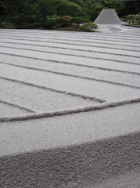
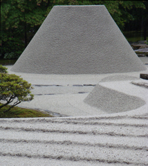

# 日本美学 Japanese Aesthetics (Graham Parkes、Adam Loughnane)

> *首次发表于 2005 年 12 月 12 日；实质修订于 2023 年 12 月 6 日。*

尽管日本人创造伟大艺术并书写艺术已历许多世纪，其中包括可追溯千年的丰富诗学传统，但日本与西方“美学”相对应的哲学学科，直到 19 世纪才起步。考察这一传统中产生的最重要美学观念，是纵观这一更广阔领域的良法；这些观念都出现在美学作为学科正式确立之前：即物哀（物の哀れ／mono no aware，事物的情致）、侘（侘び，朴素而严峻之美）、寂（さび，古拙的锈色）、幽玄（神秘的深邃）、意气（いき，洗练的风格）与切（きれ，切断）。（最后一个词读作两个等重音节，kee-reh。某些元音上的长音符号表示该元音发音长度为两倍。使用人名时，顺序遵循日本惯例：先姓后名。）

## 1. 引言

关于日本文化传统，有两点初步观察与艺术相关。第一，古典日本哲学把实在理解为恒常的 **变化**，或用佛教的说法，**无常**。呈现于感官的流变世界是唯一的实在：并不存在某种稳定不变的“柏拉图式”领域，高踞其上或隐于其后。日本的艺术传统上一直反映这种根本的无常——有时哀叹，但更多是庆祝。无常（mujō）的观念，也许最有力地表达在 13 世纪禅宗大师道元的著作与言说中——他可以说是日本最深刻的哲学家；但更晚的僧人吉田兼好在《徒然草》（Tsurezuregusa，1332）中也对此有精妙表达，该书闪耀着美学洞见：

> 无论你多么年轻、多么强壮，死亡降临的时刻总比你预想的更早。你能活到今天，已是非同寻常的奇迹；你以为自己还有哪怕片刻的喘息吗？（Keene, 120）

在日本佛教传统中，对存在根本状况的觉察并不导致虚无主义的绝望，反而召唤人在当下积极活动，并感激又获得了一刻生命。

第二点观察是：日本的艺术往往与儒家修身实践紧密相连，其证据是它们常被称为“道（生活方式）”：茶道（chadō，即饮茶之道）、书道（shodō，即书写之道），等等。由于中国的士大夫被期望精通“六艺”——礼、乐、书、数、射、御——日本的文化与艺术往往比西方传统更紧密地与智识和心灵生活相连。

直到今天，在日本，学者除具备相应智识能力外，还常是优秀书法家与有造诣的诗人，这并不罕见。

## 2. 物哀：事物的情致

物哀一语的含义复杂，且随时间而变化，但它基本指“事物”（mono）的“情致”（aware），这种情致源于事物的短暂。在 8 世纪日本诗歌经典选集《万叶集》中，aware 之感通常由鸟或其他动物哀婉的鸣叫引发。它在世界第一部小说、紫式部 11 世纪初的《源氏物语》（Genji monogatari）中也扮演重要角色。稍晚的《平家物语》（Heike monogatari）以这些著名句子开篇，清楚显示无常是物哀之感的基础：

> 祇园精舍的钟声，回荡着万物的无常；沙罗花的颜色，昭示着盛者必衰的道理。骄者不长久，犹如春夜一梦；强者终将败亡，恰似风前尘土。（McCullough 1988）[^mccullough-1988]

兼好关于无常与美之联系的文字如下：“倘若人从不似化野的露珠般消逝，从不似鸟部山的烟霭般散尽，事物又怎会具有打动人心的力量！人生最可贵的，正是它的无常。”（Keene, 7）对无常的接受与庆祝超越了病态的伤感，使人得以充分享受生活：

> 人怎能不每日为活着的喜悦而欢欣？愚人忘却这种喜悦，劳碌地追逐别的乐趣；忘却自己拥有的财富，却为贪求新的财富而冒生命之险。然而欲望永不满足。活着时他们不欢欣于生，面对死亡时却又畏惧死亡——还有什么比这更不合情理？（Keene, 79）

我们若不欢欣于生，便无法体会那些与我们共处的事物的情致。对我们大多数人而言，其中一些事物虽无常，却会比我们存续更久。尤其当它们曾被爱过，便会成为令人伤感之物：“想到一个人熟悉的物件对他的死亡无动于衷，却在他身后长久留存，令人悲哀。”（Keene, 30）

著名文学理论家本居宣长通过研究《源氏物语》，把物哀观念推到文学理论的前沿；他的研究表明，这一现象是《源氏物语》的中心主题。他主张更宽泛地理解物哀，认为它关乎对存在的情感与感受维度的深切敏感。紫式部成就的伟大之处，在于她能在写作中刻画具有深切物哀之感的人物，使读者能在此情感中与他们共鸣。

小津安二郎常被视为最具“日本性”的日本电影导演，他的电影是一系列传达物哀的练习。Stanley Cavell 的观察——“电影让我们回到并延展了最初对物体的迷恋，对它们内在而固定的生命的迷恋”——完全适用于小津；他常常通过呈现物件的面孔而非演员的面孔来表达情感。一只花瓶立在铺着榻榻米的房间角落，房中一位父亲和女儿正在睡觉；两位父亲凝视“枯山水”庭园中的岩石，姿态与石形相呼应；一面镜子映出刚刚出嫁离家的女儿的缺席——所有这些意象，都像最伟大演员脸上的表情一样有力地表达事物的情致。

在当代日本，物哀最常被引用的例子是对樱花的传统喜爱，其表现是每年大批人群外出赏樱（并在樱花树下野餐）。日本樱花的花本身并不比梨树或苹果树的花更美：它们更受珍视是因为其短暂，因为它们通常在初绽后一周内便开始飘落。正是其美的易逝，唤起观者心中怅惘的物哀之感。

## 3. 侘：朴素而严峻之美

在前述《徒然草》中，兼好问道：“我们赏樱，难道只在花开满枝之时？赏月，难道只在万里无云之夜？”（Keene, 115）若对佛教徒而言，根本状况是无常，那么只把永恒流变中的某些时刻尊为圆满，或许意味着拒绝接受这一根本状况。兼好接着说：“雨中望月，放下帘子而不觉春之流逝——这些更令人深深感动。将开未开的花枝，或落花满地的庭园，更值得我们赞叹。”这是侘（wabi）——含蓄之美——观念的一例；这一观念最初在诗歌中得到辨识与赞美。但侘的观念最充分的发展，是在茶道艺术与禅的语境中。

在《南方录》（Nampōroku，1690）——一部记录茶道大师千利休言说的书——中，我们读到：“在小[茶]室中，每一件器具都宜略有不足。有人稍见器物有损便不喜欢；这种态度表明完全缺乏理解。”（Hirota, 226）按侘的美学，带有细微瑕疵的器具，往往比表面完美的器具更受珍视；破损或开裂的器具，只要修补得当，也比完好者更受珍视。侘的美学并不意味苦行，而是意味节制，正如《南方录》中这段话所示：“小室茶会的膳食，应仅一汤两三菜；酒也应适量。为侘茶会精心备办食物，是不合适的。”（Hirota, 227）

《禅茶录》（Zencharoku，1828）中有一节论侘的著名文字，开篇说这不过是“持守[佛教]戒律”而已（Hirota, 274）。作者接着说：

> 侘意味着：即使身处困窘，也不生艰难之念。即使匮乏，也不为贫乏所动。即使遭遇失败，也不因不公而郁结。你若觉得困窘令人拘束，若哀叹匮乏如同剥夺，若抱怨事物安排不善——这便不是侘。（Hirota, 275）

茶道以茶室与器具的优雅简朴，体现了这种生活态度；它与任何认为美必须伴随壮丽与奢华的想法相抵触。

侘在空无中达到严峻的顶点——空无是佛教中一个核心而普遍的观念。在随笔《阴翳礼赞》（1933）中，伟大小说家谷崎润一郎（1886–1965）这样谈论传统日本茶室中壁龛（床之间）之美：

> 一片空无的空间以素木与素墙隔出，引入其中的光线在空无里形成幽暗的阴影。此外别无他物。然而，当我们凝视横梁之后、花瓶四周、搁架之下积聚的黑暗，尽管我们完全知道那不过是阴影，却仍不禁感到：在这小小一隅空气中，笼罩着完全而彻底的寂静；在这黑暗里，主宰着不变不动的宁静。（Tanizaki, 20）

一个简单的结构，却别具意味、引人遐想，一处富有深切哲学深度的场所。一个从房间中切出的空间，它切断直射光，从而开启一个新世界：这些手法在日本建筑传统中发展得独具特色。（关于“切”，见下文第 7 节。）

> 这正是我们祖先的天才之处：他们切断射入这片空无的光线，赋予由此形成的阴影世界一种任何壁画或装饰都无法比拟的神秘或深度。手法看似简单，却绝非轻易达成。

与其在墙上添加某种艺术性的东西，不如把墙本身减去，将它退入壁龛。然后让空无充满光与影的游戏。

京都的银阁寺（Ginkakuji，即“银阁之寺”）有一处地方，堪称日本茶道起源地之一。银阁（15 世纪晚期）是寂之乐的谦逊纪念碑，而旁边的观月台与银沙滩（约晚 200 年）则是侘的典范。后两者构成日本特有“枯山水”庭园风格的一个不寻常版本（见下文第 7 节）。这些极为抽象的造型（竟出自 17 世纪！）最好在满月之夜从银阁二楼观赏；那时沙粒在月光下泛银，条纹宛如静止海面上的波浪。

  

[银阁寺银沙滩与观月台的大图](japanese-aesthetics.ginkakuji.md)

## 4. 利休的茶道与侘的平等化美学

在日本历史上，很少有艺术家比千利休（1522–1591）更令人敬畏，也很少有一种美学运动比他对茶道的演绎——侘茶（Wabicha）——更具变革性。利休被公认为日本首屈一指的茶道大师，但他的美学家角色远不止于此。作为造诣深厚的画家与诗人、插花实践者、出色的书法家与庭园艺术家，利休后来成为一位有影响力的政府显贵，就文化与艺术事务向幕府进言。通过无数发明与创新，他所创造——有人说他所完善——的美学世界，其影响远超茶道本身的边界：它为日本人的身份与公民性开掘出新的前景，开创新的社会美德、关于人类存在与宗教救赎的原创愿景，并最终为平等开启新的可能（Suzuki 278–9）——这一切都植根于侘的美学。

利休的声誉逐渐盖过其前辈，但他的美学创新属于一个诞生于港口城市堺的谱系：其中包括茶道大师村田珠光（1423–1502）及其弟子武野绍鸥（1502–1555），二人都是禅宗信徒，后者后来成为利休的导师。两位先驱都开始开创茶道美学，为利休日后的精炼奠定基础；二人也都运用新的美学策略，旨在把侘的美学融入茶道（Ludwig, 387–390；Sen Sōshitsu, 123–157）。

利休的侘茶区别于其导师茶会之处，在于它化解了 16 世纪茶道实践与更广阔的日本文化世界中相互竞争的美学暗流之间的张力（Slusser 55–57）。在侘茶出现之前，中世茶道日益朝两个方向极化。书院（Shoin）风格在权贵富丽的宅邸中铺陈财富的炫耀。在此环境中，最受珍视的茶具（名物，meibutsu）是从中国输入的稀有珍贵器物，其美学价值主要取决于它们能多好地展示主人的富裕与权力，遂使书院茶成为一种有意非平等的仪式。

书院风格的炫耀，在所谓“婆娑罗”（basara）态度中得到进一步强化；这种态度以斗茶（tōcha）与奢华的茶会（chayoriai）为特征，旨在盛大展示财富。正当书院风格盛行之际，茶道世界同时朝相反方向发展，形成一种称为草庵（Sōan）风格的仪式；这种美学推崇朴素与贫寒，而非奢华与富裕。草庵风格以所谓“草庵”取代贵族的大厅与数十乃至数百宾客的聚会，把农夫与隐士的世界审美化，追求在狭小无饰的草庵中聚会的亲密感，通常只有寥寥数位宾客。珠光与绍鸥是这种风格的先驱之一，而利休继承的正是作为“草庵”理想的茶道，并最终将其磨砺至完美。

16 世纪日本的第二种极化文化倾向，跨越书院与草庵的分野，是武士与宗教两种美学感受之间的张力。利休的侘茶通过融合武士聚会与禅寺中培养的元素，化解了这一张力。他的茶道避免与宗教性或军国主义任何一方排他地结盟，并运用侘的美学注入一种平等主义，以平衡两个领域内根深蒂固的等级区分，把侘重新塑造为“对实在的非等级觉察”（Hirota 95）。

在军事与寺院的领域之外，16 世纪日本的民众深深分层，从顶端的武士一直到最底层的农民、佃农与商人。这些区分是绝对的，向上流动到更高社会阶层几乎不可想象。然而，利休运用侘的美学挑战社会分层（Sen Sōshitsu 182–183）。在他的侘茶中，所有茶会参与者都被视为平等，他的美学创新把这一原则具体化，确保它不只是一项高远理想。在归于他名下的《南方录》（1690）中，他声称在茶室中“世俗等级被置诸不顾”。

利休的美学决定，受一种对农耕生活贫寒存在的尊崇所引导：对山中隐士严格节用的尊崇，对贫苦农夫质朴无饰的尊崇。因此他偏爱粗糙未加砍削的材料，这意味着茶庵的墙壁与木料保持原始未完成状态，稻草与泥巴清晰可见。昂贵的中国瓷器、象牙花瓶与茶勺，被当地生产的竹制品取代。色彩鲜艳的花几乎完全被排除，一种“无偶像的”仪式随之出现，其特征是茶庵内与周围庭园中没有图像。

在利休采用的众多建筑创新中，最平等主义的是茶室的几项设计，它们使茶客在身体上不可能表达其社会地位或权力。躙口（nijiriguchi，大致可译为“匍匐而入之处”）是宾客唯一的入口（此前的数寄屋另有一个供贵族与权贵使用的大入口）。这个仅约 60 厘米 × 60 厘米（2 英尺 × 2 英尺）的小洞口，实现了侘茶的两个平等化目标（Sōshitsu Sen 182–183）。首先，武士无法携带两把武士刀进入，而武士刀通常是其社会等级顶端地位最显眼的标志。（利休在茶庵屋檐下、躙口旁设置了一个刀挂（katanakake）。）其次，洞口的大小意味着富有的贵族与廷臣无法戴着过大的高帽通过。因此，一旦进入利休狭小的数寄屋，通常用来展示与维持僵硬社会等级的任何标记都不再留存。甚至提及社会身份的谈话或修辞、对职业的指涉、展示财富的物品，或使权力合法化的关联，都被严格禁止。

侘茶美学的另一个维度强化了平等主义理想，那就是利休对本土的拥抱。他反对输入昂贵中国茶具的潮流，转而倡导反映繁华都市中心之外农耕生活的本土制作器物。在利休的众多创新中，最著名的——因体现侘的精髓而闻名——是一种全新陶艺风格乐烧（Raku，楽焼）的创立。利休延请当地陶工长次郎（Sasaki “Raku” Chōjirō）为体现侘美学的茶具赋予形式。与高度精致的中国瓷器相对，乐烧是质朴的陶器，实用、无饰，形状与完成往往不对称、不完美——它颂扬谦卑存在的优雅，是一首献给当地隐士与农夫的颂歌。烧制与干燥技术得到发展，以便让大气、自然与重力在陶土加热继而冷却的过程中自行表达。这种美学唤起的，是附近使用手边材料劳作的僧人或农夫，而非从海外输入珍宝的世俗贵族。与侘的精神相一致，乐烧器物因其展现贫寒存在的简单之美而受珍视，强调匮乏而非奢华的美学。因此，乐烧发挥了拉平等级的作用，使此前围绕茶道的排他性物质文化更具平等主义。

另一项限制财富标志的重要创新，涉及挂轴（Kakemono）设计与重心的转变。挂轴原本是边缘性的物件，利休却提升它，按平等主义理想重新校准其美学，并把它安置为茶庵与整个茶会的中心（Hirota, 217–218）。利休不仅把挂轴提升到茶会的美学前沿（这一角色此前由书院的茶入占据），还把挂轴美学从昂贵而排他的中国版本转移开。在利休的赞助下，挂轴首次委托当地禅宗书法家与画家创作。

尽管他的干预或许成功挑战了茶道世界之外的僵硬社会分层，却也可能为他自己的悲剧性垮台埋下伏笔。他试图拆解的社会等级标记，对于证成与维持幕府的权力至关重要。作为政府官员，利休几乎没有余地拒绝秀吉的意愿，而秀吉的意愿常常与侘茶的严峻大相径庭（例如建造黄金茶室待庵）。他的平等主义在削弱幕府将军赖以展示至高地位的重要象征，并威胁颠覆维持其处于社会政治等级顶端的权力结构（Slusser, 56–57）。利休的侘茶以及他所塑造的取消等级的标志与结构，对抗幕府所拥抱的权力政治，并挑战他所效忠的精英的军国主义利益。利休最终被命令切腹（seppuku），在 1591 年举行最后一次茶会后，他写下辞世诗，然后自尽。

利休对日本茶道及整体文化后续历史的影响无可否认，但他的遗产是复杂的。他的仪式性自杀被后来的超民族主义倾向挪用，用于一种美学化，从而为战时为国家牺牲的“美学”死亡树立了早期标准（Cross, 163–166）。于是，他的悲剧时刻被抬举为一种手段，用以合理化帝国一些最骇人的暴行。一段本应保持无瑕的记忆，被系于日本对帝国主义、战争与自我牺牲的灾难性美学化——这些价值与利休通过茶道中的侘美学引入日本文化的价值根本相悖。

[^mccullough-1988]: McCullough, Helen C. (trans.), 1988, *The Tale of the Heike*, Stanford: Stanford University Press.
