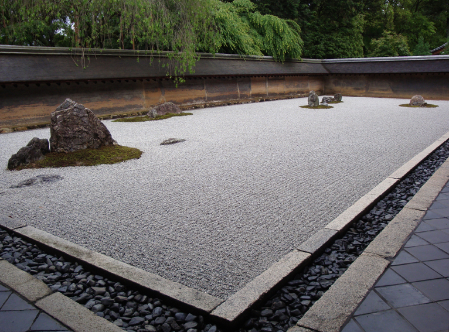
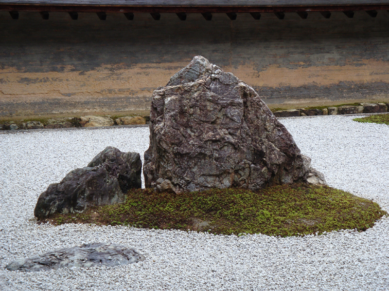
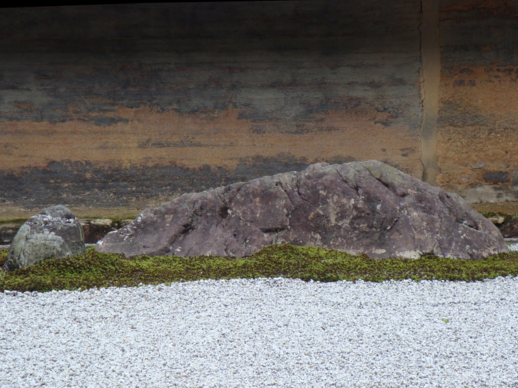
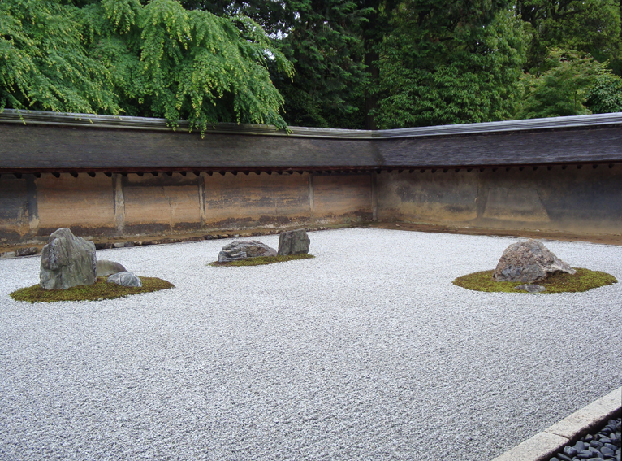
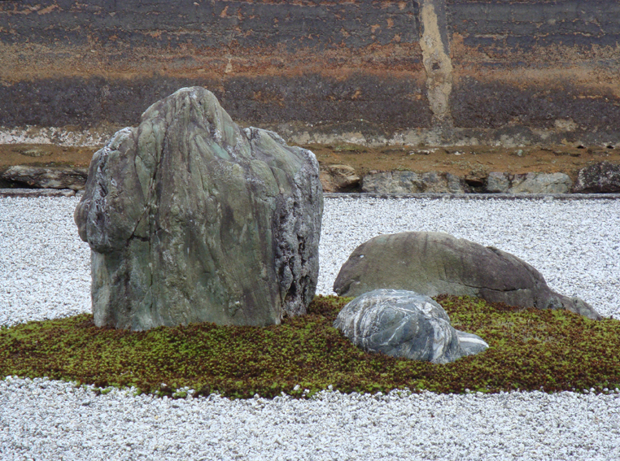
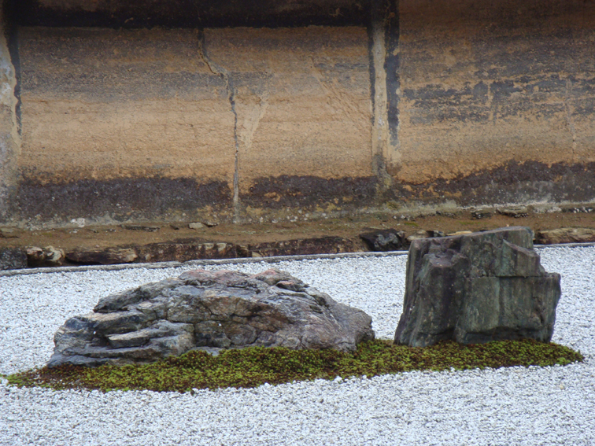
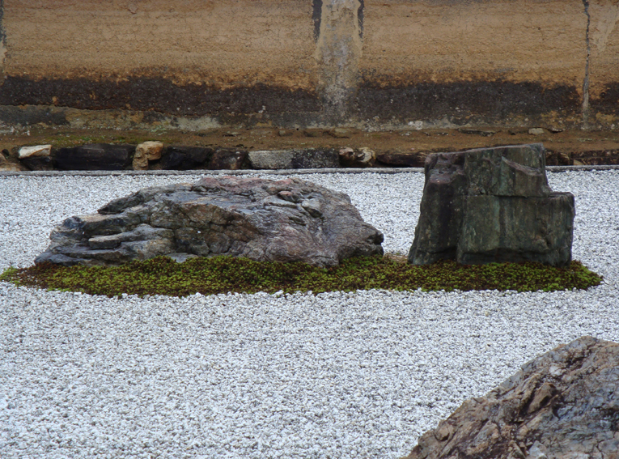
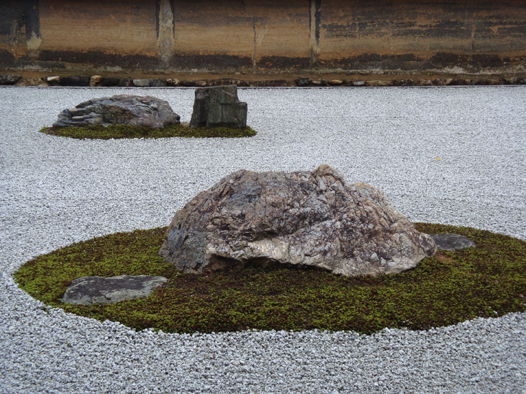
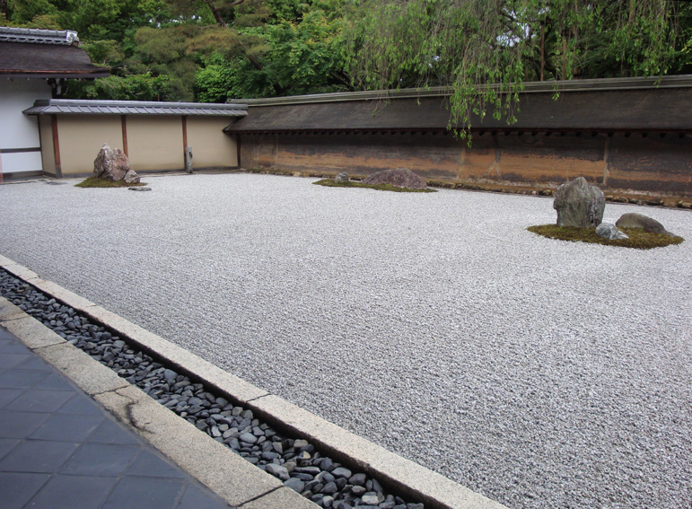
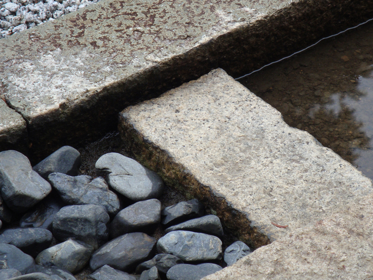

# japanese-aesthetics — ryoanji（补充材料）

> （《japanese-aesthetics》词条补充材料，源：plato.stanford.edu/entries/japanese-aesthetics/ryoanji.html）

#### 《日本美学》补充材料

## 龙安寺照片序列大图

照片 © 2011 Graham Parkes，经许可转载。
