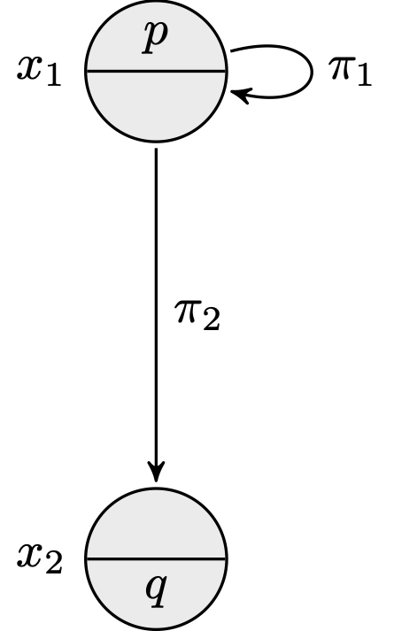
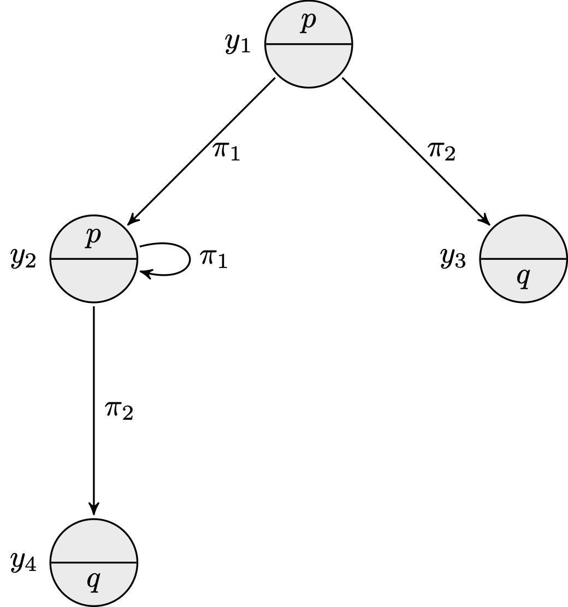

# 命题动态逻辑 Propositional Dynamic Logic (Nicolas Troquard、Philippe Balbiani)

> *首次发表于 2007 年 2 月 1 日；实质修订于 2023 年 2 月 16 日。*

程序逻辑是模态逻辑，源于这样一个想法：为程序设计语言中的每个计算机程序 *α* 配以一个模态词 $[\alpha]$。公式 $[\alpha]A$ 于是读作：$A$ 在程序 *α* 执行之后为真。这一想法源自 Engeler [1967]、托尼·霍尔 [1969]、Yanov [1959] 等人的一系列工作，他们构建并研究了能够表达程序联结词性质的逻辑语言。Salwicki [1970] 首创的算法逻辑（AL），以及 Pratt [1976] 阐发的动态逻辑（DL），正是这些工作的真正延续。我们在此将集中于 DL。大量论文致力于 DL 及其变体，也致力于它在程序验证与数据结构中的诸多应用，这些论文表明，DL 构成了研究程序性质的一种有用工具。Pratt 选择在人们或可称为一阶的层面上刻画 DL，正是他的工作促使 Fischer 与 Ladner [1979] 在几年之后定义了 DL 的命题变体。本文是对 PDL——DL 的命题变体——的导论。

## 1. 引言

动态逻辑（DL）是用于表示动态系统的状态与事件的模态逻辑。DL 的语言既是一种断言语言，能够表达计算状态的性质，又是一种程序设计语言，能够表达系统在这些状态之间转移的性质。诸 DL 是 **程序逻辑**，它们使我们能够谈论并推理事态、过程、变化与结果。

Pratt 最初关于程序的动态逻辑是一种 **一阶** 模态逻辑。**命题动态逻辑**（PDL）是它的命题对应物。它在 Fischer 与 Ladner [1979] 中作为一门独立的逻辑被提出。作为命题逻辑，PDL 的语言不使用项、谓词或函数。因此，PDL 中有两个句法范畴：命题与程序。

为了赋予 PDL 中的陈述以意义，我们通常使用以标记转移系统（LTS）表述的抽象语义。LTS 可视为克里普克模型的推广，其中世界或状态之间的转移由 **原子** 程序的名称“标记”。一个赋值指明每个状态中哪些 **命题** 为真。从状态 $x$ 到状态 $y$、标记为 *π* 的转移——记作 $xR(\pi)y$，或 $(x,y) \in R(\pi)$——表示：从 $x$ 出发，程序 *π* 存在一次在 $y$ 结束的可能执行。若命题 $A$ 在 $y$ 中为真，则公式 $\langle\pi\rangle A$ 在 $x$ 中为真：也就是说，在状态 $x$ 中，程序 *π* 存在一次在满足 $A$ 的状态中结束的可能执行。人们在 $\langle\pi\rangle$ 中认出一种令人联想到模态逻辑可能性模态（常记作 $\Diamond$）的模态。不出所料，也有相应的必然性概念（其模态常记作 $\Box$）。若 $A$ 在从 $x$ 经标记为 *π* 的转移可达的每个状态中都为真，则公式 $[\pi]A$ 在状态 $x$ 中为真。

复合程序的可能执行随后可以按组合方式加以定义。例如，程序“先 *α*，后 *β*”是一个复合程序，更确切地说是一个 **顺序**。一次可能执行可在 LTS 中表示为状态 $x$ 与 $y$ 之间的两步转移——该转移可记作 $R(\alpha;\beta)$：在状态 $x$ 中程序 *α* 存在一次在状态 $z$ 结束的可能执行，而在 $z$ 中程序 *β* 存在一次在状态 $y$ 结束的可能执行。若命题 $A$ 在 $y$ 中为真，则公式 $\langle \alpha;\beta\rangle A$ 在状态 $x$ 中为真。程序 *α* 与 *β* 本身也可以是复合程序。我们将在适当时候用更多构造表达更多的程序。

于是，程序以一种外延的方式被看待：它是 LTS 的状态对之间的一个二元关系。确切地说，它是形如 $(x,y)$ 的状态对的集合，使得该程序可在状态 $x$ 中执行并导向状态 $y$。另一方面，命题是关于一个状态的陈述；它在一个状态中或真或假。因此，命题也可以按外延方式看待：它是 LTS 中该命题为真的那些状态的集合。

我们在此用缩写 PDL 确切地指具有以下程序构造的命题动态逻辑：顺序、非确定选择、无界迭代与测试。我们在第 2 节呈现它，并给出一些性质与基本结果。特别地，我们将讨论它的公理化与可判定性。

出自霍尔 [1969] 的霍尔演算是程序逻辑的一个里程碑。它关涉形如 $\{A\}\alpha\{B\}$ 的陈述的真——意思是：以前提条件 $A$ 开始，程序 *α* 总是以 $B$ 为后条件——并以公理化方式定义。它源于一种对严格方法的需要：用这些方法推理程序的性质，从而在科学领域中给编程活动以一席之地。Burstall [1974] 看到了模态逻辑与程序推理之间的类比。但实际工作始于 Pratt [1976]：当时他正在讲授一门关于程序逻辑的课程，一些学生向他提出了这一想法。PDL 源于 Pratt 用模态逻辑形式系统对霍尔演算的解释。关于 PDL 起源的导论可参见 Pratt [1980b]。霍尔三元组 $\{A\}\alpha\{B\}$ 由 PDL 公式 $A \to [\alpha]B$ 捕捉，字面意思是：若 $A$ 为真，则 *α* 的每一次成功终止的执行都将以 $B$ 为真告终。一旦实现了这一联系，仅用 PDL 的公理化来证明霍尔演算的初始规则便是例行公事。我们将在第 3 节详细做这件事，该节集中于推理结构化程序的正确性。

与 PDL 相关的其他主题包括：关于若干有趣变体的比较表达力、可判定性、复杂度与完全性的结果，这些变体通过以各种方式扩展或限制 PDL 而得到。自 PDL 诞生以来，许多变体受到关注。这些变体可能考虑确定的程序、受限的测试、非正则程序、作为自动机的程序、程序的补与交、逆与无限计算，等等。我们将在第 4 节呈现其中一些，并提供关于其相对表达力、公理化与计算复杂度的若干指引。

我们在第 5 节作结。

## 2. 定义与基本结果

我们在 §2.1 呈现 PDL 的句法与语义。PDL 的证明论在 §2.2 呈现，并给出公理化与完全性文献指引。我们在 §2.3 讨论可判定性与复杂度问题。

### 2.1 句法与语义

命题动态逻辑（PDL）旨在表示并推理程序的命题性质。其语法建立在两组符号之上：原子公式的可数集 $\Phi_0$ 与原子程序的可数集 $\Pi_0$。在此基础上的复合公式与复合程序定义如下。

- 每个原子公式都是公式。
- $0$（“假”）是公式。
- 若 $A$ 是公式，则 $\lnot A$（“非 $A$”）是公式。
- 若 $A$ 与 $B$ 是公式，则 $(A\lor B)$（“$A$ 或 $B$”）是公式。
- 若 *α* 是程序且 *A* 是公式，则 $[\alpha]A$（“从当前状态出发的 *α* 的每次执行都导致 $A$ 为真的状态”）是公式。
- 每个原子程序都是程序。
- 若 *α* 与 *β* 是程序，则 $(\alpha;\beta)$（“先做 *α*，再做 *β*”）是程序。
- 若 *α* 与 *β* 是程序，则 $(\alpha\cup\beta)$（“非确定地做 *α* 或 *β*”）是程序。
- 若 *α* 是程序，则 $\alpha^*$（“重复 *α* 有限但非确定地确定的次数”）是程序。
- 若 $A$ 是公式，则 $A?$（“若 $A$ 为真则继续，否则失败”）是程序。

其余布尔联结词 $1$、$\land$、$\to$ 与 $\leftrightarrow$ 按标准方式用作缩写。此外，如同模态逻辑，我们把 $\lnot[\alpha]\lnot A$ 缩写为 $\langle\alpha\rangle A$（“从当前状态出发的 *α* 的某次执行导致 $A$ 为真的状态”）。我们写 $\alpha^n$ 表示 $\alpha;\ldots ;\alpha$，其中 *α* 出现 $n$ 次。更形式地说：

- $\alpha^0 := 1?$
- $\alpha^{n+1} := \alpha;\alpha^n$

又有：

- $\alpha^+ := \alpha;\alpha^*$

常用于表示无界但至少发生一次的迭代。最后，我们采用省略括号的标准规则。

公式可用于描述程序成功执行之后成立的种种性质。例如，公式 $[\alpha\cup\beta]A$ 意味着：每当程序 *α* 或 *β* 成功执行，都会到达 $A$ 成立的状态；而公式 $\langle (\alpha;\beta)^*\rangle A$ 意味着：存在 *α* 与 *β* 交替执行的一个序列，使得到达 $A$ 成立的状态。从语义上说，公式由状态集解释，程序由转移系统中状态上的二元关系解释。更确切地说，PDL 公式与程序的意义是在标记转移系统（LTS）$M = (W,R,V)$ 上解释的，其中 $W$ 是非空的世界或状态集，$R$ 是从原子程序集 $\Pi_0$ 到 $W$ 上二元关系的映射，$V$ 是从原子公式集 $\Phi_0$ 到 $W$ 的子集的映射。

直观地说，映射 $R$ 给每个原子程序 $\pi\in\Pi_0$ 指派 $W$ 上的某个二元关系 $R(\pi)$，其意图是：$xR(\pi)y$ 当且仅当存在 *π* 从 $x$ 出发、导向 $y$ 的一次执行；而映射 $V$ 给每个原子公式 $p\in\Phi_0$ 指派 $W$ 的某个子集 $V(p)$，其意图是：$x \in V(p)$ 当且仅当 $p$ 在状态 $x$ 中为真。鉴于我们对 $0$、$\lnot A$、$A\lor B$、$[\alpha]A$、$\alpha;\beta$、$\alpha\cup\beta$、$\alpha^*$ 与 $A?$ 的读法，显然 $R$ 与 $V$ 必须按如下方式归纳扩展，以为复合程序与公式提供预期意义：

- $xR(\alpha;\beta)y$ 当且仅当存在世界 $z$，使得 $xR(\alpha)z$ 且 $zR(\beta)y$
- $xR(\alpha\cup\beta)y$ 当且仅当 $xR(\alpha)y$ 或 $xR(\beta)y$
- $xR(\alpha^*)y$ 当且仅当存在非负整数 $n$，且存在状态序列 $z_0, \ldots, z_n$，使得 $z_0 = x$、$z_n = y$，并且对所有 $k = 1 \ldots n$ 都有 $z_{k-1}R(\alpha)z_k$
- $xR(A?)y$ 当且仅当 $x = y$ 且 $y \in V(A)$
- $V(0) = \emptyset$
- $V(\lnot A) = W \setminus V(A)$
- $V((A\lor B) = V(A) \cup V(B)$
- $V([\alpha]A) = \{x \mid \text{对所有世界 } y，\text{若 } xR(\alpha)y \text{ 则 } y \in V(A)\}$

若 $x \in V(A)$，则称 $A$ 在 $M$ 中的状态 $x$ 处被满足，或记作 $M, x$ sat $A$。

两个标记转移系统：$M = (W,R,V)$（左）与 $M' = (W',R',V')$（右）

称上图中左侧的标记转移系统为 $M$，右侧的标记转移系统为 $M'$。形式地定义，我们有 $M = (W, R, V)$，其中 $W = \{x_1,x_2\}$、$R(\pi_1) = \{(x_1,x_1)\}$、$R(\pi_2) = \{(x_1,x_2)\}$、$V(p) = \{x_1\}$、$V(q) = \{x_2\}$；并且我们有 $M' = (W',R',V')$，其中 $W' = \{y_1, y_2, y_3, y_4\}$、$R'(\pi_1) = \{(y_1, y_2), (y_2, y_2)\}$、$R'(\pi_2) = \{(y_1, y_3), (y_2, y_4)\}$、$V'(p) = \{y_1, y_2\}$、$V'(q) = \{y_3, y_4\}$。例如，我们有：

- $M,x_1$ sat $p$
- $M,x_2$ sat $q$
- $M,x_1$ sat $\langle \pi_1 \rangle p \land \langle \pi_2 \rangle q$
- $M,x_1$ sat $[\pi_1]p \land [\pi^*_1]p$
- $M',y_1$ sat $\langle \pi^*_1;\pi_2\rangle q$
- $M',y_2$ sat $[\pi^*_1] p$
- $M',y_1$ sat $[\pi_1 \cup \pi_2] (p \lor q)$
- $M',y_3$ sat $[\pi_1 \cup \pi_2] 0$

现在考虑一个公式 $A$。若对所有世界 $x$ 都有 $x \in V(A)$，则称 $A$ 在 $M$ 中有效，或称 $M$ 是 $A$ 的模型，或记作“$M \models A$”。若对所有模型 $M$ 都有 $M \models A$，则称 $A$ 有效，或记作“$\models A$”。若存在世界 $x$ 使得 $x \in V(A)$，则称 $A$ 在 $M$ 中可满足，或称 $M$ 满足 $A$，或记作“$M$ sat $A$”。若存在模型 $M$ 使得 $M$ sat $A$，则称 $A$ 可满足，或记作“sat $A$”。特别地，有：

sat $A$ iff not $\models \lnot A$ $\models A$ iff not sat $\lnot A$

PDL 中有一些值得注意的公式是有效的。（读者可尝试形式地证明它们，或至少以上面展示的几个例子开始说服自己。）

$\models [\alpha ; \beta]A \leftrightarrow [\alpha][\beta]A$ $\models [\alpha \cup \beta]A \leftrightarrow [\alpha]A \land [\beta]A$ $\models [\alpha^*]A \leftrightarrow A \land [\alpha][\alpha^*]A$ $[A?]B \leftrightarrow (A \rightarrow B)$

等价地，我们也可以把它们写成对偶形式。

$\langle\alpha ; \beta\rangle A \leftrightarrow \langle\alpha\rangle\langle\beta\rangle A$ $\langle\alpha \cup \beta\rangle A \leftrightarrow \langle\alpha\rangle A \lor \langle\beta\rangle A$ $\langle\alpha^*\rangle A \leftrightarrow A \lor \langle\alpha\rangle \langle\alpha^*\rangle A$ $\langle A?\rangle B \leftrightarrow A \land B$

有一个有趣的概念涉及标记转移系统所包含的、可用 PDL 公式表达的信息。以 LTS 描述的系统，其行为确实常常稍许隐藏在其形式之中。例如，只需简单查看，就很容易说服自己：上面描绘的两个 LTS 具有相同的行为，并满足相同的 PDL 公式。为结束这一节关于句法与语义的讨论，我们给出这些主张的理论基础。

给定两个 LTS，人们可以追问它们是否满足相同的公式。互模拟这一概念已成为克里普克模型与标记转移系统之等价性的标准量度。LTS $M = (W,R,V)$ 与 $M' = (W',R',V')$ 之间的 **互模拟** 是它们状态集之间的一个二元关系 $Z$，使得对 $W$ 中的所有世界 $x$ 与 $W'$ 中的所有世界 $x'$，若 $xZx'$，则：

- 对所有原子公式 $p\in \Phi_0$，有 $x\in V(p)$ 当且仅当 $x' \in V'(p)$；
- 对所有原子程序 $\pi \in \Pi_0$ 与所有世界 $y \in W$，若 $x R(\pi)y$，则存在世界 $y' \in W'$，使得 $yZy'$ 且 $x' R'(\pi)y'$；
- 对所有原子程序 $\pi \in \Pi_0$ 与所有世界 $y' \in W'$，若 $x' R'(\pi)y'$，则存在世界 $y \in W$，使得 $yZy'$ 且 $x R(\pi)y$。

若两个 LTS 之间存在互模拟，则称它们是 **互模拟的**。

事实是：在两个互模拟的 LTS $M = (W,R,V)$ 与 $M' = (W',R',V')$ 中，对 $W$ 中的所有世界 $x$ 与 $W'$ 中的所有世界 $x'$，若 $xZx'$，则对所有 PDL 公式 $A$，有 $x \in V(A)$ 当且仅当 $x' \in V'(A)$。因此，当两个 LTS 按上述互模拟定义互模拟时，若 $xZx'$，则：

- 对所有程序 *α* 与所有世界 $y \in W$，若 $x R(\alpha)y$，则存在世界 $y' \in W'$，使得 $yZy'$ 且 $x' R'(\alpha)y'$；
- 对所有程序 *α* 与所有世界 $y' \in W'$，若 $x' R'(\alpha)y'$，则存在世界 $y \in W$，使得 $yZy'$ 且 $x R(\alpha)y$。

因此，人们只需考察原子程序，就能比较两个 LTS 的行为，并可靠地推断这些 LTS 即便在复合程序上的比较行为。我们称 PDL 的程序构造 **对互模拟安全**。关于对互模拟安全的程序构造的精确刻画，见 Van Benthem [1998]。

容易看出，上面两个 LTS 实例是互模拟的。上面两张图所示的模型 $M$ 与 $M'$ 之间的一个互模拟 $Z$ 可给出为：$Z = \{(x_1,y_1), (x_1,y_2), (x_2, y_3), (x_2, y_4)\}$。状态 $x_1$ 与 $y_1$ 满足完全相同的 PDL 公式。状态 $x_1$ 与 $y_2$ 也是如此，依此类推。

### 2.2 公理化与完全性

证明论的目的，在于以公理与推理规则来刻画有效性——即性质 $\models A$。本节我们通过对公式的运算归纳地定义可推演谓词 $\vdash$，这些运算只依赖公式的句法结构，使得对一切公式 $A$ 都有

$\vdash A$ iff $\models A$.

当然，PDL 是经典命题逻辑的扩展。我们首先期望一切命题重言式都成立，并允许一切命题推理。特别地，肯定前件式是一条有效规则：由 $A$ 与 $A \rightarrow B$ 推出 $B$。对任一程序 *α*，把 LTS 限制到关系 $R(\alpha)$ 上，我们便得到一个克里普克模型，其中模态词 $[\alpha]$ 的逻辑是最弱的命题正规模态逻辑，即逻辑 K。因此，PDL 包含熟悉的分配公理图式的每一实例

**(K)**

$[\alpha](A \rightarrow B) \rightarrow ([\alpha]A \rightarrow [\alpha]B)$

并且在下述推理规则（**必然化** 规则）下封闭

**(N)**

由 $A$ 推出 $[\alpha]A$

一个模态逻辑若是遵守 (K) 与 (N) 的，便是正规的。正规模态逻辑的一个重要性质是 **对合的分配性** $\land$：公式 $[\alpha](A \land B) \leftrightarrow ([\alpha]A \land [\alpha]B)$ 可以借助 (K)、(N) 与命题推理来证明。**单调性** 规则同样可以借助 (K)、(N) 与命题推理来证明：由 $A \rightarrow B$ 推出 $[\alpha]A \rightarrow [\alpha]B$。

PDL 是包含下述公理图式每一实例的最小正规模态逻辑

**(A1)**

$[\alpha;\beta]A \leftrightarrow [\alpha][\beta]A$

**(A2)**

$[\alpha \cup \beta]A \leftrightarrow [\alpha]A \land [\beta]A$

**(A3)**

$[\alpha^*]A \leftrightarrow A \land [\alpha][\alpha^*]A$

**(A4)**

$[A?]B \leftrightarrow (A \rightarrow B)$

并且在下述推理规则（**循环不变性** 规则）下封闭：

**(I)**

由 $A \rightarrow [\alpha]A$ 推出 $A \rightarrow [\alpha^*]A$

若 $X$ 是公式集而 $A$ 是公式，则当存在公式序列 $A_0, A_1, \ldots A_n$，使得 $A_n = A$，且对一切 $i \leq n$，$A_i$ 或是某个公理图式的实例，或是 $X$ 中的公式，或是按某条推理规则由序列中在先的公式得到时，我们就说 $A$ 可由 $X$ 进行 $\vdash$-推演，或记作“$X \vdash A$”。此外，$\vdash A$ 当且仅当 $\emptyset \vdash A$；此时我们说 $A$ 是 $\vdash$-可推演的。称 $X$ 是 $\vdash$-一致的，当且仅当并非 $X \vdash 0$。容易证明，规则 (I) 可以替换为下述公理图式（**归纳** 公理图式）：

**(A5)**

$A \land [\alpha^*](A \rightarrow [\alpha]A) \rightarrow [\alpha^*]A$

我们首先证明，(I) 是基于 (A1)、(A2)、(A3)、(A4) 与 (A5) 的证明系统的一条派生规则：

| 1. | $A \rightarrow [\alpha]A$ | 前提 |
| --- | --- | --- |
| 2. | $[\alpha^*](A \rightarrow [\alpha]A)$ | 由 1 用（N） |
| 3. | $A \land [\alpha^*](A \rightarrow [\alpha]A) \rightarrow [\alpha^*]A$ | 公理图式（A5） |
| 4. | $[\alpha^*](A \rightarrow [\alpha]A) \rightarrow (A \rightarrow [\alpha^*]A)$ | 由 3 用命题推理 |
| 5. | $A \rightarrow [\alpha^*]A$ | 由 2 与 4 用肯定前件式 |

我们接下来证明 (A5) 是 $\vdash$-可推演的：

| 1. | $[\alpha^*](A \rightarrow [\alpha]A)\ \leftrightarrow\ $ $(A \rightarrow [\alpha]A) \land [\alpha][\alpha^*](A \rightarrow [\alpha]A)$ | 公理图式（A3） |
| --- | --- | --- |
| 2. | $A \land [\alpha^*](A \rightarrow [\alpha]A)\ \rightarrow\ $ $[\alpha](A \land [\alpha^*](A \rightarrow [\alpha]A))$ | 由 1 用命题推理与 $[\alpha]$ 对 $\land$ 的分配性 |
| 3. | $A \land [\alpha^*](A \rightarrow [\alpha]A)\ \rightarrow\ $ $[\alpha^*](A \land [\alpha^*](A \rightarrow [\alpha]A))$ | 由 2 用（I） |
| 4. | $[\alpha^*](A \rightarrow [\alpha]A) \rightarrow (A \rightarrow [\alpha^*]A)$ | 由 3 用命题推理与 $[\alpha^*]$ 对 $\land$ 的分配性 |
| 5. | $A \land [\alpha^*](A \rightarrow [\alpha]A) \rightarrow [\alpha^*]A$ | 由 4 用命题推理 |

基于公理图式 (A1)、(A2)、(A3)、(A4) 与 (A5) 的 PDL 公理化，由 Segerberg [1977] 提出。由上述定义可直接看出，$\vdash$ 相对于 $\models$ 是可靠的，即

对一切公式 $A$，若 $\vdash A$，则 $\models A$。

证明按 $A$ 在 $\vdash$ 中推演的长度作归纳。至于 $\vdash$ 相对于 $\models$ 的完全性问题，即

对一切公式 $A$，若 $\models A$，则 $\vdash A$，

曾为若干逻辑学家所探究。Segerberg [1977] 中给出的论证路线，是证明 $\vdash$ 完全性的首次尝试。不久，罗希特·帕里克也给出了一个证明。1978 年初 Segerberg 发现其论证中有一处缺陷（他最终作了修补），帕里克则在 Parikh [1978] 中发表了可视为 $\vdash$ 完全性的第一个证明。此后又陆续发表了 $\vdash$ 完全性的不同证明，例如 Kozen 与 Parikh [1981]。更多细节可参见 Pratt [2017]。

人们也曾探求 PDL 的各种替代证明论。甚至早期就有，尤见于 Pratt [1978]。此外还请提及 Nishimura [1979] 与 Vakarelov [1983] 关于相关理论的完全性。

PDL 可推演谓词的另一种表述方式，利用一条无穷推理规则，例如见 Goldblatt [1992a]。（无穷推理规则取无穷多个前提。）设 $\vdash'$ 为命题动态逻辑语言中对应于下述最小正规模态逻辑的可推演谓词：该逻辑包含公理图式 (A1)、(A2)、(A3) 与 (A4) 的每一实例，并在下述无穷推理规则下封闭：

**(I′)**

由 $\{[\beta][\alpha^n]A : n\geq 0\}$ 推出 $[\beta][\alpha^*]A$

可以证明，$\vdash'$ 相对于 $\models$ 既可靠又完全，即

对一切公式 $A$，$\vdash' A$ iff $\models A$。

换言之，就生成全部有效公式之集而言，证明系统 $\vdash$ 与 $\vdash'$ 是等价的。

### 2.3 可判定性与复杂度

复杂性理论的目标，在于以时间或空间资源来确立性质 sat $A$ 的可计算性。逻辑 $\mathcal{L}$ 的复杂度，常被等同于判定其公式可满足性的问题，该问题定义如下：

**(L-SAT)**

给定 $\mathcal{L}$ 的一个公式 $A$，$A$ 是否可满足？

本节我们考察下述判定问题的复杂度：

**(PDL-SAT)**

给定 PDL 的一个公式 $A$，$A$ 是否可满足？

PDL 的完全公理化，是对有效 PDL 公式集——换言之，是对其否定不可满足的公式集——的递归定义。因此，就问题 (PDL-SAT) 而言，我们有一个子过程：若 PDL 公式 $A$ 不可满足，它就会回答“否”。子过程 (SP1) 在于枚举一切 $\vdash$-可推演的公式：从公理出发，借助推理规则推出其他定理。只要有足够的时间，若某公式是 $\vdash$-可推演的，该子过程终将找到它。因此，若 $A$ 不可满足，(SP1) 终必找到 $\lnot A$，并在找到时回答“否”。

然而，若公式 $A$ 可满足，则 (SP1) 永远不会找到 $\lnot A$。它会永远运行下去，人们在任何时刻都无法据此确信。但这种不确定性有出路。我们还可以设想第二个子过程：若 PDL 公式可满足，它就回答“是”。事实上，关于 PDL 的最早结果之一，就是证明 PDL 具有 **有穷模型性质**，即

对一切公式 $A$，若 sat $A$，则存在有穷模型 $M$ 使得 $M$ sat $A$。

有穷模型性质为子过程 (SP2) 提供了基础：该子过程逐一枚举 PDL 的有穷模型，并检验其中是否有满足该公式者。（对一切公式 $A$ 与一切有穷模型 $M$，应用 $V(A)$ 的定义很容易检验是否 $M$ sat $A$。）因此，若 $A$ 可满足，它终必找到模型 $M$ 使得 $M$ sat $A$，并在找到时回答“是”。与第一个子过程 (SP1) 相对称，若公式 $A$ 不可满足，则 (SP2) 永远不会找到满足它的模型，它会永远运行下去，人们在任何时刻都无法据此确信。

现在，把 (SP1) 与 (SP2) 结合起来，我们便有了判定 PDL 公式 $A$ 是否可满足的方法。只需让二者并行运行：若 $A$ 可满足，(SP2) 终将回答“是”；若 $A$ 不可满足，(SP1) 终将回答“否”。一旦 (SP1) 或 (SP2) 之一给出答案，该过程即停机。

这样得到的过程虽足以断定问题 (PDL-SAT) 是可判定的，但在实践中效率很低。有一个结果——归功于 Fischer 与 Ladner [1979] 以及 Kozen 与 Parikh [1981]——比有穷模型性质更强，即 **小模型性质**：

对一切公式 $A$，若 sat $A$，则存在有穷模型 $M$，其大小与 $A$ 成指数关系，且 $M$ sat $A$。

这意味着，在过程 (SP2) 中我们如今知道何时应停止寻找满足某公式的模型。因此，我们可以用 (SP2) 来检验一个公式是否可满足；而一旦穷尽了所有小模型，便可断定该公式不可满足。这给出一个非确定性地在指数时间（NEXPTIME）内运行的过程：猜测一个大小至多为单指数级的模型，并检验它是否满足该公式。不过，PDL 复杂性理论的关键结果，出自 Fischer 与 Ladner [1979] 以及 Pratt [1980a]。Fischer 与 Ladner [1979] 观察到 PDL 公式能高效地描述线性空间界交替图灵机的计算，从而首次确立了 (PDL-SAT) 的指数时间下界。(PDL-SAT) 的 EXPTIME 上界由 Pratt [1980a] 得到，他把语义表列法改造用于 PDL。因此，(PDL-SAT) 是 EXPTIME-完全的。（De Giacomo 与 Massacci [2000] 提出了一个实践中更高效的算法，尽管在最坏情况下仍以确定性指数时间运行。）

## 3. 结构化程序设计与程序的正确性

从历史上看，程序逻辑源于 20 世纪 60 年代末一些计算机科学家的工作，他们志在为程序设计语言赋予意义，并为关于程序的证明寻找严格的标准。例如，这类证明可以关乎一个程序相对于某种预期行为的正确性，也可以关乎一个程序的终止。Floyd [1967] 是一篇开创性论文，它借助 **流程图** 分析了结构化计算机程序的性质。Yanov [1959] 或 Engeler [1967] 等早期工作已经提出并研究了形式语言，程序联结词的性质可在其中得到表达。霍尔 [1969] 的形式系统是 PDL 诞生过程中的一个里程碑。它被提出来作为对 Floyd 流程图的一种严格的公理化解释。在指称这一形式系统时，我们常说霍尔逻辑、弗洛伊德—霍尔逻辑或霍尔演算。霍尔演算关心的是语句（“霍尔三元组”）的真，例如 $\{A\}\alpha\{B\}$，它建立起前提条件 $A$、程序 *α* 与后条件 $B$ 之间的联系。它表示：只要 $A$ 作为 *α* 执行的前提条件成立，那么 *α* 成功执行之后 $B$ 就作为后条件成立。

几十年前如此，如今依然如此：验证一个程序，多半是通过在一批足够多样的输入上测试它来完成的。当某个输入未能得到预期输出时，就修复那个“缺陷”。若最终对每一个测试过的输入都得到了预期输出，人们便有理由相信该程序没有错误。然而，这是一种耗时的验证方法，而且它给可能失败的未测输入留下了余地。在程序已经实现并投入使用之后再发现这些错误，资源代价甚至更高。对关键系统而言，用形式方法推理程序的正确性至关重要，因为它提供了一条穷尽地证明程序没有错误的途径。

### 3.1 霍尔演算

要说明霍尔演算中的规则所刻画的程序原理，考察其中几条规则就足够了。（注意：这些规则的意思是，若规则线上方的全部语句——即前提——成立，则规则线下方的语句——即结论——也成立。）

$$ \frac{\{A\}\alpha_1 \{B\}\quad\{B\} \alpha_2\{C\}} {\{A\} \alpha_1;\alpha_2\{C\}} \text{ (rule of composition)} $$

合成规则刻画的是程序基本的顺序复合。作为前提，我们有关于两个程序 $\alpha_1$ 与 $\alpha_2$ 的部分正确性的两个假定。第一个假定是：当 $\alpha_1$ 在满足 $A$ 的状态中执行时，只要它停机，就会在满足 $B$ 的状态中结束。第二个假定是：当 $\alpha_2$ 在满足 $B$ 的状态中执行时，只要它停机，就会在满足 $C$ 的状态中结束。规则的结论说的是程序 $\alpha_1;\alpha_2$（即 $\alpha_1$ 与 $\alpha_2$ 顺序复合）的部分正确性，它由上述两个假定推出。也就是说，我们可以断定：若 $\alpha_1;\alpha_2$ 在满足 $A$ 的状态中执行，则只要它停机，就会在满足 $C$ 的状态中结束。

迭代规则是一条重要的规则，因为它刻画了程序的一项本质能力：反复执行某段代码，直到某个条件不再成立。

$$ \frac{\{A \land B\}\alpha\{A\}} {\{A\} \mathsf{while}~B~\mathsf{do}~\alpha \{\lnot B \land A\}} \text{ (rule of iteration)} $$

最后，两条后承规则是根本性的，它们分别为涉及较弱后条件与较强前提条件的直观上清楚的推理提供形式基础。

$$ \frac{\{A\}\alpha\{B\}\quad B \rightarrow C} {\{A\} \alpha \{C\}} \text{ (rule of consequence 1)} $$ $$ \frac{C\rightarrow A\quad \{A\}\alpha\{B\}} {\{C\}\alpha\{B\}} \text{ (rule of consequence 2)} $$

在霍尔 [1969] 所呈现的形式系统中，我们略去了其公理图式，因为那将需要一阶语言。最后，在后来的霍尔逻辑研究中，人们也常常加入更多规则。早期综述可参见 Apt [1979]。

### 3.2 霍尔演算与 PDL

动态逻辑源于 Pratt 在模态逻辑形式系统中对霍尔三元组与霍尔演算的解释。借助模态词 $[\alpha]$，我们可以形式地表达：执行程序 *α* 所能到达的一切状态都满足公式 $A$。这通过写作 $[\alpha]A$ 来实现。于是，霍尔三元组 $\{A\}\alpha\{B\}$ 就径直由下述 PDL 公式刻画

$A \rightarrow [\alpha]B$.

此外，重要的程序构造可以很容易地通过定义性缩写引入 PDL：

- $\mathsf{if}~ A ~\mathsf{then}~ \alpha ~\mathsf{else}~ \beta := ((A?;\alpha) \cup (\lnot A?;\beta))$
- $\mathsf{while}~ A ~\mathsf{do}~ \alpha := ((A?;\alpha)^*;\lnot A?)$
- $\mathsf{repeat}~ \alpha ~\mathsf{until}~ A := (\alpha;((\lnot A;\alpha)^*;A?))$
- $\mathsf{abort} := 0?$
- $\mathsf{skip} := 1?$

由此可见，有了 PDL，我们似乎就具备了逻辑地证明结构化程序正确性的充分工具。但除了 PDL 与霍尔演算之间这种颇为粗略的联系之外，二者在形式上究竟如何关联，或许仍不清楚。事实上，PDL 是霍尔演算的一种推广，其意义在于：霍尔演算的所有规则都能在 PDL 的公理系统中得到证明。（严格说来，霍尔演算还包含一些需要一阶动态逻辑的扩展语言才能表述的公理。）这一点相当值得注意，因此我们将展示这些规则如何推导出来。

证明从假定规则的各前提开始。然后，只使用这些假定以及 PDL 的公理与规则——不用其他任何东西——目标在于确立规则的结论在逻辑上随之成立。因此，对于合成规则，我们先假定 $\{A\}\alpha_1\{B\}$，即其 PDL 表述 $A \rightarrow [\alpha_1]B$，再假定 $\{B\}\alpha_2\{C\}$，即 $B \rightarrow [\alpha_2]C$。目标是证明 $\{A\}\alpha_1;\alpha_2\{C\}$。确切地说，我们要确立 $A \rightarrow [\alpha_1;\alpha_2]C$ 可由公式集 $\{A \rightarrow [\alpha_1]B, B \rightarrow [\alpha_2]C\}$ 进行 $\vdash$-推演。

| 1. | $A \rightarrow [\alpha_1]B$ | 假设 $\{A\}\alpha_1\{B\}$ |
| --- | --- | --- |
| 2. | $B \rightarrow [\alpha_2]C$ | 假设 $\{B\}\alpha_2\{C\}$ |
| 3. | $[\alpha_1]B \rightarrow [\alpha_1][\alpha_2]C$ | 由 2 用 $[\alpha_1]$ 的单调性 |
| 4. | $A \rightarrow [\alpha_1][\alpha_2]C$ | 由 1 与 3 用命题推理 |
| 5. | $[\alpha_1;\alpha_2]C \leftrightarrow [\alpha_1][\alpha_2]C$ | 公理图式（A1） |
| 6. | $A \rightarrow [\alpha_1;\alpha_2]C$ | 由 4 与 5 用命题推理 |
| — | $\{A\}\alpha_1;\alpha_2\{C\}$ |   |

迭代规则的证明稍为复杂。

| 1. | $A\land B \rightarrow [\alpha ]A$ | 假设 $\{A \land B\}\alpha \{A\}$ |
| --- | --- | --- |
| 2. | $A \rightarrow (B \rightarrow [\alpha ]A)$ | 由 1 用命题推理 |
| 3. | $[B?][\alpha ]A \leftrightarrow (B \rightarrow [\alpha ]A)$ | 公理图式（A4） |
| 4. | $A \rightarrow [B?][\alpha ]A$ | 由 2 与 3 用命题推理 |
| 5. | $[B? ; \alpha ]A \leftrightarrow [B?][\alpha ]A$ | 公理图式（A1） |
| 6. | $A \rightarrow [B?;\alpha ]A$ | 由 4 与 5 用命题推理 |
| 7. | $A \rightarrow [(B?;\alpha )^*]A$ | 由 6 用（I） |
| 8. | $A \rightarrow (\lnot B \rightarrow (\lnot B\land A))$ | 命题重言式 |
| 9. | $A \rightarrow [(B?;\alpha )^*](\lnot B \rightarrow (\lnot B\land A))$ | 由 7 与 8 用 $[(B?;\alpha )^*]$ 的单调性与命题推理 |
| 10. | $[\lnot B?](\lnot B\land A)\ \leftrightarrow\ $ $(\lnot B \rightarrow (\lnot B\land A))$ | 公理图式（A4） |
| 11. | $A \rightarrow [(B?;\alpha )^*][\lnot B?](\lnot B\land A)$ | 由 9 与 10 用 $[(B?;\alpha )^*]$ 的单调性与命题推理 |
| 12. | $[(B?;\alpha )^* ; \lnot B?](\lnot B\land A)\ \leftrightarrow\ $ $[(B?;\alpha )^*][\lnot B?](\lnot B\land A)$ | 公理图式（A1） |
| 13. | $A \rightarrow [(B?;\alpha )^* ; \lnot B?](\lnot B\land A)$ | 由 12 用命题推理 |
| — | $\{A\}\mathsf{while}~ B ~\mathsf{do}~ \alpha \{\lnot B\land A\}$ |   |

在 PDL 的语境中，两条后承规则实际上是合成规则的特例。要得到第一条规则，把 $\alpha_1$ 替换为 *α*，把 $\alpha_2$ 替换为 $\mathsf{skip}$。要得到第二条规则，把 $\alpha_1$ 替换为 $\mathsf{skip}$，把 $\alpha_2$ 替换为 *α*。只需应用公理图式（A4），并注意到对一切 $A$ 与一切 *α*，$[\alpha;\mathsf{skip}]A \leftrightarrow [\alpha]A$ 与 $[\mathsf{skip};\alpha]A \leftrightarrow [\alpha]A$ 也是 $\vdash$-可推演的。

### 3.3 完全正确性

按霍尔本人在霍尔 [1979] 中的说法，他最初的演算只是一个起点，带有不少局限。尤其是，它只允许人们推理 **部分** 正确性。也就是说，语句 $\{A\}\alpha\{B\}$ 的真只保证：*α* 的一切执行，只要从满足 $A$ 的状态出发，就会在满足 $B$ 的状态中结束，**或者不会停机**。换言之，一个部分正确的程序可能含有不终止的执行。（事实上，没有终止执行的程序总是部分正确的。例如程序 $\mathsf{while}~ 1 ~\mathsf{do}~ \mathsf{skip}$ 就是如此。对一切公式 $A$ 与 $B$，公式 $A \rightarrow [\mathsf{while}~1 ~\mathsf{do} ~\mathsf{skip}] B$ 都是可推演的。）该演算没有为“程序终止”的证明提供任何基础。它可以被修改，以便刻画程序的 **完全** 正确性：部分正确性加上终止。这是通过修改迭代规则来实现的。我们在此不再呈现，感兴趣的读者可参见 Apt [1981]。

我们首先指出，对于 **确定的** 程序，已经可以借助如下形式的公式刻画完全正确性

$A \rightarrow \langle\alpha\rangle B$.

表达式 $\langle\alpha\rangle B$ 的意思是：*α* 有一次执行终止于满足 $B$ 的状态。此外，若 *α* 是确定的，那么这一可能存在的终止执行就是 *α* 的唯一执行。因此，若能先证明一个程序是确定的，这一手法就足以用来证明它的完全正确性。

完全正确性问题的一般解决方案存在于 PDL 的领域之中。但我们需要对它稍作扩展。Pratt 已在 Pratt [1980b] 中暗示，PDL 的表达力不足以刻画程序的无限循环。作为回应，Streett [1982] 引入了带重复的 PDL（RPDL）。它对一切程序 *α* 都含有表达式 $\Delta\alpha$，该表达式代表一个新的命题，其语义为：

- $V(\Delta\alpha) = \{x:$ 存在状态的一个无穷序列 $z_0, z_1, \ldots$，使得 $z_0 = x$，且对一切 $n \geq 0, z_n R(\alpha) z_{n+1}\}$。

Streett [1982] 猜想：在 PDL 的证明系统中恰好加入下述公理图式，就能为 RPDL 提供公理化。

**(A6)**

$\Delta\alpha \rightarrow \langle\alpha\rangle \Delta\alpha$

**(A7)**

$[\alpha^*](A \rightarrow \langle\alpha\rangle A) \rightarrow (A \rightarrow \Delta\alpha)$

该猜想的证明由 Sakalauskaite 与 Valiev [1990] 给出。（这一猜想在组合式 PDL 变体中的一个版本，也已在 Gargov 与 Passy [1988] 中得到证明。）

容易看出，在上述霍尔演算中，不终止只可能来自迭代规则。类似地，一个 PDL 程序的不终止只可能来自无界迭代的使用。表达式 $\Delta\alpha$ 表示 $\alpha^*$ 可能发散，而这正是我们需要的那种概念。现在我们可以归纳地定义一个谓词 $\infty$，使得对程序 *α*，公式 $\infty(\alpha)$ 为真恰好当 *α* 能够进入不终止的计算。

$\infty(\pi) := 0$ 其中 $\pi\in\Pi_0$ $\infty(A?) := 0$ $\infty(\alpha \cup \beta) := \infty(\alpha)\ \lor \infty(\beta)$ $\infty(\alpha ; \beta) := \infty(\alpha) \lor \langle\alpha\rangle \infty(\beta)$ $\infty(\alpha^*) := \Delta\alpha \lor \langle\alpha^*\rangle \infty(\alpha)$

最后，一个程序的完全正确性可以借助如下形式的公式来表达

$A \rightarrow (\lnot \infty(\alpha) \land [\alpha]B)$,

其字面意思是：若 $A$ 成立，则程序 *α* 不能永远运行，并且 *α* 的每一次成功执行都会在满足 $B$ 的状态中结束。
