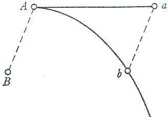
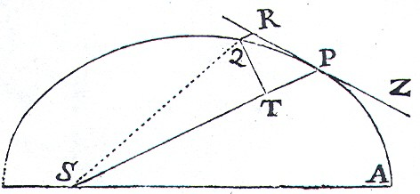
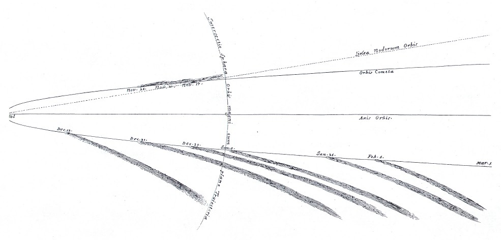

# 自然哲学的数学原理 Newton’s Philosophiae Naturalis Principia Mathematica (George Smith)

> **首次发表于 2007 年 12 月 20 日。**

没有哪部科学著作比牛顿的《自然哲学的数学原理》更受哲学家关注。然而，关注的缘由、因而还有关注的焦点，一个世纪接一个世纪地发生了显著变化。在 20 世纪，哲学家把《原理》放在爱因斯坦广义相对论的新引力理论语境中考察；主要议题是牛顿引力理论与爱因斯坦引力理论的关系，以及以爱因斯坦理论取代牛顿理论的必要性就科学知识的性质、范围与限度说明了什么。相比之下，在 18 世纪的大部分时间里，牛顿的引力理论一直处于争论之中，尤其因为缺少一种产生引力的机制——特别是一种 **接触机制**。哲学文献也相应地力图澄清并（以这样或那样的方式）解决这场争论：究竟应不应当把《原理》视为在方法论上有充分根据的著作。到 1790 年代，牛顿的引力理论已在从事 **轨道力学** 与 **物理大地测量学** 研究的人中间确立，这使《原理》成为科学在最成功状态下的 **典范**。因此，19 世纪哲学家对《原理》的兴趣转而集中在牛顿如何取得这一成功：一部分是要刻画所获得的知识，一部分是要在其他研究领域追求可比的知识。不幸的是，三个世纪以来的哲学文献中有很大一部分都受制于一幅过于简单化的《原理》图景。本词条的主要目标，就是用一幅更公允地对待《原理》之内容与方法论丰富性的图景，来取代那幅简单化的图景。

## 1. 概述：这部著作的重要性

回顾来看，在现代物理学与天文学的发展中，没有哪部著作比牛顿的《原理》更具开创性。它断言，使行星保持在轨道上的力与地面重力属于同一类；这一结论永远终结了至少可追溯至亚里士多德的一种观点：天界需要一门科学，而月下世界需要另一门科学。正如第一版序言所提出的，牛顿引力理论的最终成功，使识别 **自然力** 并以定律刻画它们成为物理学的主要追求。这一理论的成功还带来了一种新的 **精密科学** 观念：按照这种观念，观察与理论之间 **每一处** 系统性的差异，无论多么小，都被视为在告诉我们某种关于世界的重要事情。而且，一旦人们清楚引力理论为精确刻画复杂的轨道运动提供了远比观察更有效的手段——正如牛顿在《原理》中处理月球轨道时所提出的那样——物理理论便在回答关于世界的具体问题上取得了相对于观察的优先地位。

在爱因斯坦狭义与广义相对论之后，对《原理》的回顾性看法已不同于整个 19 世纪。如今人们认为，牛顿理论只在有限情形中作为高度近似成立，这与在牛顿平方反比引力之后，伽利略与惠更斯关于均匀重力下运动的结果被视为只在高度近似意义上成立，颇为相似。然而在 19 世纪中叶，当时没有理由认为牛顿理论与观察之间会出现任何足以推翻它的差异，《原理》被看作 **经验科学** 中完美性的典范，这与 17 世纪初欧几里得的《几何原本》被看作数学中完美性的典范颇为相似。由于爱因斯坦理论在历史上很大程度上以牛顿科学为基础，《原理》在我们这个后牛顿时代仍保持着物理学史中独特的开创性地位。也许更引人注目的是，由于牛顿理论与爱因斯坦理论之间的逻辑关系——爱因斯坦表明牛顿引力作为广义相对论的极限情形成立，正如牛顿（在第一卷第十节）表明伽利略的均匀重力作为平方反比引力的极限情形成立——《原理》虽然不再能被看作完美性的典范，却仍被物理学家广泛视为经验科学处于最佳状态时的典范。

尽管在《原理》问世后的岁月里，有人对它作出过夸张的断言——“……他似乎已经穷尽了他的论证，几乎没给后继者留下什么可做之事”[^note-1]——但在 18 世纪上半叶，任何人所能证成的最积极看法，都会更强调它的前景而非成就。引力理论有太多未了结的疑难，其中最刺眼的是 **月球远地点** 的 **平均运动** 中一个 2 倍的差异；这一差异削弱了“月球由平方反比力维持在其轨道上”这一主张。没有人比牛顿本人更了解这些疑难，但也没有人比他更强烈地意识到引力理论在解决行星天文学中一大批问题上的潜力——这或许足以解释，他为何要让这些疑难难以被察觉，除非读者是技术最为娴熟、最为仔细的人。18 世纪 30 年代末至 50 年代初，随着若干疑难被厘清，情况发生了戏剧性变化，某些情形甚至产生了非凡的成果，例如天文学史上首个真正成功的月球运动描述性说明。到 18 世纪下半叶，《原理》的前景不仅被从事经验研究的人普遍承认，而且其中很大一部分已经实现。我们今天所称的“牛顿力学”便在这一过程中形成；以引力为基础、对行星偏离开普勒运动（这种偏离往往相当可观）所作的说明也一并形成——这是牛顿引力理论最终终结一切反对意见的成就。

在 18 世纪，《原理》还被看作提出了一种世界观，直接对立于广义上的笛卡尔世界观——后者在 17 世纪下半叶于许多圈子里取代了经院世界观。1686 年，牛顿把书名改为《自然哲学的数学原理》，以影射笛卡尔当时最著名的著作《哲学原理》，显然有意让这部著作被如此看待。（牛顿第一版的标题页把书名的第一与第三个词排得更大，以强调这一影射。）牛顿《原理》中世界观的主要差异，在于清除天界空间中携带行星的涡旋。牛顿派随后在若干方面超出牛顿，进一步强化了这一世界观，包括到处明确主张 **超距作用** 力。例如，牛顿世界观中“**钟表宇宙**”的一面并不见于《原理》；它由拉普拉斯于 18 世纪晚期添加，当时引力理论在说明行星对开普勒运动的复杂偏离方面的成功已充分显现。

除了把引力理论看作有可能改造轨道天文学之外，牛顿还把《原理》看作例示了一种从事 **自然哲学** 的新方式。这种新方式的一个方面在第一版序言中已经宣告，即聚焦于力：

> 因为哲学的全部困难似乎就在于：从运动现象中发现 **自然力**，再由这些力说明其余现象。第一、二卷中的一般命题都指向这一目标，而第三卷中我们对世界体系的阐释则例示了这些命题。因为在第三卷中，我们借助第一、二卷中以数学方式证明的命题，从天文现象推出物体趋向太阳以及趋向各个行星的引力。然后，我们又借助同样是数学的命题，由这些力推出行星、彗星、月球和海洋的运动。但愿我们也能以同样的推理方式，从力学原理推出自然的其余现象！因为有许多事情使我猜想：一切现象或许都取决于物体微粒之间的某些力；由于尚未知晓的原因，这些微粒或者彼此相吸并在规则形状中结合，或者彼此相斥而退开。既然这些力尚未知晓，哲学家们迄今对自然的试探都徒劳无功。但我希望，此处确立的原理能为这种哲学思考方式或某种更真实的思考方式带来一些启发。（**P**, 382）[^note-2]

这种新方法的第二个方面涉及数学理论的用途：不是像伽利略与惠更斯那样从假设中推出可检验的结论，而是覆盖一整系列备选的理论可能性，从而使经验世界能够在其中作出选择。这一新进路在第一卷第十一节的末尾得到了最为有力的阐明：

> 我在此把“吸引”一词用于一般意义，指物体彼此接近的任何努力，无论这种努力是因为物体彼此相吸，还是因为物体借由发射出的精气而相互作用；也无论它是出自以太、空气或任何其他介质的作用——无论该介质是有形的还是无形的——以任何方式推动漂浮其中的物体彼此接近。我也在同样的一般意义上使用“推动”（impulse）一词；在这部论著中，我考虑的不是力的种类及其物理性质，而是力的量值与数学比例，正如我在定义中所解释的那样。数学要求研究那些由任何可被设想的条件推出的力的量值与比例。然后，下降到物理学，这些比例必须与现象相比较，以便发现哪些力的条件适用于每一类吸引物体。最后，才有可能就这些力的物理种类、物理原因与物理比例作出更为可靠的论证。（**P**, 588）

这种新方法的第三个方面在当时最具争议：它愿意暂且搁置关于力借以造成运动变化的机制的问题，即便关于力的种类与比例的数学理论似乎已除超距作用外别无选择。这一方面在第一版中多少是默会的，但后来为了回应所受到的批评，在第二版末尾增补的《总释》中被论战性地明确表达出来：

> 我至今仍未能从现象中推出引力这些性质的原因，而我不虚构假设。因为凡不是从现象中推出的东西，都必须称为 **假设**；而假设，无论是形而上学的还是物理学的，无论是基于 **隐秘的质** 的还是机械的，在 **实验哲学** 中都没有位置。在这种实验哲学中，命题从现象中推出，并通过 **归纳** 而变得一般。物体的不可入性、可动性与冲力，以及 **运动定律** 与 **引力定律**，都是通过这种方法发现的。只要引力确实存在、确实按照我们所阐述的定律起作用，并且足以说明天体与我们海洋的一切运动，那就够了。（**P**, 943）[^note-3]

在 18 世纪的大部分时间里，《原理》向哲学家提出的主要挑战，归结为这样一个问题：当除超距作用之外，尚无机制说明这些力如何起作用时，应当如何看待一种关于力的数学理论。然而到该世纪最后几十年，几乎没有余地再去质疑引力是否确实按照牛顿所阐述的定律起作用、是否足以说明天体与我们海洋的一切运动。无人能否认，一门科学已经出现；它至少在某些方面远超此前的一切，以至于独自成为一般科学终极的典范。于是哲学家面临的挑战变成：首先阐明这门科学所获得的知识的精确性质与限度，然后说明这一非凡进展在方法论上是如何取得的，以便其他探究领域能够效仿。

## 2. 《原理》的历史语境

一种常见的看法是：牛顿所做的，是提出他的引力理论来解释开普勒已经确立的轨道运动“定律”；而引力定律的普遍性最终把行星对开普勒运动的偏离解释为行星之间引力相互作用的结果。这种看法在若干方面都是错的，最直接的一点是：在《原理》之前，开普勒的“定律”远未确立。开普勒在 17 世纪头二十年提出的轨道运动计算规则，确实在精度上比此前任何方法都取得了惊人的提升。然而，开普勒的规则并未给月球运动带来可比的精度；即便在行星的情形中，计算出的位置有时也会偏差达月球视直径的四分之一。更重要的是，到 1680 年，已经提出了若干其他计算轨道的方法，其精度与开普勒方法同样处于“尚不够充分”的水平。尤其是，牛顿熟悉七种不同的行星轨道计算方法，它们的精度大致相当。其中只有两种——开普勒的方法与杰里迈亚·霍罗克斯的方法——使用开普勒的面积规则（行星相对于太阳在相等时间内扫过相等面积）来确定行星在其轨迹上的位置。伊丝玛埃尔·布利奥及其后继者托马斯·斯特里特（牛顿正是从斯特里特的《卡罗来纳天文学》中首次学到轨道天文学）用几何作图取代了面积规则。文森特·温在 1660 年代后期采用了另一种几何作图，此前他曾使用一个绕椭圆空焦点摆动的等角运动点；尼古劳斯·梅卡托则在 1676 年又增添了另一种几何作图。[^note-4] 在这六种替代方法中，只有霍罗克斯及其后继者斯特里特认真对待开普勒的 3/2 幂规则——行星周期随其到太阳平均距离的 3/2 次幂变化——并据此用周期而非位置观测来确定平均距离。[^note-5]

所有这些方法都追随开普勒，用椭圆来表示轨迹。（主要的历史原因是开普勒成功预测了 1631 年金星凌日。）然而，这并不意味着椭圆已被确立为比“数学上易于处理的、对真实轨道的近似”更多的东西。事实上，当时已知的行星轨道并没有那么接近椭圆。水星的短轴只比长轴短 2%，火星的短轴只短 0.4%；在其他所有情形中，椭圆与偏心圆之间的差异都无法察觉。牛顿在 1686 年 6 月致哈雷的信中确有理由声称自己对椭圆拥有“权利”，他说：“开普勒知道轨道不是圆形而是卵形，并猜到它是椭圆形的” （**C**, II, 436）。完全独立地，第一版《原理》最审慎的读者克里斯蒂安·惠更斯在读到牛顿赠送给他的样书后，在笔记本中写下了对《原理》成就的如下概括：

> 著名的牛顿先生已经连同笛卡尔涡旋一起扫除了所有困难；他表明，行星是由其朝向太阳的引力而保持在轨道上的；并且，偏心轨道必然变成椭圆形。（**OH**, XXI, 143）

因此，在牛顿于 1684 年开始这项工作时，开普勒那三条在《原理》之后被称为“定律”的规则，已知都不过是在高度近似意义上成立。当时轨道天文学的首要问题，并不是开普勒规则为何成立，而是在那些精度相当的不同轨道计算方法中，究竟应当偏好哪一种（如果有的话）。

椭圆可能只是对真实轨迹的近似，这一明确的可能性解释了胡克于 1679 年、哈雷又于 1684 年向牛顿提出的那个问题为何恰切——当物体在一个指向中心天体的平方反比力作用下运动时，它描画出什么轨迹？这个问题的“平方反比”部分，来自把惠更斯于 1673 年在《摆钟论》中发表的匀速圆周运动数学理论与开普勒的 3/2 幂规则结合起来：维持物体作匀速圆周运动的绳中张力，与圆半径成正比，与周期的平方成反比；但行星周期的平方随其平均距离的立方变化；因此，至少在一级近似上，使行星保持在轨道上的力，与其近乎圆形轨道的半径的平方成反比。但现在让绕行物体到中心的距离发生变化，而不是像在圆中那样保持不变。如果朝向中心的力随到该中心距离的平方反比变化，而力始终指向该中心，那么会产生什么轨迹？牛顿于 1684 年 11 月寄给哈雷的九页论文《论物体在轨道中的运动》给出的答案是：椭圆，只要速度不太高（如果速度过高，则视速度而定，是抛物线或双曲线）。发展出这一答案的关键一步，是把匀速圆周运动推广到物体在“向心”力作用下运动的情形——“向心”一词是牛顿仿照惠更斯的“离心”力铸造的，后者指使物体保持在圆中的绳中张力；而这一步的关键，是发现：在任何形式的向心力作用下运动的物体，相对于该中心总是在相等时间内扫过相等面积，因此，推广匀速圆周运动时，时间的恰当几何表示是扫过的面积，而不是角度或弧长。该论文还确认，开普勒的 3/2 幂规则对于在平方反向心力的作用下沿共焦点椭圆运动的物体仍然成立。

这些在当时都是了不起的进步，但它们以及它们背后的问题，只构成牛顿后来写作《原理》之语境的初始部分。在《论运动》论文寄往伦敦后不久，牛顿修改了该论文，并增添了两段文字。促成这次修改的问题，似乎是关于木星卫星所暗示的、指向木星的平方反向心力对太阳的影响。牛顿首先增添了两条原理，他起初称之为“假设”，后来改称为“定律”：

> 定律 3：被包围在给定空间中的物体的相对运动，无论该空间静止还是永远沿直线匀速运动而不作圆周运动，都相同。
>
> 定律 4：物体的共同重心不会因物体间的相互作用而改变其运动或静止状态。（**U**, 267）

两段增添文字中的第二段涉及在阻力介质中的运动；它为阅读《原理》第二卷提供了一个语境。

第一段增添文字后来被称为“哥白尼附释”，我们在此全文引用，因为它比任何其他材料都更好地解释了是什么引导牛顿展开进一步研究，把九页论文扩展为五百页的《原理》。它在原文中是一个很长的段落，但为便于评注，此处分为三段：

> 此外，行星天界的整个空间要么静止（如通常所信），要么沿直线匀速运动；同样，行星的共同重心（按定律 4）要么静止，要么同时运动。无论在哪种情形下，行星彼此之间的运动（按定律 3）都以相同方式进行，它们的共同重心相对于整个空间静止，因此应被视为整个行星系统不动的中心。由此，哥白尼体系确实得到了 **先验** 证明。因为，若对行星的任何位置计算共同重心，该重心要么位于太阳体内，要么总是离它很近。
>
> 由于太阳偏离重心，向心力并不总是指向那个不动的中心，因此行星既不精确沿椭圆运动，也不会两次沿同一轨道运行。行星每绕行一次，就描画出一条新的轨道，月球运动亦如此；每条轨道都取决于所有行星的合成运动，更不用说它们彼此之间的作用。除非我大错特错，否则同时考虑如此之多的运动原因，并以易于计算的精确定律来定义这些运动，将超出人类才智之力。
>
> 撇开这些精微之处，处于一切偏差中间的简单轨道，就是我已讨论过的椭圆。若有人试图按通常做法，用三次观测以三角计算确定这个椭圆，他就是在不够谨慎地行事。因为这些观测会分享此处被忽略的极微小不规则运动，从而使椭圆在大小和位置上偏离其实际值（该实际值应是所有误差的均值），于是，有多少组三次观测被使用，就会有多少个彼此不同的椭圆。因此，必须把非常多的观测结合起来，归入同一次运算，使它们相互节制，并显示出行星椭圆在位置与大小两方面的均值。（**U**, 280）

第一段凸显了《原理》写作与阅读之历史语境的又一个组成部分。伽利略 1613 年发现金星位相，为反对托勒密体系提供了决定性证据，[^note-6] 但它无法提供支持哥白尼体系而非第谷体系的理由。在第谷体系中，水星、金星、火星、木星和土星绕太阳运行，而太阳绕地球运行；其结果是，这七个天体在彼此关系中的位置，在任何时候都与哥白尼体系中的位置相同。能否找到决定性的经验根据来支持哥白尼体系而非第谷体系，成为 17 世纪最著名的问题之一。开普勒、伽利略和笛卡尔都在该世纪上半叶出版了力图解决这一问题的重要著作，[^note-7] 其中开普勒和笛卡尔把论证建立在各自提出的、支配轨道运动的物理机制之上。然而，该世纪下半叶最杰出的观测天文学家乔瓦尼·多梅尼科·卡西尼却是第谷派。在“哥白尼附释”的第一段中，牛顿把行星系统的重心确定为一切运动都应参照的恰当之点——这是两个体系之争背后的技术问题——然后宣告：在《论运动》正文中被认定支配轨道运动的向心力，开辟了建立一种稍作限定的哥白尼体系的道路。[^note-8] 牛顿发现这一推理线索，必定是推动他走向《原理》的主要因素。

“哥白尼附释”的第二段讨论轨道天文学中的一个问题，它构成《原理》历史语境的又一个组成部分。与“应当偏好开普勒的方法还是其他方法”这一问题相分离的，是另一个问题：真实运动是否比这些方法中任何一种所计算出的运动都显著更不规则、更复杂。月球轨道的复杂性，以及始终无法在开普勒为行星达到的精度内描述它，是这一问题背后的一项考虑。另一项考虑来自开普勒本人的发现（见于其《鲁道夫星表》序言，[^note-9] 后来得到他人支持）：真实运动可能包含更多偏差，其证据是轨道要素的值会随时间发生表面变化。然而，这一问题背后最重要的考虑来自笛卡尔的主张：与其涡旋在长时段中的变化运动相一致，轨道并非数学上完美的，而且“它们会随着时代的流逝而不断改变” （**D**, 3, 34）。在引用的附释第二段中，牛顿得出结论：与回答胡克和哈雷所提数学问题的椭圆相反，真实轨道不是椭圆，而确实无限复杂。这一结论在出版的《原理》中从未如此有力地表述，但博学的读者仍然把这部著作视为对“真实运动是否在数学上完美”这一问题作了否定的回答。

最后，第二段与第三段合在一起，不仅指出开普勒运动只是对真实运动的近似，而且提醒人们注意：把开普勒等人发表的轨道用作关于行星系统之主张的证据，存在潜在陷阱。例如，如果真实运动如此复杂，那么各种不同计算方法都取得可比精度就不足为奇，因为它们至多都只是近似成立。同样，成功计算轨道也不能成为反对笛卡尔涡旋的根据，因为涡旋所蕴含的不规则性不能简单地被否定。由此引起的幽灵，正是牛顿在早先关于光的颜色论文的争论中所反对的那个：可以让太多假设去迎合同一批数据。[^note-10] 更糟的是，众多可成立的假设，是从 16 世纪末以来一直困扰作为一门学科的数理天文学的幽灵。[^note-11] 因此，“计算出的轨道至多只能是近似”这一结论，会被视为提出了这样一种可能：真理与精确性超出数理天文学所能及的范围。《原理》之所以包含远超《论运动》论文的内容，主要原因就是牛顿力图达到这样的结论：尽管实际运动具有难以驾驭的复杂性，这些结论仍有权声称自己精确而真实。

牛顿写作《原理》的历史语境，涉及第一版读者认为它所要处理的一组问题：应当偏好开普勒的轨道计算方法，还是其他方法？是否存在某种经验基础来解决哥白尼体系与第谷体系之争？真实运动相对于计算运动而言，是否复杂而不规则？数理天文学能否成为一门精密科学？当时《原理》的读者都没有机会看到牛顿如何在“哥白尼附释”中把这些问题联系起来，因为该附释直到两百年后才付印。[^note-12] 然而，没有什么比这一点更能清楚表明：《原理》范围的扩展，在多大程度上源于牛顿全神贯注于这样一个问题——从据他估计至多只在高度近似意义上成立的证据出发，达到有权声称精确的结论。这就是为什么“哥白尼附释”为阅读《原理》提供了最具启发性的语境。同样，它长期不为人知，也有助于解释《原理》为何通常被如此简单化地阅读。

## 3. 《原理》的三个版本^{[[^note-13]]}

牛顿最初计划写一部两卷本著作：第一卷由从运动定律数学地推出的命题组成，其中包括少数关于阻力作用下运动的命题；第二卷则按笛卡尔《哲学原理》的方式撰写甚至排版，应用这些命题来铺陈世界体系。到 1686 年中期，牛顿已改为三卷结构，第二卷专门讨论在阻力介质中的运动。看来使他确信这一主题需要单独成卷的，是摆的衰减实验有望让他测量阻力随速度的变化。[^note-14] 当胡克就平方反比力的优先权提出异议时，牛顿放弃了最后一卷的原始版本，改为以一系列数学论证的命题来呈现世界体系，其中许多命题对读者的要求远高于原始版本中的任何内容。原始的《世界体系》确实在牛顿去世后第二年出版。原始第一卷的完整文本从未被发现。

牛顿对第一版所受到的批评反应感到失望。英格兰的反应是奉承式的，但无人指出那些未了结的疑难，这必定使牛顿怀疑究竟有多少人掌握了技术细节。欧洲大陆最杰出的科学人物克里斯蒂安·惠更斯在其《论重力的原因》（1690）中对这本书作出了混合反应。一方面，他信服牛顿的论证：平方反比的地面重力不仅延伸到月球，而且与使行星保持在轨道上的向心力属于同一类；另一方面，

> 我并不特别赞同他在这一计算及其他计算中所假设的一条原理，即：我们能在两个或多个不同物体中想象出的一切微小部分都彼此吸引或倾向于相互接近。这一点我无法承认，因为我相信我清楚地看到，这种吸引的原因既不能由任何力学原理来解释，也不能由运动定律来解释。我也完全不相信整个物体相互吸引的必要性，因为我已经表明，即使没有地球，物体也不会因为我们所称的重力而停止趋向某个中心。（**HD**, p.159）

欧洲大陆的其他人更加强烈地提出这一抱怨。很可能最令牛顿困扰的反应，是《学者杂志》上的评论：

> 牛顿先生的著作是一部力学，其完美程度超乎想象，因为不可能作出比他在前两卷中给出的更精确或更严密的证明……但必须承认，人们只能把这些证明视为仅仅机械的；的确，作者自己在第四页末尾和第五页开头承认，他并未把它们的原理当作物理学家来考虑，而只是当作纯粹的几何学家来考虑……
>
> 为了使一部著作尽可能完美，牛顿先生只需给我们一部像他的力学一样精确的物理学。当他用真实运动取代他所假设的运动时，他就会给出这部物理学。[^note-15]

使情况更加复杂的是，莱布尼茨于 1689 年发表了《论天体运动的原因》，其中提出一种涡旋理论：在该理论中，“**行星以双重运动运行，由其所处流体载运轨道的谐和环流与近心运动组成**，仿佛它具有某种吸引重力，即一种 **朝向太阳** 的推动” （**L**, 132）。[^note-16] 莱布尼茨进一步得出结论：当物体“**以谐和环流沿椭圆**（或其他圆锥曲线）**运行，且吸引中心与环流中心都位于椭圆的焦点时，重力的吸引或牵引（solicitations）将直接与环流的平方成正比，或与到焦点的半径或距离的平方成反比**” （**L**, 137）。因此，在《原理》出版后一年半内，就出现了一种与牛顿结论相容的、关于开普勒运动的竞争性涡旋理论——牛顿的结论是，开普勒运动中的向心力为平方反比。这使牛顿有理由锐化《原理》中反对涡旋的论证。

第二版于 1713 年问世，距第一版二十六年。它有五处值得注意的实质性改动。第一，第三卷开头关于万有引力的论证结构变得更加明晰，并且删去了“假设”一词。第二，由于对摆的衰减实验感到失望，以及关于液体从容器底部小孔垂直流出的速率有一项错误主张，第二卷第七节的后半部分被完全替换，结尾是新的垂直下落实验，用以测量阻力与速度的关系，并有力陈述了对一切涡旋理论的拒斥。[^note-17] 第三，关于表面重力随纬度变化的处理（第三卷命题 20）被大幅扩展，部分是为了回应惠更斯对这一变化的替代处理，部分是因为来自赤道附近的新数据。第四，关于地球晃动产生二分点岁差的处理被修订，以容纳比第一版小得多的月球对地球的引力。第五，第三卷末尾增添了若干新的彗星例子，利用了哈雷在这些年间对这一主题的研究。除此之外，还有两处改动更多是论战性的而非实质性的：牛顿在第二版第三卷之后增添了《总释》，其编者罗杰·科茨则提供了一篇长篇反笛卡尔（且反莱布尼茨）的序言。

第三版于 1726 年问世，距第一版三十九年。其中的大多数改动要么是改进，要么是新数据。最重要的实质性修订是关于表面重力随纬度的变化：牛顿此时得出结论，数据显示地球具有均匀密度。此后的版本与译本均以第三版为底本。特别值得注意的是两位耶稣会士勒瑟尔与雅基耶于 1739–42 年出版的版本，因为它包含逐命题的评注，其中许多运用莱布尼茨微积分，篇幅大致与牛顿正文相当。

## 4. “定义”与绝对空间、时间及运动

《原理》以题为“定义”的一节开篇，其中包括牛顿对绝对空间、时间与运动的讨论。在《原理》出版后的三个世纪里，没有哪一部分比它受到哲学家更多的讨论。然而不幸的是，一种不仔细关注文本的倾向，使其中许多讨论产生了不必要的混乱。[^note-18]

这些定义告诉读者，那些关键技术术语（它们全都指称量）在整部《原理》中将如何被使用。在此过程中，牛顿引入了此后一直属于物理学的术语，如 **质量**、**惯性** 与 **向心力**。每一条定义强调的都是：被指称的量应如何测量；开篇定义即为例证：“物质的量［或质量］是由其密度与体积共同产生的对物质的量度。”（由于当时密度的首要量度是比重，这里不会出现循环。）牛顿区分了三种量化向心力的方式：绝对量，对应于我们今天所称的中心力场的场强；加速量，“是这一力量的量度，与在给定时间内产生的加速度成正比”；以及运动的量，它是与我们所称的给定时间内线动量变化成正比的力的量度。

重要的是要认识到，牛顿把被定义术语的所指称为“量”，是把它们归入亚里士多德意义上的“量”这一本体论范畴。因此，力与运动都是既有方向又有大小的量；把力当作个体化的实体或实体来谈论是没有意义的。牛顿的运动定律以及由它们推出的命题，涉及的是量之间的关系，而不是物体之间的关系。我们不说“没有同一性就没有实体”，而说“没有确定的比率就没有量”；[^note-19] 而测量要求提供这样的值：它们明确地给出对这些确定比率的充分近似。

紧接八条定义之后的是关于空间、时间与运动的附释。关于这一附释的文献中，混乱的一个来源是没有注意牛顿所作的首要区分：即“绝对的、真实的、数学的”运动与“相对的、表面的、通常的”运动之间的区分。真实运动与表面运动之间的素朴区分，当然完全平常。而且，牛顿几乎不是在把它引入天文学。托勒密在轨道天文学中的主要创新——所谓的偏心率二分——蕴含：行星运动中观察到的一半“第一不等”，源于速度的真实变化，另一半则源于与观察者偏离中心相关的表面变化。同样，哥白尼的要点是：第二不等——即观察到的行星逆行运动——涉及的不是真实运动，而只是表面运动。此后哥白尼体系与第谷体系之争，则关乎观察到的太阳沿黄道的周年运动，究竟是太阳的真实运动还是仅是表面运动。因此，牛顿在关于空间与时间的附释中所做的，并不是引入一个新区分，而是更仔细地阐明一个数百年来一直是天文学根本的区分。

“绝对的、真实的、数学的”时间与空间和“相对的、表面的、通常的”时间与空间之间的区分，是牛顿在铺陈运动的相应区分时所运用的概念基础。他说：“相对的、表面的、通常的时间，是借运动对绵延所作的任何可感外在量度（精确的或不精确的）”，并对绝对空间补充了平行的一点。他指出，绝对时间与相对时间的区分早已是天文学的一部分，因为天文学家早已对自然日引入校正（通过时差），“以便依据更真实的时间来测量天体运动”；他还提出可能存在“没有任何均匀运动可作为时间的精确量度”。绝对运动被定义为从绝对空间中的一个位置到另一个位置的变化。“但由于空间的这些部分不能被看见，也不能被我们的感官彼此区分，我们就用可感的量度来代替它们”，并补充说“可能没有任何物体真正静止，可供位置与运动参照” （**P**, 410）。简言之，绝对时间与绝对位置都是本身无法被观察的量，而必须从相对时间与相对位置的量度中推断出来；而这些量度始终只是暂定的；也就是说，它们始终可能被某种新的（仍然是相对的）量度所取代，只要该量度被认为在多种现象中表现更好——这与恒星时被认为优于太阳时的情形类似。

注意这里所表达的关切：测量绝对的、真实的、数学的时间、空间与运动，而它们在附释开头都被认定为量。因此，八条定义之后的附释延续了这些定义对量度的关切——这些量度将使相关的量能够被赋值。牛顿明确承认，这些量度就是我们今天所称的受理论中介的、暂定的量度。测量是《原理》的核心。它贯穿于定义以及关于空间与时间的附释，恰恰因为这一节的首要之点在于阐明（用霍华德·斯坦的话说）“一组理论概念的经验内容” [Stein, 1967, 281][^stein-1967]。

因此，尽管牛顿关于绝对时间与相对时间、绝对空间与相对空间的区分，为他阐明绝对运动与相对运动的区分提供了概念基础，但绝对时间与绝对空间本身不能直接进入经验推理，因为它们本身不是经验上可及的。换言之，《原理》为概念化测量目标而预设了绝对时间与绝对空间，但测量本身始终是对相对时间与相对空间的测量，而被偏好的量度则是那些被认为最能近似绝对量的量度。牛顿在经验推理中从未预设绝对时间与绝对空间。行星系统中的运动被参照于恒星，而恒星被暂定为一个合适的测量参照；恒星时则被暂定为绝对时间的首选近似。此外，在运动定律的推论中，牛顿在两种情形下明确放弃了对绝对运动与相对运动之区别的担忧：

> **推论 5**。当物体被包围在给定空间中时，它们彼此之间的运动，无论该空间静止还是沿直线匀速前进而不作圆周运动，都相同。
>
> **推论 6**。如果物体以任何方式彼此相对运动，并受到沿平行直线的相等加速力推动，那么它们彼此之间的运动将继续与未受这些力作用时相同。

因此，尽管《原理》为概念化绝对运动而预设了绝对时间与绝对空间，但关于实际运动的一切经验推理背后的预设，在哲学上要谦逊得多。

如果绝对时间与绝对空间不能用来在经验上区分绝对运动与相对运动——更准确地说，区分运动的绝对变化与相对变化——那么什么能？牛顿回答说：“区分真实运动与相对运动的原因，是施加于物体以产生运动的力。除非有外力施加于运动物体本身，真实运动既不会被产生也不会被改变。”于是问题变成如何区分施加于物体的力，而力是量；因此关键问题在于：是否存在关于力的受理论中介的量度，能给出明确的值——这与同一力的不同量度给出不同值（相对运动的标志）形成对照。接下来著名的水桶例子，就是用来说明如何区分力，进而区分真实运动与表面运动。附释的最后一段开头与结尾如下：

> 要发现各个物体的真实运动，并实际把它们与表面运动区分开来，确实非常困难，因为物体真正运动于其中的那个不动空间的各部分并不对感官留下印象。但情况并非完全绝望……不过，在接下来的部分，将更充分地解释如何从运动的原因、效果与表面差异来确定真实运动；反过来，也将解释如何从运动（无论真实的还是表面的）来确定其原因与效果。因为这正是我撰写以下论著的目的。（**P**, 414f）

随后出现的是两卷命题，它们提供了从运动推断力、从力推断运动的手段；最后一卷则说明如何把这些命题应用于世界体系：先识别支配我们行星系统中运动的力，再用这些力区分某些特别令人感兴趣的真实运动与表面运动。在这一意义上，牛顿在“定义”一节中所阐明的理论概念的经验内容，与《原理》其余部分所呈现的物理理论密不可分。

认为《原理》中的经验推理并不预设一种无约束形式的绝对时间与空间，这一主张不应被理解为：牛顿理论没有关于时间与空间的基本假设，而这些假设后来被证明是有问题的。例如，在空间方面，牛顿预设：支配哪些直线平行、两点间距离为多少的几何结构，是三维且欧几里得的。在时间方面，牛顿预设：在对光速等因素作适当校正后，关于两个天界事件是否同时发生的问题，原则上总能有确定答案。而诉诸力来区分真实的非惯性运动与表面的非惯性运动，则预设：重力下的自由下落原则上总能与惯性运动区分开来。[^note-20]

同样，认为《原理》中的经验推理并不预设一种无约束形式的绝对空间，这一主张不应被理解为否认牛顿曾诉诸绝对空间来概念化对惯性运动的真实偏离。上文引用的运动定律推论 5，使他能够引入惯性系的概念，但他并未这样做，部分原因或许在于推论 6 表明：即便用惯性系来定义对惯性运动的偏离，也不充分。然而在经验上，《原理》遵循天文学实践，把天体运动相对于恒星来处理；其关键经验结论之一（第三卷命题 14 推论 1）是：恒星相对于我们行星系统的重心处于静止。

## 5. 牛顿的运动定律

“运动定律”这一名称，在 1660 年代后期曾由克里斯托弗·雷恩、约翰·沃利斯和克里斯蒂安·惠更斯在《皇家学会哲学汇刊》上用于指称关于碰撞下运动的原理。牛顿在《原理》中给出的三条定律，只有第一条与这些原理中的任何一条相对应，而且即便其表述也明显不同：“每个物体都保持其静止状态，或沿直线匀速前进的状态，除非它受到外加力的作用而被迫改变其状态。”这条一般原理——追随牛顿之后被称为惯性原理或惯性定律——自皮埃尔·伽桑狄 1641 年的《论由推动者传递的运动》以来就已印行。牛顿很可能是在阅读笛卡尔的《哲学原理》时首次在印刷品中遇到它；在那里，它由笛卡尔的前两条“自然定律”所包含，并立即被用来断言“任何沿圆周运动的物体都不断倾向于离开其所描画的圆的中心”。这就是笛卡尔得出结论的基础：某种看不见的物质（即涡旋）必定与行星接触，否则行星会沿直线飞离。它也是惠更斯在 1673 年《摆钟论》中发展其“落体及摆线运动”理论所依据的三条假设中的第一条：“如果没有重力，且空气不阻碍物体运动，那么任何物体都将沿直线以匀速继续其给定运动。”牛顿在《论运动》的登记版本中把它采纳为一条“假设”，但表述未涉及外加力：“每个物体仅在其固有力的作用下，沿直线匀速无限运动，除非有某种外在之物阻碍它。”《原理》中的表述与《论运动》中的表述——乃至与此前所有印行表述——的显著差异，在于对 **外加力** 的提及。在此前所有表述中，任何偏离匀速直线运动都意味着存在对运动的物质阻碍；而在《原理》更为抽象的表述中，所意味的是 **外加力** 的存在，至于这种力如何实现，则留待未定。

牛顿第二定律的现代 F=ma 形式，从未出现在《原理》的任何版本中，尽管在第二版与第三版之间的间隔期，牛顿已在雅各布·赫尔曼 1716 年的《力学》中看到第二定律以这种方式表述。相反，三个版本中的表述都如下：“运动的变化与所加 **运动的力** 成正比，并沿该力所施加的直线方向发生。”在《原理》正文中，这条定律既应用于离散情形——其中如碰撞所致的瞬时冲量造成运动变化——也应用于连续作用情形，例如在阻力介质中运动的物体连续减速时的运动变化。因此，牛顿似乎有意让第二定律在离散力（即我们今天所称的冲量）与连续力之间保持中立。（他以比例而非相等来陈述这条定律，绕开了在我们看来把该定律视为对二者中立时出现的单位不一致。）

关于第二定律，显而易见的问题是：牛顿所说的“运动的变化”是什么意思？如果他的意思是我们所称动量的变化——也就是说，如果用现代记号，他指的是 Δmv——那么恰当的措辞应是“运动量的变化”。在 1690 年代初牛顿打算重构《原理》时撰写的一段文字中，他解释了自己的意思：

> 如果物体 *A*［见图 1］在其位置 *A* 处受到外加力作用，本应具有一种运动，若均匀延续便会描画出直线 *Aa*，但它受到外加力作用，
>
> 
>
> 图 1
>
> 从这条直线偏转到另一条直线 *Ab*，并且当它本应位于位置 *a* 时却出现在位置 *b*；那么，由于物体在摆脱外加力时会占据位置 *a*，却被该力从这一位置推出并转移到位置 *b*，物体从位置 *a* 到位置 *b* 的平移，按本条定律的意义，将与这个力成正比，并指向该力所施加的同一目标。由此，如果同一物体被剥夺一切运动，并受到同一方向、同一大小的力作用，能在相同时间内从位置 *A* 转移到位置 *B*，那么两条直线 *AB* 与 *ab* 将平行且相等。因为同一个力，以同一方向在相同时间内作用于同一物体，无论该物体静止还是以任何方式运动，按本条定律的意义，都会达到朝向同一目标的相同平移；而在当前情形中，平移就是物体在外加力作用前静止时的 *AB*，以及它处于运动状态时的 *ab*。（**M**, 541）

换言之，运动变化的量度，是物体若未受力作用在给定时间后本应所在的位置，与它在该时间后实际所在位置之间的距离。这与当时普遍用来量度表面重力加速度强度的量度一致，即物体从静止开始在第一秒内垂直下落的距离。牛顿唯一需要作出的特殊规定，是针对非均匀的连续作用力；按照引理 10，他取距离 *AB* 在“运动的最初阶段按时间的平方比”变化。[^note-21]

如果这种解释第二定律的方式显得反常，请记住：牛顿在《原理》中使用的几何数学——以及他之前其他人所使用的——无法把加速度表示为一个自在的量。当然，牛顿本可以在符号微积分的框架内，把加速度概念化为距离对时间的二阶导数。事实上，这正是雅各布·赫尔曼 1716 年《力学》（以及 1740 年代的欧拉）中呈现第二定律的形式。但《原理》所使用的几何数学无法表示二阶导数。（牛顿在整部《原理》中都用曲率——即“与曲线相切”的圆——来代替对距离的二阶导数。）因此，牛顿自然沿用既有传统，用一个长度作为力所产生的运动变化的量度，即便不考虑这种量度还有一个好处：它使该定律同时覆盖离散力与连续作用力（在连续情形中，给定时间取极限）。

在这种解释下，牛顿的第二定律在当时并不会显得新颖。碰撞的后果也被解释为如下两者之间的距离：物体若未受碰撞在给定时间后本应所在的位置，与它在碰撞后该时间实际所在的位置；而这个距离的大小取决于碰撞物体的相对体积。此外，惠更斯在《摆钟论》中对匀速圆周运动中离心力（即绳中张力）的说明，也把“物体若沿直线继续本应所在的位置”与“它在一段极限小时间增量后位于圆上的位置”之间的距离，作为力的量度；他随后补充说，绳中张力也与物体重量成正比。因此，按上述方式理解，牛顿第二定律的新颖之处仅在于用质量取代了体积与重量。[^note-22]

在《原理》工作的早期阶段，牛顿曾为第三定律识别出三个逻辑等价的备选表述：他最终选择的 **作用—反作用原理**、我们所称的 **线动量守恒** 原理（《原理》推论 3），以及“两个或多个物体的共同重心不会因物体彼此的作用而改变其运动或静止状态”的原理（推论 4）。惠更斯曾指出，这两条原理都可从他的球体碰撞解推出；而正如牛顿所强调的，重心原理不过是惯性原理的推广。尽管他的第三定律与另外两条相比是新颖的，[^note-23] 牛顿仍然选择了它，而把另外两条降为推论。关于这一选择，可以说两点。第一，第三定律是一条局部原理，而另外两条备选表述是全局原理；与当时欧洲大陆从事力学的人不同，牛顿通常偏好局部的基本原理，或许因为局部原理的举证负担较小。第二，随着第三定律的选择，三条定律都明确涉及 **外加力**：第一定律授权推断物体上存在外加力，第二定律授权推断其大小与方向，第三定律则授权推断产生该力的物体上的相关力。在这一意义上，牛顿的三条运动定律确实是刻画 **外加力** 的公理。与科里奥利力这类表面力（牛顿完全知道这类力，当然不是用这个名字）相对，真实力是第三定律以及前两条定律都成立的力，因为只有借助这条定律，真实力、进而运动变化，才能与表面运动区分开来。

牛顿把前两条定律表述为已经“为数学家所接受，并得到许多种实验的证实” （**P**, 424）。[^note-24] 相比之下，对于第三定律，他提供了多种支持形式，包括碰撞实验。在他对第三定律证据的讨论中——以及在推论 2 中——变得清楚的一个重要因素是：牛顿的 **外加力**，与天平、杆秤这类装置的平衡理论中早已使用的静力，是同一个力。牛顿并未引入一个新的力的概念，而只是扩展了一个熟悉的力的概念。事实上，惠更斯在《摆钟论》中也使用了这种静力概念：他把自己的离心力等同于使物体作圆周运动的绳中张力（或对墙的压力），并明确类比于重物对悬挂它的绳子所施加的张力。惠更斯的离心力理论超出静力标准处理的唯一之处，在于从物体在圆中的运动推出力的大小。牛顿超出惠更斯的创新，第一是不再关注绳上的力，而关注运动物体上的相关力；第二是把这种力从它作用于物体的机制中抽象出来。因此，从已经熟悉的静力过渡到更抽象的牛顿“动力学”力，涉及三步：惠更斯一步，牛顿两步。[^note-25]

与惠更斯离心力理论的连续性，在另一个方面也很重要。牛顿在为其前两条运动定律所作的简短辩护中说：“关于摆动摆的时间所证明的东西，依赖于同样的前两条定律和前两条推论，并且得到日常钟表经验的支撑” （**P**, 424）。在惠更斯的《摆钟论》中，与第二定律有任何对应之处的唯一地方，是离心力与匀速圆周运动的理论。惠更斯所呈现的理论扩展到圆锥摆，包括一种他指出比简单摆钟更有优势的圆锥摆钟。1670 年代，牛顿曾用圆锥摆来确认惠更斯所公布的表面重力强度值——后者是用简单摆线摆与小弧圆摆测得的。[^note-26]（惠更斯本人也曾用圆锥摆测量表面重力强度，所得值与他用简单摆所得值在四位有效数字上相同。[^note-27]）这两种受理论中介的表面重力量度之间精确一致——其中一种以牛顿前两条运动定律为前提，另一种则不是——实际上构成了《原理》首次出版时前两条定律的最强证据。因为已知简单摆的量度稳定且精确到第四位有效数字。因此，作为测量力之基础的前两条定律，其手头证据远比人们通常所认识到的更强。

除了把第二定律的 F=ma 形式归给《原理》之外，关于牛顿三条运动定律最普遍的误解，也许是以为仅凭这三条定律就足以解决经典力学中的一切问题。18 世纪发展我们今天所称牛顿力学的人，始终清楚这种看法离真理有多远。牛顿的三条运动定律足以解决涉及欧拉所称“质点”的问题。的确，一旦给定作用在质点上的力，三条定律对所有质点都成立，包括位于物体内部的质点。但对于一大批涉及并非单纯质点的物体（无论刚体还是其他）的著名问题，三条定律必须由进一步的原理来补充。当时或许最突出的简单例子，是沿绳带有两个（或更多）质点摆锤的小弧圆摆问题。惠更斯在其《摆钟论》题为“振动中心”的部分解决了这个问题，并在此过程中为用附加质量调校摆钟提供了理论基础。[^note-28] 牛顿三条运动定律为何必须被补充才能解决这个问题，原因不难看出。考虑一个沿刚性绳长方向有两个质点的摆。外侧质点会降低内侧质点的速度（相对于没有外侧质点时），而内侧质点会提高外侧质点的速度。换言之，运动沿着连接它们的绳段从内侧质点传递到外侧质点。一旦已知沿绳传递给每个质点的力，牛顿三条运动定律就足以确定运动。但他的三条定律不足以确定沿绳传递的这个力是什么。要解决这个问题，需要三条定律之外的某种其他原理。在解决这个问题时应当偏好哪条原理，成为横贯 18 世纪大部分时间的著名问题。[^note-29]

## 6. 《原理》第一卷

第一卷发展了一套关于向心力下运动的数学理论。按照欧几里得传统，从运动定律数学地推出的命题被标为定理或问题。所有定理都具有“如果—那么”的形式，使它们能够在给定前件时授权推出后件。[^note-30] 但问题实际上也具有“如果—那么”的逻辑形式，因为它们所提供的（几何风格）解法授权从给定信息推出未知量。因此，思考这些派生命题的最佳方式，是把它们视为“**推理许可证**”。作为这样的东西，这些命题分为三类：（1）从关于运动的信息授权得出关于力的结论；（2）从关于力的信息授权得出关于运动的结论；（3）从关于指向物体各个部分的（分）力的信息，授权得出关于指向整个物体的（合）力的结论。

牛顿关于向心力下运动的数学理论，与伽利略和惠更斯所发展的运动数学理论之间的根本对照在于：牛顿的理论是 **一般性的**。伽利略和惠更斯考察的是一种力，即均匀重力，目标是推出可检验的后果。牛顿的理论不仅覆盖《原理》赖以闻名的按 1/r² 变化的力，也覆盖按 r、按 1/r³ 乃至按 r 的任意函数变化的力。在第十一节末尾，他给出了一个理由（前文已引用）：

> 数学要求研究那些由任何可被设想的条件推出的力的量值与比例。然后，下降到物理学，这些比例必须与现象相比较，以便发现哪些力的条件适用于每一类吸引物体。最后，才有可能就这些力的物理种类、物理原因与物理比例作出更为可靠的论证。（**P**, 588f）

他还有其他理由。引力理论蕴含：在均匀密度的球体表面以下，重力随到中心的距离线性变化；因此，至少在一级近似上，地球表面以下的重力就是这样变化的。按 1/r³ 变化的向心力成立，当且仅当轨迹是螺旋线；[^note-31] 而且，给定任何由向心力支配的静止轨道，叠加一个 1/r³ 的向心力会使该轨道进动，正如月球轨道的情形。[^note-32] 不过，牛顿的主要理由似乎还是引文中所给出的那一个。

在一个他仅顺带提及一次的奇特方面，这一理论并未覆盖“任何可被设想的条件”。牛顿的理论只处理随到力心距离变化的向心力，也就是说，对于到力心等距的两个物体，力总是相同。它不处理随 (r, θ, φ) 球坐标中两个角分量 θ 与 φ 变化的向心力。这一点值得注意，原因有二。第一，笛卡尔涡旋中产生的中心力几乎肯定随这两个角分量变化，因此牛顿在这里暗中回避了一个问题。第二，正如牛顿本人所意识到并在第一卷第十三节中指出的，椭球体周围的重力并非简单按 1/r² 变化，而必定还随纬度变化。[^note-33] 因此，从牛顿的观点看，木星和地球周围的重力——太阳周围无疑也是如此——并非简单按 1/r² 变化。这是许多常被忽视的线索之一，它们指向：《原理》中的证据推理，其错综与微妙程度远超当时乃至今天人们所认识到的。

直到第十节末尾，第一卷考察的都是指向几何中心而非物体的力。其结果是，在第一卷后段之前，任何证明都只用到前两条运动定律。更进一步，在牛顿把理论发展到那一点时，只使用了力的加速量度，因此连 **质量** 都不起作用。这一段包括第一卷中当时与现在都最广为阅读的部分：第二节一般地讨论向心力；第三节发展牛顿的基本发现——物体沿圆锥曲线运动，并相对于一个焦点在相等时间内扫过相等面积，当且仅当运动由指向该焦点的平方反向心力支配。把这两节视为第一卷高峰而形成的“火柴人”图景，不仅使读者看不到其中所发展理论的丰富性，也看不到第一卷其余部分所推出的若干同样重要的结果。

第十一节开篇的段落宣告：“到此为止，我已阐述了被吸引向不动中心的物体的运动，然而这种中心在自然界中几乎不存在……现在我开始阐述彼此吸引的物体的运动” （**P**, 561）。这一节首先成功解决了两体在平方反比相互吸引下的运动问题。然后转向多于两个物体的情形；对于这种情形，牛顿只能解决相互吸引随物体间距离线性变化的情况。对于平方反比情形，牛顿只给出定性结果，其中大多数见于命题 66 的 22 条推论，而牛顿在第一版序言中称这些推论“不完善”。所有这些推论都识别出一个物体绕第二个物体运行并受第三个物体吸引时运动中的定性倾向，其中大多数结果专门针对太阳对我们月球运动的摄动效应。因此，正是从第十一节开始，《原理》离开“《论运动》”论文的领域，开始考察真实运动的复杂性。

第十二节和第十三节处理物体之间的吸引力，这些力由构成物体的各个微观物理粒子之间的向心力组成。第十二节处理球体，第十三节处理非球体。正如牛顿所预料的，这是第一卷中最会激起那些坚持一切力都涉及物体间接触的读者强烈抱怨的部分。除此之外，第一卷中没有任何地方的数学比这里更艰深。这两节主要关注平方反比力和随距离线性变化的力，但正如第一卷前文一样，有些结果涉及以其他方式变化的力，其中包括指向某些实验的结果，这些实验或许能区分平方反比力与任何替代方案。在命题 78 的附释中，牛顿挑出了这项探究中他认为最值得注意的结果：

> 我现在已经阐述了吸引的两种主要情形，即向心力按距离的平方比减小，或按距离的简单比增大，使物体沿圆锥曲线运行，并组合成球体的向心力，这些力按同一规律随到中心的距离减小或增大——这一点值得注意。（**P**, 599）[^note-34]

这是《原理》中牛顿以旁白方式挑出一个结果的少数地方之一。在吸引力随距离线性变化的情形中，吸引球体可以被当作质量集中在球心——这一点并不那么值得注意，因为正如牛顿在第十三节所表明的，在这种吸引力情形中，吸引物体总可以被当作质量位于其重心，无论形状如何。真正值得注意的发现是：在平方反比力情形中，球体也具有这一性质。第十二、十三节的后续结果表明，在所有其他类型的向心力情形中，朝向球体的吸引并不等同于朝向其全部质量集中于球心的吸引；即便在平方反比情形中，该结果对其他形状或密度非球对称的球体也不成立。

尽管牛顿没有如此明确地挑出第一卷的其他结果，但有几个结果值得在此评论。打开牛顿向心力下运动理论之门的钥匙，是他发现如何把他和惠更斯就匀速圆周运动中的中心力所得的解法推广到非圆轨迹。图 2 显示牛顿在第一版中为这一推广所作的图。首先假设轨迹 APQ 是半径为 SP 的圆的一部分，位于 P 的物体沿该圆匀速运动。牛顿和惠更斯都曾推理：物体偏离切线的位移 QR，与维持物体在其圆轨道上的力同物体从 P 到

> 
>
> 图 2

Q 所需时间 *t* 的平方之积成正比，因此力按 QR/t² 变化。但时间与 PQ 除以速度 *v* 成正比；当 Q 趋近 P 时，PQ 趋近 PR，于是 t² 等于 PR²/v²。欧几里得《几何原本》第三卷命题 36 蕴含：在这一极限下，PR² 等于 QR 与两倍半径 SP 之积，因此匀速圆周运动的力按 v²/SP 或 v²/r 变化。[^note-35]

牛顿的命题 6 把这一结果推广到沿任意轨迹、在 **向心力** 作用下未必匀速的运动；该轨迹相对于 S 在相等时间内扫过相等面积，符合第一卷命题 1。P 处的中心力同样与短时间增量内偏离切线的位移 QR 成正比，除以该时间的平方；但现在时间不与弧 PQ 成正比，而与扫过的面积成正比；当 Q 趋近 P 时，该面积是三角形面积 SP×QT/2。因此，要使物体沿给定非圆轨迹运动，向心力沿轨迹必须按 (1/SP²)——即 1/r²——乘以 Q 趋近 P 时 (QR/QT²) 的极限而变化。在第二版中，牛顿增添了一条推论，以另一种方式表明这一结果是匀速圆周运动的推广：沿轨迹的向心力处处必须按 v²/(ρ sinSPR) 变化，其中 ρ 是轨迹在 P 处的曲率半径。由此，可以把物体视为被与运动相切的力分量从一个瞬时圆驱动到下一个瞬时圆；而在匀速圆周运动情形中，这一分量消失。

牛顿用一系列例子说明命题 6 的价值，其中最重要的两个涉及椭圆中的运动。如果力心位于椭圆的一个焦点 S，那么 (QR/QT²) 的极限处处等于椭圆恒定通径的一半，因此力按 1/SP² 或 1/r² 变化。但如果力心位于椭圆的中心 C，则力按 PC 变化，即与 r 线性变化。这一对照提出了一个有趣的问题：对于焦点非常接近中心、且力心并不已知恰好位于焦点的椭圆运动，能得出什么结论？牛顿显然注意到了这个问题，并在结束第二节的附释中提供了回答它的手段。

第十节包含一个在《原理》文献中大多未被注意的、具有哲学重要性的结果。牛顿关于地面重力延伸到月球的论证，关键依赖于惠更斯对表面重力强度的精确测量。这一受理论中介的测量，基于摆线摆在平行指向平坦地球的均匀重力下的等时性。[^note-36] 但重力沿并不彼此平行的直线指向（近乎）球形地球的中心，而且按照牛顿的理论，它并非均匀。那么，惠更斯的测量在《原理》的语境中是否失效？牛顿意识到这一关切，并在命题 48 至 52 中通过把惠更斯的摆线摆理论扩展到内摆线摆来处理它——所谓内摆线摆，是生成圆沿球体内侧而非沿平面滚动时产生的摆线路径。命题 52 随后表明：这种摆在平方反向心力下虽然不是等时的，但在随到中心距离线性变化的向心力下是等时的。由于在均匀密度球体中重力在表面以下如此线性变化，内摆线摆在表面以内是等时的，因此原则上可用于测量重力强度。该命题的一条推论进一步指出：当球体半径无限增大时，其表面趋近平面，内摆线摆的定律渐近趋近惠更斯的摆线摆定律。这不仅验证了惠更斯对表面重力的测量，还提供了一个公式，可用于确定使用惠更斯理论而非内摆线摆理论所关联的误差。

因此，牛顿在第十节不厌其烦所做的，是表明惠更斯关于均匀平行重力下摆的理论，是牛顿万有引力下摆理论的极限情形。在第二节末尾，他顺带指出，这一极限策略也涵盖伽利略的抛体运动理论。换言之，牛顿不厌其烦地表明，伽利略—惠更斯关于其均匀重力下局部运动的理论，是他的万有引力理论的一个特殊极限情形，正如爱因斯坦不厌其烦地表明牛顿引力是广义相对论引力理论的极限情形。牛顿这样做的主要原因，似乎是需要验证一项对第三卷万有引力证据推理至关重要的测量。然而从哲学立场看，引人注目的不仅是他认识到这一需要，更是他为满足这一需要所付出的努力。因此，第十节或许最能说明：牛顿有明确的理由把其所选择的一切纳入《原理》。

第九节包含另一个常被忽视、却对第三卷万有引力证据推理至关重要的结果。命题 45 把前文提到的进动轨道结果应用于近乎圆形轨道的特殊情形，即当时已知行星及其卫星那样的轨道。该命题确立：这类轨道在纯向心力下是静止的——即不进动——当且仅当支配它们的向心力 **恰好** 是平方反比。为此，它推导出一个公式，把力律中的指数 n 与轨道物体离力心最远点到最近点之间的夹角 θ（即拱点角）联系起来：n = (180/θ)² - 3。（举例说，如果拱点角为 180 度，如开普勒椭圆，则力律中的指数为 -2；如果拱点角为 90 度，如力心位于中心的椭圆，则指数为 +1。）这一结果在三个方面引人注目。第一，既然即便很小的进动在若干圈后其累积效应也可被察觉，这个公式就把进动率（每圈 2θ）变成力律指数的一个灵敏量度。第二，它产生了一个超出“如果轨道静止，则向心力为平方反比”的条件句，即“如果轨道近乎静止，则向心力近乎平方反比”。用牛顿偏好的说法 *quam proxime*（字面意思是“尽可能接近地”），后一个条件句具有“如果……*quam proxime*，那么……*quam proxime*”的形式。牛顿以月球轨道的平均进动率（每圈 3 度）为例，得出结论：作用于月球的净离心力的指数为 -2 又 4/243。第三，即便轨道确实进动，一旦表明指数对 -2 的这种分数偏离源于外部物体的摄动效应，人们仍可得出结论：指向中心物体的力恰好为 -2。这正是牛顿在得出“对太阳摄动效应作出校正后，作用于月球的向心力为平方反比”这一结论时所遵循的策略。

这并不是第一卷中牛顿不厌其烦地为一个精确的“如果……那么……”命题推导出“如果……*quam proxime*，那么……*quam proxime*”版本的唯一地方。命题 1 和命题 2 确立：运动完全由向心力支配，当且仅当在相等时间内扫过相等面积。命题 3 的第二、第三条推论随后得出结论：运动*quam proxime* 完全由向心力支配，当且仅当在相等时间内*quam proxime* 扫过相等面积。同样，在确立开普勒的 3/2 幂规则对所有同心匀速圆周运动恰好成立、当且仅当在所有轨道上恰好存在平方反向心力之后，他补充了推广：“而普遍地说，如果周期时间与半径 R 的任意幂 Rⁿ 成正比，……则向心力将与半径的幂 R²ⁿ⁻¹ 成反比，反之亦然。”[^note-37] 这一结果对 n 的非整数值成立，因此产生进一步结果：3/2 幂规则对匀速圆轨道*quam proxime* 成立，当且仅当向心力*quam proxime* 为平方反比。这些命题——牛顿不厌其烦地表明它们在*quam proxime* 形式下仍然成立——正是他在第三卷中用来断定“使我们行星系统中物体保持在轨道上的力全都是向心的且为平方反比”的命题。（相比之下，如前所述，“如果恰好是开普勒椭圆，则恰好是平方反比”这一命题为真，但“如果*quam proxime* 是开普勒椭圆，则*quam proxime* 是平方反比”这一命题在椭圆偏心率不大时并不为真，如 Smith, 2002 所解释。）不注意第一卷中的这些*quam proxime* 形式，就会看不到牛顿在第三卷中所运用的近似推理的微妙之处。

## 7. 《原理》第二卷

第二卷的目的是对笛卡尔式观念——即行星由流体涡旋携带绕其轨道运行，莱布尼茨也采纳了这一观念——提供决定性的反驳。牛顿的主要论证从第一节开头一直延伸到第七节末尾，占全卷的 80%。结束全卷的第九节提供了进一步的告别论证。我们最好先处理这第二个论证，再转向第一个。

第九节论证的要旨是：流体涡旋与开普勒的面积规则和 3/2 幂规则不相容。这一论证有两个缺陷，当时牛顿的对手都认识到了。第一，整个论证建立在一个假设上：“由于流体各部分缺乏滑性而产生的阻力，在其他条件不变时，与流体各部分彼此分离的速度成正比。”这类流体今天被称为“牛顿流体”。该假设缺乏证据，使牛顿的对手可以自由采用其他关于旋转圆柱或球体周围涡旋中速度梯度的规则，而这些规则可能削弱他的结论。第二，他对旋转圆柱或球体周围涡旋的分析涉及根本错误的物理学：它以力的平衡而非跨越构成涡旋的每个壳层的力矩平衡来定义稳态。用约翰·伯努利 1730 年的话说，牛顿“完全忽略了对杠杆作用的考虑，然而在这里这种考虑是绝对必要的；显然，同一个力沿大轮圆周切线施加时，比施加于较小半径圆周时更能使之转动。”[^note-38]（这并不是《原理》中唯一清楚表明牛顿未曾透彻思考角运动力学的地方。）

当时更有分量的论证——例如它说服了惠更斯——是贯穿该卷前七节的那个论证。这一论证的要旨从其结论中清楚可见；第二版和第三版中的表述比第一版更有力：

> 而且，即便空气、水、水银及类似流体通过其各部分某种无限分割而变得极其稀薄，成为无限流动的介质，它们对抛射球的阻力也不会减少分毫。因为前述命题所讨论的阻力来自物质的惯性；而物质的惯性是物体的本质属性，并且总是与物质的量成正比。通过分割流体的各部分，由各部分的黏着性与摩擦所产生的阻力确实可以被减小，但物质的量并不因分割其各部分而减少；既然物质的量保持不变，其惯性力——此处讨论的阻力总是与之成正比——也就保持不变。要使阻力减小，就必须减少物体所经过的空间中的物质的量。因此，行星与彗星的球体在其中不断自由地向各个方向运动、而运动并无任何可感减少的天界空间，不含有任何有形流体，或许只有极稀薄的蒸气与穿过这些空间的光线。（**P**, 761）

为达到这一结论，牛顿必须表明：（1）流体的惯性确实产生与流体密度成正比的阻力，而（2）这个力与流体的黏着性（即表面摩擦）及各部分之间的摩擦（即黏滞性）无关。或许部分是为了效仿在第一卷和第三卷中看来极为成功的处理向心力的方式，牛顿在第二卷中所采取的方式是：尽可能发展一套关于阻力下运动的一般数学理论，然后转向实验现象，以便用第一卷的话说，“发现哪些力的条件适用”于不同种类的流体。第一卷的理论之所以一般，是因为它考察随到力心距离的不同函数而变化的向心力。第二卷的理论之所以一般，是因为它考察的阻力下运动，其阻力随速度、速度平方、二者之和，乃至最终随两三项独立贡献之和而变化，其中每一项都可随速度的任意幂变化。由于牛顿的目标是得出关于流体惯性对总阻力所作贡献的结论，而他认识到表面摩擦与黏滞性也会对阻力有所贡献，他的经验问题就变成了从总阻力中 **分解** 出惯性贡献——即唯一随流体密度变化的贡献。幸运的是，由于引力在天体运动中占据绝对主导地位，第三卷并未出现这种分解不同种类力的需要。

因此，从牛顿的观点看，基本问题——假设有三种独立机制对总阻力作出贡献，其中只有一种与流体密度 ρ_f 成正比——是找到一种实验现象，使他能够确定：（1）下述图式中三个指数；以及（2）定义三个系数的定律——或者更起码地，至少确定球体这一特殊情形中最后一项系数的变化：

> *Fᵣₑₛᵢₛₜ* = *a₀v^{n₀}* + *a₁v^{n₁}* + *b₂ρ_{f}v^{n₂}*

一些初步的摆衰减实验显示出做到这一点的希望，使他在第一版中完全依赖这一现象。其想法是：让摆从若干不同高度开始摆动，以覆盖一段速度范围，然后用联立代数方程，把两三项多项式拟合到两三个损失弧数据点，改变指数直到多项式与其他损失弧数据点达到良好吻合。第六节中阻力下摆运动的理论解，随后使他能从摆的衰减率推断力。这些理论解所覆盖的阻力，不仅随速度的 0、1、2 次幂变化，也随速度的任意幂变化。因此，他原则上认为自己能够从摆衰减现象推出球体所受阻力的定律，这与他在第三卷中从轨道运动现象推出万有引力定律完全平行。然后，他就可以从行星、尤其是彗星上完全没有阻力迹象这一事实得出结论：天界区域中任何流体的密度必定恰好为零或非常接近于零。

不幸的是，摆衰减并不像牛顿在第一版工作中所预期的那样行为良好。他后来意识到，问题在于他必须让摆摆动许多次才能测量衰减率，而在此过程中会在周围流体中引起“往复”运动，使得摆锤与流体之间的 **相对** 速度——即阻力中真正起作用的速度——无法确定或控制。第六节之后的《总释》[^note-39] 报告了一系列令人印象深刻实验的详细衰减率数据，包括不同大小的摆锤在空气中的实验，以及摆锤在水和水银中的运动。读者还被详细告知如何从每种情形的数据得出如上定义阻力的多项式。任何认真处理这些数据的读者都会发现牛顿知道但不够坦率的事：没有多项式能拟合数据。实验确实清楚表明，阻力不涉及高于 2 次幂的速度；它们也提供了良好证据，表明速度平方效应占主导，甚至掩盖了任何涉及其他幂次的效应。牛顿还设法提取了一些极有保留的证据，表明速度平方效应随流体密度和球体的迎风面积（即直径的平方）变化。

第一版处理阻力的方式完全依赖摆衰减实验。这些实验所得证据令人失望，导致第一版关于天界区域不存在流体的结论，远弱于上文所引后续各版的结论。第一版出版后不久，牛顿开始了一些水中垂直下落实验，这些实验使他确信，阻力介质中垂直下落现象会产生行为更好的数据。因此，在第二版和第三版中，尽管仍完整报告摆衰减实验，第二卷的核心论证转而依靠垂直下落实验（包括从当时新落成的圣保罗大教堂穹顶顶部进行的实验），以确立球体所受阻力与流体密度、直径平方和速度平方成正比。这些实验的数据非常好——事实上比牛顿所意识到的还要好，因为其中一些被他当作实验误差而忽略的小偏差，实际上根本不是偏差，而是证据，表明他所寻求的那类多项式不足以描述阻力。

虽然垂直下落实验使牛顿能够更有力地作出对涡旋理论的最终拒斥，它们也带来了方法论上的复杂问题。垂直下落实验无法把介质惯性对阻力的贡献从总阻力中分解出来。但反对涡旋的论证要求他表明：无论天界流体多么完美地没有摩擦和黏滞性，其惯性仍会产生阻力，从而影响彗星的运动，甚至可能影响行星的运动。从摆衰减实验测得的阻力，牛顿可以得出结论：空气和水中的阻力主要由随速度平方变化的贡献支配。在空气和水的垂直下落实验中，测得的力在一级近似下随密度与速度平方之积变化，但仅仅在一级近似下，这就留下了疑问：是否已隔离出纯粹的惯性贡献。牛顿处理这一问题的方式，是为纯粹的惯性贡献提供一个相当 **特设的** 理论推导，表明它与垂直下落结果吻合得多么紧密，并提出理论阻力与实测阻力之间的差异可用于研究其他贡献。如果这样一个刻画表面摩擦与黏滞性贡献的研究纲领成功，就会为牛顿的惯性贡献理论提供有力支持。尽管如此，这种方式使牛顿从现象推导阻力定律的过程，并不像他在第一版中所希望的那样直接。[^note-40]

事实上，牛顿处理阻力的方式中有一个深层错误，直到 20 世纪初才被人们理解。阻力并非来自黏滞性和流体惯性等因素所作的独立贡献。因此，任何由少数几个始终为正的速度幂项构成的多项式，都永远不足以描述阻力。第一个迹象出现在达朗贝尔身上：他对牛顿关于惯性贡献的 **特设** 理论不满，分析了我们今天所称理想流体绕球体及其他形状物体的流动，发现所有情形中流体的净力恰好为零。因此，与牛顿相反，并不存在纯粹由流体惯性对阻力所作的那种贡献。阻力总是来自黏滞效应与惯性效应的结合，无论流体黏滞性多么低。牛顿关于阻力可以表示为一个和、其中一项给出纯粹惯性贡献的假设，在经验上是错误的，正如他关于同时性和空间为欧几里得的假设后来被证明是错误的。然而，与后一类假设不同，关于阻力的假设是一条死路。牛顿在第二卷中就阻力所取得的一切，仅仅是一条拟合曲线。

## 8. 《原理》第三卷

除了简短的开篇几节“**哲学推理法则**”和“**现象**”之外，第三卷与第一、二卷不同，并未划分成节。然而，其主体确实由四个清楚分离的部分组成：（1）引力定律的推导（命题 1–8）；（2）该定律对轨道运动与旋转物体的蕴含（从命题 8 的推论到命题 24）；（3）从引力定律定量推导若干月球不等项与二分点岁差（命题 25–39）；（4）彗星轨迹的解法，附例子与评论（命题 40–42）。下文将依次讨论这些部分。

牛顿的前两条推理法则出现在第一版中（当时标为假设[^note-41]），第三条法则在第二版中增补，第四条法则在第三版中增补。这些法则是用来支配自然哲学中证据推理的规则，类似于演绎推理规则，只是它们远不能保证从真前提得出真结论。特别是，法则 2 授权从相同结果推断相同原因——这是一个出了名的无效推理；法则 3 授权把物体“一切可对其做实验的物体都具有的”性质归纳地推广到一切物体。牛顿的措辞并未暗示这些法则产生真理，甚至不暗示产生高概率真理。例如，法则 3 和法则 4 中的关键短语应恰当地译为“应被当作”；法则 4 明确表达了所授权推断的暂定性质：

> 在实验哲学中，从现象经归纳收集起来的命题，尽管有任何相反的假设，都应被当作要么恰好为真、要么非常接近为真，直到另有其他现象使这些命题要么更为精确、要么易于出现例外。

牛顿的法则为何恰当，这个哲学问题最好不是通过追问它们如何提高真理概率来回答，而是通过追问：在持续进行的研究中，是否存在某种策略，使这些法则既能促进进一步发现，又能防止陷入最终要求把所有所谓发现都抛弃的死胡同。

在题为“**现象**”的一节中，列出并讨论了六个天文现象——最重要的是：水星、金星、火星、木星和土星，以及后两者的卫星，相对于各自轨道的中心天体在相等时间内扫过相等面积，其周期随它们到这些中心天体的平均距离的 3/2 次幂变化。顺便说，椭圆并不属于这些现象之一。在现象 3 中，牛顿排除了托勒密体系，正如伽利略在《关于两大世界体系的对话》中所做的那样：他诉诸水星和金星的位相，以及火星、木星和土星没有位相，得出结论说这五条轨道环绕太阳。但这一现象以及所有其他现象都被谨慎地表述为在哥白尼体系与第谷体系之间保持中立。在现象 4 中，布利奥计算出的轨道与开普勒的轨道被同等对待，表明这些现象并不排除布利奥替代面积规则的方法为正确的可能。现象 6 明确承认面积规则对月球只是近似成立，并进一步说明，这些现象中没有哪一个被提出为恰好成立。这指向对所有这些现象最合理的读法：它们以相当高的近似、但不超过此程度，描述第谷等人在一段有限时期内——大致从 1570 年到牛顿写作之时——对行星及其卫星所作的观测。按照这种看待现象的方式，它们毫无争议或问题。它们完全开放的问题不仅包括开普勒及其同时代人所提出的关于轨道的任何主张是否恰好成立，也包括这些主张中是否有任何一条在过去的其他时代或未来哪怕大致成立。因此，这些现象与笛卡尔关于运动不断变化的坚持并不矛盾。

第三卷前八个命题从现象对万有引力定律所作的“推导”，在过去一个世纪左右的哲学文献中引发了大量争议。[^note-42] 争议的核心是皮埃尔·迪昂提出的挑战：一个推导如何能从前提（行星在相等时间内扫过相等面积，且其轨道静止）得出引力定律这一结论，而该结论随后又蕴含前提为假（行星并不在相等时间内扫过相等面积，轨道也不静止，而是在进动）？[^note-43] 答案很简单：牛顿的推理是近似性的。他使用第一卷中已表明以“如果……*quam proxime*，那么……*quam proxime*”形式成立的“如果—那么”陈述，从在一段有限时间内至少*quam proxime* 成立的前提推出结论。当然，这意味着该推导只表明结论——尤其是引力定律——在前提成立的那段有限时间内*quam proxime* 成立。随后，推理法则授权把这个结论当作恰好成立，不受空间或时间限制。如此看待的结论确实表明前提只是*quam proxime* 成立，而非恰好成立。这一结论绝不与前提矛盾。

认识到牛顿的推理是近似性的，也回答了关于万有引力“推导”的另一项抱怨：牛顿援引这样一个命题——**如果物体沿同心圆轨道匀速运动，其周期随半径的 3/2 次幂变化，则作用于这些物体的向心力随轨道半径的平方反比变化**——而他完全清楚，观测几个世纪以来早已确立行星并不沿圆轨道匀速运动。[^note-44] 牛顿确实首先援引这个命题来得出结论（命题 1）：用现代说法，木星和土星周围存在平方反向心加速度场；接着得出结论（命题 2）：太阳周围存在平方反向心加速度场。[^note-45] 木星卫星的轨道当时被认为呈圆形，因此牛顿从它们的运动所作推断并不那么成问题。然而，尽管金星、木星和土星的轨道被认为非常接近圆形，其运动从托勒密之前就已知并非匀速。牛顿明确承认，他从 3/2 幂规则对行星推出平方反比只是近似的；紧接着的下一句他说：“但该命题的第二部分由远日点静止这一事实以最大的精确性得到证明。”然而，没有进动只能对每条轨道分别推断平方反比，而不能推断出一个涵盖所有轨道的单一统一平方反向心加速度场。因此，牛顿是用圆轨道的 3/2 规则来确立：太阳周围至少在一级近似上存在平方反比场；然后用各轨道没有进动来收紧近似。

把牛顿对万有引力的推导解释为近似推理的练习，也回答了迪昂的另一项抱怨：既然面积规则只在高度近似意义上成立，那么任何数量的替代方案（如布利奥的几何作图）也同样成立；因此牛顿的“推导”回避了为什么应偏好面积规则而非这些替代方案的问题。[^note-46] 然而，只要结论仍保持弱形式——引力定律对行星及其卫星在观测表明现象*quam proxime* 成立的时间段内*quam proxime* 成立——这个问题就无关紧要。现象确实足以达到这种弱形式的结论。因此，只有当引力定律被当作恰好成立时，这一抱怨才有力度。但正是在那里，牛顿确实作出了回应：他在命题 13 和 14 中得出结论：如果“太阳 **静止**，且其余行星彼此不发生作用”，行星 **本会** 在静止轨道中描出恰好与时间成正比的面积。[^note-47] 那么，牛顿在推导中所依据的现象之所以有权被认为优于其替代方案，是因为从这些现象推出的理论，当被当作恰好成立时，会指出这些现象也会恰好成立的情形。情况如此，就构成对从现象推导的一项要求：只有当天体引力定律的精确化产生出这样的情形——从其中推断出该定律的现象 **本会** 恰好成立——把该定律当作精确的跳跃才有正当理由。[^note-48]

这一对万有引力“推导”的分析，并未回答针对它的另外两项抱怨。第一，在得出作用于月球的向心力为平方反比的结论时，牛顿承认月球轨道的进动蕴含力的指数为 -2 又 4/243，而非恰好 -2；但他随后声称，这一小部分可由太阳引力的摄动作用解释。然而，他在命题 3 中给出的太阳作用大小[^note-49] 是他在第三卷后文所指出正确值的两倍。这个缺陷直到牛顿去世二十年后才由亚历克西-克洛德·克莱罗解决。第二，当牛顿在命题 5 的推论中援引第三定律时，他暗中假设例如木星和太阳实际上直接相互作用。换言之，他忽略了惠更斯所偏好的替代方案：某种看不见的介质正在对木星施加向心力；这种介质原则上可以吸收牛顿假设被转移给太阳的线动量。惠更斯很可能察觉到了这个缺陷，而科茨在准备第二版时明确提请牛顿注意。[^note-50]

万有引力推导之后的一组命题，显示了把该定律当作精确的这一跳跃背后的证据策略。牛顿先得出结论：行星在精确椭圆中本会在相等时间内扫过相等面积；随后又得出结论：若不是行星之间的引力相互作用，轨道本会恰好静止。紧接着，他就提请注意对这一理想化最容易观察到的偏离——当时仍属神秘的木星和土星运动偏差，牛顿把它们归因于二者的引力相互作用。因为按照该理论，理想化在指定情形中本会恰好成立，所以这些偏离以及所有其他偏离必定源于理想化情形中未考虑的其他力。识别这些力并表明按照理论它们确实产生这些偏离，是持续研究为引力理论汇集不断证据的一种方式。换一种说法，牛顿所识别的最初理想化可以作为逐次逼近过程的起点，这一过程应当产生与复杂真实运动越来越接近的吻合。这些理想化特别适合这一目的，恰恰因为按照理论，若没有其他力作用，它们本会恰好成立；因此，对它们的每一处偏离都应在物理上有意义，而不只是例如拟合曲线的偶然特征。推进这样一个逐次逼近的研究纲领，有望在纲领成功时产生对引力理论的进一步证据，或在失败时产生牛顿在法则 4 中所说的、要求修正理论的例外。

在万有引力推导之后那组命题所发展的其他结果中，当时最受称道的是命题 12 对哥白尼体系的支持，以及命题 24 对潮汐原因的识别——这两个主题开普勒、伽利略和笛卡尔都讨论过。然而，后来证明最重要的两个命题是命题 19 和命题 20，它们分别在假设地球密度均匀的前提下，推导出地球的非球状形状以及表面重力随纬度的变化。这是《原理》中牛顿在第二版和第三版中先后大幅改写过的唯一段落。正如牛顿完全清楚、惠更斯及少数其他人也意识到的，这些是《原理》中唯一依赖于 **普遍** 引力——即指向构成地球的每一物质粒子的平方反比引力——而不仅仅是宏观 **天体** 引力（指向天体的平方反比引力）的结果。惠更斯在其《论重力的原因》中，对地球形状和表面重力变化提出了另一种理论说明，并声称有证据证实它，从而反驳牛顿的 **普遍** 引力。[^note-51] 部分由于地球形状和重力随纬度变化的数据可通过赤道探险获得，这些结果成为《原理》中在 1730–40 年代最先受到集中批判性关注的结果。然而，这一切中有一个复杂因素。牛顿在第二版和第三版中列出的关于地球形状与重力变化的极其精确的结果，都基于均匀密度；因此，正如开普勒运动一样，它们代表一种理想化，对它的偏离会指向密度的不均匀性。直到克莱罗的《地球形状理论》问世，才有了计算密度不均匀性效应的方法。[^note-52]

命题 25 至 35 从太阳的摄动作用定量推导了三个月球不等项——对面积规则的系统偏离（称为“二均差”）、交点线 18 年的运动，以及轨道倾角的波动。对这三者，牛顿都从圆轨道出发，因此它们也涉及对理想化的偏离。他在命题 25 中以及随后按需得到的太阳摄动力各分量的值，精确到若干有效数字。所有这些数学要求很高的推导，都成功与观测所得不等项的值取得吻合，尤其是月球交点退行的推导，其与已知值的吻合优于 98%。（牛顿一定对自己看似平行的拱线 9 年进动推导未能达到优于 50% 的吻合感到困惑。）

命题 35 之后的附释以对前述月球不等项工作的解释开篇：“我想通过这些对月球运动的计算表明，月球运动可以由其引力理论从原因计算出来” （**P**, 869）。牛顿始终未能找到从引力理论推导月球远地点进动的方法，因此他从未成功给出一个完整的、由引力导出的月球轨道说明。[^note-53] 不过，对三个月球不等项的数学处理确实为他的引力理论提供了额外支持。它还引入了这样的观念：通过计算太阳引力作用在假设轨道中引起的运动摄动，以一系列逐次逼近来攻克真实轨道问题。这不仅是一种处理当时尚未解决的“描述月球运动”问题的全新进路——从物理原因推进到运动——也是从 18 世纪中叶直到 20 世纪末主导整个天体力学的摄动方法的开端。[^note-54] 无论命题 25 至 35 对当时读者多么艰深——对今天的读者仍然如此——它们都关键地推动了关于复杂轨道运动的进一步研究，而这项研究最终为牛顿的引力理论提供了压倒性支持。

牛顿发现，太阳和月球对扁球状地球的引力会使地球产生晃动，而这种晃动至少在定性上可以解释二分点岁差，这是一项真正的突破。此前从未有人为这一现象提出物理解释。然而，牛顿在试图定量推导岁差时遇到一个问题：他知道太阳对地球引力作用的大小，却不知道月球的大小，因为他无法像对太阳、木星和土星那样通过卫星求月球质量，毕竟没有物体绕月球运行。命题 36 和 37 力图从太阳与月球相合和相冲时潮高的差异推断月球对地球的力。在第一版中，牛顿设法推导出与已知值相当吻合的岁差率，但在第一版与第二版之间的四分之一世纪里，他得出结论：他原先使用的月球力值（为太阳力的 6 又 1/3 倍）太大。因此，第二版对岁差的推导作了大幅修订，采用新的月球力值（为太阳力的 4.4815 倍，仍比正确值大两倍多）。在所有版本中，命题 39 的推导都不是直接把晃动当作刚体运动，而是类比月球交点的运动来处理。按照我们当前物理学的标准，第三卷中没有哪一部分比牛顿对岁差的解法更偏离正轨。然而，当达朗贝尔于 1749 年基于刚体运动和从当时新发现的地球章动现象得出的正确月球力值成功完成推导后，这一现象随后为牛顿的引力理论提供了重要证据。

牛顿在命题 24、36 和 37 中对潮汐的说明，不仅在当时、而且至今仍广受称道。然而，他因此得到的赞誉超过了他应得的。他确实把太阳和月球的引力认定为驱动潮汐的力，但这就是他所做的全部。他忽略了地球的自转，更糟的是，他在这三个命题中只考虑了太阳和月球引力的径向分量。事实上，与横向分量（即垂直于径向分量的分量）相比，这些力的径向分量效应非常小。所有这些在 1770 年代拉普拉斯发展潮汐运动数学理论后才变得清楚，此后一切工作都由此出发。

第三卷以对彗星轨迹的革命性分析收尾，这一分析在三个版本中都约占全卷总长度的三分之一。这一分析来之不易。直到 1686 年 6 月，牛顿还写道：“第三［卷］还缺彗星理论” （**C**, II, 437）。与行星轨迹相比，这个问题之所以困难，是因为需要从移动地球上所作少量不精确的一次性观测出发。《原理》中提出的方法用迭代方式把抛物线拟合到观测，采用新颖的有限差分法；牛顿后来把这些方法扩展为数学专论《微分方法》。该方法首先在选择抛物线时预设引力理论，其次在假设已知行星的平方反向心力沿彗星整个轨迹作用于彗星时预设引力理论。正文指出，轨迹很可能是椭圆，但在那种情形中，回归周期将是确定椭圆的最佳方式。（抛物线近似于高偏心率椭圆曲率较高的一端。）彗星可能回归这一提议是新颖的，但当时更具革命性的是如下主张：彗星绕过太阳后折返，这意味着过去有时被当作两颗不同彗星的，实际上是同一颗彗星在近日点前后。

在第一版中，该方法只应用于 1680–81 年的彗星。结果呈现在该版唯一一张折叠页上的一英尺长图中。此前印刷品中从未出现过像图 3 这样的图。该图在后两个版本中继续出现，不过在第三版中缩小为无需折叠的形式。在第二版中，方法得到改进，并应用于 1664–65、1683 和 1682 年的彗星，反映了哈雷在此期间的研究，后者发表于 1705 年的《彗星天文学概要》。1682 年的彗星——即今天所称的哈雷彗星——因其轨迹与 1607 年彗星足够相似而被单独挑出，足以支持它每 75 年回归一次的提议。

 图 3

第三版增添了 1723 年的逆行彗星；詹姆斯·布拉德利为它提供了相对精确的观测，该方法也相应展示了最令人印象深刻的成功：计算位置与观测位置在经度或纬度上的差异都不超过 1 角分。这表明，进入计算的观测越精确，方法就越准确。

由于牛顿的彗星轨迹理论只依赖引力理论中最不具争议的部分——太阳周围处处存在的平方反向心加速度——它并未引起多少哲学上的抵抗。该方法的成功提供了证据，表明这些向心力同样作用于彗星；这与胡克在其 1678 年《彗星》中提出的主张相反——胡克认为彗星必定由与行星根本不同的物质构成，因为它们对指向太阳的力不以同样方式响应。该方法的成功还提供了有力证据，表明指向太阳的平方反比力在太阳周围整个空间中成立，因为彗星不仅穿行于行星轨道之间的空间，而且与当时已知行星的轨迹不同，它们的轨迹常常相对于黄道面高度倾斜。然而最重要的是，该方法的成功提供了最有说服力的证据，不仅反对笛卡尔涡旋，也反对一切声称行星由流体涡旋携带绕太阳运行的理论。三个版本中命题 39 的推论 3 概括了这一论证：

> 由此也明显可见，诸天缺乏阻力。因为彗星沿倾斜、有时甚至与行星运行方向相反的路径，非常自由地向各个方向运动，并且即便与行星运行方向相反，也能在很长时间内保持其运动。（**P**, 895）。

这正是说服惠更斯接受第一版的论证；此后随着该方法在更多彗星上如此成功，它变得更有说服力。[^note-55]

彗星理论所提供的附加证据，凸显了第三卷一个有时被忽视的方面。第三卷中引力理论证据的发展，并不以开头万有引力定律的“推导”告终，而是一直贯穿全卷。在 18 世纪，人们的注意力压倒性地集中在牛顿理论就地球形状与表面重力变化、潮汐理论、若干月球不等项的定量推导、二分点岁差推导以及彗星理论所提供的证据上。这表明，无论当时还是现在，都不应把万有引力的“推导”与第三卷其余部分割裂开来阅读；相反，应把整卷视为为理论提供持续证据论证。在这样的全卷语境中阅读，最恰当的看待方式是：“推导”意在确立万有引力，但只是暂定地确立，作为进一步研究可以据以展开的理论，而这一研究将继续为理论带来证据。

## 9. 《原理》的科学成就

从哈雷对第一版《原理》的匿名评论开始，就存在一种明显倾向：夸大《原理》所取得的成就，掩盖它留给他人去认识和解决的诸多未了结疑难。其后果是，人们同样倾向于扭曲 18 世纪力学与轨道天文学取得巨大进步的历史语境，贬低牛顿后继者所面对的困难以及他们在解决这些困难上的成就。《原理》在这方面很特殊：若列出其成就而不提其未了结疑难，就会夸大它所完成的东西；但若只列其未了结疑难，又有低估其非凡成就的风险。为求平衡，我们在此按先后顺序列出当时十一个重大科学问题，第三卷对它们作出了回答，并列出这些回答以及为这些回答提供证据的论证中最重要的未了结疑难。

**1.** **是什么在物理上使行星保持在绕太阳的轨道上、使卫星保持在绕行星的轨道上？** 牛顿的回答——**平方反比引力，与日常地面重力同类**——关键依赖于一个在很大程度上被压下的失败：未能解释月球轨道岁差的一半以上；它暗中假设太阳与木星及其他各个行星之间存在相互作用；它还引出了一些未回答的问题：行星轨道的近日点是否进动。

**2.** **重力在地球表面以下和以上如何变化？** 在缺乏确证数据的情况下，牛顿的回答——**一级近似下，表面以下随到中心的距离线性变化，表面以上随距离平方反比变化**——第一部分预设了均匀密度，第二部分预设了具有球对称密度的球形地球，因此留下了这样一种可能：地球表面附近的重力是恒定的，正如惠更斯在回应《原理》时仍继续主张的那样 （**HD**, 153），并引用了支持证据。

**3.** **各行星的相对密度如何，相对于彼此以及相对于太阳？** 牛顿在命题 8 的推论中给出了木星、土星和地球的依赖于理论的回答；但地球的回答即便在第三版中也依赖于一个仍有疑问的太阳水平视差值（确定月球到地球的天文单位距离所需），而且当时尚未出现对这些回答的佐证证据，例如来自木星与土星相互作用的证据。

**4.** **是否有某种有原则的方法来解决哥白尼体系与第谷体系之争，从而解决我们行星系统中一切运动应参照哪个恰当中心的问题？** 牛顿的回答——**系统的重心，太阳以相对较小的距离绕其运行**——依赖于第三运动定律被假定适用于声称太阳在运动；而在缺乏水星、金星和火星相对质量值的情况下，重心的精确位置仍悬而未决。

**5.** **行星的真实运动是什么？在计算行星位置的各种方案中，应当偏好开普勒的方案还是其某个替代方案？** 牛顿的回答并不简单：“**如果太阳静止，且其余行星彼此不发生作用，它们的轨道将是椭圆的，太阳位于共同焦点，它们将描出与时间成正比的面积**”；并且远日点和交点将静止。因此，经霍罗克斯方式修正（从周期推断平均距离）的开普勒体系，是对真实运动的首选近似*。这一回答的主要未了结疑难是：实际运动是否确实偏离开普勒理想；如果偏离，是否所有偏离都可归因于特定的力，无论是引力还是其他力。进一步的未了结疑难——第三卷部分处理了它——是：月球的非开普勒运动能否被表明不构成对牛顿行星论证的反例。

**6.** **木星和土星的运动是否异常？如果异常，其中的不等项是什么，由什么引起？** 牛顿回答 **是，因为它们发生引力相互作用，而且主导不等项的周期对应于它们连续相合之间的 19 年**。（这一回答的第二部分未出现在第一版中。）到 1720 年代初，已经清楚：这两颗行星运动异常中的主导周期并不是相合间隔的周期，而是长得多的时间尺度；这引出了如下问题：这些偏差究竟是什么，以及它们是否真能从木星和土星的引力推导出来。

**7.** **地球表面重力是否随纬度变化？如果变化，如何变化？地球形状与球体有何不同？** 牛顿的回答从第一版到第二版再到第三版有所变化，但在所有版本中，所引数据中的偏差都引出了“实际变化究竟是什么”的问题。此外，由于他的理想化理论计算假设密度均匀，他的回答还引出了如下问题：地球密度是否均匀；地球的真实形状与表面重力变化能否与密度的不均匀性相协调。

**8.** **月球的运动究竟是什么？其中的不等项——这些在木星和土星卫星运动中未被观察到的不等项——由什么引起？** 牛顿对第二部分的回答是太阳引力的摄动效应；对第一部分的回答则采取一张期票的形式：把太阳引力的所有摄动都算出来，你就会得到答案。主要的开放问题是：拱线的复杂运动以及称为“出差”的不等项——牛顿在第三卷命题 35 附释中所采用的霍罗克斯式运动学模型，对这两个特征曾求助于一个老式的本轮——能否从太阳引力的作用推导出来。

**9.** **潮汐由什么引起？为什么它们在时间上和地点上以如此方式变化？** 由于牛顿的回答——**太阳和月球的引力作用**——只是定性的，它留下了疑问：月球是否吸引地球；如果吸引，力有多大。同样悬而未决的是：海洋的惯性与黏滞性以及地球自转如何影响潮汐；这个问题需要对海洋响应太阳和月球引力的运动作动力学分析。

**10.** **是什么在物理上产生二分点岁差？** 牛顿从太阳和月球引力作用推导岁差，引出了三个未解决的问题：月球质量和地球扁率的正确值是什么？由此产生的地球运动是否真的类比于月球交点的运动？月球倾角的变化如何影响所计算的运动？

**11.** **彗星描画什么轨迹？** 牛顿的回答——**至少在其可观测区域内可用抛物线近似表示的圆锥曲线**——使如下问题更有分量：抛物线轨迹是否适用于所有彗星，而不只是第一版中的 1680–81 年彗星、第二版中分析的三颗其他彗星以及第三版中增添的一颗。《原理》还留下了其他开放问题：木星和土星的引力可能如何影响彗星运动；牛顿结果中理论与观测之间的残余差异是否应赋予意义；以及哪些彗星（如果有的话）以某种规律方式回归。

仔细阅读《原理》会清楚表明：尽管牛顿对任何未了结疑难都不明言，但他完全知道所有这些疑难，并以某种方式为极为敏锐的读者逐一标出。呈现《原理》之后 18 世纪研究史的一种富有启发的方式，是追踪每个未了结疑难如何成为突出的关切事项，然后如何被解决，至少解决到不再对牛顿引力理论构成任何威胁的程度。处理第三卷未了结疑难的这一过程直到 1730 年代牛顿去世后才开始。在牛顿生前，针对《原理》最迫切的抱怨是缺少一种机制来解释其作用，只能依靠超距作用；牛顿本人认为超距作用是“如此巨大的荒谬，我相信任何在哲学事务上具有健全思考能力的人都不可能陷入其中。”[^note-56] 然而，缺少机制并非牛顿本人视为《原理》中未了结疑难的东西，因为他坚持认为上文所列的一切结论都可以仅通过万有引力定律建立起来，其中的任何未了结疑难也都可以由此解决，而与造成引力的机制无关。在他去世后的几十年里，以他的引力理论为前提从事研究的人越来越接受关于机制问题的这同一看法。

## 10. 《原理》的方法论

在两段在三个版本中逐字相同的文字中，牛顿宣告《原理》意在例示一种经验探究的新进路。然而，第一版序言中关于从运动现象推出力、再由这些力推出运动的论述，以及第一卷第十一节末尾关于把一般向心力数学理论与现象相比较以发现哪些力的条件实际成立的论述，都没有充分说明这种新进路究竟是什么。除这两段之外，唯一值得注意的方法论论述，是前文已引用的、第二版所增《总释》中的著名段落，作为最后的告别陈述：

> 我至今仍未能从现象中推出引力这些性质的原因，而我不虚构假设。因为凡不是从现象中推出的东西，都必须称为假设；而假设，无论是形而上学的还是物理学的，无论是基于隐秘的质的还是机械的，在实验哲学中都没有位置。在这种实验哲学中，命题从现象中推出，并通过归纳而变得一般。物体的不可入性、可动性与冲力，以及运动定律与引力定律，都是通过这种方法发现的。只要引力确实存在、确实按照我们所阐述的定律起作用，并且足以说明天体与我们海洋的一切运动，那就够了。（**P**, 943）

从 18 世纪至今，哲学文献中关于《原理》方法论的大部分讨论，都把这个明显论战性的段落作为出发点，不幸地产生了更多的热而不是光。[^note-57] 这里不是处理围绕此段的一切争议的地方。不过，关于《原理》方法论的一些有保留的评论或许会有帮助。

牛顿引力理论前所未有的成功激发人们对《原理》方法论的兴趣，这几乎不足为奇。显然的想法是：在其他领域遵循同样的方法，以效仿这一成功。但这样一来，即便撇开“该方法是什么”的问题，人们也必须考虑它究竟如何促成了成功。回顾来看，第二卷清楚表明这个问题没有简单答案。如果牛顿在第二卷中遵循了同样的方法，那么他在阻力问题上的失败——更糟的是，他未认识到这一失败——表明该方法并不保证成功。经验世界必须予以配合，它才能成功。

该方法总体要旨的两个方面完全清楚。第一，牛顿认为它与当时所称的假设方法形成对照——即提出远远超出可得数据的假设，然后通过从中推出可检验结论来为它们汇集证据。[^note-58] 第二，牛顿认为该方法要求：当经验考虑尚未给出答案时，问题应被视为开放。无论经验考虑要确立一个理论结论需要什么，也无论任何如此确立的结论应具有何种地位（暂定的还是其他），牛顿认为该方法允许——甚至要求——某些问题的理论答案可以被确立，而其他密切相关问题仍暂悬置。特别是，用牛顿在结束第十一节的附释中的说法，力的物理种类与物理比例可以在恰当意义上被确立，即便其物理原因问题仍然开放。因此，该方法的明确目标，是把理论主张限制为“归纳概括”——按推理法则所规定——即由实验和观察所决定的结论。

牛顿摒弃假设方法在当时并未引起争议。莱布尼茨在其《论天体运动的原因》的手稿修订中甚至采用了牛顿式措辞：“以下内容不是基于假设，而是通过运动定律从现象推出的” [Aiton, 1972, 132][^aiton-1972]。那些至多读过《原理》小部分、并依赖他人了解该书的人，很大一部分很可能认为牛顿假设了平方反比吸引，因而实际上遵循了假设方法。在牛顿去世后的岁月里，受到集中研究的最著名问题，并非源于牛顿如何达到万有引力，而是源于他从万有引力推出的关于地球形状、木星和土星运动偏差以及月球运动的主张。处于这些研究核心的人确实把这些议题视为对牛顿引力理论的检验，但“把理论当作假设”与“把理论当作暂定确立的结论”之间的区分，对他们而言是没有多大差别的区分。尽管如此，值得注意的是：克莱罗最初从月球远地点运动的 2 倍差异中得出的结论，并不是牛顿引力理论为假，而是平方反比需要补充一个 1/r⁴ 项——这一回应完全符合牛顿的第四推理法则。

牛顿方法中当时确实引起争议的方面，是他坚持自己已经确立了关于天体力的物理种类与物理比例的结论，同时把关于其物理原因的问题搁置起来。这正是笛卡尔派抱怨的核心：《原理》是一部数学著作，而非物理学著作。然而，对牛顿两位最重要的批评者惠更斯和莱布尼茨来说，反对之处并不在于把物理原因问题保持开放，而在于接受某些在他们看来排除了对物理原因问题作出恰当回答之可能性的结论。牛顿方法的缺陷在于，它没有对理论施加如下约束：一切作用都必须通过接触，而不是超距发生。违反这一约束，正是惠更斯如下评论背后的原因：

> 关于牛顿先生给出的潮汐原因，我绝不满意，也不满意他建立在其吸引原理之上的一切其他理论；在我看来，这一原理是荒谬的，正如我在《论重力》的附录中已经提到的那样。我常常惊奇，他怎么能费尽心力作出那么多研究和困难计算，而这些研究除了这个原理之外没有别的根据。（**OH**, IX, 538）

那么，这就是《原理》中牛顿方法真正有争议的方面；下一代人必须先与之达成某种妥协，关于其未了结疑难的研究才能变得体面。[^note-59]

发展数学理论以便让实验和观察为问题提供受理论中介的答案，这一观念并非始于《原理》。在《原理》最着力效仿的著作《摆钟论》中，惠更斯发展了一套摆运动的数学理论，使摆长与周期的测量能够为如下问题提供稳健精确的答案：在没有空气阻力的情况下，物体第一秒下落多远？——这是当时表面重力强度的量度；他还发展了一套匀速圆周运动的数学理论，使圆锥摆高度与周期的测量能够为此问题提供第二个答案。到牛顿开始《原理》时，摆已经被使用了十多年，以回答表面重力在巴黎与其他地点之间如何变化的问题。牛顿认为自己在《原理》中要以数学理论达到可比目标时所面临的特殊问题，源于他在“哥白尼附释”中所表达的如下认识：轨道运动现象极其复杂，因而对多种相互竞争的描述开放。于是问题变成：找到一种方式，利用数学理论从这些现象中为关于力的物理种类与比例的问题引出确定而稳健的答案。这些答案开辟了道路，使人能够以一系列逐次逼近来追究真实运动；在此过程中，可以不断为理论带来证据，并可能像牛顿在第四推理法则中所指出的那样，限定理论的精确性与普遍适用性。由于“哥白尼附释”在当时不为人知，牛顿为解决这一问题所遵循的新方法的微妙之处在很大程度上未被注意。

毋庸赘言，这些评论并未回答哲学上最有趣的问题：《原理》的方法如何促成了其引力理论前所未有的成功。不过，希望它们确实消除了一些扭曲了如此多《原理》哲学讨论的混乱来源。

## 参考文献

> 原文参考文献已转为脚注引用：文内“作者-年份”引用组后附 [^key] 标记，完整条目见本文末脚注定义。

### 一手文献

### 二手文献

## 学术工具

* [如何引用本词条](https://plato.stanford.edu/cgi-bin/encyclopedia/archinfo.cgi?entry=newton-principia)。
* [预览本词条的 PDF 版本](https://leibniz.stanford.edu/friends/preview/newton-principia/)，见 [SEP 学会之友](https://leibniz.stanford.edu/friends/)。
* 在 [InPhO](https://www.inphoproject.org/entity?sep=newton-principia&redirect=True) 查找与本词条相关的话题与思想家。
* 在 [PhilPapers](http://philpapers.org) 查看本词条的增强文献目录（[直达条目](http://philpapers.org/sep/newton-principia/)）及其数据库链接。

## 其他网络资源

- [MacTutor 数学史档案](https://mathshistory.st-andrews.ac.uk/Biographies/Newton/)
- [牛顿项目](http://www.newtonproject.sussex.ac.uk)
- [牛顿项目—加拿大](http://www.isaacnewton.ca)

## 相关词条

笛卡尔 | 迪昂 | 康德 | 莱布尼茨 | 马赫 | 牛顿 | 牛顿：关于空间、时间与运动的观点 | 科学革命 | 惠威尔

## 脚注

[^note-1]: 出自哈雷对《原理》的匿名书评的第一段，载《皇家学会汇刊》第 186 期（1687 年 1 月、2 月、3 月），第 291 页。

[^note-2]: 除非另有注明，本书所引《原理》文句均出自 Cohen-Whitman 英译本。由于其他译本与原文也可获得，引文在《原理》中的位置总是在正文中标出，通常按卷与命题标示。对 Cohen-Whitman 译文的改动将在注释中说明。对所引段落译文所作的一处改动是：用“阐释”（explication）而非“解释”（explanation），以符合牛顿选用 *explicationem* 而非 *explanationem* 的做法。的确，在《原理》三个版本的任何一处，都没有出现 *explanare* 的任何形式。

[^note-3]: 对最后一句的 Cohen-Whitman 译文作了两处改动，该句拉丁文为：“*Et satis est quod gravitas revera existat, & agat secundum leges a nobis expositas, & ad corporum caelestium & maris nostril motus omnes sufficiat.*”第一，最后一小句中删去了“to explain”（解释）一语，拉丁文并无对应词；第二，三个动词 *existat*、*agat* 与 *sufficiat* 译为“should exist”“should act”与“should suffice”，因为三者在拉丁文中均为虚拟式。

[^note-4]: 关于所有这些方法的细节与背景，见 Curtis Wilson，“Predictive Astronomy in the Century after Kepler”，载 Taton and Wilson, 1989。

[^note-5]: 在椭圆情形中，长轴的长度是到焦点平均距离的两倍。

[^note-6]: 这一发现最初发表于 1613 年的《论太阳黑子》，并构成其《关于两大世界体系的对话》第三天中反对托勒密体系论证的核心。

[^note-7]: 开普勒的《哥白尼天文学概要》、伽利略的《关于两大世界体系的对话》，以及笛卡尔的《原理》（以及遗著《世界》）。尽管伽利略并未明确把第谷体系列为第三种主要世界体系，但第四天全部是针对它的。

[^note-8]: 牛顿结论背后的推理并不预设引力定律，因为牛顿所需的只是原“论运动”论文中已确立的东西，即指向土星、木星、地球和太阳的向心加速度（在等距处）的相对强度，随绕各自天体运行物体的周期平方与平均距离立方之间的不变比率变化。增补到“论运动”的另一篇附释——论阻力那篇——的文本证据表明，牛顿当时尚未掌握引力定律，因为他尚未形成质量概念。细节见 G. E. Smith，“How Did Newton Discover Universal Gravity?”，载 *Beyond Hypothesis: Newton's Experimental Philosophy*，*The St. John's Review*，第 xlv 卷第 2 期（1999），第 32–63 页。

[^note-9]: 开普勒在《鲁道夫星表》序言中表达了对木星、土星和火星轨道要素是否稳定的担忧，见 *Johannes Kepler Gesammelte Werke*，第 x 卷，第 44 页，第 21–25 行。

[^note-10]: 见 *Isaac Newton's Papers and Letters on Natural Philosophy*，I. Bernard Cohen 编，Cambridge: Harvard University Press, 1978，第 106 页；牛顿在那里说：“因为如果把假设的可能性当作事物真理与实在的检验标准，我看不出在任何科学中如何能获得确定性；因为可以设计出无数假设，它们似乎能克服新的困难。”

[^note-11]: 见 N. Jardine，*The Birth of History and Philosophy of Science: Kepler's* A Defence of Tycho against Ursus *with essays on its provenance and significance*，Cambridge: Cambridge University Press, 1984。

[^note-12]: 增补版“论运动”的“哥白尼附释”首次公开于 Ball, 1893，第 54 页及以下。

[^note-13]: 细节见 Cohen 1971。

[^note-14]: 见 G. E. Smith，“The Origins of Book 2 of Newton's *Principia*”，即出。

[^note-15]: 《学者杂志》第 16 卷（1688 年 8 月 2 日），第 237–8 页。Alexandre Koyré 译。关于其他书评的细节，见 Cohen, 1971，第六章。

[^note-16]: 引文（斜体为原文所有）出自贝托洛尼·梅利的译本，第 132 页。贝托洛尼·梅利在其著作中表明，与莱布尼茨出版其《试论》时所称相反，莱布尼茨至少读过牛顿《原理》的重要部分。

[^note-17]: 第一版中第二卷第七节的后半部分，见 **V**, 775-784；英译见 Buchwald and Cohen, 2001, 299-313。

[^note-18]: 关于牛顿空间与时间的哲学讨论分为三个不同时代。在 18 世纪大部分时间里，在牛顿引力理论处理实际轨道运动究竟成功到什么程度尚未明朗之前，举证责任或多或少平等地落在牛顿的支持者与批评者双方。在 19 世纪，举证责任沉重地落在牛顿的批评者身上。在 20 世纪，随着爱因斯坦相对论的出现，讨论（其中许多极为精细）集中于精确陈述牛顿那些错误的假设，Stein 1967 的经典哲学讨论即为示例。关于这一讨论史的有启发考察，以及对牛顿立场的非常仔细的分析，见 DiSalle 2006。正文中的立场源自 Stein 与 DiSalle。

[^note-19]: 今天我们会更倾向于说：没有明确的序数性就没有量——在其值之间区分序数、区间与比率量表。尽管牛顿完全清楚区间量表与比率量表的区别，但他在整部《原理》中都明确坚持：进入物理学的量涉及确定的比率。

[^note-20]: 关于这些假设及其后来被拒斥的更多内容，见 DiSalle 2006。

[^note-21]: 这一对牛顿第二定律的分析在 Bruce Pourciau 的“Newton's Interpretation of Newton's Second Law”中有详细展开，*Archive for History of Exact Sciences*，60，2006，第 157–207 页。

[^note-22]: 用绳中张力来量度物体在匀速圆周运动中的离心努力，这一观念并非始于惠更斯，而是始于笛卡尔在一段长期被忽视的文字中，**D**, 3, 59。惠更斯和牛顿都熟悉这段文字。

[^note-23]: 牛顿在其代数讲座中曾把第三定律作为解决硬球碰撞问题的两条原理之一。见 Whiteside，*The Mathematical Papers of Isaac Newton*，第 v 卷，第 149 页。然而，第三定律首次公开是在其《原理》中。

[^note-24]: 牛顿接着说：“借助前两条定律和前两条推论，伽利略发现重物下落按时间的平方比，抛体运动沿抛物线进行，实验证实了这一点，除非这些运动因空气阻力而有所减缓。”事实上，伽利略在推导这两个关系时根本未使用力的概念；而且与传说相反，无论伽利略可能多么预见到第一定律，他从未表现出丝毫领会笛卡尔所强调的蕴含：曲线运动需要某种东西使物体偏离其直线运动。在《原理》第二版中，牛顿增添了一段文字，说明如何用前两条定律和前两条推论推导伽利略的两个关系。所有证据都表明，牛顿从未读过伽利略的《两门新科学》，只是通过二手来源（包括惠更斯的《摆钟论》）得知其中的结果。因此，他关于伽利略的说法更可能只是冒昧，而非不诚实。

[^note-25]: 我们今天所使用的“动力学”一词源自莱布尼茨（1690 年代），而非牛顿。该词未出现在《原理》三个版本中的任何一处。

[^note-26]: 关于从牛顿笔记重建其工作的尝试，见 R. S. Westfall，“Newton and the Acceleration of Gravity”，*Archive for History of Exact Sciences*，35，2986，第 255–272 页。

[^note-27]: 关于惠更斯 1659 年测量表面重力的努力细节，见 Joella Yoder，*Unrolling Time: Christiaan Huygens and the Mathematization of Nature*，Cambridge University Press, 1988，第 3、4 章。

[^note-28]: 惠更斯所处理并解决的振动中心问题，是确定如下简单摆的长度：单质点摆锤、无质量绳，其周期与多质点摆锤或一个以上刚体摆锤的摆相同。在马林·梅森指出答案并非分布质量的重心之后，这个问题变得著名。

[^note-29]: 细节见 Lagrange，*Analytical Mechanics*，A. Boissonnade 与 V. N. Vagliente 译，Dordrecht: Kluwer, 1997，第二部分第一节“The Various Principles of Dynamics”中的历史导论；或 G. E. Smith，“The *Vis Viva* Dispute: A Controversy at the Dawn of Dynamics”，*Physics Today*，2006 年 10 月，第 31–36 页。

[^note-30]: 严格说，它们的逻辑形式是“如果……［那么如果……，那么……］”，其中最初的前件涉及运动定律或其推论。

[^note-31]: 螺旋线在第一卷第二、八、九节中处理。

[^note-32]: 第一卷第九节处理进动轨道，命题 43 和 44 给出关于进动与反立方力之间关系的惊人结果，命题 45 则把这一结果进一步发展到近乎圆形轨道的情形，即当时已知一切行星和卫星那样的轨道。

[^note-33]: 命题 91 的推论 2 和 3，于 1686 年夏以校样形式增补到第一卷第一版中。

[^note-34]: 在 Cohen 与 Whitman 译本中，拉丁文 *dedi expositos* 译为“given explanations”；由于牛顿使用 *expositos* 而非 *explanatos*，此处将该短语译为“set forth”，这比直译“given settings forth”或“given narrations”更不别扭。

[^note-35]: 惠更斯关于匀速圆周运动中中心力的完整解法，见其遗著“De Vi Centrifuga”，（**OH**, XV, 253-301）；牛顿独立发展的相应解法见其“De Motu”，（**M**, 36-39） 或 （**U**, 273）。

[^note-36]: 也就是说，指摆的周期在摆锤所描画的弧长增大或减小时保持不变。

[^note-37]: 第一卷命题 4 推论 7，第二版增补。

[^note-38]: 约翰·伯努利，“Nouvelles Pensées sur le Systeme de M. Descartes, Et la maniere d'en déduire les Orbites & les Aphélies des Planètes”，载 *Opera omnia*，Lausanne and Geneva, 1742，第 III 卷，第 133–173 页，引文在第 144 页。译文出自 René Dugas，*Mechanics in the Seventeenth Century*，Freda Jacquot 译，Éditions du Griffon, 1958，第 571 页。

[^note-39]: 在第一版中，这篇《总释》位于第七节之后。

[^note-40]: 牛顿在第二版中处理阻力的方式所引起的方法论麻烦，在 Smith, 2005 中有详细讨论。

[^note-41]: 在古典用法中，“假设”一词标记的是据以作出演绎的命题。到 17 世纪，它也用来标记推测性的理论主张。第三卷第一版以九条假设的清单开篇，这些假设显然意在作为该卷演绎所据的命题，而非理论猜测。第二版转向“法则”和“现象”，澄清了万有引力定律推导的逻辑结构，并消除了任何认为该推导只赋予该定律假设性地位的想法。牛顿在第二版和第三版中并未完全放弃“假设”这一标签。如前所述，第二卷第九节以一条假设开篇；而断言我们行星系统重心静止的命题 11，其前面紧接的假设是：“世界体系的中心静止。”

[^note-42]: 关于牛顿万有引力推导的逐步分析，见 William Harper，“Newton's Argument for Universal Gravitation”，载 Cohen and Smith 2002。

[^note-43]: 见皮埃尔·迪昂，*The Aim and Structure of Physical Theory*，Princeton University Press, 1991，第 190–195 页。迪昂犯了一个广为流传的错误：说牛顿从椭圆推出平方反比；但他的论点对牛顿实际使用的前提——轨道静止——同样成立。

[^note-44]: 例如见 Clark Glymour，*Theory and Evidence*，Princeton University Press, 1980，第 203–226 页。

[^note-45]: 这样陈述结论时唯一的时代错置是“场”这一术语本身；牛顿当然有这个概念，只是没有这个词，这一点从其定义 6–8 可以清楚看出，（**P**, 406-08）。

[^note-46]: 迪昂，前引书，第 195 页。

[^note-47]: 虚拟语气为牛顿原文所有，着重号为引者所加。

[^note-48]: 从牛顿在命题 8 正文中的评论看，把该定律当作精确的还有第二项要求：至少存在某种配置，使相关天体近似于如下情形——若引力来自指向物体每一部分的力，则净向心引力恰好为平方反比。所引的配置是具有球对称密度的球体。在第二卷第七节处理阻力时，牛顿表现出类似的关切：识别净力由作用于物体各部分的力合成时恰好成立的情形。

[^note-49]: 在第一版中，牛顿在命题 3 中未给出太阳摄动作用的值，而只是声称这一作用解释了 4/243 的分数。关于他使用两倍于正确值及其历史反应的更多信息，见 Cohen-Whitman 译本《原理》中“A Guide to Newton's *Principia*”第 8.16 节。

[^note-50]: 细节见 Stein 1990。

[^note-51]: 见 Eric Schliesser and George E. Smith，“Huygens's 1688 Report to the Directors of the Dutch East India Company on the Measurement of Longitude at Sea and the Evidence it Offered Against Universal Gravity”，*Archive for History of Exact Sciences*，即出。

[^note-52]: 除了未能恰当归功于其对手克莱罗之外，让·达朗贝尔在 1750 年代《百科全书》中关于地球形状的长文，对这一问题与牛顿理论关系的历史提供了极具信息量的说明。

[^note-53]: 牛顿的《月球运动理论》于 1702 年作为 David Gregory 的 *Astronomiae Physicae & Geometricae Elementa* 的一部分出版，采用了一种类似本轮的装置，由杰里迈亚·霍罗克斯设计，用来表示月球远地点进动和称为“出差”的不等项。就此而言，它并非从引力理论推导而来。

[^note-54]: 如今，计算机允许通过对运动方程作数值积分来计算轨道运动。

[^note-55]: 正如哈雷所观察到的，如果今天以他命名的彗星过去曾规律出现，这些间隔并非恰好 75 年，而是在大约 73 到 77 年之间变化。克莱罗在成功计算该彗星 1759 年回归时纳入木星和土星的引力效应，为此提供了解释。然而，随后出现的问题是：克莱罗计算中近一个月的差异，是否可能是某种作用于彗星的小阻力造成的证据。欧拉随后提出，月球无法解释的长期运动也可能来自流体阻力。因此，尽管牛顿反对太空中有阻力流体的论证在历史上极具说服力，它并未终结一切讨论。

[^note-56]: 牛顿致本特利，1692/3 年 2 月 25 日，见 （**C**, III, 254）。

[^note-57]: 关于以第十一节末尾附释为起点的另一种方法论讨论，见 George E. Smith，“The Methodology of the *Principia*”，载 Cohen and Smith 2002。

[^note-58]: 惠更斯在其 1690 年《论光》序言中对这种方法作了异常清晰的陈述；同一卷紧接着收录了他的《论重力的原因》（**HD**），其中包含他对牛顿《原理》的回应：

> 在这个主题中，人们找到一种论证，它并不带有几何学中所使用的那种高度确定性；它与几何学家所用方法的明显区别在于：几何学家用确立无疑的原理来证明命题，而在这里，原理要通过由它们可推出的推论来检验。主题的性质不允许其他处理方式。然而，用这种方式可以确立一种几乎不亚于确定性的概然性。当所设原理的后果与观察到的现象完全一致时，尤其当这些验证为数众多时，情况就是如此；但最重要的是，当人们用该假设预测新现象并发现预期实现时。

[^note-59]: 关于这种妥协如何发生的细节，见 Koffi Maglo，“The Reception of Newton's Gravitational Theory by Huygens, Varignon, and Maupertuis: How Normal Science may be Revolutionary，” *Perspectives on Science*，第 11 卷，2003，第 135–169 页。

[^newton-1687]: Newton, Isaac, *Philosophiae Naturalis Principia Mathematica* (“*Mathematical Principles of Natural Philosophy*”), London, 1687; Cambridge, 1713; London, 1726. (Pirated versions of the 1713 edition were also published in Amsterdam in 1714 and 1723.)

[^newton-1729]: –––, *The Mathematical Principles of Natural Philosophy*, tr. Andrew Motte, to which is added “The Laws of the Moon's Motion, according to Gravity,” by John Machin, London 1729. (The Motte translation of the 1726 edition, without Machin's addendum, has been reissued as *The Principia*, Amherst, NY: Prometheus, 1995.)

[^newton-1726]: –––, *Philosophiae Naturalis Principia Mathematica*, 1726 edition with commentary by Thomae Le Seur and Francisci Jacquier, S.J., Geneva, 1739-1742.

[^newton-1759]: –––, *Principes Mathématiques de la Philosophie Naturelle*, tr. Madame la Marquise du Chastellet, with commentary by Alexis-Claude Clairaut and the translator, Paris, 1759.

[^newton-1934]: –––, *Sir Isaac Newton's Mathematical Principles of Natural Philosophy and his System of the World,* tr. Andew Motte, revised Florian Cajori, Berkeley: University of California Press, 1934. (Includes “System of the World,” the original draft version of Book 3.)

[^newton-1972]: –––, **[V]** *Isaac Newton's Philosophiae Naturalis Principia Mathematica, the Third Edition with Variant Readings*, ed. A. Koyré and I. B. Cohen, 2 vols., Cambridge: Harvard University Press and Cambridge: Cambridge University Press, 1972.

[^newton-1999]: –––, **[P]** *The Principia: Mathematical Principles of Natural Philosophy: A New Translation*, tr. I. B. Cohen and Anne Whitman, preceded by “A Guide to Newton's *Principia*” by I. B. Cohen, Berkeley: University of California Press, 1999.

[^newton-1687-2]: –––, *The Preliminary Manuscripts for Isaac Newton's 1687 Principia, 1684-1686*, Cambridge: Cambridge University Press, 1989.

[^newton-1684]: –––, **[M]** *The Mathematical Papers of Isaac Newton*, ed. D. T. Whiteside, vol. 6, 1684-1691, Cambridge: Cambridge University Press, 1974. (Includes detailed commentary on much of the mathematics of the *Principia*.)

[^newton-1962]: –––, **[U]** *Unpublished Scientific Papers of Isaac Newton*, ed. A. R. Hall and M. B. Hall, Cambridge: Cambridge University Press, 1962. (Contains several manuscripts associated with the *Principia*.)

[^newton-1959]: –––, **[C]** *The Correspondence of Isaac Newton*, ed. H. W. Turnbull, J. F. Scott, A. R. Hall, and L. Tilling, 7 vols., Cambridge: Cambridge University Press, 1959-1984.

[^newton-2004]: –––, *Philosophical Writings*, ed. A. Janiak, Cambridge: Cambridge University Press, 2004.

[^descartes-1983]: Descartes, René, **[D]** *Principles of Philosophy*, tr. V. R. Miller and R. P. Miller, Dordrecht: Reidel, 1983. (Citations are to Part and Article, not to page.)

[^huygens-1888]: Huygens, Christiaan, **[OH]** *Oeuvres Complètes de Christiaan Huygens*, 22 vols., The Hague: Martinus Nijhoff, 1888-1950.

[^huygens-1673]: –––, **[HO]** *The Pendulum Clock or Geometrical Demonstrations Concerning the Motion of Pendula as Applied to Clocks*, tr. Rcihard J. Blackwell, Ames: Iowa State University. (Translation of *Horologium Oscillatorium*, Paris,1673, **[OH]**, vol. 18.

[^huygens-1690]: –––, **[HD]** *Discours de la Cause de la Pesanteur,* Leiden, 1690; **[OH]**, vol. 21; reprinted in *Traité de la lumiére* (with which it originally appeared), Paris: Dunod: 1992. (Translations by Karen Bailey, citations to 1690 page numbers.)

[^leibniz-1689]: Leibniz, G. W., **[L]** “Tentamen de Motuum Coelestium Causis,” *Acta Eruditorum*, 1689; translation in Bertoloni Meli 1993. (Citations are to page numbers in the translation.)

[^aiton-1972]: Aiton, E. J., 1972, *The Vortex Theory of Planetary Motions*, London: Macdonald.

[^ball-1893]: Ball, W. W. R., 1893, *An Essay on Newton's* Principia, London: Macmillan; reprinted 1972, New York: Johnson Reprint Corporation

[^bertoloni-1993]: Bertoloni Meli, D., 1993, *Equivalence and Priority: Newton versus Leibniz*, Oxford: Oxford University Press.

[^buchwald-2001]: Buchwald, J. Z. and Cohen, I. B. (ed.), 2001, *Isaac Newton's Natural Philosophy*, Cambridge: MIT Press.

[^cohen-1971]: Cohen, I. B., 1971, *Introduction to Newton's ‘Principia’*, Cambridge: Harvard University Press.

[^cohen-1980]: –––, 1980, *The Newtonian Revolution*, Cambridge: Cambridge University Press.

[^cohen-2002]: Cohen, I. B. and Smith, G. E. (ed.), 2002, *The Cambridge Companion to Newton*, Cambridge: Cambridge University Press.

[^disalle-2006]: Disalle, 2006, *Understanding Space-Time: The Philosophical Development of Physics from Newton to Einstein*, Cambridge: Cambridge University Press.

[^guicciardini-1999]: Guicciardini, Niccolò, 1999, *Reading the* Principia*: The Debate on Newton's Mathematical Methods for Natural Philosophy from 1687 to 1736*, Cambridge: Cambridge University Press.

[^herivel-1965]: Herivel, J., 1965, *The Background to Newton's* Principia*: A Study of Newton's Dynamical Researches in the Years 1664-84*, Oxford: Oxford University Press.

[^palter-1970]: Palter, R. (ed.), 1970, *The Annus Mirabilis of Sir Isaac Newton*, Cambridge: MIT Press.

[^smith-2002]: Smith, G. E., 2002, “From the Phenomenon of the Ellipse to an Inverse-Square Force: Why Not?”, in *Reading Natural Philosophy: Essays in the History and Philosophy of Science and Mathematics to Honor Howard Stein on his 70ᵗʰ Birthday*, ed. D. B. Malament, La Salle: Open Court, pp. 31-70..

[^smith-2005]: –––, 2005, “Was Wrong Newton Bad Newton?”, in *Wrong for the Right Reasons*, eds. J. Z. Buchwald and A. Franklin, Berlin: Springer, pp. 127-160.

[^stein-1967]: Stein, H., 1967, “Newtonian Space-Time,” in Palter 1970, pp. 258-284.

[^stein-1990]: –––, 1990, “From the Phenomena of Motions to the Forces of Nature: Hypothesis or Deduction?”, *PSA 1990*, Proceedings of the 1990 Biennial Meeting of the Philosophy of Science Association, vol. 2, East Lansing, MI: Philosophy of Science Association, pp. 209-222.

[^taton-1989]: Taton, R. and Wilson, C. (ed), 1989, *Planetary Astronomy from the Renaissance to the Rise of Astrophysics, Part A: Tycho Brahe to Newton*, Cambridge: Cambridge University Press

[^taton-1995]: –––, 1995, *Planetary Astronomy from the Renaissance to the Rise of Astrophysics, Part B: The Eighteenth and Nineteenth Centuries,* Cambridge: Cambridge University Press.

[^westfall-1971]: Westfall, R. S., 1971, *Force in Newton's Physics: The Science of Dynamics in the Seventeenth Century*, London: Macdonald.

[^westfall-1980]: –––, 1980, *Never at Rest: A Biography of Isaac Newton*, Cambridge: Cambridge University Press.

[^yoder-1988]: Yoder, J. G., 1988, *Unrolling Time: Christiaan Huygens and the Mathematization of Nature*, Cambridge: Cambridge University Press.
